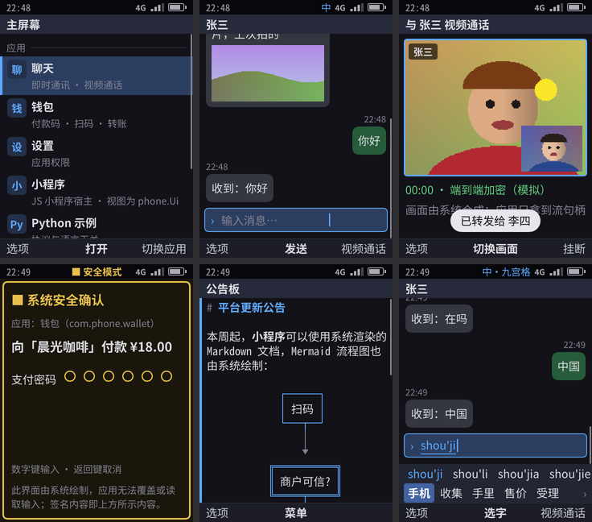
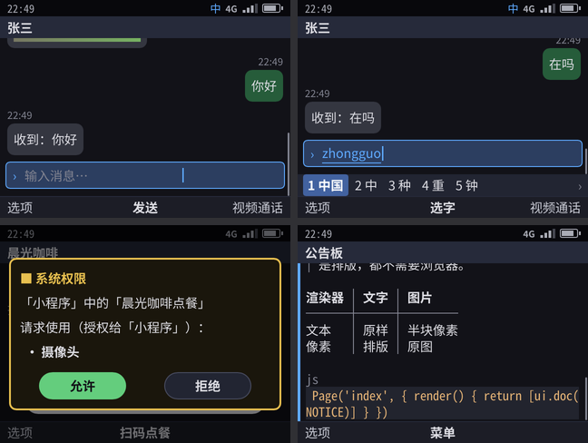
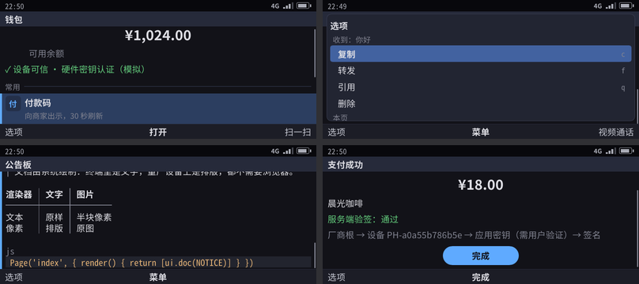
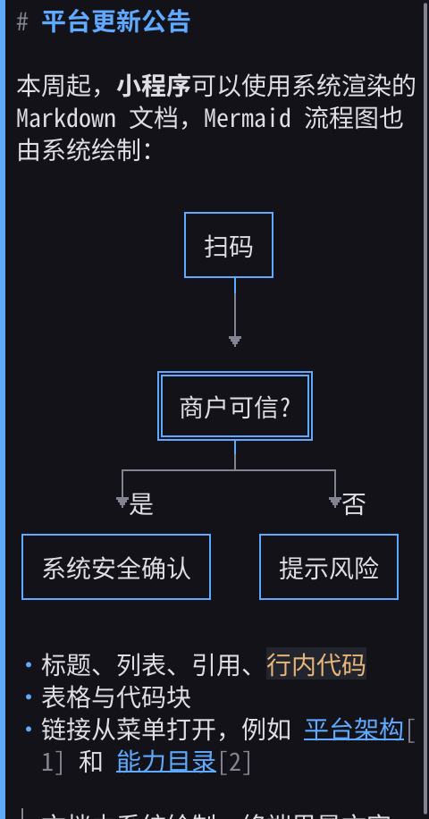
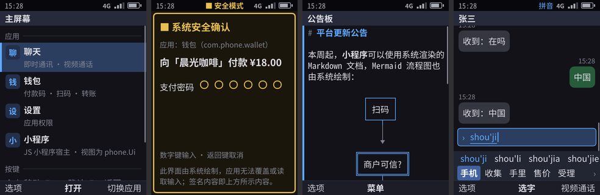
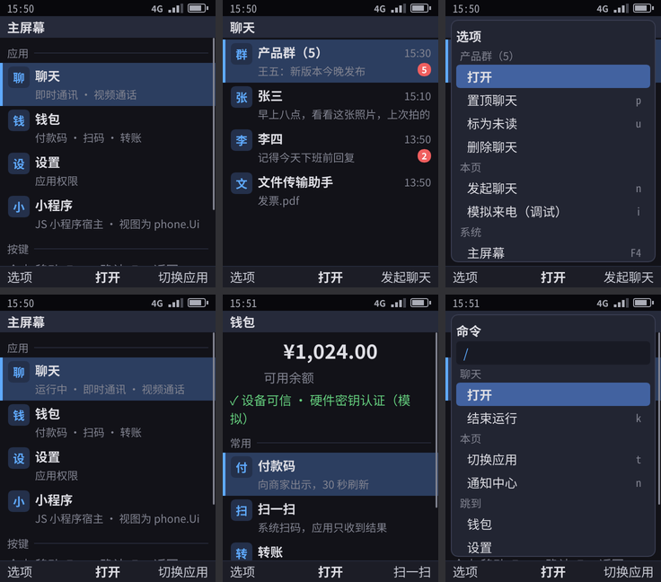

# GUI 架构（按键优先的像素界面）

为什么量产界面用像素渲染：[09-ui-feasibility-review.md](09-ui-feasibility-review.md)。按键语法与节点表：[10-keyboard-interaction-model.md](10-keyboard-interaction-model.md)。显示基础设施：[08-display-adaptive-refresh.md](08-display-adaptive-refresh.md)。Shell 和渲染器之间的协议规范：[23-renderer-protocol.md](23-renderer-protocol.md)。

## 1. 结构：一个核心，可替换的渲染器

```
应用 ──phone.Ui──► phone-shell（Go）：焦点 · 菜单 · 返回栈 · 输入法 · 系统界面 · broker
                        │  ├─► 文本渲染器（终端 / 串口 / SSH）
                        │  └─► 帧（JSON 行，stdin）──► 像素渲染器 ──► DRM/KMS
                        ◄────────── 按键（JSON 行，stdout）◄── evdev / libinput
```

- **Shell 的全部逻辑只在 Go 里保留一份**：焦点、菜单、返回栈、输入法、能力代理和系统界面。渲染器是纯粹的投影，所以系统界面的行为、安全规则和自测在文本和像素两种界面下完全一致。
- **像素渲染器是一个插槽**（`/usr/lib/phone/renderer`）。有两个实现，都在这个仓库里：设备上用 phone-paint，phone-gui 用来对照（换进插槽的镜像也能构建，§7）：

  | | phone-paint（设备默认） | phone-gui（对比用） |
  |--|--|--|
  | 实现 | 自研：tiny-skia 画图、ab_glyph 排字、drm 直接出图、evdev 读键 | Slint 1.18 软件渲染器，`backend-linuxkms-noseat` |
  | 许可 | Apache-2.0，依赖全是宽松许可证 | GPL-3.0-only（Slint 用它的 GPLv3 选项）：用来对照 phone-paint，不进设备镜像（58（内部文档） §3.3） |
  | 动效 | 焦点高亮渐变（120ms）、列表滚动缓动（140ms，ease-out；中途换目标从当前位置接着走），只在真屏幕上；截图是静止后的画面 | 焦点高亮渐变（120ms）、列表滚动缓动（140ms） |
  | 排版回报 | 每帧把节点的位置和高度报给 Shell（`layout`）；它是真屏幕时，超长节点「先滚动、再移焦点」按像素几何走（每次滚可视区的 80%） | 同样回报，几何取自 Slint 布局里每个节点的位置 |
  | 机身皮肤 | `--skin`：每张截图另存一张放进机身、带现代化九宫格或全键盘键区的 `.skin.png`（`make skins`，phone-paint 画，评审外观用；设计系统见 [26](26-design-system.md)） | — |

- **帧描述的是「屏幕上有什么」，不是「长什么样」**（`shell/frame.go`）：状态栏、标题、节点列表（带焦点）、软键、输入法候选、提示条、横幅、待机界面、最上层的系统界面（菜单、确认框、权限框、可信支付、扫码、来电）。只有系统自己解码或生成的像素才随帧发送，比如二维码、相册缩略图、媒体帧；应用永远不能发像素。
- **滚动按意图传递**：两种渲染器排版单位不同（字符行和像素），所以 Shell 发的是焦点、内容滚动比例，以及在超长焦点块里滚过的比例，渲染器按自己的排版换算，并保证焦点可见。渲染器报了排版几何、而且它就是屏幕时，「焦点块是否超长、每次滚多少」也按它的像素几何算。
- **telephonyd**（C++23）是独立的系统服务，Shell 经 Unix 套接字访问它（[04](04-ui-language-telephonyd.md)）；渲染器不接触任何系统服务。

## 2. 设备形态

`shell/device.go`：

| 形态 | 物理像素 | 缩放 | 参照 |
|------|----------|------|------|
| `bar-t9` | 480×640 | 2× | Nokia 6300 / N73 / 8110 4G |
| `bar-qwerty` | 640×480 | 2× | Nokia E71 / E63 / E72 |
| `communicator` | 800×352 | 1.6× | Nokia E90 / 9300 / N900 |

面板的实际分辨率由渲染器在握手时报告，Shell 据此选形态；运行中面板变化时渲染器发 `display` 消息（[23](23-renderer-protocol.md) §3）。

## 3. 设计语言与渲染规则

- **TUI 风格**：文字优先、栅格对齐、高对比、焦点永远可见、没有隐藏手势。
- **字体**：正文用 Noto Sans CJK SC；文档和 Mermaid 图用 Noto Sans Mono CJK SC，中文正好占两格英文的宽度。Noto CJK 缺的字形（公式里的上下标、部分数学符号）由 DejaVu Sans 兜底。
- **文档按字符格排版**：Shell 用和终端相同的排版器，按设备的列数（32 / 43 / 69 列）给出每段文字的起始列，所以断行、中文禁则、Mermaid 图在两种界面下完全一致。
- **框线字符用矢量画**：─ │ ┌ ╔ ═ ╤ 等框线和 ▼ 等箭头不用字体字形，而在字符格里画线：细线 1px、粗线 2px，双线是一条带缝的 3px 实心带。CJK 字体里的框线是全角的，直接用字形会错位。
- **宫格**：主菜单的列数由 Shell 按屏幕决定（竖屏 3、4:3 横屏 4、宽屏 5），因为宫格里的上下左右移动在 Shell 里算；计算器是 4 列按键；聚焦宫格里某一格时，按格子所在的行滚动。
- **待机界面**：帧里的 `idle`（时间、日期、运营商、主动待机信息、提示）。渲染器画墙纸、大号时钟和信息行，不画标题栏；宽屏上时钟和信息左右并排；信息行按剩余高度决定显示几条。
- **中间软键**：`Screen.Center` 是页面上没有焦点时 OK 执行的动作（待机的「菜单」、录音页的「发送」）；输入框的中间软键显示它提交动作的名字（拨号框是「拨打」）。
- **应用图标**：宫格图块和系统列表项带 PNG 路径，渲染器读取并缓存；读之前检查文件 ≤ 512 KB、尺寸 ≤ 256×256。
- **录音指示**：状态栏中间的 `mid_kind: "mic"` 用橙色（警示色）。
- **安全画面**：付款码等安全节点在面板上正常显示，截图里显示为「安全内容 · 截图已遮挡」。
- **刷新率**：60Hz 基线；选 120Hz 屏时由 `phone-displayd` 做 60↔120 自适应（[08](08-display-adaptive-refresh.md)，**未实现**）。

## 4. 体验目标

- 每次按键到焦点移动的首帧：一帧内（按选定刷新率计）
- 静态界面不提交空帧
- 来电全屏 **< 100ms**
- 若采用 120Hz 屏：交互与动效 **120Hz + 1% low ≥ 110fps**（08 §7）

## 5. 运行方式

```bash
cd kario
make paint               # phone-paint，cargo build --release
make pixel-selftest      # 三种设备形态各跑一遍完整自测（phone-paint 画），PNG 写到 build/pixel/<device>/
make preview             # 浏览器里看像素界面、用键盘操作（http://127.0.0.1:8790）
make skins               # 每张截图再放进机身，build/skins/<device>/
make gui-selftest        # 同一套自测由 phone-gui 画，对照用
build/usr/bin/phone-shell --selftest --gui paint/target/release/phone-paint --device bar-t9 --pixel-dir out/
```

设备上（Yocto 配方 `phone-paint` 或 `phone-gui`，Rust 依赖按 `Cargo.lock` 由 bitbake 逐个下载并校验）：
- 内核参数 `phone.selftest=1`：开机自测时同时用像素渲染器出图，PNG 经串口传回主机。
- 内核参数 `phone.gui=1`：Shell 用 `--gui auto` 启动插槽里的渲染器，画到 virtio-gpu 屏上。

## 6. 截图

开发机（软件渲染，与设备同一份代码）：

| 直板九宫格（480×640） | 直板全键盘（640×480） | 横屏宽键盘（800×352） |
|:--:|:--:|:--:|
|  |  |  |

Mermaid 流程图（框线为矢量绘制，双线框是判断节点）：



设备上（AArch64 QEMU，开机自测时无头渲染）：



设备上的显示链路（AArch64 QEMU，内核参数 `phone.gui=1`）：渲染器用 DRM/KMS 画到 480×640 的 virtio-gpu 屏；从 QEMU 监视器按下 USB 键盘的键，渲染器读到后转给 Shell；监视器 `screendump` 截取的是真实帧缓冲。依次为：开机主屏 → OK 打开聊天 → Tab 选项菜单 → 回到主屏（聊天显示「运行中」）→ ↓ OK 打开钱包 → `/` 命令面板。



## 7. 实测与经验

| 项 | 值 |
|----|----|
| 自测（开发机） | 两个渲染器、三种形态都跑完整自测，每个 snap 步骤生成一张 PNG |
| 设备（QEMU AArch64） | 两种镜像都在开机自测时出图；DRM 模式下计算器、通话都能操作 |
| 字体 | Noto Sans CJK 常规 + 粗体 OTC，共 40 MB（设备上可换成只含简体中文的子集） |
| 设备上踩过的坑 | ① 机器配置会覆盖 local.conf 里的显示分辨率，要用 `:forcevariable`；② tty1 上的 getty 抢屏，服务里加 `Conflicts=getty@tty1.service`；③ phone-gui 缺 `xkeyboard-config` 时 xkbcommon 建不了键盘映射；④ dumb buffer 写完要调 DirtyFB，否则 virtio-gpu 不刷新 |

## 8. 还没做

| 项 | 说明 |
|----|------|
| GPU 渲染 | QEMU 没有 virgl，需要真机；先确认软件渲染在目标 SoC 上能否稳定 60Hz |
| 媒体零拷贝（续） | 像素已经从 mediad 经共享内存直接到渲染器（[23](23-renderer-protocol.md) §4.2，两个渲染器都是）；量产改用 dmabuf 上 DRM 平面，要真机 |
