# 代码原型：phone.Ui + TUI Shell + 超级应用样例

> 状态：**原型**，在开发机和 Yocto 镜像（QEMU）上做了自动化端到端验证（§5）。哪些部分是模拟的见 §6。架构见 [11](11-platform-architecture.md)，能力目录见 [12](12-super-app-capabilities.md)。

## 1. 是什么

[kario 仓库](../) 是一个可运行的平台原型：

- **phone-shell**：文本渲染器 + 焦点 / 菜单 / 返回栈 + 系统 UI（权限、可信确认、扫码、来电、符号表）+ 能力 broker + 后台冻结。
- **像素渲染器**：phone-paint（设备上的渲染器，自研，Apache-2.0）和 phone-gui（Rust + Slint，GPL-3.0-only，对照用），画 Shell 发来的帧；三种诺基亚式形态（[06](06-gui-architecture.md)、[18](18-nokia-form-factors.md)、[23](23-renderer-protocol.md)）。
- **phone-sandbox**：应用启动器，施加命名空间、独立 uid、Landlock、seccomp、rlimit 后再启动应用（[17](17-app-sandbox.md)）。
- **系统服务**：
  - `phone-mediad`：相机、通话媒体、扫码。
  - `phone-keystored`：设备 / 应用密钥、设备认证、用户确认签名。
  - `phone-audiod`：混音、音频焦点、系统提示音（[20](20-audio.md)）。
  - `phone-imed`：输入法引擎和用户词库，词库从 `share/phone/ime.dict` 映射进内存；它崩溃时 Shell 用内置引擎接着打字（[16](16-input-method.md) §1）。
  - `phone-pushd`：整机一条推送长连接，另有模拟云端网关 `phone-pushgw`（[21](21-push.md)）。
  - `phone-displayd`：屏幕刷新率，60 ⟷ 120 Hz 自动切换（按键、动画、前台应用的提示、视频的帧率、设置、电量和温控的封顶），渲染器按它切换显示模式；开发机和自测里是模拟的 60/120 Hz 屏（[08](08-display-adaptive-refresh.md)）。
  - `phone-smsd`：短信和彩信的存储、会话（含群聊）、来电和短信共用的拦截名单、送达状态、验证码、闪信和紧急警报记录；收到的短信由 telephonyd 留着，smsd 存好确认后才放手；彩信经彩信接入点从彩信中心收发（MVP，[32](32-messaging.md)）。
  - `phone-chatsrv`：模拟的鸿雁服务器，代表应用厂商的云端。鸿雁的消息和来电由它经推送送达，鸿雁本身不常驻。
  - `phone-storesrv`：模拟的商店后台，用的是商店后台的开源核心 `appstore`：开发者注册、自动审核、签名目录、下载、崩溃报告、举报（[07](07-ecosystem-and-store.md) §4.1）；开发者工具 `phone-pkg`。
  - 系统服务在镜像里是一个程序 `kario-system`，各服务的名字是指向它的链接（[25](25-system-update.md) §3）。
- **phone-telephonyd**（C++23）：通话、短信收发和小区广播、网络状态；模拟基带后端（[04](04-ui-language-telephonyd.md)）。
- **二十个应用**：电话（智能拨号、通话记录、通话界面）、短信、闹钟（系统按时响铃）、计算器、日历（TypeScript 的系统应用：月历、农历和节气、重复日程、系统的定时通知做提醒、导入导出 `.ics`，[19](19-core-apps.md) §1）、音乐（后台播放）、相机（系统取景框）、图片（系统相册）、天气（后台刷新、待机小组件）、浏览器（网页视图）、应用商店（目录、增量更新、充电时自动更新）、鸿雁（类微信示例，含视频通话）、飞钱（类支付宝示例，含付款码、扫码付款、转账）、卡包（系统应用，管 NFC 卡，[30](30-nfc.md)）、设置（系统应用，管权限、Wi-Fi、蓝牙、沙箱自检）、小程序（JS 小程序宿主，内置 3 个小程序）、贪吃蛇（画布应用示例）、Python 示例（不用 SDK 直连协议）、C++ 示例（C 接口）、TypeScript 示例（kario build 编译，kario-jsrt 运行，[29](29-app-development.md)）。
- **Wi-Fi 与蓝牙**：Shell 经系统总线管 iwd 和 BlueZ；开发机上是模拟的网络和设备（[11](11-platform-architecture.md) §16）。
- **VPN**：WireGuard，配置从「文件」导入，也可以用手机自己生成的密钥对；设备上 Shell 写 systemd-networkd 的文件来建隧道，开发机上是模拟的隧道；始终开启、屏蔽未使用 VPN 的连接、按应用走或不走 VPN 经按应用防火墙（[11](11-platform-architecture.md) §16）。
- **通讯录和日历同步**：Shell 里的 CardDAV 客户端（`carddav/`），通讯录和 Kario 账号、其他 CardDAV 服务器（iCloud、Nextcloud、Fastmail）的几本通讯录双向同步（邮箱、地址、照片、群组都同步），在设置 › 账号里登录几个账号；其中一个账号上打开「日历」，Shell 里的 CalDAV 客户端（`caldav/`）经系统的收件箱、发件箱和日历应用双向同步日程（[19](19-core-apps.md) §1.1；和真的服务器的互通**未验证**）。
- **开机动画、待机界面与主菜单**：开机进入诺基亚式待机界面，OK 打开主菜单宫格；待机时直接按号码拨号，全键盘上打字即搜索；主菜单里数字键 1–9、`*` `0` `#` 直达第 1 到 12 格；应用图标是原创图片（[18](18-nokia-form-factors.md) §5.1）。
- **Markdown 文档节点**：系统渲染，不用浏览器；其中的 Mermaid 图画成字符框图，代码块按语言着色，公式转成 Unicode 文本（[14](14-tui-route-and-app-framework.md) §6、§8.1、§8.2）。
- **系统输入法**：全键盘 / 九宫格，中英文候选、联想、标点、输入框键盘类型（[16](16-input-method.md)）。
- **TypeScript 小程序**：`app.ts` / `app.tsx` 加载时去类型，JSX 编译成产出 `phone.Ui` 节点的 `h()` 调用；`phone.d.ts` 供开发时类型检查（[14](14-tui-route-and-app-framework.md) §8.4）。
- **沙箱**：所有应用经 `phone-sandbox` 启动；开发机上只有无需 root 的层（seccomp、rlimit），设备上全部生效。
- **Yocto 层** `meta-phone`：Wrynose 6.0 LTS，qemuarm64，systemd。

## 2. 截图

由自测自动生成（[tools/snap2png](../tools/snap2png/) 把快照转成 PNG）。付款码是安全画面，截图里被系统遮挡。

| 主屏幕 | 聊天 | 消息菜单（= 长按） |
|:--:|:--:|:--:|
| 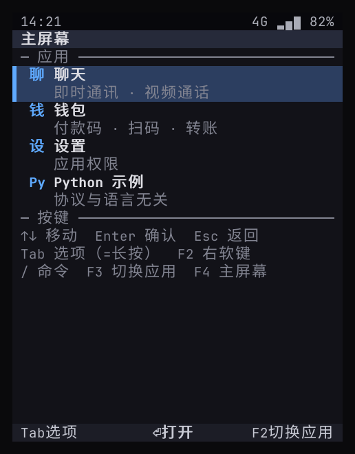 | 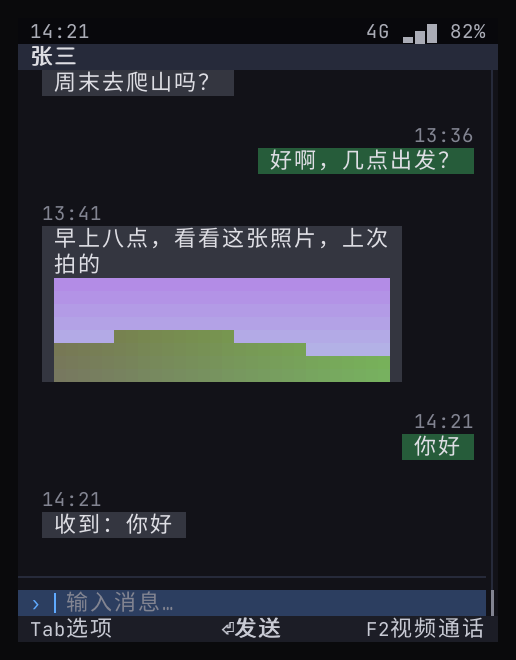 | 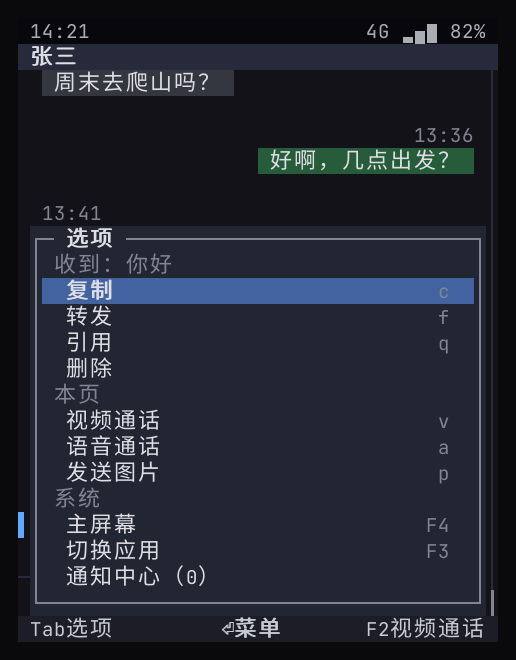 |

| 系统授权 | 视频通话（远端 + 本地画中画） | 来电（应用在后台） |
|:--:|:--:|:--:|
| 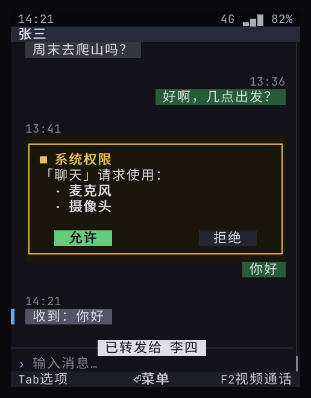 | 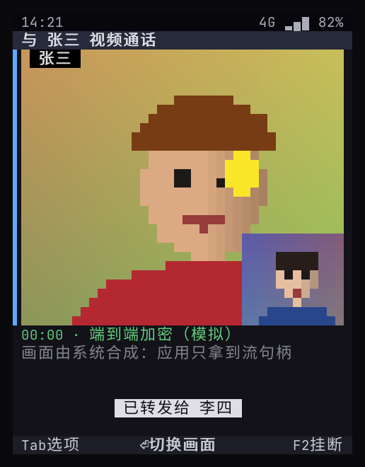 | 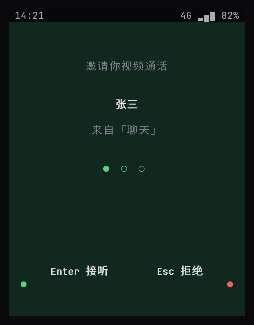 |

| 钱包（设备可信） | 付款码（截图被遮挡） | 系统扫码 |
|:--:|:--:|:--:|
| 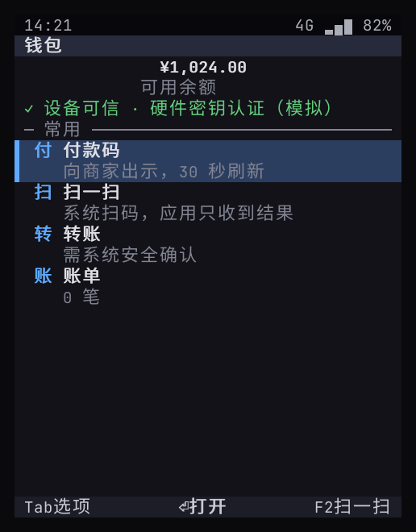 | 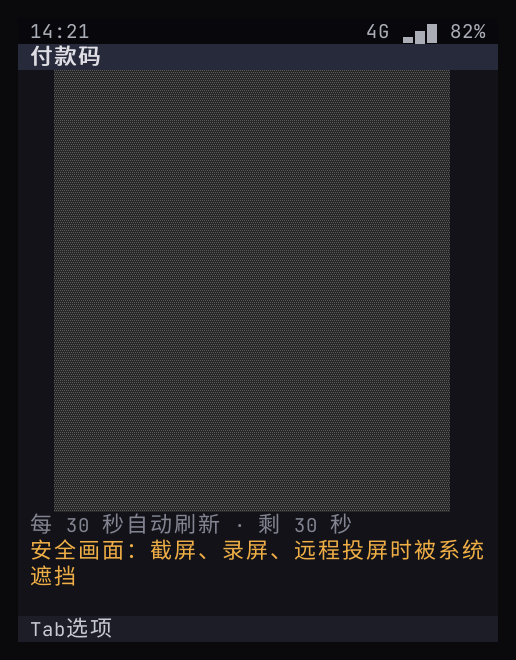 | 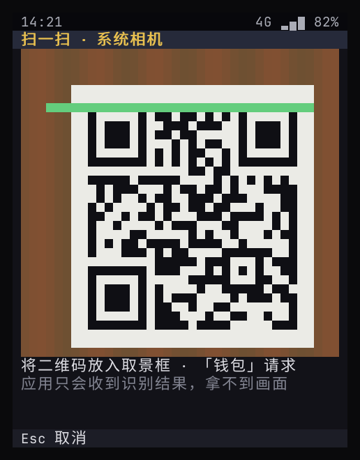 |

| 系统安全确认 | 支付成功（服务端验签通过） | Markdown 文档节点 |
|:--:|:--:|:--:|
| 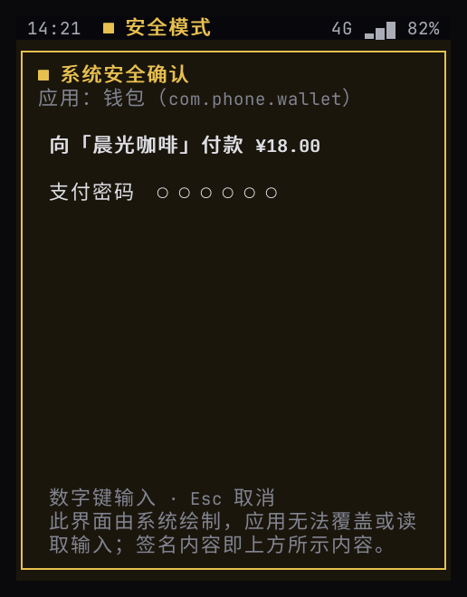 | 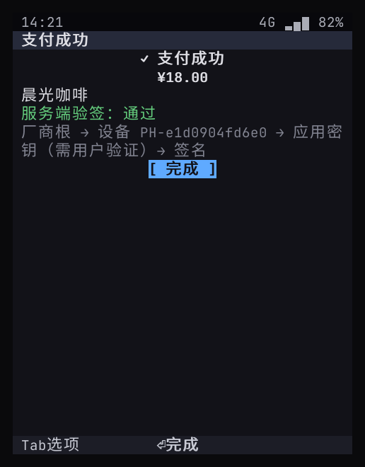 | 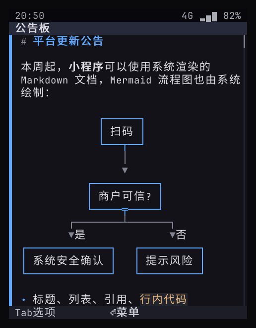 |

| 小程序请求授权（标注来源） | 小程序支付（系统安全确认标注来源） |
|:--:|:--:|
| 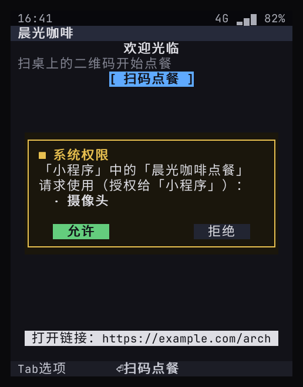 | 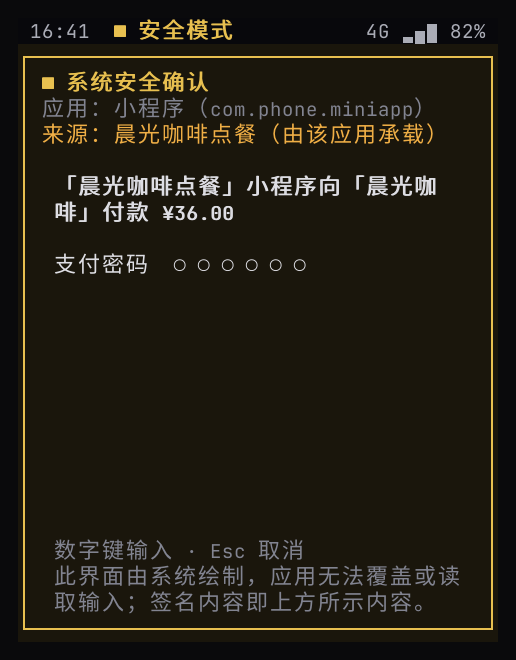 |

| 输入法：全键盘拼音 | 输入法：九宫格拼音 | 输入法：英文补全 |
|:--:|:--:|:--:|
| 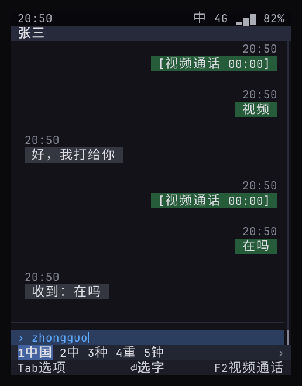 | 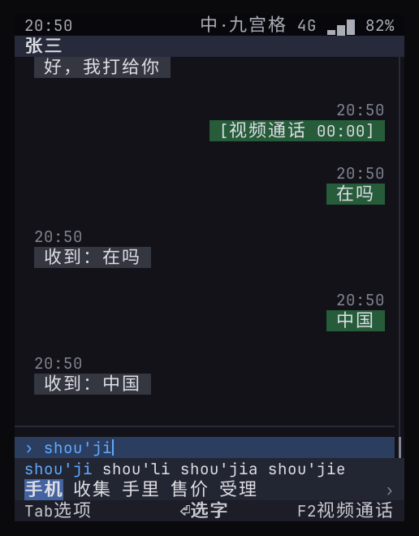 | 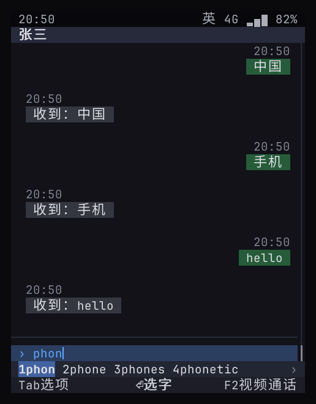 |

像素渲染器（phone-gui，同一个自测场景，三种形态）：

| 直板九宫格 480×640 | 直板全键盘 640×480 | 横屏宽键盘 800×352 |
|:--:|:--:|:--:|
| 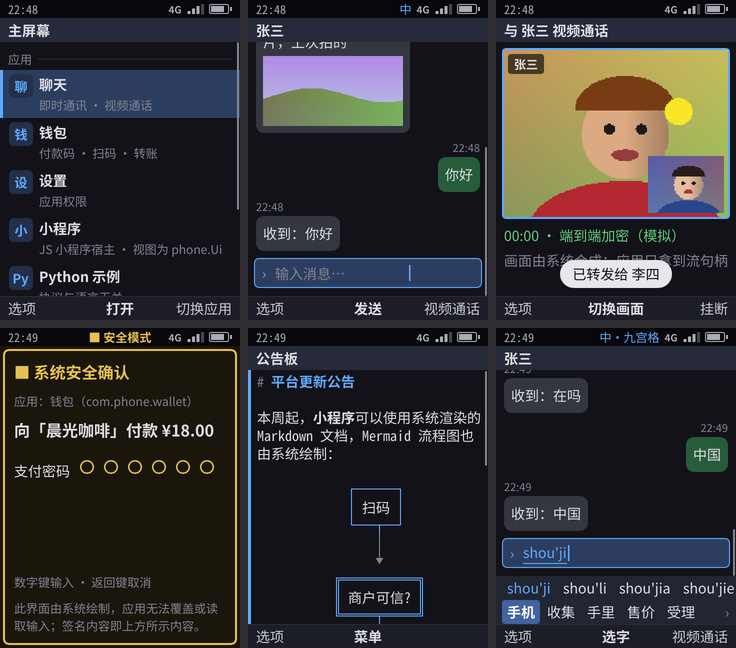 | 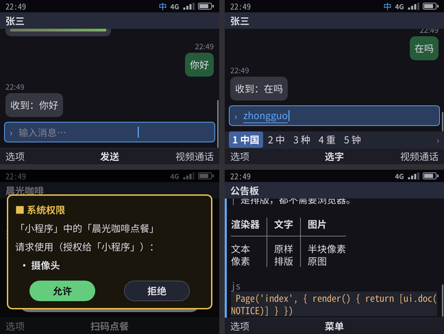 | 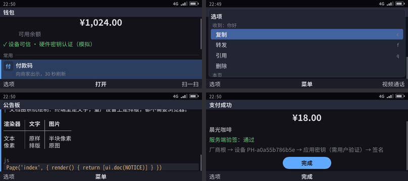 |

## 3. 目录

```
kario/
├── ui/              phone.Ui v0 协议类型 + 能力目录
├── wire/            JSON 行帧格式、服务 RPC、fd 传递（SCM_RIGHTS）
├── canvas/          单元格画布：CJK 双宽字符、真彩色、半块像素、安全画面遮挡
├── shell/           Shell：渲染、焦点 / 菜单 / 返回栈、系统 UI、broker、内置自测脚本
├── ime/             输入法引擎：拼音 / 九宫格 / 英文候选、联想、诺基亚式多击；data/ 为 AOSP 词库，构建时编成映射用的 share/phone/ime.dict
├── sandbox/         应用沙箱：Landlock、seccomp、命名空间、rlimit（cmd/phone-sandbox 是启动器）
├── paint/           phone-paint：设备上的像素渲染器（Rust：tiny-skia、ab_glyph、DRM/KMS、evdev；设计系统在 src/design.rs；input.rs 是接收插拔键盘鼠标的特权助手，touch.rs 读触摸屏；gpu.rs、gbm.rs 是可选的 GLES 2 合成和 GBM 上屏）
├── hal/             硬件层：主线内核设备类上的一层薄封装（LED、背光、电源、USB 设备模式），用哪一个由 SKU 配置决定，每类有模拟后端
├── obex/            OBEX：蓝牙传文件（Object Push）、电话本的服务端和客户端（PBAP）、短信的客户端（MAP），跑在 BlueZ 交来的 RFCOMM / L2CAP 连接上；btphone/ 是模拟的旧手机，给测试和自测用
├── contacts/        通讯录：Shell 的联系人存储（整份原子写、0600），vCard 2.1 / 3.0 / 4.0 的读写（有模糊测试）
├── carddav/         CardDAV 客户端：发现（RFC 6764）、sync-collection（或比 ETag）的双向同步、冲突的合并规则（文档 19 §1.1）；davtest/ 是内存里的 CardDAV 服务器，给测试和自测用
├── switchrecv/      换机协议 kario-switch/1 的接收端（文档 36）；oldphone/ 是照协议另写的旧手机一侧，给测试和自测用
├── i18n/            界面文字的翻译：代码里是英文，locale/<语言>.json 里是译文（默认 zh-Hans）
├── gui/             phone-gui：对照用的像素渲染器（Rust + Slint，GPL-3.0-only；ui/phone.slint、src/main.rs）
├── media/           媒体平面：帧格式、订阅、合成画面源；qrscan/ 扫码的解码器（在 mediad 里跑）
├── keystore/        密钥服务逻辑 + 服务端验证库
├── gm/              国密：SM3 摘要、SM2 签名（软件实现，量产进 TEE）
├── sdk/             Go 应用 SDK；sdk/c 是 C ABI SDK（phoneui.h）和 C++ 示例，sdk/c/include/kario_native.h 是原生模块的接口；sdk/ts 是 TypeScript 应用的类型 @kario/sdk（ui.d.ts 由 tools/tsgen 从 ui/ 生成）
├── jsrt/            kario-jsrt：TypeScript 应用的运行时（C：QuickJS-ng 加 kario 模块，经 sdk/c 讲协议；src/native.c 加载原生模块）；Go 包 jsrt 是安装器和商店共用的检查
├── telephonyd/      phone-telephonyd（C++23，CMake）：事件循环、模拟基带、通话记录、smsd 还没确认的短信
├── audio/           音频：混音器、焦点策略、合成音源、共享内存环形缓冲区、模拟麦克风（cmd/phone-audiod 是服务）
├── push/            推送：消息格式、网关令牌（cmd/phone-pushd 设备服务，cmd/phone-pushgw 模拟网关）
├── programs/        系统服务的代码，每个一个包（shellcmd · pushd · keystored · imed · audiod · mediad · nfcd · smsd · displayd · sandboxcmd · ctsverify）
├── cmd/             kario-system（系统服务合成的一个程序）· 各服务单独的开发版 phone-shell 等 · phone-imedict（构建时编词库）· phone-pushgw · phone-chatsrv（模拟鸿雁服务器）· phone-storesrv（模拟商店后台）· phone-pkg（开发者工具）· kario（TypeScript 应用的 new / build / package，内嵌 esbuild）· phone-provision · phone-cts-verify · phone-ota-verify
├── appstore/        商店后台的开源核心（目录、审核、下载、吊销、举报；正式后台在它上面扩展）
├── ota/             系统更新的协议：latest.json 的签名、手机的回报（签名、一天后的回报）；同样签名下发的节假日日历的格式；增量包（delta）、dm-verity（verity）
├── apps/            dialer · messages · contacts（通讯录）· clock · calc · calendar（日历，TypeScript）· music · camera · gallery · weather · store · browser · chat（鸿雁）· wallet（飞钱）· settings · miniapp（JS 小程序宿主 + programs/）· snake（画布应用示例）· hello-py
├── shell/doc.go     Markdown 文档节点渲染
├── shell/mermaid.go Mermaid 图（内嵌 lovely-mermaid，goja 运行）
├── shell/imebar.go  输入法接入：目标输入框、候选栏、句首自动大写
├── shell/textedit.go 输入框的光标、选中、复制粘贴、撤销；listkeys.go 列表里按字母跳转、开头结尾翻页、输入语言菜单
├── shell/frame.go   给像素渲染器的帧；gui.go 驱动 phone-gui；device.go 设备形态
├── shell/freeze.go  后台冻结；symbols.go 系统符号表
├── shell/telephony.go 订阅 telephonyd、系统来电界面；broker_phone.go 电话 / 闹钟能力
├── shell/contacts.go 通讯录：存储、写入前的系统确认、从「文件」导入和导出 vCard、蓝牙收到的名片
├── shell/airplane.go 飞行模式和移动数据；radios.go Wi-Fi 和蓝牙；btobex.go 蓝牙传文件和电话本；hotspot.go 个人热点；switch.go 从旧手机迁移（switch_bt.go 经蓝牙）；vpn.go VPN
├── shell/airplane.go 飞行模式、移动数据和数据漫游；apn.go 接入点；cellnet.go 移动网卡的地址；radios.go Wi-Fi 和蓝牙；btobex.go 蓝牙传文件和电话本；hotspot.go 个人热点；switch.go 从旧手机迁移；vpn.go VPN
├── shell/contacts.go 通讯录：存储、写入前的系统确认、从「文件」导入和导出 vCard、蓝牙收到的名片；accounts.go 通讯录的账号和同步
├── shell/airplane.go 飞行模式和移动数据；radios.go Wi-Fi 和蓝牙；btobex.go 蓝牙传文件和电话本；hotspot.go 个人热点；switch.go 从旧手机迁移；vpn.go VPN
├── vpn/            WireGuard 配置的解析和检查、systemd-networkd 的文件、netlink（握手、路由、自测的命名空间里的服务器）
├── shell/messaging.go 订阅 phone-smsd：短信通知（复制验证码）、紧急警报界面、短信能力
├── shell/alarm.go   系统闹钟服务；grid.go 宫格；boot.go 开机动画
├── shell/audio.go   接入 audiod：系统声音、应用播放；push.go 推送分发、唤醒预算、后台启动
├── shell/media.go   系统相册（照片、缩略图、访问规则）；photo.go 系统取景框与照片选择器
├── shell/sandbox.go 每应用独立 uid
├── scripts/stage.sh 按设备目录布局安装（开发构建与 Yocto 配方共用）
├── tools/snap2png/  快照转 PNG（文档用，独立 Go 模块）
├── tools/tsgen/     从 ui/ 和 i18n/ 生成 sdk/ts/ui.d.ts、jsrt/src/languages.h（过期时 make test 失败）
├── tools/imedict/   从 AOSP 词表生成输入法词库
├── tools/icons.py   画系统应用的图标（apps/*/icon.png）
├── tools/cratesinc.py 由 Cargo.lock 生成 bitbake 的 crate 下载清单
├── tools/gomodinc.py 由 go.mod、go.sum 生成 bitbake 的 Go 模块清单（make gomods；make yocto-src 发现过期就重新生成）
├── scripts/doctor.sh 查这台机器缺什么（make doctor；make yocto-doctor 只查设备镜像）；yocto-jobs.py 按处理器和内存定构建的并发
└── yocto/           kas 配置、meta-phone 层、QEMU 自测脚本、源镜像并行下载脚本
```

## 4. 运行

```bash
cd kario
make run             # 在终端里交互（终端建议 ≥ 44×27，会画出手机外框）
make preview         # 像素界面在浏览器里：http://127.0.0.1:8790，键盘就是手机按键
make selftest        # 端到端自测，16 个处理器以上各段同时跑（SELFTEST_PARTS=0：整份串行），快照写到 build/snapshots/，和 shell/testdata/snapshots/ 里的基线比对（不同的用例失败，差异写在 build/snapshots/diff/），JUnit 报告 build/selftest-junit.xml
make selftest ONLY='视频'   # 只跑名字匹配的用例
make selftest-baselines     # 改了界面之后：把这次的文字快照记成基线（看过 git diff 再提交）
make test            # go vet + go test
make yocto-doctor    # 只查设备镜像要的：缺一样就标 MISS，以 1 退出
make yocto-build     # 构建 Yocto 镜像（首次数小时，之后增量）
make yocto-selftest  # QEMU 启动镜像，开机自测，打印结果后自动关机；脚本分段在几个模拟器里同时跑，结果合起来看（SELFTEST_VMS=N 定最多几个，1 是整份脚本一个模拟器）
make yocto-selftest ONLY='蓝牙'   # 只为开发：只跑名字匹配的用例（十六进制放在内核命令行的 phone.selftest-only= 里），整份脚本一个模拟器，不查声音和兼容报告，fd store 检查也只跑 `fdstore.script` 里名字匹配的用例（一个都不匹配就不判），只看用例
make yocto-selftest ONLY='蓝牙' SELFTEST_ENV='名字=值'   # 只为开发：给镜像里的 phone-shell 设环境变量（十六进制放在 phone.selftest-env= 里），用例的 require-env 要的就这样给
python3 yocto/btvirt-test.py   # btvirt（模拟器的虚拟蓝牙控制器）带上层里的 BlueZ 补丁，在开发机上用 AddressSanitizer 跑；--unpatched 跑原版（会失败）
make yocto-run       # QEMU 交互：串口登录 root，输入 phone
make yocto-vnc       # QEMU 开机进像素界面，经 VNC（127.0.0.1:5900）操作，见 §4.1
make paint           # 编译像素渲染器 phone-paint（cargo build --release）
make pixel-selftest  # 三种形态同时跑自测（phone-paint 画，32 个处理器以上每种的各段也同时跑，PIXEL_PARTS=0：每种整份串行），PNG 写到 build/pixel/<形态>/，和像素基线（每张一个哈希）比对，不同的在 build/pixel/<形态>/diff/ 里画出差异；每种形态的输出在 build/pixel/<形态>.log，跑完后按形态打出来
make pixel-baselines # 把这次的像素哈希记成基线，PNG 留在 build/pixel-baseline/<形态>/，以后画差异用
make gui-selftest    # 同样的自测由 phone-gui 画，对照用
make yocto-gui       # QEMU：渲染器画到 virtio-gpu 屏，监视器注入按键并截屏
make yocto-gui-gpu   # 同样的按键，phone-paint 经 softpipe 在 GPU 路径上合成、中途出错，截屏和 CPU 的比（§5.1）
make telephonyd      # 只编译 telephonyd 并跑它的单元测试（make build 已包含）
make lsp             # 生成 C/C++ 的 compile_commands.json 并链到源码旁，IDE 能跳转（§4.2）
make skus            # 列出所有 SKU；每个 SKU 都是一个目标：make sku-<名字> 构建它的固件包
make yocto-stress    # 1 GB 的 web 镜像上反复用短信、鸿雁、图片、视频和浏览器，系统必须始终可用（§5.1）
```

| 键 | 作用 |
|----|------|
| ↑ ↓ ← → | 移动焦点；有字的输入框里 ← → 移动光标 |
| Shift + 方向键，Home / End，PgUp / PgDn | 输入框里选字、到开头 / 结尾；列表里到第一项 / 最后一项、翻页；系统的菜单、选择器、分享面板和符号表里到第一项 / 最后一项（[18](18-nokia-form-factors.md) §4.2） |
| Delete，Alt + 退格 | 删光标后的字；删光标前的一个词 |
| Ctrl + X / V / A / Z | 剪切、粘贴、全选、撤销（复制在选项菜单里） |
| Enter | OK（主动作） |
| Esc | 返回 |
| Tab | 选项菜单（= 长按；F1 同） |
| F2 | 右软键 |
| F3 / F4 | 切换应用 / 主屏幕 |
| F6 或 Ctrl+空格 | 输入法中 / 英切换（九宫格模式下用 `#`） |
| F7 | Chr / Sym：系统符号表（九宫格模式下用 `*`） |
| Alt + 键 | 长按（九宫格：长按数字输入数字，长按 `#` 切 123） |
| `/` | 命令面板 |
| Ctrl+C | 退出 |

`phone-shell --device bar-t9`（或 `--keypad t9`）模拟九宫格：2–9 输入拼音或英文，`0` 分隔音节 / 空格，`*` 下一个匹配或符号表，`#` 切换 拼音 → 智能英文 → Abc → abc → ABC，长按 `#` 切 123（[18](18-nokia-form-factors.md) §3）。

钱包的支付密码是原型默认值 **123456**。连续输错 5 次锁定（删除 `~/.local/state/phone-sim` 重置）。

### 4.1 亲手体验

**A. 终端里的文本界面**（最快，不用构建镜像）：

```bash
cd ~/code/kario-os/kario
make run                                      # 直板全键盘
build/usr/bin/phone-shell --device bar-t9     # 直板九宫格
```

按键见上表，另外 F5 是通话键（绿键），F4 是挂断 / 回待机（红键）。网页节点在这里只显示标题、地址和焦点，页面本身要像素界面。

**A2. 浏览器里的像素界面**（不用构建镜像、不用 VNC）：`make preview`（phone-paint 画），打开 `http://127.0.0.1:8790`；远程机器上先 `ssh -L 8790:127.0.0.1:8790 <机器>`。网页上的键盘和按钮就是手机按键。

**B. 设备镜像的像素界面**（QEMU 里开机，经 VNC 操作）：

1. 要有镜像：`make yocto-build`（构建过就跳过）。要体验网页视图，改成 `make yocto-web-build`；`yocto-vnc` 启动的是最后一次构建的镜像。
2. `make yocto-vnc`：QEMU 开机直接进像素界面，约 2 分钟（在 x86 上软件模拟 ARM，比真机慢得多）。
3. 把服务器的 5900 端口转到自己电脑：Cursor 的「端口」面板里转发 5900，或者 `ssh -L 5900:127.0.0.1:5900 <服务器>`。
4. 用 VNC 客户端（RealVNC Viewer、TigerVNC 等）连 `localhost:5900`，先点一下画面让它接收键盘。
5. 键：方向键、Enter = OK、Esc = 返回、Tab = 左软键「选项」、F2 = 右软键、F5 = 通话键、F4 = 挂断 / 回待机、F3 = 切换应用。形态是直板九宫格：数字键 2–9 打拼音，`#` 切换输入方式，`*` 选候选或符号。
6. 结束：在运行 `make yocto-vnc` 的终端里按 Ctrl+A 再按 X。镜像以快照方式启动，改动不保留。

**C. 截图集**（不用交互）：`make skins` 把自测的每一步画成带机身的图（`build/skins/<形态>/`）；`make web-selftest` 出网页视图的几张（`build/pixel-web/`）。

**建议走一遍**：

| 场景 | 怎么走 | 看什么 |
|------|--------|--------|
| 打电话（模拟基带） | 待机直接按 `10086`，通话键拨出，挂断键挂断 | 拨号、通话中、通话记录 |
| 鸿雁聊天 | `/` 输入「鸿雁」回车，进张三的会话，发「文章」 | 输入法、消息气泡、推送 |
| 公众号文章 | 选中张三回的链接：OK 是阅读模式；「选项」里选「网页」看原样网页（像素界面） | 方向键在链接间移动，「分享这篇文章」弹系统分享面板 |
| 网页表单（web 镜像） | 给张三发「搜索」，用「网页」打开 | 「清空记录」弹系统确认框；文本框打字；下拉框弹系统菜单；OK 提交 |
| 视频通话 | 给张三发「视频」，他会打回来，通话键接听 | 来电界面、通话中的画面 |
| 支付 | 打开「飞钱」：付款码、扫码付款，支付密码 123456 | 系统安全确认、安全画面在截图里被遮挡 |
| 命令面板 | 任何时候按 `/`，输入应用名或命令 | 不翻菜单直接到达 |
| 菜单文件夹 | 待机按 OK 进主菜单，进「工具」，按 `1` 直达计算器 | 诺基亚式分类：常用的在主菜单，工具、应用各在文件夹里；数字键直达 |
| 照片（JPEG） | 主菜单 › 图片 | 8 张公有领域的真实照片排成网格，只有图没有字；OK 看大图，← → 翻页，选项 › 详细信息看尺寸和 `image/jpeg` |
| 壁纸 | 看大图时选项 › 设为壁纸 › 待机和锁屏；挂断键回待机；左软键再按 `*` 锁键盘 | 待机和锁屏都是这张照片，文字白色、上面压一层渐变；设置 › 壁纸能恢复默认 |
| 本地视频 | 图片里带「▶ 0:15」的那格（示例：湿地），OK | 系统解码播放（像素界面看画面，文本界面是半块像素），OK 暂停 / 继续，← → 跳 5 秒，返回键关掉 |
| Mermaid | 主菜单 › 应用 › 小程序 › 公告板 | 系统画的 Markdown 文档：Mermaid 流程图、表格、代码高亮、公式 |
| 主题 | 设置 › 主题 › 复古绿（或浅色、琥珀） | 整个界面换配色，照片不变 |
| 浏览器（web 镜像） | 主菜单 › 浏览器，输入网址或搜索词 | 地址栏、书签、页内查找（`s`）、放大缩小（`+` `-`）；网页里的下载进「文件」 |
| 设置 | 「设置」里的应用权限、流量、声音（← → 调音量）、SIM 卡锁（PIN 码 1234）、沙箱自检 | 权限能撤销；PIN 码在系统界面输入；设备上沙箱自检全部符合预期 |

哪一步按键不顺、找不到入口、或者觉得非要触屏不可，记进一周自用记录（57（内部文档） R9）。

### 4.2 在 IDE 里读代码（LSP）

| 语言 | 语言服务器 | 要什么 |
|------|------------|--------|
| Go | gopls | 仓库根的 `go.mod`，不用生成；内部仓库 `make server` 在根目录链一个 `go.work`（指向 `build/go.work`），服务端代码能跳进开源仓库 |
| C / C++（telephonyd、sdk/c） | clangd | CMake 导出的编译命令：`make build`（或只要 `make lsp`，不编译）把 `build/telephonyd/compile_commands.json`、`build/capi/compile_commands.json` 链到 `telephonyd/`、`sdk/c/` 下，`make lsp` 另在根目录放一份合并的 |
| Rust（paint、gui） | rust-analyzer | 各自的 `Cargo.toml`，不用生成（第一次打开时它自己下载依赖） |

链接和合并的文件都在 `.gitignore` 里。编译器换了（`CXX23`、`CC14`）重跑一次 `make lsp`。

## 5. 验证结果

当前的用例数和结果见 57（内部文档）「当前验证基线」；本节说明每个环境验证什么。

| 环境 | 结果 |
|------|------|
| 开发机（Rocky 8.10 x86_64，Go 1.25，GCC 14，非 root） | `make selftest` 全部通过（root 专用的沙箱、cgroup 用例自动跳过），各段同时跑约 3 分钟、整份串行约 18 分钟（229 个用例，2026-11-25），两种跑法的文字快照都和 `shell/testdata/snapshots/` 里的基线一致（[40](40-testing.md) §2）；`go test -race ./shell` 也通过（[40](40-testing.md) §7）；`make cts` PASS：所有用例通过，每个能力都被调用过（[22](22-developer-api.md) §11）；`make build` 时还会跑 telephonyd 的 C++ 单元测试 |
| 像素渲染器（`make pixel-selftest`，由 phone-paint 画） | 每个 snap 步骤一张 PNG（界面截图见 [19](19-core-apps.md) §2）；最后一行 `PHONE-GUI-MOTION:` 报告 phone-paint 按实时显示的画法每步多久（只报告不判定，[37](37-motion.md) §5；设 `PHONE_PAINT_GPU=1` 时报告 GPU 路径的，开发机上是 Mesa 的 llvmpipe）；PNG 和像素基线（每张一个哈希）比对，基线还没记下，见 [40](40-testing.md) §7 |
| 两个渲染器（phone-paint：`make pixel-selftest`、`make yocto-selftest`、`make yocto-gui`；phone-gui：`make gui-selftest`，镜像加 `KASEXTRA=yocto/kas/phone-gui.yml`） | 同一套自测在两个渲染器、三种形态下全部通过，包括渲染器被杀掉后由看门狗重启；设备上两种镜像的开机自测、兼容测试、DRM 上屏都通过 |
| `make test`（许可证检查 + go vet + 单元测试 + 端到端） | 通过；密钥测试覆盖篡改金额、他人密钥、非本厂商根设备、PIN 锁定、nonce 重放、路径穿越；画布测试覆盖中文禁则；输入法测试覆盖全拼、简拼、部分上屏、九宫格、英文；Mermaid 测试覆盖 9 种图 |
| 模糊测试（`make fuzz`，[17](17-app-sandbox.md) §9） | 50 个目标（现在 `make fuzz` 有 69 个，后加的短信备份 XML 的 `smsbackup` 跑了 1.5 分钟，后加的 `location`、kario-jsrt 的 WebSocket 帧（C，ASan、UBSan）和扫码的 `media/qrscan` 各单独跑了 5 分钟、日历的 `.ics` 解析跑了 1 分钟、从旧手机经蓝牙迁移的 `obex` 的 `FuzzOldPhone`、`FuzzParsers` 跑了 5 分钟、6 分钟，OBEX 认证的 `FuzzAuth` 5 分钟，彩信一侧的 `mms` 的 WAP 推送和 PDU 各 2 分钟、号码的 `phonenum` 1.5 分钟、警报区域的 `ui` 1 分钟；Go 48 个；C/C++ 2 个，带 ASan 和 UBSan 编译，经套接字和管道喂行），在 48 核开发机上和别的工作同时跑，每个目标 2–25 分钟、1–8 个进程，合计约 5.5 小时（目标×时间）、约 3.3 亿次输入；USB 主机一侧（MTP 25 分钟、WebDAV 和助手各 16 分钟）、蓝牙（OBEX 服务端 18 分钟、客户端 10 分钟）、NFC 的 NCI（10 分钟）最长。修好 22 处问题，每处有回归，改之前确认失败：3 处让 Shell 扫描音乐库时崩溃（WAV、MP3、WavPack 的头），稀疏文件让装包在验签前耗尽内存，应用的文档节点用嵌套引用让 Shell 分配 1.3 GB，DSD 和 SACD 播放 3 处卡死或播不完，第三方解码器 panic 让 audiod 退出，NFC 命令重组、语音消息、WAV、xz、ext4 的无上限分配和 extent 树放大，bsdiff、xz、GPT 的负数和回绕，libphoneui 和 telephonyd 的 JSON 递归栈溢出（ASan）；USB、蓝牙、短信一侧的解析器没发现问题。`make test` 每次跑所有种子和回归，多约 1.5 秒 |
| 中间件健壮性（`make test` 里的 `TestHostileApps`、`TestServiceFaults`；开发机，非 root） | 13 种捣乱的应用都没让 Shell 崩溃：事件循环的 p99 延迟最高 7.1 ms（接近 4 MB 的消息、荒唐的页面；狂发消息时 0.09 ms），正常应用的往返 p99 最高 11 ms，Shell 的堆最多增长 10 MB；荒唐页面的一帧从 6.5 秒降到 27 ms；超长的行、格式错误、错的协议版本、从不读的应用带着原因被结束，派生的子进程随应用结束。服务挂住、答错编号时调用在期限内失败，乱答、超长行、崩溃时立即失败，服务回来后照常使用（[22](22-developer-api.md) §8.1） |
| 一次一个动作（`TestKeysWaitForTheAction`、`TestKeysGoToADialogRequest`、`TestHeldKeysGoOnWithoutAnAnswer`） | 假应用 300 ms 后才回一个选择的「替换最上面一页」，选完马上按返回：返回等应用回答再退页，退回的那一页没被换掉（不等的话就被换掉了，测试先确认过这样会失败）；应用有别的请求在等（像短信等网络回执）时一样要等，可能弹框的请求在等时键不存；应用一直不回答时 500 ms 后键照常交出去（[11](11-platform-architecture.md) §16.1） |
| 对话框只认看见以后的键（`TestDialogAnswersAreSeen`、`TestHeldKeysDoNotAnswerADialog`） | 授权框出现以前按的确认键、出现后 500 ms 内的确认键都不算回答，方向键当时就移动选择，返回当时就能拒绝；来电响铃以前按的返回不挂电话；动作后存着的确认键回放到其间弹出的确认框上不算数（两个测试都先确认过去掉这层就会失败） |
| 协议兼容（`TestCompatTranscripts`、`TestProtoVersions`；`make compat-old OLD_REV=0a4ff0b`） | 18 份录下的消息（Go、TypeScript、C++、Python 应用）原样发给当前的 Shell 全部被接受；`0a4ff0b` 的 17 个应用程序（16 个 Go 应用和 Python 示例）在当前的 Shell 和服务上都起来、显示页面、接按键，没有格式错误或不认识的消息，没有崩溃（[22](22-developer-api.md) §2.1） |
| `make soak`（开发机，32 分钟） | 68 轮全部通过，服务没有重启。Shell：描述符 74→72，goroutine 32→32，堆 5.8→6.2 MB，RSS 44.0→48.4 MB（区间 43.0–49.1），都没有持续增长；各服务的描述符不变，RSS 涨得最多的是 phone-smsd，24.8→32.2 MB（它存的短信每轮多三条），持续增长 2.4 MB，低于 16 MB 的界限 |
| `make yocto-soak`（QEMU） | 设备上的浸泡（`soak-boot.sh`，一个 Shell 跑 `SOAK_ROUNDS` 轮，每 30 秒采样）：20 轮 771 秒通过（2026-11-16 的代码），系统服务重启 0 次，Shell 和各服务的描述符、内存都在界限内 |
| `make mm-selftest`（Debian 容器：telephonyd 的 ModemManager 后端 + 私有 D-Bus + 模拟的 ModemManager） | 通话（含 DTMF：`Call.SendDtmf`；通话中拨第二路先 `HoldAndAccept` 再 `CreateCall`）、短信、SIM 卡 PIN / PUK（锁着拨紧急号码照样拨出）、SIM 卡给的紧急号码（`Sim.EmergencyNumbers`）、移动数据的承载（只断自己的，IMS 承载不碰）、LTE 附着接入点、彩信承载、基带与 ModemManager 的来去都走真实的 D-Bus 接口，最后查后端契约，39 个用例（[04](04-ui-language-telephonyd.md)） |
| `make sku-check`（`make test` 的一部分） | 每个 SKU 展开无误：键码表、接线标签、形态尺寸，整机类主板的屏、缩放和字的大小；A/B 槽的选择逻辑与 RAUC 后端；chroot 套件的演练（每一步的计划、不改任何东西）和 shellcheck（[24](24-sku-framework.md) §6.2、§7.4，[25](25-system-update.md)） |
| `make yocto-ota-test`（QEMU，A/B 磁盘） | 连开 13 次机：分批推送没轮到和暂停时不提供、拒装不受信任的包、增量装到另一槽、Shell 带着渲染器和应用起来后标记为好、渲染器起不来三次后回滚（回到的那一槽向服务器报 `rollback`）、改坏的槽和换掉的描述当场被拒；最后两次是真的 RAUC 上的自动更新：连着用户设成按流量计费的模拟 Wi-Fi 时不装，改成不计费后在后台装到另一槽并通知，下次开机健康（[25](25-system-update.md) §3；`rollback` 的回报和最后两次 2026-11-25 在 QEMU 上跑过 ✓） |
| `make yocto-ota-delta`（QEMU，A/B 磁盘） | 用跨版本增量包（RAUC 包里带着应用程序，照安卓的 payload 做块操作）经设置从存下的基础装到这一版：重建的槽的 root hash 必须是签名描述里的，B 带着 Shell 和渲染器起来；给别的版本做的增量包被安装钩子拒绝；装上后不健康就回滚到基础、B 再用不带应用程序的包更新 A（用镜像里的应用程序）、写的时候断电、损坏的包退回整包，再和整包自适应安装比下载量（[25](25-system-update.md) §5.5）。模拟器上 ✓：`0a4ff0b` → 第 5 轮做完，增量包 6.9 MB、实际下载 8.08 MB，自适应下载 69.6 MB，整包 137.8 MB；应用程序写 509 MB 用 45.9 秒、内存峰值 22.3 MB。断电的那条改成断电后再装一次：要从应用程序的检查点接着装、下载的比整个增量包少（[25](25-system-update.md) §5.6；2026-11-15 在 QEMU 上跑过：A 写到 226 MiB 时断电，再装时从 86 个操作的第 49 个接着装，跳过 3.6 MB 负载，下载 4.13 MB，整个增量包 4.2 MB）。后加的三步 2026-11-19 跑过 ✓：同一个包完整再装一次，应用程序从包的设备直接读负载，重复下载的要不到包的 5% 加 64 KiB（每次安装都重复下载的约 60 KiB，包不到 1.3 MB 时就超过 5%；发布的代码是 29.8%，改后 1.0%）；测试服务器在包发出 60% 后停 90 秒，Shell 过一会儿再装，应用程序从检查点接着装，一共下载的要不到包的 1.5 倍（发布的代码 1.76 倍，改后 1.15 倍）；写到一半建停止文件（Shell 停自动更新时就这样），应用程序停在检查点，A 不是下次启动的槽、没有描述，再装从检查点接着装（[25](25-system-update.md) §5.5）。2026-11-25 从 `effcfc2` 的基础跑（只有 `kario-system` 和应用程序重新链接，负载 1.0 MB）：这一版的应用程序打 35.3 MB 的 `kario-system` 的补丁时内存峰值 16.6–19.4 MB（基础的旧应用程序 92.7–93.7 MB），装、断电、断网、停止文件后接着装、坏包退回整包都过；三项下载量没过（负载不到 1 MiB、包里没有垫的文件，重复的在负载尾巴上，旧应用程序也一样，§5.5）；现在不论负载多大都把镜像垫到 dm-verity 的预读不伸进它（`yocto/verity-pad-test.py` ✓），模拟器上**未验证** |
| 系统更新的断点续装和自动更新（宿主机：`make test` 里 `ota/delta`、`cmd/phone-ota-delta`、`shell` 的单元测试，`make selftest` 里模拟的 A/B 手机上的四个「系统更新」用例） | 一次增量安装里每隔几次写或同步断一次电（没同步的写随机丢一部分）、断一次网，接着装的结果都和目标逐字节相同，读的负载少了跳过的那部分；断网或被叫停时检查点记在停下的那个操作（或那一块）上，接着装只读之后的负载；对不上的检查点被忽略；下载断了 Shell 过 30 秒、2 分钟、8 分钟再试；自动更新只在不计费的 Wi-Fi、电量过半或在充电、不在通话时装，装到一半条件没了就停下（增量包的应用器见到停止文件停在检查点，整包断它经 Shell 回环代理的下载；用户自己装的不停），设置里写明已暂停，条件回来后接着装；用户在「设置 › Wi-Fi」里把连着的网络设成按流量计费时当场停下（第四个用例：等不到 30 秒后再看网络，旧代码上失败），改回不计费后接着装；代理到更新服务器的连接都从第一条的地址出去，那个地址没了（离开了 Wi-Fi）就不再下载；DHCP 没回答时过 5 分钟再问，不一直当不计费；正在试用的新系统不做自动更新，选了今晚就在夜里息屏、没有闹钟时重启（[25](25-system-update.md) §5.6、§6）；格式 2 的分块补丁边下边打，结果和整个补丁打的逐字节相同，旧文件经几个窗口从源槽读、不整个放进内存（32 MiB 的程序打补丁时应用器的内存峰值约 16 MiB，原来约 91 MiB，`TestBigFilePatchMemory`），在一个补丁中间断电也能接着装，损坏的一块在打之前被拒；固定的合成系统的负载不超过 330000 字节；从 mksquashfs 做的包里直接读负载（压缩了的块也从设备读、自己解压，只有碎片块里的尾巴经文件），每个设备块只读一次，设备读不下去时不改经文件读；计费的检测（DHCP 的 `ANDROID_METERED`、手机热点的网段）、用户的选择和只在不计费网络上跑的后台任务（[25](25-system-update.md) §5.1、§5.5、§6.1）。模拟的 A/B 手机上的两个用例在 QEMU 镜像里也通过；断电后接着装在 QEMU 上跑过（上一行）；真的 RAUC 在 A/B 磁盘上的自动更新 2026-11-25 在 QEMU 上跑过 ✓（`make yocto-ota-test`），未上真机 |
| `make yocto-ota-release`（QEMU，A/B 磁盘，kario-internal） | 早先发布版的 A/B 磁盘经设置装后来的发布版，用发布版自己的 `latest.json` 和包：这一版的 Shell 挑增量包就装增量包，不挑就装整包；机型串不同的旧版本不开机，写明没有更新路径（[25](25-system-update.md) §5.4） |
| `make yocto-charger-test`（QEMU，[28](28-battery.md) §10） | 带一加 6T 的引导程序在充电器开机时给的 `androidboot.mode=charger` 开机，`test_power` 模拟电池和充电器：生成器选了 `phone-charger.target`，充电画面写着 50%、在充电，Shell、telephonyd、ModemManager、iwd、蓝牙、multi-user.target 都没起，5 秒后熄屏，电源键亮屏，照 Shell 不挂起（`sleep: off`），`test_power` 设成充满和 1500 mA 时状态里是 `Full` 和电流、那一行不写百分比，电量设成 2% 时那一行写着 2%、按住电源键 2.4 秒不重启，拔掉充电器 3 秒后自己关机；第二次启动（`phone.charger-test=start`，`-no-reboot`）2% 时按住、改成 3%，手机自己重启。2026-11-26 ✓（两次启动 46 秒和 29 秒）；**未上真机** |
| 原生模块（宿主机：`make test` 里 `jsrt`、`cmd/kario`、`appstore`、`shell`、`apps/store` 的单元测试，`make selftest` 的「原生模块」用例；[29](29-app-development.md) §5.3） | 同一份用例在 kario-jsrt 和 Node（`kario-native.node`）下都通过：数字、字符串、就地改的字节、JSON、错误、工作线程上的异步调用（三个同时跑）、模块自己线程发的 50 个事件按顺序到；拒收没声明的、名字不对的、不在包里的、符号链接到包外的、别的架构的、不是 ELF 的、没有入口的、接口版本不对的、`init` 失败的，每种一句原因；原生代码崩溃时日志写明模块和函数。包检查（安装器要本机架构，商店和 `kario package` 要 `arm64`、每个版本都进人工审核）；示例 `examples/imgproc` 的 `kario test` 4 个用例；自测从商店装它、确认框写明含原生代码，C 的模糊 5.2 ms、QuickJS 上的 TypeScript 249 ms（48 倍），像素一样。QEMU 上 ✓（C 21 ms、TypeScript 4993 ms），**未上真机** |
| TypeScript 应用随回复的文件和网络（宿主机：`make test` 里 `jsrt` 的 `TestReplyFiles`、`TestNet` 和 Node 下的同名用例，`sdk/c` 的 `phoneui_test`；`make selftest` 的「TypeScript 应用」；`make fuzz` 的 `FuzzWebSocketFrames`；[22](22-developer-api.md) §9.2、§9.4） | 同一批用例在 kario-jsrt 和 Node 下都通过。文件：选的照片（`read`、`readAll`、`size`、`close`）、一次几个文件、超过 16 MB 的、不是普通文件的、开着 64 个的上限、丢下不管的结果、失败的调用、播放和录音的环形缓冲区、没封印的环，进程的描述符都回到原数。网络：流式读 9 MB、无尽的流取消后服务器那边断开、读流时的安静超时和整读的超时、两种读法互斥；取消在发出前、等待中、带原因、`AbortSignal.timeout`、读流时；Cookie 只在 `include` 时收发，有期限的跨进程、会话的不跨；WebSocket 的回声、协议、握手的头、ping、服务器关闭、三种不对的握手、超大帧（1009）、不是 UTF-8 的文本（1007）、取消、`ws://` 回环、构造时的拒绝；应用忙 1.5 秒时服务器狂发，kario-jsrt 的内存峰值不过 96 MB。自测里 TypeScript 示例经系统选择器拿到照片、读出大小和文件头。模糊测试 5 分钟无问题。自测的那部分 QEMU 两个镜像上 ✓；流式读、取消、Cookie、WebSocket 在 QEMU 的真沙箱里由「TypeScript 应用自己的网络在真的沙箱里」（`examples/netcheck`）测，公开镜像上 ✓（2026-11-26，单独跑），其余只在开发机上跑，**未上真机** |
| 定位（宿主机：`make test` 里 `location`、`shell` 的单元测试，`make selftest` 的定位用例，`location` 的模糊目标；[22](22-developer-api.md) §4.7） | NMEA 0183：标准文档里的 GGA、RMC、GSA、GSV、VTG 原样解析（位置、海拔、速度、航向、卫星数、HDOP 换成的精度、带日期的时间），南纬西经、只发 GGA 的接收机、跨午夜、没定位的历元、校验和错和 `NaN` 一律不出位置；模拟接收机写进命名管道、Stream 读出来的位置一致，读的一端关了再开照样接上。服务：后台应用、没授权、没声明的被拒；等定位时接收机打开，定位交出后 5 秒关掉；超时的错误里带着接收机的错误，出错的接收机隔一段时间重试；持续定位到后台暂停、接收机关掉，回前台重开、先补发当前定位；间隔和距离过滤、授权收回后不再发；总开关关掉时等着的请求失败、持续定位收到 `location.off`、接收机立即关、交给提供方服务的请求也被拦下；大致位置落在约 2 公里格子的中心：带噪声的 2000 次定位都落在同一个格子、换一天还是那个格子，格子边上 ±250 米的抖动不换格子、走进下一行 600 米才换，各纬度上格子东西南北都约 2 公里、到极地和日界线也不出界；最近访问存下来、重启后还在、过一天就不列。授权框：精确、大致、拒绝三个选择，左右键循环，选大致后只拿到格子，请求只要大致时只给「大致」和「拒绝」，大致的持续定位同一格子 10 分钟内不重发；最窄的屏幕（36 列）上四种语言的按钮都不重叠。后台定位：「始终允许」只给声明了它的应用本身、不能是「询问」，给了连带允许位置，位置拒绝或改回询问时收回（询问时精度也复位），权限列表里没给的列为拒绝；没给时后台请求被拒、不弹框、持续定位暂停，给了后后台请求有结果、持续定位不停、最近访问记为后台，冻结时不发，`location` 后台模式不冻结，小程序在后台被拒；提醒每小时看一次、一周一次、之后又用过才再提醒，重启后记得；「始终允许」的第二步：没允许「使用时」时、在后台、小程序、没声明时都不弹框，第一个框里没有它，第二个框写着理由、默认「仅在使用时允许」、左右键循环，只问一次（两种回答都记住），位置改回询问后才再问，问本身不算用过；第二个框也不收它出现以前按的键和头一刻的回车、不收电脑注入的键；后台持续定位时状态栏中间写着应用名、「设置」挂一条不弹横幅不算未读的通知，回前台撤掉、再到后台再挂，「停止」后在后台等的定位失败、应用收到 `location.stopped`、持续定位不再发、后台请求被拒、`location` 后台模式不再免冻结（也不再算前台服务用移动数据），回前台接着发。网络定位：Wi-Fi 和基站经模拟服务给出位置（标为 network、没有卫星数），接收机有定位后不再问，没授权、总开关关、网络定位关时都不问，关掉时删掉手机上的结果；没有接收机的手机只靠网络定位；产品配置层的服务、密钥文件和环境变量、SUPL 服务器、不下载星历，配错的不用。`location` 包：隐藏网络、`_nomap` / `_optout`、随机和组播地址不发，最多 20 个、少于 2 个不发 Wi-Fi；HTTP 服务的请求（不按 IP 定位、带密钥）和回答（404、403、越界）、错误里不出现密钥；结果按接入点重叠和基站复用、一周过期、「不认识」记一小时，每小时次数、两次间隔、出错后翻倍等待，重启后还在、关掉时删掉；A-GNSS 用模拟的 ModemManager：先设 SUPL、注入星历、再带 A-GPS 打开 GPS，用完恢复原来的定位源，第二次不重复注入，各步失败都照常定位；基站字符串按 GSM / UMTS / LTE / NR 读；星历一天下载一次、服务器不通时一周内用旧的、一小时内不重试。模糊目标 5 分钟无问题。真机的 GNSS、A-GNSS、iwd 的接入点和 ModemManager 的基站**未上真机**，真的网络定位服务、SUPL 和 XTRA 服务器**未验证**；QEMU 上的管道用例 ✓ |
| 扫码识别（宿主机：`make test` 里 `media/qrscan`、`media`、`programs/mediad` 的单元测试，`make selftest` 的两个扫码用例，`media/qrscan` 的模糊目标；[11](11-platform-architecture.md) §9） | 解码器 gozxing（ZXing 的 Go 移植，MIT，ZXing 原有的部分 Apache-2.0；arm64 的 kario-system 大 0.55 MB，Shell 不链接它）在 phone-mediad 里，每秒解 4 帧 640×480 的灰度，读出第一个码为止，一次只解一帧。单元测试：版本 1、2、4、7、10、15、25、40 × 纠错 L、M、Q、H 都读出；占画面大半的码在任意旋转、透视（远边窄到 80%）、失焦（3–5 像素的方框模糊）、噪声（±20）下 324 种姿态读出 323 种；合成相机拍的手持卡片、叠在 vivid 彩条上的同一张卡片各 240 帧全读出；镜像的码读出；不是 UTF-8 的字节换成 U+FFFD；没有码的画面（木桌、彩条、灰、噪声、棋盘、只有定位图案的卡片）都读不出；超界的帧（太小、太大、4K、像素数不对）不解码就拒绝。读不好的（ZXing 本身的局限）：版本 1 的码没有校正图案，透视超过 5% 就读不出；码只占画面三分之一高（每模块约 4.6 像素）时失焦会丢约 1/6 的帧，扫码时下一帧补上；版本 10 以上的码要正对相机；黑底白码不认。速度（开发机 Xeon E5-2670 v3）：有码的帧 2.4 ms，没有码 2.1 ms，纯噪声 6.3 ms（最慢的一种），1280×960 9.4 ms；Cortex-A53 按慢 5–6 倍估约 12–15 ms，最慢约 40 ms（**估算**）。模糊目标找到 1 处，见 [17](17-app-sandbox.md) §9.3；修好后跑 5 分钟（150 万次输入）无问题。QEMU 上的扫码用例 ✓（2026-11-27 夜间链 r86），真机相机**未上真机** |
| 交互模式（Python 伪终端驱动） | 主屏幕渲染、Enter 打开应用、Tab 选项菜单、Ctrl+C 正常退出 ✓ |
| Yocto Wrynose qemuarm64（TCG 模拟，root） | 镜像（phone-paint）不含 GPLv3 组件，对照用的 phone-gui 镜像里只有它是 GPLv3；两个渲染器都降权、Landlock、seccomp。开机自测全部通过（含沙箱自检、cgroup 与内存超限、低内存清理、无响应、崩溃记录、安装与启动前验签、紧急呼叫、渲染器崩溃重启），兼容测试 PASS，渲染器经插槽启动，报告签名在宿主机上核对通过（Python 用例因镜像无 python3 跳过；telephonyd、audiod、pushd 在设备上运行；像素渲染器同时出图；设备放出的声音录下来分析通过），见 §5.1 |

自测用例（[shell/selftest.script](../shell/selftest.script)），每条都走完整链路；环境里缺东西的用例跳过（`require-*`，[40](40-testing.md) §2）：手机上是碰模拟指纹传感器的、移动模拟定位接收机的（和要天气应用位置的）、设模拟光线传感器的，内核没有 Landlock 时是「沙箱：独立 uid、命名空间、Landlock」：

| 用例 | 证明了什么 |
|------|-----------|
| 待机界面，OK 进主菜单 | manifest 加载、系统界面也走 `phone.Ui`；`Screen.Center` 让 OK 打开菜单 |
| 命令面板跳转并收发消息 | 应用进程、输入框、`/` 命令面板 |
| 消息菜单（等价长按） | 菜单由 Shell 按元素动作生成 |
| 转发到其他会话 | 多页面流程、返回栈 |
| 视频通话：运行时授权 + 媒体流 | broker 授权、媒体平面帧到达屏幕 |
| 最小化后从系统通话指示返回 | 后台通话、状态栏指示、系统事件 |
| 来电：应用在后台，系统全屏接听 | CallKit 式系统来电界面 |
| 后台消息：横幅与通知中心 | 通知、横幅、点击打开回到会话 |
| 钱包：设备认证 | nonce + 证书链验证 |
| 付款码是安全画面 | 快照中被遮挡（`▒`） |
| 付款码在收银台 | 条形码（Code 128，`bar:`，给激光扫码枪）和二维码都在安全画面上；节点标了 `bright`，显示时背光到 100%、不变暗，离开回到设置的 80%（[22](22-developer-api.md) §13） |
| 系统扫码 + 可信支付确认 | 识别是真的：相机前没有码时解了几帧也没有结果；举起 Wi-Fi 的二维码，飞钱说认不出；再举起商户的付款码，从画面里读出后交给飞钱（模拟器上码叠在 vivid 的画面上，`scan-code`）；扫码只给结果、PIN 输错 / 输对、服务端验签 |
| 转账表单 | 多字段表单、所见即所签 |
| 账单与危险操作二次确认 | danger 动作统一确认 |
| 撤销权限后能力调用被拒绝 | 设置应用（系统权限）+ broker 拒绝；用例自己进鸿雁里张三的会话再按 F2（会话里 F2 才是视频通话），单独跑也过 |
| 沙箱：已生效的限制层全部符合预期 | 开发机上 seccomp 拦截危险系统调用，自检无失败项 |
| 输入法：全键盘拼音、候选与联想 | `zhongguo` → 候选「中国」→ 上屏后出现联想 → 发送成功 |
| 输入法：九宫格拼音 | `746854` → 拼音行 `shou'ji` + 候选「手机」→ 发送成功 |
| 输入法：九宫格英文与全键盘英文补全（全键盘的英文句首自动大写） | `#` 切英文、`43556` → hello；全键盘 `phon` → Phone（输入框开头自动大写，候选跟着大写） |
| 输入法：诺基亚式按键 | `##` 切 Abc，多击输入 Hello，长按 5，`*` 符号表，长按 `#` 切 123 |
| 全键盘的数字（照诺基亚 E71） | 给出 qwerty-v1 的 Fn 层；待机界面打 `wer`，搜索结果里有「拨号 123」，按通话键打开拨号界面、号码是 123；接着打 `sd` 变成 12345；打 `wet`（`t` 背后不是数字）没有拨号这一行；在鸿雁的输入框里长按 `w` `e` `r` 打出 123；Shift 点一下、锁定时状态栏显示 Abc、ABC |
| 全键盘的编辑（照诺基亚 E71） | 在鸿雁的输入框里：Shift + Chr（`key lang`）打开「输入语言」选英文，状态栏显示 Abc；打 `caf` 再按住 Chr 按 `e`（`chr e`）得到「Café」；Shift + ← 选中「ok」、Ctrl + C 复制（提示「已复制」），到结尾粘贴成「Café ok ok」；按住退格删掉最后一个词，撤销又回来；Fn + ← 到开头打 `oh`，句首自动大写成「Oh Café ok ok」；选项菜单里有「粘贴「ok」」和「全选」；发出去，机器人回复「收到：Oh Café ok ok」；切回中文打「你好」，Chr 打开符号表再按 `.` 换成句号的变体页、选「……」，按住 Chr 按两下 `,` 出「、」，机器人回复「收到：你好……、」（像素截图 `21b`–`21e`：语言菜单、选中、选项菜单、变体页） |
| 全键盘的列表 | 设置首页打 `x` 跳到「显示与亮度」、打 `d` 跳到「电池」（按拼音首字母），OK 打开的就是那一页；Fn + →（`key last`）到最后一项「应用崩溃记录」，Fn + ←（`key first`）到第一项「我的设备」 |
| 文档节点 | Markdown 由系统渲染；Mermaid 流程图画成框图；链接自动进菜单，选中后应用收到 URL |
| 小程序：JS 逻辑 + 数据绑定 + 本地存储 | kario-jsrt 运行时（每个小程序一个进程）、`setData` 重新渲染、存储在重开后仍在 |
| 小程序：扫码点餐 + 支付 | TypeScript 写的小程序经宿主调用系统扫码与安全确认（桌上的码在扫码界面打开后才举起来），对话框标注小程序名称，宿主服务端验签；打印 `PHONE-SCAN`：哪个相机、解了几帧、读出几次、解一帧多久 |
| 小程序关掉后留着 | 点单页上点了一杯拿铁（合计 ¥18.00），按 Q 退出回到小程序列表，再打开时还在点单页、合计还是 ¥18.00（运行时没结束，宿主让它重发页面）；返回键回到首页「欢迎光临」，再按返回退出；最后结束宿主（留着的运行时随它结束）。开发机上通过；QEMU 两个镜像上通过；**未上真机** |
| 沙箱：独立 uid、命名空间、Landlock | 11 项自检：读不到私钥和其他应用数据、连不上密钥服务、不能执行自己写入的代码、不能写公共临时目录、看不到其他进程、没有网络、不能监听端口、危险系统调用被拦截；能写自己的数据目录、读公开根公钥（需 root，仅设备上执行；内核没有 Landlock 时跳过，`require-kernel landlock`） |
| 后台冻结 | 离开飞钱 1 秒（自测时缩短）后进程被暂停（`/proc` 状态 T），回来后恢复并响应按键；鸿雁不常驻，也会被冻结 |
| 鸿雁不常驻 | 冻结后，服务器 3 秒后的 VoIP 推送把它叫醒，它报告来电，系统全屏来电界面出现 |
| 电话：智能拨号、拨出、接通、通话中按键发 DTMF、挂断 | 输入 `94` 筛出张三（zhang）和中国移动（zhong）；拨出后经历呼叫中、振铃、通话中；挂断后通话记录出现「已拨」；通话中按 `1` `0` `#` `2` `4`（全键盘上 `w` 代替 `1`，`e`、`s` 不按 Fn 也发 2、4，不再被挂断、免提的快捷键占用），通话界面显示已发送的按键 10#24；`l` 开免提，挂断键挂断 |
| 电话：系统来电 | `tel ring` 让模拟基带来电，系统全屏来电界面显示联系人名，接听后交给电话应用 |
| 电话：电话应用还没启动时一口气拨号 | 先结束电话应用，待机界面打 `152` 立刻按 OK，拨出的是 152（「正在呼叫 152…」）；再打 `10086` 立刻按通话键也一样。旧代码上 OK 赶在 5、2 前面拨了「1」（单元测试 `TestKeysAfterTheFirstPageKeepTheirPlace` 在旧代码上失败） |
| 电话：基带迟迟不应答拨号 | `tel slow 3000`：基带 3 秒后才应答 `dial`；按 OK 后 400 ms 内就是通话界面「正在呼叫 152…」，返回键照样能用，基带应答后状态栏出现「● 正在呼叫…」，通话键回到通话；基带应答前挂断，应答一到就挂掉，状态栏上不留通话 |
| 电话：通话转到后台、回到通话 | 返回键、右软键「最小化」把通话转到后台，待机界面状态栏「● 通话 00:0x」、提示「通话键 回到通话」，计算器里也显示；通话键、选项菜单的「返回通话」（`R`）、通知中心最上面的「电话 · 通话」一行都回到通话界面 |
| 电话：第二路通话 | 还在振铃时（`tel slow 0 8000`）待机打数字只提示「通话还在接通：按通话键回到通话」；接通后打数字打开「新通话」页，返回键回到通话；拨 10086 时 152 保持（「另一路：152，已保持」），已有两路时打数字提示「已有两个通话：按通话键回到通话」；`o` 切换，挂断一路后另一路保持着，`h` 恢复 |
| 电话：后台挂断 | 通话在后台时 `tel hangup 152` 让对方挂断：系统提示「和 152 的通话结束」，状态栏标记消失，通话键打开最近通话；人在计算器里时按挂断键直接挂断后台的通话，人还在计算器里 |
| 电话：呼叫等待 | 通话中 `tel ring` 来电，系统来电界面写着「接听后和 152 的通话保持」；按通话键接听后两路都在通话界面，挂断新的一路后保持的还在；再来电时挂断键拒接，回到原来的通话；来电在响时对方挂掉（`tel hangup`）算未接，待机界面显示「电话：未接来电」 |
| 电话：电源键结束通话 | `power-key on`、`setting power_ends_call 1`：通话界面写着「按电源键挂断」，按电源键通话结束、屏幕还亮着；设成 0 后没有这一行，电源键关屏幕，再按点亮还是通话界面，挂断键挂断；最后 `power-key sku`，设置留在 0（开发机的默认也是关） |
| 电话：通话中贴着耳朵时触摸不算 | 只在像素渲染器上跑（`require-touch`）：通话界面写着「贴着耳朵时触摸不起作用」，点「挂断」通话还在；`key volup` 提示「触摸已打开 10 秒」，再点就挂断；下一通 `touch long` 按住（一秒多）同样唤醒；开了免提（`l`）直接点「挂断」就挂断。像素自测 ✓（2026-11-27，三种形态），**未上真机** |
| 锁屏指纹在 OK 键上 | 换成 OK 键上的传感器（SKU 的 `fingerprint = "ok-key"`：键帽下的面阵传感器，手指放上去就读、不用按；`fingerprint-at ok-key`）：待机和锁屏上传感器不通电（`fingerprint-power off`），锁屏提示里没有「触碰指纹传感器」，录入的手指放在 OK 上不叫出 PIN 码界面、不解锁，按 OK 才叫出；飞钱付款时确认框写「把录入过的手指放在 OK 键上确认」和「没有安全硬件（TEE）」，这时传感器通电，输两位后按 OK 只提示「请输入完整的 6 位支付密码」、不付款，手指放上去即付款成功，之后断电；换回原来的传感器（[31](31-lock-and-biometrics.md) §4.5） |
| 锁屏：通话中上锁 | 通话中息屏上锁，点亮后还是通话界面，返回、右软键都出不去，挂断后 5 秒内回到锁屏；通话在后台时锁键盘，锁屏提示「通话键 回到通话」，按通话键不用解锁回到通话 |
| 通讯录（14 个用例） | 待机按右软键打开通讯录，新建「赵六」：两个号码（第二个在选项里选成「工作」）和备注，搜索框打 `zl`（拼音首字母）、`95`（九宫格数字）都找到它，电话里智能拨号打 `95` 也列出它；联系人页上按通话键直接拨出（不再确认），通话界面归电话应用，「发短信」打开和它的会话、返回回到通讯录；改名成「赵小六」、删掉工作号码；最近通话里把拒接的陌生号码「保存号码」，电话请通讯录新建（号码已填好），存好回到电话、记录上显示名字，在通讯录里删掉后又只有号码；短信会话里同样把陌生号码存成联系人，会话标题换成名字；runner 的 `file-put` 往「文件」放一张 `.vcf`（一个新联系人、一个已有的），导入时系统列出它、说 1 个新的、1 个已有，确认后加入；配对的耳机用蓝牙发来 vCard 2.1（quoted-printable 编码的中文名），收进「文件」后系统问要不要加入；导入菜单里按 `s` 选「SIM 卡上的联系人」，系统经 telephonyd 读出模拟 SIM 卡上的三个联系人、确认后加入，再导一次说都已在通讯录里；全部导出成 vCard 存进「文件」（系统确认，文件不交给应用），导入时列得出来；删除先确认，取消就留着，确认后电话的智能拨号也找不到；群组：新建「家人」、在搜索里把妈妈加进去，群组页只列她，她的联系人页写着「家人」，删掉群组后她还在；合并重复：导入两个同名的「周七」（号码不同、一个有备注），「合并重复的联系人」列出这一组，确认后合成一个、两个号码和备注都在；邮箱、地址和照片：导入的名片带着邮箱和地址，搜索框打邮箱的一段（`kario.test`）找到它，联系人页列出邮箱和地址；新建「周八」时填邮箱（选项里选成「工作」）、在地址页填地址，联系人页列出它们，从图片里经系统的选择器选一张做照片，再确认去掉；用例加的联系人和群组最后都删掉 |
| 短信 | 写新信息给王五，收到自动回复；回到主屏后 10086 来短信，出现横幅 |
| 短信：通知、回复、送达 | 短信应用没开时来短信，从通知中心打开就是那个会话；回复「你好」时输入框下写「还可输入 68 字 · 1 条」，对方收到后标「已送达」 |
| 短信：复制验证码 | 银行的验证码短信，通知中心里按 `c` 复制验证码，在新信息里粘贴得到 482913 |
| 短信：删除 | 会话里删一条短信、再删整个会话，都先弹确认 |
| 短信：拦截 | 拦截 10690666 后它的短信没有横幅、不进通知中心，在「已拦截」里；取消拦截 |
| 短信：smsd 崩溃 | 杀掉 phone-smsd，这时到的短信留在 telephonyd（待确认 1 条），smsd 重启后收下、通知，telephonyd 的队列清空 |
| 短信：telephonyd 崩溃 | telephonyd 把短信存进待确认队列、还没交给 smsd（`sim.sms` 带 `held`）就被杀掉；重启后从 `telephony.json` 读回，smsd 重连时收下、通知，队列清空 |
| 紧急警报 | 锁着、息屏时来国家级小区广播：亮屏、全屏警报压在锁屏上、`alert` 提示音、振动，OK 关掉后还锁着；设置里关掉特别严重后同级警报不弹，短信 › 紧急警报里两条都有 |
| 彩信 | runner 起一个假彩信中心（`mms offer`），模拟基带从运营商网关号码发来装着彩信通知的 WAP 推送；smsd 存通知、取回、拆开，通知里是文字，从通知打开的会话里有文字和图片（`图片 · photo.png`），图片进了相册；会话菜单「添加图片」经系统的照片选择器选一张、打字发出，假彩信中心收到 m-send.req（`mms sent 1`），气泡标「已发出」（[32](32-messaging.md) §11） |
| 闪信 | 模拟基带发 class 0 短信：系统对话框立刻弹出（「中国移动 发来的闪信」），telephonyd 的待确认队列在显示后清空；按返回关掉就没有了（短信里搜不到），第二条按 OK 保存后在短信的会话列表里（[32](32-messaging.md) §12） |
| 拦截名单 | 陌生号码来电拒接后，在电话的最近通话里按菜单「拦截此号码」（先确认）；它再来电不响铃、不弹来电界面，通话记录里是「已拦截」；它的短信不通知、在短信的「已拦截」里；设置 › 号码拦截里拦号段 `1066*`，号段里的短信也进「已拦截」；最后在设置里两个都取消（[32](32-messaging.md) §6） |
| 默认短信应用 | 开发者模式下装上商店的示例短信应用 `smslite`，设置 › 应用 › 默认应用里选它，系统先问；之后新短信的通知归它，系统的短信删会话被拒（「只有默认短信应用能这样做」），`smslite` 能删；再选回短信不问，卸载示例（[32](32-messaging.md) §8） |
| 短信：草稿 | 新信息写了收件人和内容没发就返回，列表里写「草稿：周五开会别忘了」；杀掉 phone-smsd 后还在；打开会话时输入框里是草稿，删光后返回，草稿和只有草稿的会话都没了（[32](32-messaging.md) §4） |
| 短信：定时发送 | 新信息的选项里「定时发送」，日期和时间（默认一小时后）按右软键「定时」，会话里写「定时发送 · 时间」，列表里写「定时：」；杀掉 phone-smsd 后还在；runner 的 `sms due` 让 smsd 马上发出（`schedule.sim`，只在模拟基带上收），之后「已送达」；删掉会话（[32](32-messaging.md) §5.1） |
| 短信：按关键词拦截 | 「已拦截」里加关键词「代开发票」，「本公司代开 发票」（中间夹空格）的短信没有横幅、不进通知中心，在「已拦截」里；取消关键词，删掉那个会话（[32](32-messaging.md) §6） |
| 短信：恢复和备份 | runner 的 `file-put` 放一个安卓「SMS Backup & Restore」的备份（两条，表情写成代理对的数字引用），选项里「从文件恢复」列出它，系统写明 2 条、确认后加进会话；再恢复一次「已恢复 0 条」；「备份到文件」系统写明条数和 `sms-…xml`，确认后在「文件」里；搜索找到恢复的短信、删掉会话，`files-drop` 拿走两个文件（[32](32-messaging.md) §4.1） |
| 彩信：名片 | runner 的 `mms vcard` 发一条带 vCard 的彩信（李雷），会话里写「名片：李雷.vcf」，OK「加入通讯录」后系统写明 1 个新联系人，确认后加入；删掉会话和联系人（[32](32-messaging.md) §11） |
| 验证码交给应用、联系人选择器 | 开发者模式下装 `smslite`：选项里「选择联系人」打开系统的选择器（「选择联系人 · 给「简讯」」），打 `lisi` 选李四，号码框里只有 13800000002；「等验证码」后来一条银行的验证码短信，系统写明「「简讯」要这条短信里的验证码」，确认后应用显示 739201；卸载示例，删掉那条短信（[12](12-super-app-capabilities.md) §2、§5） |
| 飞钱：添加银行卡（短信验证码） | 飞钱首页「银行卡」里添加，输入卡号后「获取短信验证码」，飞钱经 `sms.otp` 等；银行的短信来时系统写明「「飞钱」要这条短信里的验证码」，确认后飞钱的模拟银行核对验证码、添加尾号 2233 的卡；删掉这条短信、清空通知 |
| 闹钟 | 新建「+2」（2 分钟后）的闹钟，`timeshift 180` 快进 3 分钟，系统全屏响铃，同时振动 |
| 计算器 | `12 * 30` 回车得 42（`*` 是「+」）；`6 * * 2 =` 得 4（`*` 连按切到「−」） |
| 日历（5 个用例） | 月视图：周一在前，今天写「今天」，每天下面是农历和节气，测试节假日日历的日子标「休」「班」（`nfc holidays fixture`）；宫格里 → ← 由系统移动，到边上接到别的月，`#` `*` 换月、`0` 回到今天，OK 打开的日视图写「明天」「N 天后」「N 天前」和完整的农历（快照 `60-calendar-month`、`61-calendar-day`）。新建日程：编辑页默认提前 10 分钟提醒，存好后系统里排着 1 个定时通知（`scheduled`）；回待机等日历冻结，`timeshift 4900` 后系统发出通知（新日程默认在至少半小时后的整点开始，提醒最晚在 80 分钟后），日历仍冻结；从通知中心打开就是这个日程，删除后定时通知没了。每周重复：近期日程里 5 次，只改其中一次（改了标题，还是 5 次）、只删其中一次（剩 4 次）。导入：`file-put` 放一个带 Asia/Shanghai 时区、每周重复 3 次、提前 30 分钟提醒的 `.ics`，日历从系统的文件列表选它，摘要写「1 个新日程」，导入后搜得到、详情写「每周星期二，共 3 次」「提前 30 分钟」；系统的导入入口（`calendar-import`）在后台导入另一个文件、通知里报数，`calendar-undo` 后搜不到它，第一个还在。每小时重复和自己组织的邀请：系统导入每周一每 4 小时一次、另有两个 RDATE 的日程，搜到它 2030-11-04 08:00 的那次，详情写着「每 4 小时，星期一」和「另外：2030-11-06 15:00……」；新建的日程里按 `7` 邀请参与者（先填自己的邮箱，再加两位），移出一位；发送邀请时系统确认把「邀请 ….ics」存到「文件」、再弹分享（取消掉），给移出的人发「取消通知 ….ics」，删除日程时也生成取消通知；最后 `calendar-undo`、`files-drop` 收拾干净（开发机上 ✓，2026-11-21；QEMU ✓，2026-11-27 夜间链 r86）。月视图开头 `clock-at 12:00` 把 Shell 和应用的钟定在这一天的中午（半夜前后跑时，今天、明天仍是用例开始时的那两天），结束时 `clock-reset` 拨回机器的钟。开发机上九宫格和全键盘都通过，QEMU 两个镜像上通过（2026-11-18）；**未上真机** |
| 音乐 | 后台播放时不冻结；来电时音乐暂停、铃声响，拒接后音乐继续；暂停后界面显示「已暂停」（[20](20-audio.md)） |
| 音频输出 | 放着音乐插上替身耳机、替身 USB 解码器，音乐换到最后插上的；VoIP 通话跟着解码器、用手机的麦克风；拔掉正在用的解码器音乐暂停、有提示条；命令面板里选扬声器；拔掉没在用的耳机音乐不停（[20 §12](20-audio.md#12-几个输出同时接着35-毫米耳机usb-解码器蓝牙)） |
| 电话、闹钟的声音 | 拨出有回铃音、接通是通话声、来电有铃声、闹钟有闹钟声，结束后都安静（向 audiod 查询实际在播放的流） |
| 推送：通知不唤醒，数据短暂唤醒 | 冻结的飞钱收到到账通知时仍冻结；数据推送让它恢复 3 秒记账后重新冻结（[21](21-push.md)） |
| 推送：进程不在时后台启动 | 杀掉飞钱后，数据推送在后台启动它并记账 |
| 推送：VoIP 与消息 | 鸿雁收到 VoIP 推送后报告来电，系统全屏来电界面出现；消息推送进入会话 |
| 应用自己的长连接 | 开发者模式下装 `keepalive` 示例（`keepalive` 权限），它经系统连上本机回环上的测试服务器（`keep-server`）；冻结后服务器发一行，应用被解冻收下又冻结；`timeshift 400` 后来一条推送，应用的心跳搭这次唤醒（服务器收到 `PING`，单独为它唤醒 0 次）；过了期限（`keepalive-due`）系统单独唤醒一次；设置 › 电池的「自己的连接」写着为它唤醒 1 次、约 0.9 mAh；卸载（[21](21-push.md) §8）。开发机 ✓（2026-11-26，单独跑）；QEMU ✓（2026-11-27，整套运行），**未上真机** |
| 应用自己的长连接，Shell 重启后 | `require-restart`：测试服务器在 Shell 的进程外（`keep-server … apart`，原地重启时还在）；开发者模式下装 `keepalive` 示例连上它，冻结后服务器发一行，应用被解冻收下；`shell-restart`，应用进程不变、被新的 Shell 接管；又冻结后服务器再发一行，应用照样被解冻收下，数据唤醒数成 2 次；过了期限（`keepalive-due`）系统单独唤醒一次，服务器收到 `PING`；服务器只接受过这一条连接、它还开着（`keep-conns 1`，没有重连）；卸载（[21](21-push.md) §8.5，[40](40-testing.md) §2）。开发机 ✓（2026-11-27）；QEMU ✓（2026-11-27，单独跑；整份 `make yocto-selftest` 里也过），**未上真机** |
| 应用自己的长连接，fd 存储的位置不够时 | 只在 QEMU 的 fd store 检查里跑（`fdstore.script`，`require-fdstore`）：检查单元的存储只有 4 个位置（产品是 512），应用自己的连接最多占 1 个；测试服务器在 Shell 的服务之外（`keep-server … outside`，崩溃后还在）；开发者模式下装 `keepalive` 和 `keepalive-ts` 示例；前者连上，systemd 的存储里有它的连接（`fdstore … keep yes`，问的是 systemd）；后者连上同一个服务器（WebSocket），最近用过的后者占了位置，前者的被挤出去，Shell 记一行 `no room … (4 places`；停掉后者，前者的回到存储（`has a place in the fd store again`）；后者再连上又把它挤出去；`shell-crash`，systemd 重启的 Shell 接管两个应用（进程不变）和后者的连接，记一行 `had no room in the fd store; told the app to connect again (full)`，前者收到 `lost`（`full`）重连（服务器第 4 次收到 `HELLO`），这回它最近用过，占了位置，后者的出去；卸载（[21](21-push.md) §8.2，[40](40-testing.md) §2）。开发机上没有（systemd 239 没有 fd 存储）；QEMU ✓（2026-11-27，`ONLY=` 单独跑一次、整份 `make yocto-selftest` 里一次），**未上真机** |
| 应用自己的长连接在 Shell 崩溃前被服务器断开 | 只在 QEMU 的 fd store 检查里跑：`keepalive` 示例在前台连着，服务器以 RST 断开（`keep-reset`），应用自己读到（日志 `keepalive closed: the server closed it`，页面「没有连接」）；Shell 那份只在应用冻结时才看，没察觉；systemd 发现存储里那份挂断了，扔掉（`fdstore … keep no`）；`shell-crash`，重启的 Shell 接管应用，记一行 `did not come along; told the app to connect again (dropped)`（应用已经没有连接，不理这个事件）；卸载。`unsaved`（套接字跟过来了，`keepalive.json` 里却没有它的安排）在镜像上造不出来：得在把套接字放进存储和写下安排之间崩溃，或者删改 `keepalive.json`，那是假造 Shell；只有单元测试 `TestKeepaliveLostWithoutItsSchedule`。开发机上没有；QEMU ✓（2026-11-27，`ONLY=` 单独跑一次、整份 `make yocto-selftest` 里一次），**未上真机** |
| 应用自己的长连接在真的沙箱里 | 只在设备上跑（`require-sandbox`、`require-netfw`）：测试服务器在自己的网络命名空间里、隔着一对 veth（`keep-server netns`，不走回环）；开发者模式下装 `keepalive` 示例连上它，服务器收到 `HELLO`，发一行应用收到；`keepalive-net` 查系统那份套接字属于应用的 uid、应用进程拿着同一个套接字、按应用防火墙的计数器记到它名下今天收发各至少 120 字节（打印 `PHONE-KEEPALIVE-NET`）；「设置 › 流量」的各应用移动数据里有它；卸载，流量的记录还原（[21](21-push.md) §8.5）。开发机上跳过；QEMU ✓（2026-11-27，整套运行和单独跑），**未上真机** |
| TypeScript 应用的保活 WebSocket | 开发者模式下装 `keepalive-ts` 示例（`keepalive` 权限），它开一个带 `keepalive` 的 WebSocket，经系统连上本机回环上说 WebSocket 的测试服务器（`keep-server 127.0.0.1:0 ws`），服务器收到 `HELLO`；冻结后服务器发一条消息，应用被解冻收下（日志里有）又冻结；过了期限（`keepalive-due`）系统单独唤醒一次，服务器收到 `PING`；设置 › 电池的「自己的连接」写着它、为它唤醒 1 次；卸载（[21](21-push.md) §8.3）。开发机 ✓（2026-11-27，单独跑）；QEMU ✓（2026-11-27，整套运行），**未上真机** |
| TypeScript 应用的保活 WebSocket 在真的沙箱里 | 只在设备上跑（`require-sandbox`）：开发者模式下装 `keepalive-ts` 示例，经系统连上回环上的 WebSocket 测试服务器，连的是主机名 `localhost`（IPv4、IPv6 两个地址，服务器只在 IPv4 上），服务器收到 `HELLO`；`keepalive-net` 查系统那份套接字属于应用的 uid、沙箱里 kario-jsrt 的进程拿着同一个套接字（回环不经按应用防火墙，不查流量）；真的 cgroup 冻结后服务器发一条消息，应用被解冻收下；卸载（[21](21-push.md) §8.5）。开发机上跳过；QEMU ✓（2026-11-27，单独跑），**未上真机** |
| 鸿雁：语音消息 | 录音时状态栏显示「● 麦克风」；发送后指示消失，气泡显示时长，机器人回复；选中气泡播放，audiod 里出现一路媒体流（设备上从声卡录音里认出了这段语音） |
| 录音：离开前台即停止 | 录音中按 F4，系统停止录音、指示消失；回到鸿雁，录音页提示「录音已中断」 |
| 相机：系统取景框 | 取景框里确实有摄像头画面（等到 5 帧到达屏幕），按 OK 拍照，提示已保存到图片 |
| 图片：系统相册 | 预授权「相册」的图片应用列出示例照片和刚拍的照片，打开大图显示尺寸 |
| 鸿雁：发图 | 系统选择器出现，选中后应用收到只读文件并读出大小，照片气泡由系统显示；鸿雁要的是发送用的副本（`media.pick` 的 `max_side`），提示里写出发出的和原图的大小；第二次打开时有十张照片，选中的最后一张也在屏幕上（phone-paint 里宫格往下滚一行；截图 `37b-picker-last`） |
| 通话键、挂断键 | 待机按通话键进最近通话，再按一次回拨；通话中按挂断键挂断；来电时挂断键拒接、通话键接听 |
| 键盘锁 | 左软键再按 `*` 锁定，只提示一下「键盘已锁」，状态栏出现小锁；锁定后按数字、OK 都无效，提示「按「解锁」再按 *」；左软键再按 `*` 解锁 |
| 挂断键：菜单打开时也直接回待机 | 在应用里打开选项菜单，按挂断键，菜单关闭并回到待机 |
| 设置：声音、自动键盘锁、关于本机 | 调高媒体音量后 audiod 上的音量随之改变；自动键盘锁设为 15 秒，`timeshift` 快进后待机界面自动锁定；关于本机显示系统名和版本 |
| 亮度 | 从命令面板打开「设置 · 亮度」，在「显示与亮度」页上按 ← → 调亮度，背光（开发机和 QEMU 上是模拟的，页面写明）跟着变到 70%、90%，再调回 80% |
| 自动亮度 | 打开「设置 · 自动亮度」，`lux` 给模拟的光线传感器读数：5 勒克斯时背光降到 36%，20000 勒克斯时到 100%、键盘背光关掉，回到 300 勒克斯时回到设置的 80%、键盘背光重新亮起；关掉后暗处也还是 80% |
| 动画效果 | 打开「设置 · 动画效果」，→ 依次换成减弱（页面说明转场没了）、关闭，← 换回标准；动效本身只在真屏幕上画，开发机和 QEMU 的自测里看不到（`make yocto-gui` 在 QEMU 的屏上看得到，见 §5.1 的显示） |
| 刷新率 | 模拟的 60/120 Hz 屏上（私有的 phone-displayd，QEMU 的开机自测里也是）：打开设置等画面不动后是 60 Hz；在首页按 ↓ 和 Fn + →（`key last`，滚到底）时升到 120 Hz（`display went 120`），停下 400 毫秒后回到 60 Hz；`display report` 打出面板、刷新率和切换次数 |
| 刷新率设置 | 打开「设置 · 刷新率」（只有屏有不止一种刷新率时才有这一行），→ 换成「标准 60 Hz」：原因是设置，按键也一直是 60 Hz（`display stayed 60`）；再 → 「高 120 Hz」：不动也一直是 120 Hz；`power 9` 后最高 60 Hz（`cap:battery`），`power 82` 回到 120；`display thermal hot` 后最高 60 Hz（`cap:thermal`），`cool` 回到 120；→ 换回自动，不动时回到 60 Hz |
| 辅助功能·视觉 | 命令面板打开「设置 · 高对比度文字」（设置 › 辅助功能），依次打开高对比度文字、粗体文字、颜色反转，颜色校正换成绿色弱；`frame-a11y` 查帧里的 `contrast`、`bold`、`invert`、`daltonize`，像素自测截 `93-a11y-seeing`；全部关掉，帧里不再有这几项（[19](19-core-apps.md) §1.4） |
| 辅助功能·放大 | 「设置 · 放大」页上同时按两个音量键（`key a11y`）：提示已放大 2 倍，帧带 `magnify: 2`，像素自测截 `93-a11y-magnifier`；→ 换成 3 倍，帧跟着变，← 换回；再按一次复原；辅助功能快捷方式换成颜色反转后它开关颜色反转（放大不动），改回放大 |
| 辅助功能·按键 | 按键重复延迟改成 0.5 秒、重复速率改成不重复、长按时间 1 秒、慢速键 0.3 秒、打开粘滞键（这些只发给读键盘的渲染器，自测的按键不经键盘、不受影响）；按键反馈选「声音与振动」后按一下键振动一次（`vibrated`）；全部改回 |
| 辅助功能·听觉 | 打开单声道音频，phone-audiod 报告单声道（`audio-channels`）；左右声道平衡偏左 20% 时它的平衡是 −0.2，改回居中、关掉单声道后回到立体声 |
| 辅助功能·屏幕阅读器 | 打开屏幕阅读器：说「屏幕阅读器已打开」，再说焦点所在的项（「…开关，已开启，第 1 项，共 17 项」）；↓ 读下一项；朗读方式换成按需后移动焦点不出声（`unspoken`），按住两个音量键（`long a11y`）读焦点所在的项；换回焦点移动时只说变了的状态；关掉时说「屏幕阅读器已关闭」；每句都经 phone-audiod 的语音服务（`spoken` 同时查它的记录），引擎是模拟的 |
| 图片：删除照片要系统确认 | 图片应用请求删除，系统确认框出现，确认后照片从相册消失 |
| 剪贴板 | 鸿雁里复制一条消息，在输入框的系统菜单里「粘贴「…」」，发出的消息就是复制的文字 |
| 状态栏：网速和电量百分比 | 打开「显示实时网速」后右上角最左边出现每秒流量（如 `0.0K/s`）；关掉「显示电量百分比」后电池旁边不再写百分比；恢复后两样都回到默认 |
| 屏幕使用时间 | 开头 `clock-at 12:00`、结尾 `clock-reset`：「现在开始停用时间」只到计划的结束 07:00，今天的计数按手机的这一天，在 07:00 或半夜前后跑时会在用例中间变（夜间链 d96：前一段拨快的钟让它在 06:5x 跑，贪吃蛇第二次就打开了）；`screen-use clear` 先清掉前面用例记下的时间（快照里的应用列表才每次一样），给鸿雁、短信记上 34、12 分钟；命令面板打「设置 · 屏幕使用时间」，给计算器设每天 15 分钟；`screen-use` 给计算器记上 11 分钟，系统提示「今天还剩」；再记 5 分钟，计算器被换成系统的「屏幕使用时间」界面（「今天的限额已用完」），「再用 15 分钟」后又打开；「现在开始停用时间」后贪吃蛇打开的是同一个界面（「停用时间到」），电话照常，「结束这次停用时间」后贪吃蛇打开；最后改回不限（[19](19-core-apps.md) §1.2） |
| 未成年人模式 | 设置 › 健康使用手机 › 未成年人模式里打开，系统界面上设家长 PIN 码（全键盘输一次，九键再输一次）；在「允许的联系人」里允许妈妈（刚输过 PIN 码，不再问）；陌生号码来电不响、记为已拦截，妈妈来电照常，陌生号码的短信不通知，打给它被拒（「无法拨打：…未成年人模式」，通话记录里没有）；命令面板里搜不到贪吃蛇；打开开发者模式先要家长 PIN 码（取消后还关着）；关掉时输错提示还能错几次，输对后关掉，贪吃蛇又能打开（[19](19-core-apps.md) §1.2、[31](31-lock-and-biometrics.md) §10） |
| 家长远程管理 | `parent-server on` 换上 Shell 里模拟的账号服务器（它的规则公钥当作产品给的）；未成年人模式打开后，「家长远程管理」页先写明家长能看到什么，「关联家长的账号」显示 8 位配对码和二维码（安全界面）；`parent-bind` 扮家长输入配对码，手机问要不要允许，允许后写着由 mum@kario.test 管理；`parent-policy` 扮家长保存规则（只允许计算器和闹钟、妈妈、闹钟每天 30 分钟），服务器签名后经推送网关推送，手机取来验签，页面写「第 1 版，… 生效」，命令面板里搜不到天气；`parent-report` 要今天的使用情况，服务器收到的报告里有闹钟的限额；`parent-locate` 问手机在哪里，服务器收到模拟定位的坐标，通知中心里有「已发送这台手机的位置」；第 2 版去掉限额，报告里跟着变；`parent-unbind` 后通知「未成年人模式不再远程管理」，页面又能重新关联；每一步都要服务器的推送真的经过网关；最后用 PIN 码关掉未成年人模式（[19](19-core-apps.md) §1.2） |
| 问家长要时间 | 先 `clock-at 12:00`、最后 `clock-reset`（计算器的分钟数和给服务器的请求都按手机的这一天，请求写着这一天还剩多久，半夜前后跑时在用例中间就过了这一天）；同样换上模拟的账号服务器、打开未成年人模式并关联；`parent-policy` 给计算器每天 15 分钟；`screen-use` 记上 60 分钟后计算器打开的是「屏幕使用时间」界面，「问家长」写着「mum@kario.test 在自己的手机上回答」；进去用 `fill` 留言「作业写完了」、选「多用 30 分钟」，界面写「正在等回答」；`parent-asked` 等服务器收到这条留言，`parent-answer 20` 扮家长只同意 20 分钟，服务器签名后经推送网关推送，手机验签后计算器自己打开，通知中心里有「家长多给了时间」；再记 25 分钟又被拦，问 15 分钟，`parent-answer no` 后通知中心里有「家长没有同意多给时间」；`parent-unbind` 后「问家长」写着「没有关联家长的账号，没人可问」；最后用 PIN 码关掉未成年人模式，计算器改回不限（[19](19-core-apps.md) §1.2） |
| 忘记家长 PIN 码 | 换上模拟的账号服务器、打开未成年人模式并关联；未成年人模式里「忘记家长 PIN 码」写着家长确认后在这里设新的，按下后写「已申请，正在等 mum@kario.test 在家长网页上确认」；`parent-reset confirm` 扮重新登录过的家长确认，服务器签名后经推送网关推送，手机验签后那一行变成「请在 … 前设置：mum@kario.test 确认了重设」；在系统的「重设家长 PIN 码」界面输两遍新的，提示「家长 PIN 码已重设」，`parent-reset done` 等服务器记下已完成；关闭未成年人模式时旧的 PIN 码提示不对，新的才能关，关掉时一起解除关联（`parent-bound no`）（[19](19-core-apps.md) §1.2、[31](31-lock-and-biometrics.md) §10） |
| 恢复出厂设置（设备） | 只在设备上（`require-sandbox`、`require-device`、`require-systemd`：root，有主板的 `sku.json`，这个系统的 systemd 回答 `systemctl`）：镜像里有 `/usr/lib/phone/data-wipe`，`phone-wipe.service` 排在 `sysinit.target` 前、启用了；在临时目录里搭 `/var/lib` 和持久区、留下请求后运行它（`device-wipe`）：设备密钥和出厂证书原样留下、写了 32 字节的新数据盐，锁屏 PIN 码、联系人、Wi-Fi 网络清空，`/var/lib` 的别的不动，请求删掉（[31](31-lock-and-biometrics.md) §11.1）；QEMU 两个镜像上通过 |
| 恢复出厂设置 | 要原地重启（`require-reboot`，phone-shell 有，`go test ./shell` 的分组里跳过）；`device-id save` 记下设备号、设备公钥和根；`carddav-server`、`theft-server on` 换上 Shell 里模拟的账号服务器；设锁屏 PIN 码，设置 › 账号里登录 Kario 账号，`theft-bound yes` 等服务器上有了绑定；「设置 · 恢复出厂设置」打开页面，写着会清除、设备证书留下、「关：恢复出厂设置后不要求登录 r***t…」、要输锁屏 PIN 码；「清除全部数据」后系统的 PIN 码界面、最后确认（写着防盗锁随之解除），确认后 `rebooted`：phone-shell 停掉应用和服务、在原地重新执行，启动服务前清除自测的状态目录；之后 `device-id same`、`state-file` 核对账号和锁屏 PIN 码没了、根还在，没锁，`theft-bound no`，设置 › 账号里没有账号（[31](31-lock-and-biometrics.md) §11） |
| 防盗锁 | 同样要原地重启；登录 Kario 账号、设锁屏 PIN 码后上锁，PIN 码输错 4 次各有提示、第 5 次要等 30 秒，界面上多出「忘了 PIN 码？按 #」；按 # 是系统的确认「不用 PIN 码清除这台手机？」，写着之后要 l***t@kario.test；确认后 `rebooted`，开机停在防盗锁的界面上；OK 检查时服务器说仍绑着；左软键发验证码，`theft-code wrong` 输错提示不对，`theft-code` 输对后「防盗锁已解除」，`theft-bound no`，菜单又能打开（[31](31-lock-and-biometrics.md) §11.4） |
| 天气：定位与后台刷新 | 第一次定位弹出「位置」授权，状态栏右上角显示定位图标 📍；离开后冻结，`timeshift` 一小时后系统唤醒它跑后台任务，随后再冻结；回来看到「后台刷新 1 次」 |
| 定位：持续定位只给前台 | 天气 › 我的位置用 `location.watch`：接收机打开、状态栏显示位置图标，坐标、精度、海拔、卫星数出来；接收机移到上海并以 12.5 米/秒向东走，页面跟着变、速度显示 45.0 公里/小时；回待机后接收机在 5 秒内关掉、图标消失；接收机再移到深圳，回到天气后接收机重新打开、页面接着更新；返回后接收机关掉；「设置 › 位置」的最近访问里有天气 |
| 设置 › 位置 | 页面列出总开关、模拟接收机、最近 24 小时访问过位置的应用、有位置权限的应用；关掉总开关后天气的我的位置显示「无法定位」、接收机不开；打开后把天气改成只给大致位置，我的位置显示「大致位置」和 ±2000 米、没有卫星数；改回精确位置后卫星数回来 |
| 定位：授权框里选精确、大致或拒绝 | 「设置 › 应用权限」把天气的位置改回「下次询问」；重开天气，授权框写着「精确」「大致」「拒绝」和「大致：约 2 公里的范围」；按右键选大致、确认，我的位置显示「大致位置」和 ±2000 米；「设置 › 应用权限」里天气的位置那一行写着「大致位置」，按 `p` 改成「精确位置」后卫星数回来 |
| 定位：「始终允许」也能在设置里给 | 天气只有「使用时」的位置：冻结后被后台任务唤醒时要位置被拒，最近访问里没有后台；「设置 › 位置」里天气是「使用时允许」，按 `b` 改成「始终允许」；再被唤醒时后台拿到位置，最近访问记为后台；系统发通知「有应用在后台使用了你的位置」，点开就是「设置 › 位置」，最近访问里天气写着「在后台使用」；最后在「设置 › 应用权限」把天气的「后台使用位置」改成「仅使用时」 |
| 定位：「始终允许」是单独的第二步 | 「设置 › 应用权限」把天气的位置改回「下次询问」（后台位置跟着收回）；重开天气，第一个授权框只有精确、大致、拒绝，没有「始终允许」；确认精确后在天气里按 `b`（「后台也跟着我的位置」），系统另弹一个框，写着「后台使用位置：关着应用时也按你所在的城市刷新天气」和「仅在使用时允许」；按左键选「始终允许」、确认，天气提示「关着应用时天气也跟着你的位置」；打开我的位置后回待机界面：天气的持续定位在后台照样报，状态栏写着「● 天气 · 后台定位」，通知中心有「设置」发的「「天气」正在后台使用你的位置」；在那条通知上按 `s`（停止），后台定位停下、标记和通知都没了，接收机关掉；重开天气，我的位置接着报出接收机移到的上海；最后把「后台使用位置」改回「仅使用时」、接收机放回北京 |
| 定位：第二个框里按默认的「仅在使用时允许」 | 把天气的位置改回「下次询问」；重开天气，第一个框选「大致」；按 `b`，第二个框里直接确认（默认「仅在使用时允许」），天气提示「只在你使用天气时定位」；我的位置显示「大致位置」和 ±2000 米；回待机界面，持续定位暂停、定位图标熄灭、接收机关掉，状态栏没有后台定位，通知中心没有后台定位的通知；重开天气，我的位置接着报大致位置；再按 `b` 不再弹框、只有提示；最后在「设置 › 应用权限」把位置改回「精确位置」 |
| 定位：卫星定位不到时用网络定位 | 接收机移到上海并拿走卫星：我的位置 5 秒后由模拟的网络定位服务给出上海的坐标，写着「由 Wi-Fi 和移动网络定位」；卫星回来后换回卫星定位（有卫星数，来源那行消失）；「设置 › 位置」列出「Wi-Fi 和移动网络定位」和「模拟的服务」，关掉后再拿走卫星，我的位置一直「正在定位…」；最后打开网络定位、放回北京 |
| 定位：NMEA 管道（本机） | 本机的接收机换成运行目录里的命名管道（和 QEMU 一样），自测往里写 NMEA 语句；天气的我的位置拿到成都的坐标和卫星数，移动后跟着变；返回后 Shell 不再读管道；最后换回模拟接收机 |
| 定位（设备）：QEMU 的 NMEA 管道 | 只在 SKU 写了 `fifo:` 的设备上跑（QEMU）：确认接收机是管道，同上一行，坐标经真的 NMEA 解析得到（QEMU 上通过：5 次定位，成都，±4.5 米，8 颗卫星） |
| 分享：照片 | 图片应用分享照片，系统面板只列出能收图片的鸿雁；选会话后照片发出，机器人回复「这张拍得好」，说明照片已授权给鸿雁 |
| 分享：文字 | 天气分享今天的天气，面板列出短信和鸿雁；选短信后，新信息页里已经填好文字 |
| 原生模块 | 用开发商店签名的 `examples/imgproc`（`lib/<架构>/imgproc.so`）从商店安装，确认框写「含原生代码（imgproc）」；应用里原生代码、工作线程、TypeScript 各模糊一次，「比较」说两边像素一样、原生快几十倍，数字作为 `PHONE-APP-LOG` 一行打印（QEMU 上通过：C 21 ms、TypeScript 4993 ms） |
| 应用商店：签名包的安装与卸载 | 改坏一个字节的包被拒收；正常的包弹出系统确认框（版本、开发者、签发商店、权限），装好后「便签」从安装目录运行并保存数据；卸载后重新安装，数据是空的 |
| cgroup（仅设备） | 计算器的组里有内存上限 192 MB、进程上限 128、前台 CPU 权重 400；离开后冻结器生效、权重降到 50；回来后解冻 |
| 内核特性（仅设备） | 开机时的内核探测（`shell/kernel.go`）在 QEMU 的主线内核上没有缺的保护，也没有退而求其次的做法（`kernel missing none`、`kernel fallback none`，打出 `PHONE-KERNEL`；`require-own-kernel`：别的系统的内核上跳过，写明它缺什么）；老内核上缺什么、怎么降级见 [24](24-sku-framework.md) §7.5。QEMU ✓（2026-11-27 夜间链 r86） |
| 兼容测试（只在 `--cts` 下） | 兼容测试应用越权调用 6 项一律被拒绝；后台任务间隔少于 15 分钟被拒绝；有电话权限时自己接听、静音、保持、恢复、挂断来电；没有通讯录权限时改、删、导出联系人被拒绝，新建联系人先由系统写明存什么、用户拒绝就不存；（仅设备）探针不停占用内存，超过上限后被系统结束（内核的 OOM，或者顶在上限上卡住时由 Shell 结束），并提示原因；探针读大量文件、页缓存占满上限时照常运行，系统不结束它 |
| 菜单：数字键直达 | 九宫格设备上，待机按 OK 进主菜单，按 3 打开通讯录；按 `*`（第 10 格）打开「工具」，里面按 1 打开计算器 |
| 待机：直接拨号、打字搜索 | 九宫格上在待机界面按 1 进入拨号，接着输入 0086，智能匹配出中国移动；全键盘上在待机界面打「飞」，搜索结果回车打开飞钱 |
| 电源键：整机的电源键归 Shell | 只在 QEMU 的开机自测里跑（`require-button power`）：主机从 QEMU 的监视器按 virt 机器的电源按钮（gpio-keys 的 `KEY_POWER`），待机时按一下熄屏，再按一下亮屏，系统一直开着；镜像不带 logind 的 drop-in 时按下后 logind 让模拟器关机（[28](28-battery.md) §7）。2026-11-24 在 QEMU 上 ✓，**未上真机** |
| 电源键连按 | 待机时脚本的电源键一口气按十下（40 ms 一下）：屏幕最后亮着，面板跟着最后一下、Shell 等它回答，没有电源菜单也没有快速选卡；再五下最后灭；再一下亮，按键照常（[28](28-battery.md) §7）。2026-11-25 在开发机和 QEMU 上 ✓，**未上真机** |
| 电源键连按（实体电源键） | 只在 QEMU 的开机自测里跑（`require-button power`）：主机从 QEMU 的监视器 150 ms 一下连按十下、五下、一下 virt 机器的电源按钮（`button-burst`），每一下都是短按，屏幕最后亮、灭、亮。2026-11-25 在 QEMU 上 ✓，**未上真机** |
| 触摸 | 有像素渲染器时（`require-touch`）：手指经无头的 phone-paint 落在画面上（`touch` 步骤，渲染器像读自己的触摸屏那样说落在什么上），Shell 换成按键（[10](10-keyboard-interaction-model.md) §2.1）：待机点软键栏中间进主菜单；设置里往上拖是滚动它、焦点移到看得见的下一行，拖回来焦点不跟着回去，点「蓝牙」一行打开它，点标题栏返回，点「我的设备」、从离左边缘 15 个逻辑像素处往右短划 27 个返回，长按「Wi-Fi」出选项菜单、点菜单外面关掉。三种形态都跑；2026-11-25 在 QEMU 上 ✓（拖动改成滚动以前的那一版），2026-11-26 改了，改后 QEMU ✓（2026-11-27 夜间链 r86），**未上真机** |
| 触摸屏（设备） | 只在 QEMU 的开机自测里跑（`require-touchscreen`：SKU 有触摸屏、`PHONE_SELFTEST_TOUCH`）：主机经 QMP 往 QEMU 的 virtio 多点触摸设备里点和划（`touchscreen` 步骤、`yocto/qemu-buttons.py`），Shell 从内核的触摸屏设备读出来（多点触摸协议的槽和跟踪号），再交给渲染器：点软键栏中间进主菜单，往上拖滚动设置、焦点移到看得见的下一行，点「蓝牙」打开，从左边缘往右划返回。2026-11-25 在 QEMU 上 ✓，**未上真机** |
| USB 键盘、鼠标插到手机上 | 只在 QEMU 的开机自测里跑（`require-usb-plug`：SKU 的口能当主机、`PHONE_SELFTEST_USB_PLUG`）：主机经 QMP 往 QEMU 的 xHCI 上插 `usb-kbd`、`usb-mouse`（`usb-plug` 步骤、`yocto/qemu-buttons.py`），Shell 拦着的总线上读过描述符认出键盘、鼠标，在 VBUS 预算内放行；拔掉后放下，待机界面不动（[27](27-usb-typec.md) §2.1）。**还没跑过**，**未上真机** |
| 触摸返回一步 | 有像素渲染器时（`require-touch`）：从主菜单打开设置，点标题栏回到主菜单（不是待机界面），再打开、按返回键也回到主菜单，红键回待机；通知中心里从左边缘往右划回到待机界面（[10](10-keyboard-interaction-model.md) §2.1）。2026-11-26 加的，QEMU ✓（2026-11-27 夜间链 r86），**未上真机** |
| 屏幕上的九宫格 | 有像素渲染器、画面至少 240 逻辑像素高时（`require-touch`、`require-tall 240`：通讯器 220 逻辑像素高，放下键盘就看不到标签框了），`buttons-only on` 模拟没接键盘的一加 6T：新建闹钟，时间框下面是只有数字的键盘（`soft-keypad digits`），点 0 7 3 0（`touch tap key …`）；标签框是九宫格，`#` 到 Abc 打 Ad，回到拼音 9 4 6 6 4 点 OK 选字；返回先关联想、再收起键盘，点标签框键盘回来，OK 移到保存按钮键盘收起，点软键栏中间保存；像素快照 `soft-keypad-digits`、`soft-keypad-pinyin`（[10](10-keyboard-interaction-model.md) §2.1）。2026-11-27 加的，像素自测 ✓（2026-11-27：直板九宫格、直板全键盘；通讯器跳过），**未上真机** |
| 视频跳到哪里 | 有像素渲染器和视频解码时（`require-touch`、`require-video`）：图片里放示例视频、暂停，点进度条的四分之三处（`touch tap bar 75%`）跳到 0:10 左右、仍然暂停，按 2 跳到 0:03 左右（[10](10-keyboard-interaction-model.md) §2.1）。2026-11-26 加的，QEMU ✓（2026-11-27 夜间链 r86），**未上真机** |
| 电源菜单 | 按住电源键打开电源菜单，「取消」在最前、选着；短按一下电源键只关掉菜单，屏幕还亮着，紧接着再按一下才熄屏；菜单开着时屏幕到时间熄灭，菜单随之关掉（[28](28-battery.md) §7）。2026-11-25 在开发机上 ✓，**未上真机** |
| 电源菜单（只有电源键和音量键） | `buttons-only on` 模拟没接键盘的一加 6T：菜单第一行写着「音量键移动 · 电源键选择」，音量键只移动选中项、不调音量，选着「取消」短按电源键关掉菜单、屏幕还亮着；结束模拟后音量键照常调音量。2026-11-25 在开发机上 ✓，**未上真机** |
| 电源菜单（只有电源键和音量键）选关机 | 只在开发机上跑（`require-dev-machine`：手机和模拟器上真的关机）：同样模拟没接键盘，音量下键移到「关机」，短按电源键选它，开发机提示不关机、菜单关掉。2026-11-25 在开发机上 ✓，**未上真机** |
| 电源菜单（没有电源键的机型） | `power-key off` 模拟没有单独电源键的板子（挂断键兼作电源键）：在通知页上按住挂断键打开电源菜单，「取消」选着；按一下挂断键只关掉菜单，通知页还在；`power-key on`（板子有自己的电源键）时按住挂断键只回待机，不出电源菜单（[28](28-battery.md) §7 的表）。2026-11-26 在开发机上 ✓，**未上真机** |
| 闹钟响时短按电源键 | `alarm-in` 设一个闹钟，快进到它响；短按电源键：稍后提醒（像安卓），闹钟声停，提示「5 分钟后再响」，待机界面写「闹钟 HH:MM（稍后提醒） 标签」；快进 5 分钟再响，按住电源键照旧出电源菜单、闹钟还在响，短按电源键只关掉菜单，OK 停止；最后删掉闹钟（[19](19-core-apps.md) §2）。2026-11-26 在开发机上 ✓，**未上真机** |
| 闹钟响时按挂断键（没有电源键的机型） | `power-key off`：挂断键兼作电源键，短按也是稍后提醒（有提示，不会悄悄关掉闹钟），待机界面写着再响的时间；再响时按住挂断键出电源菜单、闹钟还在响，按一下挂断键只关掉菜单；`power-key on` 时挂断键不动闹钟，返回键稍后提醒；最后删掉闹钟。2026-11-26 在开发机上 ✓，**未上真机** |
| 声音开关（6T 的提醒滑块） | 只在 SKU 有声音开关时跑（`require-sound-switch`：`sku.json` 的 `sound_switch`；开发机上 `phone-shell --selftest --sku shell/testdata/sku-sound-switch.json`，`go test` 的场景测试也带着它）：`sound-switch` 步骤像渲染器报的那样拨开关：拨到振动有提示条，来电只振动、来电界面写「静音模式 · 振动」；拨到静音，来电写「静音模式 · 不振动」；「设置 › 声音与振动」只显示开关定的模式（「声音模式」，写明由开关设定），拨开关时跟着变；静音时闹钟照常响、照常振；最后放回渲染器报的位置（[20](20-audio.md) §4.1）。2026-11-26 在开发机上 ✓，**未上真机**（[39](39-oneplus-6t.md) §14.18） |
| 翻盖的盖子 | 只在 SKU 有盖子时跑（`require-lid`：`sku.json` 的 `lid`；开发机上 `phone-shell --selftest --sku shell/testdata/sku-lid.json`，`go test` 的场景测试也带着它）：`lid` 步骤像渲染器报的那样合上、打开盖子：合上时内屏马上熄灭，OK 键、通话键、数字都不点亮它、也不起作用，电源键也不点亮；打开时内屏亮起，还在待机界面；键盘锁着（左软键再按 *）时合上再打开，键盘锁解开（没有锁屏 PIN 码）；来电响铃时合上，铃声停，打开后来电还在、写着「铃声已静音」，挂断键拒接；最后盖子开着（[24](24-sku-framework.md) §9.10.8）。2026-11-27 在开发机上 ✓，**未上真机** |
| Python 应用 | 协议与语言无关（镜像里无 python3 时自动跳过） |
| 拨号码 | 电话里打完 `*#06#` 就显示 IMEI（手机自己答）；`*101#` 拿到运营商的三行菜单，回复 2 得到流量余额；网络主动发来的提问在电话应用里回复 |
| 墓碑 | 鸿雁的会话里写了草稿没发，回待机后像低内存清理那样结束它；从「切换应用」回去，还在那个会话里，草稿还在，发出去机器人照常回复 |
| 画布应用：贪吃蛇 | 诺基亚式的黄绿液晶画面是应用给的图形，系统在文本和像素界面里都画出来；按键和选项菜单都能改关卡、切换撞墙和穿墙，开局、暂停（打开选项菜单也自动暂停：`focus` 事件）、撞墙结束后 OK 回关卡界面；应用被内存回收结束后再打开，关卡还在；返回仍回待机 |
| Wi-Fi 和蓝牙 | 设置里选一个加密网络，在单独的页面输入密码后连上；蓝牙关了再开，打开「配对新设备」（打开就搜索）找到耳机，配对后这一页自己关上，耳机列在「已配对的设备」（耳机没有屏幕，不用核对配对码；要核对的设备由单元测试覆盖）。模拟器上走真的 iwd 和 BlueZ：mac80211_hwsim 的第二个射频做接入点，btvirt 的第二个虚拟控制器做耳机（它能显示也能确认，BlueZ 有时要手机这一侧核对配对码，用例遇到就确认，见「换机（模拟器，蓝牙）」） |
| 企业 Wi-Fi（802.1X） | 企业网络要填用户名、密码和服务器域名；域名填错（`evil.example`）时连不上，改对后用 PEAP（内层 MSCHAPv2）连上；忘记网络后改用 TTLS / PAP 再连上。开发机上是模拟的网络核对域名；模拟器上是真的 iwd 对着 hostapd 自带的 EAP 服务器（第三个 mac80211_hwsim 射频，只在 qemuarm64 的镜像里），CA 和服务器证书由自测在测试时生成（不进 git、不进镜像），iwd 按这个 CA 和域名核对；hostapd 的 MSCHAPv2 要 OpenSSL legacy 模块里的 MD4、DES（这个模块只装在模拟器镜像里），它不发地址，测试网络用静态 IPv4。模拟器上通过（镜像里没有 hostapd 或空闲射频时这个用例跳过，这里是通过而不是跳过）；**未上真机** |
| 蓝牙传文件和电话本 | 配对的耳机发来的文件，用户确认后收进「文件」，拒收时对方得到「禁止」；设置 › 蓝牙里在设备上按 OK「发送文件」，系统列出「文件」，选中的那个发过去；车机读电话本前系统问一次，允许后读到联系人（vCard 2.1）。OBEX 是 Shell 自己的（`obex` 包，单元测试另覆盖 RFCOMM 那样的字节流和 L2CAP 那样一次一包、分包、vCard 3.0、按名字搜的列表、通话记录、拒收和过大的文件；L2CAP 上服务端和客户端都用单响应模式，请求带了别的 Connection ID 回 0xD3，照车机的 vCard 属性选择器写，[36](36-device-switch.md) §8.1）。不装 obexd 是量过的：Yocto 构建出的 libicudata 33.2 MB、libicui18n 3.7 MB、libicuuc 2.3 MB、libical 1.8 MB（装进镜像的大小），共 41 MB，而 libical 只有 obexd 的 PBAP 后端用（`phonebook-dummy.c`）；自己的实现在 `kario-system`（arm64）里约 49 KB 代码（`go tool nm` 的符号大小，obex 包 25 KB、Shell 里的部分 24 KB；加上 PBAP、MAP 的客户端后 obex 包是 51 KB，自测用的模拟旧手机 `obex/btphone` 另有 16 KB，Shell 里的部分没再量），obexd 本身没构建、没量。模拟器上对方是 btvirt 的第二个控制器（通过），和别家手机、车机**未上真机**；虚拟控制器够不着手机自己的射频，手机自己的控制器旁边这个用例跳过（`require-bt-peer`，「Wi-Fi 和蓝牙」「换机（模拟器，蓝牙）」「通讯录：蓝牙收名片」也是） |
| 蓝牙发文件要认证码 | 配对的耳机收文件前要认证码（OBEX 认证；`bt-peer-code 4711`）：设置 › 蓝牙里把「文件」里的一张照片（`合影.jpg`）发给它，系统的认证码界面写着「「Kario 耳机」要求输入认证码」（文本快照 `bt-send-code`）；码对照片发过去，耳机收到；码不对提示「「Kario 耳机」没有接受这个认证码」；按 Esc 不发，也不提示。用例删掉照片，耳机不再要码（`bt-peer-code none`）。输码时对方断开（界面马上收起，回「发送失败」）、敌意的设备名由单元测试覆盖（[36](36-device-switch.md) §8.1）。开发机上通过；QEMU ✓（2026-11-27 夜间链 r86；对方是 btvirt 的第二个控制器，一样 `require-bt-peer`）；收文件时要认证码的真设备**未上真机** |
| 飞行模式和移动数据 | 设置首页打开飞行模式，状态栏变成 ✈，基带射频、Wi-Fi、蓝牙都关掉；飞行模式下打开 Wi-Fi；关掉飞行模式后蓝牙回来、Wi-Fi 还开着；从电源菜单再打开飞行模式，这次 Wi-Fi 留着（上次用户自己开的），蓝牙关掉；锁着键盘拨 112，基带自己上电拨出，飞行模式随之关闭，蓝牙回来；关掉移动数据后状态栏不再显示 4G，打开后又显示；设备上另查防火墙挡住 telephonyd 报的移动网卡（模拟器上通过）。telephonyd 的单元测试覆盖射频关着时拒打电话、短信、USSD 和来电，112 照样打通，紧急呼叫中拒关射频，两个开关重启后保持；ModemManager 后端的用例在模拟的 ModemManager 上通过（`make mm-selftest`）；**未上真机** |
| 接入点（2 个用例） | 模拟的中国移动 SIM 卡（460 00）按 telephonyd 的接入点数据库用 `cmnet`：用命令面板打「设置 · 接入点名称」进「移动网络」页，移动数据一行写「已连接 · cmnet · 100.80.12.34」，接入点页写「中国移动 · SIM 卡网络 460 00」，列出上网的 `cmnet`（使用中）、彩信的 `cmwap`、IMS 的 `ims`。编辑：打开使用中的 `cmnet`，把 APN 改成 `cmnet.kario`、IP 类型换成 IPv4 后保存，列表和移动数据一行跟着变（数据连接换成了它）；确认「恢复默认」后回到数据库的 `cmnet`、IPv4/IPv6。开发机上通过；数据库的选法、用户的改动、ModemManager 上的重连由 telephonyd 的单元测试和 `make mm-selftest` 覆盖，设置的页面和编辑页由设置的单元测试覆盖；**未上真机** |
| 数据漫游（4 个用例） | `tel roaming 26202` 让模拟的手机漫游到德国的网络：数据漫游关着时状态栏显示 R、不再显示 4G，通知中心里有「设置 · 漫游时没有移动数据」，写着手机在国外的「Vodafone.de」网络上、要打开数据漫游，点开是「移动网络」页，数据漫游一行写「正在国外漫游 · 移动数据关着」，移动数据一行写在国外漫游时关闭；漫游到国内别家的网络（`tel roaming 46001`）时照常上网、没有 R。国内漫游：在 460 01 上关掉「国内漫游」后状态栏不再显示 4G（也没有 R），移动数据一行写在国内漫游时关闭，通知写着手机在国内别家的「46001」网络上；再打开后照常上网，通知随之消失。打开数据漫游先弹出漫游费用的提醒，确认后状态栏显示「4G R」；关掉后数据又断开，回到本地网络后 R 消失。设备上的用例（`require-netfw`）：国际漫游、数据漫游关着时防火墙挡住 `simwwan0`，回国后放开。开发机上前三个通过（2026-11-25），设备用例 QEMU ✓（2026-11-27 夜间链 r86）；**未上真机** |
| VoLTE 标志 | `tel ims registered` 让模拟的基带在 4G 上报 IMS 注册了：状态栏在 4G 左边写 VoLTE（文本渲染器是 `VoLTE 4G ▂▄▆`）；命令面板打「设置 · VoLTE」进「移动网络」页，最后一行「VoLTE」写「已注册」；`tel ims registering` 后标志消失、那一行写「正在注册…」；`tel ims unknown` 后写「未知」，状态栏照旧是 `4G ▂▄▆`。开发机上通过（2026-11-27）；**未上真机** |
| 流量与流量套餐 | 自测把 410 MB 移动数据和 2 GB Wi-Fi 记到应用商店和浏览器上（`data-charge`）：「设置 › 移动网络 › 流量」写着本周期移动数据 410 MB、应用商店在浏览器前面，Wi-Fi 另列；流量套餐里把每月流量设成 1 GB，提醒默认是 80%（819.2 MB）；在待机界面再记 450 MB，以「设置」的名义来一条「流量提醒」；打开「用完套餐时关闭移动数据」后再记 200 MB，状态栏的 4G 消失，通知中心的「移动数据已关闭」点开就是流量页，写着本周期的套餐用完了；「移动网络」里移动数据一行写着为什么关着，打开先确认，确认后 4G 回来、再记也不再关，流量页写着超出套餐后开着；漫游到德国时记的 5 MB 另写在「本周期国外漫游」，不算进套餐；最后套餐改回原样、记录还原（`data-usage save`、`restore`）。开发机上通过；**未上真机** |
| 流量套餐的硬上限和防火墙（设备） | 只在有按应用防火墙的设备上跑（`require-netfw`）：套餐设成 1 MB、用满时打开硬上限（`setting data_limit_off 1`），防火墙挡住 telephonyd 报的移动网卡（`data-cut simwwan0`）；设置里确认打开移动数据后放开（`data-cut none`）。QEMU 两个镜像上通过 |
| 移动网卡的地址（设备） | 只在 Shell 配移动网卡的设备上跑（root、有 systemd-networkd，`require-cell-net`）：一对 veth 顶替模拟基带的 `simwwan0`（另一头在单独的网络命名空间里），查 systemd-networkd 按 telephonyd 的 `data_ip` 给它配上 `100.80.12.34/30`、MTU 1400、经 `100.80.12.33` 的默认路由（跃点 2048），systemd-resolved 有这块网卡的 DNS；关掉移动数据后 IPv4 地址清掉、配置文件改成 Unmanaged，打开后又配上。开发机上跳过；模拟器上两个镜像 ✓（2026-11-20）；**未上真机** |
| VPN | 自测往「文件」里放一个 WireGuard 配置（分隧道，密钥在测试时生成）；设置 › VPN 里从系统的文件列表导入，设置拿不到私钥；连上后状态栏显示 VPN（像素渲染器画一把钥匙），页面显示已连接，详情里有地址、服务器和走隧道的地址；断开后指示消失；删除前先确认。开发机上是模拟的隧道；同一个用例在设备上走真的 systemd-networkd（终点是文档用的地址，没有握手），断开后另查网卡和策略路由都删掉了（模拟器上两个镜像 ✓）。解析、检查（好的和坏的配置、模糊测试）、networkd 文件（和 `vpn/testdata` 的样本逐字比较）、状态转换（假的后端）由单元测试覆盖 |
| VPN 始终开启、屏蔽和按应用 | 只在开发机的模拟隧道上跑（`require-vpn sim`）：「文件」里的全隧道配置（`vpn-file … full`）导入后在详情里打开「始终开启的 VPN」，马上连上；打开「屏蔽未使用 VPN 的连接」（`vpn-lock on`）；模拟的隧道断了（`vpn-drop`）自己连回来，底下换到 wwan0（`vpn-net`）也重连；在「走 VPN 的应用」里选「只有选中的应用」并勾上浏览器后浏览器的包进隧道、应用商店的不进，「除选中的应用外的全部」时反过来（`vpn-route`，按 Shell 的策略判断，日志里打 `PHONE-VPN-ROUTE:`），再改回全部应用；断开时先确认，断开后始终开启和屏蔽都关掉；删除配置。开发机上通过；单元测试另查失败后按 2 秒起退避重试、换了网络重连、有始终开启时别的配置连不上，屏蔽要先有始终开启、它放行的服务器（域名的用解析过的地址）、热点和 USB 线的网卡，各种模式下应用的包去哪儿，分隧道按应用时重建隧道、全隧道不重建，域名换成解析出的地址；`netfw` 的单元测试查屏蔽链和按应用两条链的规则 |
| VPN 始终开启，Shell 重启后 | 只在开发机上跑（`require-vpn sim`、`require-restart`）：配置设为始终开启、连上后 Shell 原地重启（`shell-restart`），新的 Shell 自己把它连上（模拟的隧道在重启后是断的）；断开（确认）后删除。开发机上通过 |
| VPN（设备） | 只在有 systemd-networkd 的设备上跑：设置里生成本机的密钥对，自测在一个网络命名空间里起 WireGuard 服务器（隔着一对 veth，只认这个公钥），把不带私钥的全隧道配置放进「文件」；导入、连上后查：握手成功，隧道自己的包从 veth 出去，别的地址都进隧道，发往服务器隧道地址的 TCP 回显通，经服务器的 DNS（systemd-resolved 问隧道的网卡）解析出名字，应用商店的 uid 发的包过了按应用防火墙进了隧道；打印一行 `PHONE-VPN:`；断开后网卡和策略路由都清掉。模拟器上两个镜像 ✓（要内核的 WireGuard，`phone-vpn.cfg`）；**未上真机** |
| VPN 始终开启和按应用（设备） | 只在有 systemd-networkd 的设备上跑（`require-vpn-peer`、`require-netfw`；隧道外要有路由，`require-direct-route`）：再生成一对密钥，起网络命名空间里的服务器，导入它的全隧道配置后在详情里打开始终开启，马上连上，`vpn-check` 查握手、回显、经它的 DNS 解析和应用商店的包进隧道；打开屏蔽后防火墙里有 `vpn-lock` 链（`vpn-lock on`），商店的包照样进隧道；删掉隧道的网卡（`vpn-drop`）后 Shell 自己连回来、又握上手；排除浏览器后浏览器以 uid 发的包带上隧道的标记绕开隧道（`vpn-route … direct`：没被挡、隧道的计数器不涨，源地址伪装成出去的网卡的），商店的进隧道，「只有选中的应用」时反过来；改回全部应用，断开（确认）后屏蔽链删掉（`vpn-lock off`）。模拟器上两个镜像 ✓（2026-11-20）；**未上真机** |
| VPN 屏蔽未使用 VPN 的连接（设备） | 只在有 systemd-networkd、隧道外有路由的设备上跑（`require-direct-route`）：始终开启的分隧道（`vpn-file` 的样本，终点是文档用的地址）打开屏蔽后，应用商店发往隧道以外地址的包被防火墙挡住（`vpn-route … blocked`：EPERM）；排除商店后 Shell 把分隧道的路由放进隧道自己的表、重建隧道，商店的包带着标记照常发出（`direct`）；改回全部应用又挡住；断开（确认）后屏蔽撤掉，商店照常发出；删除配置。模拟器上两个镜像 ✓（2026-11-20）；**未上真机** |
| 通讯录同步（CardDAV，3 个用例） | 自测在 Shell 里起一个内存里的 CardDAV 服务器（`carddav/davtest`，在 127.0.0.1 上，路径照 Kario 账号服务器的排法），当作产品的 Kario 账号服务器，上面有一张带照片、邮箱和群组（`CATEGORIES`）的名片；设置 › 账号里用应用专用密码登录 Kario 账号（验证码那一页最下面的「改用应用专用密码」，下面几个用 Kario 账号的用例也这样登录）：密码不对时登录页写着服务器不接受、不留账号；对了以后回到账号列表，打开这个账号，双向同步：服务器的「云端李雷」带着邮箱进了通讯录、在群组「同事」里，手机的联系人传上去；服务器上改了号码，「立即同步」后手机上跟着变；模拟断网时账号页写着「等待网络」，网络一回来（当作网络事件告诉 Shell）就同步；「退出登录并删除它的联系人」以后李雷不在了，手机原有的联系人留着，服务器上一张不删，空了的群组在通讯录里删掉。第二个用例：服务器上另有一本「工作」（王总的名片带邮箱、地址，iPhone 那样的分组名片「项目组」里有他）；登录后账号页列出两本、只有第一本同步，打开「工作」，王总带着邮箱、地址进了通讯录、在「项目组」里；「新联系人存到」选「工作」以后，通讯录里新建的「测试孙九」传到那一本；把他加进「项目组」，服务器的分组名片里多了一个成员；从图片里给他选一张照片，服务器上的名片带上 JPEG，去掉后也没有了；关掉「工作」并删掉它的联系人，王总不在了；最后退出登录、删掉孙九和空了的群组。第三个用例：服务器上只读的「System」里有「只读赵六」（生日、单位和职位、网址）；账号页写着它只读、不同步，打开后赵六进了通讯录，联系人页写着只读、「主任 · 总部」、生日、网址；按「编辑」打开的是副本，存到能写的那本，服务器上多了副本（带生日）；把副本搬到「只在手机上」，服务器上的副本删掉；日历里搜得到「只读赵六的生日」，写着满几岁、来自通讯录；退出登录并删除它的联系人，最后删掉副本（开发机上 ✓，2026-11-21）。发现（`.well-known`、主体、主目录、DNS SRV 和 TXT、主目录里的几本，只读的排在能写的后面）、第一次双向同步和把同一个人连起来（只在手机上的也连）、sync-token 增量和自己写的不再读、令牌失效从头来、写的时候 412 和合并规则（号码、邮箱、地址按集合，照片）、两边的删除和「改动胜过删除」、名片里不显示的属性原样保留、邮箱和地址的改写、照片原样存也原样写回（没变不重写；网址的照片只从通讯录自己的服务器下载、每个网址一次、至多 1 MB，名片留着网址直到手机上换了照片；别的服务器的、太大的、不是图片的不下载）、只读的通讯录（只拉不写、手机上改了删了的换回服务器的、手机上原有的不连进去、它的群组照服务器的）、搬到另一本（旧的那本删掉名片、分组名片里去掉它，新的那本带着照片和群组新建）、昵称、单位和职位、生日和纪念日（不带年份的、iPhone 的 X-APPLE-OMIT-YEAR 和标成纪念日的 X-ABDATE）、网址的读写和合并、旧的同步状态因为这些字段再重读一遍、只读的联系人系统不让改删搬、只有系统的日历应用读得到生日（`contacts.dates`）、两种群组（`CATEGORIES` 和分组名片：成员、改名、删除，两边都改，新通讯录的默认做法）、几本通讯录各管各的、旧的同步状态重读一遍、旧的账号记录升级、密码不对、服务器停机和退避、网络事件马上重试（至多 10 秒一次）、大通讯录分页（1200 张、每页 100、每批 50）、没有 sync-collection 时比 ETag 和 CTag、服务器改写名片不给 ETag、只收 vCard 4.0、名片太大、服务器的通讯录满了、同步途中用户改了联系人、通讯录写不进去，由 `carddav`、`contacts`、`keystore`、`shell` 的单元测试覆盖；`carddav` 的 `TestInterop`（要给服务器和账号的环境变量）对着本机另编的真的 Kario 账号服务器跑过 ✓（2026-11-18，[19](19-core-apps.md) §1.1）；iCloud、Nextcloud、Google、Fastmail **未验证**，**未上真机**；QEMU ✓（2026-11-27 夜间链 r86） |
| Kario 账号：用验证码登录（4 个用例） | 模拟的 Kario 账号服务器（`carddav-server`）同时有手机用验证码登录的接口（`account/accounttest`：`/v1/auth/code`、`/v1/auth/device`，服务器给手机建的密码在模拟的 CardDAV、CalDAV、防盗锁那里当账号的密码用），`account-code` 输入它「邮箱」里最新的验证码（`wrong` 输一个错的），`account-device` 看服务器给手机建的最后一个密码（`active` 时打出 `PHONE-ACCOUNT` 和它的名字），`account-revoke` 像账号网页让手机退出登录那样吊销它。第一个用例：设置 › 账号 › Kario 账号里填邮箱、回车发送验证码，页面写着验证码已发到哪里，输错一次写着还能试 4 次，输对后回到账号列表、同步完（云端李雷进了通讯录），服务器给手机建了以手机命名的密码；账号页写着「用验证码登录」；退出登录并删除它的联系人时确认框写着会吊销，之后服务器上这个密码已吊销，李雷不在了，最后删掉空了的群组「同事」。第二个用例：连输五次错的验证码，前四次写着还能试 4、3、2、1 次，第五次后写着试错太多次、要重新发送；「重新发送验证码」后错误消失；退出这一页，没有账号，服务器也没给手机建密码（开发机上 ✓，2026-11-24）。第三个用例（2026-11-25）：要持久区（`require-persist`：防盗锁的记录在那里，`go test ./shell` 的分组里没有，跳过），另有模拟的防盗锁（`theft-server on`），用验证码登录、`theft-bound yes` 绑上后 `account-revoke`，「立即同步」后写着可能是在账号的网页上让它退出登录了；退出登录并删除它的联系人时确认框事先写着防盗锁会在账号上一直开着，退出后提示防盗锁在账号上还开着，账号列表上留着带设备号的提示，服务器上仍绑着；`theft-remove`（机主在网页上移除）后按「已在账号的网页上移除？」，提示「Kario 账号上的防盗锁已关」，设备号的那条提示消失；最后删掉空了的群组「同事」（开发机上 ✓，2026-11-25；确认框那一步是同一天后加的）。第四个用例（2026-11-25）：同样要持久区，`theft-bind-other bob@kario.test` 让模拟的防盗锁服务器上这台手机（设备号和设备公钥照 phone-keystored 的）先绑在另一个账号上，用验证码登录后绑定回 409，账号列表上写着这台手机还锁在另一个 Kario 账号上、带设备号，下面一行「重试开启防盗锁」；按它提示原来的机主还没移除、那一行留着；`theft-remove` 后再按，提示「防盗锁已开」，提示和设备号消失，`theft-bound yes`；`carddav-net offline` 后打开账号、「立即同步」写着等待网络，退出登录并删除联系人的确认框写着没有网络（防盗锁会一直开着），取消；`carddav-net real` 同步完后退出，`theft-bound no`；最后删掉空了的群组「同事」（开发机上 ✓，2026-11-25）。服务器的回答（还能试几次、新邮箱要同意、账号的应用专用密码满了、发得太频繁、服务器出错）、新邮箱同意后建账号、登录在服务器建了密码以后失败时吊销它、在账号网页上被退出登录后账号页的说明、离线退出时照样退出并写明要在网页的「已登录的手机」里让哪一个退出登录、留在服务器上的绑定的提示和检查、退出前的确认框什么时候说防盗锁会留在账号上、绑定回 409 时不再重试和「重试」、只开日历的账号和绑定收到 401 时账号登录被拒绝、退出时先解除防盗锁的绑定再吊销密码、日志里没有邮箱验证码和密码，由 `antitheft`、`account`、`shell`、`apps/settings` 的单元测试覆盖；账号服务器那边（kario-internal）用 `account` 客户端对着真的 `kario-accountsrv` 测过。QEMU ✓（2026-11-27 夜间链 r86），真的发邮件**未实现**，**未上真机** |
| 日历同步（CalDAV） | 自测在 Shell 里起的模拟 Kario 账号服务器同时也是 CalDAV 服务器（`caldav/davtest`，同一个地址，路径照 Kario 账号服务器的排法），日历里放一个「yunduan-huiyi」；设置 › 账号里登录 Kario 账号，打开「日历」（快照 `accounts-calendar`）：服务器上的日程进了日历（日历应用在后台被 `calendar.sync:` 叫醒，用 `calendar.pull` 取），日历里新建的「shouji-richeng」经 `calendar.push` 和系统的同步传到服务器，服务器上原有的 X- 属性留着；服务器上改了名字，「立即同步」后日历里跟着变；「退出登录并删除它的联系人」以后从服务器来的日程不在了，手机上建的留着（最后删掉，手机恢复原样）。发现（`.well-known/caldav`、`calendar-home-set`、跳过只读的和只收任务的日历）、第一次同步两边同 UID 的用服务器的、手机的改动写进服务器的对象而不丢别的属性、服务器的改动和删除到日历、冲突时服务器的赢而手机的改动另存一份（拉的时候和 412 两种）、两边的删除和「改动胜过删除」、令牌失效从头来、分页、没有 sync-collection 时比 ETag 和 CTag、服务器改写对象不给 ETag、太大的和读不出的留着下次、服务器停机和退避、离线时改动在发件箱里等、日历满了时留在收件箱里、关掉「日历」、只有系统的日历应用能用这两个能力，由 `caldav`、`shell`（`TestCalendarSync`）和日历应用的单元测试覆盖；`caldav` 的 `TestInterop` 对着本机另编的真的 Kario 账号服务器跑过 ✓（[19](19-core-apps.md) §1.1）。开发机上跑过，QEMU ✓（2026-11-27 夜间链 r86）；iCloud、Nextcloud、Fastmail **未验证**，**未上真机** |
| 日历邀请经账号服务器（CalDAV 调度） | 模拟的账号服务器会调度（RFC 6638：`caldav-schedule on`，`DAV` 头带 `calendar-auto-schedule`，主体有 `schedule-inbox-URL` 和 `calendar-user-address-set`，有调度的收件箱），先放进一个别人发来的邀请「pengyou-juhui」（`caldav-invite`：日程进日历，REQUEST 进收件箱）；登录 Kario 账号、打开「日历」以后收件箱读过即删（`caldav-inbox 0`）；日历里打开邀请，写着「你的回复经账号的服务器交给组织者」，「回复邀请」认得自己是哪位参与者（账号的地址），「接受」后服务器收到回复（`caldav-sent REPLY … ACCEPTED`），「文件」里没有回复文件；新建「tuandui-huiyi」并按 `7` 邀请参与者：页面写着「你以 alice@kario.test 组织这个日程」「邀请、更新和取消由账号的服务器自己发送」，不用填自己的邮箱，加上 lilei 以后服务器发出邀请（`caldav-sent REQUEST`），参与者那一行写着「邀请已送达」（服务器写的 SCHEDULE-STATUS 经同步回到日历）；模拟 lilei 接受（`caldav-reply`），「立即同步」后日历通知「「tuandui-huiyi」的回复」，收件箱又读空，日程页上不再写「邀请已送达」；删除这个日程时不生成取消通知文件、服务器上没了；最后退出登录并删除从账号来的日程（邀请不在了），清掉那条通知。发现服务器会不会调度、服务器停了调度后回到文件、第一次同步交出去的邀请标成手机自己发的、两边都改了的邀请不另存副本（组织者的改动保留参与者的回复，参与者只回自己的 PARTSTAT 和提醒）、读不到日程的邀请留在收件箱、第一次同步带来的不提示，由 `caldav`（`TestScheduling`）、`shell`（`TestCalendarScheduling`）和日历应用的单元测试覆盖；Kario 账号服务器那边的调度有它自己的测试（kario-internal），`caldav` 的 `TestInteropScheduling` 对着本机另编的真的 Kario 账号服务器跑过 ✓（[19](19-core-apps.md) §1.1）。开发机上跑过，QEMU ✓（2026-11-27 夜间链 r86）；iCloud、Nextcloud **未验证**，**未上真机** |
| 个人热点 | 用命令面板打「设置 · 个人热点」进设置首页「移动网络」下面的那一项；在单独的页面把密码改成 `kario-hotspot-1`，打开热点，状态栏显示 📡，Wi-Fi 随之关掉；模拟的平板用新密码连上（`hotspot-client`），热点页显示「已连接 1 台设备」；关掉后图标消失、Wi-Fi 回来，密码改回原来的（`hotspot-pass save`、`restore`：同一个 Shell 里跑到后面的换机时，它的快照按密码的长度排版）。只在开发机的模拟 Wi-Fi 上跑（`require-hotspot sim`），开发机上通过；单元测试另查密码不写日志、错的和旧的密码连不上、开着时改密码会重启热点、Wi-Fi 原来关着的关掉热点后照样关着、打开 Wi-Fi 和飞行模式都会关掉热点、默认路由变了 NAT 和转发跟着换、关掉后转发恢复原样 |
| 个人热点的选项 | 开着热点在设置 › 个人热点里：安全性换成 WPA2/WPA3 过渡模式时只认 WPA2 的模拟设备连得上（`hotspot-client … wpa2`），换成只用 WPA3 时热点重启、它被挡在外面（`refused`，日志里打 `PHONE-HOTSPOT-CLIENT:`），再换回 WPA2；打开隐藏网络后附近的设备扫不到它，关掉又扫得到（`hotspot-seen`）；换到 5 GHz 后只有 2.4 GHz 的设备连不上，再换回来；最多连接设备数调到 1，第一台连上、第二台被拒绝，热点页写着「1 台，最多 1 台」；设备下载 2 KB、上传 1 KB（`hotspot-traffic`）后流量记进本次和今天（`hotspot-usage`，页面上「本次 ↓2.0 KB ↑1.0 KB」）；「已连接的设备」页列出「平板」和它的 MAC；最后上限改回不限、关掉热点。只在开发机的模拟 Wi-Fi 上跑（`require-hotspot sim`：模拟的热点做得到全部选项，iwd 的接入点没有 WPA3 和隐藏），开发机上通过；单元测试另查 iwd 那样的接入点不给选 WPA3、隐藏和 5 GHz，改上限不重启热点、改别的重启，热点重启后流量接着记、隔天另记，nl80211 的站点、频道和新站点事件、请走设备的请求，DHCP 的解析和内核里的过滤器（BPF 虚拟机里跑），超出上限时请走的是刚连上的设备 |
| 个人热点每天的上限 | 只在开发机的模拟热点上跑（`require-hotspot sim`），钟定在中午（`clock-at 12:00`，最后 `clock-reset`：上限是这一天的）：设置 › 个人热点里把「设备每天的流量上限」调到 500 MB、打开热点，模拟的平板连上；设备下载 400 MB 时以「设置」的名义提醒「热点流量提醒」，再下载 100 MB 时热点关掉、Wi-Fi 回来，通知中心的「个人热点已关闭」点开就是热点页，写着今天的上限已用完；再打开先确认，之后再下载也不关；「流量」页里设备用的 510 MB 算在「热点上的设备」下；最后改回不设上限、关掉热点、记录还原。开发机上通过；模拟器上没测（iwd 的热点上计数是同一条路） |
| 个人热点（模拟器） | 同样从设置改密码、打开热点；然后查防火墙把热点和默认路由的网卡（模拟器上是 eth0）共享出去、两块网卡都开了转发（`hotspot-share default`）；第三个模拟射频移进自己的网络命名空间，wpa_supplicant 用新密码连上，udhcpc 从 iwd 拿到地址（`hotspot-client`，日志里打 `PHONE-HOTSPOT-CLIENT:`），页面显示「已连接 1 台设备」；这台设备 ping 通手机和 NAT 后面 QEMU 的网关 10.0.2.2（`hotspot-ping`，日志里打 `PHONE-HOTSPOT-PING:`）；接入点网卡的计数器记下了至少 200 字节（`hotspot-usage`），设备列表里有它，名称是 udhcpc 申请地址时报的主机名「平板」（`hotspot-report 平板`，日志里打 `PHONE-HOTSPOT:`，连同接入点做得到的安全性和频段），「已连接的设备」页也列出它；关掉后防火墙的两条链删掉、转发恢复原样（`hotspot-share none`），射频回到手机这边，Wi-Fi 回来，密码改回原来的（`hotspot-pass restore`）。只在有 iwd、wpa_supplicant（只装在模拟器镜像里）和空闲射频时跑（`require-hotspot iwd`），开发机上跳过；模拟器上两个镜像 ✓（2026-11-20）；**未上真机** |
| 换机 | 命令面板打「设置 · 从旧手机迁移」进「我的设备」里的这一项，打开页面，按 `s` 开始接收：模拟的 Wi-Fi 没连上，Shell 打开个人热点（状态栏显示 📡），页面一打开就是配对二维码（就在说明下面，像素快照里遮住；带上静区比文字界面的 40 列宽，那里写着「屏幕太小，放不下二维码」，不画扫不了的码），下面是「等待旧手机…」和热点的名称、密码；runner 扮旧手机（`switch-send`：用 `switchrecv/oldphone` 这个照 [36](36-device-switch.md) 另写的客户端，不走 Shell 的代码，先用页面上的密码连上模拟的热点）配对，发来 `shell/switch_sample.json` 里的 2 个联系人（中文名，vCard 3.0 和 4.0）、3 条通话记录、2 条短信、1 个日历事件和 1 张照片，日志里打 `PHONE-SWITCH:`；结束后热点关掉，页面列出每类的数量；通讯录搜得到两个新联系人，短信里有导入的会话，电话的最近通话里有三条（两条显示联系人的名字），「文件」里有照片和 `.ics`（`files`）；「撤销这次导入」确认后这些都没了。只在开发机的模拟 Wi-Fi 上跑（`require-hotspot sim`），开发机上通过；**模拟器上没跑过**，**未上真机**；会话结束后日历应用导入了那个日程（日历里搜「爬山」搜得到），撤销后搜不到；快照等日历说导入了的通知（`notified`）的横幅过去再拍，用例最后在通知中心清掉这条通知（文件名里有当天的日期，留着会进后面用例的快照） |
| 换机（同一 Wi-Fi） | 只在开发机的模拟 Wi-Fi 上跑（`require-hotspot sim`）：手机先连上 Wi-Fi「Kario-Test」（`wifi-ap`、`wifi-join`，日志里打 `PHONE-WIFI:`），开始接收后不开热点（没有 📡），页面打开就是二维码，下面写着「经 Wi-Fi 接收」「Kario-Test」「旧手机要连同一个 Wi-Fi 网络」和旧手机连不上时为什么、怎么「改用热点」；`switch-send` 读二维码里的 `wifi`（没有 `ssid`、`psk`），查模拟的手机连着的就是这个网络，连到码里的地址（开发机上是 `127.0.0.1`），日志里打 `PHONE-SWITCH: pairing with … over Wi-Fi "Kario-Test"`，发来 2 个联系人和 1 张照片，撤销后删掉；再在 Wi-Fi 上开始，手机换到「Kario-Office」（`wifi-join`）时接收停下，页面最上面写着「接收已停止：手机从 Wi-Fi「Kario-Test」换到了「Kario-Office」」，按「改用热点接收」（`h`）经热点重新开始（📡），旧手机连上热点传完、撤销；最后在 Wi-Fi 上开始后按「改用热点」（`h`），换成热点的码，停止后热点关掉。开发机上通过；**未上真机** |
| 换机（蓝牙） | 只在开发机的模拟蓝牙上跑（`require-bt sim`）：`bt-oldphone android 旧安卓` 放一台模拟的安卓旧手机在旁边（`obex/btphone`：安卓那样写的 vCard 2.1、quoted-printable 的中文名、0 号是它自己的名片，bMessage 和短信列表），设置 › 蓝牙里关了再开，在「配对新设备」里搜到、核对配对码配对（配好后这一页自己关上）；在从旧手机迁移里按 `b`（经蓝牙迁移），页面列出已配对的设备，选中它；页面写着「请在「旧安卓」上允许」，没有二维码（快照 `switch-bt-ask`），旧手机的用户两次都允许（`bt-oldphone-allow yes`）；读完后页面列出通讯录 3（不要旧手机自己的名片）、通话记录 3、短信 4 和「有 1 项没有导入」（隐藏的号码）；通讯录搜得到诸葛明、上官燕，短信里有发出的「好的，九点西湖边见」和彩信的文字，最近通话里有诸葛明、上官燕和 10086；撤销后通讯录里没了；再配对模拟的 iPhone（`bt-oldphone iphone 旧 iPhone`：vCard 3.0、没有 0 号名片、短信服务的列表是空的、没有已发送），通讯录 2、通话记录 3，短信写着「经蓝牙只过来了一部分」，撤销。开发机上通过；**未上真机** |
| 换机（模拟器） | 只在 iwd 的设备上跑：设置里先关 Wi-Fi，再开始接收，Shell 让 iwd 开个人热点（192.168.43.1）；runner 在空闲的模拟射频上起旧手机（wpa_supplicant 在自己的网络命名空间里，按二维码里的名称和密码连上），`switch-send` 的连接从那个命名空间建，经热点和手机的防火墙到 47800 端口，配对后发来同样的数据；查热点在结束后关掉、各类的数量、通讯录和短信里有、照片在「文件」里，撤销后都删掉，最后在设置里打开 Wi-Fi |
| 换机（模拟器，同一 Wi-Fi） | 只在 iwd 的设备上跑（`require-hotspot iwd`）：手机连着测试接入点「Kario-Test」（`wifi-ap` 在第二个模拟射频上起的 iwd 接入点，已经起着就不再起；`wifi-join` 没连着时连上，等到有地址），开始接收后不开热点，页面写着经 Wi-Fi「Kario-Test」接收；`wifi-client` 把空闲的第三个模拟射频移进自己的网络命名空间，wpa_supplicant 用这个网络的密码连上「Kario-Test」，udhcpc 从这个接入点（iwd 的 DHCP 服务器）拿到地址（不要路由器，日志里打 `PHONE-WIFI-CLIENT:`）；`switch-send` 查旧手机连着的就是码里的 `wifi`，连接从那个命名空间建，经射频到手机在这个网络上的地址的 47800 端口，发来 2 个联系人和 1 张照片；`wifi-client-off` 把射频还回来，撤销后都删掉。依赖：镜像的 iwd 开着网络配置（`main.conf` 的 `EnableNetworkConfiguration=true`），所以 `AccessPoint.Start` 起的接入点从 iwd 的地址池拿地址、用 DHCP 发地址（「Wi-Fi 和蓝牙」里手机连上后显示「已连接」也靠这个）；手机和这个接入点的两块网卡在同一个网络命名空间、同一个子网里，旧手机的连接从哪块网卡进来都在子网里。QEMU 两个镜像上 ✓（2026-11-20）；**未上真机** |
| 换机（模拟器，蓝牙） | QEMU 上通过 ✓（2026-11-20 修好 btvirt 以后：只跑蓝牙、换机的用例连续 5 次，`make yocto-selftest` 整套两次（一次 223 个用例全过、兼容测试和 fd store 都过；另一次停在靠后的兼容测试用例「应用超出内存上限」，之前的 215 个都过，那个用例和蓝牙无关）；2026-11-19 整套两次）。2026-11-20 曾只在设了 `KARIO_SELFTEST_BT_OLDPHONE` 时跑：整套连跑 6 次里 4 次 btvirt 死于 SIGBUS（两个虚拟控制器一起没了），后面的蓝牙收名片跟着失败。是 btvirt 自己的错（BlueZ 5.86 的 `emulator/btdev.c` 和 `src/shared/mainloop.c`），加了故障处理的 btvirt 在 QEMU 上给出回溯：查询（Inquiry）到时，`inquiry_timeout` 删掉同一批 epoll 事件里还排着的查询结果定时器，主循环接着调用它已释放的回调（glibc 在释放的块里写了随机的 tcache 键），跳到不对齐的地址（pc 是乱值，lr 在 `mainloop_run`）；`inquiry_timeout` 还在自己的回调里释放了自己的定时器、之后又读。那时设置开始的搜索离开页面后不停（现在离开就停，见「蓝牙搜索跟着页面」），手机这一侧约每 16 秒查询一次，所以崩的时刻不固定，有时就在这个用例里。层里给 bluez5 打上 BlueZ 在 5.86 以后的三个修复（`0001`–`0003`，Backport）。内核在 `hci_conn_timeout` 报连接的引用计数小于 0 是 btvirt 的另一个错：同一对控制器第二次配对时它不再问应答方的 IO 能力（看的是上次留下的 `io_cap`），应答方（旧手机那一侧）的内核收到 Simple Pairing Complete 却没收到 IO Capability Request（btmon 里看得到），内核在前者放掉、在后者拿住连接，于是少算一次，连接空闲到时就报；层里的 `0004`（我们写的，Upstream-Status: Pending）让每次配对都问。这个警告在修后的运行里没再出现，但修之前取证的三次运行里也没出现（要等旧手机那一侧的连接先到空闲时限），所以 `0004` 消掉它是按 btmon 和内核的代码判断的，没在 QEMU 上看到前后对比；开发机上的 `btvirt-test.py` 显示原版第二次配对时应答方少一次 IO Capability Request。`yocto/btvirt-test.py` 在开发机上用 AddressSanitizer 跑这几种情形，原版都失败。配对码有时不弹：两个适配器在同一个 bluetoothd 里，BlueZ 把两侧同时来的核对当作一件事，只问代理先到的那一侧、另一侧自己答应（`agent_has_request` 返回 `-EINPROGRESS`），先到哪一侧看内核先处理哪个控制器的事件，所以用例用 `key-if`。只在 BlueZ 上跑（`require-bt bluez`）：`bt-oldphone android 旧手机` 把 btvirt 的第二个虚拟控制器变成安卓旧手机：它那一侧由 Shell 答模拟手机的电话本和短信（`obex/btphone`），为它发布 MAP 的服务记录（自测时手机这一侧也有），并解除它和手机两边的配对，好让重新配对时读到这些服务；设置 › 蓝牙里关了再开，在「配对新设备」里搜索、配对（BlueZ 要核对配对码时核对；配好后这一页自己关上）；经蓝牙迁移选中它，两次都允许，Shell 在 BlueZ 交来的连接上读电话本、通话记录（L2CAP 时用单响应模式；QEMU 上 BlueZ 交来的都是 RFCOMM 连接，这条路没走到）和短信；数量和开发机上一样（通讯录 3、通话记录 3、短信 4），通讯录搜得到诸葛明，撤销后删掉；最后 `bt-peer Kario 耳机` 把对方改回耳机的名字，在「配对新设备」里搜一轮（`bt-inquiry yes`：btmon 看到至少一次查询），再等手机的设置 › 蓝牙里也显示这个名字（手机记着的名字要等下一次查询或连接才更新：以前是设置一直没停的搜索替用例做了这件事；不等的话紧接着的蓝牙收名片会写「来自：旧手机」）。之前在 QEMU 上让它失败的是设置 › 蓝牙页面的刷新：开关按下后、系统答复之前问到的刷新（读到的是按之前的样子），以及先问后答的旧刷新，把页面改回旧样子，下一个键就落到别的行上（该搜索时按到蓝牙开关，该配对时按到停止搜索）；现在这样的刷新不显示。更早一次运行里连电话本（PBAP）的连接 30 秒没交给 Shell、之后读短信一直 `br-connection-busy`，这几次都没再出现（两侧的连接 0.2 秒内交到），那次的原因没查到。**未上真机** |
| 蓝牙搜索跟着页面 | 设置 › 蓝牙 › 配对新设备在前台时才搜索附近的设备，像安卓设置的配对页面（[19](19-core-apps.md)）：设置关掉以后（`appstop`）没有搜索在跑（`radio bt-search off`；以前前面用例里开的搜索离开页面后一直开着），蓝牙页面本身不搜，进「配对新设备」就搜（`radio bt-search on`），模拟器上 btmon 在手机的控制器上 25 秒里看到 HCI Inquiry（`bt-inquiry yes`，打印 `PHONE-BT-INQUIRY`）；按返回离开它就停，之后 25 秒一次查询也没有（`bt-inquiry no`）；再进去又搜，回到待机（应用到后台）又停，25 秒没有查询。其余由单元测试覆盖：Shell 记下谁开的搜索，只让前台、亮屏的应用开，应用离开前台、被冻结、退出或息屏时替它停掉（`TestBTSearchEndsWithTheApp`）；设置被别的页面盖住或到后台时停、回来再搜，系统对话框（命令面板、配对码）盖住时照样搜，选中设备配对时停、配对失败再搜、配好后关上这一页，打开时蓝牙关着就先打开（`TestPairPageSearchesWhileInFront`），两个都先确认过旧的做法会失败。开发机上 ✓（模拟的蓝牙：`bt-inquiry` 看它在不在搜），QEMU 上 ✓（2026-11-21：页面开着时 25 秒里 2 次查询，按返回以后、回到待机以后各 25 秒里 0 次） |
| 应用商店后台：分批发布与自动更新 | 新版本分批到 0% 时这台手机看不到；开发者放到 100% 后出现「可更新」；连上不计费的 Wi-Fi、插上电源、`timeshift` 六小时后商店在后台装好并通知「已自动更新」（商店的自动更新是只在不计费网络上跑的后台任务）；商店下架后，不打开商店，后台任务取到清单，应用再也启动不了 |
| Wi-Fi 计费网络 | 模拟的手机热点「Pixel-Hotspot」的 DHCP 带 `ANDROID_METERED`（`wifi-ap … metered`），连上后「设置 › Wi-Fi」里写着「按流量计费：手机热点」；打开自动更新，模拟的 A/B 手机上 Shell 说在计费网络上不装；在这个网络上按 `m` 换成「是」再换成「否」（「不按流量计费（你的设置）」），一小时后后台装好 9.0.0；再按 `m` 回到自动检测，忘记这个网络后选择一起删掉。只在开发机的模拟 Wi-Fi 上跑（`require-metered-ap`：iwd 的接入点不发厂商选项），开发机上通过；**未上真机** |
| 后台任务遇到计费网络 | 手机连上 Wi-Fi「Kario-Test」，计算器（它自己没有别的后台任务，冻结不会被别的任务的唤醒挡住）登记一个插着电、要不计费网络的后台任务（`job-add … charging unmetered`）；设置 › Wi-Fi 里把这个网络设成不计费，插上电源、`timeshift` 后任务跑了一次；把网络改成按流量计费后系统停掉任务（`job … stops 1`：计算器收到 `job.stop`），几秒后计算器被冻结；改回不计费后任务马上重跑（`job … runs 2`）；最后改回自动检测、取消任务、拔掉电源、忘记网络。开发机上通过；QEMU 两个镜像上通过（iwd）；**未上真机** |
| 后台数据 | 设置 › 流量 › 流量节省里打开应用商店的页面，关掉「后台数据」：设置在前台时商店的移动数据被挡住（`net-blocked … background_data`；`net-send … blocked`：设备上按商店的 uid 发 UDP 得到防火墙的 EPERM，开发机上按 Shell 的策略答）；打开商店后放开、发得出去，回到待机又挡住；商店登记一个要网络的后台任务（`job-add … network`），`timeshift` 后它到期了却在移动数据上等着（`job … waits blocked`），连上 Wi-Fi「Kario-Test」后跑了一次；最后取消任务、打开后台数据、忘记网络。开发机上通过；QEMU 两个镜像上通过（真的防火墙）；**未上真机** |
| 应用的流量上限 | 给浏览器记 50 MB 移动数据后在流量页打开它的页面，把「移动数据上限」设成 100 MB；在待机界面再记 35 MB，以「设置」的名义来一条「「浏览器」快用完移动数据上限了」；再记 20 MB，它的移动数据被挡住（`net-blocked … app_limit`、`net-send … blocked`），通知中心的「「浏览器」的移动数据上限用完了」点开就是它的页面，写着被挡住了，流量页里它那一行写着上限用完了；上限调到 200 MB 后放开；最后改回不设上限、记录还原（`data-usage save`、`restore`）。开发机上通过；QEMU 两个镜像上通过 |
| 流量节省 | 设置 › 流量 › 流量节省里打开开关：不在屏幕上的浏览器和应用商店的移动数据都被挡住（`net-blocked … background_data`），浏览器发不出去；在浏览器的页面里打开「不受流量节省限制」后它放开、发得出去；关掉流量节省后商店也放开；最后浏览器改回原样。开发机上通过；QEMU 两个镜像上通过 |
| 后台任务拔掉电源 | 计算器登记一个只在插着电时跑的后台任务（`job-add … charging`），`timeshift` 后插上电源，任务跑了一次、计算器在后台运行；拔掉电源后系统停掉任务（`job … stops 1`：计算器收到原因为 `unplugged` 的 `job.stop`），几秒后计算器被冻结，没插电时任务不再跑；再插上电源后任务马上重跑（`job … runs 2`）；最后取消任务、拔掉电源。开发机上通过；QEMU 两个镜像上通过；**未上真机** |
| NFC：卡包、门禁卡、快速选卡、交通卡、付款、读卡（8 个用例） | 模拟控制器和模拟读卡器上：读卡模式复制门禁卡；锁着、息屏、模拟挂起时门禁卡和快捷交通卡自己应答，屏幕不亮，读卡器的场叫醒手机；门禁卡按使用时间选，工作日和休息日分开，按节假日日历（更新服务器签名下发；用的是测试日历，不是官方的）把调休上班的周六算工作日、放假的周三算休息日；连按两下电源键快速选卡；锁着时付款卡不应答，解锁后由后台启动的飞钱付款；退出「添加门禁卡」当场停止读卡；应用的读卡模式（运行时权限、系统的读卡界面、和 CPU 卡交换命令的会话）和「读卡器离开」事件（[30](30-nfc.md) §9；**未上真机**） |
| USB 文件共享在单独的沙箱进程里 | 助手按路径打不开文件、建不了套接字、运行不了程序；有 cgroup 时在自己的组里（内存 64 MB、不用交换、64 个进程），没有 cgroup 委派的开发机上和应用一样留在 Shell 的组里；它越界的请求 Shell 不接；超过文件夹上限的文件拒收（413）；崩溃了 Shell 重启它，拔线后它也结束（[27](27-usb-typec.md) §3.2；组和上限 QEMU 上通过） |
| USB 文件传输（MTP） | 先查内核有 FunctionFS（模拟器上还要有 dummy_hcd）；设置 › USB 选文件传输后，信任的电脑（开发机上是模拟的数据线，模拟器上是 dummy_hcd 经 usbfs）看到 Photos、Videos、Music、Files 四个存储，按 Windows 的方式读属性列表，下载、分段读、上传、在 Music 里建文件夹；删除、改名、往 Photos 拷文本都被拒绝；文件由沙箱助手经 FunctionFS 收发；模拟器上另用 libmtp 的 mtp-detect、mtp-files、mtp-getfile 认设备、列文件、拷文件（[27](27-usb-typec.md) §3.3；模拟器 ✓；真电脑**未上真机**，Windows、macOS、Linux 都没试过） |
| 开发者模式：按键、打字 | 电脑经 `phone-dev key`、`type` 按键打字（`dev type /` 打开命令面板，`dev key esc` 关掉），状态栏写「● 电脑在按键」；`setting device_unlocked 1` 弹出的解锁设备确认不接受电脑的 OK（手机上提示要用手机自己的按键，对话框还在），电脑的 Esc 能取消；键盘锁着时电脑的按键都被拒绝，人自己按「解锁」再按 * 才解开（[27](27-usb-typec.md) §4；开发机 ✓） |
| 开发者模式：推拉文件 | `dev push`、`dev pull` 进出开发者目录，`dev-rm` 删掉推进去的；`/etc/passwd`、`..`、系统应用的数据都被拒绝；开发者模式装上 KarioUI 便签后往它的数据里推一个文件再拉回来，卸载后它的数据跟着没了（开发机 ✓） |
| 开发者模式：问题报告、系统日志、旁加载更新、重启 | `dev bugreport` 的 zip 里有 README.txt、about.json、sku.json、apps.txt、crashes.json、shell.log 等；`dev syslog -u shell` 里有这次请求的日志；模拟的 A/B 手机（`ota sim`）上没签名的包被模拟的 RAUC 拒装，签名的装进槽 b，`dev reboot` 重启进去（`ota restarts 1`）；`dev reboot bootloader` 照说重启（自测里不真的重启）（开发机 ✓） |
| 开发者模式：截屏 | 要像素渲染器：`dev screenshot` 拿回和屏幕一样的 PNG（快照目录里的 `92-dev-screenshot`）；飞钱的付款码页面截出来是一块「安全画面」，电脑上说「masked」（`93-dev-screenshot-masked`）（开发机上用 phone-paint ✓） |
| 开发者模式在模拟器上：推拉文件、按键、日志、端口转发 | 只在模拟器上跑（`require-usb-host`、`require-netfw`）：经真的 SSH（dbclient）推拉文件、按键、看 systemd 的日志；`dev-forward` 在电脑的网络命名空间里用 `dbclient -L` 把电脑的端口转到手机回环地址上的回显服务：等 Shell 接下转发（它的答复经会话回到电脑），数据真的经 22 端口回来；然后一条转发的连接一直双向传着数据（每轮 16 KB），这时关掉开发者模式：新的 SSH 连接进不来（3 秒没连上），开着的会话照样回显，电脑关掉转发的连接后 dbclient 当场退出、看到原因，22 对开着的连接排空后也关上（[27](27-usb-typec.md) §3），打印 `PHONE-DEV-FORWARD`；失败时写出 Shell 的开发者链路日志、回显服务还开着的连接和线上未确认的字节数。QEMU 上通过 ✓（2026-11-21：dbclient 在关掉开发者模式 3.02 秒后退出，其中 3 秒是查新连接的那一步，电脑一关转发的连接它就退了；那之前开着的会话又回来 53 次回显；22 再过 3.7 秒对开着的连接也关上）；同一步在只少了排空的镜像上失败：关掉开发者模式 83 秒后 dbclient 还在，之后一次回显也没回来，手机上 336 字节没被确认。这一步的旧版（等转发的连接关掉、线上没有未确认的数据才关开发者模式）2026-11-20 连续 5 次、整套两次都过。之前一次整套运行在关掉开发者模式以后转发 80 秒还没断，曾只在设了 `KARIO_SELFTEST_DEV_SSH` 时跑：步骤刚关掉自己转发的连接就关开发者模式，从此 22 端口进来的包都被丢掉，dbclient 关这个连接的消息和它对手机数据的确认都到不了，手机的 TCP 停下，Shell 及时结束了请求（日志里有「ended: developer mode is off」），它的话却到不了电脑，dbclient 一直等那个通道；在关掉开发者模式之后才关转发连接，QEMU 上同样失败，复现了。另一次通过其实没测到断开：Shell 还没接下转发（dbclient 自己已经在转发），关掉开发者模式后才到的请求被拒绝。现在 22 对开着的连接排空后才关，这样的会话也能传完。逻辑由开发机上的 `TestDevForward`、`TestUSBFirewallDrains` 覆盖 |
| 开发者模式在模拟器上：经真的 SSH 调试 TypeScript 应用 | 只在模拟器上跑（`require-usb-host`、`require-netfw`）：开发者模式装上 KarioUI 便签，电脑在自己的网络命名空间里经 dbclient 跑 `phone-dev debug`，自测程序讲 kario-jsrt 的行（`dev-debug`、`dev-debug-send`、`dev-debug-wait`、`dev-debug-end`，[29](29-app-development.md) §5.5）：应用在调试器下重启、停在入口，调用栈在 `main.js`，在帧里求值 `6 * 7`，单步，继续后页面出来，电脑走了应用照跑、还是那个进程；再 `-attach` 到正在跑的应用上（同一个进程），运行中求值，暂停后在手机上加一条便签时停住，继续后便签加上，电脑走了照跑；最后卸载、拔线。开发机上换成在手机这头跑 `phone-dev`、逐行跑过（`TestDevDebugCase`）；QEMU ✓（2026-11-27，整套运行和单独跑），**未上真机** |

### 5.1 Yocto / QEMU

| 项 | 值 |
|----|-----|
| 发行版 | Poky 6.0.4（Wrynose），systemd 259.5，内核 6.18.54-yocto-standard，GCC 15.3 |
| 机器 | qemuarm64（AArch64，x86 主机上 TCG 模拟） |
| 镜像 | `phone-image`：含 `phone-fw`、插槽里的渲染器（phone-paint；对照用的镜像换成 phone-gui。Rust 由 Yocto 自带的 Rust 1.94 交叉编译，crate 由 bitbake 按 `Cargo.lock` 下载校验）、`phone-telephonyd`（C++23，CMake，GCC 15）、`fonts-noto-cjk`、dropbear；镜像不含 GPLv3 组件，对照用的镜像里只有 phone-gui 是 GPLv3 |
| `phone-fw` 配方 | Wrynose 自带 Go 1.26 交叉编译；依赖是 bitbake 按 `phone-fw-go-mods.inc` 下载并校验的 Go 模块（`gomod://`，`tools/gomodinc.py` 从 go.mod、go.sum 生成，`make gomods`；`make test` 发现清单落后就失败，`make yocto-src`——也就是 `make yocto-build` 和建立在它上面的目标——发现落后就先重新生成，要联网和不比 go.mod 的 `go` 行旧的 Go，生成不了就停下说明原因；清单头上的摘要只算 go.mod 的指令和 go.sum，注释、`// indirect`、`toolchain`、`godebug` 和顺序不算，所以 `go mod tidy`（`make vendor` 会跑）挪动它们不算落后），许可证按 `phone-fw-licenses.inc` 登记；编译时不联网；安装布局与开发构建相同（`scripts/stage.sh`） |
| 源码 | 默认是 `make yocto-src` 从工作树打的包（含没提交的改动）；`make yocto-build SRC=git` 让各配方改从 git 提交构建（`classes-recipe/phone-src.bbclass`：默认 HEAD，经 kas 挂载的 `/kario` 取；`GIT=github` 从 GitHub 取），产品发布就这样构建两个仓库的提交 |
| 自测方式 | 内核参数 `phone.selftest=1` → `phone-selftest.service` 运行同一场景 → 打印结果 → 自动关机；`phone.selftest-parts=<段,…>` 只跑这几段（几个模拟器同时跑，各跑几段，fd store 只在带 `phone.selftest-fdstore=1` 的那个里查，[40](40-testing.md) §1）；失败时还打印各应用进程的状态（内核等待点）、Shell 轨迹（脚本步骤、前台切换、系统浮层）和服务、应用日志 |
| 结果 | 每个模拟器开机先是 `PHONE-MODULES: PASS`（lockdown 下加载一个签了名的模块、拒绝去掉签名的副本，[39](39-oneplus-6t.md) §8.3）；它那几段的 `PHONE-SELFTEST-RESULT: PASS`（同时由插槽里的渲染器出图），之后 `PHONE-CTS: PASS`；宿主机把各模拟器的用例数加起来，打印总的 `PHONE-SELFTEST-RESULT`；各段的报告从各自的串口取回后由 `phone-cts-verify` 一起核对签名和能力覆盖；随后 `audio-check.py` 分析几个模拟器录下的声音：`AUDIO-CHECK: PASS`（[20](20-audio.md) §6）。用例数见 57（内部文档） |
| 低内存压力测试 | `make yocto-stress`：网页视图镜像装在 1 GB 的 SKU（`qemu-t9-1g`）上，后台放着音乐，连做 5 轮「短信发出并收到回复 → 鸿雁收发消息 → 看图片 → 看视频时打开浏览器、连开三页」（`stress.script`）。每一步都要在时限内完成，渲染器不能重启，系统服务不能被结束或重启，内核的 OOM 杀手除了应用自己的内存上限以外不能出手；同时每 2 秒记一次可用内存和内存压力（PSI）。结果（2026-11-14 最后一次跑）：5 轮全过，最少还剩 446 MB 可用（共 975 MB），没有内存压力，低内存杀手不用出手；夜间链不跑它，之后的代码上**未验证**。先前几次失败找出两个问题，都已改掉：网页进程树在 256 MB 的组里抖动（压力 full 到 72%，整机变慢），1 GB 机型的上限改为 384 MB；重启的应用或网页进程留在上次的组里，旧进程树的页缓存还记在组上，浏览器从墓碑恢复后的网页进程一起来就被 WebKit 结束、下一个卡住，现在组先删掉再新建（[17](17-app-sandbox.md) §5）。那几次里低内存杀手结束过后台的网页和应用，系统服务和渲染器始终没丢 |

显示（`make yocto-gui`）：内核参数 `phone.gui=1` 时，phone-shell 驱动插槽里的渲染器用 DRM/KMS 画到 virtio-gpu 屏（480×640）；QEMU 监视器注入 USB 键盘按键并截帧缓冲，7 步操作（待机 → 菜单 → 电话 → 选项 → 计算器 → 短信 → 待机直接拨号）全部生效，这时 audiod、pushd 也作为系统服务运行（截图见 [19](19-core-apps.md) §2）。之后 7 步让东西动起来：主菜单、月历、计算器里的焦点滑动，设置首页的滚动，选项菜单升起落下，鸿雁里输入法候选的焦点滑动，飞钱扫码的扫描线；内核参数 `systemd.setenv=PHONE_PAINT_TRACE=1`、`systemd.setenv=PHONE_PAINT_STEPS=/dev/console` 让 phone-paint 在控制台上报每段动画的耗时（再加 `phone.gui-console`，这些行和 Shell、渲染器的其他行一起由镜像里的 gui-console 作为一个控制台文件打出来，内核的行落在里面时驱动脚本拼回来，[40](40-testing.md) §2），驱动脚本最后打出 `PHONE-GUI-MOTION:`（合计，和转场、缓动、不动的帧各一行；数字是模拟器的，[37](37-motion.md) §2.3）；最后在推入一页时连着截屏，看有没有撕裂的画面。`GUI_ENV='…'` 用同样的办法再传别的变量，`GUI_WAIT=<n>` 让每一步为慢的渲染器多等 n 倍；`make yocto-gui-gpu` 连跑三遍（CPU 画、经 softpipe 在 GPU 路径上合成、GPU 中途出错），比对截屏（[42](42-gpu-rendering.md) §7）。

构建备注（本机：48 核，经公司代理上网）：

- 首次构建约 2 小时，瓶颈是网络：内核 git 仓库约 4.2GB，单连接只有约 0.4MB/s。代理是按连接限速，所以 [yocto/fetch-mirror.sh](../yocto/fetch-mirror.sh) 用 24 路分段并行下载 Yocto 官方源镜像包（约 10MB/s，8 分钟），放进 `DL_DIR` 后 bitbake 直接解包使用。
- 之后改动代码再 `make yocto-build`，只重建变了的配方和镜像，几分钟完成；sstate 与下载缓存放在 `~/yocto/cache`，可跨构建复用。
- **构建要什么**：`make doctor` 的「device image」部分列出设备镜像构建缺了就不行的东西，标 MISS：podman 或 docker（Makefile 先用 podman，`KAS_CONTAINER_ENGINE=` 可改）；Makefile 要运行的那个 kas-container（先找 `~/.local/kas-venv/bin/kas-container`，再找 PATH 上的，`KAS=` 可改）；rootless podman 的 subuid、subgid（各 65536 个）、newuidmap 和 newgidmap、打开的用户命名空间；不比 go.mod 的 `go` 行旧的 Go（重新生成模块清单用，只用本机的，`GOTOOLCHAIN=local`）；GCC 14（`yocto-selftest` 和更新测试先 `make build`）；cargo（发布给开发机的 phone-paint，`make paint`）；openssl（`make ota-keys`）；Python 3.11（`tools/sku.py`）；构建目录所在的盘：第一次构建约 150 GB，已有构建目录时至少 20 GB（估计值）。只有个别检查要的标 warn（numpy 查声音；机器小时提醒第一次构建要很久）。`make yocto-doctor` 只查这一部分，缺一样就以 1 退出；`make doctor` 的退出码仍只看宿主机那部分（写应用不需要容器）。Go 比 go.mod 旧时，生成模块清单直接停下并说要哪个版本，不再让 go 命令下载新的工具链：那样会把 `golang.org/toolchain` 当成模块写进清单。
- **并发跟着机器走**：`BB_NUMBER_THREADS` 和 `PARALLEL_MAKE` 不再写死在 kas 文件里（原来 QEMU 镜像 24、6T 16），由 Makefile 按这台机器算（`scripts/yocto-jobs.py`）：每个处理器一个，每 2 GiB 内存最多一个，内存取机器的和所在 cgroup 上限里小的那个（rootless podman 的构建就在这个 cgroup 里）；经 kas 传给 bitbake，两者都不进任务签名，换了不重建。这台机器 48 核、这个用户上限 48 GB，算出 24，和原来一样；8 核 15 GB 的机器算出 7（**未验证**）。`YOCTO_JOBS=` 两个一起设，或分别设 `BB_NUMBER_THREADS=`、`PARALLEL_MAKE=`。`web.yml` 给 WebKit 的 `-j 8` 照旧（一个编译进程约 5.5 GB，小机器上要自己在覆盖里调低）。
- **没有采用的**：2026-11-21 另一台机器（8 核 15 GB）准备 6T 的构建时加了 `PARALLEL_MAKE:pn-ncurses = "-j 1"`、`PARALLEL_MAKE:pn-zstd = "-j 1"` 和一个不编 pzstd 的 zstd bbappend（pzstd 链接 `libzstd.a` 时找不到 `ZSTD_compressBlock_*`）。固定的 oe-core 里 zstd 是 1.5.7，配方从 2021 年起就编 pzstd，之后的 oe-core 也没改；pzstd 的 Makefile 先让 `lib/` 编好 `libzstd.a` 再链接，看不出并行竞争，这台机器 24 路并行构建时也没出过这个错。那台机器当时是 8 核 15 GB 开 24 路，没有日志能分清是竞争，还是机器过载（内存耗尽、编译被杀）留下的坏构建目录；不编 pzstd 还会改 zstd 的任务签名，依赖它的配方都要重建。所以三处都没加。并发按机器算以后再遇到，先在 kas 的 shell 里 `bitbake -c cleansstate zstd zstd-native ncurses ncurses-native` 再构建，留下日志。
- **耗时主要花在哪**（用 Yocto 的 buildstats 量过一次增量构建，并检查了内存上限）：
  - 内存不是瓶颈。这个用户的内存上限是 48 GB，增量构建里峰值最大的任务（编译 phone-gui）只用了 2.5 GB；只有当初编 WebKit 开 24 路并行时撞到过上限。所以解除内存限制对现在的任务基本没有帮助。
  - 真正的大头：
    - phone-gui 编译约 140 秒；
    - 生成 SPDX / SBOM 约 100 秒；
    - 打包根文件系统约 70 秒；
    - QEMU 开机自测约 3.5 分钟：x86 上模拟 AArch64，没有 KVM。
  - 源码包用 `gzip -n` 生成，相同源码得到完全相同的文件；否则每次都带着新的时间戳，bitbake 以为源码变了，只改 Go 代码也要重编渲染器。
  - 还能做的：
    - 多个 QEMU 自测并行跑（48 核，一次自测只占 4 个虚拟核）；
    - 找一台 ARM64 服务器（鲲鹏、Ampere）跑 KVM，模拟能快一个数量级；
    - 开发构建关掉 SPDX。不过这会改变所有任务的签名，第一次要整体重建，而且发布构建仍需要 SBOM 来履行 GPL 义务。

## 6. 模拟了什么、没做什么

| 部分 | 原型 | 量产 |
|------|------|------|
| 相机、通话远端、扫码识别 | 相机走 V4L2（模拟器上是 vivid），没有摄像头时是合成画面；通话远端是合成画面；扫码从相机画面里真的解码（合成相机拍的是桌上的二维码卡片，模拟器上卡片叠在 vivid 的画面上）；没有网络传输 | libcamera、硬件编解码、真机相机上的识别（**未上真机**）、网络传输 |
| 密钥 | 软件 Ed25519，应用密钥可选国密 SM2；开发机上厂商根密钥首次启动时在设备上生成，灌装后用认证方 CA 签发的证书 | TEE + 产线灌装，根密钥不在设备上 |
| 可信输入 | Shell overlay，应用读不到 | TEE 可信 UI 路径 |
| 沙箱 | `phone-sandbox`：独立 uid、命名空间、Landlock、seccomp、rlimit；设备上每个应用一个 cgroup（内存、进程、CPU 权重、冻结器），开发机上退回 SIGSTOP；按应用防火墙、内存压力下先结束后台应用 ✓ | 按设备调 cgroup 上限、I/O 权重（[17](17-app-sandbox.md) §8） |
| 渲染 | 文本渲染器 + 两个像素渲染器（软件渲染）；phone-paint 的视频帧经共享内存、不经 Shell ✓，动效 ✓，增量帧（`patch`）✓；phone-paint 可选 GPU 合成（GLES 2 加 GBM 上屏，画面和 CPU 路径最多差 2 级）和 GPU 栅格化（GPU 画的每种操作和 CPU 逐字节相同）；开发机上只在 llvmpipe 上测过，[37](37-motion.md) §5 | GPU 合成和栅格化在真 GPU（Adreno、Mali、PowerVR）上验证、GBM 上屏验证、Mesa 进镜像；媒体 dmabuf 直通（设计见 [23](23-renderer-protocol.md) §9） |
| 协议传输 | JSON 行 | 二进制 + 增量更新 |
| 小程序 | 每个小程序一个 `kario-jsrt` 进程，签名的小程序包，按小程序记账的授权与密钥，关掉后留 5 分钟、再打开回到原来的页 ✓ | 按系统内存紧张的程度调留几个（[29](29-app-development.md) §5.4） |
| 输入法 | 独立进程 `phone-imed`，二进制词库映射进内存（私有内存约 4 MB）；用户词库、模糊音；笔画输入 ✓ | 笔画数据的校对与授权、表情与符号面板、双拼（[16](16-input-method.md) §8） |
| 基带 | telephonyd 的模拟基带：通话声是合成的，短信自动回复 | ModemManager 后端；通话声由基带与声卡直连 |
| 视频 | mediad 用 ffmpeg 软件解码，只编免专利费的 WebM（VP8 / VP9、Opus / Vorbis），按媒体服务的节拍每秒 15 帧；示例是一段 15 秒的公有领域视频 | 硬件解码（H.264 / HEVC，V4L2 解码器或厂商的 VPU），解码缓冲经 dmabuf 上屏（R21） |
| 音频 | audiod 自己混音，经 aplay 输出；真的音乐库（媒体库里的曲目）；麦克风是模拟信号 | PipeWire 输出端（蓝牙、耳机）、ALSA UCM 路由、解码器、录音（[20](20-audio.md) §7） |
| 推送 | 模拟网关跑在本机或设备上，TLS 证书固定（可选 TLCP），设备凭设备认证注册，数据部分端到端加密；内测手机没有灌装设备证书，网关认不出是不是真设备 | 正式的推送服务（不开源）、产线灌装的设备证书（[21](21-push.md) §7、[22](22-developer-api.md) §11） |
| 定位 | 模拟接收机输出 NMEA 0183 语句（默认在北京，自测可以移动它、拿走卫星），经真的解析器（`location/`）；QEMU 读运行目录里的命名管道，自测往里写 NMEA；网络定位是模拟的服务（按模拟接收机的位置给），Wi-Fi 是模拟的接入点、基站是模拟的；A-GNSS 只在单元测试里对着模拟的 ModemManager | 内核 GNSS 子系统的 `/dev/gnssN`、串口，或 ModemManager 的 Location 接口（代码已有，**未上真机**）；A-GNSS 的 SUPL 和 XTRA、iwd 的接入点、ModemManager 的基站、产品配置的网络定位服务（**未上真机**、**未验证**） |
| VPN | 开发机上是模拟的隧道（马上连上，一秒后「握手」，字节数随时间涨）；设备上是 systemd-networkd 和内核的 WireGuard，自测的服务器在同一台设备的网络命名空间里 | 真的 VPN 服务器和网络（**未上真机**）；始终开启、屏蔽和按应用在开发机上按 Shell 的策略判断，设备上的两个用例模拟器上两个镜像 ✓；IKEv2/IPsec、给应用的 VPN 接口 **未实现** |
| 通讯录同步 | 单元测试和自测对着内存里的 CardDAV 服务器（`carddav/davtest`）；有没有网络、是不是按流量计费，自测里由 `carddav-net` 给出；DNS SRV 只对着假的解析器 | 经 HTTPS 部署的 Kario 账号服务器、iCloud、Nextcloud、Google、Fastmail **未验证**（本机 HTTP 跑的 Kario 账号服务器 ✓，2026-11-18）；网络事件（netlink、telephonyd 的移动数据）只在设备上，开发机上由 `carddav-net` 代替 |
| 日历同步 | 单元测试和自测对着内存里的 CalDAV 服务器（`caldav/davtest`），网络和通讯录共用 `carddav-net` | 经 HTTPS 部署的 Kario 账号服务器、iCloud、Nextcloud、Fastmail **未验证**（本机 HTTP 跑的 Kario 账号服务器 ✓）；服务器端调度（RFC 6638）**未实现**，手机自己组织的日程给参与者写 `SCHEDULE-AGENT=CLIENT`，会调度的服务器认不认**未验证** |
| 天气数据 | 按城市和日期生成的模拟预报 | 天气服务商的接口 |
| Web 视图、商城 | 网页视图是 WPE WebKit（单独的镜像，`KASEXTRA=yocto/kas/web.yml`）；商城是开源核心加模拟后台 | 网页里的视频要硬件解码（R39）；正式的商店后台不开源（[07](07-ecosystem-and-store.md) §4.1） |

## 7. 读代码的入口

| 关注点 | 位置 |
|--------|------|
| 应用身份不可伪造：socketpair → fd 3 | `shell/core.go` `spawn` |
| broker：声明检查、运行时授权、分发到服务 | `shell/broker.go` |
| 系统 UI：权限、可信确认、扫码、来电 | `shell/overlay.go` |
| 扫码识别：mediad 解码相机画面 | `programs/mediad/scan.go`；解码器 `media/qrscan`；合成画面里的二维码卡片 `media/card.go` |
| 只为可见画面订阅媒体帧 | `shell/render.go` `reconcileSubs` |
| 所见即所签、服务端验证 | `keystore/verify.go` |
| 国密 SM2 / SM3 | `gm/` |
| 输入法服务、二进制词库 | `cmd/phone-imed`、`ime/dict.go`、`shell/imeclient.go` |
| 内存报告（自测最后一步） | `shell/memreport.go` |
| 应用怎么写 | `apps/chat`、`apps/wallet`、`apps/hello-py/hello.py` |
| TypeScript 应用怎么写 | `examples/hello-ts/src/main.ts`；接口 `sdk/ts/index.d.ts`；运行时 `jsrt/src/`；命令行 `cmd/kario`；Shell 怎么启动它 `shell/jsapp.go`；原生模块 `examples/imgproc`、`sdk/c/include/kario_native.h`、`jsrt/src/native.c`、Node 下的 `sdk/ts/node/native.c` |
| 小程序怎么写 | `apps/miniapp/programs/*/app.{js,ts}`（`Page` / `setData` / `phone.*`），类型在 `apps/miniapp/types/phone.d.ts`，宿主在 `apps/miniapp/main.go`、`typescript.go`，每个小程序的 kario-jsrt 进程和桥在 `runtime.go`、`runtime.js` |
| Markdown / Mermaid 渲染 | `shell/doc.go`、`shell/mermaid.go`、`shell/highlight.go`（代码高亮）、`shell/texmath.go`（公式） |
| 输入法 | 引擎 `ime/`；接入 Shell 在 `shell/imebar.go` |
| 沙箱 | 启动：`shell/sandbox.go`；施加：`sandbox/`；自检：`apps/settings/probe.go` |
| 像素渲染器 | 帧：`shell/frame.go`；进程：`shell/gui.go`；界面：`paint/src/`（对照用的 phone-gui：`gui/ui/phone.slint`） |
| 推送和后台任务怎么唤醒应用 | `shell/push.go` `deliverBackground`、`shell/jobs.go` |
| 系统设置、剪贴板、定位 | `shell/settings.go`、`shell/clipboard.go`、`shell/location.go`（接收机：`location/`，NMEA 解析、管道和串口、ModemManager、模拟接收机） |
| 渲染器协议（可替换的插槽） | Shell 侧 `shell/gui.go`；备选渲染器 `gui/src/main.rs`；自研渲染器 `paint/src/`（`frame.rs` 协议、`canvas.rs` 绘制、`paint.rs` 版面）；规范 [23](23-renderer-protocol.md) |
| 系统名 | `brand.json`（装到 `share/phone/brand.json`），`shell/device.go` 的 `loadBrand` |
| 发布与贡献 | `scripts/publish.sh`（`make publish`，`scripts/binary-check.py` 失败时拒绝）、`scripts/check-dco.sh`、`scripts/const-check.py`；Actions 的 `ci.yml`（按 `scripts/ci-plan.py` 的计划跑，门禁 `pr-ok`）、`codeql.yml`、`ai-review.yml`（`scripts/ai-review.py`）、`release.yml`；见 [36](38-contributing.md) |
| 应用包与安装 | 格式与签名 `pkg/`；安装策略 `shell/install.go`；商店骨架 `apps/store`；示例第三方应用 `examples/notes` |
| 许可证边界 | `scripts/license-check.py`（`make license-check`） |
| 渲染器看门狗 | `shell/watchdog.go` |
| 沙箱检查表（设置与兼容测试共用） | `sandbox/selfcheck_linux.go` |
| 兼容测试 | 报告与签名 `shell/cts.go`；核验 `cmd/phone-cts-verify`；用例 `shell/cts.script`；兼容测试应用 `cts/probe` |

## 8. 下一轮

剩余工作统一记在 57-backlog.md（内部文档）。
