# 代码原型：phone.Ui + TUI Shell + 超级应用样例

> 状态：**原型**，在开发机和 Yocto 镜像（QEMU）上做了自动化端到端验证（§5）。哪些部分是模拟的见 §6。架构见 [11](11-platform-architecture.md)，能力目录见 [12](12-super-app-capabilities.md)。

## 1. 是什么

[kario 仓库](../) 是一个可运行的平台原型：

- **phone-shell**：文本渲染器 + 焦点 / 菜单 / 返回栈 + 系统 UI（权限、可信确认、扫码、来电、符号表）+ 能力 broker + 后台冻结。
- **像素渲染器**：phone-paint（设备上的渲染器，自研，Apache-2.0）和 phone-gui（Rust + Slint，GPL-3.0-only，对照用），画 Shell 发来的帧；三种诺基亚式形态（[06](06-gui-architecture.md)、[18](18-nokia-form-factors.md)、[23](23-renderer-protocol.md)）。
- **phone-sandbox**：应用启动器，施加命名空间、独立 uid、Landlock、seccomp、rlimit 后再启动应用（[17](17-app-sandbox.md)）。
- **系统服务**：
  - `phone-mediad`：相机、通话媒体、扫码。
  - `phone-keystored`：设备 / 应用密钥、设备认证、用户确认签名。
  - `phone-audiod`：混音、音频焦点、系统提示音（[20](20-audio.md)）。
  - `phone-imed`：输入法引擎和用户词库，词库从 `share/phone/ime.dict` 映射进内存；它崩溃时 Shell 用内置引擎接着打字（[16](16-input-method.md) §1）。
  - `phone-pushd`：整机一条推送长连接，另有模拟云端网关 `phone-pushgw`（[21](21-push.md)）。
  - `phone-smsd`：短信的存储、会话、拦截、送达状态、验证码和紧急警报记录；收到的短信由 telephonyd 留着，smsd 存好确认后才放手（[32](32-messaging.md)）。
  - `phone-chatsrv`：模拟的鸿雁服务器，代表应用厂商的云端。鸿雁的消息和来电由它经推送送达，鸿雁本身不常驻。
  - `phone-storesrv`：模拟的商店后台，用的是商店后台的开源核心 `appstore`：开发者注册、自动审核、签名目录、下载、崩溃报告、举报（[07](07-ecosystem-and-store.md) §4.1）；开发者工具 `phone-pkg`。
  - 系统服务在镜像里是一个程序 `kario-system`，各服务的名字是指向它的链接（[25](25-system-update.md) §3）。
- **phone-telephonyd**（C++23）：通话、短信收发和小区广播、网络状态；模拟基带后端（[04](04-ui-language-telephonyd.md)）。
- **十八个应用**：电话（智能拨号、通话记录、通话界面）、短信、闹钟（系统按时响铃）、计算器、音乐（后台播放）、相机（系统取景框）、图片（系统相册）、天气（后台刷新、待机小组件）、浏览器（网页视图）、应用商店（目录、增量更新、充电时自动更新）、鸿雁（类微信示例，含视频通话）、飞钱（类支付宝示例，含付款码、扫码付款、转账）、设置（系统应用，管权限、Wi-Fi、蓝牙、沙箱自检）、小程序（JS 小程序宿主，内置 3 个小程序）、贪吃蛇（画布应用示例）、Python 示例（不用 SDK 直连协议）、C++ 示例（C 接口）、TypeScript 示例（kario build 编译，kario-jsrt 运行，[29](29-app-development.md)）。
- **Wi-Fi 与蓝牙**：Shell 经系统总线管 iwd 和 BlueZ；开发机上是模拟的网络和设备（[11](11-platform-architecture.md) §16）。
- **开机动画、待机界面与主菜单**：开机进入诺基亚式待机界面，OK 打开主菜单宫格；待机时直接按号码拨号，全键盘上打字即搜索；主菜单里数字键 1–9 直达应用；应用图标是原创图片（[18](18-nokia-form-factors.md) §5.1）。
- **Markdown 文档节点**：系统渲染，不用浏览器；其中的 Mermaid 图画成字符框图，代码块按语言着色，公式转成 Unicode 文本（[14](14-tui-route-and-app-framework.md) §6、§8.1、§8.2）。
- **系统输入法**：全键盘 / 九宫格，中英文候选、联想、标点、输入框键盘类型（[16](16-input-method.md)）。
- **TypeScript 小程序**：`app.ts` / `app.tsx` 加载时去类型，JSX 编译成产出 `phone.Ui` 节点的 `h()` 调用；`phone.d.ts` 供开发时类型检查（[14](14-tui-route-and-app-framework.md) §8.4）。
- **沙箱**：所有应用经 `phone-sandbox` 启动；开发机上只有无需 root 的层（seccomp、rlimit），设备上全部生效。
- **Yocto 层** `meta-phone`：Wrynose 6.0 LTS，qemuarm64，systemd。

## 2. 截图

由自测自动生成（[tools/snap2png](../tools/snap2png/) 把快照转成 PNG）。付款码是安全画面，截图里被系统遮挡。

| 主屏幕 | 聊天 | 消息菜单（= 长按） |
|:--:|:--:|:--:|
| 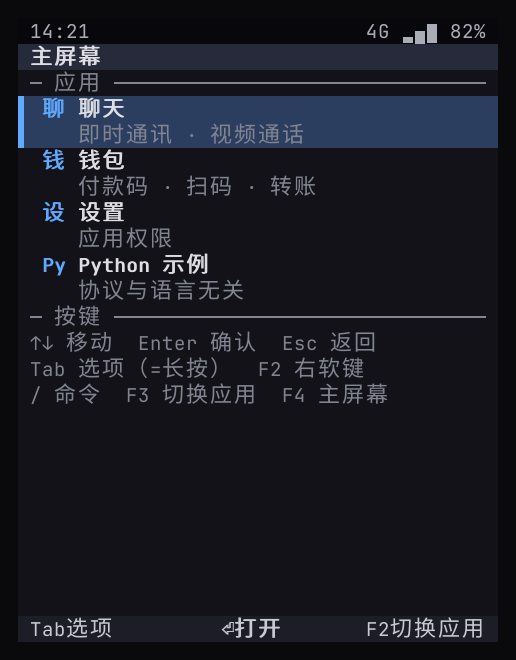 | 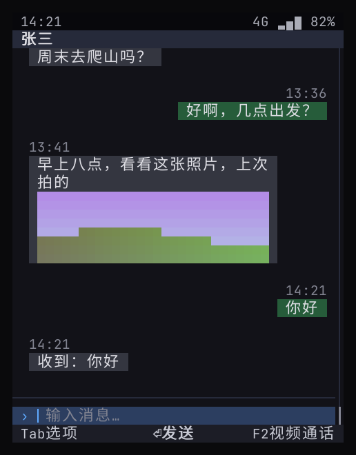 | 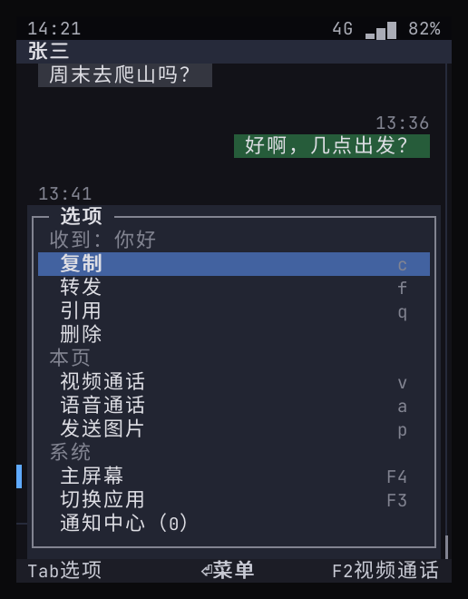 |

| 系统授权 | 视频通话（远端 + 本地画中画） | 来电（应用在后台） |
|:--:|:--:|:--:|
| 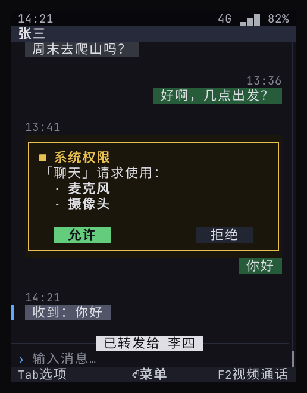 | 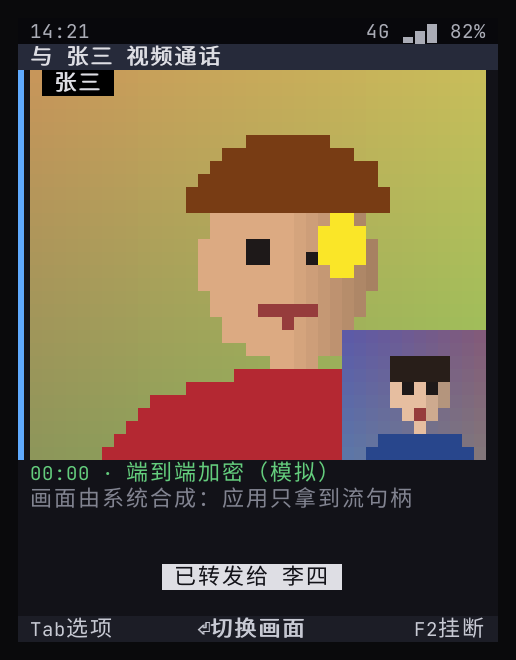 | 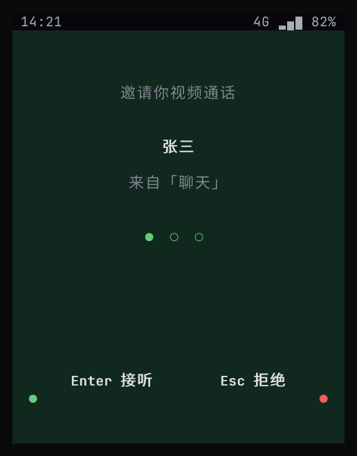 |

| 钱包（设备可信） | 付款码（截图被遮挡） | 系统扫码 |
|:--:|:--:|:--:|
| 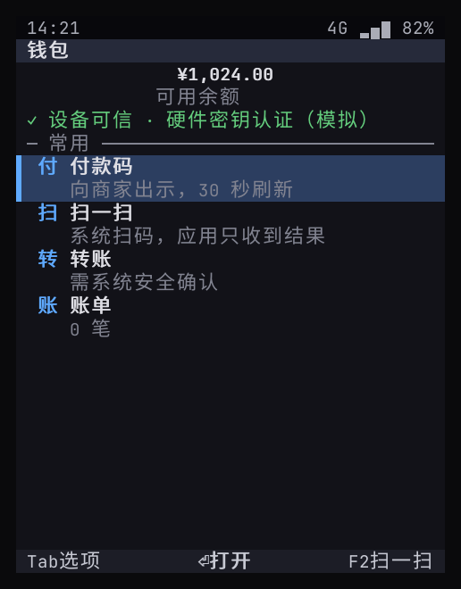 | 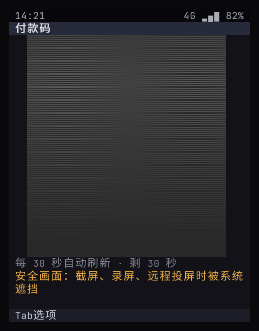 | 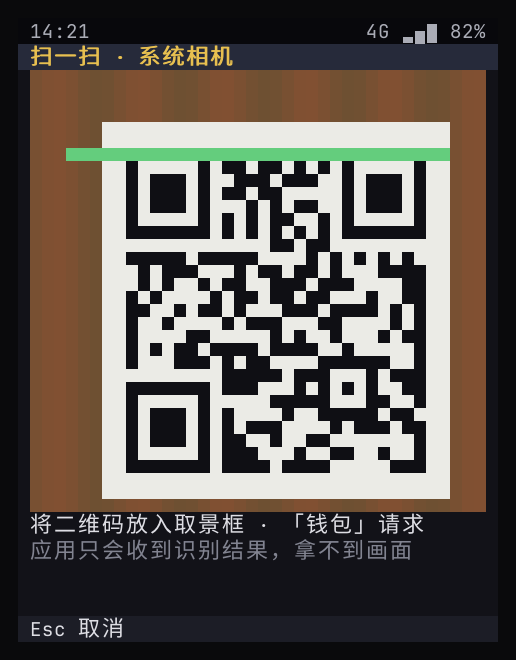 |

| 系统安全确认 | 支付成功（服务端验签通过） | Markdown 文档节点 |
|:--:|:--:|:--:|
| 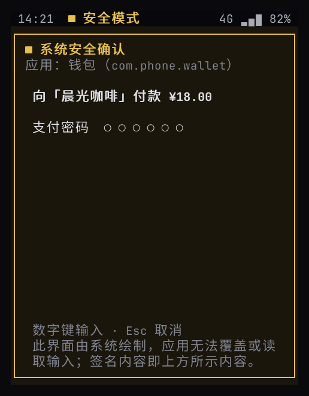 | 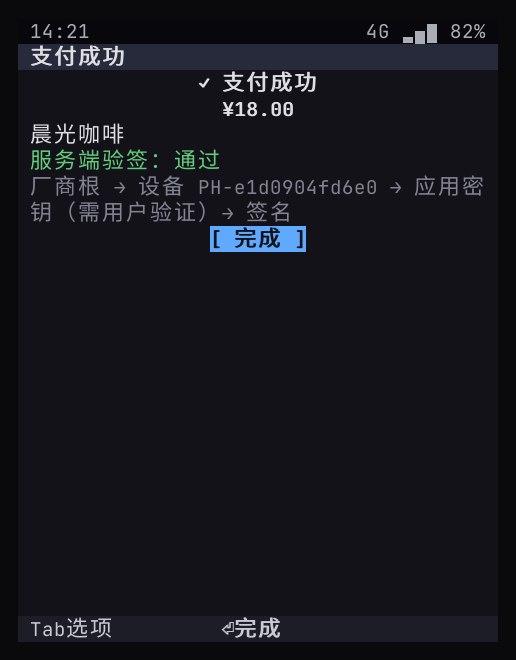 | 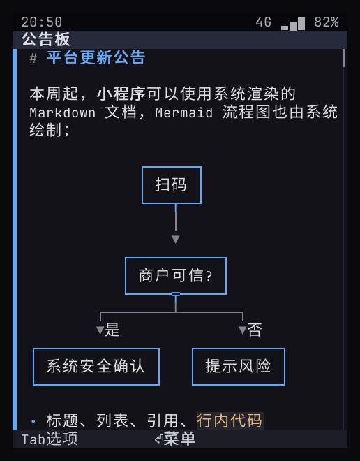 |

| 小程序请求授权（标注来源） | 小程序支付（系统安全确认标注来源） |
|:--:|:--:|
| 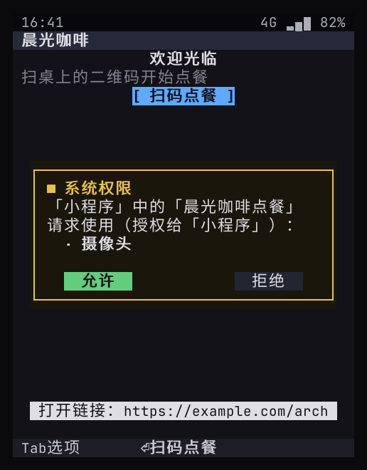 | 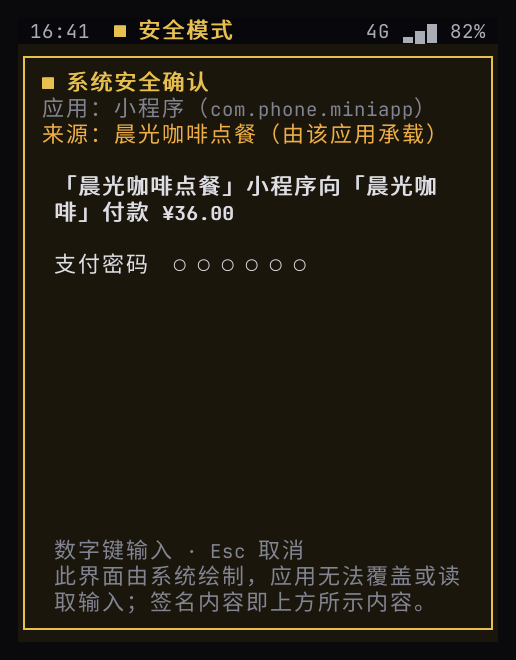 |

| 输入法：全键盘拼音 | 输入法：九宫格拼音 | 输入法：英文补全 |
|:--:|:--:|:--:|
| 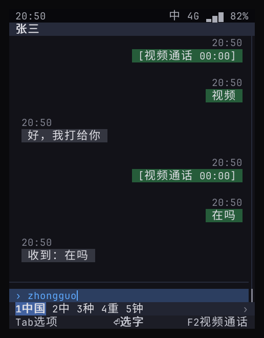 | 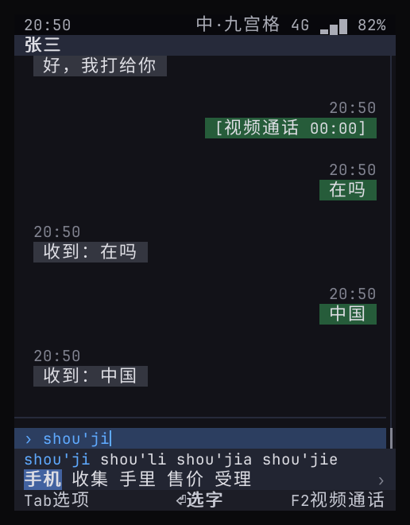 | 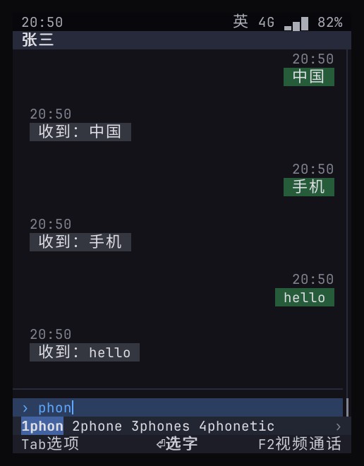 |

像素渲染器（phone-gui，同一个自测场景，三种形态）：

| 直板九宫格 480×640 | 直板全键盘 640×480 | 横屏宽键盘 800×352 |
|:--:|:--:|:--:|
| 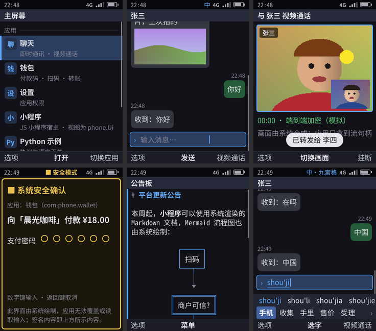 | 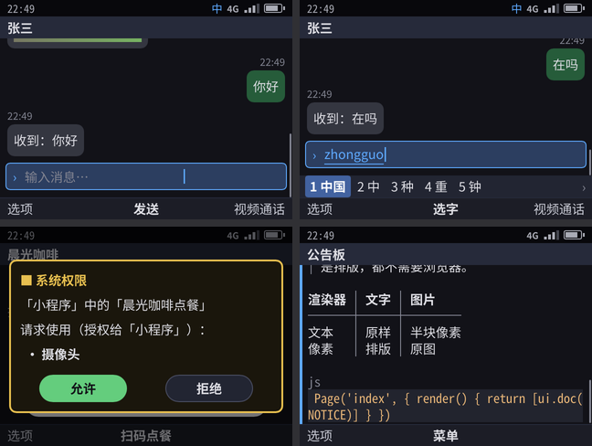 | 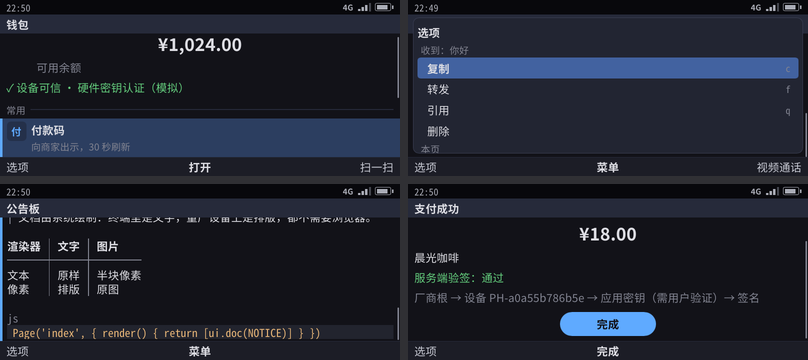 |

## 3. 目录

```
kario/
├── ui/              phone.Ui v0 协议类型 + 能力目录
├── wire/            JSON 行帧格式、服务 RPC、fd 传递（SCM_RIGHTS）
├── canvas/          单元格画布：CJK 双宽字符、真彩色、半块像素、安全画面遮挡
├── shell/           Shell：渲染、焦点 / 菜单 / 返回栈、系统 UI、broker、内置自测脚本
├── ime/             输入法引擎：拼音 / 九宫格 / 英文候选、联想、诺基亚式多击；data/ 为 AOSP 词库，构建时编成映射用的 share/phone/ime.dict
├── sandbox/         应用沙箱：Landlock、seccomp、命名空间、rlimit（cmd/phone-sandbox 是启动器）
├── paint/           phone-paint：设备上的像素渲染器（Rust：tiny-skia、ab_glyph、DRM/KMS、evdev；设计系统在 src/design.rs；input.rs 是接收插拔键盘鼠标的特权助手）
├── hal/             硬件层：主线内核设备类上的一层薄封装（LED、背光、电源、USB 设备模式），用哪一个由 SKU 配置决定，每类有模拟后端
├── obex/            OBEX：蓝牙传文件（Object Push）和电话本服务端（PBAP），跑在 BlueZ 交来的 RFCOMM / L2CAP 连接上
├── i18n/            界面文字的翻译：代码里是英文，locale/<语言>.json 里是译文（默认 zh-Hans）
├── gui/             phone-gui：对照用的像素渲染器（Rust + Slint，GPL-3.0-only；ui/phone.slint、src/main.rs）
├── media/           媒体平面：帧格式、订阅、合成画面源
├── keystore/        密钥服务逻辑 + 服务端验证库
├── gm/              国密：SM3 摘要、SM2 签名（软件实现，量产进 TEE）
├── sdk/             Go 应用 SDK；sdk/c 是 C ABI SDK（phoneui.h）和 C++ 示例；sdk/ts 是 TypeScript 应用的类型 @kario/sdk（ui.d.ts 由 tools/tsgen 从 ui/ 生成）
├── jsrt/            kario-jsrt：TypeScript 应用的运行时（C：QuickJS-ng 加 kario 模块，经 sdk/c 讲协议）；Go 包 jsrt 是安装器和商店共用的检查
├── telephonyd/      phone-telephonyd（C++23，CMake）：事件循环、模拟基带、通话记录、smsd 还没确认的短信
├── audio/           音频：混音器、焦点策略、合成音源、共享内存环形缓冲区、模拟麦克风（cmd/phone-audiod 是服务）
├── push/            推送：消息格式、网关令牌（cmd/phone-pushd 设备服务，cmd/phone-pushgw 模拟网关）
├── programs/        系统服务的代码，每个一个包（shellcmd · pushd · keystored · imed · audiod · mediad · nfcd · smsd · sandboxcmd · ctsverify）
├── cmd/             kario-system（系统服务合成的一个程序）· 各服务单独的开发版 phone-shell 等 · phone-imedict（构建时编词库）· phone-pushgw · phone-chatsrv（模拟鸿雁服务器）· phone-storesrv（模拟商店后台）· phone-pkg（开发者工具）· kario（TypeScript 应用的 new / build / package，内嵌 esbuild）· phone-provision · phone-cts-verify · phone-ota-verify
├── appstore/        商店后台的开源核心（目录、审核、下载、吊销、举报；正式后台在它上面扩展）
├── ota/             系统更新的协议：latest.json 的签名、手机的回报（签名、一天后的回报）；同样签名下发的节假日日历的格式；增量包（delta）、dm-verity（verity）
├── apps/            dialer · messages · clock · calc · music · camera · gallery · weather · store · browser · chat（鸿雁）· wallet（飞钱）· settings · miniapp（JS 小程序宿主 + programs/）· snake（画布应用示例）· hello-py
├── shell/doc.go     Markdown 文档节点渲染
├── shell/mermaid.go Mermaid 图（内嵌 lovely-mermaid，goja 运行）
├── shell/imebar.go  输入法接入：目标输入框、候选栏
├── shell/frame.go   给像素渲染器的帧；gui.go 驱动 phone-gui；device.go 设备形态
├── shell/freeze.go  后台冻结；symbols.go 系统符号表
├── shell/telephony.go 订阅 telephonyd、系统来电界面、通讯录；broker_phone.go 电话 / 闹钟能力
├── shell/airplane.go 飞行模式和移动数据；radios.go Wi-Fi 和蓝牙；btobex.go 蓝牙传文件和电话本
├── shell/messaging.go 订阅 phone-smsd：短信通知（复制验证码）、紧急警报界面、短信能力
├── shell/alarm.go   系统闹钟服务；grid.go 宫格；boot.go 开机动画
├── shell/audio.go   接入 audiod：系统声音、应用播放；push.go 推送分发、唤醒预算、后台启动
├── shell/media.go   系统相册（照片、缩略图、访问规则）；photo.go 系统取景框与照片选择器
├── shell/sandbox.go 每应用独立 uid
├── scripts/stage.sh 按设备目录布局安装（开发构建与 Yocto 配方共用）
├── tools/snap2png/  快照转 PNG（文档用，独立 Go 模块）
├── tools/tsgen/     从 ui/ 和 i18n/ 生成 sdk/ts/ui.d.ts、jsrt/src/languages.h（过期时 make test 失败）
├── tools/imedict/   从 AOSP 词表生成输入法词库
├── tools/icons.py   画系统应用的图标（apps/*/icon.png）
├── tools/cratesinc.py 由 Cargo.lock 生成 bitbake 的 crate 下载清单
└── yocto/           kas 配置、meta-phone 层、QEMU 自测脚本、源镜像并行下载脚本
```

## 4. 运行

```bash
cd kario
make run             # 在终端里交互（终端建议 ≥ 44×27，会画出手机外框）
make preview         # 像素界面在浏览器里：http://127.0.0.1:8790，键盘就是手机按键
make selftest        # 端到端自测，快照写到 build/snapshots/，JUnit 报告 build/selftest-junit.xml
make selftest ONLY='视频'   # 只跑名字匹配的用例
make test            # go vet + go test
make yocto-build     # 构建 Yocto 镜像（首次数小时，之后增量）
make yocto-selftest  # QEMU 启动镜像，开机自测，打印结果后自动关机
make yocto-run       # QEMU 交互：串口登录 root，输入 phone
make yocto-vnc       # QEMU 开机进像素界面，经 VNC（127.0.0.1:5900）操作，见 §4.1
make paint           # 编译像素渲染器 phone-paint（cargo build --release）
make pixel-selftest  # 三种形态各跑一遍自测（phone-paint 画），PNG 写到 build/pixel/<形态>/
make gui-selftest    # 同样的自测由 phone-gui 画，对照用
make yocto-gui       # QEMU：渲染器画到 virtio-gpu 屏，监视器注入按键并截屏
make telephonyd      # 只编译 telephonyd 并跑它的单元测试（make build 已包含）
make lsp             # 生成 C/C++ 的 compile_commands.json 并链到源码旁，IDE 能跳转（§4.2）
make skus            # 列出所有 SKU；每个 SKU 都是一个目标：make sku-<名字> 构建它的固件包
make yocto-stress    # 1 GB 的 web 镜像上反复用短信、鸿雁、图片、视频和浏览器，系统必须始终可用（§5.1）
```

| 键 | 作用 |
|----|------|
| ↑ ↓ ← → | 移动焦点 |
| Enter | OK（主动作） |
| Esc | 返回 |
| Tab | 选项菜单（= 长按；F1 同） |
| F2 | 右软键 |
| F3 / F4 | 切换应用 / 主屏幕 |
| F6 或 Ctrl+空格 | 输入法中 / 英切换（九宫格模式下用 `#`） |
| F7 | Chr / Sym：系统符号表（九宫格模式下用 `*`） |
| Alt + 键 | 长按（九宫格：长按数字输入数字，长按 `#` 切 123） |
| `/` | 命令面板 |
| Ctrl+C | 退出 |

`phone-shell --device bar-t9`（或 `--keypad t9`）模拟九宫格：2–9 输入拼音或英文，`0` 分隔音节 / 空格，`*` 下一个匹配或符号表，`#` 切换 拼音 → 智能英文 → Abc → abc → ABC，长按 `#` 切 123（[18](18-nokia-form-factors.md) §3）。

钱包的支付密码是原型默认值 **123456**。连续输错 5 次锁定（删除 `~/.local/state/phone-sim` 重置）。

### 4.1 亲手体验

**A. 终端里的文本界面**（最快，不用构建镜像）：

```bash
cd ~/code/kario-os/kario
make run                                      # 直板全键盘
build/usr/bin/phone-shell --device bar-t9     # 直板九宫格
```

按键见上表，另外 F5 是通话键（绿键），F4 是挂断 / 回待机（红键）。网页节点在这里只显示标题、地址和焦点，页面本身要像素界面。

**A2. 浏览器里的像素界面**（不用构建镜像、不用 VNC）：`make preview`（phone-paint 画），打开 `http://127.0.0.1:8790`；远程机器上先 `ssh -L 8790:127.0.0.1:8790 <机器>`。网页上的键盘和按钮就是手机按键。

**B. 设备镜像的像素界面**（QEMU 里开机，经 VNC 操作）：

1. 要有镜像：`make yocto-build`（构建过就跳过）。要体验网页视图，改成 `make yocto-web-build`；`yocto-vnc` 启动的是最后一次构建的镜像。
2. `make yocto-vnc`：QEMU 开机直接进像素界面，约 2 分钟（在 x86 上软件模拟 ARM，比真机慢得多）。
3. 把服务器的 5900 端口转到自己电脑：Cursor 的「端口」面板里转发 5900，或者 `ssh -L 5900:127.0.0.1:5900 <服务器>`。
4. 用 VNC 客户端（RealVNC Viewer、TigerVNC 等）连 `localhost:5900`，先点一下画面让它接收键盘。
5. 键：方向键、Enter = OK、Esc = 返回、Tab = 左软键「选项」、F2 = 右软键、F5 = 通话键、F4 = 挂断 / 回待机、F3 = 切换应用。形态是直板九宫格：数字键 2–9 打拼音，`#` 切换输入方式，`*` 选候选或符号。
6. 结束：在运行 `make yocto-vnc` 的终端里按 Ctrl+A 再按 X。镜像以快照方式启动，改动不保留。

**C. 截图集**（不用交互）：`make skins` 把自测的每一步画成带机身的图（`build/skins/<形态>/`）；`make web-selftest` 出网页视图的几张（`build/pixel-web/`）。

**建议走一遍**：

| 场景 | 怎么走 | 看什么 |
|------|--------|--------|
| 打电话（模拟基带） | 待机直接按 `10086`，通话键拨出，挂断键挂断 | 拨号、通话中、通话记录 |
| 鸿雁聊天 | `/` 输入「鸿雁」回车，进张三的会话，发「文章」 | 输入法、消息气泡、推送 |
| 公众号文章 | 选中张三回的链接：OK 是阅读模式；「选项」里选「网页」看原样网页（像素界面） | 方向键在链接间移动，「分享这篇文章」弹系统分享面板 |
| 网页表单（web 镜像） | 给张三发「搜索」，用「网页」打开 | 「清空记录」弹系统确认框；文本框打字；下拉框弹系统菜单；OK 提交 |
| 视频通话 | 给张三发「视频」，他会打回来，通话键接听 | 来电界面、通话中的画面 |
| 支付 | 打开「飞钱」：付款码、扫码付款，支付密码 123456 | 系统安全确认、安全画面在截图里被遮挡 |
| 命令面板 | 任何时候按 `/`，输入应用名或命令 | 不翻菜单直接到达 |
| 菜单文件夹 | 待机按 OK 进主菜单，进「工具」，按 `1` 直达计算器 | 诺基亚式分类：常用的在主菜单，工具、应用各在文件夹里；数字键直达 |
| 照片（JPEG） | 主菜单 › 图片 | 8 张公有领域的真实照片排成网格，只有图没有字；OK 看大图，← → 翻页，选项 › 详细信息看尺寸和 `image/jpeg` |
| 壁纸 | 看大图时选项 › 设为壁纸 › 待机和锁屏；挂断键回待机；左软键再按 `*` 锁键盘 | 待机和锁屏都是这张照片，文字白色、上面压一层渐变；设置 › 壁纸能恢复默认 |
| 本地视频 | 图片里带「▶ 0:15」的那格（示例：湿地），OK | 系统解码播放（像素界面看画面，文本界面是半块像素），OK 暂停 / 继续，← → 跳 5 秒，返回键关掉 |
| Mermaid | 主菜单 › 应用 › 小程序 › 公告板 | 系统画的 Markdown 文档：Mermaid 流程图、表格、代码高亮、公式 |
| 主题 | 设置 › 主题 › 复古绿（或浅色、琥珀） | 整个界面换配色，照片不变 |
| 浏览器（web 镜像） | 主菜单 › 浏览器，输入网址或搜索词 | 地址栏、书签、页内查找（`s`）、放大缩小（`+` `-`）；网页里的下载进「文件」 |
| 设置 | 「设置」里的应用权限、流量、声音（← → 调音量）、SIM 卡锁（PIN 码 1234）、沙箱自检 | 权限能撤销；PIN 码在系统界面输入；设备上沙箱自检全部符合预期 |

哪一步按键不顺、找不到入口、或者觉得非要触屏不可，记进一周自用记录（57（内部文档） R9）。

### 4.2 在 IDE 里读代码（LSP）

| 语言 | 语言服务器 | 要什么 |
|------|------------|--------|
| Go | gopls | 仓库根的 `go.mod`，不用生成；内部仓库 `make server` 在根目录链一个 `go.work`（指向 `build/go.work`），服务端代码能跳进开源仓库 |
| C / C++（telephonyd、sdk/c） | clangd | CMake 导出的编译命令：`make build`（或只要 `make lsp`，不编译）把 `build/telephonyd/compile_commands.json`、`build/capi/compile_commands.json` 链到 `telephonyd/`、`sdk/c/` 下，`make lsp` 另在根目录放一份合并的 |
| Rust（paint、gui） | rust-analyzer | 各自的 `Cargo.toml`，不用生成（第一次打开时它自己下载依赖） |

链接和合并的文件都在 `.gitignore` 里。编译器换了（`CXX23`、`CC14`）重跑一次 `make lsp`。

## 5. 验证结果

当前的用例数和结果见 57（内部文档）「当前验证基线」；本节说明每个环境验证什么。

| 环境 | 结果 |
|------|------|
| 开发机（Rocky 8.10 x86_64，Go 1.25，GCC 14，非 root） | `make selftest` 全部通过（root 专用的沙箱、cgroup 用例自动跳过），约 100 秒；`make cts` PASS：所有用例通过，每个能力都被调用过（[22](22-developer-api.md) §11）；`make build` 时还会跑 telephonyd 的 C++ 单元测试 |
| 像素渲染器（`make pixel-selftest`，由 phone-paint 画） | 每个 snap 步骤一张 PNG（界面截图见 [19](19-core-apps.md) §2） |
| 两个渲染器（phone-paint：`make pixel-selftest`、`make yocto-selftest`、`make yocto-gui`；phone-gui：`make gui-selftest`，镜像加 `KASEXTRA=yocto/kas/phone-gui.yml`） | 同一套自测在两个渲染器、三种形态下全部通过，包括渲染器被杀掉后由看门狗重启；设备上两种镜像的开机自测、兼容测试、DRM 上屏都通过 |
| `make test`（许可证检查 + go vet + 单元测试 + 端到端） | 通过；密钥测试覆盖篡改金额、他人密钥、非本厂商根设备、PIN 锁定、nonce 重放、路径穿越；画布测试覆盖中文禁则；输入法测试覆盖全拼、简拼、部分上屏、九宫格、英文；Mermaid 测试覆盖 9 种图 |
| `make mm-selftest`（Debian 容器：telephonyd 的 ModemManager 后端 + 私有 D-Bus + 模拟的 ModemManager） | 通话、短信、SIM 卡 PIN / PUK、基带与 ModemManager 的来去都走真实的 D-Bus 接口（[04](04-ui-language-telephonyd.md)） |
| `make sku-check`（`make test` 的一部分） | 每个 SKU 展开无误：键码表、接线标签、形态尺寸；A/B 槽的选择逻辑与 RAUC 后端（[24](24-sku-framework.md)、[25](25-system-update.md)） |
| `make yocto-ota-test`（QEMU，A/B 磁盘） | 连开 11 次机：分批推送没轮到和暂停时不提供、拒装不受信任的包、增量装到另一槽、Shell 带着渲染器和应用起来后标记为好、渲染器起不来三次后回滚、改坏的槽和换掉的描述当场被拒（[25](25-system-update.md) §3） |
| `make yocto-ota-delta`（QEMU，A/B 磁盘） | 用跨版本增量包（RAUC 包里带着应用程序，照安卓的 payload 做块操作）经设置从存下的基础装到这一版：重建的槽的 root hash 必须是签名描述里的，B 带着 Shell 和渲染器起来；给别的版本做的增量包被安装钩子拒绝；装上后不健康就回滚到基础、B 再用不带应用程序的包更新 A（用镜像里的应用程序）、写的时候断电、损坏的包退回整包，再和整包自适应安装比下载量（[25](25-system-update.md) §5.5）。模拟器上 ✓：`0a4ff0b` → 第 5 轮做完，增量包 6.9 MB、实际下载 8.08 MB，自适应下载 69.6 MB，整包 137.8 MB；应用程序写 509 MB 用 45.9 秒、内存峰值 22.3 MB |
| `make yocto-ota-release`（QEMU，A/B 磁盘，kario-internal） | 早先发布版的 A/B 磁盘经设置装后来的发布版，用发布版自己的 `latest.json` 和包：这一版的 Shell 挑增量包就装增量包，不挑就装整包；机型串不同的旧版本不开机，写明没有更新路径（[25](25-system-update.md) §5.4） |
| 交互模式（Python 伪终端驱动） | 主屏幕渲染、Enter 打开应用、Tab 选项菜单、Ctrl+C 正常退出 ✓ |
| Yocto Wrynose qemuarm64（TCG 模拟，root） | 镜像（phone-paint）不含 GPLv3 组件，对照用的 phone-gui 镜像里只有它是 GPLv3；两个渲染器都降权、Landlock、seccomp。开机自测全部通过（含沙箱自检、cgroup 与内存超限、低内存清理、无响应、崩溃记录、安装与启动前验签、紧急呼叫、渲染器崩溃重启），兼容测试 PASS，渲染器经插槽启动，报告签名在宿主机上核对通过（Python 用例因镜像无 python3 跳过；telephonyd、audiod、pushd 在设备上运行；像素渲染器同时出图；设备放出的声音录下来分析通过），见 §5.1 |

自测用例（[shell/selftest.script](../shell/selftest.script)），每条都走完整链路：

| 用例 | 证明了什么 |
|------|-----------|
| 待机界面，OK 进主菜单 | manifest 加载、系统界面也走 `phone.Ui`；`Screen.Center` 让 OK 打开菜单 |
| 命令面板跳转并收发消息 | 应用进程、输入框、`/` 命令面板 |
| 消息菜单（等价长按） | 菜单由 Shell 按元素动作生成 |
| 转发到其他会话 | 多页面流程、返回栈 |
| 视频通话：运行时授权 + 媒体流 | broker 授权、媒体平面帧到达屏幕 |
| 最小化后从系统通话指示返回 | 后台通话、状态栏指示、系统事件 |
| 来电：应用在后台，系统全屏接听 | CallKit 式系统来电界面 |
| 后台消息：横幅与通知中心 | 通知、横幅、点击打开回到会话 |
| 钱包：设备认证 | nonce + 证书链验证 |
| 付款码是安全画面 | 快照中被遮挡（`▒`） |
| 系统扫码 + 可信支付确认 | 扫码只给结果、PIN 输错 / 输对、服务端验签 |
| 转账表单 | 多字段表单、所见即所签 |
| 账单与危险操作二次确认 | danger 动作统一确认 |
| 撤销权限后能力调用被拒绝 | 设置应用（系统权限）+ broker 拒绝 |
| 沙箱：已生效的限制层全部符合预期 | 开发机上 seccomp 拦截危险系统调用，自检无失败项 |
| 输入法：全键盘拼音、候选与联想 | `zhongguo` → 候选「中国」→ 上屏后出现联想 → 发送成功 |
| 输入法：九宫格拼音 | `746854` → 拼音行 `shou'ji` + 候选「手机」→ 发送成功 |
| 输入法：九宫格英文与全键盘英文补全 | `#` 切英文、`43556` → hello；全键盘 `phon` → phone |
| 输入法：诺基亚式按键 | `##` 切 Abc，多击输入 Hello，长按 5，`*` 符号表，长按 `#` 切 123 |
| 文档节点 | Markdown 由系统渲染；Mermaid 流程图画成框图；链接自动进菜单，选中后应用收到 URL |
| 小程序：JS 逻辑 + 数据绑定 + 本地存储 | goja 运行时、`setData` 重新渲染、存储在重开后仍在 |
| 小程序：扫码点餐 + 支付 | TypeScript 写的小程序经宿主调用系统扫码与安全确认，对话框标注小程序名称，宿主服务端验签 |
| 沙箱：独立 uid、命名空间、Landlock | 11 项自检：读不到私钥和其他应用数据、连不上密钥服务、不能执行自己写入的代码、不能写公共临时目录、看不到其他进程、没有网络、不能监听端口、危险系统调用被拦截；能写自己的数据目录、读公开根公钥（需 root，仅设备上执行） |
| 后台冻结 | 离开飞钱 1 秒（自测时缩短）后进程被暂停（`/proc` 状态 T），回来后恢复并响应按键；鸿雁不常驻，也会被冻结 |
| 鸿雁不常驻 | 冻结后，服务器 3 秒后的 VoIP 推送把它叫醒，它报告来电，系统全屏来电界面出现 |
| 电话：智能拨号、拨出、接通、挂断 | 输入 `94` 筛出张三（zhang）和中国移动（zhong）；拨出后经历呼叫中、振铃、通话中；挂断后通话记录出现「已拨」 |
| 电话：系统来电 | `tel ring` 让模拟基带来电，系统全屏来电界面显示联系人名，接听后交给电话应用 |
| 短信 | 写新信息给王五，收到自动回复；回到主屏后 10086 来短信，出现横幅 |
| 短信：通知、回复、送达 | 短信应用没开时来短信，从通知中心打开就是那个会话；回复「你好」时输入框下写「还可输入 68 字 · 1 条」，对方收到后标「已送达」 |
| 短信：复制验证码 | 银行的验证码短信，通知中心里按 `c` 复制验证码，在新信息里粘贴得到 482913 |
| 短信：删除 | 会话里删一条短信、再删整个会话，都先弹确认 |
| 短信：拦截 | 拦截 10690666 后它的短信没有横幅、不进通知中心，在「已拦截」里；取消拦截 |
| 短信：smsd 崩溃 | 杀掉 phone-smsd，这时到的短信留在 telephonyd（待确认 1 条），smsd 重启后收下、通知，telephonyd 的队列清空 |
| 短信：telephonyd 崩溃 | telephonyd 把短信存进待确认队列、还没交给 smsd（`sim.sms` 带 `held`）就被杀掉；重启后从 `telephony.json` 读回，smsd 重连时收下、通知，队列清空 |
| 紧急警报 | 锁着、息屏时来国家级小区广播：亮屏、全屏警报压在锁屏上、`alert` 提示音、振动，OK 关掉后还锁着；设置里关掉特别严重后同级警报不弹，短信 › 紧急警报里两条都有 |
| 闹钟 | 新建「+2」（2 分钟后）的闹钟，`timeshift 180` 快进 3 分钟，系统全屏响铃 |
| 计算器 | `12 * 30` 回车得 42（`*` 是「+」）；`6 * * 2 =` 得 4（`*` 连按切到「−」） |
| 音乐 | 后台播放时不冻结；来电时音乐暂停、铃声响，拒接后音乐继续；暂停后界面显示「已暂停」（[20](20-audio.md)） |
| 电话、闹钟的声音 | 拨出有回铃音、接通是通话声、来电有铃声、闹钟有闹钟声，结束后都安静（向 audiod 查询实际在播放的流） |
| 推送：通知不唤醒，数据短暂唤醒 | 冻结的飞钱收到到账通知时仍冻结；数据推送让它恢复 3 秒记账后重新冻结（[21](21-push.md)） |
| 推送：进程不在时后台启动 | 杀掉飞钱后，数据推送在后台启动它并记账 |
| 推送：VoIP 与消息 | 鸿雁收到 VoIP 推送后报告来电，系统全屏来电界面出现；消息推送进入会话 |
| 鸿雁：语音消息 | 录音时状态栏显示「● 麦克风」；发送后指示消失，气泡显示时长，机器人回复；选中气泡播放，audiod 里出现一路媒体流（设备上从声卡录音里认出了这段语音） |
| 录音：离开前台即停止 | 录音中按 F4，系统停止录音、指示消失；回到鸿雁，录音页提示「录音已中断」 |
| 相机：系统取景框 | 取景框里确实有摄像头画面（等到 5 帧到达屏幕），按 OK 拍照，提示已保存到图片 |
| 图片：系统相册 | 预授权「相册」的图片应用列出示例照片和刚拍的照片，打开大图显示尺寸 |
| 鸿雁：发图 | 系统选择器出现，选中后应用收到只读文件并读出大小，照片气泡由系统显示 |
| 通话键、挂断键 | 待机按通话键进最近通话，再按一次回拨；通话中按挂断键挂断；来电时挂断键拒接、通话键接听 |
| 键盘锁 | 左软键再按 `*` 锁定，只提示一下「键盘已锁」，状态栏出现小锁；锁定后按数字、OK 都无效，提示「按「解锁」再按 *」；左软键再按 `*` 解锁 |
| 挂断键：菜单打开时也直接回待机 | 在应用里打开选项菜单，按挂断键，菜单关闭并回到待机 |
| 设置：声音、自动键盘锁、关于本机 | 调高媒体音量后 audiod 上的音量随之改变；自动键盘锁设为 15 秒，`timeshift` 快进后待机界面自动锁定；关于本机显示系统名和版本 |
| 图片：删除照片要系统确认 | 图片应用请求删除，系统确认框出现，确认后照片从相册消失 |
| 剪贴板 | 鸿雁里复制一条消息，在输入框的系统菜单里「粘贴「…」」，发出的消息就是复制的文字 |
| 天气：定位与后台刷新 | 第一次定位弹出「位置」授权，状态栏显示「● 位置」；离开后冻结，`timeshift` 一小时后系统唤醒它跑后台任务，随后再冻结；回来看到「后台刷新 1 次」 |
| 分享：照片 | 图片应用分享照片，系统面板只列出能收图片的鸿雁；选会话后照片发出，机器人回复「这张拍得好」，说明照片已授权给鸿雁 |
| 分享：文字 | 天气分享今天的天气，面板列出短信和鸿雁；选短信后，新信息页里已经填好文字 |
| 应用商店：签名包的安装与卸载 | 改坏一个字节的包被拒收；正常的包弹出系统确认框（版本、开发者、签发商店、权限），装好后「便签」从安装目录运行并保存数据；卸载后重新安装，数据是空的 |
| cgroup（仅设备） | 计算器的组里有内存上限 192 MB、进程上限 128、前台 CPU 权重 400；离开后冻结器生效、权重降到 50；回来后解冻 |
| 兼容测试（只在 `--cts` 下） | 兼容测试应用越权调用 6 项一律被拒绝；后台任务间隔少于 15 分钟被拒绝；有电话权限时自己接听、静音、保持、恢复、挂断来电；（仅设备）探针不停占用内存，超过上限后被系统结束，并提示原因 |
| 菜单：数字键直达 | 九宫格设备上，待机按 OK 进主菜单，按 7 打开计算器 |
| 待机：直接拨号、打字搜索 | 九宫格上在待机界面按 1 进入拨号，接着输入 0086，智能匹配出中国移动；全键盘上在待机界面打「飞」，搜索结果回车打开飞钱 |
| Python 应用 | 协议与语言无关（镜像里无 python3 时自动跳过） |
| 拨号码 | 电话里打完 `*#06#` 就显示 IMEI（手机自己答）；`*101#` 拿到运营商的三行菜单，回复 2 得到流量余额；网络主动发来的提问在电话应用里回复 |
| 墓碑 | 鸿雁的会话里写了草稿没发，回待机后像低内存清理那样结束它；从「切换应用」回去，还在那个会话里，草稿还在，发出去机器人照常回复 |
| 画布应用：贪吃蛇 | 诺基亚式的黄绿液晶画面是应用给的图形，系统在文本和像素界面里都画出来；按键和选项菜单都能改关卡、切换撞墙和穿墙，开局、暂停（打开选项菜单也自动暂停：`focus` 事件）、撞墙结束后 OK 回关卡界面；应用被内存回收结束后再打开，关卡还在；返回仍回待机 |
| Wi-Fi 和蓝牙 | 设置里选一个加密网络，在单独的页面输入密码后连上；蓝牙关了再开、搜索到耳机，配对后列在「已配对的设备」（耳机没有屏幕，不用核对配对码；要核对的设备由单元测试覆盖）。模拟器上走真的 iwd 和 BlueZ：mac80211_hwsim 的第二个射频做接入点，btvirt 的第二个虚拟控制器做耳机 |
| 企业 Wi-Fi（802.1X） | 企业网络要填用户名、密码和服务器域名；域名填错（`evil.example`）时连不上，改对后用 PEAP（内层 MSCHAPv2）连上；忘记网络后改用 TTLS / PAP 再连上。开发机上是模拟的网络核对域名；模拟器上是真的 iwd 对着 hostapd 自带的 EAP 服务器（第三个 mac80211_hwsim 射频，只在 qemuarm64 的镜像里），CA 和服务器证书由自测在测试时生成（不进 git、不进镜像），iwd 按这个 CA 和域名核对；hostapd 的 MSCHAPv2 要 OpenSSL legacy 模块里的 MD4、DES（这个模块只装在模拟器镜像里），它不发地址，测试网络用静态 IPv4。模拟器上通过（镜像里没有 hostapd 或空闲射频时这个用例跳过，这里是通过而不是跳过）；**未上真机** |
| 蓝牙传文件和电话本 | 配对的耳机发来的文件，用户确认后收进「文件」，拒收时对方得到「禁止」；设置 › 蓝牙里在设备上按 OK「发送文件」，系统列出「文件」，选中的那个发过去；车机读电话本前系统问一次，允许后读到联系人（vCard 2.1）。OBEX 是 Shell 自己的（`obex` 包，单元测试另覆盖 RFCOMM 那样的字节流和 L2CAP 那样一次一包、分包、vCard 3.0、按名字搜的列表、通话记录、拒收和过大的文件）。不装 obexd 是量过的：Yocto 构建出的 libicudata 33.2 MB、libicui18n 3.7 MB、libicuuc 2.3 MB、libical 1.8 MB（装进镜像的大小），共 41 MB，而 libical 只有 obexd 的 PBAP 后端用（`phonebook-dummy.c`）；自己的实现在 `kario-system`（arm64）里约 49 KB 代码（`go tool nm` 的符号大小，obex 包 25 KB、Shell 里的部分 24 KB），obexd 本身没构建、没量。模拟器上对方是 btvirt 的第二个控制器（通过），和别家手机、车机**未上真机** |
| 飞行模式和移动数据 | 设置首页打开飞行模式，状态栏变成 ✈，基带射频、Wi-Fi、蓝牙都关掉；飞行模式下打开 Wi-Fi；关掉飞行模式后蓝牙回来、Wi-Fi 还开着；从电源菜单再打开飞行模式，这次 Wi-Fi 留着（上次用户自己开的），蓝牙关掉；锁着键盘拨 112，基带自己上电拨出，飞行模式随之关闭，蓝牙回来；关掉移动数据后状态栏不再显示 4G，打开后又显示；设备上另查防火墙挡住 telephonyd 报的移动网卡（模拟器上通过）。telephonyd 的单元测试覆盖射频关着时拒打电话、短信、USSD 和来电，112 照样打通，紧急呼叫中拒关射频，两个开关重启后保持；ModemManager 后端的用例在模拟的 ModemManager 上通过（`make mm-selftest`）；**未上真机** |
| 应用商店后台：分批发布与自动更新 | 新版本分批到 0% 时这台手机看不到；开发者放到 100% 后出现「可更新」；插上电源、`timeshift` 六小时后商店在后台装好并通知「已自动更新」；商店下架后，不打开商店，后台任务取到清单，应用再也启动不了 |
| NFC：卡包、门禁卡、快速选卡、交通卡、付款、读卡（8 个用例） | 模拟控制器和模拟读卡器上：读卡模式复制门禁卡；锁着、息屏、模拟挂起时门禁卡和快捷交通卡自己应答，屏幕不亮，读卡器的场叫醒手机；门禁卡按使用时间选，工作日和休息日分开，按节假日日历（更新服务器签名下发；用的是测试日历，不是官方的）把调休上班的周六算工作日、放假的周三算休息日；连按两下电源键快速选卡；锁着时付款卡不应答，解锁后由后台启动的飞钱付款；退出「添加门禁卡」当场停止读卡；应用的读卡模式（运行时权限、系统的读卡界面、和 CPU 卡交换命令的会话）和「读卡器离开」事件（[30](30-nfc.md) §9；**未上真机**） |
| USB 文件共享在单独的沙箱进程里 | 助手按路径打不开文件、建不了套接字、运行不了程序；有 cgroup 时在自己的组里（内存 64 MB、不用交换、64 个进程），没有 cgroup 委派的开发机上和应用一样留在 Shell 的组里；它越界的请求 Shell 不接；超过文件夹上限的文件拒收（413）；崩溃了 Shell 重启它，拔线后它也结束（[27](27-usb-typec.md) §3.2；组和上限模拟器上**待跑**） |
| USB 文件传输（MTP） | 先查内核有 FunctionFS（模拟器上还要有 dummy_hcd）；设置 › USB 选文件传输后，信任的电脑（开发机上是模拟的数据线，模拟器上是 dummy_hcd 经 usbfs）看到 Photos、Videos、Music、Files 四个存储，按 Windows 的方式读属性列表，下载、分段读、上传、在 Music 里建文件夹；删除、改名、往 Photos 拷文本都被拒绝；文件由沙箱助手经 FunctionFS 收发；模拟器上另用 libmtp 的 mtp-detect、mtp-files、mtp-getfile 认设备、列文件、拷文件（[27](27-usb-typec.md) §3.3；模拟器 ✓；真电脑**未上真机**，Windows、macOS、Linux 都没试过） |

### 5.1 Yocto / QEMU

| 项 | 值 |
|----|-----|
| 发行版 | Poky 6.0.4（Wrynose），systemd 259.5，内核 6.18.54-yocto-standard，GCC 15.3 |
| 机器 | qemuarm64（AArch64，x86 主机上 TCG 模拟） |
| 镜像 | `phone-image`：含 `phone-fw`、插槽里的渲染器（phone-paint；对照用的镜像换成 phone-gui。Rust 由 Yocto 自带的 Rust 1.94 交叉编译，crate 由 bitbake 按 `Cargo.lock` 下载校验）、`phone-telephonyd`（C++23，CMake，GCC 15）、`fonts-noto-cjk`、dropbear；镜像不含 GPLv3 组件，对照用的镜像里只有 phone-gui 是 GPLv3 |
| `phone-fw` 配方 | Wrynose 自带 Go 1.26 交叉编译；依赖是 bitbake 按 `phone-fw-go-mods.inc` 下载并校验的 Go 模块（`gomod://`，`tools/gomodinc.py` 从 go.mod、go.sum 生成，`make gomods`；`make test` 发现清单落后就失败），许可证按 `phone-fw-licenses.inc` 登记；编译时不联网；安装布局与开发构建相同（`scripts/stage.sh`） |
| 源码 | 默认是 `make yocto-src` 从工作树打的包（含没提交的改动）；`make yocto-build SRC=git` 让各配方改从 git 提交构建（`classes-recipe/phone-src.bbclass`：默认 HEAD，经 kas 挂载的 `/kario` 取；`GIT=github` 从 GitHub 取），产品发布就这样构建两个仓库的提交 |
| 自测方式 | 内核参数 `phone.selftest=1` → `phone-selftest.service` 运行同一场景 → 打印结果 → 自动关机；失败时还打印各应用进程的状态（内核等待点）、Shell 轨迹（脚本步骤、前台切换、系统浮层）和服务、应用日志 |
| 结果 | `PHONE-SELFTEST-RESULT: PASS`（全部用例，同时由插槽里的渲染器出图），之后 `PHONE-CTS: PASS`，报告从串口取回后由 `phone-cts-verify` 核对签名；随后 `audio-check.py` 分析 QEMU 录下的声音：`AUDIO-CHECK: PASS`（[20](20-audio.md) §6）。用例数见 57（内部文档） |
| 低内存压力测试 | `make yocto-stress`：网页视图镜像装在 1 GB 的 SKU（`qemu-t9-1g`）上，后台放着音乐，连做 5 轮「短信发出并收到回复 → 鸿雁收发消息 → 看图片 → 看视频时打开浏览器、连开三页」（`stress.script`）。每一步都要在时限内完成，渲染器不能重启，系统服务不能被结束或重启，内核的 OOM 杀手除了应用自己的内存上限以外不能出手；同时每 2 秒记一次可用内存和内存压力（PSI）。结果：5 轮全过，最少还剩 493 MB 可用（共 975 MB），没有内存压力，低内存杀手不用出手。先前几次失败找出两个问题，都已改掉：网页进程树在 256 MB 的组里抖动（压力 full 到 72%，整机变慢），1 GB 机型的上限改为 384 MB；重启的应用或网页进程留在上次的组里，旧进程树的页缓存还记在组上，浏览器从墓碑恢复后的网页进程一起来就被 WebKit 结束、下一个卡住，现在组先删掉再新建（[17](17-app-sandbox.md) §5）。那几次里低内存杀手结束过后台的网页和应用，系统服务和渲染器始终没丢 |

显示（`make yocto-gui`）：内核参数 `phone.gui=1` 时，phone-shell 驱动插槽里的渲染器用 DRM/KMS 画到 virtio-gpu 屏（480×640）；QEMU 监视器注入 USB 键盘按键并截帧缓冲，7 步操作（待机 → 菜单 → 电话 → 选项 → 计算器 → 短信 → 待机直接拨号）全部生效，这时 audiod、pushd 也作为系统服务运行（截图见 [19](19-core-apps.md) §2）。

构建备注（本机：48 核，经公司代理上网）：

- 首次构建约 2 小时，瓶颈是网络：内核 git 仓库约 4.2GB，单连接只有约 0.4MB/s。代理是按连接限速，所以 [yocto/fetch-mirror.sh](../yocto/fetch-mirror.sh) 用 24 路分段并行下载 Yocto 官方源镜像包（约 10MB/s，8 分钟），放进 `DL_DIR` 后 bitbake 直接解包使用。
- 之后改动代码再 `make yocto-build`，只重建变了的配方和镜像，几分钟完成；sstate 与下载缓存放在 `~/yocto/cache`，可跨构建复用。
- **耗时主要花在哪**（用 Yocto 的 buildstats 量过一次增量构建，并检查了内存上限）：
  - 内存不是瓶颈。这个用户的内存上限是 48 GB，增量构建里峰值最大的任务（编译 phone-gui）只用了 2.5 GB；只有当初编 WebKit 开 24 路并行时撞到过上限。所以解除内存限制对现在的任务基本没有帮助。
  - 真正的大头：
    - phone-gui 编译约 140 秒；
    - 生成 SPDX / SBOM 约 100 秒；
    - 打包根文件系统约 70 秒；
    - QEMU 开机自测约 3.5 分钟：x86 上模拟 AArch64，没有 KVM。
  - 源码包用 `gzip -n` 生成，相同源码得到完全相同的文件；否则每次都带着新的时间戳，bitbake 以为源码变了，只改 Go 代码也要重编渲染器。
  - 还能做的：
    - 多个 QEMU 自测并行跑（48 核，一次自测只占 4 个虚拟核）；
    - 找一台 ARM64 服务器（鲲鹏、Ampere）跑 KVM，模拟能快一个数量级；
    - 开发构建关掉 SPDX。不过这会改变所有任务的签名，第一次要整体重建，而且发布构建仍需要 SBOM 来履行 GPL 义务。

## 6. 模拟了什么、没做什么

| 部分 | 原型 | 量产 |
|------|------|------|
| 相机、通话远端、扫码识别 | 合成画面（拍照也是合成画面）；扫码结果就是画面里画的那段文本；没有网络传输 | V4L2 / libcamera、硬件编解码、真实识别、网络传输 |
| 密钥 | 软件 Ed25519，应用密钥可选国密 SM2；开发机上厂商根密钥首次启动时在设备上生成，灌装后用认证方 CA 签发的证书 | TEE + 产线灌装，根密钥不在设备上 |
| 可信输入 | Shell overlay，应用读不到 | TEE 可信 UI 路径 |
| 沙箱 | `phone-sandbox`：独立 uid、命名空间、Landlock、seccomp、rlimit；设备上每个应用一个 cgroup（内存、进程、CPU 权重、冻结器），开发机上退回 SIGSTOP | 按应用防火墙；内存压力下先结束后台应用 |
| 渲染 | 文本渲染器 + 两个像素渲染器（软件渲染；视频帧经 Shell 转发） | GPU 渲染、phone-paint 的动效、增量帧、媒体 dmabuf 直通 |
| 协议传输 | JSON 行 | 二进制 + 增量更新 |
| 小程序 | 内置在宿主二进制里；权限只做声明检查与来源标注，授权仍归宿主 | 签名分发；按小程序记账的授权与密钥（R5） |
| 输入法 | 独立进程 `phone-imed`，二进制词库映射进内存（私有内存约 4 MB）；用户词库、模糊音 | 笔画输入（[16](16-input-method.md) §8） |
| 基带 | telephonyd 的模拟基带：通话声是合成的，短信自动回复 | ModemManager 后端；通话声由基带与声卡直连 |
| 视频 | mediad 用 ffmpeg 软件解码，只编免专利费的 WebM（VP8 / VP9、Opus / Vorbis），按媒体服务的节拍每秒 15 帧；示例是一段 15 秒的公有领域视频 | 硬件解码（H.264 / HEVC，V4L2 解码器或厂商的 VPU），解码缓冲经 dmabuf 上屏（R21） |
| 音频 | audiod 自己混音，经 aplay 输出；曲目是合成的示例；麦克风是模拟信号 | PipeWire 输出端（蓝牙、耳机）、ALSA UCM 路由、解码器、录音（[20](20-audio.md) §7） |
| 推送 | 模拟网关跑在本机或设备上，TLS 证书固定（可选 TLCP），设备凭设备认证注册，数据部分端到端加密；内测手机没有灌装设备证书，网关认不出是不是真设备 | 正式的推送服务（不开源）、产线灌装的设备证书（[21](21-push.md) §7、[22](22-developer-api.md) §11） |
| 定位 | 模拟（固定在北京，精度 30 米） | ModemManager Location 或 gpsd |
| 天气数据 | 按城市和日期生成的模拟预报 | 天气服务商的接口 |
| Web 视图、商城 | 网页视图是 WPE WebKit（单独的镜像，`KASEXTRA=yocto/kas/web.yml`）；商城是开源核心加模拟后台 | 网页里的视频要硬件解码（R39）；正式的商店后台不开源（[07](07-ecosystem-and-store.md) §4.1） |

## 7. 读代码的入口

| 关注点 | 位置 |
|--------|------|
| 应用身份不可伪造：socketpair → fd 3 | `shell/core.go` `spawn` |
| broker：声明检查、运行时授权、分发到服务 | `shell/broker.go` |
| 系统 UI：权限、可信确认、扫码、来电 | `shell/overlay.go` |
| 只为可见画面订阅媒体帧 | `shell/render.go` `reconcileSubs` |
| 所见即所签、服务端验证 | `keystore/verify.go` |
| 国密 SM2 / SM3 | `gm/` |
| 输入法服务、二进制词库 | `cmd/phone-imed`、`ime/dict.go`、`shell/imeclient.go` |
| 内存报告（自测最后一步） | `shell/memreport.go` |
| 应用怎么写 | `apps/chat`、`apps/wallet`、`apps/hello-py/hello.py` |
| TypeScript 应用怎么写 | `examples/hello-ts/src/main.ts`；接口 `sdk/ts/index.d.ts`；运行时 `jsrt/src/`；命令行 `cmd/kario`；Shell 怎么启动它 `shell/jsapp.go` |
| 小程序怎么写 | `apps/miniapp/programs/*/app.{js,ts}`（`Page` / `setData` / `phone.*`），类型在 `apps/miniapp/types/phone.d.ts`，宿主在 `apps/miniapp/main.go`、`typescript.go` |
| Markdown / Mermaid 渲染 | `shell/doc.go`、`shell/mermaid.go`、`shell/highlight.go`（代码高亮）、`shell/texmath.go`（公式） |
| 输入法 | 引擎 `ime/`；接入 Shell 在 `shell/imebar.go` |
| 沙箱 | 启动：`shell/sandbox.go`；施加：`sandbox/`；自检：`apps/settings/probe.go` |
| 像素渲染器 | 帧：`shell/frame.go`；进程：`shell/gui.go`；界面：`gui/ui/phone.slint` |
| 推送和后台任务怎么唤醒应用 | `shell/push.go` `deliverBackground`、`shell/jobs.go` |
| 系统设置、剪贴板、定位 | `shell/settings.go`、`shell/clipboard.go`、`shell/location.go` |
| 渲染器协议（可替换的插槽） | Shell 侧 `shell/gui.go`；备选渲染器 `gui/src/main.rs`；自研渲染器 `paint/src/`（`frame.rs` 协议、`canvas.rs` 绘制、`paint.rs` 版面）；规范 [23](23-renderer-protocol.md) |
| 系统名 | `brand.json`（装到 `share/phone/brand.json`），`shell/device.go` 的 `loadBrand` |
| 发布与贡献 | `scripts/publish.sh`（`make publish`）、`scripts/check-dco.sh`、`scripts/const-check.py`；Actions 的 `ci.yml`、`release.yml` |
| 应用包与安装 | 格式与签名 `pkg/`；安装策略 `shell/install.go`；商店骨架 `apps/store`；示例第三方应用 `examples/notes` |
| 许可证边界 | `scripts/license-check.py`（`make license-check`） |
| 渲染器看门狗 | `shell/watchdog.go` |
| 沙箱检查表（设置与兼容测试共用） | `sandbox/selfcheck_linux.go` |
| 兼容测试 | 报告与签名 `shell/cts.go`；核验 `cmd/phone-cts-verify`；用例 `shell/cts.script`；兼容测试应用 `cts/probe` |

## 8. 下一轮

剩余工作统一记在 57-backlog.md（内部文档）。
