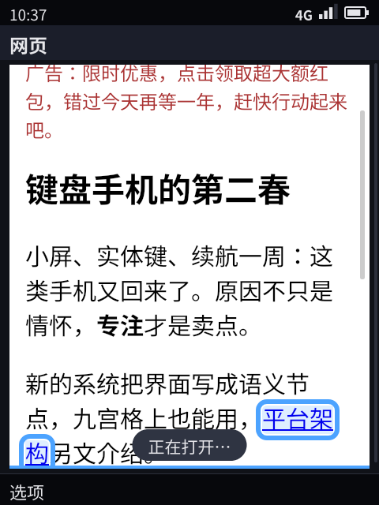
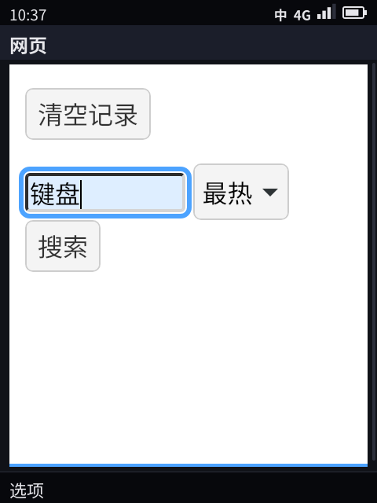
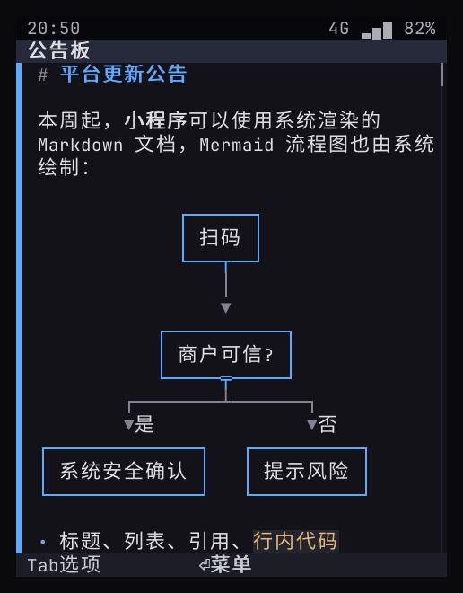
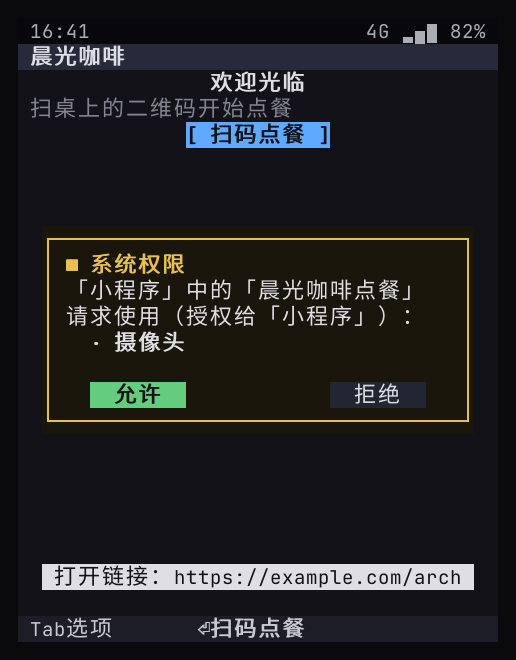
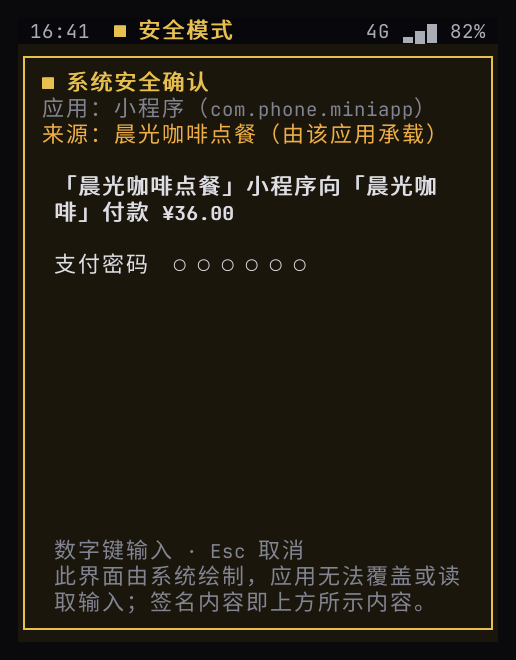

# 复评：TUI 技术路线与应用框架（对照 DeepSeek Harness / dsh-TUI）

> 调研对象：DeepSeek Harness（DSH）及其终端前端 dsh-TUI、dsh-tui。结论中的建议记为 **D5，已依据实测（[15](15-web-vs-semantic-benchmark.md)）确认**。据此落地的代码见 §6，剩余工作见 57-backlog.md（内部文档）。

## 0. 结论先行

1. **dsh-TUI 不是无头浏览器。** 它是 Node.js 进程里的 React 组件，经 Ink / Yoga 排版后直接输出到终端字符格。Markdown 由 JS 解析库转成带样式的文字，图片走 Kitty / Sixel 终端图形协议。另一个同名项目 dsh-tui 基于 pi-tui，DSH 早期官方 TUI 基于 OpenTUI（SolidJS）。浏览器只出现在 DSH 的另一个前端：Web 应用（`dsh-web-app`），与 TUI 并列。
2. **它渲染 Markdown 和 Mermaid 的能力，我们不用浏览器也能做。** 已加入 `doc` 节点：系统渲染 Markdown（标题、列表、引用、行内代码、表格、代码块），链接自动进菜单；Mermaid 用的是 dsh-TUI 同一个库 lovely-mermaid，画成字符框图；终端和设备共用（§6、§8.1）。
3. **浏览器作底座会让「渲染」更丰富，但不会让「平台能力」更丰富。** 超级应用真正依赖的推送、可信支付、设备认证、系统来电界面、相机隐私、按键交互，浏览器都不提供，仍要系统来做，再经 JS 桥暴露（微信 JSSDK 就是这么做的）。代价是内存（实测约 8–10 倍，见 [15](15-web-vs-semantic-benchmark.md)）、功耗、攻击面、按键体验、系统界面可被网页仿冒，终端里要靠 Chromium 级引擎且排版错位（§4）。
4. **D5（已定）：保持「语义优先」，浏览器作为受控组件进入。** 应用框架分四档：原生 `phone.Ui` 应用 → 系统渲染文档 → JS 小程序（JS 逻辑 + `phone.Ui` 视图）→ Web 视图组件（WPE WebKit，承载存量 H5）。前三档已有原型（§5）。
5. **插件生态不是一回事。** DSH 的插件是同一进程内、完全信任的组合（Cordis），适合开发者自己机器上的工具；我们要承载陌生第三方和支付，必须进程隔离 + 能力代理。可以借鉴的是它的组合层、热重载、「一份事件日志，多种前端」和插件声明的命令 / 面板 / 设置——用在系统扩展和开发体验上，不用在第三方应用上（§2）。

## 1. 调研：它们是什么

| 对象 | 事实（来源见文末） |
|------|-------------------|
| **DeepSeek Harness（DSH）** | 「一切皆插件」的 Agent 框架，建在 **Cordis** 上（Koishi 作者 Shigma 的插件元框架）。插件向共享上下文贡献服务、类型化事件和**可撤销的副作用**；模型适配、工具注册表、会话日志、Agent 循环本身都是插件，可在配置里替换。 |
| DSH 组合方式 | **profile** = 有序的 **bundle** 列表 + 用户自己的 `cordis.patch.yml` + `--patch` 叠加层；bundle 是带 `dsh.bundle.patch` 的 npm 包，由 pnpm 安装；patch 按 id 替换或插入配置行；支持热重载。前端有 web（浏览器应用）、headless、SDK（JSON-RPC）、ACP，社区另有多个 TUI。 |
| **dsh-TUI**（ccch1mneyyy） | Node ≥ 22.19。自述管线：`dsh profile → dsh-base → dsh-TUI Cordis patch → 会话事件 → React 组件 → Ink/Yoga 渲染器 → 终端`。功能：流式 Markdown、工具卡片、Kitty / Sixel 图片、LaTeX 转 Unicode 或图片、鼠标、侧栏面板（插件可注册面板）、插件声明的设置页、OSC 777 / 9 / 99 系统通知；长会话按可见窗口渲染。 |
| **dsh-tui**（dsh-tui 组织） | 基于 `@earendil-works/pi-tui`，从 DSH 仓库历史里恢复的官方 TUI，作为树外 bundle 安装。 |
| 你的猜测「内容是无头浏览器」 | **不是。** 浏览器渲染进终端确有先例——Carbonyl（Chromium 直接输出到终端）、Browsh（无头 Firefox）——但那是另一类东西，DSH 的 TUI 没用。 |

## 2. 插件式生态与我们的设计

| 维度 | DSH（Cordis 插件） | 本平台 |
|------|--------------------|--------|
| 扩展单位 | 同一 Node 进程里的插件 | 每个应用一个进程 |
| 信任模型 | 完全信任：插件能读写进程内一切 | 默认不信任：应用只能经 broker 请求能力 |
| 隔离 | 无 | 每应用独立 uid（设备上原型 ✓）+ 能力代理；后续 Landlock / seccomp |
| 组合 | 有序 patch 层，按 id 替换配置行 | manifest + broker；系统侧的产品配置层 ✓（§2.1） |
| 热重载 | 有（可撤销副作用） | 无（应用重启） |
| 界面扩展 | 插件注册命令、面板、设置页、工具卡片 | 应用只声明页面和动作，系统统一呈现 |
| 分发 | npm / pnpm | `.phoneapp` 签名包 + 商城（设计） |
| 面向 | 开发者自己的机器 | 普通用户的手机，含支付 |

**结论**：两者解决不同问题。超级应用不能做成进程内插件——一个插件就能读到支付密钥、伪造系统界面。

**可以借鉴的（已记入 57（内部文档））：**

| 借鉴 | 落到哪里 |
|------|----------|
| 组合层（bundle / profile / patch） | **系统扩展**：一个 Shell 镜像、多种产品形态，按配置层组合 ✓（§2.1） |
| 插件声明贡献点（命令、面板、设置） | 应用在 manifest 里声明命令（进命令面板）、设置（开关、选项、数字、文字四种，「设置 › 应用设置」里系统呈现、核对和保存）、待机小组件（一行字，↓ 选中按 OK 直达应用的深链接），由 Shell 统一呈现 ✓（[22](22-developer-api.md) §2） |
| 会话日志是真源，多个前端是投影 | 我们已经这样做：`phone.Ui` 树是真源，文本渲染器、像素渲染器、headless 自测都是投影——写进架构原则 |
| 渲染意图（工具卡片的 terminal / diff / generic） | 与语义节点同一思想；可增加代码、diff、终端输出类节点 |
| 热重载、`--dump-config` 式诊断 | 模拟器里改 JS 小程序即时刷新；`phone-shell --dump` 输出当前界面树 ✓ |

### 2.1 产品配置层（已实现）

`share/phone/profile.d/*.json` 按文件名顺序逐层叠加，每层是一个 JSON 合并补丁（RFC 7386，和帧补丁同一规则）：`00-base` 是镜像自带的，产品和 OEM 的层排在后面；打开开发者模式时，状态目录下的 `profile.d` 也算进来。镜像里的层在只读、校验过的系统分区上，不需要另外签名；机主自己的层只在开发者模式下生效。`phone-shell --dump-profile` 打印合并结果和每个键最后由哪一层设定（DSH 的 `--dump-config`）。

| 键 | 作用 |
|----|------|
| `product` | 产品名，「关于本机」显示 |
| `hidden_apps` | 这个产品不带的系统应用（不列出、不启动） |
| `app_order` | 主菜单里的顺序，盖过应用清单里的 `order` |
| `settings` | 系统设置的默认值（用户改过的仍以用户为准） |
| `providers` | 把一项能力交给一个系统服务实现（`"location.get": "service:gnss"`）：broker 照常先查权限，再把调用连同调用方身份（应用或「宿主/小程序」）转给 `<run>/<名字>.sock` 的 `capability` 方法，回复原样交还应用。OEM 换定位、计步之类的实现不用改 Shell |

**没有做进程内插件**：DSH 的节点渲染器、设置页插件跑在宿主进程里、完全受信任。我们这边，节点的「长什么样」整个交给可替换的渲染器插槽（[23](23-renderer-protocol.md)），新的节点类型走协议的次版本；能力的实现交给独立进程的提供者服务。两者都不需要把 OEM 代码装进 Shell 进程，崩溃和越权都隔离在外面。验证：单元测试 `TestProfileLayers`（叠加顺序、对象逐成员合并、`null` 删除、来源记录、开发者层只在开发者模式下生效、非法的提供者引用被拒）和 `TestProviderRouting`（能力被转给提供者服务，带着调用方身份，回复原样交回）。

## 3. TUI 技术路线复评

| 做法 | 例子 | 原理 | 优点 | 缺点 |
|------|------|------|------|------|
| 组件树 → 终端字符格 | dsh-TUI（React / Ink / Yoga）、OpenTUI、pi-tui、**本平台**（Go / Bubble Tea + 自研画布） | 组件 → 布局 → 字符格 + 真彩色；图片用 Kitty / Sixel / 半块字符 | 轻、快、SSH 可用 | 排版有限：没有比例字体和复杂 CSS |
| 浏览器排版后降采样进终端 | Carbonyl、Browsh | 浏览器先渲染成像素，再转成字符 | 网页兼容性满分 | 小屏上文字不可读；资源重 |
| 浏览器直接上屏 | KaiOS、Firefox OS、webOS | Gecko / WebKit 直接画到屏幕 | 开发者多、网页生态 | 内存与功耗；每个应用都得自己做方向键导航；系统界面可被仿冒 |

对我们的含义：

- 我们的「TUI」在量产设备上不是终端，而是像素屏。所以真正的选择是「**语义树 + 系统渲染器**」还是「**浏览器引擎直接上屏**」。
- 在终端（开发、SSH、串口）里，浏览器路线只能靠 Carbonyl 这类 Chromium 改版。**更正（实测，见 [15](15-web-vs-semantic-benchmark.md) §3）**：Carbonyl 把文字输出成终端字符，文字可读；问题是按像素排版再映射到字符格——中文字距拉开、溢出屏宽、多一行地址栏、按键没有传到页面，而且背后是完整的 Chromium。语义路线直接按字符格排版。
- 渲染器语言：Node 生态的 TUI 很成熟，但设备上要多带一个 Node 运行时（几十 MB 内存、启动慢）；Go 是单个二进制，原型里帧级视频合成已跑通。**维持 Go，不换 Node。**

## 4. 浏览器作底座，能力真的更丰富吗

| 能力 | 浏览器提供？ | 说明 |
|------|:---:|------|
| 富排版（Markdown / HTML / CSS） | ✓ | 常见部分由 `doc` 节点覆盖；完整 HTML 交给 Web 视图组件 |
| 存量 H5 内容（公众号文章、活动页） | ✓ | 浏览器真正不可替代的价值 → 第 4 档 Web 视图 |
| 音视频播放、WebRTC | ✓ | WebRTC 可作通话传输栈的一个选项；但授权、来电接管、后台通话仍归系统 |
| JS / WebAssembly 生态 | ✓ | 小程序逻辑层用独立 JS 引擎即可，不必带 DOM（已有原型） |
| 应用不在前台时的推送 | ✗ | Web Push 依赖浏览器厂商的推送服务，国内不可用 |
| 可信支付确认、TEE 密钥、设备认证 | ✗ | WebAuthn 覆盖登录，没有「所见即所签」的支付确认 |
| 系统来电界面、通话中指示 | ✗ | — |
| 按键优先交互 | ✗（需逐个适配） | KaiOS 要求每个应用自己做方向键导航，否则退化为虚拟光标 |
| 防仿冒系统界面 | ✗ | 网页能画出一模一样的支付确认框 |
| 文本渲染器（SSH / 串口） | △ | 需要 Carbonyl（Chromium），文字可读但排版错位，见 §3 |
| 资源 | 代价 | 实测：同一聊天页 WPE 约 300 MB、Chromium 约 400 MB，当前实现 39 MB（[15](15-web-vs-semantic-benchmark.md)） |

**结论**：浏览器补的是「内容与渲染」，平台的核心能力仍在系统层。

微信自己的路线是证据：小程序分**逻辑层**（JS 引擎：Android 上 V8、iOS 上 JavaScriptCore，没有 DOM）和**视图层**（WXML / WXSS 声明式）。视图层可以由 WebView 渲染，也可以由腾讯自研的 **Skyline** 引擎渲染——腾讯为了性能，把渲染从 WebView 里拿了出来，还省掉了「每个页面一个 WebView 实例」的开销。`phone.Ui` 在这套结构里正处在 WXML 的位置：厂商要做的映射是「组件 → 语义节点」，而不是「页面 → 像素」。

### 4.1 KaiOS：浏览器做底座的手机系统为什么没有微信、支付宝

**KaiOS 是什么**：Firefox OS 的分支。底下是厂商 Android BSP 的内核、HAL 和无线接口（它叫 Gonk），上面是 Gecko 引擎，系统界面和应用都是网页应用。2.5 版用 Gecko 48；3.x、4.0 版用 Gecko 84 / 123，只在美国发售，不能侧载应用。硬件是 256 MB–1 GB 内存、240×320 的屏。

**技术上做得出精简版，商业上没人愿意做**：

- **WhatsApp 做过**：KaiOS 版有消息、语音消息，2021 年起 512 MB 机型上还能语音通话。2024 年 6 月 Meta 停止新用户使用，2025 年初全部停掉，理由是按使用情况和功能发展做取舍。能做出来，但要为一个小平台单独维护一个网页版、方向键版的客户端，份额一缩就不划算。
- **支付宝只做过付款码**：诺基亚 105 4G（展锐 T107，不是 KaiOS）上，用智能手机扫码绑定后可以单独出示付款码，是阿里 AIoT 和展锐的定制功能。完整的支付宝、微信都没有上过 KaiOS；国内键盘手机要用微信，走的是 Android（多亲 Qin 等）。
- **底层限制抬高了适配成本**：
  - 只能用网页技术写：厂商现成的 C++ 跨平台核心（网络、数据库、加密、音视频引擎）用不上，要用 JS 重写；2.5 版连 WebAssembly 都没有。
  - 后台受限：只有 Service Worker（处理一个事件最多 30 秒）和不可靠的闹钟接口；推送走 Web Push，国内用不了。即时通讯和网络电话的后台需求只能和 KaiOS 谈私有接口。
  - 界面要从头做：每个应用自己做 240×320 的界面和方向键导航，等于一个新客户端。
  - 硬件下限低（256–512 MB），功能得砍到能跑。

所以缺的不是某一项底层能力，而是「为小平台单独做一个客户端」的成本远大于收益：底层限制把成本抬高，份额决定没人愿意付。

**和我们的差别**：

| | KaiOS | 本平台 |
|--|-------|--------|
| 应用怎么写界面 | 网页，应用自己画、自己做方向键导航 | 语义节点（`phone.Ui`），系统按形态和键盘排版、导航；同一个客户端在九宫格、全键盘、横屏上都能用 |
| 语言 | JS（3.x 起有 WebAssembly） | 任何语言的原生进程（Go、C / C++、Python、JS / TS 小程序）；厂商的 C++ 核心库经 C ABI SDK 直接用（[22](22-developer-api.md) §9） |
| 后台与推送 | Service Worker 30 秒；Web Push 国内不可用 | 系统推送长连接与唤醒预算、网络电话后台模式、定时任务（[21](21-push.md)、[17](17-app-sandbox.md) §5） |
| 支付与安全 | 网页接口，没有系统级支付确认 | 系统的可信确认、安全画面、设备证书与应用密钥（[11](11-platform-architecture.md) §7） |
| 小程序与 H5 | 都是网页 | JS 小程序宿主（逻辑层 + 语义视图，与微信小程序同构）；存量 H5 走 Web 视图（§5） |
| 硬件 | 256 MB–1 GB | 2–4 GB（[24](24-sku-framework.md)） |
| 开放 | 闭源，3.x 起不能侧载 | Apache-2.0；兼容测试与认证（[22](22-developer-api.md) §11） |

**我们会不会遇到同样的困境**：在「超级应用来不来」这件事上会。技术能把适配成本压低，但决定权在腾讯、阿里，看的是我们的用户量；WhatsApp 的退出说明，做了也可能因为份额不够撤掉。对策：

1. 首发不依赖微信：定位第二台 / 专注手机（D1），先做我们自己能把应用做全的场景。
2. 把适配成本压到最低：厂商复用现有后端和 C++ 核心，只写一层语义界面；小程序模型与微信同构，迁移的是数据绑定和组件映射，不是重写。
3. 先争取小而具体的接入：付款码、健康码这类功能，支付宝在功能机上做过；我们有系统级安全画面和可信确认，接入只要几个接口（[12](12-super-app-capabilities.md)）。
4. 存量内容走 Web 视图：公众号文章、H5 活动页。商户的网页收银台能不能在 Web 视图里完成支付**未验证**。
5. 规模靠运营商、整机厂合作，而不是等应用来。

## 5. 调整后的应用框架（D5 已定）

| 档 | 写法 | 谁渲染 | 适用 | 状态 |
|----|------|--------|------|------|
| 1. 原生语义应用 | 任意语言输出 `phone.Ui` | 系统 | 系统应用、超级应用主体 | 原型 ✓ |
| 2. 系统渲染文档 | Markdown（后续加 HTML 子集） | 系统 | 文章、帮助、聊天富文本 | **原型 ✓** |
| 3. JS 小程序 | JS 逻辑（无 DOM）+ `phone.Ui` 视图，由宿主应用承载 | 系统 | 超级应用的小程序、轻应用 | **原型 ✓** |
| 4. Web 视图组件 | HTML / CSS / JS（存量 H5） | 文本端：阅读模式（系统文档节点）；像素端：WPE WebKit，经媒体表面合成 | 公众号文章、活动页、小程序 web-view | **原型 ✓**（阅读模式、像素端 `web` 节点） |
| 例外：画布应用 | 任意语言，`canvas` 节点里给图形（矩形、线、圆、点、多边形） | 系统（画成像素；像素端是一张图，文本端是半块字符） | 游戏、地图、图表 | **原型 ✓**（贪吃蛇，[07](07-ecosystem-and-store.md) §0） |

**第 4 档 Web 视图**

已实现的是文本端的阅读模式（`web/reader`）：页面在**宿主应用自己的沙箱里**取回和解析（用它的网络权限），系统不解析不可信的 HTML。正文取 `<article>` / `<main>`，没有时取自己的段落文字最多的元素；去掉脚本、样式、表单、导航、页眉、页脚、侧栏；标题、段落、列表、引用、代码、表格、图片说明转成 Markdown，交给系统的 `doc` 节点排版，链接进菜单（只留 http / https，`javascript:`、`file:` 一律丢掉）。鸿雁里，带网址的消息菜单多一项「阅读模式」；自测用例「网页阅读模式」打开模拟服务器上的一篇公众号文章，检查正文在、广告 / 登录 / 版权页脚都没了、链接在菜单里。

像素端是 `web` 节点（[22](22-developer-api.md) §3）：应用只给网址，页面由系统起的 `phone-webview` 进程渲染（`webview`：C，用 WPE WebKit 的 GObject 接口，和 Igalia 的 Cog、GNOME Web 同一种接法；注入的脚本是单独的 `nav.js`、`bridge.js`，构建时生成头文件）。

- **进程**：**每个宿主应用一个网页进程**，应用里所有 `web` 节点都是它里面的视图，共用一个网络进程、一份 Cookie 和缓存。视图在节点所在的界面还在应用的界面栈里时一直保留，不在屏幕上就告诉引擎「不可见」（暂停绘制、降低定时器频率），回到这一屏时页面状态还在。没有视图 30 秒后进程退出，应用退出时立即结束，系统内存紧张时后台应用的网页进程最先被结束（应用留着，回到页面时重新载入，[17](17-app-sandbox.md) §5.1）；进程崩溃后，在屏幕上的页面在新进程里重新打开，一分钟最多重启 3 次。
- **权限与资源**：设备上以宿主应用的网页 uid（`<应用>/web`，与应用本身不同）在沙箱里运行（[17](17-app-sandbox.md)），数据在 `<应用数据>/web/`；联网跟宿主应用的网络权限走，流量记在宿主名下。网页进程有自己的 cgroup（在应用的组旁边）：内存上限按 SKU 的内存档（1 GB 机型 384 MB、2 GB 机型 512 MB、4 GB 机型 768 MB，没有 SKU 时 512 MB；WPE 的进程树——视图、网页进程、网络进程——开一个普通页面就要约 250 MB，上限再小它就在自己的组里抖动），WebKit 被告知其中 60%，超过时先清缓存、再结束网页进程并重新加载；WebKit 的缓存模型也按内存档：1 GB 机型不留页面缓存和内存缓存（返回上一页时重新载入），2 GB 机型用文档浏览器的，4 GB 机型用网页浏览器的（`--cache-model`）；应用被冻结时网页进程一起冻结。
- **CPU 还是 GPU**：沙箱默认不给网页进程 GPU 设备，Skia 用 CPU 画。SKU 打开 `web_gpu` 且主板有渲染节点时，沙箱只放行渲染节点（`/dev/dri/renderD*`，不是显示设备），WebKit 用 GPU 画。现在的画面都经共享内存交给渲染器，GPU 画完还要读回内存；真正省电的是把 GPU 缓冲（dmabuf）直接交给渲染器合成，要等有 GPU 的真机（R21）。
- **引擎接法**：WPE 的旧接口（libwpe + WPEBackend-fdo，共享内存缓冲）离屏渲染，镜像里现成的 wpewebkit 不用改编译选项；每帧从 BGRX 转成 RGB，写进视图自己的双缓冲媒体表面（与视频同一布局，[23](23-renderer-protocol.md) §4.2），表面的 fd 交给 Shell，Shell 转给渲染器，帧里只带表面名和帧号，像素不经过 Shell。页面按逻辑像素排版，设备缩放系数放大到物理像素，所以按手机网页的宽度布局。
- **交互**：注入的脚本做空间导航——方向键在链接、按钮、输入框、下拉框之间移动：候选必须在焦点边缘之外（同一行矮几像素的按钮不算「下面」），按边到边的距离加两倍的横向偏移选最近的；目标在一屏之内就移过去（就近滚动，中间的文字仍在屏上），更远就先翻 0.8 屏。OK 点击焦点元素，返回键先在页面里后退（前进后退缓存保留页面状态），退到底才交给系统关掉这一屏。
- **表单**：焦点在文本框上时，按键经系统输入法（九宫格、全键盘、拼音候选）输入，Shell 把文本框的内容镜像在自己这边，每次变化经原生 setter 写回页面并触发 `input` 事件（React 一类框架能收到）；密码、数字、电话号码框不走输入法。OK 提交：先给页面发回车键事件，页面没拦下就提交表单。下拉框（`<select>`）用一次真实的空格键打开，选项由系统菜单显示，选中后写回页面。
- **对话框**：页面的 `alert`、`confirm` 显示成系统确认框，`prompt` 显示成带输入框的系统界面（用系统输入法输入，确定或取消把结果交回页面），都写明「「鸿雁」里的网页 <主机>」；离开页面的确认一律放行。
- **文件**：引擎显示不了的内容（附件、压缩包）作为下载存进网页进程自己的目录，下完由 Shell 搬进系统的「文件」区（最大 16 MB），授权给这个网页的来源，提示并发通知「已下载到文件」。页面的 `<input type=file>` 由 Shell 列出「文件」区里类型对得上的文件（系统菜单写明是哪个网页要），选中的那个复制给网页进程，只交出这一个。
- **页面控制**（`web.control`，[22](22-developer-api.md) §4.6.1）：刷新、前进后退、停止、缩放（0.5–3 倍）、页内查找（高亮全部，`n` 下一处，提示「找到 N 处」）、清除本应用的网站数据（Cookie、缓存、本地存储，网页进程先结束）；按网站管理（`sites`）：系统界面列出给这个应用存着数据的网站和各自存了什么（Cookie、网站存储、缓存），选一个确认后只删它的，应用看不到列表也碰不到数据。页面的地址、标题、加载状态、能否前进后退、缩放经 `web` 事件告诉宿主应用。
- **内容拦截**：宿主应用的设置 `content_blocking` 开着时，网页进程带上系统的规则（`share/phone/web/blocklist.json`，WebKit 的内容拦截器格式，编译一次后缓存）启动，拦掉广告和跟踪脚本的请求；改设置会重启网页进程。
- **导航与安全**：只打开 http、https（以及 about、data、blob）；`file:`、`tel:`、别的应用的私有协议都不打开，Shell 记日志；`target=_blank` 和 `window.open` 在同一视图打开。定位、通知、相机、麦克风的网页权限请求一律拒绝，页面要系统能力只能走 `phone.call`。打不开的网页、证书不可信、网页进程反复崩溃都显示一页说明（标题分别是「打不开这个网页」「连接不安全」「这个网页多次崩溃」）。用户代理里带「Kario/0.6」。
- **能力**：页面里的 `phone.call(能力, 参数)` 返回 Promise，经控制通道到 Shell，由 broker 以宿主应用的身份、来源「网页 <主机>」处理——授权记在这个来源名下，系统界面写明是哪个网页在请求（分享面板显示「「鸿雁」里的网页 … 分享…」）。网页可用的能力是白名单：分享、复制、定位、安全确认；签名密钥、扫码、相机、照片、文件等不对网页开放，所以网页能弹出系统的安全确认，但完成不了支付签名。
- **文本渲染器**：同一个节点显示标题、地址、焦点所在的链接、正在输入的文字（含输入法未上屏的部分）和操作提示，方向键照样在页面里移动（画面要像素界面才看得到）；没有网页视图的设备上提示改用阅读模式。
- **离工业级还差**：网页里的视频（web 镜像为了零 GPLv3 去掉了 GStreamer 插件，H.264 要硬件解码，随真机）、全屏**未实现**（R39）；读屏不做（键盘机上用得极少）；GPU 缓冲直通渲染器随 R21。

**浏览器应用**（`apps/browser`，菜单里的「浏览器」）：首页是地址栏（网址或搜索词，搜索引擎在应用设置里选必应或百度）、书签和最近访问；打开后整屏是 `web` 节点。选项菜单里有地址栏（`g`）、刷新（`r`）、加书签（`b`）、页内查找（`s`，`n` 下一处）、放大缩小（`+` / `-`）、前进（`f`）、分享链接（`h`）、网站数据（`d`，按网站删除）、清除网站数据（`x`）；下载的 WebM 视频进「文件」后，系统问要不要也加入「图片」；返回键先在页面里后退。历史和书签存在应用自己的数据目录。网页引擎就是现成的精简开源引擎 WPE WebKit（嵌入式用的 WebKit 移植，不带浏览器外壳），我们只写外壳；不在屏幕上的网页视图不画，没有网页视图 30 秒后网页进程退出，应用退出时立即结束，平时不打开浏览器就没有负载。

自测用例「网页视图」（需要 `phone-webview` 和像素渲染器，否则跳过）：在鸿雁里打开同一篇公众号文章，文章按原样显示（每次焦点移动后都核对网页视图送来了新帧、且不是纯色，渲染失败的黑屏或白屏会让用例失败）；方向键经过页眉的「首页」移到正文里的「平台架构」；回待机再从命令面板回到鸿雁，焦点还在「平台架构」，没有重新加载；打开链接、返回键后退；再移到「分享这篇文章」按钮，页面调 `phone.call('share.open')`，系统分享面板标注网页来源，取消后页面拿到错误。用例「网页表单」：同一个应用里再打开站内搜索页，核对没有启动第二个网页进程；页面的确认框以系统对话框出现并标注网页来源；文本框里输入「键盘」，下拉框经系统菜单选「最热」，OK 提交后页面标题变成「搜索：键盘（最热）」；返回后从前进后退缓存恢复，文本框里的字还在。用例「浏览器」：在地址栏输入模拟服务器的工具页，页面里的广告脚本被拦掉（页面标题成了「工具页：没有广告」）；页内查找「键盘」报「找到 1 处」；加书签；点「下载说明书」，`manual.txt` 进了「文件」区；网页的选文件框由系统列出它（带大小），选中后页面显示「已选：manual.txt」；页面的 `prompt` 出现系统的「网页提问」界面，输入「键盘机」后页面显示它；返回键退到浏览器首页，书签和最近访问都在。开发机没有 WPE 包，`make web-selftest` 在 Debian 容器里编译和运行 `phone-webview`；设备上随 web 镜像（`kas/web.yml`）的开机自测跑。

| 文章按原样显示，方向键停在正文链接上 | 表单：输入法写进文本框，下拉框经系统菜单选择 |
|:--:|:--:|
|  |  |


## 6. 已落地（原型）

| 内容 | 要点 | 验证 |
|------|------|------|
| `doc` 节点 | goldmark 解析，系统按字符格排版；链接自动成为菜单动作（`link:N`，值为 URL）；超出屏幕的长文档先滚动再移焦点；中文禁则（右括号、标点不出现在行首） | 自测「文档节点」；单元测试 |
| JS 小程序宿主（`apps/miniapp`） | goja 引擎，每个小程序独立运行时；回调超过 300ms 被中断；`Page({data, render, onAction})` + `setData` 数据绑定；`phone.*` 桥（`scanCode`、`requestPayment`、存储、导航），先查小程序自己声明的权限 | 自测「小程序：数据绑定」「扫码点餐 + 支付」 |
| 来源标注 `origin` | 宿主代小程序请求能力时，权限框、扫码界面、安全确认框都写明「X 小程序（在 Y 中）」；授权仍归宿主应用 | 同上（截图 13、14） |
| 每应用独立 uid | Shell 以 root 运行时，每个应用一个 uid、只拥有自己的数据目录；系统服务 socket 与密钥文件对应用不可达 | QEMU 上「沙箱自检 5/5」 |
| Mermaid 图 | `doc` 里的 ```` ```mermaid ```` 代码块由系统画成字符框图（§8.1） | 自测「文档节点」；单元测试 4 个 |
| 代码高亮、公式 | 代码块按语言着色；`$…$`、`$$…$$`、```` ```math ```` 转成 Unicode 文本（§8.2） | 单元测试：12 种语言的分词、LaTeX 转换、价格里的 `$` 不误判 |
| TypeScript 小程序 | `app.ts` 加载时去类型；`phone.d.ts` 提供类型（§8.4） | 点餐小程序改为 TS，自测通过；`tsc` 严格模式通过 |
| TSX 视图 | `app.tsx` 的 JSX 编译成 `h()` 调用，产出的仍是 `phone.Ui` 节点（§8.4） | 便签小程序改为 TSX，自测通过；单元测试核对节点形状 |
| 系统输入法 | 九宫格 / 全键盘，中英文候选与联想（[16](16-input-method.md)） | 自测 3 个用例；单元测试 8 个 |

| 文档节点 | 小程序授权（标注来源） | 小程序支付（系统安全确认） |
|:--:|:--:|:--:|
|  |  |  |

## 7. 决策状态

**D5（已定）**：采用「语义优先」四档结构（§5）——浏览器不作底座，只作为第 4 档按需启动的组件；DSH 式进程内插件只用于 OEM 系统扩展，不用于第三方应用。依据是实测对比 [15](15-web-vs-semantic-benchmark.md)。

## 8. 答疑

### 8.1 Mermaid 要不要浏览器？dsh-TUI 怎么做的？

- **官方 mermaid.js 确实要浏览器**：它用 DOM 和 SVG 排版，命令行版 `mmdc` 背后是无头 Chromium。
- **dsh-TUI 没用它**，用的是 **lovely-mermaid**（Apache-2.0）：纯 JS 重写了 Mermaid 的解析和布局，直接输出 Unicode 框线字符画，不需要 DOM。它的其它渲染件也是同样的思路：Markdown 用 marked，代码高亮用 highlight.js，公式用 MathJax 转 Unicode 或图片，都不需要浏览器。
- **我们用的是同一个库**：打包成一个 87 KB 的 JS 文件，嵌进 Shell，在 goja 里运行。
  - 支持流程图、时序图、状态图、类图、ER 图、饼图（画成条形）、思维导图、时间线、gitGraph，9 种都在单元测试里实际渲染过（含中文）。
  - 小屏适配：横向流程图（LR）太宽时自动改画成纵向（TD）；还放不下就显示源码，并提示需要多少列。
  - 性能（本机）：首次加载加第一张图约 40 ms，之后每张约 10 ms；单次渲染超过 800 ms 会被中断。
- 像素渲染器（R1）上照样画这份字符图（等宽字体）；以后需要时，再把它的布局结果画成矢量线条。

### 8.2 dsh-TUI 渲染器、DSH 插件系统、本平台：三方对比

| | dsh-TUI（渲染器） | DSH（插件系统） | 本平台 |
|---|---|---|---|
| 是什么 | 终端里的聊天界面前端 | Agent 框架的扩展机制 | 手机系统的应用框架 + 系统渲染器 |
| 运行时 | Node.js ≥ 22 | Node.js（Cordis） | Shell 和宿主是 Go 单二进制；小程序 JS 跑在 goja |
| 界面由谁画 | **应用自己画**：React 组件，经 Ink / Yoga 排版成字符格 | 插件注册面板、命令，由前端去画 | **应用只描述，系统来画**：应用给 `phone.Ui` 语义树 |
| 按键、焦点、返回 | 各组件自己处理 | — | 系统统一：焦点、菜单、返回栈、输入法 |
| Markdown / Mermaid | marked / lovely-mermaid | — | goldmark / lovely-mermaid（同一个库） |
| 代码高亮、公式 | highlight.js、MathJax | — | 内置的小分词器；LaTeX 转 Unicode（下文） |
| 图片 | Kitty / Sixel 终端图形协议 | — | 终端里用半块字符；设备上直接画像素 |
| 扩展边界 | 同一进程 | 同一进程，**完全信任** | **每个应用一个进程 + 独立 uid + 能力代理** |
| 换前端 | — | 同一份会话日志，web / TUI / SDK 多个前端 | 同一棵 `phone.Ui` 树，文本 / 像素 / 自测多个渲染器 |
| 面向 | 开发者桌面 | 开发者 | 普通用户的手机、陌生第三方、支付 |

**代码高亮和公式**都在 Shell 的排版器里做，像素渲染器只是按样式画字符片段，所以两种界面一致：

- **代码高亮**：每种语言一张表（关键字、注释符、字符串引号），按行分词，块注释可以跨行；分四类着色：关键字、字符串、注释、数字。支持 Go、JS / TS、Python、Rust、C、C++、Java / Kotlin、Shell、JSON、TOML、YAML、SQL，别的语言保持单色。不用 chroma 这类完整高亮库：它会给 Shell 增加好几 MB，小屏上四类颜色已经够用。
- **公式**：`$…$` 行内，`$$…$$` 或 ```` ```math ```` 单独成行。不做排版，转成 Unicode 文本：`x^2 + y^2 = r^2` → x² + y² = r²，`\sum_{i=1}^{n} a_i` → ∑ᵢ₌₁ⁿ aᵢ，`\frac{a+b}{2}` → (a+b)/2，`\sqrt{x+1}` → √(x+1)，`\mathbb{R}` → ℝ。没有 Unicode 形式的退化成可读的写法，如 `e^{i\pi}` → e^(iπ)；重音（`\hat`、`\bar`）只保留字母。`$` 的判定沿用 pandoc 的规则，「价格 $5 到 $10」不会被当成公式。像素渲染器用 DejaVu Sans 兜底 Noto CJK 没有的上下标字符。

**根本差别是「谁来画界面」。** dsh-TUI 让应用（React 组件）自己画，灵活，但每个应用的按键习惯、样式都可能不同，网页或组件也能画出一个假的支付框。本平台让应用只描述内容和动作，由系统统一画。代价是表现力受语义节点限制；换来的是：小屏上按键体验一致，系统界面无法被仿冒，同一个应用可以在终端、像素屏和自测里各用一个渲染器。

**插件系统的差别是「信任边界」。** DSH 的插件和宿主在同一进程，能读写一切，适合开发者在自己机器上组合工具。超级应用和支付不能这样做，所以第三方应用一律进程隔离。DSH 值得借鉴的组合层、贡献点、热重载，我们只用在 OEM 系统扩展和开发体验上（§2、§2.1）。

### 8.3 「语义 UI + JS」的底层是什么

```
小程序源码（TypeScript / JavaScript）
   │  加载时：esbuild 去掉类型（TS）
   ▼
goja：纯 Go 写的 JS 解释器（ES5.1 + 大部分 ES2015+；没有 DOM，没有 JIT）
   │  Page({data, render, onAction}) / setData / phone.*（扫码、支付、存储、导航）
   ▼
宿主应用 phone-app-miniapp：Go 进程、独立 uid，每个小程序一个 JS 运行时，回调限时 300 ms
   │  phone.Ui：JSON 行，经 Shell 传给应用的 fd 3（socketpair）
   ▼
Shell（Go）：焦点、菜单、返回栈、输入法、系统对话框、能力代理（broker）
   │  渲染器：文本（Bubble Tea + 自研字符画布，CJK 双宽、真彩色、半块像素） ‖ 像素（Slint，R1）
   ▼
终端 / 串口 / SSH ‖ 手机屏（DRM/KMS）
```

- **没有 Node.js，没有浏览器，没有 DOM。** JS 只负责逻辑和数据，`render()` 返回语义节点，界面由 Shell 画。
- 原生应用跳过上面两层，用任意语言直接输出 `phone.Ui`（已有 Go、Python 的例子）。
- 结构上与微信小程序一致：逻辑层是 JS 引擎，视图是声明式的语义树（对应 WXML），由系统渲染（对应 Skyline）。
- goja 是解释器，比带 JIT 的 V8 慢得多，但对界面逻辑够用；实测小程序宿主进程约 14 MB。以后如果性能不够，可以换成 QuickJS 或 V8，应用代码不用改。

### 8.4 能换成 TypeScript 吗

**能，已实现。**

- 小程序目录里放 `app.tsx`、`app.ts` 或 `app.js`（按这个顺序找）。宿主加载时用 esbuild（Go 库，编进宿主）去掉类型，再交给 goja。语法错误会报出行号和列号。
- **类型检查放在开发时做。** `apps/miniapp/types/phone.d.ts` 声明了 `Page`、`setData`、`phone.*` 和全部节点类型，`tsc --noEmit` 用严格模式检查。点餐小程序已经改写成 TS，`tsc` 和自测都通过。
- **量产时**，TS 在打包签名阶段就编译成 JS。设备上只运行 JS，宿主不再需要带 esbuild（目前宿主二进制 21.8 MB，其中有一部分是 esbuild）。
- **TSX 视图**：esbuild 把 `<item title="x"/>` 编译成 `h("item", {title: "x"})`，`h()` 和 `Fragment` 由宿主的预置脚本提供。元素就是同名的 `phone.Ui` 节点，文本子节点拼成节点的 `text`，函数是组件，数组会展开。没有虚拟 DOM 和差分：`render()` 每次产出整棵语义树，比较和局部刷新由 Shell 和渲染器负责（[23](23-renderer-protocol.md) 的 `patch`）。`phone.d.ts` 里有 JSX 的元素类型，`tsc` 用 `"jsx": "react"`、`"jsxFactory": "h"` 检查。

```tsx
render() {
  return <>
    <input id="new" placeholder="写一条便签，Enter 保存" submit="add" clear={true} />
    <section>共 {notes.length} 条</section>
    {notes.map((n, i) => <item id={"n" + i} title={n} actions={[ui.danger("del", "删除")]} />)}
  </>;
}
```

## 来源

- DeepSeek Harness 架构：<https://github.com/deepseek-ai/deepseek-harness/blob/master/docs/architecture.md>
- dsh-TUI：<https://github.com/ccch1mneyyy/dsh-TUI>；dsh-tui：<https://github.com/dsh-tui/dsh-tui>；发布讨论：<https://github.com/deepseek-ai/deepseek-harness/discussions/4587>
- Cordis：<https://cordis.moe/>
- 微信小程序运行环境与 Skyline：<https://developers.weixin.qq.com/miniprogram/dev/framework/runtime/env.html>、<https://developers.weixin.qq.com/miniprogram/dev/framework/runtime/skyline/introduction.html>
- Carbonyl：<https://github.com/fathyb/carbonyl>；Browsh：<https://github.com/browsh-org/browsh>
- KaiOS：版本与应用（<https://kaios.dev/faq/>）、后台执行（<https://kaios.dev/2023/10/running-in-the-background-on-kaios/>）、平台架构（<https://consumer.kaiostech.com/platform>）
- WhatsApp 停止支持 KaiOS：<https://faq.whatsapp.com/420008397294796>、<https://announce.data.kaiostech.com/>；KaiOS 上的 WhatsApp 语音通话：<https://kaiostech.com/knowledge-base/activate-whatsapp-voip/>
- 诺基亚 105 4G 的支付宝付款码（展锐 T107）：<https://news.qq.com/rain/a/20210709A0ATXL00>
