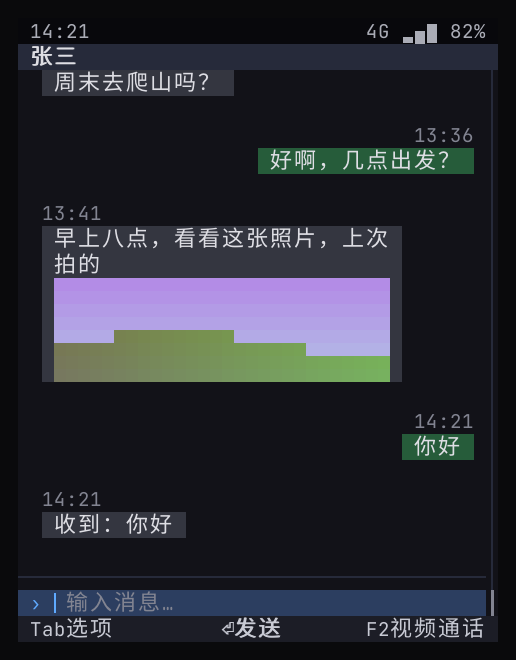
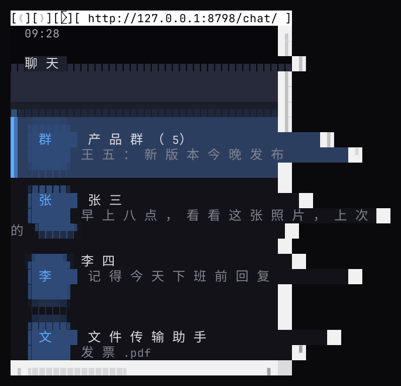

# 实测对比：当前实现（语义 UI）vs Web 路线

> 目的：给 D5（顶层应用怎么构建）提供实测依据。同一个聊天应用做了两份：现有的 `apps/chat`（Go，`phone.Ui`），以及新写的 Web 版 `web/chat`（HTML / CSS / JS，按键交互自己实现）。测量脚本：`bench/bench.py`（启动时间、整棵进程树的 PSS / RSS、空闲 CPU），`bench/web-keys.mjs`（Web 版按键端到端），`bench/term-shot.py`（终端截屏）。
> 本机：Rocky 8.10，x86_64，48 核；WPE 在 Debian trixie 容器里跑（本机没有 WPE 包），没有 GPU，走软件渲染。设备（AArch64 QEMU）结果见 §5。

## 0. 结论先行

1. **内存差一个数量级。** 同样显示聊天列表：当前实现整套 **39MB**（含 Shell、聊天应用和媒体、密钥两个系统服务）；WPE **约 300MB**，Chromium **约 400MB**，而且 Web 这边还没算任何系统服务。
2. **多开应用时差距更大。** 当前实现每多一个应用约 **8MB**（一个 Go 进程），JS 小程序约 **14MB**；一个 WPE 内容进程约 **200MB**（软件渲染），一个 Chromium 渲染进程约 **40–110MB**。2GB 内存的手机上，Web 路线能常驻的应用屈指可数。
3. **启动在本机都不到 1 秒**（当前实现 0.07 秒，WPE / Chromium 0.3 秒左右）；**设备上（AArch64 QEMU）当前实现 1.1 秒，WPE 6.7 秒**，内存 66 MB 对 413 MB，安装体积 12.8 MB 对 211 MB（§5）。
4. **Web 的真实优势是排版和存量 H5**，这一点实测确认：Chromium 里的 Web 版画面和现有实现相当，富排版能力更强。
5. **Web 的代价不止资源。** Web 版应用代码里 **57% 是自己写的按键交互层**（焦点、菜单、返回栈、软键），我写的时候还出了一个输入框状态同步的 bug；在终端里要靠 Carbonyl（即 Chromium）才能显示，文字可读但排版错位，按键也没有传到页面上。
6. **结论（D5 已定）**：顶层应用按语义 UI 构建（第 1–3 档）；Web 引擎只作第 4 档组件，在打开 H5 内容时启动、关闭即回收，不作应用的常驻运行时。想用 JS 写应用的开发者走第 3 档 JS 小程序：保留 JS，成本约 14MB。

## 1. 被测对象

| 路线 | 内容 | 版本 |
|------|------|------|
| 当前实现 | `phone-shell` + `phone-app-chat` + `phone-mediad` + `phone-keystored`，终端里的文本渲染器 | 本仓库 |
| WPE | cog（headless 平台）加载 Web 版聊天页，480×640 | cog 0.18.4，WPE WebKit 2.48.3（Debian trixie） |
| Chromium | headless 模式加载同一页面，480×640 | Chrome for Testing 158 |
| JS 小程序 | `phone-app-miniapp` 运行「晨光咖啡点餐」（goja） | 本仓库 |

公平性说明：
- 当前实现**还没有像素渲染器**（R1，未做），数字是文本渲染器的；像素渲染器会增加内存，待 R1 实测。
- 当前实现的数字**包含**媒体和密钥两个系统服务（约 14MB）；Web 那边**不包含**任何系统服务，所以 Web 的数字是下限。
- Web 版功能比现有聊天应用少：没有视频通话、来电、通知（这些要 WebRTC + 系统接口），代码量对比因此偏向 Web。

## 2. 结果

| 指标 | 当前实现 | JS 小程序（第 3 档） | WPE 2.48 | Chromium 158 |
|------|---------:|---------:|---------:|---------:|
| 冷启动到聊天列表 | **0.07 s**（含启动两个服务、主屏幕、拉起应用） | — | 0.30 s（首次 2.6 s：建字体缓存） | 0.34 s（排除 D-Bus 超时后，见 §4） |
| 常驻内存 PSS（整棵进程树） | **39–41 MB**，4 个进程 | 50 MB，4 个进程 | 302–309 MB，3 个进程 | 393–412 MB，13 个进程 |
| 其中最大的进程 | Shell 16–20 MB | 小程序宿主 14 MB | WebProcess 约 198 MB | 浏览器主进程 约 110 MB |
| 每多开一个应用（估算） | **≈ 8 MB** | ≈ 14 MB | ≈ 200 MB（一个 WebProcess） | ≈ 40–110 MB（一个渲染进程） |
| 空闲 CPU | 0.8–1.0%（状态栏时钟每 500ms 重绘，可优化） | 1.0% | 16–17%（headless 平台自身的帧循环，不可比） | 0.4% |
| 安装体积 | 41 MB（3 个服务 + 5 个应用，含 JS 引擎，未 strip） | 含在左边 | 约 175 MB（引擎 + ICU + GStreamer 等） | 413 MB |

每个进程的明细（取最后一次）：

| 当前实现 | PSS | WPE | PSS | Chromium（前 4） | PSS |
|----------|----:|-----|----:|------------------|----:|
| phone-shell | 20 MB | WPEWebProcess | 198 MB | chrome（浏览器） | 109 MB |
| phone-app-chat | 8 MB | cog | 64 MB | chrome | 64 MB |
| phone-keystored | 7 MB | WPENetworkProcess | 43 MB | chrome | 42 MB |
| phone-mediad | 7 MB | | | chrome | 37 MB |

## 3. 开发与交互

| 方面 | 当前实现 | Web 版 |
|------|----------|--------|
| 聊天应用代码 | `apps/chat/main.go` 458 行（含视频通话、来电、通知、机器人回复） | 269 行（JS 197 行非空代码），**其中按键交互层 113 行 = 57%**；没有视频通话、来电、通知 |
| 按键可达（同一流程：选会话、发消息、消息菜单、引用、转发、返回） | 自测全部通过，由系统保证 | 7/7 通过（`web-keys.mjs`），但焦点、菜单、返回栈、软键都是应用自己写的；第一次跑时「引用」失败——输入框的值同时存在于 DOM 和 JS 变量里，重绘时被覆盖，修复后通过 |
| 系统界面防仿冒 | 应用只能交语义节点，可以用文字模仿对话框内容，但画不出系统对话框的边框和配色；状态栏「安全模式」由系统画 | 网页能画出像素级一致的对话框；只能靠系统占住状态栏、全屏 overlay 来区分 |
| 富排版、存量 H5 | Markdown `doc` 节点；不支持 H5 | 完整 |

| 当前实现（终端，40×24） | Web 版（Chromium，480×640 像素） | Web 版在终端（Carbonyl，40×24） |
|:--:|:--:|:--:|
|  |  |  |

终端（SSH、串口、开发机）这一项要更正 [14](14-tui-route-and-app-framework.md) §3 的说法：Carbonyl 会把文字输出成终端字符，**文字是可读的**，并不是「完全不可读」。实际问题有三个：
- 页面按 CSS 像素排版后再映射到字符格，中文字之间被拉开、内容溢出 40 列；
- 多出一行浏览器地址栏；
- 按键（下、回车）没有传到页面上，截图停在列表页。

要在终端里好用，得为字符格专门写样式并处理浏览器外壳的按键归属，而且背后仍是一个完整的 Chromium。

## 4. 测量中的问题（如实记录）

- **Chromium 起初每次启动 25 秒**：恰好是 D-Bus 调用的默认超时，它在等这台服务器上不存在的桌面服务（如密钥环）。设置 `DBUS_SESSION_BUS_ADDRESS=disabled:` 和 `--password-store=basic` 后降到 0.34 秒；表里用的是后者。
- **Chromium 默认走环境里的公司代理**，连不上本机测试服务器，需要 `--no-proxy-server`。
- **WPE 的空闲 CPU** 在默认和 Skia CPU 渲染两种模式下都是 16–17%，同一页面在 Chromium 只有 0.4%，判断是 cog headless 平台的固定帧循环；真实设备走 DRM 平台，按垂直同步、只重绘变化区域，此项不可比。
- **我写的 Web 版第一次跑不起来**：在普通脚本里定义的 `top()` 与浏览器全局 `window.top` 冲突，改名后正常。
- **没有 GPU**：WPE 和 Chromium 都走软件渲染。有 GPU 时 CPU 侧内存会少一些，但显存另算，PSS 统计不到。

## 5. 设备上（AArch64，Yocto，QEMU）

WPE WebKit 2.52.6 + cog 已加入 `yocto/kas/web.yml`，镜像带开机测量服务（内核参数 `phone.bench=1`）：同一台虚拟机里先测当前实现、再测 WPE，打印结果后自动关机。

实测（qemuarm64，x86 主机上 TCG 模拟，2GB 内存，每项 3 次）：

| 指标 | 当前实现 | WPE 2.52（cog headless） | 倍数 |
|------|---------:|---------:|---:|
| 冷启动到聊天列表 | **1.09 s** | 6.70 s | 6× |
| 常驻内存 PSS（整棵进程树） | **66.4 MB**，4 个进程 | 412.5 MB，3 个进程 | 6× |
| 不算系统服务（只算 Shell + 聊天应用） | **37.6 MB** | 412.5 MB（不含任何系统服务） | 11× |
| 空闲 CPU | 8.2% | 104.8% | — |
| 安装体积（Yocto 已 strip） | **12.8 MB**（Shell、服务、全部应用） | 211 MB（引擎 + cog + 依赖库） | 17× |

| 当前实现 | PSS | WPE | PSS |
|----------|----:|-----|----:|
| phone-shell | 22.6 MB | WPEWebProcess | 381.9 MB |
| phone-keystored | 15.4 MB | WPENetworkProcess | 20.4 MB |
| phone-app-chat | 15.0 MB | cog | 19.8 MB |
| phone-mediad | 14.8 MB | | |

解读：
- **数量级结论不变，差距比本机更大。** 本机内存约 8 倍，设备上 6 倍（含系统服务）到 11 倍（不含）；启动时间在本机两边都不到 1 秒，设备上 WPE 要 6.7 秒。
- 上表是 Go 程序还动态链接 Go 标准库（`libstd.so`）时测的：设备上三个小进程（聊天应用、两个服务）各比本机多约 7–8 MB，当前实现从 39 MB 升到 66 MB。WebProcess 从 198 MB 升到 382 MB。
- **多出来的 7–8 MB 来自链接方式，已经修掉。** Yocto 在 aarch64 上默认让所有 Go 程序链接共享的 `libstd.so`（`GO_DYNLINK`）。这个库有 5.9 MB 的指针表（`.data.rel.ro`，24 万条重定位），每个进程加载时动态链接器都要把它改写一遍，变成该进程私有的脏页。现在 phone-fw 配方关掉 `GO_DYNLINK` 和 cgo，每个程序是静态的 PIE，只重定位自己的约 0.25 MB。设备自测跑完后的实测：小应用（计算器、电话、闹钟、音乐）从约 12 MB 降到 3.3–3.8 MB，和本机一样；keystored 从 11.6 MB 降到 4.3 MB；整棵进程树（Shell、渲染器、8 个服务、10 个应用）从约 314 MB 降到 191 MB。设备内核没有透明大页，与此无关；本机的透明大页另见 [11](11-platform-architecture.md) §5。
- TCG 模拟会把 CPU 时间放大很多，空闲 CPU 只看相对关系；WPE 的 104.8% 主要来自 headless 平台的固定帧循环（§4），真实设备走 DRM 平台时会低很多。
- 当前实现测的是开机后进入聊天列表，没有用到输入法；输入法现在是独立进程 `phone-imed`，私有内存约 4 MB（[16](16-input-method.md) §6）。WPE 这边没有输入法。

构建备注：第一次编译 WPE 2.52 失败——它的图片解码器无条件引用 GStreamer 头文件，而裁掉 `video` 开关后 GStreamer 没进依赖；已把 `video` 加回 `web.yml`。第二次编译到 8118/9293 步时，编译器被 OOM 杀掉：构建用户的 cgroup 上限是 48 GB，单个编译进程最高约 5.5 GB，因此把 WebKit 的并行度限制为 8。WebKit 单独开了 ccache（meta-phone 的动态层 `dynamic-layers/webkit`，只在 meta-webkit 在构建里时生效；不全局开，因为 ccache 类会把设置导出到所有任务，全局开等于让整个 sstate 失效）：冷缓存完整编译 108 分钟，任务签名变了但源码和编译参数没变时重编只要 3.2 分钟。缓存在构建目录的 `ccache/` 下，清理 `tmp/` 不受影响；kas 容器里用的是 Yocto 自己编的 ccache，不是宿主机的。

## 6. 对顶层应用构建方式的含义

| 选项 | 内存（本机实测） | 按键体验 | 终端渲染 | 存量 H5 | 适合 |
|------|------|------|------|------|------|
| A. 语义 UI 应用（第 1 档） | 每应用 ≈ 8 MB | 系统保证 | 原生 | 不支持 | 系统应用、超级应用主体 |
| B. JS 小程序（第 3 档） | 每个 ≈ 14 MB | 系统保证 | 原生 | 不支持 | 想用 JS 的开发者、超级应用的小程序 |
| C. Web 视图组件（第 4 档） | 每个 ≈ 40–200 MB，用完回收 | 引擎空间导航 + 应用配合 | 降级为阅读模式 | 支持 | 文章、活动页、小程序 web-view |
| D. 浏览器作应用底座 | 引擎 300–400 MB 起，每应用 +40–200 MB | 每个应用自己写（本例 57% 代码） | 需要 Chromium 级引擎，排版错位 | 支持 | — |

**D5（已定）**：采用 A + B 作为顶层应用的构建方式，C 作为按需启动的组件，不采用 D。设备数据（§5）已补齐，数量级结论不变，差距比本机更大。
