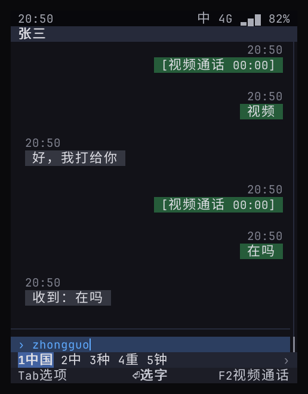
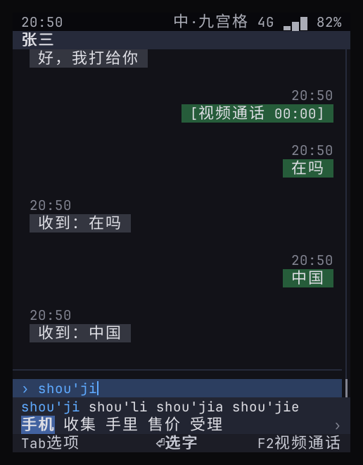
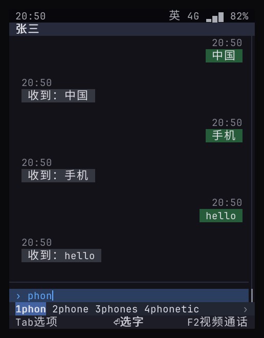

# 输入法：九宫格与全键盘、中英文、候选与联想

> 状态：**原型 ✓**（`ime` + 独立进程 `phone-imed`，本机与设备自测 6 个用例 + 单元测试）。按键已对齐诺基亚的习惯，依据和差异见 [18](18-nokia-form-factors.md)。量产待办见 §8，剩余工作见 57（内部文档）。

## 0. 结论

- 输入法是**系统服务**，和安全确认框同一层：按键先到输入法，应用只收到上屏后的文字，拿不到原始按键；密码框不经过输入法。
- **两种键盘，一套引擎**：全键盘（QWERTY）和九宫格（T9）。
- **中文**：全拼、未打完的音节（`zhongg`）、首字母简拼（`zg` → 中国）、部分上屏（先上屏「我们」，剩下的 `zhongguo` 继续组词）、上屏后**联想**（中国 → 人 / 特色 / 政府…）；九宫格多一行**拼音选择**（`shou'ji / shou'li …`）。
- **英文**：全键盘按前缀**补全**（`phon` → phone / phones / phonetic）；九宫格为传统 **T9 预测**（`43556` → hello，长度相同的词优先）。
- **标点**：中文模式自动转全角（，。？！），紧跟数字时保持半角（`6.5`、`1,000`）。
- **输入框可声明键盘类型**：`number` / `phone` 直接输入数字，`email` 自动切英文（对应 Android 的 inputType）。
- **词库**：AOSP 谷歌拼音输入法词库 65105 条 + AOSP LatinIME 英文词表 6 万词，均为 Apache-2.0。

## 1. 架构位置

```
按键 ──► Shell ──RPC──► phone-imed（ime 引擎 + 用户词库）
          ▲  每次调用带回完整状态      │ 组词、候选、联想
          │                           ▼  词库：share/phone/ime.dict，映射进内存
   系统绘制候选栏 ◄── 状态快照（预编辑、候选行、模式）
          │
   上屏文字 ──► 输入框的值 ──► 应用收到 action（含该页所有输入框的值）
```

`phone.Ui` 协议不变：应用只在提交时收到输入框的值。

- **独立进程**：`phone-imed` 持有引擎和用户词库，Shell 把按键转给它，拿回的状态（预编辑、候选行、模式指示、是否要开符号表）缓存起来供绘制，绘制从不等待服务。每次调用限时 2 秒，输入法卡死也不会卡住 Shell。
- **崩溃隔离**：`phone-imed` 崩溃只丢掉当前这次组词。Shell 立刻改用内置的同一套引擎接着打字（不带用户词库，用户词库只归 `imed`），2 秒后重连；设备上 systemd 经套接字激活重启它，Shell 自己拉起服务时由 Shell 重启。内置引擎里组到一半的词会在内置引擎里打完，再切回 `imed`。
- **沙箱**：systemd 单元里不给网络、不给设备，除自己的状态目录外只读。

## 2. 按键

按键对齐诺基亚：九宫格按 Series 40 / S60，全键盘按 E71 / E90。逐键依据见 [18](18-nokia-form-factors.md) §3、§4。

**九宫格**

| 键 | 拼音 | 智能英文 | Abc / abc / ABC（多击） |
|----|------|----------|--------------------------|
| 2–9 | 数字串按音节编码切分 | T9 预测 | 连按切换字母，约 1 秒或按 ▶ 确认 |

笔画模式（§5.3）：1 横、2 竖、3 撇、4 点、5 折，按书写顺序打；6 代替记不清的一笔；7–9 不用；▼ 之后 1–5 选字、OK 上屏，和拼音相同。预编辑区显示打过的笔画（一丨丿丶乛）。
| `*` | 下一个拼音 | 下一个词 | 打开符号表 |
| `0` | 音节分隔符 | 上屏并加空格 | 空格 |
| `1` | 音节分隔符 | 上屏并打开标点栏 | 标点多击 |
| ▼ | 进入编号模式，之后 1–5 直接选字 | 同左 | — |
| ▲ | 回到拼音行，◀ ▶ 选拼音，OK / ▼ 锁定 | 翻页 | — |
| ◀ ▶ | 移动候选高亮 | ▶ 上屏不加空格，◀ 上一个词 | ▶ 确认当前字母 |
| OK | 上屏 | 上屏 | 确认当前字母 |
| C / 退格 | 删一个数字 | 同左 | 取消当前字母 |
| 返回 | 取消组词 / 关闭联想栏 | 同左 | 同左 |

| 没在组词时 | 作用 |
|------------|------|
| `#` 短按 | 切换模式：拼音 → 笔画 → 智能英文 → Abc → abc → ABC（国行诺基亚的顺序） |
| `#` 长按 | 切到 123，再长按回到原模式 |
| `*` 短按 / 长按 | 打开系统符号表（再按 `*` 翻页） |
| `1` | 打开标点栏 |
| 数字长按 | 直接输入该数字 |

上屏后出现联想栏，第一项高亮，OK 选中（S60 做法）；要发送消息，先按返回关掉联想栏。

**全键盘**

| 键 | 中文 | 英文 |
|----|------|------|
| 字母 | 拼音 | 组词 |
| 空格 | 上屏当前候选 | 上屏并加空格 |
| 1–5 | 选第几个候选 | 同左 |
| ◀ ▶ / ▲ ▼ | 移动高亮 / 翻页 | 同左 |
| OK | 上屏当前候选 | 同左 |
| Shift + 字母 | 直接输入大写英文 | — |
| Ctrl + 空格 | 切换中 / 英（终端里也可按 F6） | 同左 |
| Chr / Sym | 打开系统符号表（终端里按 F7） | 同左 |

没在组词时，这些键保持原有含义：OK 提交、返回键返回、方向键移动焦点。全键盘上联想栏出现后，按 ◀ ▶ 才进入联想栏选择，直接按 OK 仍然是提交。

## 3. 界面

| 全键盘拼音 | 九宫格拼音（拼音行 + 候选行） | 英文补全 |
|:--:|:--:|:--:|
|  |  |  |

- 输入框里显示正在组的拼音（带下划线），九宫格显示当前拼音读法。
- 候选栏在软键栏上方，**占用正文行数**，保证输入框始终可见。
- 状态栏右侧显示模式：`中`、`英`、`123`，九宫格时为 `中·九宫格`。

## 4. 输入框的键盘类型

| `keyboard` | 行为 | 例子 |
|------------|------|------|
| （空） | 默认中文，可切换 | 聊天、备注 |
| `number` | 不经过输入法，直接输入数字和小数点 | 金额 |
| `phone` | 同上 | 手机号 |
| `email` | 在这个输入框里自动切英文，离开后恢复原模式 | 账户、邮箱 |

钱包的转账表单已经用上：「对方账户」为 `email`，「金额」为 `number`。

## 5. 词库与许可

| 词库 | 来源 | 规模 | 内嵌大小（gzip） |
|------|------|------|------|
| 中文 | AOSP PinyinIME `rawdict_utf16_65105_freq.txt`（词、词频、拼音） | 65105 条，416 个音节 | 632 KB |
| 英文 | AOSP LatinIME `en_wordlist.combined.gz`（只取纯字母单词，去掉标为冒犯性的词，取前 6 万） | 60000 词 | 280 KB |
| 笔画 | cnchar 的笔顺数据（MIT，`cnchar-order` 3.2.6），按 GB 13000.1 的规则折成五类 | 6939 字 | 41 KB |

生成脚本：`tools/imedict/build.py`；许可声明：`ime/data/NOTICE.*`。LatinIME 这份文件没有二元组，所以英文的下一词预测从用户自己打过的词对里学（§5.1）。

### 5.1 用户词库、调频、模糊音

- **调频**：用户选过的词记下次数，候选里按次数排在前面（`ime/user.go`）。
- **自造词**：一次输入分几段选完时（`wodemingzi` 先选「我的」再选「名字」），整段学成一个词；下次全拼或九宫格打出同样的拼音，它排在第一。
- **英文下一词**：记下用户打完一个词后接着打的词，选完 `good` 就把 `morning` 放进联想。
- 用户词库存在 `phone-imed` 的状态目录（`ime/user.json`），最多 5000 个词，只在设备上，不上传。
- **模糊音**（「设置 › 模糊音」，全键盘）：z/zh、c/ch、s/sh、n/l、an/ang、en/eng、in/ing 不分，查词时展开这些变体（包括还没打完的最后一个音节）。九宫格不做模糊：z 和 zh 的数字码长度不同。

### 5.2 二进制词库

构建时 `phone-imedict` 把两份词表编成一个只读文件 `share/phone/ime.dict`（6.6 MB），运行时整个映射进内存。查词只碰用到的页，这些页是干净的页缓存，内存紧张时内核可以直接丢掉。

| 段 | 内容 |
|----|------|
| 头 | 魔数 `PIMEDIC2`、源词表的校验值、各段的偏移和条数 |
| 字符串池 | 每个字符串一个长度字节加内容，去重 |
| 中文词条 | 按词频排：词、拼音（`zhong guo`） |
| 英文词条 | 词、小写、数字码、词频 |
| 索引表 | 全拼、九宫格数字码、简拼（每个键最多 40 个）、按词（联想用）、英文小写、英文数字码、笔画码。每张表是按键排序的定长记录（键、词条号），同键内按词频，查找就地二分 |

- 只有约 400 个音节在打开时建成小表（音节、前缀展开）；其余全部就地读。
- 文件和二进制里内嵌的词表不配套（校验值不同）、被截断或头部损坏时不用它，改在内存里现场生成同样格式的数据。开发机测试走这条路，代码路径只有一条。
- Yocto 里 `phone-imedict` 为构建机再编一份来运行，生成的文件随镜像安装；开发机上 `stage.sh` 直接运行。
- 笔画表是第 7 张索引表（文件里的第 11 段）：键是笔画码（`25112141`），值是这个字在中文词条里的序号（词条按词频排，序号就是频率名次；词表里没有的生僻字补在末尾、没有拼音）。魔数随之升到 `PIMEDIC2`，旧文件自动作废。

### 5.3 笔画输入

- **五类**：cnchar 的 25 种笔形按 GB 13000.1 折成五类：横（含提）、竖（含竖钩）、撇、点（含捺）、折（其余带转折的）。生成脚本 `tools/strokes-from-cnchar.py`，许可声明 `ime/data/NOTICE.cnchar`。抽查「一 中 火 永 我 国 的 点」与标准笔顺一致。
- **排序**：笔画正好打完的字排最前（按一笔「横」，第一个是「一」），其余按字频；6 是通配，只用它前面的部分二分查找，后面逐个比对。
- **数据**：cnchar 没有说明笔顺数据的出处。量产前要按 GB 13000.1《汉字笔顺规范》全量校对，并确认数据授权（或改用自行标注的数据）。

## 6. 资源实测（本机）

| 项 | 值 |
|----|----|
| 词库打开 | 映射文件，毫秒级；第一次聚焦到文字输入框前就在 `imed` 启动时完成 |
| `phone-imed` 常驻 | PSS 约 9.8 MB，其中私有内存 4.2 MB（Go 运行时与堆）；其余是程序代码页约 3 MB、查词碰到的词库页约 2.6 MB，都是可回收的干净页 |
| Shell | 不再有词库。以前词库建在 Shell 的堆里，Shell 多出约 25 MB 私有内存 |
| 堆 | 映射词库后输入法自己的堆约 0.1 MB；`imed` 把 GOGC 调到 25，堆维持在 1 MB 左右，而不是运行时默认的 4 MB 下限 |
| 单次候选计算 | 毫秒级 |

## 7. 验证

| 用例 | 内容 |
|------|------|
| 单元测试（`ime`） | 全拼、未完成音节、简拼、部分上屏、九宫格拼音与拼音选择、英文补全、英文 T9、标点与模式切换；诺基亚规则：多击与超时、Abc 句首大写、长按数字、`*` 下一个词 / 下一个拼音 / 符号表、`0` 分隔音节、▼ 编号选字、联想栏 OK 选中 |
| 自测：全键盘拼音、候选与联想 | `zhongguo` → `1中国` → 空格上屏 → 联想出现 → Enter 发送 → 机器人回复「收到：中国」 |
| 单元测试：词库 | 映射文件和现场生成的查询结果逐项一致；截断、魔数错误、词表不配套的文件被拒绝 |
| 自测：独立进程 | 杀掉 `phone-imed` 后第一个键由内置引擎处理，照常打出「北京」并发送；`imed` 重启后重新接管，打出「上海」 |
| 自测：九宫格拼音 | `746854` → 拼音行 `shou'ji` + 候选「手机」 → 上屏并发送 |
| 自测：九宫格英文与全键盘英文 | `#` 切英文、`43556` → hello；全键盘 `phon` → phone |
| 自测：九宫格笔画 | `#` 切到笔画；`2512` 预编辑显示「丨乛一丨」，「中」在候选里；`6334`（第一笔用通配）第一个是「火」；发送后机器人回复「收到：中火」；单元测试 `TestStrokes` 另查一笔「横」时「一」排第一、7–9 不进笔画码 |
| 自测：诺基亚式按键 | `###` 切到 Abc；多击输入 `Hello`；长按 5 输入数字；`*` 打开符号表选「。」；长按 `#` 切 123 输入 6，再长按切回；发送后机器人回复「收到：Hello5。6」 |

## 8. 量产待办

| 项 | 说明 |
|----|------|
| 笔画数据校对与授权 | 按 GB 13000.1 全量校对 6939 字的笔顺，确认数据来源可商用（§5.3） |
| 表情与符号面板、双拼 | 按需 |
