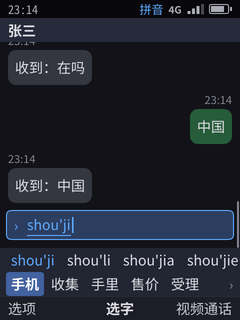
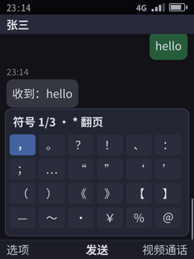
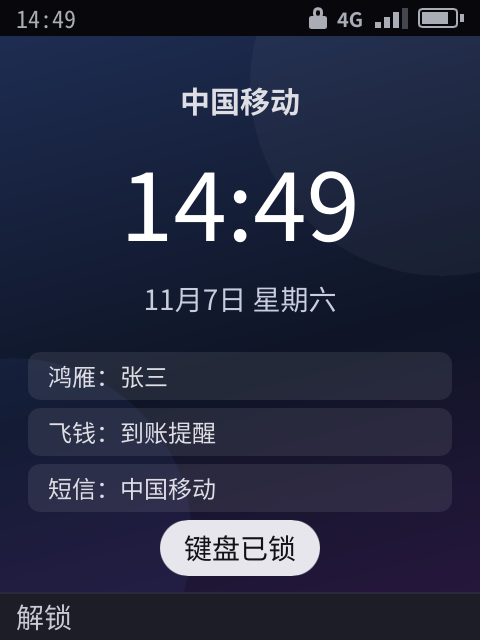
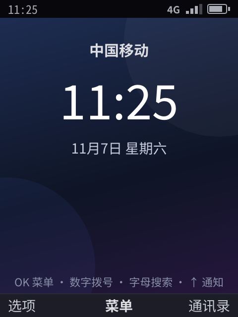
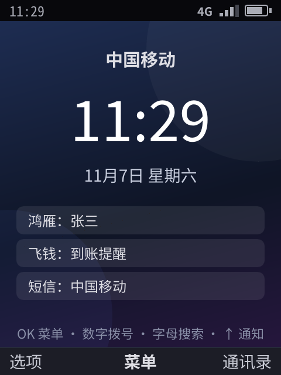
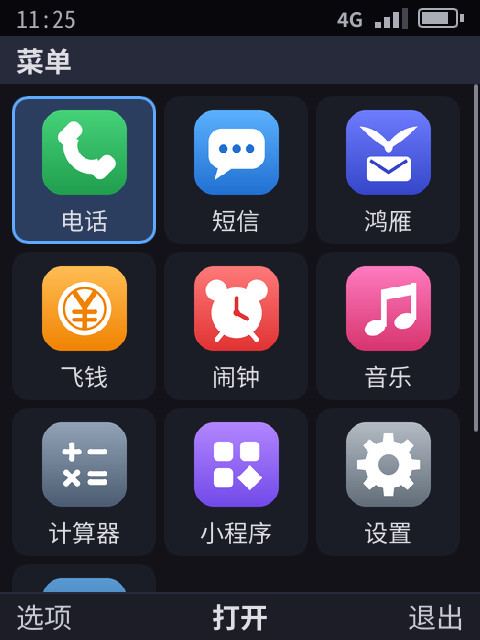
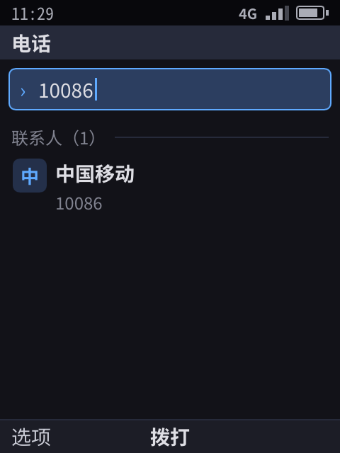
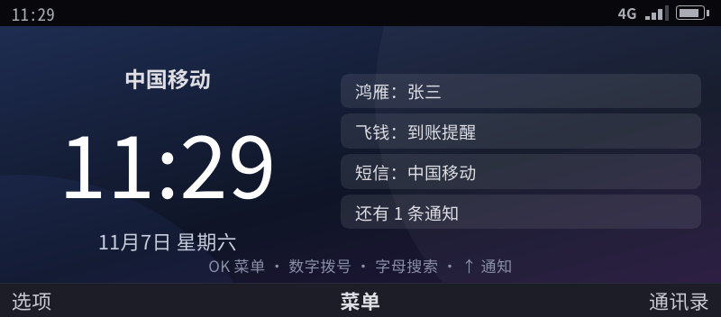
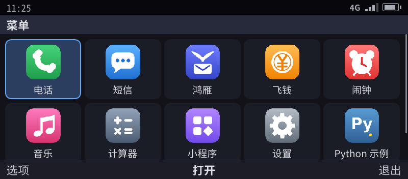

# 诺基亚形态与按键：九宫格、全键盘、输入切换对齐

> 状态：
> - 三种设备形态（像素渲染器的屏幕参数 + 键盘行为）：原型 ✓。
> - 输入法按键对齐诺基亚（九宫格、全键盘）：原型 ✓，有单元测试和自测用例。
> - 机身皮肤（截图里画出键盘区）：未做。
>
> 资料来自诺基亚官方说明书（S40、S60、KaiOS）、中文版说明书和论坛。每条结论都标了来源等级：**官方** 指官方说明书或界面规范；**社区** 指多个独立来源一致；**未核实** 指只有一个来源或互相矛盾。完整来源列表见文末。

## 0. 结论

- 诺基亚的众多机型，对软件来说可以归成**三类键盘 × 三种屏幕**。滑盖、翻盖、侧滑只是机械结构不同，软件上归入其中一类：

  | 本平台形态 | 键盘 | 屏幕 | 诺基亚原型 |
  |------------|------|------|------------|
  | `bar-t9` 直板九宫格 | 12 键（ITU-T）+ 左右软键 + 五向键 + 通话 / 挂断 + C 键 | 竖屏 480×640 | 6300、N73；滑盖 N95；翻盖 7390；8110 4G |
  | `bar-qwerty` 直板全键盘 | 紧凑全键盘，数字在 Fn 层 | 横屏 640×480 | E71、E63、E72 |
  | `communicator` 横屏宽键盘 | 带数字行的完整键盘 | 宽屏 800×352 | E90、9300；侧滑 N900、E7 |

- **按键和模式切换按诺基亚的习惯来**（§3、§4）。各代机型做法不一致时，九宫格以 Series 40 第 6 版为准，全键盘以 E71、E90 为准，并在 §6 写明和其他机型的差异。
- **借鉴的边界**：键位布局和交互习惯可以借鉴；诺基亚的商标、字体、图标、铃声、开机动画不用；机身做「致敬」不做「复刻」。保留什么、换掉什么，见 58（内部文档） §2。
- 同一个应用在三种形态上**不用改代码**：应用只描述节点和动作，键位映射、输入法、排版都由系统按形态处理。

## 1. 形态参数

定义在 `shell/device.go`，用 `phone-shell --device <形态>` 选择：

| 形态 | 物理像素 | 缩放 | 文档列数 | 键盘行为 |
|------|----------|------|----------|----------|
| `bar-t9` | 480×640 | 2× | 32 | 九宫格（§3） |
| `bar-qwerty` | 640×480 | 2× | 43 | 全键盘（§4） |
| `communicator` | 800×352 | 1.6× | 69 | 全键盘（§4），数字行直接输入数字 |

像素渲染器的截图见 [06](06-gui-architecture.md) §6。

## 2. 物理键位

### 2.1 九宫格（以 N73 为例）

```
┌──────────────────────────────┐
│          屏幕（竖屏）          │
├─────────┬──────────┬─────────┤
│ 左软键   │    ▲     │  右软键  │
│ 「选项」 │  ◀ OK ▶  │ 「返回」 │
│  通话    │    ▼     │  挂断    │
├─────────┴──────────┴─────────┤
│  1 .,?!   2 abc    3 def     │
│  4 ghi    5 jkl    6 mno     │
│  7 pqrs   8 tuv    9 wxyz    │
│  * 符号   0 空格   # 模式    │
│  C 清除   ✎ 编辑键（S60 部分机型）│
└──────────────────────────────┘
```

- 字母按 ITU-T E.161 分配（官方）。
- 1 键是标点循环，不同机型顺序略有不同，例如 8390 是 `. , ' ? ! @ " 1 - ( ) / : _`（官方）。

### 2.2 紧凑全键盘（E71 / E63 / E72）

- E71 有 Fn、Shift、Chr 三个修饰键；退格在第二行末尾，回车在第三行末尾。E71 没有单独的 Ctrl 键，Ctrl 要按 Fn + Chr（官方）。国行 E71 的 Chr 键上印着「中」（社区）。
- 数字排成电话键盘的样子，放在 Fn 层：5 在 G 键（带盲点），可推出 1-2-3 在 R T Y，4-5-6 在 F G H，7-8-9 在 V B N，0 在 M（**未核实**，需要实机照片确认）。
- E63 有单独的 Ctrl 键，E72 用 Sym 键代替 Chr（官方）。

### 2.3 带数字行的完整键盘（E90 / 9300 / N900）

- E90 内屏键盘有数字行、两个 Shift、Tab、Ctrl、Chr 和大回车键（社区）。
- N900 是三排字母，带 Fn（蓝色箭头）、Sym/Ctrl、方向键（官方）。

## 3. 九宫格按键（已实现）

| 按键 | 诺基亚 | 本平台 | 来源 |
|------|--------|--------|------|
| `#` 短按 | 切换大小写 / 输入法；国行 S40 依次是拼音、笔画、英文大写、英文小写、数字 | 依次切换：**拼音 → 笔画 → 智能英文 → Abc → abc → ABC** | 官方（顺序未核实） |
| `#` 长按 | S40：弹出小菜单选「数字模式」；S60：直接在字母和数字间切换 | **在数字（123）和原模式之间切换** | 官方 |
| `*` 组词时 | 英文智能输入：下一个匹配词；S40 第 6 版中文：下一个拼音 | **英文：下一个词；中文：下一个拼音；标点：下一个标点** | 官方 |
| `*` 没在组词 / 长按 | 打开特殊字符表 | **打开系统符号表**（再按 `*` 翻页） | 官方 |
| `0` | 空格；英文智能输入时上屏并加空格；中文组词时是音节分隔符 | 同左 | 官方 |
| `1` | 标点循环（智能输入时按 1 后再按 `*` 换标点） | 打开标点栏，按 `1` 或 `*` 换下一个 | 官方 |
| 数字长按 | 直接输入该数字（国行 S40：没有未完成的输入时） | 同左 | 官方 |
| ▼ | S40：从拼音行进入候选行；S60：选定拼音后候选带编号 | **进入编号模式，之后按 1–5 直接选字** | 官方 |
| ▲ | — | 回到拼音行，用 ◀ ▶ 选拼音，OK 或 ▼ 锁定 | — |
| ▶（英文） | 上屏当前词，不加空格 | 同左 | 官方 |
| OK | 上屏 | 同左 | 官方 |
| C / 退格 | 删除最后一个按键 | 同左 | 官方 |
| 右软键 / 返回 | 关闭候选窗口 | 取消组词，关闭联想栏 | 官方 |
| 联想 | S60：上屏后出现联想栏，第一项高亮，OK 选中；输入下一个拼音时联想栏消失 | 同左（九宫格上联想栏默认激活） | 官方 |
| 多击（Abc / abc / ABC） | 同一键连按切换字母，约 1 秒不按或按 ▶ 确认 | 同左；Abc 模式下句首字母自动大写 | 官方 |

## 4. 全键盘按键（已实现）

| 操作 | 诺基亚（E71 / E63 / E90 / N900） | 本平台 | 来源 |
|------|----------------------------------|--------|------|
| 中 / 英切换 | **Ctrl + 空格**（国行 E63 / E71 / E90 论坛一致；N900 官方用它切换输入语言） | Ctrl + 空格（终端里也可按 F6） | 社区 + N900 官方 |
| 特殊字符表 | Chr（E71 / E63 / E90）或 Sym（E72 / N97 / E7） | **Chr / Sym 打开系统符号表**（终端里按 F7） | 官方 |
| 上屏候选 | 第三方输入法：空格或 OK 上屏第一个候选 | 空格或 OK 上屏当前候选；1–5 选第几个 | 社区 |
| 大写 | Shift 按一次大写一个字母，按两次锁定 | 中文模式下按 Shift + 字母直接输入大写英文 | 官方 |
| 数字 | E71：Fn + 键，Fn 连按两次锁定；E90：数字行 | 由键盘驱动的键码表负责（Fn 层是硬件布局，不归输入法）；终端里直接按数字 | 官方 |
| 联想 | — | 上屏后出现联想栏，按 ◀ ▶ 进入选择；直接按 OK 发送 | — |
| 输入语言选择器 | Shift + Chr（E90 官方，E71 社区） | 未做：目前只有中、英两种 | 官方 / 社区 |

## 5. 模式指示

状态栏显示当前模式。九宫格显示「拼音 / 笔画 / 智能英文 / Abc / abc / ABC / 123」，全键盘显示「中 / 英」。

| 九宫格拼音 | 系统符号表 |
|:--:|:--:|
|  |  |

## 5.1 待机界面与主菜单（已实现）

开机后进入**待机界面**，而不是直接进宫格，按诺基亚 S40 的逻辑：

| 在待机界面按 | 结果 | 诺基亚的对应 |
|--------------|------|--------------|
| OK（中间软键「菜单」） | 打开主菜单宫格 | S40：中间键 = 菜单 |
| 右软键「通讯录」 | 打开电话应用的联系人 | S40：右软键 = 名片夹 |
| 左软键「选项」 | 通知中心、切换应用等 | S40 的左软键是「转至」快捷方式，我们换成更常用的系统入口 |
| 数字、`*`、`#` | 直接进入拨号，按下的键已经填好，接着输入就做智能匹配 | 所有诺基亚：待机时直接按号码 |
| 字母（全键盘机型） | 打开全局搜索，按下的字母就是搜索词 | 黑莓的「打字即搜索」，诺基亚 E 系列也有类似的联系人搜索 |
| ↑ | 通知中心（选中了小组件时先往回移一行） | 现代手机下拉通知栏的按键版 |
| ↓ | 在待机小组件之间移动（选中的一行前面标「▶」），OK 打开它所属的应用，直达应用给这一行设的深链接；返回取消选中 | S40 的「动态待机」 |
| 通话键（绿键） | 打开最近通话，焦点在最近一条；再按一次就回拨 | 所有诺基亚：绿键看已拨电话，连按两次回拨 |
| 左软键再按 `*` | 锁定键盘（见下面的「键盘锁」） | S40 的键盘锁 |
| F4（挂断键） | 回到待机界面；按住打开电源菜单（关机、重启）：没有单独电源键的键盘机，挂断键兼作电源键 | 红键回待机，按住红键关机 |
| 挂断键在待机界面或锁屏上连按两下（停一下之后，400 ms 内） | 打开快速选卡（NFC：门禁卡、交通卡、付款卡），锁着也行，选一张卡出示 60 秒（[30](30-nfc.md) §5）。第一下在那里本来没事可做（已经在待机，或者只是点亮屏幕），所以和「按一下回待机」不冲突；从应用里、通话中按的挂断键照旧回待机、挂断，不算第一下；连着狂按挂断键不会打开它；来电和闹钟响着时不算 | 挂断键兼作电源键时的「双击电源键」：像小米双击电源键打开卡包、iPhone 双击侧边按钮打开钱包 |
| 电源键（板子有单独的电源键时，键名 `power`） | 按一下息屏（锁不锁照息屏的规则）或亮屏；来电响铃时静音；连按两下（400 ms 内，任何界面，锁着也行）打开快速选卡；按住打开电源菜单 | 安卓手机的电源键、iPhone 的侧边按钮；小米双击电源键打开卡包 |
| 侧键音量（USB 键盘上是 F8、F9） | 来电响铃时静音铃声；放音乐时调媒体音量；其余时候调铃声音量（任何界面都有效，键盘锁着也一样） | 所有手机 |
| 媒体键：耳机线控、键盘的播放 / 暂停、上一首、下一首（USB 键盘上还有 F10、F11、F12） | 播放 / 暂停直接控制正在播放的声音；上一首、下一首交给正在播放的应用；通话中不动音乐（任何界面都有效，键盘锁着也一样） | 所有手机 |

在任何界面上：
- **通话键**触发焦点元素或页面上 ID 为 `call` / `dial` 的动作：在联系人、通话记录上就是拨打，在拨号框里就是拨出。拨号框为空时，跳到最近一条通话记录；页面上没有这类动作时，打开最近通话。
- **挂断键**触发页面上 ID 为 `hangup` 的动作：在电话和鸿雁的通话界面上就是挂断。没有这个动作时回待机。
- **来电时**，通话键接听，挂断键拒接。

应用不用为这两个键写代码，按约定给动作起名就行（[22](22-developer-api.md) §3）。

挂断键在菜单、对话框打开时：先把它们关掉，再回待机或挂断，和诺基亚的红键一样。来电、闹钟这类全屏提醒例外：来电时挂断键是拒接，闹钟要用户自己选「停止」或「稍后提醒」。

键盘锁（对齐诺基亚 S40）：
- 锁定时只弹一下「键盘已锁」，待机界面不常驻提示文字；
- 锁定期间状态栏有一个小锁，左软键显示「解锁」，其余软键为空；
- 按了别的键，提示「按「解锁」再按 *」；按了左软键，提示「现在按 *」；3 秒内按 `*` 解锁，提示「键盘已解锁」；
- 来电、闹钟、通话中的按键照常能操作；挂断键照常回待机；
- **紧急呼叫不用解锁**：锁着时直接输入 112、110、119、120、122（以及 911、999），屏幕提示「紧急号码 112 · 按通话键拨打」，按通话键就拨出，通话界面归电话应用，挂断后键盘仍是锁着的；
- **自动键盘锁**：设置 → 键盘锁，可选关、15 秒、30 秒、1 分钟。待机界面停留这么久没有按键就自动锁定；应用在前台、通话中或有浮层时不锁。

| 键盘锁（直板九宫格） |
|:--:|
|  |

- **方向键左右**：焦点元素或页面绑定了 ← → 的动作时执行它（音量调小 / 调大、上一首 / 下一首、上一张 / 下一张）；没有绑定时 ← 返回上一级、→ 打开焦点项，像诺基亚的五向键那样左右也能进出菜单。宫格和输入框里照旧移动。

在主菜单里：
- 宫格的列数按屏幕定：竖屏 3 列，4:3 横屏 4 列，宽屏 5 列（E90 内屏就是宽宫格）；
- 按数字 1–9 直达对应位置的格子（菜单宫格加数字，同 S40）；
- 和诺基亚一样分文件夹：主菜单只放每天用的（电话、短信、鸿雁、飞钱、图片、相机、音乐、浏览器、商店、卡包、设置），计算器、闹钟、天气进「工具」，小程序和示例进「应用」，商店装的应用默认进「应用」；应用在清单里用 `folder` 选（`tools`、`apps`）。文件夹也是宫格，同样按数字直达；
- 右软键「退出」或返回键回待机。

待机界面显示运营商、时钟、日期星期，下面是「主动待机」的信息行：最近的通知、下一个闹钟、正在播放的歌，放不下的会省略。
- 像素渲染器画渐变墙纸，或用户设的照片壁纸（设置 › 壁纸；锁屏可以另设一张）；
- 宽屏上时钟和信息行左右并排；
- 文本渲染器用普通节点显示同样的内容。

应用图标是图片（`tools/icons.py` 画的原创图案，不用诺基亚的图标）：
- 清单里用 `icon_image` 指向应用目录里的 PNG；
- 像素渲染器自己读取，读之前检查文件大小（≤ 512 KB）和图片尺寸（≤ 256×256），因为图标来自应用包；
- 文本渲染器仍显示单字图标。

| 待机 | 主动待机信息 | 主菜单（图标） | 待机时直接拨号 |
|:--:|:--:|:--:|:--:|
|  |  |  |  |

| 横屏宽键盘：待机 | 横屏宽键盘：主菜单 5 列 |
|:--:|:--:|
|  |  |

## 6. 与诺基亚的差异（如实记录）

| 项 | 差异 | 原因 |
|----|------|------|
| 英文智能输入 | 诺基亚只在行内显示一个词，按 `*` 换；我们多显示一行候选，`*` 和 ◀ ▶ 都能换 | 屏幕更大，一眼能看到更多候选 |
| 中文 `*` | 用 S40 第 6 版的做法（下一个拼音）；S60 的 `*` 是声调 | 两代做法冲突，取 `*` 在中英文里都表示「下一个」 |
| 声调 | 不支持；中文组词时 1 键也作分隔符 | 词库没有声调信息 |
| 联想栏 | 九宫格上 OK 选联想词（S60），要发送得先按返回关掉联想栏；全键盘上联想栏不抢 OK | 全键盘的 OK 用于发送更顺手，也是 E71 上第三方输入法的常见做法 |
| 长按 | 设备上按住 600ms 算长按；终端模拟器里用 Alt + 键代替 | 终端收不到按键松开的事件 |
| 笔画输入、模糊音、用户词组 | ✓ | 见 [16](16-input-method.md) §5 |

## 7. 模拟器键位对照

| 手机键 | 终端（`phone-shell`） | 像素渲染器（`phone-gui`，设备上的 USB 键盘） |
|--------|----------------------|----------------------------------------------|
| 五向键 / OK | 方向键 / Enter | 同左 |
| 返回 / 右软键关闭 | Esc | Esc |
| 左软键「选项」 | Tab（或 F1） | Tab / F1 |
| 右软键 | F2 | F2 |
| 通话键 | F5 | F5 |
| 挂断（回待机）/ 任务 | F4 / F3 | F4 / F3 |
| 电源键 | 没有（脚本里是 `key power`，按住是 `long power`） | 板子的电源键（`KEY_POWER`）：松开时算按一下，按住 600ms 算长按 |
| `*` `#` 0–9 | 同名键；Alt + 键 = 长按 | 同名键；按住 600ms = 长按（九宫格形态） |
| 中 / 英 | F6 或 Ctrl + 空格 | F6 或 Ctrl + 空格 |
| Chr / Sym | F7 | F7 |

## 8. 未核实与待办

| 项 | 说明 |
|----|------|
| E71 数字层和最下一排的确切布局 | 需要实机照片 |
| 6300、N95 的 1 键、0 键多击顺序 | 各机型不同，需要说明书原文 |
| 诺基亚自带全键盘拼音的候选编号、空格作用、声调键 | 资料不足 |
| 机身皮肤 | 在截图里画出九宫格、全键盘的键盘区，方便评审 |
| 键盘驱动 | 九宫格和全键盘的 evdev 键码表（含 Fn 层），R16 有硬件后做 |

## 来源

- S40：[6300 说明书（Vodafone 托管）](https://www.vodafone.de/media/downloads/help-devices/Nokia_6300_APAC_UG_en.pdf)、[6300 中文说明书](https://www.manuallib.com/download/pdf15/NOKIA-6300-OWNER-MANUAL.PDF)、[6316s 中文说明书](http://download-support.webapps.microsoft.com/files/support/china/phones/guides/Nokia_6316s_UG_zh-CN.pdf)、[2720 fold](https://manualsdump.com/en/manuals/nokia-2720model/220008/16)
- S60：[S60 界面规范](https://devlib.symbian.slions.net/s3/GUID-B35E6CAD-C9C8-467E-85CF-9781DEC8BF7C.html)、[N95 8GB](https://nokia-n95-8gb.helpdoc.net/en/nokia-n95-8gb-user-guide/messaging/write-text/traditional-text-input/)、[N76 中文说明书](https://www.manuallib.com/download/pdf12/NOKIA-N76-USER-MANUAL.PDF)、[E50](http://nds1.webapps.microsoft.com/files/support/apac/phones/guides/Nokia_E50_APAC_UG_en.pdf)
- 全键盘：[E71 说明书](http://nds1.webapps.microsoft.com/phones/files/guides/Nokia_E71-1_UG_en.pdf)、[E72](https://nokia-e72.helpdoc.net/en/nokia-e72-user-guide/get-started/write-text/write-text-with-the-keyboard/)、[E61i 中文（香港）](https://www.ziliaoku.com/res/info_aef76c14c7244a9a92001f35f8b468c6.html)、[E90 说明书](https://www.instructionsmanuals.com/sites/default/files/2019-05/Nokia-E90-en.pdf)、[N900 键盘](https://nokia-n900.helpdoc.net/en/nokia-n900-user-guide-2/introduction-2/text-input-2/use-the-physical-keyboard-2/)、[E7 键盘](https://nokia-e7-00.helpdoc.net/en/nokia-e7-00-user-guide/get-started/keys-and-parts/keyboard/)
- KaiOS：[8110 4G](https://www.hmd.com/en_int/support/nokia-8110-4g-user-guide/write-text)、[2720 Flip](https://www.hmd.com/en_int/support/nokia-2720-user-guide/write-text?locale=fi-FI)
