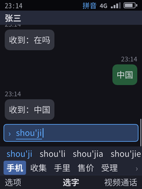
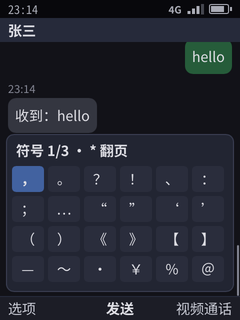
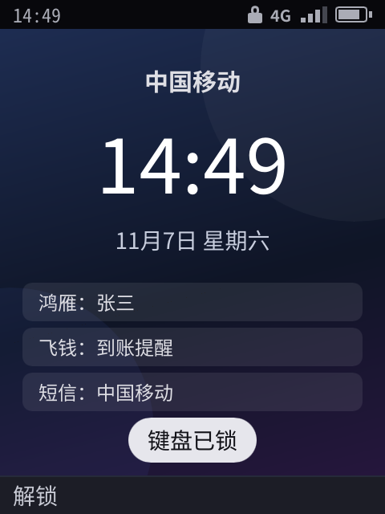
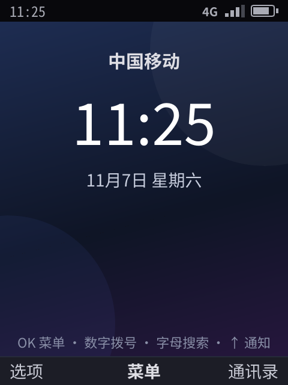
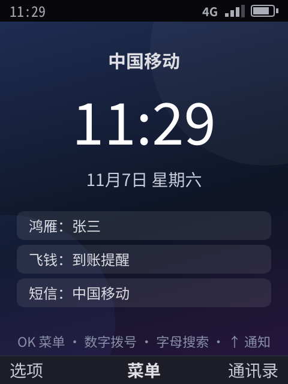
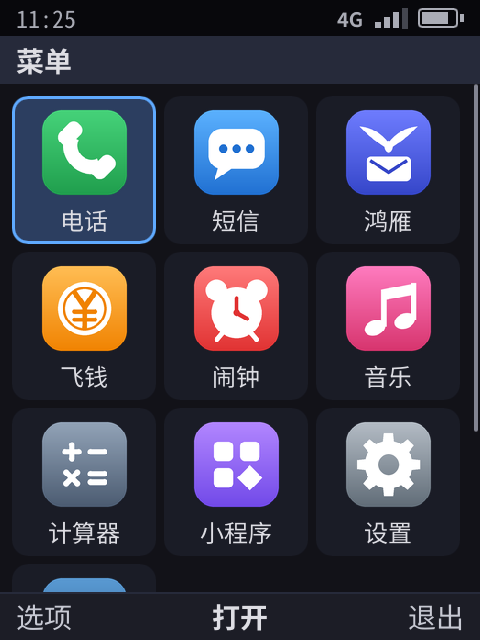
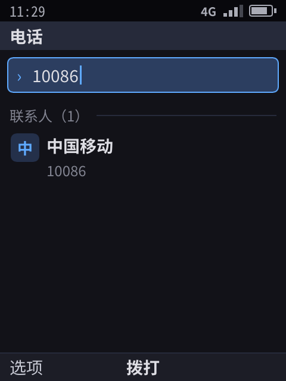
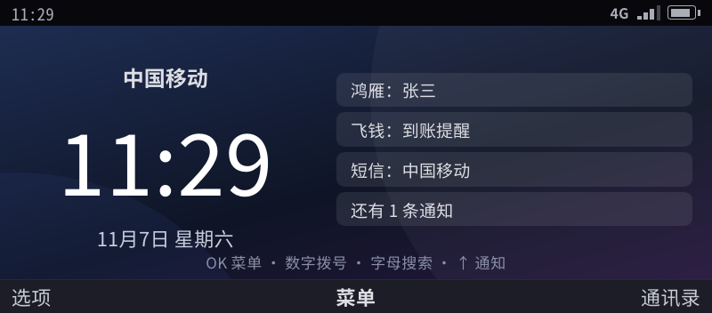
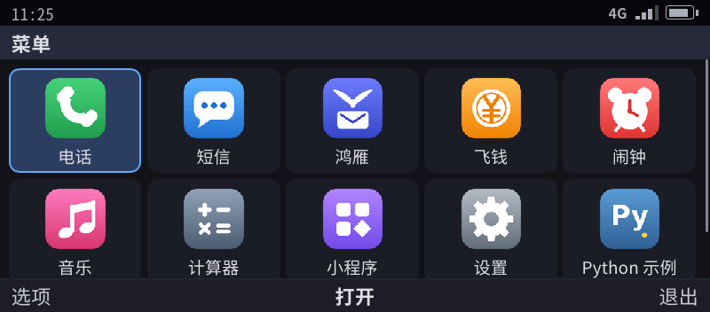

# 诺基亚形态与按键：九宫格、全键盘、输入切换对齐

> 状态：
> - 三种设备形态（像素渲染器的屏幕参数 + 键盘行为）：原型 ✓。
> - 输入法按键对齐诺基亚（九宫格、全键盘）：原型 ✓，有单元测试和自测用例。
> - 机身皮肤（截图里画出键盘区）：原型 ✓（`make skins`，phone-paint 画）。
>
> 资料来自诺基亚官方说明书（S40、S60、KaiOS）、中文版说明书和论坛。每条结论都标了来源等级：**官方** 指官方说明书或界面规范；**社区** 指多个独立来源一致；**未核实** 指只有一个来源或互相矛盾。完整来源列表见文末。

## 0. 结论

- 诺基亚的众多机型，对软件来说可以归成**三类键盘 × 三种屏幕**。滑盖、翻盖、侧滑只是机械结构不同，软件上归入其中一类：

  | 本平台形态 | 键盘 | 屏幕 | 诺基亚原型 |
  |------------|------|------|------------|
  | `bar-t9` 直板九宫格 | 12 键（ITU-T）+ 左右软键 + 五向键 + 通话 / 挂断 + C 键 | 竖屏 480×640 | 6300、N73；滑盖 N95；翻盖 7390；8110 4G |
  | `bar-qwerty` 直板全键盘 | 紧凑全键盘，数字在 Fn 层 | 横屏 640×480 | E71、E63、E72 |
  | `communicator` 横屏宽键盘 | 带数字行的完整键盘 | 宽屏 800×352 | E90、9300；侧滑 N900、E7 |

- **按键和模式切换按诺基亚的习惯来**（§3、§4）。各代机型做法不一致时，九宫格以 Series 40 第 6 版为准，全键盘以 E71、E90 为准，并在 §6 写明和其他机型的差异。
- **借鉴的边界**：键位布局和交互习惯可以借鉴；诺基亚的商标、字体、图标、铃声、开机动画不用；机身做「致敬」不做「复刻」。保留什么、换掉什么，见 58（内部文档） §2。
- 同一个应用在三种形态上**不用改代码**：应用只描述节点和动作，键位映射、输入法、排版都由系统按形态处理。

## 1. 形态参数

定义在 `shell/device.go`，用 `phone-shell --device <形态>` 选择：

| 形态 | 物理像素 | 缩放 | 文档列数 | 键盘行为 |
|------|----------|------|----------|----------|
| `bar-t9` | 480×640 | 2× | 32 | 九宫格（§3） |
| `bar-qwerty` | 640×480 | 2× | 43 | 全键盘（§4） |
| `communicator` | 800×352 | 1.6× | 69 | 全键盘（§4），数字行直接输入数字 |

像素渲染器的截图见 [06](06-gui-architecture.md) §6。

## 2. 物理键位

### 2.1 九宫格（以 N73 为例）

```
┌──────────────────────────────┐
│          屏幕（竖屏）          │
├─────────┬──────────┬─────────┤
│ 左软键   │    ▲     │  右软键  │
│ 「选项」 │  ◀ OK ▶  │ 「返回」 │
│  通话    │    ▼     │  挂断    │
├─────────┴──────────┴─────────┤
│  1 .,?!   2 abc    3 def     │
│  4 ghi    5 jkl    6 mno     │
│  7 pqrs   8 tuv    9 wxyz    │
│  * 符号   0 空格   # 模式    │
│  C 清除   ✎ 编辑键（S60 部分机型）│
└──────────────────────────────┘
```

- 字母按 ITU-T E.161 分配（官方）。
- 1 键是标点循环，不同机型顺序略有不同，例如 8390 是 `. , ' ? ! @ " 1 - ( ) / : _`（官方）。

### 2.2 紧凑全键盘（E71 / E63 / E72）

- E71 有 Fn、Shift、Chr 三个修饰键；退格在第二行末尾，回车在第三行末尾。E71 没有单独的 Ctrl 键，Ctrl 要按 Fn + Chr（官方）。国行 E71 的 Chr 键上印着「中」（社区）。
- 数字排成电话键盘的样子，放在 Fn 层：5 在 G 键（带盲点），可推出 1-2-3 在 R T Y，4-5-6 在 F G H，7-8-9 在 V B N，0 在 M（**未核实**，需要实机照片确认）。
- E63 有单独的 Ctrl 键，E72 用 Sym 键代替 Chr（官方）。
- E71 说明书写的编辑键（官方）：状态栏用 Abc / abc / ABC 表示大小写；按住退格连续删除；按住 Shift 再按方向键选中一个词、一句或一行，Ctrl + C 复制、Ctrl + V 粘贴；Fn + 空格改输入语言、开关智能输入。
- E72 说明书（官方）：Shift 点一下，下一个字母换成另一种大小写；按住 Sym 连按字母出带重音的字母（á 等），顺序和有哪些随输入语言；Ctrl + X 剪切、Ctrl + A 全选；按住 Ctrl 按 Sym 选最近用过的符号。
- Kario 的 qwerty-v1 有 Shift、Fn、Sym（当 Chr 用）和中 / 英键，没有 Ctrl：键盘配置写 `ctrl = "fn+sym"`，先按 Fn + Sym 再按字母就是 Ctrl + 字母，照 E71（§4.2）。

### 2.3 带数字行的完整键盘（E90 / 9300 / N900）

- E90 内屏键盘有数字行、两个 Shift、Tab、Ctrl、Chr 和大回车键（社区）。
- N900 是三排字母，带 Fn（蓝色箭头）、Sym/Ctrl、方向键（官方）。

## 3. 九宫格按键（已实现）

| 按键 | 诺基亚 | 本平台 | 来源 |
|------|--------|--------|------|
| `#` 短按 | 切换大小写 / 输入法；国行 S40 依次是拼音、笔画、英文大写、英文小写、数字 | 依次切换：**拼音 → 笔画 → 智能英文 → Abc → abc → ABC** | 官方（顺序未核实） |
| `#` 长按 | S40：弹出小菜单选「数字模式」；S60：直接在字母和数字间切换 | **在数字（123）和原模式之间切换** | 官方 |
| `*` 组词时 | 英文智能输入：下一个匹配词；S40 第 6 版中文：下一个拼音 | **英文：下一个词；中文：下一个拼音；标点：下一个标点** | 官方 |
| `*` 没在组词 / 长按 | 打开特殊字符表 | **打开系统符号表**（再按 `*` 翻页） | 官方 |
| `0` | 空格；英文智能输入时上屏并加空格；中文组词时是音节分隔符 | 同左 | 官方 |
| `1` | 标点循环（智能输入时按 1 后再按 `*` 换标点） | 打开标点栏，按 `1` 或 `*` 换下一个 | 官方 |
| 数字长按 | 直接输入该数字（国行 S40：没有未完成的输入时） | 同左 | 官方 |
| ▼ | S40：从拼音行进入候选行；S60：选定拼音后候选带编号 | **进入编号模式，之后按 1–5 直接选字** | 官方 |
| ▲ | — | 回到拼音行，用 ◀ ▶ 选拼音，OK 或 ▼ 锁定 | — |
| ▶（英文） | 上屏当前词，不加空格 | 同左 | 官方 |
| OK | 上屏 | 同左 | 官方 |
| C / 退格 | 删除最后一个按键 | 同左 | 官方 |
| 右软键 / 返回 | 关闭候选窗口 | 取消组词，关闭联想栏 | 官方 |
| 联想 | S60：上屏后出现联想栏，第一项高亮，OK 选中；输入下一个拼音时联想栏消失 | 同左（九宫格上联想栏默认激活） | 官方 |
| 多击（Abc / abc / ABC） | 同一键连按切换字母，约 1 秒不按或按 ▶ 确认 | 同左；Abc 模式下句首字母自动大写 | 官方 |

## 4. 全键盘按键（已实现）

| 操作 | 诺基亚（E71 / E63 / E90 / N900） | 本平台 | 来源 |
|------|----------------------------------|--------|------|
| 中 / 英切换 | **Ctrl + 空格**（国行 E63 / E71 / E90 论坛一致；N900 官方用它切换输入语言） | Ctrl + 空格（终端里也可按 F6）；qwerty-v1 上是中 / 英键，或 Fn + Sym 再按空格 | 社区 + N900 官方 |
| 特殊字符表 | Chr（E71 / E63 / E90）或 Sym（E72 / N97 / E7） | **点一下 Chr / Sym（松开时）打开系统符号表**（终端里按 F7）；表里再按一个字母或标点，换成它的变体页，同一个键再按选下一个 | 官方 |
| 带重音的字母、标点的变体 | E72：按住 Sym 连按字母，á 等依次出现，顺序随输入语言 | **按住 Chr 连按一个键**：第一下打出第一个变体，再按换成下一个（`e` → é è ê ë…，`n` → ñ，`c` → ç，`s` → ß；大写字母出大写：按住 Chr 后点一下 Shift 再按字母，先按 Shift 再按 Chr 是输入语言）；拼音模式下标点先出中文的（`.` → 。 …… ·，`,` → ， 、，`?` → ？）；正在组的词先上屏；没有变体的键照常打字；表在 `ime/data/marks.json` | 官方 |
| 上屏候选 | 第三方输入法：空格或 OK 上屏第一个候选 | 空格或 OK 上屏当前候选；1–5 选第几个 | 社区 |
| 大写 | Shift 按一次大写一个字母，按两次锁定；状态栏 Abc / abc / ABC | 按住 Shift 打大写；有 Fn 层的手机键盘上点一下 Shift 只大写下一个字母，快速点两下（500 ms 内）锁定大写，再点一下解锁，状态栏显示「Abc」「ABC」；中文模式下 Shift + 字母直接输入大写英文 | 官方 |
| 句首大写 | 状态栏 Abc 时句首字母大写（E71）；Shift 点一下换成另一种大小写（E72） | 英文模式下输入框开头和 `.` `!` `?` 之后的第一个字母自动大写，状态栏显示「Abc」；这时点一下 Shift，这个字母改成小写（状态栏「abc」）；邮箱、网址框、拼音模式不自动大写；补全的候选跟着大写 | 官方 |
| 光标、选择、复制粘贴 | E71：按住 Shift 再按方向键选中，Ctrl + C 复制、Ctrl + V 粘贴；E72：Ctrl + X 剪切、Ctrl + A 全选 | 文字框有光标，◀ ▶ 移动；按住 Shift + ◀ ▶ 选字，Shift + ▲ ▼ 选到开头、结尾；Ctrl + C 复制（没选中时复制全部）、X 剪切、V 在光标处粘贴、A 全选、Z 撤销；qwerty-v1 没有 Ctrl：先按 Fn + Chr 再按字母；选项菜单里也有（§4.2） | 官方 |
| 删除 | E71：按住退格连续删除 | 退格删光标前的字（有选中时删选中的）；按住 600 ms 以后每次连发删一个词；Shift 或 Fn + 退格（PC 键盘的 Delete）删光标后的字 | 官方 |
| 开头、结尾、翻页 | E72 的邮件：到第一封或最后一封、上下翻页有快捷键 | Fn + ◀ ▶：文字框里到开头、结尾（再按住 Shift 就选到那里），列表里到第一项、最后一项，系统的菜单、选择器、分享面板和符号表里也一样（§4.2「系统弹层里的两头」）；Fn + ▲ ▼：列表翻一屏；PC 键盘的 Home、End、PgUp、PgDn 同样 | 官方（键位是 Kario 定的） |
| 列表里打字母 | E71：通讯录里打字就是搜索 | 页面上没有输入框、这个字母也不是快捷键时，焦点跳到下一个以它开头的项（中文按拼音首字母），到底再从头找；系统菜单里同样（菜单项的快捷键优先）；有输入框的页面照旧打进输入框 | 官方 / 社区（黑莓的列表） |
| 数字 | E71：按住 Fn 再按键，或按住那个键；Fn 快速连按两次锁定；C3-00：按 Fn 在字母、数字间切换，按两次锁定；E90：数字行 | 按住 Fn 再按键；文字框里按住有数字的字母键 600 ms，字母换成数字（这些键不连发）；点一下 Fn 只管下一个键，快速点两下（500 ms 内）锁定，再点一下解锁，状态栏显示「Fn」「123」（phone-paint 的输入助手）；号码、数字框和 PIN 码不用按 Fn（§4.1）；终端里直接按数字 | 官方 |
| 联想 | — | 上屏后出现联想栏，按 ◀ ▶ 进入选择；直接按 OK 发送 | — |
| 输入语言选择器 | E71：Fn + 空格（还能开关智能输入）；E90：Shift + Chr | **Shift + Chr 或 Fn + 空格**打开「输入语言」：中文（拼音）、英文，当前的打勾；输入法只有这两种 | 官方 |

### 4.1 共用的数字键随界面变化（已实现）

紧凑全键盘上数字和字母共用一组键（Kario 的 qwerty-v1：W E R / S D F / Z X C 是 1–9，句号键是 0，Q 是 #，A 是 *）。诺基亚的全键盘机按界面和输入框决定这一下出什么，Kario 照着做：

| 在哪里 | 诺基亚 | Kario |
|--------|--------|-------|
| 待机界面 | E71：直接打字就按名字搜联系人；也可以输入号码按通话键拨出（官方说明书两处都写了）；C3-00：待机时输入号码按通话键 | 打的字母照旧打开全局搜索；打的键背后都是号码字符（数字、`*`、`#`、`+`）时，搜索结果最后多一行「拨号 123」，按通话键（或选中它按 OK）打开拨号界面、号码已经填好，和九宫格上待机按数字一样。没有别的结果时它排第一 |
| 号码、数字框（`keyboard: "number"` / `"phone"`）和 PIN 码（锁屏、SIM 卡、支付密码）、锁着时打的紧急号码 | S60 的数字输入模式（`EAknEditorNumericInputMode`）：全键盘的键直接打出数字，不用按 Fn | 有第二层字符的键直接打出它（`w` 是 1、`h` 是 `:`、`o` 是 `+`），没有的照原样；PIN 码只收数字；状态栏显示「123」 |
| 文字框 | 字母；按住键或 Fn + 键出数字，Fn 连按两次锁定 | 字母；按住 Fn、点一下 Fn 或锁定 Fn 出第二层字符（§4 表） |

Fn 层来自型号的键盘配置（[24](24-sku-framework.md) §1），九宫格和没有 Fn 层的键盘照旧：开发机上不带型号时一切不变，自测用 `fn-layer` 步骤给出 qwerty-v1 的 Fn 层。文字框里按住字母键出数字（E71 的另一种方式）已实现：渲染器按下时照常打出字母，按住 600 ms 时报一次带 `retype` 的长按，Shell 删掉刚打的字母、换成它的数字（列表里长按不做别的）。没做的：拨号界面的智能拨号按九宫格的数字匹配拼音，全键盘上要按名字找人请在待机界面打字母；phone-gui 不处理 Fn 层，Fn、Shift 的点按和锁定、按住出数字只在 phone-paint 里，phone-gui 上**未实现**。设备上的 Fn、Shift 点按和锁定、按住出数字只有单元测试，**未上真机**。

### 4.2 编辑文字、列表里的键（已实现）

**光标和选中**：Shell 给每个输入框记着光标和选中的字（按字符算，`shell/textedit.go`），渲染器照着画（帧里的 `caret_back`、`selection`，[23](23-renderer-protocol.md) §4）。光标一开始在结尾，应用改了输入框的值时回到结尾。输入框有字时 ◀ ▶ 在字里移动，到头就停，不会离开页面；空输入框里 ◀ 照旧返回上一级。以前有字时按 ◀ 也返回，打的字就丢了，已修正（回归测试 `TestLeftStaysInTheField`）。打字、粘贴、符号表都插在光标处，有选中的字时替换它；正在组词时，开头、结尾、复制这类键不起作用，先上屏再按。输入框只有一行，所以 Shift + ▲ ▼ 选到开头、结尾。中文上屏后联想栏还在时，◀ ▶ 先进入联想栏（[16](16-input-method.md) §2），按返回关掉它再移动光标。撤销最多 20 步，连着打的字算一步，空格开始新的一步。

**剪贴板**：复制、剪切进系统剪贴板，就是 [17](17-app-sandbox.md) §1 那个应用只能写、10 分钟后清空的剪贴板；密码框里不能复制、剪切。焦点在列表项上时，Ctrl + C 执行它的「复制」动作（ID 为 `copy` 的动作，比如鸿雁的消息、通讯录的号码）；焦点不在输入框时，Ctrl + V 把字粘贴进页面上的第一个输入框。选项菜单「系统」组的前几项是粘贴「…」（按 `v`）、复制（输入框有字时）、剪切（有选中时）、全选，没有 Ctrl 的键盘和九宫格靠它们。

**哪个键做什么**由键盘配置和渲染器决定，Shell 只收到 `first`、`last`、`pageup`、`pagedown`、`delete`、`copy`、`cut`、`paste`、`selectall`、`undo`、`lang` 这些键名，和方向键上的 `shift`、字母上的 `chr`（[23](23-renderer-protocol.md) §3）：

| 操作 | bar-qwerty（qwerty-v1） | communicator（带数字行的完整键盘；还没有它的型号配置，开发机上是 PC 键盘） | 终端（`phone-shell`） |
|------|------|------|------|
| Ctrl + 字母 | 先按 Fn + Sym，再按字母（键盘配置的 `ctrl = "fn+sym"`，[24](24-sku-framework.md) §1） | Ctrl 键 | Ctrl + X、V、A、Z；Ctrl + C 是退出终端，复制用选项菜单 |
| 选字 | 按住 Shift + 方向键 | 同左 | Shift + 方向键、Shift + Home / End |
| 开头、结尾、翻页 | Fn（按住或点一下）+ 方向键 | Home、End、PgUp、PgDn | 同左 |
| 删光标后的字 | Shift 或 Fn + 退格 | Delete，Shift + 退格 | Delete |
| 按住退格删词 | 按住 600 ms | 同左 | Alt + 退格 |
| 重音字母、标点变体 | 按住 Sym 再按键 | 按住 F7（Chr）再按键 | 按 F7 打开符号表，再按那个键 |
| 输入语言 | Shift + Sym，或 Fn + 空格 | Shift + F7 | 没有（F6 切中 / 英） |

**列表**：页面上没有输入框、打的字母也不是快捷键（应用的动作键、Fn 层的数字）时，焦点跳到下一个名字以这个字母开头的项，中文名按拼音首字母（输入法词库的读音），到底再从头找；系统菜单（选项、电源、输入语言）里同样，菜单项自己的快捷键优先。有输入框的页面照旧把字打进输入框（通讯录边输边搜），待机界面照旧打字即搜索；主菜单宫格里字母也跳，数字键照旧直达格子。

**系统弹层里的两头**：Shell 画的弹层里 Fn + ◀ ▶（`first`、`last`）和列表一样到两头：菜单（选项、命令面板、文件选择器、联系人选择器、电源菜单、快速选卡、输入语言）到第一项、最后一项，打了字时是匹配的第一项、最后一项，只在搜索时列出的项不算；照片选择器、分享面板（应用间调起时选应用的面板也是它）、符号表的宫格到第一格、最后一格。照片选择器和分享面板刚弹出的头 500 ms 里，它们和方向键一样当时就移动选择（[11](11-platform-architecture.md) §16.1）。九宫格的键盘没有这两个键，自测脚本照样送得到。已经在那一头时弹层不轻推（弹层的选中项不推，[37](37-motion.md) §3）；弹层里 Fn + ▲ ▼ 还不翻页（**未实现**）。三种机型各跑一遍的测试：`TestPickerFirstLast`、`TestShareSheetFirstLast`、`TestMenuFirstLast`、`TestSymbolTableFirstLast`（在旧代码上都失败）；菜单里没有匹配项时按 ↓ 再按 OK 以前会让 Shell 崩溃，已修正（`TestMenuNoMatchDownOK`，在旧代码上失败）。照片选择器和分享面板的宫格按整行滚动，让选中的那一格留在屏幕上，文字渲染器和 phone-paint 都这样，三种机型都一样：从能让选中那一行留在屏幕上的第一行画起，和菜单留住选中项一样（过了第一屏，选中那一行是露出的最后一行），并用正文列表的滚动条表示上面或下面还有（文字渲染器在最后一列画 │、滑块是 ┃，phone-paint 在右边画一道细条）；放得下的宫格照旧画，没有滚动条。每个渲染器放得下的行数不一样（文字渲染器 40 × 24 时 6 行，phone-paint 在 `bar-t9` 上 3 行、`bar-qwerty` 上 2 行、`communicator` 上 1 行），所以帧不变：帧里本来就写着选中的是哪一格（[23](23-renderer-protocol.md) §4）；phone-gui 的选择器不滚（**未实现**）。以前照片比放得下的多时（phone-paint 在 `bar-t9` 上超过 9 张），`last` 或 ↓ 选中的格子画在屏幕外面。三种机型各按键跑一遍的测试：`TestPickerGridScrollsText`（40 格和刚好放得下的宫格：每按一下，选中的那格画在高亮上，滚动条的滑块在顶上、中间或底下）、`TestPickerGridScrollsOnPhonePaint`（在无头的 phone-paint 上，每张照片、每个应用图标各是一种颜色：每按一下，选中的那格整个露在屏幕上），以及 Rust 的 `a_picker_keeps_its_choice_on_screen`，在旧代码上都失败；鸿雁那个用例的截图 `37b-picker-last` 选中第十张照片，phone-paint 里三种机型都往下滚了一行。**未上真机**。

**九宫格不变**：t9-v1 没有这些键，`bar-t9` 上渲染器照旧处理 Chr、退格和方向键（C 键按住照旧连发），Shell 的自动大写、字母跳转只在全键盘上；选项菜单的复制、全选所有键盘都有。组合键在 phone-paint 里（`paint/src/kms.rs` 的 `Keyboard`，有单元测试），phone-gui 不处理，也不画光标和选中（**未实现**）。网页里的输入框归网页自己的编辑器，没有这里的光标。自测里 `key shift+left` 是按住 Shift 的方向键，`chr e 2` 是按住 Chr 按两下 `e`，`long backspace` 是按住退格。设备上的组合键只有单元测试和开发机自测，**未上真机**。

## 5. 模式指示

状态栏显示当前模式。九宫格显示「拼音 / 笔画 / 智能英文 / Abc / abc / ABC / 123」，全键盘显示「中 / 英」，英文模式下下一个字母会自动大写时显示「Abc」，这时点了 Shift 显示「abc」；有 Fn 层的全键盘在号码、数字框里显示「123」，Fn 点了一下显示「Fn」，锁定时显示「123」。

| 九宫格拼音 | 系统符号表 |
|:--:|:--:|
|  |  |

## 5.1 待机界面与主菜单（已实现）

开机后进入**待机界面**，而不是直接进宫格，按诺基亚 S40 的逻辑：

| 在待机界面按 | 结果 | 诺基亚的对应 |
|--------------|------|--------------|
| OK（中间软键「菜单」） | 打开主菜单宫格 | S40：中间键 = 菜单 |
| 右软键「通讯录」 | 打开通讯录应用（产品里没有它时打开电话应用的联系人） | S40：右软键 = 名片夹 |
| 左软键「选项」 | 通知中心、切换应用等 | S40 的左软键是「转至」快捷方式，我们换成更常用的系统入口 |
| 数字、`*`、`#` | 直接进入拨号，按下的键已经填好，接着输入就做智能匹配 | 所有诺基亚：待机时直接按号码 |
| 字母（全键盘机型） | 打开全局搜索，按下的字母就是搜索词；打的键背后都是号码字符时，最后一行是「拨号 123」，按通话键打开拨号界面、号码填好（§4.1） | 黑莓的「打字即搜索」；诺基亚 E71 待机时打字按名字搜联系人，输入号码按通话键拨出 |
| ↑ | 通知中心（选中了小组件时先往回移一行） | 现代手机下拉通知栏的按键版 |
| ↓ | 在待机小组件之间移动（选中的一行前面标「▶」），OK 打开它所属的应用，直达应用给这一行设的深链接；返回取消选中 | S40 的「动态待机」 |
| 通话键（绿键） | 打开最近通话，焦点在最近一条；再按一次就回拨；有通话在后台时回到通话界面（[19](19-core-apps.md) §5） | 所有诺基亚：绿键看已拨电话，连按两次回拨 |
| 左软键再按 `*` | 锁定键盘（见下面的「键盘锁」） | S40 的键盘锁 |
| F4（挂断键） | 回到待机界面；有通话在后台时挂断它；按住打开电源菜单（关机、重启）：没有单独电源键的键盘机，挂断键兼作电源键，这时闹钟响着按一下是稍后提醒（和电源键一样），按住照旧打开电源菜单 | 红键回待机，按住红键关机 |
| 挂断键在待机界面或锁屏上连按两下（停一下之后，400 ms 内） | 打开快速选卡（NFC：门禁卡、交通卡、付款卡），锁着也行，选一张卡出示 60 秒（[30](30-nfc.md) §5）。第一下在那里本来没事可做（已经在待机，或者只是点亮屏幕），所以和「按一下回待机」不冲突；从应用里、通话中按的挂断键照旧回待机、挂断，不算第一下；连着狂按挂断键不会打开它；来电和闹钟响着时不算 | 挂断键兼作电源键时的「双击电源键」：像小米双击电源键打开卡包、iPhone 双击侧边按钮打开钱包 |
| 电源键（板子有单独的电源键时，键名 `power`） | 按一下息屏（锁不锁照息屏的规则）或亮屏；来电响铃时静音；闹钟响着时稍后提醒（5 分钟后再响，像安卓）；连按两下（停一下之后，400 ms 内，之后 400 ms 里没有第三下；任何界面，锁着也行）打开快速选卡，连着狂按只是息屏、亮屏，最后照最后一下；按住打开电源菜单 | 安卓手机的电源键、iPhone 的侧边按钮；小米双击电源键打开卡包 |
| 侧键音量（USB 键盘上是 F8、F9） | 来电响铃时静音铃声；放音乐时调媒体音量；其余时候调铃声音量（任何界面都有效，键盘锁着也一样）；闹钟响着时也是调铃声音量，闹钟和铃声用同一个音量，正在响的闹钟跟着变轻变响，不稍后提醒 | 所有手机；安卓的时钟让用户选音量键在闹钟响时调音量、稍后提醒还是关闭，默认调音量 |
| 媒体键：耳机线控、键盘的播放 / 暂停、上一首、下一首（USB 键盘上还有 F10、F11、F12） | 播放 / 暂停直接控制正在播放的声音；上一首、下一首交给正在播放的应用；通话中不动音乐（任何界面都有效，键盘锁着也一样） | 所有手机 |

在任何界面上：
- **通话键**触发焦点元素或页面上 ID 为 `call` / `dial` 的动作：在联系人、通话记录上就是拨打，在拨号框里就是拨出。拨号框为空时，跳到最近一条通话记录；页面上没有这类动作时，有通话就回到通话界面，没有才打开最近通话。
- **挂断键**触发页面上 ID 为 `hangup` 的动作：在电话和鸿雁的通话界面上就是挂断。没有这个动作时，有电话在后台就挂断它（诺基亚的红键在哪里都结束通话），没有才回待机。
- **来电时**，通话键接听，挂断键拒接。

应用不用为这两个键写代码，按约定给动作起名就行（[22](22-developer-api.md) §3）。

挂断键在菜单、对话框打开时：先把它们关掉，再回待机或挂断，和诺基亚的红键一样。来电、闹钟这类全屏提醒例外：来电时挂断键是拒接；闹钟响着时挂断键从不停止闹钟：板子有单独的电源键时挂断键不动闹钟，要用户自己选「停止」（OK）或「稍后提醒」（返回、右软键、短按电源键）；没有单独电源键时挂断键就是电源键，按一下和短按电源键一样是稍后提醒（提示「5 分钟后再响」，待机界面写着「闹钟 HH:MM（稍后提醒）」），按住打开电源菜单，闹钟在下面接着响。

**怎么关机**（2026-11-26 按代码核对；电源菜单**未上真机**）：每种机型都是按住一个键打开电源菜单（「取消」「关机」「重启」「打开/关闭飞行模式」，打开时选着「取消」），再选「关机」；没有按住直接关机的键：安卓长按电源键也是出菜单，口袋里压住一个键不能把手机关掉。按住十来秒手机自己重启（一加 6T 的 PMIC 复位，安卓的强制重启也是它）是硬件的，不归 Kario（[28](28-battery.md) §7）。

| 机型 | 打开电源菜单 | 选「关机」 | 关掉菜单 | 自测 |
|------|--------------|-----------|----------|------|
| 有单独电源键的板子（`power_key = true`）：Kario 的九宫格（`t9-v1`）和全键盘（`qwerty-v1`）产品都装在这样的板子上（sm6115、sm4250），接了键盘的一加 6T 也是 | 按住电源键（长按时间，默认 600 ms，不短于 500 ms）；挂断键按住只回待机 | 方向键移到「关机」按 OK；九宫格上也可以按 1 | 短按电源键（只关菜单，屏幕不熄）、返回；挂断键关掉菜单并回待机 | 「电源菜单」；「电源菜单（没有电源键的机型）」的后半段（按住挂断键不出菜单） |
| 没有单独电源键的板子（QEMU；红键报 `KEY_POWER`、`[keymap]` 里写成 `end` 的整机）：挂断键兼作电源键 | 按住挂断键（同样的长按时间）；QEMU 的 virt 电源按钮报 `power`，按住也打开 | 同上 | 按一下挂断键（只关菜单，不回待机）、返回 | 「电源菜单（没有电源键的机型）」 |
| 只有电源键和音量键（没接键盘的一加 6T） | 按住电源键；第一行写着「音量键移动 · 电源键选择」 | 音量下键按一下到「关机」，短按电源键 | 选着「取消」时短按电源键 | 「电源菜单（只有电源键和音量键）」「……选关机」 |

键盘锁（对齐诺基亚 S40）：
- 锁定时只弹一下「键盘已锁」，待机界面不常驻提示文字；
- 锁定期间状态栏有一个小锁，左软键显示「解锁」，其余软键为空；
- 按了别的键，提示「按「解锁」再按 *」；按了左软键，提示「现在按 *」；3 秒内按 `*` 解锁，提示「键盘已解锁」；
- 来电、闹钟、通话中的按键照常能操作；挂断键照常回待机；
- **紧急呼叫不用解锁**：锁着时直接输入 112、110、119、120、122（以及 911、999 和 SIM 卡给的紧急号码），屏幕提示「紧急号码 112 · 按通话键拨打」，按通话键就拨出，通话界面归电话应用，挂断后键盘仍是锁着的；
- **自动键盘锁**：设置 → 键盘锁，可选关、15 秒、30 秒、1 分钟。待机界面停留这么久没有按键就自动锁定；应用在前台、通话中或有浮层时不锁。

| 键盘锁（直板九宫格） |
|:--:|
|  |

- **方向键左右**：焦点元素或页面绑定了 ← → 的动作时执行它（音量调小 / 调大、上一首 / 下一首、上一张 / 下一张）；没有绑定时 ← 返回上一级、→ 打开焦点项，像诺基亚的五向键那样左右也能进出菜单。宫格里照旧移动；输入框里有字时移动光标、到头就停，空输入框里和别处一样（§4.2）。
- **列表到头**：列表不回绕，第一项上按 ↑、最后一项上按 ↓ 什么都不动（最后一项后面还有文字时先往下滚，滚到头为止）；`first`、`last`、翻页键已经在那一头时一样；宫格里 → 在行末走到下一行的第一格，只在最后一格上什么都不动（← 在第一格上照旧返回）。这样的按键在画面上轻推一下：焦点高亮往那边挪 3 个像素再回来（120 ms，动画效果「关闭」时不推，[37](37-motion.md) §3），让人知道按键没丢，只是到头了；屏幕阅读器开着时说「列表开头」「列表末尾」或「这一行末尾」（它平时只说变了的东西，到头时什么都没变）。比屏幕还高的块（长文章）是最后一个焦点时，看到它的底以后再按 ↓ 也停在底上（以前会跳回块顶）。

在主菜单里：
- 宫格的列数按屏幕定：竖屏 3 列，4:3 横屏 4 列，宽屏 5 列（E90 内屏就是宽宫格）；
- 按数字 1–9 直达对应位置的格子，第 10 到 12 格是键盘最下一排的 `*` `0` `#`（菜单宫格加数字，同 S40）；
- 和诺基亚一样分文件夹：主菜单只放每天用的（电话、短信、鸿雁、飞钱、图片、相机、音乐、浏览器、商店、卡包、设置），计算器、闹钟、天气进「工具」，小程序和示例进「应用」，商店装的应用默认进「应用」；应用在清单里用 `folder` 选（`tools`、`apps`）。文件夹也是宫格，同样按数字直达；
- 右软键「退出」或返回键回待机。

待机界面显示运营商、时钟、日期星期，下面是「主动待机」的信息行：最近的通知、下一个闹钟、正在播放的歌，放不下的会省略。
- 像素渲染器画渐变墙纸，或用户设的照片壁纸（设置 › 壁纸；锁屏可以另设一张）；
- 宽屏上时钟和信息行左右并排；
- 文本渲染器用普通节点显示同样的内容。

应用图标是图片（`tools/icons.py` 画的原创图案，不用诺基亚的图标）：
- 清单里用 `icon_image` 指向应用目录里的 PNG；
- 像素渲染器自己读取，读之前检查文件大小（≤ 512 KB）和图片尺寸（≤ 256×256），因为图标来自应用包；
- 文本渲染器仍显示单字图标。

| 待机 | 主动待机信息 | 主菜单（图标） | 待机时直接拨号 |
|:--:|:--:|:--:|:--:|
|  |  |  |  |

| 横屏宽键盘：待机 | 横屏宽键盘：主菜单 5 列 |
|:--:|:--:|
|  |  |

## 6. 与诺基亚的差异（如实记录）

| 项 | 差异 | 原因 |
|----|------|------|
| 英文智能输入 | 诺基亚只在行内显示一个词，按 `*` 换；我们多显示一行候选，`*` 和 ◀ ▶ 都能换 | 屏幕更大，一眼能看到更多候选 |
| 中文 `*` | 用 S40 第 6 版的做法（下一个拼音）；S60 的 `*` 是声调 | 两代做法冲突，取 `*` 在中英文里都表示「下一个」 |
| 声调 | 不支持；中文组词时 1 键也作分隔符 | 词库没有声调信息 |
| 联想栏 | 九宫格上 OK 选联想词（S60），要发送得先按返回关掉联想栏；全键盘上联想栏不抢 OK | 全键盘的 OK 用于发送更顺手，也是 E71 上第三方输入法的常见做法 |
| 长按 | 设备上按住 600ms 算长按；终端模拟器里用 Alt + 键代替 | 终端收不到按键松开的事件 |
| 笔画输入、模糊音、用户词组 | ✓ | 见 [16](16-input-method.md) §5 |
| 变体的顺序 | 诺基亚按输入语言给每个字母不同的变体和顺序；我们所有语言用同一张表，拼音模式下标点先出中文的 | 输入法只有中、英两种 |
| 单独按住 Chr / Sym | E72 按住 Sym 开关蓝牙、按住 Ctrl 切静音情景模式；我们按住 Chr 不按别的键，松开时照样打开符号表，按住 Ctrl 什么也不做 | 情景模式和蓝牙在系统菜单里，Chr 只管打字 |
| 句首大写之后 | E72 上 Shift 点一下换一个字母的大小写，按两下才切换大小写模式；我们句首点一下 Shift 只让下一个字母小写，没有一直小写的 abc 模式 | 自动大写只在句首，没必要再记一种模式 |
| 选择 | E71 按住 Shift + ▲ ▼ 选整行；我们的输入框只有一行，Shift + ▲ ▼ 选到开头、结尾 | 没有多行输入框 |
| 空输入框里按 ◀ | 诺基亚在编辑器里 ◀ 只动光标；我们空输入框里按 ◀ 返回上一级，有字时才动光标 | 和输入框外的 ◀ 一致（[19](19-core-apps.md)），聊天页打开就在输入框里 |
| 剪贴板 | 诺基亚的剪贴板谁都能读；我们的只有系统能读，应用只能写，复制的字 10 分钟后清空 | [17](17-app-sandbox.md) §1 |
| 列表里打字母 | S60 的列表没有；我们照黑莓跳到这个字母开头的项 | 全键盘上字母键空着，长列表里省得一项项按 ▼ |
| 连按两下空格出句号 | E71、E72 说明书都没写，我们也不做 | 不是诺基亚的做法（黑莓的）；需要时作为设置项再加 |

## 7. 模拟器键位对照

| 手机键 | 终端（`phone-shell`） | 像素渲染器（`phone-paint`，设备上的 USB 键盘） |
|--------|----------------------|----------------------------------------------|
| 五向键 / OK | 方向键 / Enter | 同左 |
| 返回 / 右软键关闭 | Esc | Esc |
| 左软键「选项」 | Tab（或 F1） | Tab / F1 |
| 右软键 | F2 | F2 |
| 通话键 | F5 | F5 |
| 挂断（回待机）/ 任务 | F4 / F3 | F4 / F3 |
| 电源键 | 没有（脚本里是 `key power`，按住是 `long power`） | 板子的电源键（`KEY_POWER`）：没到长按时间就松开算按一下，按住长按的时间（默认 600 ms，不短于 500 ms）算长按（[28](28-battery.md) §7） |
| `*` `#` 0–9 | 同名键；Alt + 键 = 长按 | 同名键；按住 600ms = 长按（九宫格形态） |
| 中 / 英 | F6 或 Ctrl + 空格 | F6 或 Ctrl + 空格 |
| Chr / Sym | F7 | F7（松开时打开符号表；按住再按键出变体） |
| 选字、开头结尾、翻页、删光标后的字 | Shift + 方向键，Home、End、PgUp、PgDn，Delete | 同左 |
| 复制、剪切、粘贴、全选、撤销 | 选项菜单，Ctrl + X、V、A、Z（Ctrl + C 是退出） | Ctrl + C、X、V、A、Z |
| 按住退格（删一个词）、输入语言 | Alt + 退格；没有输入语言键 | 按住退格；Shift + F7 |

## 8. 未核实与待办

| 项 | 说明 |
|----|------|
| E71 数字层和最下一排的确切布局 | 需要实机照片 |
| 6300、N95 的 1 键、0 键多击顺序 | 各机型不同，需要说明书原文 |
| 诺基亚自带全键盘拼音的候选编号、空格作用、声调键 | 资料不足 |
| 键盘驱动 | 九宫格和全键盘的 evdev 键码表（含 Fn 层），R16 有硬件后做 |
| 编辑键上真机 | Fn + Sym 当 Ctrl、按住 Sym 出变体、按住 Shift 选字、按住退格删词只在开发机的 PC 键盘和单元测试上跑过，qwerty-v1 的矩阵上**未上真机**；TCA8418 要报连发（EV_REP），按住退格删词才有 |
| 最近用过的符号 | E72 按住 Ctrl 按 Sym 选最近用过的符号，未做 |
| 输入语言 | 只有中文（拼音）和英文；智能输入（补全）不能在语言菜单里关；各语言的变体表、西班牙语词库未做 |
| 自动大写的开关 | 没有设置项，邮箱、网址框不大写；要关掉只能逐个句首点 Shift |
| 多行输入框、列表里多选 | 输入框只有一行；S60 按住 Shift（编辑键）在列表里标记多项，未做 |
| phone-gui 和网页 | phone-gui 不处理组合键、不画光标和选中；网页里的输入框没有系统光标 |
| communicator 的型号配置 | `sku/` 里还没有带数字行的键盘，开发机上按 PC 键盘（有 Ctrl、Home、End） |
| 待机界面长按数字 | E71 长按 1 打语音信箱、长按 2–9 快速拨号、长按 0 打开浏览器主页（官方），未做：要先有语音信箱号码和快速拨号的设置 |

## 来源

- S40：[6300 说明书（Vodafone 托管）](https://www.vodafone.de/media/downloads/help-devices/Nokia_6300_APAC_UG_en.pdf)、[6300 中文说明书](https://www.manuallib.com/download/pdf15/NOKIA-6300-OWNER-MANUAL.PDF)、[6316s 中文说明书](http://download-support.webapps.microsoft.com/files/support/china/phones/guides/Nokia_6316s_UG_zh-CN.pdf)、[2720 fold](https://manualsdump.com/en/manuals/nokia-2720model/220008/16)
- S60：[S60 界面规范](https://devlib.symbian.slions.net/s3/GUID-B35E6CAD-C9C8-467E-85CF-9781DEC8BF7C.html)、[N95 8GB](https://nokia-n95-8gb.helpdoc.net/en/nokia-n95-8gb-user-guide/messaging/write-text/traditional-text-input/)、[N76 中文说明书](https://www.manuallib.com/download/pdf12/NOKIA-N76-USER-MANUAL.PDF)、[E50](http://nds1.webapps.microsoft.com/files/support/apac/phones/guides/Nokia_E50_APAC_UG_en.pdf)
- 全键盘：[E71 说明书](http://nds1.webapps.microsoft.com/phones/files/guides/Nokia_E71-1_UG_en.pdf)（[网页版：打字](https://nokia-e71.helpdoc.net/en/nokia-e71-user-guide/get-started/write-text/traditional-text-input/)、[智能输入](https://nokia-e71.helpdoc.net/en/nokia-e71-user-guide/get-started/write-text/predictive-text-input/)）、[E72 快捷键](https://nokia-e72.helpdoc.net/en/nokia-e72-user-guide/shortcuts/general-shortcuts/)、[C3-00 说明书](http://nds1.webapps.microsoft.com/files/support/nam/phones/guides/Nokia_C3-00_UG_en-US.pdf)、[S60 编辑器接口（输入模式）](https://docs.huihoo.com/symbian/s60-3rd-edition-cpp-developers-library-v1.1/GUID-759FBC7F-5384-4487-8457-A8D4B76F6AA6/html/Editors_API4.html)、[E72](https://nokia-e72.helpdoc.net/en/nokia-e72-user-guide/get-started/write-text/write-text-with-the-keyboard/)、[E61i 中文（香港）](https://www.ziliaoku.com/res/info_aef76c14c7244a9a92001f35f8b468c6.html)、[E90 说明书](https://www.instructionsmanuals.com/sites/default/files/2019-05/Nokia-E90-en.pdf)、[N900 键盘](https://nokia-n900.helpdoc.net/en/nokia-n900-user-guide-2/introduction-2/text-input-2/use-the-physical-keyboard-2/)、[E7 键盘](https://nokia-e7-00.helpdoc.net/en/nokia-e7-00-user-guide/get-started/keys-and-parts/keyboard/)
- KaiOS：[8110 4G](https://www.hmd.com/en_int/support/nokia-8110-4g-user-guide/write-text)、[2720 Flip](https://www.hmd.com/en_int/support/nokia-2720-user-guide/write-text?locale=fi-FI)
