# 必备应用与平台能力核对

> 逐个核对一台手机必备的 15 个应用需要哪些平台能力、我们现在有没有。状态说明：**✓** 原型已实现并有自测；**部分** 有但不完整；**✗** 没有。剩余工作见 57（内部文档）。

## 0. 结论

- **15 个应用里，电话（模拟基带）、短信、闹钟、计算器、日历、音乐、相机、图片、天气、设置、应用商店，以及鸿雁、飞钱的主体能力已具备。** 平台能力的缺口只剩下面几项：

  | 缺口 | 卡住的应用 | 对鸿雁 / 飞钱 | 优先级 |
  |------|------------|---------------|:---:|
  | 真机的定位接收机（接口、权限、NMEA 解析、ModemManager 和 `/dev/gnssN` 的读取已有，**未上真机**；开发机和 QEMU 上是模拟接收机） | 地图类、鸿雁位置共享 | 位置共享、附近、风控 | P1 |
  | 视频：只放 WebM（VP8 / VP9，软件解码），H.264 / HEVC 要真机的硬件解码；下载的 WebM 经确认加入「图片」✓；相机录像要真机的硬件编码器，**未实现** | 图片、相机 | 视频消息 | P2 |

- **鸿雁、飞钱不投主要精力。** 它们是能力的「用户」：我们要做的是让它们用到的每一项能力稳定可靠（§3），真正的应用等腾讯、阿里按我们的平台适配。
- **「支付宝 Java 版」行不通。** 支付宝的 J2ME 客户端早已停止维护，服务端也不再支持，就算在系统里加一个 Java ME 运行环境也连不上。现实路径只有两条：平台把能力做稳，等阿里适配；或者合作开发 `phone.Ui` 版。

## 1. 逐个核对

| 应用 | 需要的平台能力 | 现状 | 缺口 |
|------|----------------|------|------|
| **电话** | 拨号 / 接听 / 挂断 / 保持 / 静音、系统来电界面、通话记录、通讯录、通话音频路由、距离传感器、紧急呼叫、DTMF | 拨号状态机、系统来电界面、通话记录（联系人的名字）、智能拨号（联系人的每个号码，拼音全拼、首字母，从任一个音节起）、号码框和最近通话里「保存号码」（交给通讯录新建）、铃声 / 回铃音 / 忙音、免提切换、USSD（`*100#` 查询、运营商菜单、网络主动发来的提问）、`*#06#` 显示 IMEI ✓（模拟基带）；最近通话里也有从旧手机迁移来的通话（telephonyd 的 `log.import`，按时间排进去，200 条上限照旧，撤销时删掉）✓（开发机自测）；ModemManager 后端 ✓（模拟的 ModemManager 上测过，[04](04-ui-language-telephonyd.md)）；通话中按数字键发 DTMF，打语音菜单（10086、银行）：全键盘上没有自己快捷键的字母直接发它背后的数字 ✓（模拟基带和模拟的 ModemManager 上，**未上真机**）；通话转到后台（返回键、右软键「最小化」）照常通话，状态栏处处显示通话和时长，通话键、选项和命令面板、通知中心、锁屏都能回到通话，后台时挂断键照样挂断，通话中打数字是第二路（先保持原来的，能切换），呼叫等待，没法再拨时说明原因和回去的路 ✓（模拟基带，§5，**未上真机**） | 真机音频路由、距离传感器、真机基带 |
| **短信** | 收发、通知、通讯录、长短信拼接、彩信、验证码提取 | 收发、通知、会话和未读数、送达回执、分条计数、搜索、删短信和会话、拦截号码（「已拦截」文件夹）、复制验证码（通知上也有）、紧急警报记录 ✓（模拟基带，phone-smsd 存储，[32](32-messaging.md)）；只有它能删和拦截（默认短信应用）；陌生号码的会话里「保存号码」、通讯录的「发短信」打开会话 ✓；从旧手机迁移来的短信按时间排进会话，已读未读照旧手机的，不发通知（phone-smsd 的 `import`，撤销时删掉）✓（开发机自测）；每个会话的草稿（smsd 存着，列表里写「草稿：」）、定时发送（新信息和会话里选日期时间，smsd 到点发、重启后照旧，换了时区也在那一刻发）、按关键词拦截（含关键词的短信进「已拦截」，和号码拦截同一份名单）、备份到「文件」和从「文件」恢复（安卓「SMS Backup & Restore」的 XML，含彩信的文字，已有的不再加）、彩信里的名片加入通讯录、新信息里用系统的联系人选择器填收件人 ✓（开发机自测，[32](32-messaging.md)） | 彩信；**未上真机** |
| **通讯录**（系统应用，从电话里分出来，不计入 15 个） | 新建 / 编辑 / 删除联系人、多个号码和类型、备注、搜索、导入导出名片、从电话和短信存号码、车机读取、蓝牙收名片、同步 | 待机右软键打开（诺基亚的名片夹），主菜单第 3 格；列表边输边搜（姓名、拼音全拼和首字母、九宫格数字、号码、邮箱），每个联系人前面是它的照片（没有时是名字的第一个字）；详情页显示照片、昵称、职位和单位、拨打、发短信、复制号码、邮箱、地址和网址、生日和纪念日（带年份的写着几岁、几年），写着它在哪本通讯录（只读的写明只能在服务器上改，「编辑」打开一份存到别处的副本）；新建和编辑：姓名、最多 8 个号码（类型：手机 / 住宅 / 工作 / 其他）、备注、最多 8 个邮箱和 4 个地址（类型：住宅 / 工作 / 其他；地址在单独的一页填街道、楼栋房间、城市、省州、邮编、国家）、单位、职位、昵称、生日和纪念日（系统的日期输入框，选项里「不带年份」）、最多 4 个网址、照片（从图片里经系统的选择器选，系统裁成正方形、缩小成 JPEG；去掉照片要确认）、新建时存到哪本通讯录；联系人页上「移到另一本通讯录」（`v`，§1.1）；删除先确认；从「文件」导入 vCard 2.1 / 3.0 / 4.0（系统列出 `.vcf`，读出新联系人请用户确认，已有的不再加），从 SIM 卡导入（导入菜单里的「SIM 卡上的联系人」，按 `s`：Shell 经 telephonyd 读 SIM 卡的电话簿，同样请用户确认、不重复加；模拟基带上 ✓，ModemManager 一侧只对着模拟的 ModemManager 测过）；导入时邮箱、地址和内嵌的照片一起进来；全部导出成 vCard 3.0 存进「文件」（系统确认；带邮箱、地址，照片放得下时也带上，文件超过 4 MB 就不带照片并在确认框里说明）；电话、短信的「保存号码」经 `contact.save` 打开填好号码的新建页；配对设备用蓝牙发来的名片收进「文件」后系统问要不要加入；车机经 PBAP 读的就是这份通讯录（每个号码带类型）；从旧手机迁移来的联系人（vCard 3.0 / 4.0，经蓝牙从旧手机读来的是 2.1 / 3.0、不要旧手机自己的名片；已有的不再加，撤销时按 ID 删掉，导入后改过的也删）；拼音按输入法词库算，多音字姓氏按姓读 ✓（单元测试 ✓，vCard 解析器有模糊测试 ✓，开发机自测 ✓，QEMU 两个镜像 ✓；**未上真机**）；群组（新建、改名、删除、加入和移出联系人；群组页就是按群组筛过的通讯录，联系人页写着所在的群组；和账号同步，§1.1）、合并重复的联系人（号码相同或同名的一组组列出来，用户确认后合成一个：号码、邮箱、地址、备注、群组合在一起，照片用第一个有照片的，合起来超过 8 个号码就不合并）、挑一个联系人交给应用的系统选择器（`contacts.pick`：应用只拿到选中的那个号码）✓（单元测试，开发机自测；QEMU **还没跑**）；**和账号双向同步**：设置 › 账号可以登录好几个账号（Kario 账号、其他 CardDAV 服务器），每个账号的每本通讯录可以单独开关，新联系人存到选好的那本；系统在后台同步（sync-collection 增量，没有时比 ETag；冲突按字段合并；删除两边都同步；邮箱、地址、照片、群组（分组名片或 `CATEGORIES`）都同步，照片没变不重写；网络一恢复就同步；名片里手机不显示的属性原样留在服务器上，§1.1）✓（单元测试对着内存里的 CardDAV 服务器，开发机自测；**未上真机**） | 别的服务器上网址的照片不下载（§1.1）；农历生日；CardDAV 和真的服务器（iCloud、Nextcloud、Google、Fastmail、部署好的 Kario 账号服务器）的互通**未验证** |
| **图片** | 媒体库（系统索引照片）、系统解码 JPEG / PNG、缩略图、分享、删除 | 系统媒体库、PNG / JPEG 解码与缩略图、「相册」权限、照片网格（图铺满格子、不显示文字）、看大图（← → 翻页）、设为待机 / 锁屏壁纸、删除（系统确认）、分享、视频播放（系统解码，OK 暂停，← → 跳 5 秒）、下载的视频经确认加入 ✓ | 相机录像、H.264 |
| **相机** | 预览、拍照、存入媒体库、快门键、闪光灯 | 系统取景框、拍照存入媒体库 ✓（V4L2 摄像头，没有时用合成画面），扫码 ✓ | 快门键、闪光灯、真实传感器（R14） |
| **浏览器** | Web 视图、网络、下载、阅读模式 | 浏览器应用（地址栏：网址或搜索词，必应 / 百度；书签、最近访问、前进后退、刷新、页内查找、缩放、分享链接）、下载进「文件」区、网页里选文件上传、`prompt`、拦截广告和跟踪（应用设置里可关）、清除网站数据 ✓；网络权限（沙箱）、阅读模式、Web 视图 ✓ | 全屏视频（要硬件解码） |
| **设置** | 权限、网络、显示、声音、日期时间、输入法、存储、关于、系统更新 | 首页照手机常见的分组排（参考小米），一组只有一项时直接是那一项：我的设备（关于本机、系统更新、从旧手机迁移：勾选通讯录、通话记录、短信、日历、照片、视频后开始接收：连着 Wi-Fi 时经这个 Wi-Fi（页面写着经 Wi-Fi「网络名」接收，旧手机要连同一个网络；连不上时可以「改用热点」，页面说明公共、办公室的 Wi-Fi 常常隔离设备），没连 Wi-Fi 时打开个人热点（页面写着热点的名称、密码），显示配对二维码（安全界面），旧手机上的「Kario 换机」扫码后传过来，页面显示每类的进度；Wi-Fi 断开、换了网络、地址变了或热点被关掉时停下，页面写着原因，可以「改用热点接收」重新开始；结束后列出这次导入的数量，「撤销这次导入」一键删掉；开发机上走模拟的热点和模拟的 Wi-Fi ✓，QEMU 上 iwd 真的开热点 ✓（同一 Wi-Fi 的 QEMU 用例还没跑过），**未上真机**；旧手机上不装应用时按「经蓝牙迁移」选一台已配对的旧手机，旧手机上允许后读来通讯录、通话记录（安卓、iPhone）和短信（安卓），同样显示进度、列出数量、可以撤销，开发机上对着模拟的旧手机 ✓，QEMU 用例**还没通过**（暂时跳过，[13](13-prototype.md)），**未上真机**，[36](36-device-switch.md)）、账号（通讯录和 Kario 账号、其他 CardDAV 服务器同步，可以有好几个账号；日历用其中一个账号经 CalDAV 同步（「日历」开关，同步状态和上次的错误）：登录（应用专用密码交给系统封存）、每个账号的同步状态和上次的错误、每本通讯录的开关、新联系人存到哪本、立即同步、用不用移动数据、退出一个账号时可选删掉从它来的联系人和日程，§1.1；开发机自测 ✓，**未上真机**）、Wi-Fi（连加密网络、企业网络、忘记网络）、蓝牙（已配对的设备，「配对新设备」页面里搜索附近的设备，像安卓设置的配对页面：这一页在前台时才搜索，打开时蓝牙关着就先打开，被别的页面盖住、按返回离开、应用到后台、息屏时都停，回来再搜，系统对话框（命令面板、配对码）盖住时照样搜（安卓的对话框也不停，不然找到的设备会在它下面消失）；选中一台配对时停，配对失败接着搜，配好后这一页自己关上，回到蓝牙页面；系统那边也替它把关：应用离开前台、被冻结、退出或息屏时 Shell 停掉它开的搜索，[22](22-developer-api.md) §4.5；配对（对方有屏幕时核对配对码）、取消配对、给已配对的设备发文件、允许或收回车机读通讯录；单元测试 ✓，QEMU ✓（btmon 看到离开这一页、回到待机以后控制器不再发查询，见 [13](13-prototype.md) 的用例「蓝牙搜索跟着页面」）、移动网络（飞行模式、移动数据（连着时写接入点和地址；模拟基带上 ✓，未上真机）、数据漫游（默认关，打开前提醒漫游费用，写着现在是国外还是国内漫游；国内漫游不受它管）、接入点名称（SIM 卡运营商的接入点，使用中的标出来，可以选用别的上网接入点、查看和编辑（名称、APN、类型、IP 类型、身份验证、用户名、密码只写不读、彩信的 MMSC、代理、端口）、添加、删除、恢复默认；模拟基带上 ✓，未上真机）、SIM 卡锁（开关 PIN 锁、改 PIN 码，PIN 在系统界面输入）、流量（本周期的移动数据、各应用按用量排、Wi-Fi 另列、国外漫游另记；流量套餐：每月流量、起算日、流量提醒、用完时关闭移动数据（再打开先确认，到周期结束或调高套餐前不再关），§1.3；开发机自测 ✓，真的基带**未上真机**））、个人热点（开关、网络名称、密码（照手机的做法显示出来，在单独的页面修改）；接入点做得到的才列出来：安全性（WPA2、WPA2/WPA3 过渡模式、只用 WPA3）、隐藏网络、频段（2.4 / 5 GHz，射频和所在国家允许时），iwd 的接入点只有 WPA2、不能隐藏，页面如实写着；最多连接设备数（不限或 1–10 台，超出的设备连不上，已连着的不受影响）；「已连接的设备」页（设备申请地址时报的名称、MAC、地址、几点连上的）；本次和今天的流量；设备每天的流量上限（用到 80% 提醒，用满关掉热点，当天再打开先确认，§1.3）；开着时 Wi-Fi 关着，状态栏显示热点图标；开发机上是模拟的 ✓（模拟的热点做得到全部选项），模拟器上是 iwd 的接入点加 NAT ✓，**未上真机**）、VPN（WireGuard：从系统的文件列表导入「文件」里的 `.conf`（如经 USB 从电脑拷来）、生成本机的密钥对（只显示公钥，可复制）、连接和断开（同时一个，状态栏显示钥匙）、详情（地址、服务器、走隧道的地址、握手、收发字节；始终开启的 VPN：开着就一直连着，隧道断了、连接失败、换了网络、重启后自己重连，配置列表里标着「始终开启」，断开它要确认，断开后始终开启随之关掉；屏蔽未使用 VPN 的连接：只在始终开启时有，VPN 没连上时应用都上不了网，VPN 页上写着正在屏蔽）、走 VPN 的应用（全部应用、只有选中的应用、除选中的应用外的全部，逐个应用勾选）、删除前确认；开发机上是模拟的隧道 ✓（应用的包去哪儿按 Shell 的策略判断），设备上经 systemd-networkd，QEMU 两个镜像上的用例 ✓，始终开启、屏蔽和按应用的设备用例模拟器上 ✓，**未上真机**）、更多连接（NFC：只有开关和打开「卡包」的一行；USB）、壁纸（恢复默认）、键盘锁、通知与状态栏（显示实时网速，默认关；显示电量百分比，默认开；紧急警报）、显示与亮度（亮度：← → 每次调 10%，最低 10%，息屏前的调暗不会比它亮，没有背光的机器上是模拟的；自动亮度：跟着光线传感器，亮度设置变成室内光线下的亮度，没有传感器的机器上是模拟的；刷新率：自动（滚动和动画时用屏的最高一档，画面不动时降低）、标准 60 Hz、高 120 Hz，← → 换，像手机那样；屏有不止一种刷新率时才有这一行，电量低、手机发热时写着现在最高 60 Hz（phone-displayd，[08](08-display-adaptive-refresh.md)；模拟的 60/120 Hz 屏上 ✓，**未上真机**）；动画效果：标准、减弱、关闭（[37](37-motion.md)）；主题：深色、浅色、复古绿、琥珀；大字号）、声音与振动（← → 调音量、静音）、指纹与密码（锁屏 PIN 码、息屏后多久锁定、锁屏上的通知内容；指纹：录入、改名、删除、用于解锁和支付；PIN 码在系统界面输入）、隐私与安全（应用权限，含小程序单独的授权；沙箱自检）、应用设置、电池（各应用最近一天的后台、前台 CPU）、健康使用手机（屏幕使用时间：每个应用今天和本周在屏幕上的时间、每天的限额、停用时间；未成年人模式：家长 PIN 码守着，只和允许的联系人通话发短信、只有允许的应用，家长可以在微信里的网页上远程管理；§1.2，单元测试 ✓，**未上真机**）、辅助功能（屏幕阅读器：朗读焦点所在的项和变化，焦点移动时或按需读，语音引擎是模拟的；视觉：大字号、高对比度文字、粗体文字、颜色反转、颜色校正、放大；按键：重复延迟和速率、长按时间、慢速键、粘滞键、按键反馈；听觉：单声道音频、左右声道平衡；辅助功能快捷方式：两个音量键同时按；§1.4，**未上真机**）、更多设置（语言：简体中文、繁體中文、English、Español 或自动；地区；日期和时间：时区、网络时间、24 小时制；模糊音；开发者模式；解锁设备；恢复出厂设置：写明清除什么、保留什么，要锁屏 PIN 码和系统自己的最后确认，重启后在服务启动之前清除数据，登录了 Kario 账号时有防盗锁，[31](31-lock-and-biometrics.md) §11，开发机自测 ✓，**未上真机**）、应用崩溃记录。每一项、每一组都是命令面板里的命令：按 `/` 打「蓝牙」或「设置 · 大字号」，设置打开到这一项所在的页面并聚焦它 ✓ | 输入法、存储；手动设时间只在设备上可用（未上真机）；账号只有通讯录和日历同步（§1.1），小米菜单里的云服务、设备互联、桌面**未实现**；辅助功能里屏幕阅读器真的语音引擎（现在只写进日志，听不到）、字幕、phone-gui 里的这些**未实现**（§1.4）；家长远程管理未成年人模式只有微信里打开的网页（§1.2，**未上真机**），微信小程序和家长自己的 Kario 手机上的界面 **未实现**；VPN 只有 WireGuard：IKEv2/IPsec、L2TP、OpenVPN，给应用的 VPN 接口（像安卓的 VpnService）**未实现**；个人热点在手机上（iwd 的接入点）没有 WPA3 和隐藏网络（iwd 3.12 不支持，**未实现**）；流量只有整机的套餐：按应用的流量上限、后台不用移动数据、双卡分开计**未实现**（§1.3） |
| **邮件** | 网络、后台同步、凭据保存、HTML 邮件、附件 | 网络 ✓、文档节点 ✓、后台任务 ✓、文件选择器与存文件（附件）✓ | 凭据保存（钥匙串） |
| **闹钟** | 系统按时触发（应用冻结也响）、铃声、振动、从休眠唤醒 | 系统闹钟服务、全屏响铃、闹钟声、振动、稍后提醒 ✓ | 自选铃声 |
| **计算器** | 纯界面 | ✓（宫格按键，诺基亚式 `*` 切运算符） | — |
| **日历** | 定时提醒、日期输入、农历和节假日、导入导出、CalDAV 同步 | 系统应用，TypeScript 和 KarioUI 写的（`apps/calendar`，主菜单「工具」里）。月视图是系统的宫格（`columns: 7`，按地区的一周第一天排，简体中文周一在前）：方向键由系统在宫格里移动，到了边上 ← → 接到前一天、后一天所在的月，`*` `#` 换月，`0` 回到今天，OK 打开这一天；今天写「今天」，有日程的日子带个数；中文界面下数字下面是农历日（初一写月名）、节气和传统节日，全靠算法算（不带日期表）：Meeus 的新月级数和太阳视黄经（加上月球和行星的主要摄动），北京时间，1901–2099 年和寿星天文历（sxtwl，BSD-3-Clause；太阳黄经摄动项的系数也是按它的节气时刻用最小二乘拟合的）逐日对过——1980–2099 年每一天的农历日期和节气都一样，1929 年以后的农历月都一样，只有 1923、1950、1951、1979 年各有一个节气差一天、1914–1920 年有 3 个农历月不同（`apps/calendar/src/lunar.ts`）；地区的法定节假日和调休上班标「休」「班」，用的就是卡包门禁卡用的那份系统节假日日历（`holidays.get`，更新服务器签名下发，[25](25-system-update.md) §0；仓库里只有自测用的测试日历，应用照写日历的来源）。日视图：离今天多远（明天、3 天后）、完整的农历日期（干支年、生肖）、节日和节假日、当天的日程（← → 前一天、后一天，`1` 在这一天新建）；近期日程（30 天）；日程详情。新建和编辑：标题、全天、开始和结束（系统的日期、时间输入框，[22](22-developer-api.md) §3）、重复（每天、每周、每月、每年；永不结束、到某天、若干次后；从别的日历导入、编辑器说不出来的规则（每小时、每分钟的，带 BYHOUR、BYMINUTE、BYWEEKNO、BYYEARDAY 的）原样保留，「重复」一行只读、写明「这个重复规则来自别的日历，原样保留：这里不能修改」）、两个提醒、时区（手机的时区或跟着手机的浮动时间）、地点、备注；重复的日程可以「只编辑这一次」「编辑这一次及以后」「编辑所有重复」「只删除这一次」「删除这一次及以后」「删除所有重复」（RFC 5545 的 RECURRENCE-ID、EXDATE；「这一次及以后」把系列拆成两个：旧的加上到这一次前一分钟（全天的到前一天）的 UNTIL，COUNT 换成这个 UNTIL，从这一次起是新 UID 的新系列，COUNT 剩下的次数归它，这一次及以后的单独改过的日程和 EXDATE 跟着新系列走，改了时间就一起挪；`Calendar.split`）。提醒是系统的定时通知（`notify.schedule`，[22](22-developer-api.md) §4.4）：日历一直排着接下来 35 天里最近的 60 个，改动、启动、每天两次的后台任务和每次提醒响过后重排；应用冻结、没在运行也按时来，打开通知回到那一次日程，关机期间错过的开机后补上并写明。iCalendar（RFC 5545 的常用子集：VEVENT、DTSTART / DTEND / DURATION、IANA 时区名的 TZID（也认 Outlook、Thunderbird 的写法；别的 TZID 读文件自己的 VTIMEZONE：STANDARD / DAYLIGHT 的 DTSTART、TZOFFSETFROM / TO、RRULE、RDATE，它在今年前两年到后八年里的变化和某个 IANA 时区一样时就用那个 IANA 时区（候选按一月、七月的偏移从约 70 个常见时区里挑，先试手机的时区，偏移来自系统的 `time.offsets`），不一样时日历自己按 VTIMEZONE 的规则换算（1970–2100 年，存进应用的存储，导出时连同 VTIMEZONE 写回，提醒按 UTC 交给系统；`apps/calendar/src/vtz.ts`）；系统没有偏移的 IANA 名也先用文件的 VTIMEZONE）、RRULE 的 FREQ（MINUTELY、HOURLY、DAILY、WEEKLY、MONTHLY、YEARLY；SECONDLY 不读：时间只到分钟，这样的日程不导入并写明原因）/ INTERVAL / COUNT / UNTIL / BYDAY / BYMONTHDAY / BYMONTH / BYYEARDAY / BYWEEKNO / BYHOUR / BYMINUTE / BYSETPOS / WKST（照 RFC 5545 的展开和限定表：每小时、每分钟的按事件自己的钟点走，限定掉的日子、钟点整段跳过，COUNT 上千次也不逐分钟数；BYWEEKNO 按 WKST 和「第一周至少四天」算周，跨年的那几天算在日历年里；BYSETPOS 挑一个周期里展开出的全部时间；BYSECOND 只认 0；RFC 不许的组合（BYWEEKNO 不在每年的规则里，BYYEARDAY 在每天、每周、每月的规则里，BYWEEKNO 带序号的 BYDAY）不读）、RDATE（日期、时间、TZID、UTC；PERIOD 只取开始，时长照事件的；按事件的钟点存，日程页写着「另外：…」；EXDATE 也去掉它；「这一次及以后」不从 RDATE 的那一次拆，拆开时那一次之后的 RDATE 跟着新系列）、EXDATE、RECURRENCE-ID、显示提醒的 VALARM、邀请的 ORGANIZER / ATTENDEE / SEQUENCE）：从「文件」导入（系统的文件列表，先看摘要再导入，按 UID 不重复加），分享过来的 `.ics` 也一样；一个或全部导出到「文件」（系统确认）；系统的导入入口（深链接 `calendar.import:<文件 ID>`，Shell 的 `ImportCalendar`）在后台静默导入、通知里报数，`calendar.undo:` 只拿掉那一次导入的，留给换机接上（[36](36-device-switch.md) 现在仍把事件存成「文件」里的 `.ics`）。命令面板：「日历 · 新建日程」「搜索日程」「近期日程」「今天」；应用里按标题、地点、备注搜索。事件存在应用的存储里（运行时在后台先写新文件再改名，写失败时提示「Could not save」），至多 2000 个、900 KB。邀请不经邮件（iTIP，RFC 5546）：从「文件」打开或分享过来的 METHOD:REQUEST 显示组织者、参与者和各自的回复，用户说明自己是哪位参与者（记下地址，下次直接认得；只有一位时就是他），可以「接受」「暂定」「拒绝」：回复写进日程的 PARTSTAT（接受、暂定时日程进日历，已有的同 UID 日程被替换；拒绝时不进、已有的删掉），并生成 METHOD:REPLY 的 `.ics` 存到「文件」后交给系统的分享（`share.open`，用户选短信、鸿雁、蓝牙……）；日程页上有「回复邀请」可以改主意；METHOD:CANCEL 列出要取消的日程，「从日历中删除」（一次的取消加 EXDATE）或「保留，标为已取消」（列表里写「已取消：」）；参与者发回的 METHOD:REPLY 更新组织者那份里各人的 PARTSTAT（`apps/calendar/src/itip.ts`）。自己组织的日程（没有组织者的，或者组织者是用户自己的地址）：日程页上「邀请参与者」（`7`，有了参与者后叫「参与者」）打开参与者页：头一回先填自己的邮箱（当组织者，记下来，和回复邀请时认的「自己」是同一份），再填参与者（邮箱，或「名字 <邮箱>」，至多 50 位），加进去后日程有了组织者（自己）和参与者（自己是已接受的主持人，别人待回复）；在参与者上按 OK 移出（先确认），还没通知的写在页上。「发送邀请」（`8`，参与者页上也有）把日程连同单独改过的那几次写成 METHOD:REQUEST 的 `.ics`（不带提醒），系统确认后存到「文件」、交给系统的分享；「给移出的人发取消通知」生成只写着他们的 METHOD:CANCEL；改了时间、全天、时区或重复，SEQUENCE 加一，存的时候提示把新的邀请发出去；删掉整个日程生成 METHOD:CANCEL（SEQUENCE 加一），删掉一次生成那一次的 CANCEL（RECURRENCE-ID），删掉这一次及以后发截短了的 REQUEST；自己组织的日程没有「回复邀请」。同步到账号时给它的参与者写 `SCHEDULE-AGENT=CLIENT`（§1.1）。通讯录里的生日和纪念日（系统经 `contacts.dates` 只给日历名字和这两个日子）显示成每年的全天日程「…的生日」「…的纪念日」：月视图的个数、日视图、搜索里都有，打开写着满几岁或几周年、来自通讯录；不存进日历、不同步、不导出、没有提醒，在通讯录里改；不带年份的从 1972 年（闰年）起算，2 月 29 日在平年落在 2 月最后一天；应用设置「通讯录里的生日和纪念日」可以不显示（`apps/calendar/src/birthdays.ts`）。和账号同步（CalDAV，§1.1）：设置 › 账号里打开「日历」，日程经系统和 Kario 账号或别的 CalDAV 服务器双向同步。单元测试 47 个 ✓（农历、重复规则（RFC 5545 的例子，连同每小时、每分钟的）、RDATE、「这一次及以后」、VTIMEZONE、iTIP（连同自己组织的邀请）、生日、同步、有夏令时和没有的时区、`.ics` 读写和坏输入、界面），`.ics` 解析器（连同 VTIMEZONE、邀请）有模糊测试 ✓，开发机自测 6 个用例（前 4 个九宫格和全键盘 ✓；「日历同步（CalDAV）」和「每小时重复和 RDATE、自己组织的日程邀请参与者」只在开发机上默认的机型上跑过 ✓），QEMU 两个镜像上前 4 个 ✓；**未上真机** | 命令面板只列清单里固定的命令，搜不到具体的日程（应用里搜）；FREQ=SECONDLY 不读（这样的事件不导入）；编辑器只建简单的重复（每小时、每分钟的和带 BY 部分的只能原样保留），RDATE 在编辑器里不能改；VTIMEZONE 只在 1970–2100 年里换算；iTIP 不收发邮件（文件进出），服务器端调度（RFC 6638）**未实现**（§1.1）；生日没有提醒，农历生日不认；和 iCloud、Nextcloud、Fastmail 的 CalDAV 互通**未验证**；繁体中文、西班牙语的节气和节日译名没有母语者审校 |
| **应用商店** | 安装 / 更新 / 卸载、验签、权限展示、下载、自动更新 | 签名包、系统确认后安装、同开发者更新、卸载清理 ✓（[22](22-developer-api.md) §12）；商店目录、下载、增量更新、应用详情和举报、分批发布、充电时在后台自动更新、在后台取下架清单 ✓（[07](07-ecosystem-and-store.md) §4.1） | 付费应用 |
| **贪吃蛇**（画布应用的示例，不计入 15 个） | 画布：游戏画面、按键；音效 | 诺基亚 6110 / 3310 式：黄绿色背光的单色液晶屏，17×10 格，每节蛇身和食物都是留着缝的小方块，蛇头张着嘴，分数、级别、「GAME OVER」是应用用矩形拼的像素字；开局前选 1–9 级（速度，一个食物得级别那么多分），可切换撞墙（默认）或穿墙；每吃 5 个食物出一只限时 20 步的奖励小虫（级别的 5–15 倍，越早吃越多）；不能掉头，转向可以提前按两下；暂停 / 继续，离开前台自动暂停；最高分、级别和玩法存在应用数据里。系统在文本和像素界面里画，聚焦时方向键、数字、`#` `*` 和 OK 交给应用 ✓（单元测试 ✓，自测 ✓）；吃到食物「嘀」一声，用应用自己的声音流，不要权限（开发机上看到流在播放，未上真机听） | 音效走 `media` 类别，同一时间只有一路，会顶掉后台正在放的音乐（[20](20-audio.md) §2） |
| **天气** | 网络、定位、后台刷新、主屏小组件 | 定位（开发机和 QEMU 上是模拟接收机）、「我的位置」页（持续定位：坐标、精度、海拔、速度、航向、卫星数）、每小时后台刷新、温度单位和预报天数（3–7 天）两项应用设置、待机小组件（OK 直达今天的天气）✓；预报是模拟数据 | 真实天气服务 |
| **音乐** | 音频播放、后台播放、媒体按键与音量、媒体库；无损与 DSD | 播放、暂停 / 继续、切歌、进度、后台播放不冻结、来电自动暂停、音量键、正在播放 ✓；音乐目录（`media/music`，文件夹保留，电脑经 USB 拷进来，[27](27-usb-typec.md) §3.1）里的 FLAC、WAV、AIFF、ALAC、APE、WavPack、MP3、Ogg、DSF、DFF、CUE 分轨、SACD 镜像（[20](20-audio.md) §9）；按专辑、艺术家、文件夹浏览，每首显示格式（「FLAC 24/96」「DSD64」「SACD」）；列表就是播放队列，无缝接下一首；前后 10 秒；回放增益；只有音乐在响时按曲目自己的格式送声卡（比特完美、DoP、原生 DSD），正在播放页上写明怎么送的 ✓（单元测试 ✓，开发机自测 ✓，**未上真机**） | AAC；封面显示；比特完美时用声卡的硬件音量；真的 USB / DSD 解码器、真实的 SACD 镜像上验证（[20](20-audio.md) §7） |
| **鸿雁**（示例） | 即时通讯界面、音视频通话、通知、推送、小程序、扫码、支付、通讯录、发图、位置、分享 | 界面、视频通话、系统来电、通知、推送（消息与 VoIP 来电，数据端到端加密）、小程序、扫码、通讯录、语音消息、发图、复制、接收分享 ✓ | 位置共享 |
| **飞钱**（示例） | 可信确认、密钥与设备认证、扫码、安全画面、NFC、到账通知、生物识别 | 可信确认、密钥、认证、扫码、安全画面、到账推送、NFC 交通卡和付款卡（模拟控制器；快捷交通卡、默认付款应用在「卡包」里设，[30](30-nfc.md)）、指纹支付（用户打开「指纹用于支付」后；录入新指纹后退回支付密码、确认后重新开通，[31](31-lock-and-biometrics.md) §5）✓ | 真机 NFC（[30](30-nfc.md) §10）、真机指纹传感器、真实 TEE（R15） |
| **卡包**（系统应用，不计入 15 个） | NFC 卡模拟、读卡模式、快速选卡、息屏和挂起时刷卡 | 列出所有卡（系统保存的门禁卡、应用提供的交通卡和付款卡，写着是哪个应用的），读实体卡添加门禁卡并起名，改名、删除、排顺序，设快捷交通卡和默认付款应用，每张卡设息屏、锁着时能不能用（门禁卡和快捷交通卡默认能，付款卡永远要解锁），出示一张卡；门禁卡按使用时间选（一天里的钟点、工作日或休息日，认地区的节假日日历，60 天的刷卡记录），卡包里写着每张的常用时段；门禁卡、快捷交通卡锁着、息屏、挂起时不按键也能刷，屏幕不亮；连按两下电源键（没有电源键时在待机界面连按两下挂断键）打开系统的快速选卡；用仅系统应用可用的 `nfc.state` / `nfc.set`（模拟控制器，单元测试 ✓，自测 ✓，[30](30-nfc.md)）✓ | 真机 NFC（[30](30-nfc.md) §10）、加密门禁卡、真的节假日日历数据 |

### 1.1 通讯录和日历同步（CardDAV、CalDAV）

> 2026-11-18 实现；2026-11-20 起有多个账号、一个账号的几本通讯录、邮箱、地址、照片、群组的同步，网络一恢复就同步。单元测试（`carddav`、`contacts`、`keystore`、`shell`、`apps/settings`、`apps/contacts`）对着内存里的 CardDAV 服务器 `carddav/davtest`（几本通讯录、分组名片、照片）✓，开发机自测「通讯录同步（CardDAV）」「通讯录同步：一个账号里的几本通讯录……」「通讯录：联系人的邮箱、地址和照片……」✓（[13](13-prototype.md) §5；QEMU **还没跑**）；对着真的 Kario 账号服务器 `kario-accountsrv`（本机另编的一份，HTTP，127.0.0.1）跑过 `carddav` 的互通测试 ✓（2026-11-18，还是一本通讯录、没有邮箱照片群组的时候；下面「对过没有」）；iCloud、Nextcloud、Google、Fastmail **未验证**；**未上真机**。2026-11-21 起有只读的通讯录、把联系人搬到另一本、昵称单位职位生日纪念日网址、通讯录自己服务器上网址的照片、日历里的生日：单元测试（`carddav`、`contacts`、`shell`、`apps/contacts`、`apps/settings`，日历应用）✓，开发机自测「通讯录：只读的通讯录、生日和别的字段……」✓（QEMU **没跑过**），和真的服务器**未验证**。

- **谁来同步**：Shell（`shell/accounts.go`），用 `carddav` 包：`client.go` 讲协议（RFC 6352），`discover.go` 找通讯录（RFC 6764），`sync.go` 是一本通讯录的双向同步，`groups.go` 是群组。可以登录好几个账号，一次同步一个账号（它打开的几本通讯录一本接一本）。设置的页面在 `apps/settings/accounts.go`，走仅系统应用可用的 `account.*`（[22](22-developer-api.md) §4.5）。
- **账号**：设置 › 账号：每个账号一行（Kario 账号或服务器的主机名、用户名、同步状态），「新联系人存到」，下面是「添加账号」：
  - 「Kario 账号」：服务器是产品的 Kario 账号服务器（产品层 `services.env` 的 `PHONE_ACCOUNT_SERVER`，[11](11-platform-architecture.md) §15，代码里不写死；产品没给就没有这一项），填邮箱和应用专用密码；
  - 「其他 CardDAV 账号」：服务器（主机名就行，也可以是通讯录或主体的完整地址；留空时按邮箱的域名查 DNS）、用户名、密码（iCloud、Fastmail 要应用专用密码）。
  - 登录时系统先找到通讯录、服务器认了密码，才留下账号；密码不对、找不到通讯录、服务器不是 HTTPS，都写在登录页上，不留账号（也不占用账号的编号）。同一个服务器的同一个用户已经登录了就拒绝。
  - 账号页：同步状态（「x 分钟前已同步」「正在接收联系人：120 / 5000」「等待网络」「没有同步；15:30 再试」）和上次的错误、服务器、这个账号的每本通讯录（名字、开关、里面的联系人数和其中来自服务器的、还没传上去的改动）、「使用移动数据」开关、「立即同步」（`s`）、两种退出登录。
- **几本通讯录**：发现时列出主目录里的每一本：用户能写的在前（按路径排），只读的在后（账号页写着「只读」，下面「只读的通讯录」）。登录后第一本打开，别的先关着，在账号页上逐本打开（OK），或者关掉：「关掉，联系人留着」（`f`：里面的联系人照原样留在手机上、不再同步，再打开时接着同步）、「关掉并删掉里面的联系人」（`x`：从服务器来的删掉，在手机上新建的变成只在手机上，同步状态清掉，再打开时从头同步）。一个联系人至多在一本通讯录里（`ui.Contact.Book`，「账号/通讯录」，空的是只在手机上），一本通讯录的同步只管它自己的联系人，从服务器下来的新联系人进那一本；联系人在通讯录应用里可以搬到另一本（下面「搬到另一本」）。
- **新联系人存到哪里**：设置 › 账号 ›「新联系人存到」：一本打开着、能写的通讯录（只读的不能选），或者「只在手机上」。手机上新建的（通讯录应用，别的应用经 `contact.save` / `contacts.save`）、从「文件」和 SIM 卡导入的、从旧手机迁移来的、蓝牙收到的名片都进这一本；通讯录应用新建时可以在「存到」里另选一本或「只在手机上」。第一个账号登录时它打开的那本（第一本能写的）成为默认，手机上原有的（只在手机上的）联系人都归到这一本，第一次同步时传上去，和只有一个账号时一样；后来登录的账号不动原有的联系人，只在它第一次同步时把服务器上的名片和只在手机上的同一个人（同名、一边的号码都在另一边里）连起来，归到那一本。默认的那本关掉或退出登录后，默认换成还开着、能写的第一本，没有就是只在手机上。
- **发现**：依次试填的地址、主机的 `/.well-known/carddav`、主机的根；只填了域名或留空时再查 `_carddavs._tcp` 的 SRV 记录和 TXT 记录的 `path=`（留空时先查）。重定向照跟（PROPFIND 原样重发；不从 HTTPS 降到 HTTP）；`current-user-principal` → `addressbook-home-set` → 主目录里的通讯录（权限 `current-user-privilege-set` 里没有 `write`、`bind`、`all` 的是只读的，比如 Nextcloud 的系统通讯录）。每一本记下它有没有 `sync-collection`、单张名片的上限（`max-resource-size`）、新名片写 vCard 3.0 还是 4.0（只收 4.0 时写 4.0，否则 3.0）。明文 HTTP 只用于本机和内网的 IP 地址，别的一律要 HTTPS（密码要跟着每个请求走）。
- **一次同步**（每本通讯录）：
  1. 拉：有 `sync-collection`（RFC 6578）就带上次的 sync-token 问变了什么，每页至多 500 条（服务器截断时回 507，带它给的令牌接着问；服务器不接受 `limit` 就不带）；服务器不认这个令牌（`valid-sync-token`）就从头要一遍全部，手机上有、全部里没有的就是服务器上删掉的。没有 `sync-collection` 时先看 CTag，没变就什么都没变，变了就 PROPFIND 列出所有名片的 ETag 来比。变了的名片每批 50 张用 `addressbook-multiget` 读进来，每批在通讯录里一次写完（`contacts.Store.Batch`：联系人和群组各一次原子写、一次排序）；全部进来以后才记下新的令牌。
  2. 群组（下面「群组」）：先把分组名片和手机的群组对上（改名、删除），再按联系人合并群组，手机这一边当场写好。
  3. 推：手机上删掉的（`DELETE` 带 `If-Match`）、改过的（重新 `GET` 服务器上那张、只改变了的属性，`PUT` 带 `If-Match`）、新建的（`PUT` 带 `If-None-Match: *`，文件名和 UID 是新的随机 UUID）；最后写变了的分组名片。服务器没给 ETag（它存的时候改写了名片）就再读一次取 ETag。自己写上去的改动，下次拉的时候按 ETag 认得出，不再读。
  - 进度每批存一次（`<状态目录>/shell/carddav-<账号>-<通讯录>.json`）：断网、关机、出错中断的，下次接着来；通讯录写不进去时这一批算没做，下次重读。
- **冲突的规则**（两边都改了同一个联系人：拉的时候看到，或者写的时候服务器回 412）：对着两边上次一致的那一份，按字段合并——
  - 只有一边改了的字段，用那一边的；
  - 号码、邮箱、地址各按集合合并：哪一边加的都留下，哪一边删的都删掉；只有一边改了类型的，用那一边的；
  - 姓名、备注或照片两边都改了，用服务器的（手机和服务器的时钟说不准谁后改，手机离线几天后再连上也不该覆盖别处后来的改动）；
  - **改动胜过删除**：一边删了、另一边改了，联系人回来：服务器上删了、手机上改了，就在原处重新建一张；手机上删了、服务器上改了，就重新加回手机；
  - 写的时候 412：重读、合并、再写；又 412 就留到下次。同步途中用户刚好改了这个联系人，系统不覆盖，下次再按上面的规则合并。
- **第一次同步**：服务器上的新名片和手机上还没同步过的联系人，姓名相同（不分大小写）、一边的号码都在另一边里的，算同一个人连起来（姓名、备注用服务器的，服务器没有备注时用手机的；号码、邮箱、地址取两边的并集；照片用服务器的，服务器没有时用手机的），不重复添加；手机上这本通讯录里其余的联系人传上去。
- **手机显示的和不显示的**：手机显示姓名（FN，没有时用 N、ORG）、号码（TEL，至多 8 个）、邮箱（EMAIL，至多 8 个，类型住宅 / 工作 / 其他）、地址（ADR 的七个部分：信箱、楼栋房间、街道、城市、省州、邮编、国家，至多 4 个，类型同上）、照片（PHOTO，下面）、备注（NOTE）、昵称（第一个 NICKNAME，几个昵称用「, 」连起来）、单位（第一个 ORG 的第一部分）和职位（TITLE）、生日（BDAY）、纪念日（4.0 的 ANNIVERSARY、安卓和 DAVx⁵ 写的 X-ANNIVERSARY、iPhone 标成纪念日的 `itemN.X-ABDATE`）、网址（URL，至多 4 个），群组见下面；生日、纪念日可以不带年份（4.0 的 `--MMDD`，iPhone 的 `X-APPLE-OMIT-YEAR=1604`），写成文字的（`VALUE=text`）不读。手机上改了以后，`contacts.PatchCard` 只重写变了的那几个属性（改名时 FN 和 N 一起改；改了类型的邮箱、地址只换 TYPE，别的参数和值照原样；单位只换 ORG 的第一部分，后面的部门照原样；纪念日照名片原来的写法写，原来没有时 4.0 写 ANNIVERSARY、3.0 写 X-ANNIVERSARY；3.0 里不带年份的日期写成 iPhone 的 `X-APPLE-OMIT-YEAR=1604:1604-MM-DD`）；别的行——iPhone 的 `item1.X-ABLabel` 标签、别的 X-ABDATE、别的程序写的 `X-` 属性——一个字节不动；手机没显示的号码、邮箱、地址（超过上限的、拨不了的号码）也留着；删掉的号码、邮箱连同它那一组的 `X-ABLabel` 一起删；名片有 REV 的改成现在；换行（CRLF 或 LF）照原样。既没名字也没号码的名片不进通讯录，也不去碰它。一张名片手机至多读 4 MB（照片的那一行至多约 1.4 MB）；超过服务器 `max-resource-size` 的写不上去，只算这一张失败，账号页写着有几个没写上。手机上的通讯录满了（5000 个）时，放不下的等有了空位再加。
- **照片**：名片里内嵌的照片（3.0 的 `PHOTO;ENCODING=b`、2.1 的 `ENCODING=BASE64`、4.0 的 `data:` URI）是 JPEG、PNG 或 GIF、至多 1 MB、每边至多 4096 像素的，原样存进手机（`<状态目录>/shell/contact_photos/<SHA-256 的前 16 位十六进制>`，同一张照片一个文件，`contacts.json` 里只有这个键；没有联系人用的照片一小时后删掉）。照片没变时写回的名片不动 PHOTO 那一行，服务器上的 ETag 不会因为照片来回变；手机上换了照片才重写（3.0 写 `PHOTO;ENCODING=b;TYPE=JPEG`，4.0 写 `data:image/jpeg;base64,`），去掉照片就删掉 PHOTO。网址的照片（`PHOTO;VALUE=uri:…`）只从这本通讯录自己的服务器下载（同样的协议、主机和端口，重定向也不出这台服务器；它本来就有密码、也知道名片什么时候被读）：由系统在同步时取（应用不碰网络），至多 1 MB，是 JPEG、PNG、GIF 的才存，每个网址只取一次（同步状态里记着网址和取到的照片，名片改了别的、网址没变时不再取）；取的时候没网就这次同步算失败、下次再来，服务器回错误、太大、不是图片的就当没有照片。名片上的网址照原样留着，手机上换了照片或去掉照片才替换或删掉那一行。别的服务器上的网址（比如 Google 名片里 googleusercontent.com 的照片）不下载：取一次就告诉了那个网址的主人什么时候同步了这个联系人；这种名片在手机上没有照片，那一行原样留在服务器上；超过上限的照片也一样。在手机上设照片：通讯录里经系统的照片选择器选一张，系统取它中间的正方形，缩到至多 256 × 256，存成至多 48 KB 的 JPEG（`contacts.photo`，[22](22-developer-api.md) §4.2）。
- **群组**：手机的群组按名字（不分大小写）对应每本通讯录里的群组。服务器存群组有两种做法，每本通讯录照它已有的数据来：
  - 分组名片（iCloud、iPhone 通讯录：3.0 的 `X-ADDRESSBOOKSERVER-KIND:group` 和 `X-ADDRESSBOOKSERVER-MEMBER:urn:uuid:<UID>`，4.0 的 `KIND:group` 和 `MEMBER`）：一个群组一张名片，成员是它们名片的 UID；
  - 每张名片的 `CATEGORIES`（Nextcloud、Google、安卓 DAVx⁵ 默认的做法）：联系人在哪些群组写在它自己的名片上。
  - 怎么认：通讯录里有分组名片就是分组名片（这时名片上的 `CATEGORIES` 不当群组，原样留着）；没有分组名片、有名片带 `CATEGORIES` 就是 `CATEGORIES`；两样都没有时用上次同步认定的；还没认定过的新通讯录（**决定**）：Kario 账号用分组名片（和它同步的另一端多是 iPhone，iPhone 只认分组名片），iCloud（主机名以 `icloud.com` 结尾）也用分组名片，别的服务器用 `CATEGORIES`（任何原样存名片的服务器都留得住）。认定的做法存在同步状态里（`State.Groups`）。写回时用认定的那一种：新建的分组名片 3.0 的通讯录写 Apple 的 `X-ADDRESSBOOKSERVER-*`，4.0 的写 `KIND`/`MEMBER`；改已有的分组名片照它原来写成员的方式，别的行不动。
  - 合并：每个联系人在哪些群组按名字的集合合并（对着两边上次一致的那一份：哪一边加的都留下，哪一边去掉的都去掉）。服务器上分组名片改了名，手机的群组跟着改名（两边都改了用服务器的）；只在手机上改了名，分组名片跟着改；手机上删了群组，删掉它的分组名片（服务器同时改了名的除外）；服务器上删了分组名片，这本通讯录的联系人从手机的群组里出来，群组本身留着。群组里还没有这本通讯录的联系人时不建分组名片。分组名片里手机不认识的成员（`mailto:`、手机不显示的名片）原样留着。
  - 一个手机群组可以有几本通讯录的联系人，在一本通讯录里改了名，别的通讯录里的同名群组跟着改。同步清空的群组留在手机上，由用户删。导入、导出的名片文件不带群组（文件里的 `CATEGORIES` 常是安卓的「我的联系人」「星标」这类，不是用户的群组）。
- **什么时候同步**：系统的后台任务每 30 分钟一次（Shell 自己的任务，和应用的后台任务在同一次唤醒里跑，到期时唤醒手机，`jobs.go`；同步中手机不休眠）；手机上改了联系人或群组（通讯录应用、导入、换机、撤销导入）后 20 秒（这 20 秒里再改就重新计时）；网络恢复或换了网络时（下面）；设置里「立即同步」。
- **没网、按流量计费的网**：没有网络就等着，账号页写「等待网络」；网络一恢复或换了网络就马上再看：设备上 Shell 听 netlink 路由套接字的网卡、地址、路由的变化（连上、断开 Wi-Fi，移动数据连上，地址变了）和 telephonyd 报的移动数据连上、断开，一串变化合成一次（最后一次之后 2 秒，`shell/netwatch.go`）；没收到这样的事件时每 5 分钟看一次。关了「使用移动数据」时只连 Wi-Fi 同步，移动数据下写「等待 Wi-Fi」。开发机（用电脑的网络）和服务器在本机时不看网络。设备上的网络事件**未上真机**（QEMU 也**还没跑**）。
- **出错和退避**：网络不通、超时、服务器 5xx 或 429 时，隔一段再自己试：1 分钟起每次加倍，至多 6 小时，服务器给了 `Retry-After` 就至少等那么久；因为连不上而失败的，网络恢复或换了网络时不等退避马上再试一次（离上一次至少 10 秒），再失败照样加倍；「立即同步」不等。服务器不认密码（401，比如应用专用密码被吊销）就停下，账号页说明要用应用专用密码，等用户「立即同步」或重新登录，后台任务不再拿这个密码去试。服务器上的通讯录满了也停下。一张名片写不上（太大、服务器拒收）不影响别的。服务器上这本通讯录不见了（404）时重新发现一次，按名字找回它。
- **密码**：从设置交给系统一次，phone-keystored 用设备密钥派生的密钥按 AES-256-GCM 封起来（`keystore.SealSecret`，封的时候绑着用途 `carddav:<账号>`，拿到别的账号上打不开；量产时在 TEE 里），账号记录（`<状态目录>/shell/accounts.json`，0600）里只有封好的那一串；每次同步打开一次，用完就扔。设置拿不回密码；日志里只有账号的编号和服务器的主机名，没有用户名和密码；`carddav` 的错误里不带地址（服务器的路径里可能有用户名）。
- **退出登录**：每个账号单独退出，两种：保留联系人（这个账号的联系人都留在手机上，从此只在手机上），或者删掉从这个账号来的联系人（从服务器同步下来的那些；在这台手机上新建、传上去的留着，变成只在手机上）。别的账号的联系人不动；日历和哪个账号同步，退出那个账号时日程也照这两种办（下面「日历（CalDAV）」）。服务器上一张不删；这个账号几本通讯录的同步状态和封好的密码一起删掉。
- **以前的账号**：只有一个账号、一本通讯录时的账号记录（`book`）读进来以后变成这个账号的第一本，设为默认，同步状态改名为 `carddav-<账号>-b1.json`，手机上的联系人都归到这一本（以前它们都和这个账号同步）。同步状态的版本（`State.Version`）早于 2 的，下一次同步把整本通讯录重读一遍：旧的状态里没有邮箱、地址、照片和群组，不重读的话手机上一改就会把服务器上的这些写掉。
- **只读的通讯录**：账号页上写着「只读」，和别的一样逐本打开、关掉。打开后只拉不写：服务器上的名片进手机（写着只读），服务器上的改动和删除到手机；系统不让改、删、搬它的联系人，也不能把它们加进群组、移出群组、合并（「「…」在只读的通讯录里：只能在它的服务器上改」），它不能做「新联系人存到」，新联系人也存不进去。手机上真有改动或删除（别处来的）时，下一次同步把服务器的那张取回来盖上；它的群组照服务器的（手机上改名、删掉的群组对它的联系人还是服务器上的名字）。第一次同步不把只在手机上的联系人连进去。通讯录应用里只读的联系人页上写着来自哪本、只能在服务器上改，「编辑」打开的是一份副本：存进能写的那本（或只在手机上），带着它的照片。服务器的权限后来变了不会自己发现（要重新登录）。
- **搬到另一本**：通讯录应用的联系人页「移到另一本通讯录」（`v`）列出别的能写的通讯录和「只在手机上」，选了以后联系人就在那一本（ID、照片、群组都不变）；旧的那本下一次同步时把服务器上的名片删掉（带 `If-Match`；服务器上有人改过时照「改动胜过删除」回到旧的那本），分组名片里也去掉它，新的那本把它作为新名片传上去（照片、群组跟着）。两本在不同的账号里也一样。只读的通讯录里的联系人不能搬（可以存副本）。只有系统的通讯录应用能搬，别的应用改联系人时 `book` 不管用（[22](22-developer-api.md) §4.2）。
- **日历里的生日**：系统的日历应用经 `contacts.dates`（只给它，只有名字、生日、纪念日）读到这些日子，显示成每年的全天日程（§1 的日历）。
- **以前的同步状态**：同步状态的版本早于 3 的，下一次同步把整本通讯录重读一遍：旧的状态里没有昵称、单位、生日这些，不重读的话手机上一改就会把服务器上的这些写掉。
- **没做的**：别的服务器上网址的照片（上面说的原因）；农历生日（vCard 没有标准写法）、生日提醒；iPhone 通讯录读不读手机写的 X-ANNIVERSARY **未验证**（iPhone 自己用标成纪念日的 X-ABDATE，名片原来是这样写的手机照着写）；和真的服务器（iCloud、Nextcloud、Google、Fastmail、部署好的 Kario 账号服务器）在分组名片、`CATEGORIES`、照片、多本通讯录、只读的通讯录、生日这些字段上的互通**未验证**。

#### 和 Kario 账号服务器怎么对话

Kario 账号服务器（`kario-accountsrv`，在不开源的 kario-internal 里）对手机来说就是一个普通的 CardDAV 服务器，手机和 iPhone 通讯录、安卓上的 DAVx⁵ 走同一条路：

- **地址和登录**：服务器地址是产品层给的 `PHONE_ACCOUNT_SERVER`（账号服务的 HTTPS 地址，不用加 `/dav/`）；HTTP Basic，用户名是账号的邮箱，密码是在账号上给这台手机建的应用专用密码（账号本身用邮箱验证码登录，没有主密码；每台设备一个应用专用密码，丢了手机只吊销那一个）。连续登录失败太多时服务器回 429 和 `Retry-After`，手机照着等。
- **发现**：`/.well-known/carddav` 跳到 `/dav/`，那里的 `current-user-principal` 是 `/dav/principals/<账号号>/`，它的 `addressbook-home-set` 是 `/dav/addressbooks/<账号号>/`，里面只有一本通讯录 `contacts/`。地址里只有随机的账号号，没有邮箱。
- **同步**：服务器有 `sync-collection`（带 `limit`，截断时回 507 和只到这一页的令牌）、`addressbook-multiget`、强 ETag（内容的 SHA-256）、`If-Match` / `If-None-Match: *`。令牌不是它发的、或者比它记得的最早一次删除还旧，回 403 `valid-sync-token`，手机从头同步一遍。
- **名片**：服务器只声明 vCard 3.0，所以手机新建的写 3.0；名片原样存、原样回，所以别的设备写的属性和手机改过的名片里手机不显示的部分都留着，分组名片、`CATEGORIES` 和内嵌的照片也一样（手机给联系人设的照片至多 48 KB，在单张名片的上限以内）；还没有群组的通讯录，手机用分组名片（§1.1「群组」）。服务器要每张名片有 `UID` 和 `FN`（手机新建的都有，改的时候不动 UID），单张至多 256 KB（`max-resource-size`，手机写之前就比），同一个 UID 只能在一张名片上（手机新建的 UID 是新的随机 UUID）；整本至多 2 万张，满了回 507，手机停下并在账号页说明。
- **手机不用的**：账号服务的 `/v1/` 接口（邮箱验证码登录、建应用专用密码、导出、注销）。应用专用密码先在账号服务的网页上建好：在浏览器里打开账号服务的地址（`/account/`），用邮箱验证码登录（新邮箱先同意账号保存哪些数据），给每台设备建一个应用专用密码（只在建的时候显示一次），吊销不用的，也能导出账号里的全部数据、注销账号（先输入账号的邮箱确认）；网页在 kario-internal 里，在无头 Chromium 里端到端测过，还没部署（**未验证**）。在手机上直接用邮箱验证码登录、由手机自己建应用专用密码，以及设备证书加账号令牌的登录都**未实现**（账号服务那边也还没有）。
- **对过没有**：`carddav/davtest` 照这个服务器的行为写（路径、令牌、墓碑、507 分页、412），单元测试和自测对着它。另外 2026-11-18 拿 kario-internal 里 `kario-accountsrv` 的源码在本机另编一份（kario-internal 本身没动），HTTP 跑在 127.0.0.1，经 `/v1/` 注册、建应用专用密码，再跑 `carddav` 的 `TestInterop`：两台模拟的手机对同一个账号，发现（`.well-known` 的 301 → `/dav/` → 主体 → 主目录 → `contacts/`）、`sync-collection`、`addressbook-multiget`、`If-None-Match: *` 新建、`If-Match` 修改和删除、一边读一边写时服务器真的回 412（访问日志里看得到）、合并、删除两边同步、名片里的 `X-` 属性和邮箱留着 ✓。经 HTTPS 的反向代理（FN Connect）和部署好的服务**未验证**。2026-11-20 的多本通讯录、邮箱、地址、照片和群组没有再对它跑过（这次没有 kario-internal 的工作树，服务器那边也不用改：它原样存名片，只有一本通讯录），**未验证**。
- **对着别的服务器试**：`KARIO_CARDDAV_SERVER=contacts.icloud.com KARIO_CARDDAV_USER=… KARIO_CARDDAV_PASSWORD=… go test ./carddav -run Interop -v`（密码只经环境变量）；要用专门测试的账号：测试自己加几个「Kario interop <时间>」的联系人，改了、删了，别的名片只读不写。iCloud、Nextcloud、Fastmail 都还没跑过。

#### 日历（CalDAV）

> 2026-11-20 实现。单元测试 ✓（`caldav` 对着内存里的 CalDAV 服务器 `caldav/davtest`，`shell` 的 `TestCalendarSync`，日历应用的同步测试），`caldav.Patch` 有模糊测试 ✓；开发机自测「日历同步（CalDAV）」（[13](13-prototype.md) §5）✓；对着本机另编的 `kario-accountsrv`（HTTP，127.0.0.1）跑过 `caldav` 的互通测试 ✓（下面「对过没有」）；QEMU 上**没跑过**；iCloud、Nextcloud、Fastmail **未验证**；**未上真机**。

- **谁来同步，为什么在系统里**：日历应用把日程存在自己的存储里，系统读不到；可账号的应用专用密码在系统手里（phone-keystored 封存，应用拿不到），账号、网络规则、退避、后台任务也都在 Shell 的账号那边。所以同步在 Shell 里跑（`shell/calsync.go`，用 `caldav` 包：`client.go` 讲 RFC 4791，`discover.go` 找日历，`sync.go` 是双向同步，`ics.go` 是系统要读、要改的那点 iCalendar；HTTP、凭据和重定向的规则用 `carddav` 的），日程在系统和应用之间以「一个 UID 一个对象」（重复的日程连同它单独改过的那几次）的 iCalendar 来回：
  - 系统 → 应用：服务器上变了的放进系统的收件箱（`caldav.Queue`，`<状态目录>/shell/calqueue-<账号>.json`），系统用深链接 `calendar.sync:` 叫醒日历（在后台启动或唤醒，不占唤醒额度），日历用 `calendar.pull` 一页页取（每页至多 50 个、约 512 KB），取到的整个替换同 UID 的日程（同一次的 ID 不变），下一次带 `taken` 告诉系统哪些取了；日历启动、回到前台时也取。
  - 应用 → 系统：日历里的改动（新建、编辑、删除、导入、撤销、「这一次及以后」、回复邀请）保存后马上用 `calendar.push` 交给系统的发件箱，这就是日历的离线队列（同一 UID 后来的改动顶掉前面还没发出去的），20 秒后同步；从服务器取来的不会再发回去。两个能力只给系统的日历应用（[22](22-developer-api.md) §4.5）。
  - 打开「日历」时，系统先找到日历，再让日历把全部日程交出来（`want_all`，最后一批带 `done`）。
  - 为什么不让日历应用自己连服务器：密码不出系统，通讯录和日历共用账号、状态、网络规则和退避，设置里一页管两样；代价是没传完的日程在系统里多放一份。
- **发现**：和通讯录一样试填的地址、主机的 `/.well-known/caldav`、根，只填域名或留空时查 `_caldavs._tcp` 的 SRV 和 TXT（RFC 6764）；`current-user-principal` → `calendar-home-set` → 主目录里按路径排第一个能写、收 VEVENT 的日历（iCloud 只有提醒事项的、Nextcloud 只读的生日日历跳过）。
- **一次同步**：账号的一次同步里，通讯录之后接着做日历（同一个密码、网络规则、「立即同步」；通讯录那边密码被拒、没网、服务器不可用时日历这次不做）：
  1. 拉：`sync-collection`（RFC 6578，每页 500，令牌失效时从头要一遍）或者 CTag 加 ETag 比较；变了的每批 50 个用 `calendar-multiget` 读，放进收件箱、存了盘以后才记下新令牌；不是事件的对象（任务、日志）和超过 512 KB 的不碰。
  2. 推：删除（`DELETE` 带 `If-Match`）、修改（重新 `GET` 服务器上的对象，把手机改的写进去，`PUT` 带 `If-Match`）、新建（`PUT` 带 `If-None-Match: *`，文件名是新的随机 UUID；服务器回 412 时看是不是自己上次没收到回答的那个）。
  - 手机只改它显示的那几项（DTSTART、DTEND、DURATION、SUMMARY、LOCATION、DESCRIPTION、RRULE、RDATE、EXDATE、RECURRENCE-ID、显示和声音提醒）：`caldav.Patch` 把它们写进服务器原来的对象，别的属性（分类、别的程序的 X- 属性、邮件提醒、VTIMEZONE、日历级的属性）一字不动；参与者照服务器的（别的参数，比如 SCHEDULE-STATUS，照原样），把手机的回复（PARTSTAT）和 SCHEDULE-AGENT 写进去，手机加的参与者加上；日程有组织者、手机上的参与者少于日历应用的上限（50 位，`caldav.MaxAttendees`）时手机手上是全部参与者，它没有的就是手机上移出的，从服务器上去掉（服务器的对象就是手机上次拿到的那份：ETag 不对时走冲突的规则）；时间、重复变了 SEQUENCE 加一；单独改过的那一次按时刻对上（RECURRENCE-ID 写成 UTC 还是带 TZID 都认）。
- **冲突的规则：服务器的赢，手机上的改动另存一份**：两边都改了同一个日程（拉的时候看到，或者写的时候 ETag 变了、服务器回 412），手机上换成服务器的版本，手机的改动成了一个新 UID 的日程，传到服务器、也进日历，日历发通知「「…」在别的设备上也改过：你的修改另存为一个日程」。不按「谁后改」来定：手机和服务器的时钟说不准，离线几天的改动也不该悄悄盖掉别处后来的改动。改动胜过删除：服务器上删了、手机上改了，手机的作为新对象传上去；手机上删了、服务器上改了，服务器的回到手机。第一次同步时两边同一个 UID 的算同一个日程，用服务器的，不另存。
- **2000 个、900 KB 的上限**：日历放不下时停下并告诉系统（`full`），没取的留在系统的收件箱里，账号页写「手机上的日历满了：服务器上的 n 个日程在等」，日历删掉日程有了空位后再取。
- **离线**：没网时改动留在发件箱，账号页写「还没传上去：日历里的 n 处改动」，网络回来照通讯录的规则同步；关机重启后收件箱、发件箱、同步状态都还在（每批写盘，收件箱先于令牌）。
- **设置**：设置 › 账号里通讯录那几行下面的「日历」：开关（打开时先找日历，找不到就写明「服务器上没有这个账号的日历」）、状态（「x 分钟前已同步」「正在同步…」「等待网络」…）、上次的错误、服务器上的日历名和日程数、没传上去的改动；「立即同步」「使用移动数据」通讯录和日历一起管。「退出登录并删除它的联系人」在日历开着时连同从账号来的日程一起删（日历收到 `calendar.undo:account:<账号>`，删掉从服务器来的；手机上建的、传上去的留着）。关掉「日历」只是不再同步，收件箱、发件箱和同步状态删掉，日程留在手机上。
- **Kario 账号服务器**：同一个主体上还有 CalDAV：`/.well-known/caldav` 跳到 `/dav/`，主体的 `calendar-home-set` 是 `/dav/calendars/<账号号>/`，里面只有一个日历 `calendar/`（只收 VEVENT，不收 METHOD，单个至多 256 KB，整个至多 2 万个；`calendar-multiget`、按时间段的 `calendar-query`、`sync-collection`、强 ETag、`If-Match` / `If-None-Match: *`，一个 UID 只能在一个对象里）。服务器端调度（RFC 6638）**未实现**。
- **对过没有**：`caldav/davtest` 照这个服务器的行为写，单元测试和自测对着它。另外 2026-11-20 拿 kario-internal 里 `kario-accountsrv` 的源码在本机编一份（HTTP，127.0.0.1），经 `/v1/` 建账号和应用专用密码，跑 `caldav` 的 `TestInterop`：两台模拟的手机对同一个账号，发现（`.well-known/caldav` → 主体 → `calendar-home-set` → `calendar/`）、`sync-collection`、`calendar-multiget`、新建、修改、删除两边同步、一边读一边写时服务器真的回 412、手机的改动另存一份 ✓；同一次的 `carddav` 互通测试也 ✓。别的服务器：`KARIO_CALDAV_SERVER=caldav.icloud.com KARIO_CALDAV_USER=… KARIO_CALDAV_PASSWORD=… go test ./caldav -run Interop -v`（密码只经环境变量，要用专门测试的账号）；iCloud、Nextcloud、Fastmail 都还没跑过（**未验证**）。
- **没做的**：一个账号里的多个日历（只同步第一个能写、收事件的）、改日历的名字和颜色、任务（VTODO）、CalDAV 推送都**未实现**。服务器端调度（RFC 6638：服务器替组织者把邀请、更新、取消发给参与者，收下回复）**未实现**，也不小：手机发邀请走文件（§1 的日历），用不着服务器；要做的话 Kario 账号服务器得有调度的收件箱和发件箱、`calendar-user-address-set`、给参与者投递（日历用户在别的服务器上时就是发邮件），都在不开源的服务器那边，手机这边还要处理服务器的 SCHEDULE-STATUS。手机自己组织的日程，同步上去时每个参与者都带 `SCHEDULE-AGENT=CLIENT`（RFC 6638 §7.1：客户端自己调度），免得会调度的服务器（iCloud、Nextcloud）再发一遍；它们认不认**未验证**。

### 1.2 健康使用手机：屏幕使用时间与未成年人模式

> 2026-11-19 实现（手机上的部分）。单元测试（`keystore`、`programs/smsd`、`shell`、`apps/settings`）✓，开发机自测「屏幕使用时间」「未成年人模式」两个用例 ✓（文本渲染器，[13](13-prototype.md) §5），像素渲染器和 QEMU 两个镜像上 ✓；**未上真机**。家长远程管理（微信里的网页）2026-11-20 实现，见本节最后。

这是普通手机上的一项可选功能（像 iOS 的屏幕使用时间、安卓的家长控制），不改变手机本身：Kario 首先是一部完整的手机，以后也要跑微信、支付宝这样的大应用（[29](29-app-development.md) §5.3 的原生模块）。给学生和孩子用的手机（家长要的是打电话、发短信、知道在哪，不要游戏和刷不完的信息流），和给大人用的「专注手机」，用的是同一套：设置首页的「健康使用手机」一组，里面是「屏幕使用时间」和「未成年人模式」（照小米的菜单）。系统保存、执行这两样（`shell/screentime.go`、`shell/minor.go`），设置只显示和发改动（`apps/settings/wellbeing.go`，`settings.get` 的 `screen_time`、`minor`，`settings.set` 的 `screen_limit`、`downtime`、`downtime_start`、`downtime_end`、`downtime_now`、`downtime_app`、`minor_mode`、`minor_app`、`minor_contact`、`parent_pin`、`parent_link`、`parent_confirm`、`parent_reset`，`ui/names.go`）。

**屏幕使用时间**

- **怎么计时**：应用在前台、屏幕亮着、手机没锁时才算它的时间，按本地日期分天存（`<状态目录>/shell/screen-time.json`，留 14 天，过了午夜的那一段算第二天）；后台放的音乐、待机和系统界面不算。时长用单调时钟量，网络校时、手动改时间不会多算或少算（自测的 `timeshift` 也算进去；用例用 `screen-use` 直接记上一段时间）。前台应用切换时结一次账，平时随系统的例行检查（亮屏时每半秒）结账，每分钟写一次盘。
- **页面**：今天的总时间；本周（从地区的一周第一天起）的总时间，点进去是每天和每个应用的；停用时间；「今天的应用」按今天用得多的排，每行写本周的时间和每天的限额。
- **每日限额**：每个应用可设不限、15 分钟、30 分钟、1 小时、2 小时、3 小时。还剩 5 分钟时系统提示「「计算器」：今天还剩 5 分钟」；用完时在前台的应用被换下去，换成系统的「屏幕使用时间」界面（`sys.held`），写明「「计算器」今天的限额已用完：15 分钟」，可选「再用 15 分钟」「今天不再限制」；之后再打开（菜单、命令面板、通知、切换应用、深链接，都经 `Launch`）也是这个界面，应用不开。没开未成年人模式时直接给时间（像 iOS 的「忽略限额」，给大人自己管自己）；开着时先要家长 PIN 码，或者选「问家长」向远程管理的家长要时间（下面的「问家长要时间」）。第二天从头算。
- **停用时间**：每天的一段（默认 22:00–07:00，← → 每次挪 30 分钟，可以跨午夜），或「现在开始停用时间」（到结束时间为止）；这段时间里只有「停用时间内允许」的应用能用（默认短信、通讯录、闹钟），别的打开时是同一个系统界面「停用时间到 07:00：只能用这时允许的应用和打电话」，可选「再用 15 分钟」「结束这次停用时间」（未成年人模式下要家长 PIN 码）。
- **永远不拦**：电话和设置（未成年人模式在设置里关）；正在通话的应用（VoIP 通话也是）；来电、闹钟、紧急警报是系统界面，不受影响；紧急电话任何时候都能打。限额和停用时间只管前台：已经在后台放的音乐照放。菜单上被拦着的应用写「今天的时间已用完」或「停用时间」。

**未成年人模式**

- **开和关**：设置 › 健康使用手机 › 未成年人模式里打开，系统界面上设一个家长 PIN 码（4–16 位数字，输两遍）就打开了；关掉要输这个 PIN 码，关掉时 PIN 码、允许的应用和号码，连同屏幕使用时间的限额、给过的时间和停用时间一起删掉（每天用了多久的记录留着），和家长的关联也解除：关着时手机什么都不拦、不连账号服务器，和没有这个功能一样（`TestMinorModeParentPIN`）。默认关着。家长 PIN 码和锁屏 PIN 码是两个，校验和输错的等待一样（[31](31-lock-and-biometrics.md) §10）。phone-keystored 里有家长 PIN 码就是开着：Shell 记着上次听到的（`<状态目录>/shell/minor.json`，只有允许的应用和号码，没有 PIN 码），开机先照它，再听 phone-keystored 的——Shell 的文件丢了而 PIN 码还在，也是开着（用一开始允许的应用）。
- **只和允许的联系人**：家长从通讯录里挑号码（或者直接输一个），按号码记下当时的名字；孩子之后在通讯录里改联系人的号码，改不了谁能打进来。别的号码打来，和拦截名单一样直接拒接、不响铃，通话记录里是「已拦截」（`callBlocked` 返回 `minor`）；发来的短信、彩信、闪信由 phone-smsd 放进「已拦截」、不通知（`only` 方法：Shell 把允许的号码连同紧急号码交给 smsd，smsd 存进自己的日志，重启后、Shell 起来以前到的短信也照样拦）；打给别的号码（电话应用和别的应用都一样，`tel.dial`）、发短信给别的号码（`sms.send`，群发里有一个也不行）都被拒绝，电话应用提示「无法拨打：未成年人模式：只能打给家长允许的联系人」。紧急号码（112、110、119、120、122、911、999 和 SIM 卡、网络给的）进出都不拦。号码按 `phonenum.Key` 比，写法不同（+86、空格）也认得。
- **只有允许的应用**：一开始允许短信、通讯录、卡包、日历、闹钟、计算器、相机、图片、音乐、天气（电话、设置一直在）；浏览器、应用商店、飞钱、鸿雁、小程序、贪吃蛇和商店装的应用先藏起来，家长在「允许的应用」里一个个打开。藏起来的应用不在主菜单和文件夹里、不在命令面板里（应用名和它贡献的命令都没有）、不在分享和「用什么打开」的列表里、它的 NFC 卡不应答；它不能启动，后台也不行（推送、后台任务都起不来，`spawn` 拒绝）；打开模式或藏起一个应用时，它正在跑就结束，通知清掉。
- **要家长 PIN 码的事**：从应用商店安装和需要用户确认的更新（先输 PIN 码再弹系统的安装确认，装好的应用自动允许；不加权限的后台自动更新照旧）；开发者模式、解锁设备（两个方向都要）；日期、时间、时区和自动时间（不然改时间就能绕过停用时间）；未成年人模式和屏幕使用时间的每一项改动；限额、停用时间的「再用 15 分钟」。在设置里输过一次后，设置一直在前台的 10 分钟内接着改不用再输；离开设置就失效，系统界面上给时间的那次每次都要输。恢复出厂设置（设置 › 更多设置，或锁屏上忘了 PIN 码时）要家长 PIN 码，每次都要输：设置里输过一次后 10 分钟内不用再输的那一条在这里不算（[31](31-lock-and-biometrics.md) §11）。
- **管不到的**：家长允许了的应用里面的东西（浏览器的网页、鸿雁里的人和 VoIP 通话）不过滤，内容过滤**未实现**；能拿到 PIN 码的人什么都能改；用电脑刷机会把手机连同这些设置一起清掉：登录着 Kario 账号时，防盗锁（像安卓的 FRP）让清除后的手机要这个账号的验证码才能用（[31](31-lock-and-biometrics.md) §11.4），但未成年人模式的设置回不来，能连状态分区一起刷的人（没锁住的 bootloader）连防盗锁也绕得过（**依赖硬件**）；位置只在远程管理的家长问的时候发一次（下面的「家长远程管理」），持续的位置共享**未实现**。

**家长远程管理**

> 2026-11-20 实现：手机一侧（`shell/family.go`、设置的 `apps/settings/wellbeing.go`）、协议 `family` 包（kario-family/1）和账号服务器一侧（kario-internal 的 `kario-accountsrv`，内部文档 64 §3.1）。单元测试（`family`、`shell`、`apps/settings`，账号服务器的 8 个测试）✓，开发机自测「家长远程管理」✓（Shell 里模拟的账号服务器 `family/familytest`，推送走真的推送网关和 phone-pushd，[13](13-prototype.md) §5），家长网页在无头 Chromium 里端到端 ✓（kario-internal 的 `make family-test`）；QEMU 两个镜像上的自测 ✓（2026-11-20，模拟的账号服务器）；**未上真机**；部署好的账号服务器、经公网的推送网关和微信内置浏览器**未验证**。微信小程序、家长自己的 Kario 手机上的界面**未实现**。
>
> 同一天第二轮加了「问家长要时间」和「忘记家长 PIN 码」（下面两条；手机一侧在 `shell/family_ask.go`，phone-keystored 的 `parent.reset_pin`）：单元测试（`family`、`keystore`、`shell`、`apps/settings`，账号服务器又多 2 个测试）✓，家长网页的端到端测试（`make family-test`）加了回答请求和重新登录后确认重设 ✓，开发机自测加了「问家长要时间」「忘记家长 PIN 码」两个用例 ✓（文本渲染器，Shell 里模拟的账号服务器，推送走真的推送网关，[13](13-prototype.md) §5）；QEMU 上还没跑；**未上真机**；**没有部署**；微信内置浏览器**未验证**。

学生的家长用微信，所以家长这一侧是账号服务器上的一个手机网页（`<账号服务器>/family/`，微信里直接打开；小程序以后再说）。手机上执行的还是上面这一套，规则从账号服务器来：

- **关联**：设置 › 健康使用手机 › 未成年人模式 › 家长远程管理（只在未成年人模式开着、产品给了账号服务器和它的规则公钥时才有）先写明家长能看到什么（下面的「报告」），按「关联家长的账号」（要家长 PIN 码）后手机向账号服务器要一个 8 位配对码，显示配对码和二维码（安全界面），二维码里是 `<账号服务器>/family/#code=<配对码>`（配对码在 `#` 后面，不会进服务器的日志）。家长用微信扫码（或打开网址），用邮箱验证码登录 Kario 账号，填配对码和给这台手机起的名字；手机上随即显示「<邮箱> 输入了配对码，想管理这台手机的未成年人模式」，再写一遍家长能看到什么，选「允许」（家长 PIN 码；刚在设置里输过就不再问）或「拒绝」。配对码 10 分钟有效、只能用一次；不允许就作废。允许以后设置里写「由 <邮箱> 管理」、从哪天起、家长的规则是第几版、什么时候生效，系统发一条通知。一台手机只有一个家长账号，一个账号最多管 10 台手机。
- **家长网页能做的**：看今天每个应用的屏幕使用时间（「再问一次手机」）；改允许的联系人（名字和号码）、允许的应用、每个应用的每日限额（不限、15 分钟到 3 小时）、停用时间（每天、开始和结束、停用时间里允许的应用）；回答孩子要时间的请求；「手机现在在哪里？」；确认重设家长 PIN 码；解除关联。应用列表来自手机的报告；手机还没报告时只能改联系人和停用时间。
- **规则怎么到手机**：家长每保存一次，服务器把规则作为这台手机的下一版策略签名：`{设备号, 版本, 签发时间, 过期时间, 家长的账号, 规则}` 的 JSON，签的是 `kario-family/1\n` 加上这串字节（Ed25519，`family.Message`）。服务器经推送网关在系统自己的频道 `system.family`（`family.PushApp`；`system.` 开头的应用号装不了，Shell 自己收这个频道，[21](21-push.md) §3）发一条只说「有新策略」的推送（不带规则和孩子的任何信息），手机再去取。手机只接受这样的策略（`family.Verify`）：签名对得上产品层 `PHONE_FAMILY_KEY` 给的公钥（`services.env`，和 `PHONE_UPDATE_KEY` 一样是镜像里的文件，[11](11-platform-architecture.md) §15；文件一行一把，换钥时是签名的那一把和下一把，签好的策略带签它的钥的钥号 `key`，手机按钥号挑出那一把验，§15.1）、设备号是自己的、版本比在用的大、没过期（签发后 14 天内取；手机最多接受 31 天的有效期）、规则在范围内（至多 100 个联系人、300 个应用，限额 1–1440 分钟）。过期了还没取到的，服务器取的时候用同一个版本号重签一次。然后和在设置里用家长 PIN 码改的一样写进未成年人模式和屏幕使用时间（电话、设置不设限额），发一条通知。推送丢了也不要紧：手机每 30 分钟（系统的后台任务，`family-check`）和开机后都会问一次；没有推送服务时就只靠这个。
- **远程和手机上的家长 PIN 码谁说了算（决定）**：关联要 PIN 码，所以关联就是 PIN 码持有人把这几项交给这个账号管：远程的策略能收紧也能放宽允许的联系人、应用、限额和停用时间。远程**永远做不了**的：关掉（或打开）未成年人模式、改 PIN 码、加别的家长、改 PIN 码守着的别的东西（开发者模式、解锁设备、日期时间、从商店装应用）；这些只能在手机上用 PIN 码做。两边都改的时候以后改的为准：手机上用 PIN 码改了以后（时间晚于某一版策略的签发时间），那一版到了也不覆盖它（版本号照样记下，不再取），手机把改过的规则和改的时间报上去，家长的网页就从手机上的规则开始改，下一次保存才覆盖；比较的是服务器的签发时间和手机的时钟（未成年人模式里改时间要 PIN 码）。关掉未成年人模式（PIN 码）同时解除关联。
- **离线**：手机一直用最后一份验过的策略，过期了也照用（过期只限制「接受」，不限制「执行」）；连不上服务器时 1 分钟起每次加倍、至多 30 分钟再试，设置里写着下次什么时候试。离线期间家长问的位置不补答（服务器只把 2 分钟内的请求交给手机）。
- **报告（只有家长页面上显示的）**：今天每个应用在屏幕上的时间、手机上有哪些应用（名字和应用号）、正在执行的规则和来自第几版、手机上用 PIN 码改过的时间。关联后、每次执行策略或手机上改了规则后 5 秒、家长「再问一次」时、平时每 30 分钟（按分钟算有变化才发）上传。服务器只留最新的一份，到手机那天的午夜就删。没有短信、通话、照片、浏览记录和应用里的内容。
- **位置**：只在家长按「手机现在在哪里？」时回答一次：手机发通知「已发送这台手机的位置：<邮箱> 在 <时间> 问了这台手机在哪里，手机回答了一次」并弹提示，状态栏的定位标记亮一下；1 分钟内的定位直接用，否则打开定位等最多 45 秒，等不到就给最后知道的位置（带它的时间），一个都没有就说没定到。用户在设置里关了定位就只回答「定位关着」，不替家长打开。给的是精确位置（应用的「大致位置」设置管不到它）。服务器最多留一天。
- **问家长要时间**：未成年人模式下，应用到了每日限额或停用时间时，系统的「屏幕使用时间」界面（`sys.held`）在「好」下面多一个「问家长」，副标题写着「<邮箱> 在自己的手机上回答」。进去（`sys.ask`）可以给家长留一句话（至多 60 个字，可以不写），再选「多用 15 分钟」「多用 30 分钟」「多用 60 分钟」；手机生成一个随机的请求号，连同应用、名字、分钟数、留言、为什么被拦（限额还是停用时间）、手机上的日期和这一天的结束时间，用设备令牌发给账号服务器（`family.Ask`），记进 `family.json`（只留当天的）。家长网页上列出今天的请求（应用、分钟数、留言、几点问的、限额还是停用时间），可以改分钟数（15、30、60、120）再「同意」，或「拒绝」。同意时服务器用同一把规则签名钥签一份授权 `{设备号, 请求号, 应用, 手机上的日期, 分钟数, 签发时间, 过期时间}`，签的是 `kario-family-grant/1\n` 加 JSON（`family.GrantMessage`；和策略的 `kario-family/1\n` 分开，谁也冒充不了谁），经 `system.family` 推一条只说「有回答」的推送（`answer`，带请求号），手机去取。手机只接受这样的授权（`family.VerifyGrant` 加 `shell/family_ask.go`）：签名对得上产品给的公钥、设备号是自己的、请求号是自己发过且还没有回答的（只用一次）、应用和请求的一样、日期是手机上的今天、没过期（签发后 1 小时内取，而且不超过请求那天的午夜；手机最多接受 24 小时的有效期）；授权和下面的重设的有效期都按账号服务器的时钟算：手机用服务器最近一次回答里的 `Date` 估计它（`familyNow`），手机的时钟差几个小时也照样接受；`Date` 没有签名，但授权和重设只认手机自己发过、还没用过的那个请求号，改了它也换不来别的（`TestFamilyGrantWithAClockOff`），然后只给这个应用今天多这些分钟：超过限额的部分照加，停用时间里也能用这些分钟（都从现在的使用时间算起，第二天作废），通知孩子「家长多给了时间：<邮箱> 今天给「计算器」多加了 20 分钟」；孩子还停在那个界面上就直接打开应用。拒绝时通知「家长没有同意多给时间」。报告照旧（使用时间照常算）。
  - **过期和限次**：请求发出 1 小时内、而且在手机那天的午夜前可以回答，之后网页上写「没有回答，已过期」，界面上又可以再问；同一个应用有一个在等回答时不能再问（界面写着「几点问过要几分钟，正在等回答」）。每台手机每小时至多 5 个请求，手机和服务器都数（服务器回 429 和 `Retry-After`，界面写着几点再问）。服务器把请求和授权留到手机那天的午夜就删。
  - **离线和没关联**：问家长要连得上账号服务器：连不上时界面提示没发出去，不排队、不补发（家长 PIN 码照样能给时间）；家长同意时手机离线，手机下次问到服务器（推送或每 30 分钟；有请求在等时每 5 分钟）时还在当天、没过期就接受。手机没关联家长的账号时「问家长」还在，但副标题和按下去的提示都写着「没有关联家长的账号，没人可问：设置 › 未成年人模式 › 家长远程管理」。家长那边没有新请求的提醒：要家长打开网页才看到（这台手机的页面开着时每 10 秒刷新一次请求），微信的模板消息、订阅消息**未实现**。
- **忘记家长 PIN 码**：只在关联了家长的账号时，设置 › 未成年人模式里多一行「忘记家长 PIN 码」（不要 PIN 码）：手机生成随机的重设号发给账号服务器（每台手机每小时至多 3 次），行上写着「几点已申请，正在等 <邮箱> 在家长网页上确认」，可以「撤回」。家长网页上显示「手机在几点申请重设家长 PIN 码」和「确认重设」；确认要 10 分钟内用邮箱验证码登录过（不然网页先让家长重新登录：验证码发到家长的邮箱，登录后旧的会话吊销），网页提醒要把手机拿在自己手里再确认。服务器签一份重设 `{设备号, 重设号, 签发时间, 过期时间}`，签的是 `kario-family-reset/1\n` 加 JSON（`family.ResetMessage`），10 分钟有效，推一条 `reset`；没在 1 小时内确认的申请作废。手机只接受签名对、设备号是自己的、重设号是自己申请的那个、没过期（手机最多接受 15 分钟）的重设，通知「设置新的家长 PIN 码」，设置里那一行变成「设置新的家长 PIN 码：请在几点前设置：<邮箱> 确认了重设」；按下去是系统自己的家长 PIN 码界面（输两遍新的），交给 phone-keystored 之前再验一次重设没过期，phone-keystored 换掉 PIN 码（`parent.reset_pin`：旧的不再能用，输错的次数清零，[31](31-lock-and-biometrics.md) §10），重设随之用掉、只能用一次。手机通知「家长 PIN 码已重设」，再告诉服务器设好了（连不上就下次问到时再说），家长网页上写着几点重设的。重设不改未成年人模式的其他东西，也不解除关联。**没关联家长账号的手机忘了家长 PIN 码还是只能刷机**（刷机连同手机上的数据一起清掉）；设置里也不显示这一行。
- **解除关联**：家长在网页上解除，或在手机上「解除关联」（家长 PIN 码），或关掉未成年人模式。手机上的规则都留着，只是不再有人远程管；服务器删掉这台手机的一切（绑定、规则、报告、位置、要时间的请求、重设的记录）并推一条「已解除」，手机下次问到时也知道（通知「未成年人模式不再远程管理」）。手机上解除时连不上服务器，就记下来以后再告诉服务器（`family.json` 的 `leaving`），报告和位置当场停。家长注销账号也一样。
- **凭据**：配对时服务器给手机一个设备令牌（`kfd_` 加 32 字节随机数，服务器只存 SHA-256），手机交给 phone-keystored 封存（用途 `family:<设备号>`），`<状态目录>/shell/family.json`（0600）里只有封好的令牌、设备号、家长的邮箱和签过名的策略原样。
- **协议**（手机一侧，`family.Client`；服务器出错时 401、404、410 是「绑定没了」）：

| 请求 | 内容 | 回答 |
|------|------|------|
| `POST /v1/family/device/pair` | `{push_token}` | 201 `{device, token, code, expires_in}` |
| `GET /v1/family/device` | — | `{state: pairing / claimed / bound, parent, version, locate, report, answered, reset}`（`answered`：家长回答了的请求号；`reset`：家长确认了的重设号） |
| `POST /v1/family/device/confirm` | `{allow, consent}`（`consent` 是手机上那段说明的版本，`family.ConsentVersion`） | 204 |
| `GET /v1/family/device/policy` | — | `{policy, sig}`（base64），还没有时 204 |
| `PUT /v1/family/device/report` | `family.Report` | 204 |
| `POST /v1/family/device/location` | `family.Location`（回答哪个请求，位置或 `off` / `unavailable` / `no_fix`） | 204 |
| `DELETE /v1/family/device` | — | 204（手机解除） |
| `POST /v1/family/device/requests` | `family.Ask` | 201；同一个请求号再发 200；每小时超过 5 个 429 |
| `GET /v1/family/device/requests` | — | 今天的请求 `[{id, state: pending / granted / refused / expired, minutes, grant: {grant, sig}}]` |
| `POST /v1/family/device/reset` | `{id}` | 201；每小时超过 3 次 429 |
| `GET /v1/family/device/reset` | — | `{reset, sig}`（base64），没有确认了的时 204 |
| `POST /v1/family/device/reset/done` | `{id}` | 204（新 PIN 码已设好）；不是确认了的那个 409 |
| `DELETE /v1/family/device/reset` | — | 204（手机撤回） |

- **威胁模型（协议和手机一侧；服务器一侧见内部文档 64 §3.1）**：

| 威胁 | 怎么挡 |
|------|--------|
| 账号服务器和手机之间的人（含终止 TLS 的反向代理，内测的 FN Connect）改规则 | 规则有服务器的签名，手机只认产品镜像里的公钥；改一个字节都验不过。令牌只走 HTTPS（本机和内网地址除外） |
| 重放旧的、更宽的策略 | 版本必须比在用的大；有效期 14 天；设备号在签名里，重新关联换新设备号 |
| 伪造或偷看推送 | 推送只说「有新东西」，不带规则和孩子的信息；伪造的推送最多让手机多问一次服务器 |
| 偷看到配对码抢先输入 | 手机写明是哪个账号、要家长 PIN 码才允许；配对码 8 位、10 分钟、一次，服务器按账号和地址限次 |
| 孩子自己解除或绕过 | 关联、允许、解除和关掉未成年人模式都要 PIN 码；策略关不掉未成年人模式；改日期时间要 PIN 码（停用时间和过期判断靠时钟） |
| 家长账号被盗（现在只有邮箱验证码一道） | 能放宽规则、问位置、同意要时间的请求，但手机每次换规则、每次被问位置、每次多给时间都通知，设置里写着谁在管，有 PIN 码的人随时解除；确认重设 PIN 码还要 10 分钟内重新登录过，新 PIN 码由拿着手机的人设（偷账号的人自己设不了），手机通知、家长网页留 30 天的记录；更强的登录**未实现** |
| 设备令牌从手机上被偷 | keystored 封存（量产在 TEE 里）；拿到令牌能取规则、伪造报告和位置答案、以孩子的名义要时间和申请重设，不能改规则，也造不出授权和重设；设备证书登录**未实现** |
| 服务器的签名私钥泄露 | 能给关联过的手机签任意规则（仍关不掉未成年人模式），手机发过请求、申请过重设时还能签授权和重设；换钥要随系统更新换公钥，换钥流程**未实现** |
| 伪造、重放或挪用授权 | 授权有服务器的签名，签的消息开头是 `kario-family-grant/1\n`，当不了策略，策略也当不了授权；设备号、手机自己发过的请求号、应用、手机上的今天都在签名里；每个请求只用一次；1 小时内取；只加这个应用今天的时间 |
| 孩子不停地要时间烦家长 | 每台手机每小时至多 5 个，同一个应用一次只有一个在等回答；家长网页上照实列出 |
| 孩子自己申请重设 PIN 码 | 只是申请：要家长在网页上重新登录后确认；网页提醒拿着手机再确认，因为确认后 10 分钟内拿着手机的人就能设新 PIN 码（手机分不出是谁拿着）；重设号只能用一次，过期作废 |

- **没做的**：微信小程序和家长自己的 Kario 手机上的界面；孩子要时间、申请重设时提醒家长（微信的模板消息、订阅消息）；没关联家长账号时找回家长 PIN 码（只能刷机）；几位家长管同一台手机；设备证书登录（令牌只靠封存）；签名钥的轮换；网页上的地图（只有坐标和高德地图的链接，按 WGS-84 坐标打开，**未验证**）；手机上解除时服务器那边的提示要等家长下次打开网页。

### 1.3 流量与流量套餐

> 2026-11-20 实现；后台数据、流量节省和应用自己的上限 2026-11-21。单元测试（`shell` 的 `TestDataCycle`、`TestDataUsageLines`、`TestDataSystemLine`、`TestDataPlan`、`TestDataPlanSettings`、`TestHotspotDailyLimit`、`TestUnmeteredJobStops`、`TestBackgroundData`、`TestAppNetSettingChecks`、`TestNetStateEvents`、`TestAppDataLimit`、`TestJobsWaitForWifi`、`TestPolicySend`，`apps/settings`、`apps/store`）✓；开发机自测「流量与流量套餐」「个人热点每天的上限」「后台任务遇到计费网络」「后台数据」「应用的流量上限」「流量节省」✓（计数是自测记上去的，热点是模拟的，挡不挡是 Shell 的策略，[13](13-prototype.md) §5）；QEMU 上的「流量套餐的硬上限和防火墙（设备）」、改过的「按应用流量与只用 Wi-Fi」和新的三个用例（那里 `net-send` 真的过防火墙）**还没跑过**；真的基带上的计数**未上真机**。

照安卓的「流量使用情况」做，由 Shell 计数、提醒、执行（`shell/datausage.go`、`shell/netpolicy.go`），设置只显示和发改动（`apps/settings/datausage.go`，`settings.get` 的 `data_usage`，`settings.set` 的 `data_limit`、`data_cycle_day`、`data_warning`、`data_warning_percent`、`data_limit_off`、`data_saver`、`app_background_data`、`app_data_unrestricted`、`app_data_limit`，[22](22-developer-api.md) §4.5）：

- **页面**：设置 › 移动网络 › 流量写着本周期的移动数据（设了套餐时是「已用多少，共多少」和一条进度），周期从哪天到哪天、今天用了多少；「流量套餐」和「流量节省」两行；国外漫游的另写一行；「各应用的移动数据」按用量从多到少，除了应用还有「热点上的设备」「系统和其他」「已卸载的应用」（应用那一行还写着它自己的规则，如「上限 100.0 MB」「上限用完了」「后台数据关」，点开是它的页面；设了上限或关了后台数据的应用没用移动数据也列出来）；「本周期的 Wi-Fi」另列，按 Wi-Fi 的用量排；上个周期的移动数据；最后写明计数从哪来。样子和电池页的按应用 CPU 一样。
- **怎么计数**：按天（本地日期）、按行（应用、热点上的设备、系统）、按网络（Wi-Fi、移动数据、在国外漫游时的移动数据）累加，存在 `<状态目录>/shell/data-usage.json`，留到上个周期的第一天、至少 62 天；每 30 秒读一次计数器（打开流量页时马上读），至多每 30 秒写一次盘，卸载应用和关机时马上写。计数从哪来，系统按手机能做到的选：
  - 有按应用防火墙的手机（root、内核有 nftables 的具名计数器）：防火墙每个应用一组计数器（按 uid，[17](17-app-sandbox.md) §1），原子地读出清零，记到应用那一行；网卡自己的计数器（`/sys/class/net/*/statistics`：`wl` 开头的算 Wi-Fi，热点的接入点网卡除外；telephonyd 报的移动数据网卡算移动数据）减去各应用和热点上的设备的，记作「系统和其他」（推送连接、通讯录同步、系统自己的下载）。这样移动数据的总量是网卡上真走过的，和运营商算的接近；两边的计数器读的时刻差一点，减出负数时记 0。
  - 内核没有防火墙要的具名计数器（nf_tables 的有状态对象，Linux 4.10，老的厂商内核，[24](24-sku-framework.md) §7.5）：防火墙起不来，只有网卡的计数器，页面只有一行「应用和系统」和各网络的总量，并写明原因。这一项不算保护，不进开机时的内核探测报告。
  - 开发机（不是 root）：自己不计数（电脑的网卡不是手机的），自测用 `data-charge` 把字节记到某一行上；模拟的热点照常计。
  - 热点上的设备：按接入点网卡的计数器（`hotspot_usage.go`），算到热点分享出去的网络上，手机上就是移动数据。
  - 国外漫游（telephonyd 报 `international`）时的移动数据记作漫游，不算进套餐；国内漫游照常算。
  - 周期：从每月的起算日到下个月的同一天；当月没有这一天（31 日、2 月）时用月末。
- **流量套餐**（流量页的「流量套餐」）：每月流量（输 GB，如 10 或 0.5，也可以写 500 MB）、起算日（← →）、流量提醒（套餐的 50%、75%、80%、90%，默认 80%；按 c 自定一个量；或者关掉）、「用完套餐时关闭移动数据」。
  - 用到提醒的量时以「设置」的名义发一条通知「流量提醒」，每个周期一次（改了提醒的量重新算），点开是流量页；用满套餐时发「流量套餐已用完」，移动数据照开。
  - 打开了「用完套餐时关闭移动数据」时，用满就挡住移动数据：telephonyd 断开数据连接，防火墙挡住移动网卡，和关掉移动数据一样，但移动数据的开关不动；通知「移动数据已关闭」，流量页和移动网络里的移动数据一行写明是套餐用完了。再打开移动数据时先确认（「本周期的套餐用完了。仍要打开移动数据吗？」），确认后到这个周期结束或调高套餐之前都不再挡（调高后又用满就再挡）；新的周期开始时移动数据自己回来。
  - 计数每 30 秒看一次，所以移动数据可能超出一点才被挡住；在内核里按字节当场挡（nftables 的 quota，安卓用 eBPF）**未实现**。
- **应用的页面**（点开应用那一行，或从流量节省页列出的所有用网络的应用进去）：它本周期的移动数据（↓ ↑，Wi-Fi 另写）、「后台数据」「不受流量节省限制」「移动数据上限」，以及它的移动数据现在为什么被挡住。
  - **后台数据**（默认开，安卓的同名开关）：关掉后应用只在屏幕上时（在前台、亮着屏、键盘没锁）或系统给的后台模式让它跑着时（通话、正在放它的音乐、始终允许的定位；安卓把这些前台服务也算作前台）能用移动数据；在后台（冻结、为后台任务或推送被唤醒）时它的移动数据被挡住，Wi-Fi 从不挡（按流量计费的 Wi-Fi 也不挡；安卓连计费的 Wi-Fi 也挡）。这期间它要网络的后台任务（`job.schedule` 的 `network`）等 Wi-Fi，正跑着的在手机换到移动数据时被停掉（`job.stop`，`blocked`）。
  - **流量节省**（流量页的「流量节省」，`data_saver`）：除了「不受流量节省限制」的应用（`app_data_unrestricted`），所有应用的后台数据都关；应用自己的「后台数据」关着时，不受限制也不起作用。状态栏上的图标**未实现**。
  - **应用自己的上限**（`app_data_limit`，每个周期多少字节，0 不设）：它本周期在国内外的移动数据（和它那一行写的一样）对着上限算；用到 80% 时以「设置」的名义发一条写着应用名字的通知（「「浏览器」快用完移动数据上限了」），用满时再发一条（「「浏览器」的移动数据上限用完了」），每个周期各一次（改了上限重新算），点开是它的页面；之后它的移动数据被挡住，在屏幕上也一样，到这个周期结束或调高上限为止（调高后又用满就再挡）。计数每 30 秒看一次，所以应用可能超出一点；在内核里按应用的配额**未实现**。
  - **怎么挡**：有按应用防火墙的手机上，给应用的 uid（连同它的网页视图）加上和只用 Wi-Fi 一样的规则（[17](17-app-sandbox.md) §1），挡不挡一变就生效（前台的应用、屏幕、键盘锁、计数、设置一变，每个时钟周期也看一次）：它从非 Wi-Fi 网卡发出的包被丢弃，连接马上失败，得到 EPERM（fetch 被拒，套接字的 connect、send 得到 EPERM）。内核没有防火墙要的具名计数器（Linux 4.10，见上）时没有按应用的规则：照样告诉应用（`net.state`）、后台任务照样等 Wi-Fi，但它的连接照样能通，页面写明这一点；应用自己的上限没法计（没有按应用的计数器），那一行不让设；Shell 开机时在日志里写明。开发机上也没有防火墙：挡不挡是 Shell 的策略，按模拟射频的网络算（自测的 `net-send` 按防火墙会怎么答来答），它自己的连接照样能通。
  - **应用怎么知道**：`net.state` 给出手机现在在什么网络上、它的后台数据开没开、流量节省、它的移动数据现在为什么被挡（`wifi_only`、`app_limit`、`background_data`），以及它的上限和用了多少；挡不挡一变，在运行、没被冻结的应用还会收到 `net.state` 事件（[22](22-developer-api.md) §4.7、§5）。
- **个人热点每天的上限**（设置 › 个人热点 › 设备每天的流量上限：不设、500 MB、1、2、5、10 GB，`hotspot.set` 的 `daily_limit`）：设备今天用到 80% 时提醒一次「热点流量提醒」，用满时关掉热点（Wi-Fi 回来）并通知「个人热点已关闭」，点开是热点页；当天再打开先确认，之后今天不再关。
- **QEMU 能看到什么**：按应用的计数器、防火墙挡住移动网卡、设置页面和通知都和手机上一样；看不到真的移动数据：QEMU 的模拟基带没有数据通路（`simwwan0` 只在「移动网卡的地址」用例里是一对 veth），应用的包从 QEMU 的有线网卡出去，防火墙把它算作移动网络，而网卡的计数器只看 telephonyd 报的网卡，所以「系统和其他」的移动数据在 QEMU 上是 0；运营商那边的计数、真的漫游也测不到。
- **没做的**：双卡分开计**未实现**：电话的模型只有一张 SIM 卡（telephonyd 的 `Status`、Shell 的 `telStatus` 和 `radio.state` 只有一个 SIM 卡状态、一个本国网络、一条数据连接，ModemManager 的 SIM 卡槽没有读），没有可以分开计的；查运营商那边的余额（*101# 这类 USSD 由用户自己在电话里查）和对账；漫游单独的上限；热点上按设备分开计；按应用设提醒的比例（总是 80%）；像安卓那样在按流量计费的 Wi-Fi 上也挡后台数据；写明被挡原因的 fetch 错误（fetch 对 EPERM 给的是 libcurl 自己的文字，QEMU 上**未验证**；原因看 `net.state`）。

### 1.4 辅助功能

> 2026-11-21 实现。单元测试（`shell` 的 `TestA11ySettings`、`TestScreenReader`、`TestA11yShortcut`、`TestKeyFeedback`、`TestRendererKeySettings`、`TestTextRendererContrast`；`apps/settings` 的 `TestA11yPage`、`TestA11yActions`、`TestMenuCommands`；`audio`、`audio/tts`、`programs/audiod`；phone-paint 的 `design`、`look`、`keygate`、`kms`、`paint` 的测试）✓；开发机自测五个用例「辅助功能·视觉」「辅助功能·放大」「辅助功能·按键」「辅助功能·听觉」「辅助功能·屏幕阅读器」（[13](13-prototype.md) §5）；QEMU **还没跑**；**未上真机**；语音引擎**未实现**。

设置首页「健康使用手机」下面的「辅助功能」一组，照安卓和小米的无障碍菜单分成五段（安卓分屏幕阅读器、显示、互动控制、音频和字幕；小米分视觉、听觉、肢体）。系统存着、执行（`shell/a11y.go`、`shell/reader.go`），设置只显示和发改动（`apps/settings/a11y.go`，`settings.set` 的键见 [22](22-developer-api.md) §4.5）；每一项都是命令面板里的命令（「设置 · 粗体文字」）。

| 段 | 项 | 怎么做的 |
|----|----|----------|
| 屏幕阅读器 | 屏幕阅读器（开关）、朗读方式（焦点移动时 / 按需） | 下面的「屏幕阅读器」 |
| 视觉 | 大字号（和「显示与亮度」里的是同一项）、高对比度文字、粗体文字、颜色反转、颜色校正（绿色弱、红色弱、蓝色弱）、放大（2 倍、3 倍） | 帧里的 `contrast`、`bold`、`invert`、`daltonize`、`magnify`，phone-paint 画（[23](23-renderer-protocol.md) §4；高对比度文字的对比度规则 [26](26-design-system.md) §5.1）；都关着时画面和截图逐字节和以前一样。文本界面里高对比度文字把字换成黑或白、粗体文字用终端的粗体；颜色滤镜和放大只有 phone-paint 有 |
| 按键 | 按键重复延迟（0.25、0.5、1、2 秒）、重复速率（每秒 30、15、8、4 次或不重复）、长按时间（0.4、0.6、1、1.5 秒）、慢速键（关、0.3、0.5、1 秒）、粘滞键、按键反馈（无、声音、振动、声音与振动） | 计时和组合发给读键盘的渲染器（`keys` 消息，[23](23-renderer-protocol.md) §2、§3）：phone-paint 自己重复按住的键（不用内核的重复）、长按到了时间就报、慢速键、粘滞键（Shift 在任何键盘上都点一下管下一个字母、点两下锁定，Ctrl、Alt 点一下管下一个键），Alt + 键是这个键的长按。默认是以前的样子（250 ms 后每秒 30 次、长按 600 ms）；自测的按键不经键盘，不受影响；电脑终端里由终端重复。按键反馈由 Shell 做：每按一下（渲染器、终端、自测的 `key`）响一下按键音（提示音类别，静音模式不响）或振 20 ms |
| 听觉 | 单声道音频、左右声道平衡（← → 每次 10%） | phone-audiod 的混音器（[20](20-audio.md) §11）；字幕：手机上放的东西里还没有带文字的（视频不读字幕轨，语音消息没有转写），**未实现** |
| 快捷方式 | 辅助功能快捷方式：放大（默认）、屏幕阅读器、颜色反转、关 | 两个音量键同时按（安卓的快捷方式；电脑终端里 Alt + F8，按住是 Alt + F9）：放大时按一次放大、再按一次复原；屏幕阅读器开着时两个一起按住到长按的时间，读焦点所在的项 |

**放大**：整屏围着焦点放大 2 倍或 3 倍（焦点所在的行、宫格的格子、菜单里选中的项、对话框），焦点移动时跟着走（安卓的放大也跟着焦点和输入）。渲染器按放大的比例把帧重画一遍，字是清楚的，不是把像素放大；排版不变，Shell 和应用都不知道放大了。开着放大或颜色滤镜时不画转场。

**屏幕阅读器**：

- **说什么**：从 Shell 手里的节点树读，和渲染器画的是同一棵：页面或对话框的标题；焦点所在的项的文字（节点有给阅读器的 `a11y_label` 时读它）、它是什么（编辑框、按钮、开关、复选框、单选按钮、链接、标题、进度条、视频、图片、网页）、状态（开关开着还是关着，项的值和角标，编辑框里的内容或「已输入 3 个字符」）、第几项（「第 3 项，共 10 项」）；菜单读选中的项和第几项，对话框读标题、内容和怎么答（「OK：确定；返回：取消」），输 PIN 码的界面读输了几位。变化：换了页面或对话框读标题和焦点（打断正在说的），焦点移动读新的项（打断），焦点所在的项状态变了只读状态，提示条和通知横幅排在后面读。应用用节点的 `role`、`checked`、`a11y_label` 告诉阅读器开关、复选框这类控件和图标是什么（[22](22-developer-api.md) §3）；设置里的开关都标了。
- **按键**：照常移动焦点，阅读器只说话（安卓的 TalkBack 要改手势，键盘手机不用改键）。
- **朗读方式**：「焦点移动时」如上；「按需」平时不出声，两个音量键一起按住时读页面标题和焦点所在的项。
- 打开、关掉时说「屏幕阅读器已打开」「屏幕阅读器已关闭」；也可以把辅助功能快捷方式设成屏幕阅读器，用两个音量键开关它。
- **声音**：每句经 phone-audiod 的语音服务（`speech.say`，[20](20-audio.md) §11），接口、排队和打断都有，**引擎是模拟的**：只把要说的话写进 audiod 的日志，手机上听不到（所以阅读器开着时日志里有屏幕上的文字；真的引擎不必记）。中英文都能说、许可证进得了零 GPLv3 的镜像、又小的引擎没有找到：eSpeak NG 是 GPLv3；SVOX Pico 是 Apache-2.0、每种语言约 1 MB，但没有中文；中文的 sherpa-onnx 模型几十 MB 起、模型文件的许可证要核实（[20](20-audio.md) §11）。真的引擎**未实现**。
- 屏幕关着时（设备上不画帧）阅读器也不读；来电、闹钟会点亮屏幕。

**没做的**：真的语音引擎；字幕；phone-gui 里的这些（它不认帧里的新字段和 `keys`）；按键的设置在真机的键盘上**未上真机**；放大时平移和改倍数的按键（只能在设置里换倍数）；Ctrl、Alt 被粘住时状态栏没有指示（Shift、Fn 有）；阅读器的逐字、逐行和读整页（TalkBack 的阅读控件）。

## 2. 已实现的系统能力

| 内容 | 说明 |
|------|------|
| **telephonyd**（C++23，R2） | 单线程事件循环；调制解调器抽象接口 + 模拟基带（注网、信号、呼叫中 → 振铃 → 通话中、占线、未接、短信自动回复）；通话记录持久化；收到的短信和小区广播放在待确认队列里，phone-smsd 存好确认后才放手（[32](32-messaging.md)）；协议与其他系统服务相同（JSON 行）。见 [04](04-ui-language-telephonyd.md) |
| 电话能力 | `tel.dial / answer / hangup / hold / mute / calls / log`、`sms.send / list / read / threads / alerts / delete / block / blocked`（删和拦截只给默认短信应用）。**没有 `phone` 权限的应用也能请求拨号，但要用户在系统对话框里确认**（同 iOS 的 `tel:` 链接），通话界面始终归电话应用。键盘锁着时能直接拨紧急号码（[18](18-nokia-form-factors.md) §5.1） |
| 系统来电界面 | 无论前台是什么，SIM 来电都由系统全屏接管；接听后交给电话应用；未接来电记入通知中心 |
| **phone-smsd** | 短信的系统服务：存储（只追加的日志加快照，不用数据库）、会话、已读未读、删除、搜索、拦截文件夹、送达状态、验证码；收到的短信 telephonyd 留着，smsd 存好确认后才放手；紧急警报（小区广播）在锁屏上也全屏弹出，有专门的提示音，国家级不能关，其他级别在设置里关（[32](32-messaging.md)） |
| 通讯录 | 系统存储，归 Shell（`shell/contacts.go`，`contacts` 包）：来电、短信、通话记录的名字在 Shell 的主循环里查，车机经蓝牙读、应用经 broker 读，单独一个服务只会给每次查名字多一趟往返。一个 JSON 文件（`<状态目录>/shell/contacts.json`），每次改动整份原子写（同目录临时文件、fsync、rename、目录 fsync），权限 0600；一批改动（同步拉下来的一批）只写一次（`Store.Batch`，群组的 `contact_groups.json` 也是）；照片是旁边 `contact_photos/` 里的文件，按内容的 SHA-256 命名；读不出的文件挪到旁边（`contacts.json.damaged`）留着，不被覆盖；读不了的文件（没权限、I/O 错误）不写。新手机的通讯录是空的，示例联系人只给开发机（没有 SKU）和自测（`phone-shell --selftest` / `--script`，设备上也是）。读要运行时权限「通讯录」，系统镜像里的电话、短信、通讯录应用在清单里预授权；写（`contacts.save` / `delete` / `import` / `export`）每次由系统弹框写明改什么、请用户确认，只有系统的通讯录应用例外（[22](22-developer-api.md) §4.2） |
| 闹钟服务 | 系统保存并按时触发，应用冻结或没运行也会全屏响铃；支持稍后提醒、每天重复 |
| **定时通知** | `notify.schedule`：应用把一条通知排在某个时区的某个钟点（09:00 Asia/Shanghai 的会议），或者跟着手机时区走的浮动时间（每天 08:00），可每天、每周重复；系统保存（`<状态目录>/shell/scheduled.json`，整份原子写），到点自己显示，应用冻结、没在运行都不用唤醒它；挂起时 RTC 像闹钟一样在它之前叫醒手机；关机期间错过的开机后补上，写明「关机期间错过」；每个应用至多 64 个，要 `notifications` 权限，用户关了它的通知就不显示（[22](22-developer-api.md) §4.4） |
| **日期、时间输入框** | 输入框的 `keyboard: "date"` / `"time"`：值是 `YYYY-MM-DD`、`HH:MM`，用户看到的是地区的年月日顺序加星期、自己选的 12 / 24 小时制；← → 选年、月、日或时、分，↑ ↓ 加减，数字直接打（九宫格的数字键，全键盘的数字层不用按 Fn）；所有应用都能用，KarioUI 是 `DateInput`、`TimeInput`（[22](22-developer-api.md) §3） |
| 输入框实时变更 | `live` 输入框每次编辑都通知应用，用于边输边搜（智能拨号） |
| 待机与主菜单 | 开机进待机界面，按 OK 进主菜单；主菜单按屏幕 3–5 列，按数字键 1–9 直达对应的格子；应用图标是图片，见 [18](18-nokia-form-factors.md) §5.1。像诺基亚一样分文件夹：主菜单放每天用的，计算器、闹钟、天气这类进「工具」，小程序和示例进「应用」，商店装的应用默认进「应用」（清单的 `folder`） |
| 方向键左右 | 绑定了 ← → 的动作优先（调音量、上一首 / 下一首、上一张 / 下一张、视频跳 5 秒）；没有绑定时 ← 返回上一级，→ 打开焦点项；宫格里照旧移动，输入框里有字时移动光标（[18](18-nokia-form-factors.md) §4.2） |
| **主题与壁纸** | 设置 › 主题换整套配色（文本界面和 phone-paint 都跟着换）；图片里看照片时「设为壁纸」：待机、锁屏或两者，系统存一份副本，键盘锁着时显示锁屏的那张；壁纸上的文字用白色，压一层渐变的暗色保证看得清（[23](23-renderer-protocol.md) §4） |
| **界面位置** | 应用用页面的 `layout` 说内容放哪：音乐的正在播放、看图居中稍偏下，计算器贴底、结果按屏宽放到最大（`display` 样式），由系统按屏幕摆 |
| 开机动画 | 原创图案（不是诺基亚的握手）：12 个按键依次点亮，然后出现系统名和进度条 |
| **照片** | 照片属于系统，不属于拍照的应用，存在系统状态目录里。应用能看到的只有：自己拍的、用户在系统选择器里交给它的；持有运行时权限「相册」时可以看全部。拍照（`camera.capture`）走系统取景框，存 JPEG；选图（`media.pick`）走系统选择器，交出一张只读文件；删除由系统确认；图片节点写 `media:<编号>` 由系统解码。媒体库第一次打开时放进系统镜像里的示例：8 张公有领域 / CC0 的照片和一段视频（Wikimedia Commons，来源写在 `share/phone/examples/*/SOURCES.md`），旧版本留下的画出来的占位图换成这些 |
| **视频播放** | `video.open`：Shell 打开视频文件和一路 audiod 声音环，交给 mediad；mediad 起 ffmpeg 解码（WebM：VP8 / VP9、Opus / Vorbis），画面经共享内存给渲染器，声音写进环；画面的时钟跟着 audiod 已放出的声音走，所以暂停、卡顿、来电抢走音频焦点时画面一起停。应用只拿到流名，写进 `media` 节点；流不在应用的前台界面上时系统暂停，界面关掉时关掉播放器（[22](22-developer-api.md) §4.6）。镜像里的 ffmpeg 只编了免专利费的格式；H.264 / HEVC 留给真机的硬件解码（**未实现**） |
| **设置** | 应用权限（含每项授权最近一次使用的时间和次数、长期不用被收回的授权；网络可设成「只用 Wi-Fi」）、Wi-Fi 和蓝牙（`wifi.*`、`bt.*`，[22](22-developer-api.md) §4.5）、个人热点（`hotspot.*`，同上）、流量（本周期按应用、按 Wi-Fi / 移动网络统计收发字节，流量套餐和提醒，应用的后台数据、流量节省和应用自己的上限，[17](17-app-sandbox.md) §1、§1.3）、应用设置（开关、选项、数字、文字）、声音（三类音量交给 audiod）、主题、壁纸、自动键盘锁、安全（锁屏 PIN 码和指纹，[31](31-lock-and-biometrics.md) §6）、SIM 卡锁（[04](04-ui-language-telephonyd.md)）、开发者模式、系统更新（[25](25-system-update.md)）、关于本机（含产品名、应用崩溃记录）、沙箱自检、状态栏的实时网速和电量百分比、语言、地区、日期和时间（下一行），都走仅系统应用可用的 `settings.get` / `settings.set` |
| **语言、地区和时间** | 四种界面语言，换语言时 Shell 马上换、应用带着墓碑重启并回到原来的页面，渲染器也重启（[22](22-developer-api.md) §9.1）。地区自动取 SIM 卡的国家（telephonyd 报告 SIM 的 MCC，没卡时用上一张卡的），没有时用 SKU 的地区；自动语言按地区定。时区自动取网络的：telephonyd 报告 NITZ（模拟基带和 ModemManager 的 `Modem.Time` 都有），在网络所在国家的时区里找偏移相同的，网络不报时用地区的主时区；也可以按地区从 IANA 时区里选。设备时钟和 RTC 始终是 UTC，Shell 和每个应用拿到 `TZ`；Shell 自己的时钟、日期、星期按语言和时区显示，可切 12 / 24 小时制。网络时间：镜像有 systemd-timesyncd（经 systemd-timedated）时用 NTP，没同步时用 NITZ；也可以关掉自动、手动设时间（Shell 以 root 设系统时钟和 RTC）。NTP、NITZ 设钟和手动设时间单元测试 ✓、未上真机；镜像里有 systemd-timesyncd、systemd-timedated 和 tzdata（tzdata 由 kas 配置装进镜像，构建出的根文件系统里核实过；Shell 内嵌一份 Go 的时区库兜底，其他进程读镜像的 `/usr/share/zoneinfo`） |
| **应用生命周期的兜底** | 低内存时先结束后台应用；前台应用卡住 5 秒提示「没有响应」；崩溃留记录，反复崩溃的不在后台启动（[17](17-app-sandbox.md) §5.1、§5.2） |
| **声音** | 音量键（来电时静音铃声，放音乐时调媒体音量）、静音模式下来电只振动、待机界面的「正在播放」和系统菜单里的暂停 / 继续；鸿雁的视频通话有双向声音；语音消息用 Opus 编码，存成 Ogg Opus（[20](20-audio.md) §4） |
| **相机** | mediad 优先用 V4L2 摄像头（模拟器上是内核的 vivid 虚拟摄像头），没有时用合成画面（[11](11-platform-architecture.md) §8） |
| **输入法** | 用户词库与调频、自造词组、英文下一词、模糊音（[16](16-input-method.md) §5.1）；九宫格笔画输入（§5.3） |
| **网页阅读模式** | 宿主应用在自己的沙箱里取回网页、抽出正文，交给系统的文档节点显示，链接进菜单；鸿雁里带网址的消息可以「阅读模式」打开（[14](14-tui-route-and-app-framework.md) §5） |
| **Web 视图** | `web` 节点：页面由系统的 `phone-webview`（WPE WebKit）在独立进程、宿主的网页 uid 下渲染，画面经共享内存交给像素渲染器；方向键在链接间移动，返回键先后退；页面的 `phone.call` 走 broker，系统界面标注网页来源；鸿雁里带网址的消息可以「网页」打开（[14](14-tui-route-and-app-framework.md) §5） |
| **产品配置层** | `profile.d` 逐层叠加：产品名、不带的系统应用、菜单顺序、系统设置的默认值、能力交给哪个系统服务实现（[14](14-tui-route-and-app-framework.md) §2.1） |
| **待机小组件** | 应用在待机界面放一行字；↓ 选中、OK 直达应用里对应的页面（[18](18-nokia-form-factors.md) §5.1） |
| **C/C++ 应用** | C ABI SDK（`sdk/c`）和 C++ 示例应用（[22](22-developer-api.md) §9） |
| **天气** | 前台定位（运行时权限「位置」，状态栏右上角显示定位图标 📍），自己把坐标换成城市；「我的位置」（`l`）用 `location.watch` 实时显示接收机给的位置，到后台时系统暂停、返回时停止；后台每 60 分钟由系统按预算唤醒刷新，不常驻；预报是模拟数据 |
| **剪贴板** | 应用只能写不能读；粘贴是系统菜单的第一项「粘贴「…」」（[17](17-app-sandbox.md) §1） |
| **分享面板** | `share.open`（[22](22-developer-api.md) §4.9）：清单里用 `share` 声明能接收什么，系统列出目标；分享照片时顺带授权给目标；发起方看不到用户装了哪些应用 |

| 开机 | 主菜单宫格 | 智能拨号 | 通话中 |
|:--:|:--:|:--:|:--:|
| 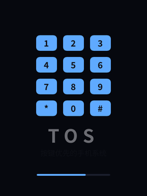 | 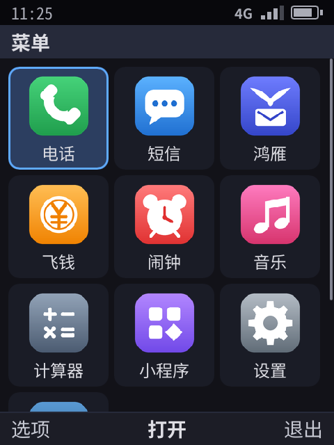 | 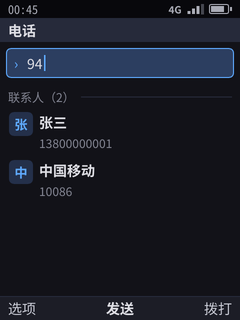 | 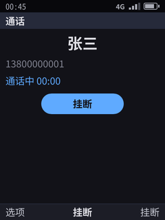 |

| 系统来电 | 短信 | 闹钟响铃 | 计算器 |
|:--:|:--:|:--:|:--:|
| 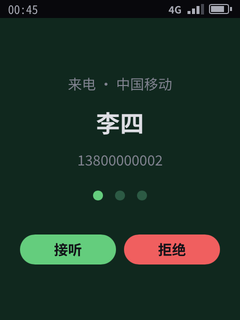 | 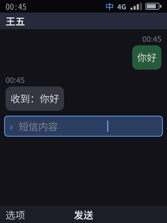 | 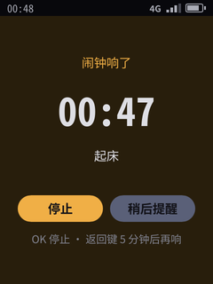 | 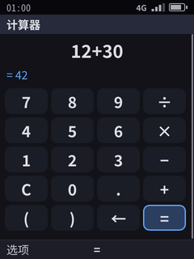 |

| 系统取景框 | 图片应用 | 系统选择器 | 鸿雁发出的照片 |
|:--:|:--:|:--:|:--:|
| 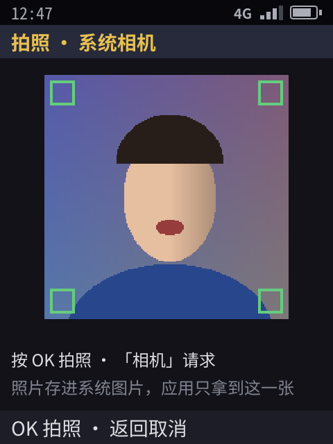 | 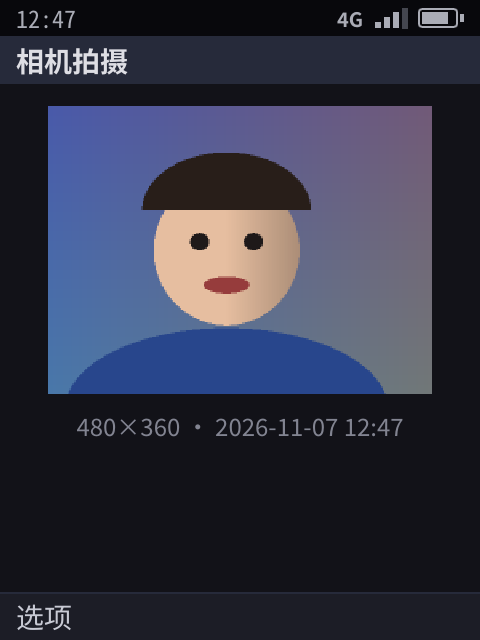 | 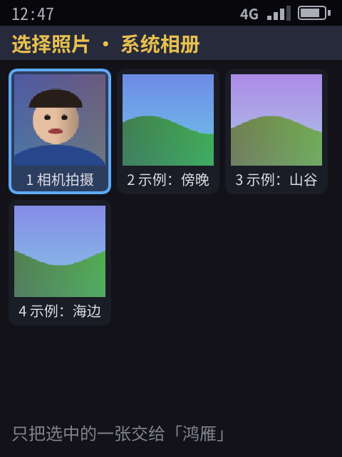 |  |

| 天气 | 关于本机 | 分享面板 | 日历（月视图，测试节假日日历） |
|:--:|:--:|:--:|:--:|
| 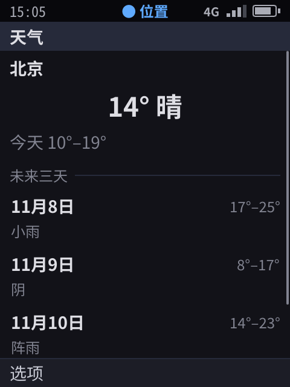 | 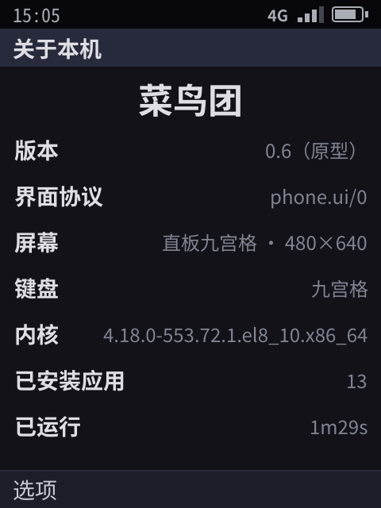 | 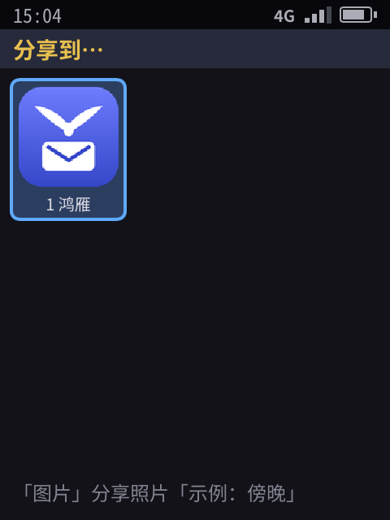 | 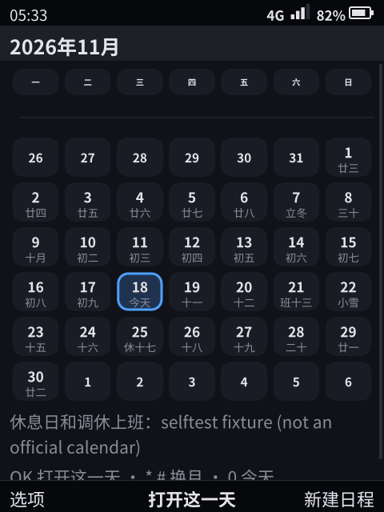 |

设备上（AArch64 QEMU，像素渲染器经 DRM/KMS 画到 virtio-gpu 屏，QEMU 监视器注入 USB 键盘按键并截帧缓冲）：待机界面 → OK 打开主菜单 → OK 打开电话 → Tab 选项菜单 → 回待机、OK、按 7 打开计算器，`12 * 30` 回车得 42 → 回待机、OK、按 2 打开短信 → 回待机后直接输入 10086 并拨出：

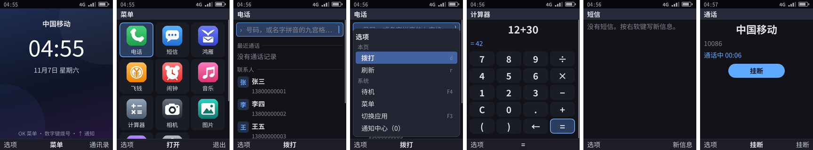

## 3. 鸿雁、飞钱依赖的能力：现状与稳定性要求

| 能力 | 现状 | 「稳定提供」还差什么 |
|------|------|----------------------|
| 应用身份与沙箱 | ✓ 设备上沙箱自检 13/13，兼容测试跑同一份检查；每个应用一个 cgroup；按应用的网络开关、只用 Wi-Fi、流量统计 | — |
| 通知 | ✓（含快捷回复） | 分组、免打扰 |
| **推送** | ✓（[21](21-push.md)）：应用冻结或进程不在时也能收到；VoIP 推送唤醒来电；数据端到端加密，密钥在 keystored；卸载即作废令牌；TLS（或 TLCP），设备凭设备认证注册 | 正式推送网关的部署、产线灌装的设备证书 |
| 音视频通话 | 部分：视频通路、系统来电、推送唤醒、铃声、录音、应用自带音频流 ✓ | 网络传输、回声消除 |
| 扫码 | ✓（系统扫码，应用只拿结果；mediad 从相机画面解码，开发机的合成相机、模拟器的 vivid 上测过） | 真实相机（R14），真机上的识别**未上真机** |
| 可信支付确认 | ✓（系统界面，所见即所签，服务端验签；也能用指纹确认，模拟传感器，[31](31-lock-and-biometrics.md)） | 真实 TEE（R15）、真机指纹传感器 |
| 小程序 | ✓（JS / TS，来源标注，运行时授权按「宿主 + 小程序」记账，密钥按小程序隔离，签名分发） | — |
| 通讯录 | ✓ 读（邮箱、地址、照片 `contact:<键>`）；写入经系统确认（`contacts.save` 等）；系统和几个 CardDAV 账号的几本通讯录双向同步（§1.1），应用不用管（`contacts.books` 列出这些通讯录）；群组（`contacts.groups`、`contacts.group`，也同步）、联系人照片（`contacts.photo`）、系统的联系人选择器（`contacts.pick`） | 应用换一个联系人所在的通讯录 |
| 发图 / 收图 | ✓ 发图：系统选择器只交出选中的一张（只读文件）；收到的图由系统解码显示；PNG 和 JPEG；收到的图「保存到相册」（`media.save`，系统确认） | 压缩 |
| 位置 | `location.get`、`location.watch`、权限（授权框可选精确或大致）、后台定位（「始终允许」、提醒）、总开关、网络定位开关、最近访问（含后台）、大致位置 ✓；开发机和 QEMU 上是模拟接收机和模拟的网络定位服务，真机 GNSS 和 A-GNSS **未上真机** | 真机上的卫星定位、真的网络定位服务、位置共享 |
| 剪贴板 | ✓ 只写不读，粘贴由系统完成 | — |
| 分享 | ✓ 系统分享面板（文字、照片、链接、文件） | — |
| 后台保活 | ✓ 不需要：鸿雁不常驻，消息和来电由服务器经推送送达（[21](21-push.md) §4），只在通话中不冻结；定时同步用后台任务 | — |

## 4. 下一步

1. 定位接收机上真机（随 R2 / R16 的硬件）：ModemManager 和 `/dev/gnssN` 的读取已有，要在骁龙板上跑通。

## 5. 电话：通话界面在前台和后台

通话界面是电话应用的一页，通话期间一直是它最上面的一页。照诺基亚 S40 / S60 和现在的手机：通话可以转到后台继续，在任何界面都看得到它，也都回得来；没法再拨一路时直说原因和回去的路，不会停在「无法拨打」上。代码在 `apps/dialer/call.go`（通话界面）和 `shell/cellcall.go`（后台、状态栏、回到通话）。

### 5.1 拨出

- 待机界面直接打号码（全键盘上数字键，或带 Fn 层时 Fn 下的数字），按 OK 或通话键拨出。电话应用一拿到拨号就推出通话界面「正在呼叫 152…」，不等基带应答 `dial`；基带应答前按挂断，界面立刻结束，应答一到就挂掉那一路。
- 电话应用还没启动时一口气打 `152` 再按 OK（或通话键）：在它首页出来以前按的键先存着，首页出来后照原来的顺序交给它；首页刚出来、存着的键还没交出去时按的键排在它们后面（以前 OK 会赶在 5、2 前面，拨出去的是「1」，只提示「无法拨打」，号码框里又显示 152，看上去像卡住了）。
- 之后：对方振铃… → 通话中 00:12；对方忙、呼叫失败、对方挂断各有提示，通话结束后回到电话首页，最近通话里有这一条。

### 5.2 转到后台和回到通话

| 做什么 | 九宫格 | 全键盘（终端里） | 结果 |
|--------|--------|------------------|------|
| 转到后台 | 返回键、右软键「最小化」、选项里的「最小化」 | Esc、Backspace、F2 | 通话继续，回到通话界面出来之前的地方：从别的应用来的回那个应用（通讯录、音乐……），否则回待机或系统界面 |
| 看到通话 | — | — | 通话界面不在前面时，每个界面的状态栏中间都是「● 通话 01:23」（还在接通时「● 正在呼叫…」，只剩保持的那一路时「● 保持 01:23」），文本和像素渲染器都画；待机界面的提示换成「通话键 回到通话 · OK 菜单」 |
| 回到通话 | 通话键 | 通话键（F5） | 待机界面上、别的应用里焦点上没有要拨的号码时，通话键回到通话界面；焦点上有号码或「拨打」时照常拨它（第二路，§5.4） |
| 回到通话 | 选项菜单、命令面板里的「返回通话」 | 同上，快捷键 `R` | 回到通话界面 |
| 回到通话 | 通知中心最上面一行「电话 · 通话 01:23」 | 同上 | OK 回到通话界面，`e` 挂断 |
| 回到通话 | 锁屏上按通话键 | 同上 | 安全锁锁着时不用解锁就回到通话界面，只能用通话界面（[31](31-lock-and-biometrics.md) §2.2） |
| 挂断 | 挂断键（红键） | F4 | 在通话界面上挂断它显示的那一路；通话在后台时，在哪个界面按都挂断进行中的那一路（诺基亚的红键）。后台挂断、对方挂断时系统提示「和 152 的通话结束 · 00:12」，状态栏的标记随之消失 |

### 5.3 通话界面上的键

| 键 | 九宫格 | 全键盘 |
|----|--------|--------|
| 数字、`*`、`#` | 发 DTMF（打语音菜单），界面上显示「已发送的按键」 | 同左；带 Fn 层时 Fn 下是数字的字母（`w e r`、`s d f`、`z x c`，`q` 是 `#`，`a` 是 `*`）不按 Fn 也发它的数字，通话界面的快捷键不占这些字母 |
| OK | 挂断（焦点在「挂断」按钮上） | 同左 |
| 左软键 | 选项：挂断、静音 / 取消静音、保持 / 恢复通话、免提 / 关闭免提、切换通话（有两路时）、新通话（能再拨一路时）、最小化 | 同左；快捷键 `m` 静音、`h` 保持、`l` 免提、`o` 切换通话、`n` 新通话 |
| 右软键 | 最小化：转到后台 | F2 |
| 返回 | 转到后台 | Esc、Backspace |
| 挂断键 | 挂断显示的那一路 | F4 |

### 5.4 第二路通话与呼叫等待

- 通话中在待机界面打数字：电话打开「新通话」页，盖在通话界面上，写着「正在和 152 通话，拨出时保持 · 返回键回到通话」，号码框照样边输边搜联系人和最近通话；返回键回到通话界面。通话界面选项里的「新通话」（`n`）也打开它；九宫格上通话界面的数字是 DTMF，所以第二路要么从选项开，要么先转到后台再打数字。
- 拨出时 telephonyd 先保持接通的那一路再拨（GSM 里通话中 ATD 也是这样，[04](04-ui-language-telephonyd.md)）。通话界面显示新的一路，下面一行「另一路：152，已保持 00:21」；「切换通话」（`o`）恢复保持的那一路、保持另一路；挂断一路后另一路还在，保持着的要按「恢复通话」。
- 没法再拨一路时不打开「新通话」页，系统直接说原因和回去的路：还在接通（呼叫中、振铃）「通话还在接通：按通话键回到通话」，已有两路「已有两个通话：按通话键回到通话」，紧急呼叫中「正在紧急呼叫：按通话键回到通话」。这时别的应用（通讯录、短信）请求 `tel.dial`，broker 回同样的话（[22](22-developer-api.md) §4.2）。
- 通话中来电（呼叫等待）：系统来电界面照常，多一行「接听后和 152 的通话保持」。接听（OK、通话键）后原来的保持、两路都在通话界面；拒接（返回、挂断键）回到原来的通话；对方先挂掉算未接，进通知中心。

### 5.5 其他

| 项 | 说明 |
|----|------|
| 免提、静音 | 免提在通话界面上切换（`audio.route`）；最后一路通话结束时系统把声音切回听筒，下一通电话不会还开着免提。静音按路记在 telephonyd |
| 通话中的电话应用 | 有蜂窝通话时 Shell 不冻结它，低内存回收、改语言重启也跳过它（以前在后台 10 秒就被暂停，通话的事件堆在它的队列里） |
| 锁屏 | 通话中息屏上锁时通话界面留在前面，点亮就是它；锁着时返回、右软键、菜单都出不去，挂断后回到锁屏（[31](31-lock-and-biometrics.md) §2.2） |
| 测试 | 单元测试：`shell` 的 `TestCallScreenToBackgroundAndBack`、`TestHideReturnsToTheAppBefore`、`TestEndKeyHangsUpAway`、`TestDigitsDuringACall`、`TestDialRefusedBesideACall`、`TestDialerRunsDuringACall`、`TestCallEndedInTheBackground`、`TestCallIndicator`、`TestWaitingCallNote`、`TestLockDuringACall`、`TestKeysAfterTheFirstPageKeepTheirPlace`；`apps/dialer` 的 `TestDialShowsTheCallAtOnce`、`TestEventsBeforeTheDialAnswer`、`TestSecondCall`、`TestNoSecondCall`、`TestCallScreenKeys`；`telephonyd_test` 的第二路、呼叫等待、切换、对方挂断、慢基带。开发机自测七个用例（[13](13-prototype.md) §5），文本和像素渲染器都过。都在模拟基带上，ModemManager 后端的第二路（先 `HoldAndAccept` 再 `CreateCall`）在模拟的 ModemManager 上测过（`make mm-selftest` 33/33），**未上真机** |
