# 必备应用与平台能力核对

> 逐个核对一台手机必备的 15 个应用需要哪些平台能力、我们现在有没有。状态说明：**✓** 原型已实现并有自测；**部分** 有但不完整；**✗** 没有。剩余工作见 57（内部文档）。

## 0. 结论

- **15 个应用里，电话（模拟基带）、短信、闹钟、计算器、音乐、相机、图片、天气、设置、应用商店，以及鸿雁、飞钱的主体能力已具备。** 平台能力的缺口只剩下面几项：

  | 缺口 | 卡住的应用 | 对鸿雁 / 飞钱 | 优先级 |
  |------|------------|---------------|:---:|
  | 真实定位后端（接口和权限已有，定位是模拟的） | 地图类、鸿雁位置共享 | 位置共享、附近、风控 | P1 |
  | 视频：只放 WebM（VP8 / VP9，软件解码），H.264 / HEVC 要真机的硬件解码；下载的 WebM 经确认加入「图片」✓；相机录像要真机的硬件编码器，**未实现** | 图片、相机 | 视频消息 | P2 |

- **鸿雁、飞钱不投主要精力。** 它们是能力的「用户」：我们要做的是让它们用到的每一项能力稳定可靠（§3），真正的应用等腾讯、阿里按我们的平台适配。
- **「支付宝 Java 版」行不通。** 支付宝的 J2ME 客户端早已停止维护，服务端也不再支持，就算在系统里加一个 Java ME 运行环境也连不上。现实路径只有两条：平台把能力做稳，等阿里适配；或者合作开发 `phone.Ui` 版。

## 1. 逐个核对

| 应用 | 需要的平台能力 | 现状 | 缺口 |
|------|----------------|------|------|
| **电话** | 拨号 / 接听 / 挂断 / 保持 / 静音、系统来电界面、通话记录、通讯录、通话音频路由、距离传感器、紧急呼叫、DTMF | 拨号状态机、系统来电界面、通话记录、通讯录、智能拨号、铃声 / 回铃音 / 忙音、免提切换、USSD（`*100#` 查询、运营商菜单、网络主动发来的提问）、`*#06#` 显示 IMEI ✓（模拟基带）；ModemManager 后端 ✓（模拟的 ModemManager 上测过，[04](04-ui-language-telephonyd.md)） | 真机音频路由、距离传感器、DTMF、真机基带 |
| **短信** | 收发、通知、通讯录、长短信拼接、彩信、验证码提取 | 收发、通知、会话和未读数、送达回执、分条计数、搜索、删短信和会话、拦截号码（「已拦截」文件夹）、复制验证码（通知上也有）、紧急警报记录 ✓（模拟基带，phone-smsd 存储，[32](32-messaging.md)）；只有它能删和拦截（默认短信应用） | 彩信；ModemManager 一侧未运行测试、**未上真机** |
| **图片** | 媒体库（系统索引照片）、系统解码 JPEG / PNG、缩略图、分享、删除 | 系统媒体库、PNG / JPEG 解码与缩略图、「相册」权限、照片网格（图铺满格子、不显示文字）、看大图（← → 翻页）、设为待机 / 锁屏壁纸、删除（系统确认）、分享、视频播放（系统解码，OK 暂停，← → 跳 5 秒）、下载的视频经确认加入 ✓ | 相机录像、H.264 |
| **相机** | 预览、拍照、存入媒体库、快门键、闪光灯 | 系统取景框、拍照存入媒体库 ✓（V4L2 摄像头，没有时用合成画面），扫码 ✓ | 快门键、闪光灯、真实传感器（R14） |
| **浏览器** | Web 视图、网络、下载、阅读模式 | 浏览器应用（地址栏：网址或搜索词，必应 / 百度；书签、最近访问、前进后退、刷新、页内查找、缩放、分享链接）、下载进「文件」区、网页里选文件上传、`prompt`、拦截广告和跟踪（应用设置里可关）、清除网站数据 ✓；网络权限（沙箱）、阅读模式、Web 视图 ✓ | 全屏视频（要硬件解码）、无障碍、按网站管理 Cookie |
| **设置** | 权限、网络、显示、声音、日期时间、输入法、存储、关于、系统更新 | 应用权限（含小程序单独的授权）、飞行模式和移动数据开关（模拟基带上 ✓，未上真机）、Wi-Fi（连加密网络、企业网络、忘记网络）、蓝牙（搜索、配对（对方有屏幕时核对配对码）、取消配对、给已配对的设备发文件、允许或收回车机读通讯录）、流量、电池（各应用最近一天的后台、前台 CPU）、应用设置、声音（← → 调音量）、主题（深色、浅色、复古绿、琥珀）、壁纸（恢复默认）、键盘锁、安全（锁屏 PIN 码、息屏后多久锁定、锁屏上的通知内容；指纹：录入、改名、删除、用于解锁和支付；PIN 码在系统界面输入）、SIM 卡锁（开关 PIN 锁、改 PIN 码，PIN 在系统界面输入）、静音、模糊音、开发者模式、解锁设备、系统更新、关于本机、沙箱自检、语言（简体中文、繁體中文、English、Español 或自动）、地区、日期和时间（时区、网络时间、24 小时制）、NFC（只有开关和打开「卡包」的一行，卡在卡包里管）✓ | 选 APN、输入法、存储；手动设时间只在设备上可用（未上真机） |
| **邮件** | 网络、后台同步、凭据保存、HTML 邮件、附件 | 网络 ✓、文档节点 ✓、后台任务 ✓、文件选择器与存文件（附件）✓ | 凭据保存（钥匙串） |
| **闹钟** | 系统按时触发（应用冻结也响）、铃声、振动、从休眠唤醒 | 系统闹钟服务、全屏响铃、闹钟声、稍后提醒 ✓ | 振动、RTC 唤醒、自选铃声 |
| **计算器** | 纯界面 | ✓（宫格按键，诺基亚式 `*` 切运算符） | — |
| **日历** | 定时提醒、日期输入、CalDAV 同步 | 系统闹钟可作提醒 ✓、后台任务 ✓ | 定时通知接口、日期输入 |
| **应用商店** | 安装 / 更新 / 卸载、验签、权限展示、下载、自动更新 | 签名包、系统确认后安装、同开发者更新、卸载清理 ✓（[22](22-developer-api.md) §12）；商店目录、下载、增量更新、应用详情和举报、分批发布、充电时在后台自动更新、在后台取下架清单 ✓（[07](07-ecosystem-and-store.md) §4.1） | 付费应用、开发者门户里调分批比例 |
| **贪吃蛇**（画布应用的示例，不计入 15 个） | 画布：游戏画面、按键；音效 | 诺基亚 6110 / 3310 式：黄绿色背光的单色液晶屏，17×10 格，每节蛇身和食物都是留着缝的小方块，蛇头张着嘴，分数、级别、「GAME OVER」是应用用矩形拼的像素字；开局前选 1–9 级（速度，一个食物得级别那么多分），可切换撞墙（默认）或穿墙；每吃 5 个食物出一只限时 20 步的奖励小虫（级别的 5–15 倍，越早吃越多）；不能掉头，转向可以提前按两下；暂停 / 继续，离开前台自动暂停；最高分、级别和玩法存在应用数据里。系统在文本和像素界面里画，聚焦时方向键、数字、`#` `*` 和 OK 交给应用 ✓（单元测试 ✓，自测 ✓）；吃到食物「嘀」一声，用应用自己的声音流，不要权限（开发机上看到流在播放，未上真机听） | 音效走 `media` 类别，同一时间只有一路，会顶掉后台正在放的音乐（[20](20-audio.md) §2）；打开「选项」菜单时游戏不暂停（应用收不到菜单弹出的消息） |
| **天气** | 网络、定位、后台刷新、主屏小组件 | 定位（模拟）、每小时后台刷新、温度单位和预报天数（3–7 天）两项应用设置、待机小组件（OK 直达今天的天气）✓；预报是模拟数据 | 真实天气服务 |
| **音乐** | 音频播放、后台播放、媒体按键与音量、媒体库；无损与 DSD | 播放、暂停 / 继续、切歌、进度、后台播放不冻结、来电自动暂停、音量键、正在播放 ✓；音乐目录（`media/music`，文件夹保留，电脑经 USB 拷进来，[27](27-usb-typec.md) §3.1）里的 FLAC、WAV、AIFF、ALAC、APE、WavPack、MP3、Ogg、DSF、DFF、CUE 分轨、SACD 镜像（[20](20-audio.md) §9）；按专辑、艺术家、文件夹浏览，每首显示格式（「FLAC 24/96」「DSD64」「SACD」）；列表就是播放队列，无缝接下一首；前后 10 秒；回放增益；只有音乐在响时按曲目自己的格式送声卡（比特完美、DoP、原生 DSD），正在播放页上写明怎么送的 ✓（单元测试 ✓，开发机自测 ✓，**未上真机**） | AAC；封面显示；比特完美时用声卡的硬件音量；真的 USB / DSD 解码器、真实的 SACD 镜像上验证（[20](20-audio.md) §7） |
| **鸿雁**（示例） | 即时通讯界面、音视频通话、通知、推送、小程序、扫码、支付、通讯录、发图、位置、分享 | 界面、视频通话、系统来电、通知、推送（消息与 VoIP 来电，数据端到端加密）、小程序、扫码、通讯录、语音消息、发图、复制、接收分享 ✓ | 位置共享 |
| **飞钱**（示例） | 可信确认、密钥与设备认证、扫码、安全画面、NFC、到账通知、生物识别 | 可信确认、密钥、认证、扫码、安全画面、到账推送、NFC 交通卡和付款卡（模拟控制器；快捷交通卡、默认付款应用在「卡包」里设，[30](30-nfc.md)）、指纹支付（用户打开「指纹用于支付」后；录入新指纹后退回支付密码、确认后重新开通，[31](31-lock-and-biometrics.md) §5）✓ | 真机 NFC（[30](30-nfc.md) §10）、真机指纹传感器、真实 TEE（R15） |
| **卡包**（系统应用，不计入 15 个） | NFC 卡模拟、读卡模式、快速选卡、息屏和挂起时刷卡 | 列出所有卡（系统保存的门禁卡、应用提供的交通卡和付款卡，写着是哪个应用的），读实体卡添加门禁卡并起名，改名、删除、排顺序，设快捷交通卡和默认付款应用，每张卡设息屏、锁着时能不能用（门禁卡和快捷交通卡默认能，付款卡永远要解锁），出示一张卡；门禁卡按使用时间选（一天里的钟点、工作日或休息日，认地区的节假日日历，60 天的刷卡记录），卡包里写着每张的常用时段；门禁卡、快捷交通卡锁着、息屏、挂起时不按键也能刷，屏幕不亮；连按两下电源键（没有电源键时在待机界面连按两下挂断键）打开系统的快速选卡；用仅系统应用可用的 `nfc.state` / `nfc.set`（模拟控制器，单元测试 ✓，自测 ✓，[30](30-nfc.md)）✓ | 真机 NFC（[30](30-nfc.md) §10）、加密门禁卡、真的节假日日历数据 |

## 2. 已实现的系统能力

| 内容 | 说明 |
|------|------|
| **telephonyd**（C++23，R2） | 单线程事件循环；调制解调器抽象接口 + 模拟基带（注网、信号、呼叫中 → 振铃 → 通话中、占线、未接、短信自动回复）；通话记录持久化；收到的短信和小区广播放在待确认队列里，phone-smsd 存好确认后才放手（[32](32-messaging.md)）；协议与其他系统服务相同（JSON 行）。见 [04](04-ui-language-telephonyd.md) |
| 电话能力 | `tel.dial / answer / hangup / hold / mute / calls / log`、`sms.send / list / read / threads / alerts / delete / block / blocked`（删和拦截只给默认短信应用）。**没有 `phone` 权限的应用也能请求拨号，但要用户在系统对话框里确认**（同 iOS 的 `tel:` 链接），通话界面始终归电话应用。键盘锁着时能直接拨紧急号码（[18](18-nokia-form-factors.md) §5.1） |
| 系统来电界面 | 无论前台是什么，SIM 来电都由系统全屏接管；接听后交给电话应用；未接来电记入通知中心 |
| **phone-smsd** | 短信的系统服务：存储（只追加的日志加快照，不用数据库）、会话、已读未读、删除、搜索、拦截文件夹、送达状态、验证码；收到的短信 telephonyd 留着，smsd 存好确认后才放手；紧急警报（小区广播）在锁屏上也全屏弹出，有专门的提示音，国家级不能关，其他级别在设置里关（[32](32-messaging.md)） |
| 通讯录 | 系统存储，运行时权限「通讯录」；系统镜像里的电话、短信应用在清单里预授权 |
| 闹钟服务 | 系统保存并按时触发，应用冻结或没运行也会全屏响铃；支持稍后提醒、每天重复 |
| 输入框实时变更 | `live` 输入框每次编辑都通知应用，用于边输边搜（智能拨号） |
| 待机与主菜单 | 开机进待机界面，按 OK 进主菜单；主菜单按屏幕 3–5 列，按数字键 1–9 直达对应的格子；应用图标是图片，见 [18](18-nokia-form-factors.md) §5.1。像诺基亚一样分文件夹：主菜单放每天用的，计算器、闹钟、天气这类进「工具」，小程序和示例进「应用」，商店装的应用默认进「应用」（清单的 `folder`） |
| 方向键左右 | 绑定了 ← → 的动作优先（调音量、上一首 / 下一首、上一张 / 下一张、视频跳 5 秒）；没有绑定时 ← 返回上一级，→ 打开焦点项；宫格和输入框里照旧移动 |
| **主题与壁纸** | 设置 › 主题换整套配色（文本界面和 phone-paint 都跟着换）；图片里看照片时「设为壁纸」：待机、锁屏或两者，系统存一份副本，键盘锁着时显示锁屏的那张；壁纸上的文字用白色，压一层渐变的暗色保证看得清（[23](23-renderer-protocol.md) §4） |
| **界面位置** | 应用用页面的 `layout` 说内容放哪：音乐的正在播放、看图居中稍偏下，计算器贴底、结果按屏宽放到最大（`display` 样式），由系统按屏幕摆 |
| 开机动画 | 原创图案（不是诺基亚的握手）：12 个按键依次点亮，然后出现系统名和进度条 |
| **照片** | 照片属于系统，不属于拍照的应用，存在系统状态目录里。应用能看到的只有：自己拍的、用户在系统选择器里交给它的；持有运行时权限「相册」时可以看全部。拍照（`camera.capture`）走系统取景框，存 JPEG；选图（`media.pick`）走系统选择器，交出一张只读文件；删除由系统确认；图片节点写 `media:<编号>` 由系统解码。媒体库第一次打开时放进系统镜像里的示例：8 张公有领域 / CC0 的照片和一段视频（Wikimedia Commons，来源写在 `share/phone/examples/*/SOURCES.md`），旧版本留下的画出来的占位图换成这些 |
| **视频播放** | `video.open`：Shell 打开视频文件和一路 audiod 声音环，交给 mediad；mediad 起 ffmpeg 解码（WebM：VP8 / VP9、Opus / Vorbis），画面经共享内存给渲染器，声音写进环；画面的时钟跟着 audiod 已放出的声音走，所以暂停、卡顿、来电抢走音频焦点时画面一起停。应用只拿到流名，写进 `media` 节点；流不在应用的前台界面上时系统暂停，界面关掉时关掉播放器（[22](22-developer-api.md) §4.6）。镜像里的 ffmpeg 只编了免专利费的格式；H.264 / HEVC 留给真机的硬件解码（**未实现**） |
| **设置** | 应用权限（含每项授权最近一次使用的时间和次数、长期不用被收回的授权；网络可设成「只用 Wi-Fi」）、Wi-Fi 和蓝牙（`wifi.*`、`bt.*`，[22](22-developer-api.md) §4.5）、流量（按应用、按 Wi-Fi / 移动网络统计收发字节，[17](17-app-sandbox.md) §1）、应用设置（开关、选项、数字、文字）、声音（三类音量交给 audiod）、主题、壁纸、自动键盘锁、安全（锁屏 PIN 码和指纹，[31](31-lock-and-biometrics.md) §6）、SIM 卡锁（[04](04-ui-language-telephonyd.md)）、开发者模式、系统更新（[25](25-system-update.md)）、关于本机（含产品名、应用崩溃记录）、沙箱自检、语言、地区、日期和时间（下一行），都走仅系统应用可用的 `settings.get` / `settings.set` |
| **语言、地区和时间** | 四种界面语言，换语言时 Shell 马上换、应用带着墓碑重启并回到原来的页面，渲染器也重启（[22](22-developer-api.md) §9.1）。地区自动取 SIM 卡的国家（telephonyd 报告 SIM 的 MCC，没卡时用上一张卡的），没有时用 SKU 的地区；自动语言按地区定。时区自动取网络的：telephonyd 报告 NITZ（模拟基带和 ModemManager 的 `Modem.Time` 都有），在网络所在国家的时区里找偏移相同的，网络不报时用地区的主时区；也可以按地区从 IANA 时区里选。设备时钟和 RTC 始终是 UTC，Shell 和每个应用拿到 `TZ`；Shell 自己的时钟、日期、星期按语言和时区显示，可切 12 / 24 小时制。网络时间：镜像有 systemd-timesyncd（经 systemd-timedated）时用 NTP，没同步时用 NITZ；也可以关掉自动、手动设时间（Shell 以 root 设系统时钟和 RTC）。NTP、NITZ 设钟和手动设时间单元测试 ✓、未上真机；镜像里有没有 systemd-timesyncd 和 tzdata 还没核实（Shell 内嵌一份 Go 的时区库兜底，其他进程读镜像的 `/usr/share/zoneinfo`） |
| **应用生命周期的兜底** | 低内存时先结束后台应用；前台应用卡住 5 秒提示「没有响应」；崩溃留记录，反复崩溃的不在后台启动（[17](17-app-sandbox.md) §5.1、§5.2） |
| **声音** | 音量键（来电时静音铃声，放音乐时调媒体音量）、静音模式下来电只振动、待机界面的「正在播放」和系统菜单里的暂停 / 继续；鸿雁的视频通话有双向声音；语音消息用 Opus 编码，存成 Ogg Opus（[20](20-audio.md) §4） |
| **相机** | mediad 优先用 V4L2 摄像头（模拟器上是内核的 vivid 虚拟摄像头），没有时用合成画面（[11](11-platform-architecture.md) §8） |
| **输入法** | 用户词库与调频、自造词组、英文下一词、模糊音（[16](16-input-method.md) §5.1）；九宫格笔画输入（§5.3） |
| **网页阅读模式** | 宿主应用在自己的沙箱里取回网页、抽出正文，交给系统的文档节点显示，链接进菜单；鸿雁里带网址的消息可以「阅读模式」打开（[14](14-tui-route-and-app-framework.md) §5） |
| **Web 视图** | `web` 节点：页面由系统的 `phone-webview`（WPE WebKit）在独立进程、宿主的网页 uid 下渲染，画面经共享内存交给像素渲染器；方向键在链接间移动，返回键先后退；页面的 `phone.call` 走 broker，系统界面标注网页来源；鸿雁里带网址的消息可以「网页」打开（[14](14-tui-route-and-app-framework.md) §5） |
| **产品配置层** | `profile.d` 逐层叠加：产品名、不带的系统应用、菜单顺序、系统设置的默认值、能力交给哪个系统服务实现（[14](14-tui-route-and-app-framework.md) §2.1） |
| **待机小组件** | 应用在待机界面放一行字；↓ 选中、OK 直达应用里对应的页面（[18](18-nokia-form-factors.md) §5.1） |
| **C/C++ 应用** | C ABI SDK（`sdk/c`）和 C++ 示例应用（[22](22-developer-api.md) §9） |
| **天气** | 前台定位（运行时权限「位置」，状态栏显示「● 位置」），自己把坐标换成城市；后台每 60 分钟由系统按预算唤醒刷新，不常驻；预报是模拟数据 |
| **剪贴板** | 应用只能写不能读；粘贴是系统菜单的第一项「粘贴「…」」（[17](17-app-sandbox.md) §1） |
| **分享面板** | `share.open`（[22](22-developer-api.md) §4.9）：清单里用 `share` 声明能接收什么，系统列出目标；分享照片时顺带授权给目标；发起方看不到用户装了哪些应用 |

| 开机 | 主菜单宫格 | 智能拨号 | 通话中 |
|:--:|:--:|:--:|:--:|
| 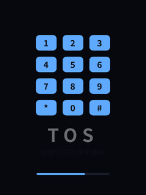 | 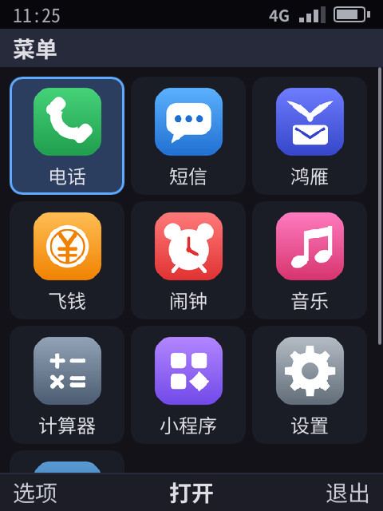 | 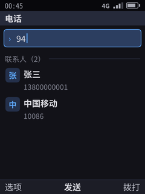 | 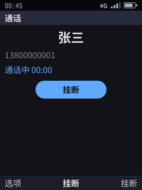 |

| 系统来电 | 短信 | 闹钟响铃 | 计算器 |
|:--:|:--:|:--:|:--:|
| 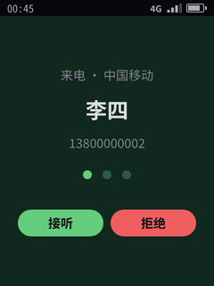 | 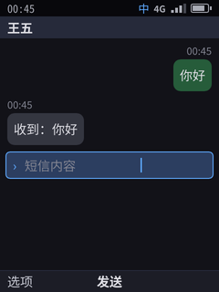 | 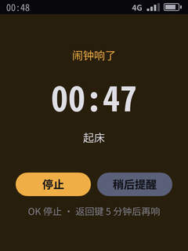 | 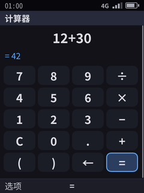 |

| 系统取景框 | 图片应用 | 系统选择器 | 鸿雁发出的照片 |
|:--:|:--:|:--:|:--:|
| 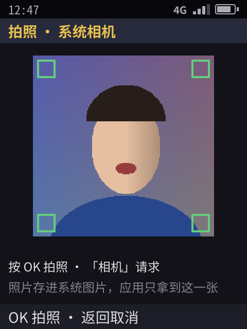 | 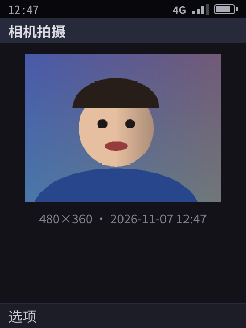 | 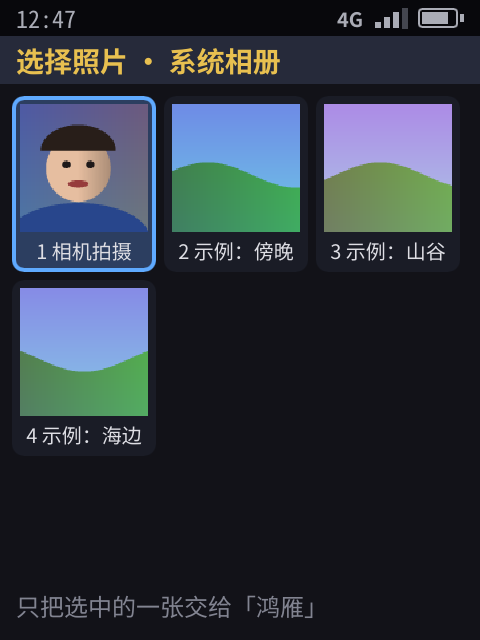 |  |

| 天气 | 关于本机 | 分享面板 |
|:--:|:--:|:--:|
| 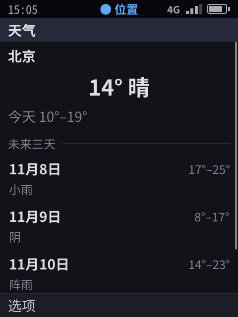 | 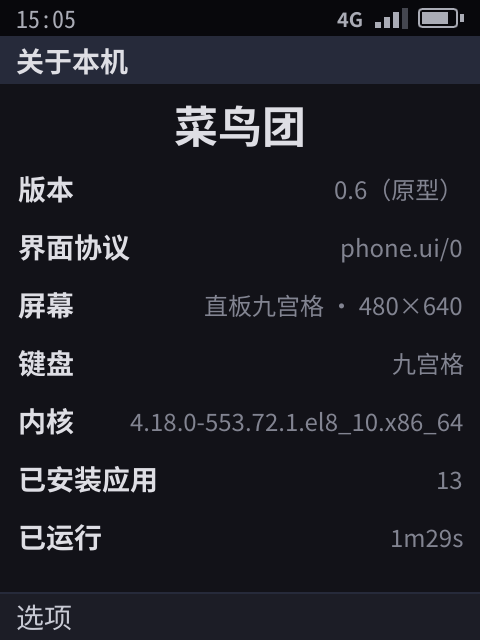 | 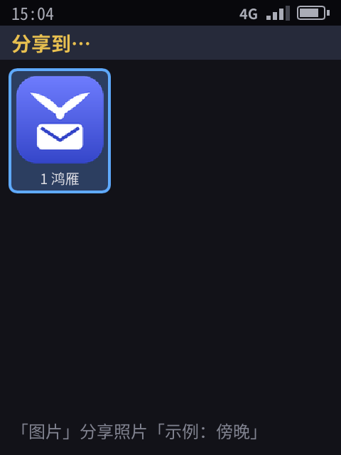 |

设备上（AArch64 QEMU，像素渲染器经 DRM/KMS 画到 virtio-gpu 屏，QEMU 监视器注入 USB 键盘按键并截帧缓冲）：待机界面 → OK 打开主菜单 → OK 打开电话 → Tab 选项菜单 → 回待机、OK、按 7 打开计算器，`12 * 30` 回车得 42 → 回待机、OK、按 2 打开短信 → 回待机后直接输入 10086 并拨出：

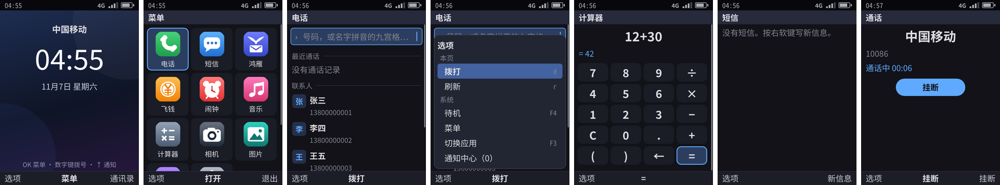

## 3. 鸿雁、飞钱依赖的能力：现状与稳定性要求

| 能力 | 现状 | 「稳定提供」还差什么 |
|------|------|----------------------|
| 应用身份与沙箱 | ✓ 设备上沙箱自检 13/13，兼容测试跑同一份检查；每个应用一个 cgroup；按应用的网络开关、只用 Wi-Fi、流量统计 | — |
| 通知 | ✓ | 快捷回复、分组、免打扰 |
| **推送** | ✓（[21](21-push.md)）：应用冻结或进程不在时也能收到；VoIP 推送唤醒来电；数据端到端加密，密钥在 keystored；卸载即作废令牌 | TLS、用设备证书认证、云端网关 |
| 音视频通话 | 部分：视频通路、系统来电、推送唤醒、铃声、录音、应用自带音频流 ✓ | 网络传输、回声消除 |
| 扫码 | ✓（系统扫码，应用只拿结果） | 真实相机（R14） |
| 可信支付确认 | ✓（系统界面，所见即所签，服务端验签；也能用指纹确认，模拟传感器，[31](31-lock-and-biometrics.md)） | 真实 TEE（R15）、真机指纹传感器 |
| 小程序 | ✓（JS / TS，来源标注，运行时授权按「宿主 + 小程序」记账） | 按小程序隔离的密钥（R5） |
| 通讯录 | ✓ | 写入、群组、同步 |
| 发图 / 收图 | ✓ 发图：系统选择器只交出选中的一张（只读文件）；收到的图由系统解码显示；PNG 和 JPEG；收到的图「保存到相册」（`media.save`，系统确认） | 压缩 |
| 位置 | 部分：`location.get` 和权限 ✓，定位是模拟的 | 真实卫星定位、位置共享 |
| 剪贴板 | ✓ 只写不读，粘贴由系统完成 | — |
| 分享 | ✓ 系统分享面板（文字、照片） | 分享链接、文件 |
| 后台保活 | ✓ 不需要：鸿雁不常驻，消息和来电由服务器经推送送达（[21](21-push.md) §4），只在通话中不冻结；定时同步用后台任务 | — |

## 4. 下一步

1. 真实定位后端（随 R2 / R16 的硬件）。
2. 小程序的签名分发（R5 剩下的部分）。
