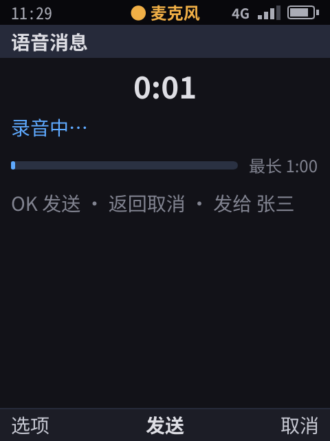
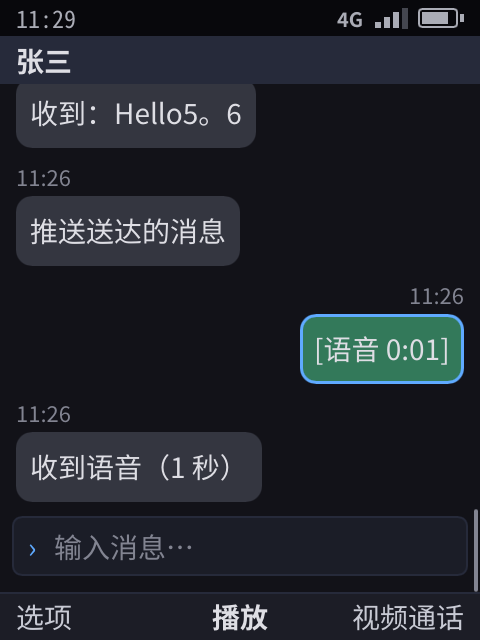
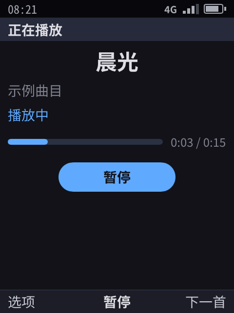
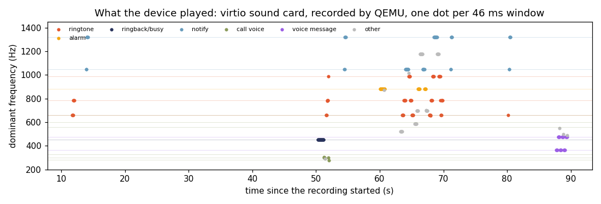

# 音频服务（R23）

> 电话、闹钟、音乐、鸿雁语音都要用声音。已实现：系统服务 `phone-audiod`、音频焦点、系统提示音、音乐应用、后台播放、录音、应用自带音频流（共享内存，经 fd 传递，§3.1）、鸿雁的语音消息、视频的声音（mediad 写进同一种环形缓冲区），以及设备上的声卡和 QEMU 录音验证。无损音乐（FLAC、WAV、AIFF、ALAC、APE、WavPack，CUE 分轨）、DSD（DSF、DFF、SACD 镜像）、按曲目自己的格式送声卡（比特完美、DoP、原生 DSD）、无缝播放和回放增益见 §9：开发机上单元测试 ✓、自测 ✓，**未上真机**（没有真的 USB 解码器和 SACD 光盘镜像）。蓝牙、真实录音设备等见 §7，**未实现**。

## 0. 结论

- **应用碰不到声卡。** 沙箱里没有 `/dev/snd`（Landlock 只放行 `/dev/null`、`/dev/zero` 和两个随机数设备），音频服务的套接字只有 Shell 能连（权限 0600）。应用只能通过 broker 请求「播放媒体库里的某一首」，或者控制自己的播放流。
- **什么时候发声由系统决定。** 每路声音属于一个类别，类别有优先级：紧急警报 > 通话 > 铃声 > 闹钟 > 媒体 > 提示音。来电时音乐自动暂停，挂断后自动继续；提示音只把音乐压低。应用只能用「媒体」类别，所以不能借高优先级类别打断别人。
- **铃声、闹钟、回铃音、忙音、提示音都由系统播放**，应用冻结或没运行也照样响。
- **录音必须经过用户授权，并且有状态栏指示。** 只有前台应用或通话中的应用能录音，应用一离开前台，系统就停掉它的录音（Android 9+、iOS 也是这样）。
- **应用自己的声音不经过 Shell。** Shell 只在建立时检查一次权限，交给应用一块共享内存，之后 PCM 数据在应用和 audiod 之间直接流动（§3.1）。
- **音乐应用可以在后台播放。** 清单里声明 `background: ["audio"]`，正在放歌时离开应用也不会被冻结；暂停或放完后，下次离开时照常冻结。
- **音乐按自己的格式播放。** 只有音乐在响时，audiod 绕过 48 kHz 的混音器，按曲目自己的采样率和位深打开声卡；样本一点不改时（媒体音量最大、不开回放增益、声卡支持这个格式）就是比特完美。DSD 能原生送就原生送，用户选了 DoP 就按 DoP，否则转成 176.4 kHz PCM。通知音一响就回到混音器，一秒后再切回去（§9.5）。
- 开发机自测、像素渲染器三种形态都是 37/37；设备上的结果见 §6。

## 1. 架构

```
 应用（沙箱，无 /dev/snd）
   │ phone.Ui：media.list / audio.play / audio.control / audio.state / audio.route
   ▼
 Shell broker ── 权限、只能控制自己的流、把流的事件转给所属应用
   │ 系统声音：来电铃声、回铃音、通话、闹钟、通知提示音（按通话和闹钟状态自动开关）
   │ JSON 行 RPC + 事件订阅（unix 套接字，0600）
   ▼
 phone-audiod ── 混音器（48 kHz 立体声，每 20 ms 一帧）+ 焦点策略 + 音源
   │             只有音乐在响时：绕过混音器，按曲目自己的格式（§9.5）
   ▼
 输出端：alsa（aplay → 声卡；插着 USB 声卡时用它） | file（WAV） | null
```

和 Android、iOS 的对应关系：

| 职责 | Android | iOS | 我们 |
|------|---------|-----|------|
| 混音、输出 | AudioFlinger | 系统音频服务 | `phone-audiod` 的混音器 |
| 谁能发声、打断与恢复 | 音频焦点（AudioFocus）+ AudioPolicy | 音频会话类别 + 打断通知 | 类别优先级（§2），策略在服务里，应用不能自己定 |
| 后台播放 | 前台服务 + 媒体通知 | `audio` 后台模式 | `background: ["audio"]`，只在真正发声时生效 |
| 铃声、闹钟 | 系统应用 + 铃声流 | 系统 | Shell 直接播放，应用不参与 |

## 2. 类别与焦点

| 类别 | 谁用 | 优先级 | 对音乐的影响 |
|------|------|:---:|------|
| `alert` | 紧急警报（小区广播，[32](32-messaging.md) §7）；音量固定为最大，静音模式也响 | 6 | 暂停，结束后继续 |
| `call` | 通话中（回铃音、通话声、忙音） | 5 | 暂停，结束后继续 |
| `ring` | SIM 来电、VoIP 来电 | 4 | 暂停，结束后继续 |
| `alarm` | 闹钟 | 3 | 暂停，结束后继续 |
| `media` | 应用（音乐等） | 2 | 同一时间只有一路，新的顶掉旧的 |
| `notify` | 通知横幅 | 1 | 压低到 30%，不暂停 |

- 被高优先级打断的流标记为 `by_focus`。打断结束后只恢复这类流，用户自己按了暂停的不会被恢复。
- 每个类别有独立音量（`volume` 方法）。
- 路由 `earpiece` / `speaker` 由拨号界面的「免提」切换，需要 `phone` 权限。原型只有一个输出端，免提只是把通话增益乘 1.4；真正切换听筒、扬声器、耳机要靠目标硬件的 ALSA UCM 配置（§7）。

## 3. 应用接口

| 能力 | 参数 | 说明 |
|------|------|------|
| `media.list` | — | 系统媒体库里的音频：音乐库里的曲目（§9，ID 是 `music:<音乐库里的路径>`，CUE 和 SACD 的曲目后面加 `#<序号>`），然后是 3 首合成的示例曲目。音乐曲目除了标题、艺术家、时长，还有 `album`、`album_artist`、`track`、`disc`、`genre`、`year`、`folder`、`format`（「FLAC 24/96」）、`quality`、`codec`、`rate`、`bits`、`channels`、`lossless`、`replaygain`、`cover`、`from`（`cue` / `sacd`） |
| `audio.play` | `{media, next?, at_ms?, replaygain?, dsd?}` | 播放媒体库里的一项，类别固定为 `media`，返回流。`next`：接在后面无缝播放的曲目；`at_ms`：从哪里开始；`replaygain`：`track` / `album` / 空（关）；`dsd`：`auto` / `dop` / `pcm` |
| `audio.control` | `{id, op, at_ms?, next?, replaygain?, dsd?}` | `pause` / `resume` / `stop`，只能控制自己的流；音乐另有 `seek`（`at_ms`）、`queue`（换掉接在后面的曲目，`next` 为空就是不接）、`options`（`dsd`） |
| `audio.state` | — | 自己的流：状态、位置、时长、是否因焦点暂停 |
| `audio.route` | `{route}` | `earpiece` / `speaker`，需要 `phone` 权限 |

流的状态每次变化，Shell 都会给所属应用发一个 `audio` 事件（流的 JSON），应用据此更新界面，放完时收到 `ended` 自动切下一首。音乐的流还带 `media`（正在放的那一首：排队的下一首接上时它就变了，应用据此再排下一首）、`format` 和 `output`（怎么到声卡：`mixer 48 kHz`、`pcm S32_LE 96000 Hz 2ch bit-perfect`、`dop …`、`dsd …`）。这几个字段和 `media.list` 的音乐字段现在由 Shell 和音乐应用各自定义（`shell/music.go`、`apps/music/library.go`），还没收进 `ui/caps.go`。

### 3.1 应用自带的音频流

| 能力 | 权限 | 说明 |
|------|------|------|
| `audio.stream` `{name}` | — | 播放应用自己写入的 PCM：语音消息、VoIP 解码后的声音、音效。类别由系统定：应用在通话中是 `call`，否则是 `media` |
| `audio.record` `{name}` | 麦克风（运行时授权） | 麦克风的声音写进缓冲区，由应用读取。只有前台应用或通话中的应用能用，离开前台立即停止；录音期间状态栏中间显示「● 麦克风」（像素渲染器里是橙色） |

数据怎么走：

```
 应用 ──audio.stream──▶ Shell（检查权限、定类别）──open──▶ audiod
                                                       │ 建一块 memfd：48 kHz 单声道环形缓冲区，封住大小
 应用 ◀──回复 + fd（SCM_RIGHTS）── Shell ◀──回复 + fd── audiod
   │
   └── 之后：应用写 / 读共享内存，audiod 每 20 ms 读 / 写一次；Shell 不再经手
```

- 缓冲区格式见 `audio/ring.go`：64 字节的头，记录读写位置，后面是样本。一个生产者、一个消费者。
- 两边都不信任对方写的读写位置：下标对容量取模，对端怎么改都不会越界。memfd 封住大小（`F_SEAL_SHRINK`），对端没法截短文件，也就没法让另一边访问映射内存时因 SIGBUS 崩溃；映射前检查封印，没封的拒绝。这几条都有单元测试。
- 应用 SDK：`app.GoAudio(能力, 名称, 回调)` 拿到 `AudioStream`，读写其中的 `Ring`，用完 `Close`。
- 视频的声音走同一种缓冲区，只是写的一方是 mediad 不是应用：`video.open` 时 Shell 以应用的名义开一路 `media` 类别的流，把 fd 交给 mediad，mediad 的 ffmpeg 把声音解成 48 kHz 单声道写进去。画面的时钟取 audiod 已经读走的样本数，所以音频焦点暂停了这路声音（来电），画面也停（[19](19-core-apps.md) §2）。
- 麦克风现在是模拟的：365 Hz 和 475 Hz 交替的「说话声」，既不是系统声音的频率，也不是示例曲目里的音符，所以录下的语音在设备的声卡输出里也能认出来（§6）。

**鸿雁的语音消息**：
- 在聊天页按选项菜单的「语音消息」（快捷键 r），进入录音页，显示时长和进度条，最长 1 分钟；
- 按 OK 发送，返回取消；
- 录音存成 WAV，放在应用自己的数据目录；
- 气泡显示「[语音 0:02]」，选中按 OK 播放；
- 录音时离开应用，系统会停止录音，回来后录音页提示「录音已中断」。

| 录音（状态栏有指示） | 发出的语音消息 |
|:--:|:--:|
|  |  |

`progress` 节点（进度条：`fraction` 0–1、左侧标签、右侧说明）是通用能力，音乐进度、应用商店下载、系统更新都能用。两种渲染器各画一份，应用不用拼字符。

## 4. 系统声音

声音全部是程序合成的原创音，不用诺基亚的铃声（Nokia Tune）或其他厂商的提示音：

| 声音 | 内容 | 什么时候响 |
|------|------|------------|
| 来电铃声 | E5、G5、B5 三音上行，循环 | SIM 来电、VoIP 来电（系统来电界面出现时），接听或拒接即停 |
| 闹钟 | 880 Hz 三连音，循环 | 闹钟到点，关闭或稍后提醒即停 |
| 回铃音 | 450 Hz，响 1 秒停 4 秒（国内电话网的信号音） | 拨出后对方振铃 |
| 忙音 | 450 Hz，响 0.35 秒停 0.35 秒 | 对方占线 |
| 通话声 | 低频和声，模拟对方说话 | 模拟基带的通话中（真机上由基带与声卡直连，§7） |
| 提示音 | 两个短音（C6、E6） | 通知横幅出现时；通话中不响 |
| 紧急警报 | 853 Hz 和 960 Hz 同时响（CMAS、EU-Alert 的提示信号），2 秒、半秒、半秒，循环 | 紧急警报界面出现时，关掉即停 |

### 4.1 音量键、静音模式、振动

- **音量键**（侧键；USB 键盘上是 F8、F9）在任何界面都有效，键盘锁着也一样：来电响铃时按任意一个，铃声静音，来电界面显示「铃声已静音」，电话照样在响屏；正在放音乐时调媒体音量；其余时候调铃声音量，提示条显示当前音量。
- **媒体键**（耳机线控、键盘的媒体键；USB 键盘上还有 F10 播放 / 暂停、F11 上一首、F12 下一首）同样在任何界面都有效。播放 / 暂停由系统直接控制正在播放的流；上一首、下一首是应用的事（曲目单在应用手里），系统给正在播放的应用发 `media` 事件（`next` / `previous`），相当于媒体会话。通话中按键归通话，不动音乐。待机界面显示「正在播放 <曲名>」。
- **静音模式**（「设置 › 静音模式」）：来电铃声和提示音改为振动，来电界面显示「静音模式 · 振动」；闹钟照常响。
- **振动**：驱动手机内核常见的 LED 类振动马达（`/sys/class/leds/vibrator`，先写时长再激活）。来电时每 1.5 秒振一次，通知振一次。模拟器上没有马达，只记录振动请求（自测用 `vibrated` 断言）。
- **正在播放**：有音乐在放时，待机界面显示「正在播放 …」，系统菜单里有「暂停播放 / 继续播放」（`shell/volume.go`）。

### 4.2 通话里的应用声音

应用在通话中（VoIP 或电话）开的音频流和录音都归「通话」类别：通话期间优先，离开前台也不停。鸿雁的视频通话接通后开两路：一路放对方的声音（原型里是模拟的语音节奏），一路读麦克风，挂断时一起关掉。

### 4.3 语音消息的压缩

语音消息用 Opus 编码（VoIP 模式，最高 16 kbit/s，20 ms 一帧，复杂度 5），存成标准的 Ogg Opus 文件（RFC 7845），任何播放器都能打开：每秒约 2 KB，是 48 kHz PCM 的五十分之一（`voice.Encode` / `voice.Decode`，包 `audio/voice`）。编码器是 libopus 用 ccgo 转译成的纯 Go（`github.com/kazzmir/opus-go`，BSD-3），不用 cgo，应用在自己的沙箱里就能编码；单独成包，只有发语音的应用链接它（聊天应用的二进制因此大 1.7 MB）。开发机上 10 秒语音编码 0.26 秒；ffprobe 识别为 48 kHz 单声道 Opus，ffmpeg 解码无误。解码时按 OpusHead 的 pre-skip 去掉编码器的前导延迟、按最后一页的 granule 位置截尾，解出的样本数和录音完全相同，与原信号逐点的相关系数约 0.8。

## 5. 实现

| 部分 | 位置 | 说明 |
|------|------|------|
| 混音器与焦点 | `audio/audio.go` | 流、类别、焦点、音量、路由、立体声混音；只有一路音乐在响时把它交出去直送声卡（`Solo`），通知音一来就收回，一秒后再交出去；单元测试覆盖焦点切换、音调频率、WAV 读写、立体声、排队换曲的事件、交出和收回 |
| 音源 | `audio/sources.go`、`mp3.go`、`opusfile/`、`vorbisfile/` | 系统提示音、合成示例曲目、WAV 文件、MP3（边解码边播；go-mp3，纯 Go，Apache-2.0）、Ogg Opus 和 Ogg Vorbis（`.opus`、`.ogg`、`.oga`，按第一个包是 `OpusHead` 还是 `\x01vorbis` 分辨；边解码边播，单声道或立体声混成单声道。Opus 用和语音消息同一个纯 Go 的 libopus；Vorbis 用纯 Go 的 jfreymuth/oggvorbis（MIT），按最近样本重采样到 48 kHz。两个解码器都只链接进 phone-audiod，Shell 只读 Ogg 头和最后一页算长度）。单元测试：440 Hz 的 MP3、520 Hz 的立体声 Opus、660 Hz 的 44.1 kHz Vorbis 解码后频率误差在 10 Hz 内，长度对得上；22.05 kHz 的 MP3 被拒绝 |
| 服务 | `cmd/phone-audiod`（`programs/audiod`） | RPC：`play`（音乐是 `track`、`next`、`start_ms`、`dsd`）、`control`（音乐另有 `seek`、`queue`、`options`）、`state`、`volume`、`route`；订阅后收到流事件；输出端 `auto` 在有声卡和 `aplay` 时用 ALSA（有 USB 声卡就用 USB 的），否则静音；ALSA 输出端先用 `aplay --dump-hw-params` 和 USB 声卡的 `/proc/asound/cardN/stream0` 问清声卡支持什么，再决定每首歌怎么送（§9.5） |
| 无损与 DSD | `audio/flac`、`audio/tags`、`audio/cue`、`audio/dsd`、`audio/musicfile`、`audio/hifi` | 见 §9 |
| Shell 接入 | `shell/audio.go`、`shell/music.go` | 系统声音按通话、来电、闹钟状态自动开关；应用能力；后台播放不冻结（`shell/freeze.go`）；音乐库（§9.7） |
| 共享内存环形缓冲区、模拟麦克风 | `audio/ring.go` | 单元测试：绕回、结束标记、拒绝没封印的 memfd、对端谎报读写位置 |
| fd 传递 | `wire/wire.go`、`rpc.go` | 单元测试：多条带 fd 的消息、解码器预读时 fd 不错配 |
| 语音消息 | `apps/chat` | 录音、存 WAV、回放 |
| 音乐应用 | `apps/music` | 曲目列表，按专辑、艺术家、文件夹浏览，每首显示格式；正在播放（进度条、暂停 / 继续、上一首 / 下一首、前后 10 秒、停止、怎么到声卡）；一个列表就是播放队列，无缝接下一首；播放设置（回放增益、DSD 输出）；曲目信息（§9.8） |
| 自测脚本命令 | `shell/headless.go` | `audio <类别>`、`audio paused <类别>`、`audio idle`、`require-audio` |
| 设备 | `meta-phone/recipes-kernel/linux` | 内核配置片段 `phone-sound.cfg`：ALSA + virtio 声卡 |
| | `phone-audiod.service` | 系统服务；开机自测时让出声卡给自测自己的实例 |
| | `yocto/qemu-selftest.sh` | QEMU 加 virtio 声卡，把设备放出的声音录成 WAV |
| | `yocto/audio-check.py` | 逐段分析录音的主频，认出铃声、闹钟、回铃音等，缺一个就失败；`--plot` 画出 §6 的图 |

自测里和声音有关的断言：

- 拨出时有回铃音，接通后是通话声，挂断后安静。
- 系统来电时响铃声，接听后转为通话声。
- 闹钟到点有闹钟声，关闭后安静。
- 新用例「音乐」：
  - 播放后离开应用，2 秒后进程仍在运行，没有被冻结；
  - 来电时铃声响、音乐暂停；
  - 拒接后音乐自动继续；
  - 回到应用按暂停，界面显示「已暂停」。
- 用例「音乐：无损与 DSD」（§9.9）：FLAC 24/96 按 96 kHz 送声卡；CUE 整轨专辑分成三首、整轨文件不单列，按专辑进去播第一首，不按键就接着放第二、三首；DSF 转成 176.4 kHz PCM。
- 用例「音乐：电脑经 USB……」：电脑看到的文件夹叫「相册」「视频」「音乐」「文件」，往「音乐」里拷的专辑文件夹原样保留（[27](27-usb-typec.md) §3.1）。



## 6. 设备上的验证

- **内核**：配置片段打开 ALSA 和 virtio 声卡（`CONFIG_SND_VIRTIO=y`），设备上出现 `/dev/snd/pcmC0D0p`。
- **服务**：`phone-audiod --sink auto` 检测到声卡和 `aplay`，就选择 ALSA 输出（日志：`sink alsa:plughw:0,0`）。
- **QEMU**：`qemu-selftest.sh` 加 `-audiodev wav` 和 `-device virtio-sound-pci`，把设备放出的声音录成 WAV。
- **分析**：`make yocto-selftest` 跑完后，`audio-check.py` 逐段（46 ms）取主频，认出每段是哪种系统声音，铃声、闹钟、回铃音、语音消息缺一个就失败。
  - 结果：每次 `make yocto-selftest` 都输出 `AUDIO-CHECK: PASS`，和开机自测同时通过。
  - 语音消息识别到 1.2 秒，只出现在语音消息用例那一段。完整链路是：模拟麦克风 → 共享内存 → 鸿雁 → WAV 文件 → 共享内存 → 混音器 → virtio 声卡 → QEMU 录音。
  - 模拟麦克风用的是两首示例曲目都不用的频率，并要求至少连续 0.6 秒，否则曲目里的音符会被误认成语音消息。



图上的事件和自测用例一一对应：

| 时间 | 声音 | 用例 |
|------|------|------|
| 12 秒 | 铃声、提示音 | 鸿雁 VoIP 来电；后台消息横幅 |
| 50 秒 | 450 Hz 回铃音，然后是通话声 | 电话拨出、接通 |
| 52 秒 | 铃声 | SIM 来电 |
| 60 秒 | 880 Hz 闹钟声 | 闹钟到点 |
| 63–70 秒 | 示例曲目（灰点），中间插入铃声 | 音乐播放中来电，铃声响、音乐暂停，拒接后音乐继续 |
| 55、71、80 秒 | 提示音 | 短信、推送消息的横幅 |
| 80 秒 | 铃声 | 推送：鸿雁收到 VoIP 推送，报告来电 |
| 88–89 秒 | 365 / 475 Hz（紫点） | 鸿雁回放刚录的语音消息 |

TCG 模拟下，客户机跟不上实时，声卡数据会断续（欠载）。所以这份录音只用来判断「有没有响、响的是哪种声音」，不评估音质。

## 7. 还没做的

| 内容 | 为什么需要 | 打算 |
|------|------------|------|
| 真实录音设备 | 现在麦克风是模拟的 | 和输出端一样接 ALSA（`arecord`），量产走 PipeWire。QEMU 的 wav 后端不能采集，开发机也没有麦克风，所以这一步要到真机上验证 |
| 耳机按键、锁屏上的播放控制 | 现在只有待机界面的「正在播放」和系统菜单的暂停 / 继续 | 和输出端换 PipeWire 一起做 |
| 真实通话音频 | 真机上通话声由基带和声卡直连，不经过混音器 | 接入 ModemManager 时（R2）按硬件配置 ALSA UCM 的通话路由 |
| 蓝牙、耳机、听筒 / 扬声器真路由 | 真机必备 | 输出端换成 PipeWire（WirePlumber 只做设备管理，策略仍留在 `phone-audiod`） |
| 回声消除 | 免提和 VoIP | WebRTC AEC，放在服务里 |
| 其余音乐解码器（AAC）；MPEG-2 / 2.5 的低采样率 MP3 | 音乐 | AAC 有专利费，走真机的硬件解码器；MP3 只支持 MPEG-1 Layer III（32 / 44.1 / 48 kHz）：go-mp3 解低采样率文件会出错而且不报错，所以直接拒绝 |
| 比特完美时的音量 | 现在比特完美要媒体音量开到最大；不是最大时按原采样率送，但在数字域调音量（不再比特完美，DoP 和原生 DSD 也就改成转 PCM） | 用声卡自己的硬件音量（ALSA 混音器的音量控件，HiBy 等播放器在 USB 独占模式下就这样），要按板子和解码器配 |
| 真的 USB 解码器、DSD 解码器 | DoP、原生 DSD、离散采样率的协商只在单元测试里对着样例文本测过，**未上真机** | 接一台支持 DSD 的 USB 解码器验证；插拔时现在要等下一次换输出（通知音、换格式）才换到新声卡 |
| SACD 光盘镜像的兼容性 | 解析按公开资料写，测试用的镜像是自己的写入器生成的，**没有用真实的光盘镜像验证** | 找几张真实镜像（立体声、多声道、DST）对照修正 |
| DST 压缩帧 | 交给 ffmpeg 的 DST 解码器，我们没有 DST 编码器，测试里只能用「不压缩」的 DST 帧，所以真正压缩过的帧的解码**未验证** | 用真实的 DST 文件或镜像验证 |
| APE 解码 | 交给 ffmpeg；开发机上没有 Monkey's Audio 编码器，只测了文件头解析，解码**未验证** | 放一个小 APE 样例文件进测试 |
| 封面显示 | 标签里的封面读得出来（`cover` 字段），音乐应用还不显示 | Shell 的图片节点认 `music:` 的封面（`shell/frame.go`、`shell/render.go`） |

## 8. OSS、ALSA、PipeWire 是什么关系

我们没有用 OSS。OSS（Open Sound System）是 2000 年前后的老接口，Linux 2.6 起由 ALSA 取代。**ALSA 至今仍是 Linux 内核里的音频驱动层**，Android 也建在它上面（用的是精简用户库 tinyalsa）。所谓「现代音频架构」，指的是 ALSA 之上那一层：

| 层 | 作用 | 我们现在 | 量产 |
|----|------|----------|------|
| 内核驱动 | 声卡、编解码芯片（SoC 上是 ASoC） | ALSA，QEMU 的 virtio 声卡 | ALSA ASoC，按板子写设备树 |
| 路由配置 | 听筒、扬声器、耳机、通话通路的开关 | 无（只有一个输出） | ALSA UCM 配置文件 |
| 声音服务器 | 混音、重采样、蓝牙、低延迟 | phone-audiod 自己混音，`aplay` 输出 | PipeWire（Fedora、Ubuntu、postmarketOS 已默认使用），负责设备、蓝牙（BlueZ）、回声消除模块 |
| 策略 | 谁能发声、谁打断谁、谁能录音 | phone-audiod（§2） | 仍是 phone-audiod；PipeWire 的会话管理器 WirePlumber 只做设备管理 |

所以要现代化，不是把 ALSA 换掉，而是把我们的输出端从 `aplay` 换成 PipeWire（R29），策略层保持不变。


## 9. 无损音乐与 DSD

> 目标是像 HiBy Music 那样的无损播放器：认得常见的无损格式和 DSD，CUE 分轨，曲目按自己的格式送到声卡，一首接一首没有缝。状态：开发机上单元测试 ✓、自测 ✓；DSD 解码器、USB 解码器、真实的 SACD 镜像**未上真机**（§7）。

### 9.1 格式与解码

| 格式 | 文件 | 谁来解 | 说明 |
|------|------|--------|------|
| FLAC | `.flac` | 自己写的纯 Go 解码器（`audio/flac`，按 RFC 9639） | 4–32 位、任意采样率（192 kHz 及以上）、1–8 声道；有 seek 表就按表跳，没有就在帧头之间二分，跳到哪一个样本都准。单元测试：16/44.1、24/96、24/192、单声道、独立声道、只用固定预测、高阶 LPC，和 ffmpeg 的解码逐样本相同；有表、无表的跳转也逐样本相同。开发机上解 1 秒 24/96 立体声白噪声（最难压的信号）用 17 ms |
| WAV | `.wav` | 自己读（`audio/musicfile`、`audio/hifi`） | 8–32 位整数、32 / 64 位浮点、`WAVE_FORMAT_EXTENSIBLE`、超过 4 GB 的 RF64；浮点转成 32 位整数输出（因此不算比特完美） |
| AIFF / AIFF-C | `.aif` `.aiff` `.aifc` | 自己读 | 大端整数、`sowt`（小端）、32 / 64 位浮点 |
| ALAC | `.m4a` `.mp4` | ffmpeg（单独的进程，和 mediad 放视频一样） | MP4 的盒子（时长、采样率、位深、标签）自己读；同一个 `.m4a` 里是 AAC 就拒绝（AAC 有专利费，§7） |
| APE（Monkey's Audio） | `.ape` | ffmpeg | 文件头（3.98 以后和以前两种）、APEv2 标签自己读 |
| WavPack | `.wv` | ffmpeg | 块头、声道数、标签自己读；WavPack 5 的 DSD 模式不支持 |
| MP3、Ogg Vorbis、Ogg Opus | `.mp3` `.ogg` `.oga` `.opus` | 原有的纯 Go 解码器 | 现在也按原采样率、立体声输出；MP3 按 LAME 头里的编码延迟和补白去头去尾，一张专辑连着放没有缝 |
| DSD | `.dsf` `.dff` | 自己读（`audio/dsd`） | DSF（索尼）和 DSDIFF（飞利浦）；DSD64、128、256 |
| DST | `.dff`（压缩过的）、SACD 镜像 | ffmpeg 的 DST 解码器，帧由我们取出、包成 DSDIFF 交给它 | 每批 10 秒放进内存文件（memfd），批与批之间多带一帧再丢掉它的输出，所以接缝处和连续解码一样；ffmpeg 自己把 DSD 转成 PCM，我们再要 176.4 kHz。DST 帧里标明「不压缩」的帧我们直接当 DSD 放（ffmpeg 对这种帧的排布有错） |
| SACD 镜像 | `.iso` | 自己解析（`audio/dsd`） | 见 §9.4 |

ffmpeg 是 LGPL，只作为单独的程序运行；解出 32 位 PCM，16 / 24 位的源只是左移，样本原样保留，所以经 ffmpeg 的格式也能比特完美。单元测试：24 位 WAV 编成 ALAC、WavPack 后经 ffmpeg 解回，逐样本相同，跳转后也相同。设备上的 ffmpeg 只打开需要的解码器和解复用器（`yocto/kas/phone-qemuarm64.yml`）：视频原有的 VP8、VP9、Opus、Vorbis、PNG，加上 ALAC、APE、WavPack、DST，MOV（MP4 / M4A）、APE、WV、IFF（DSDIFF）解复用器，输出 32 位 PCM。这几种都没有专利费：ALAC 由苹果以 Apache 2.0 开源，APE、WavPack 免费；DST 是 MPEG-4 的一部分，相关专利是 2000 年前后申请的，量产前要法务再确认。

### 9.2 标签

`audio/tags` 读 Vorbis 注释（FLAC、Ogg）、ID3v2.2 / 2.3 / 2.4（MP3，WAV、AIFF、DSF、DFF 里的 ID3 块；非同步化、扩展头、v2.4 的数据长度标志都处理）、ID3v1、APEv2（APE、WavPack），MP4 的 iTunes 标签盒子在 `audio/musicfile` 里读。取的字段：标题、艺术家、专辑、专辑艺术家、音轨号 / 总数、碟号 / 总数、流派、年份、作曲、回放增益（曲目 / 专辑的增益和峰值，Opus 的 `R128_*_GAIN`）、内嵌 CUE（FLAC、APE 的 `CUESHEET`）、封面（是否有、MIME，图片数据按需读）。编码：ID3 标为 Latin-1 的文字其实常是 GBK 或 UTF-8，按「是合法 UTF-8 就当 UTF-8，像 GBK 中文就当 GBK，否则 Latin-1」读。单元测试覆盖每种标签，另有一个用 ffmpeg 写的 ID3v2.4 对照。

### 9.3 CUE 分轨

`audio/cue` 读 `FILE`、`TRACK`、`INDEX 00 / 01`、`TITLE`、`PERFORMER`、`SONGWRITER`、`ISRC`、`CATALOG`、`REM GENRE / DATE / DISCNUMBER / REPLAYGAIN_*`；编码认 UTF-8（带不带 BOM）、UTF-16（带 BOM）、GBK（GB 18030）。

- **分界**：一首从自己的 `INDEX 01` 放到下一首的 `INDEX 01`，前奏间隙（`INDEX 00` 到 `01`）归上一首（foobar2000 的默认做法），所以相邻两首首尾相接，不重不漏。
- **多文件**：一首可以跨文件（上一首的文件放完，再放下一个文件开头到这一首的 `INDEX 01`），EAC 两种写法（间隙写在下一个文件开头，或写在上一个文件末尾）都对。
- **找文件**：`FILE` 写的名字找不到时，依次试大小写不同的同名文件、同名换了扩展名的（整轨抓成 WAV 后转成了 FLAC / APE）、和 CUE 同名的音频文件。名字里有 `..` 或绝对路径就拒绝，CUE 只能指向自己所在的文件夹。
- **整轨文件不单列**：曲库里不再单独列出 CUE 用到的文件。
- **无缝**：同一个整轨文件里的下一首不另开解码器，直接接过上一首的解码器接着读（APE 也不用重启 ffmpeg），单元测试里三首连放和整轨文件逐样本相同。

### 9.4 DSD 与 SACD

- **DSF**：按 4096 字节一块、各声道轮流的布局读，最低位在前的字节翻过来。**DSDIFF**：`FRM8` 里的 `PROP`（采样率、声道、压缩方式）、`DSD ` 或 `DST ` 块，`DSTI` 帧索引（先核对再用，没有就沿着块头走），`DIIN` 里的标题和艺术家，非标准的 `ID3 ` 块。
- **SACD 镜像**：Scarlet Book 规范不公开，解析按公开资料自己写，没有参考任何 GPL 代码（如 sacd-ripper）。第 510 扇区的主目录 `SACDMTOC`（专辑信息、立体声区和多声道区目录在哪），511 扇区的 `SACDText`（专辑名、艺术家），区目录 `TWOCHTOC` / `MULCHTOC`（采样率、帧格式 DST / 不压缩 DSD、声道数、扬声器布局、曲目数），后面几个扇区里的 `SACDTRL1`（每首的起始扇区和扇区数）、`SACDTRL2`（起始时间和时长，75 帧一秒）、`SACDTTxt`（每首的标题和演唱者，按区声明的字符集：ISO 8859-1、Shift-JIS、KS C 5601、GB 2312、Big5）。音频扇区：头字节、包信息（帧起点、数据类型、长度）、每个在本扇区开始的帧的时间码，然后是包；音频包连起来就是帧（不压缩 DSD 每声道 4704 字节，按字节交错；DST 是一个编码帧）。按时间码取一首的帧，跳转先按比例估扇区再往回退。
- **区的选择**：有立体声区就放立体声区；只有多声道区时放多声道区，混成立体声（中置、环绕各 −3 dB，去掉低音声道）。
- **测试镜像**由测试里自己的写入器生成（`audio/dsd/dsdtest`，立体声不压缩 + 多声道 DST，GB 2312 文字），因此只证明读写两边一致，**与真实光盘镜像的兼容性未验证**（§7）。
- **转 PCM**（`audio/dsd` 的 `Decimator`）：一个 Kaiser 窗 sinc 低通 FIR（阻带约 80 dB），只在输出采样点上算；输入是 1 位，所以滤波器里每个字节查一次表（表里是这 8 个抽头对 256 种字节取值的和）。DSD64 → 176.4 kHz：512 抽头，−6 dB 在 37 kHz；→ 88.2 kHz：1024 抽头，−6 dB 在 28 kHz；DSD128 / 256 抽头按倍数增加，形状不变。DSD 的 0 dB（50 % 调制）对应 PCM 的 −6 dBFS，不额外加增益，不会削波。单元测试：DSD64 / 128 / 256 的 1 kHz 测试音转换后到 20 kHz 的信噪比都在 70 dB 以上，电平误差 0.3 dB 以内，空闲码转出来是静音。开发机上（Xeon E5-2670 v3）1 秒立体声 DSD64 转 176.4 kHz 用 28 ms；手机上的开销**未上真机测**，DSD256 要四倍。
- **DoP**（`audio/dsd`）：每个 24 位样本低两字节装本声道 16 个 DSD 位（先到的在高位），最高字节是轮换的标记 0x05 / 0xFA；DSD64 用 176.4 kHz，DSD128 用 352.8 kHz。**原生 DSD**：ALSA 的 `DSD_U8`、`DSD_U16_LE/BE`、`DSD_U32_LE/BE`，每帧装各声道 1 / 2 / 4 个字节，先到的字节在高位。这两种打包都有单元测试（标记交替、跨调用保持、字节顺序）。

### 9.5 送到声卡：比特完美、DoP、原生 DSD

只有一路音乐在响、一秒内没有别的声音要混时，audiod 不经混音器，按这首歌的格式打开声卡（`aplay` 换成这首歌的格式、采样率、声道数），每 20 ms 写一份；通知音、铃声一来就回到 48 kHz 立体声的混音器，一秒后再切回去（换的时候声卡缓冲里约 0.2 秒的声音会丢掉；开始播放时也有这么多延迟）。怎么送由 `hifi.Negotiate` 决定，输入是曲目的格式、声卡支持什么（`aplay --dump-hw-params` 的格式、声道、采样率范围；USB 声卡用 `/proc/asound/cardN/stream0` 里每个备用设置的精确采样率）、总增益（媒体音量 × 回放增益）和 DSD 设置：

| 曲目 | 条件 | 怎么送 |
|------|------|--------|
| PCM（FLAC、WAV、ALAC…） | 声卡支持这个采样率 | 原采样率；容器按「刚好装下」挑（16 位用 S16_LE，24 位用 S24_3LE，没有就放进 S32_LE 的高位，样本不变）；单声道复制成两路；总增益正好是 1、不是浮点源时标为比特完美 |
| PCM | 总增益不是 1 | 原采样率，在 32 位里调音量，16 / 24 位输出加 TPDF 抖动，不再比特完美 |
| PCM | 声卡不支持这个采样率（比如 USB 解码器没有 88.2 kHz） | 回混音器，重采样到 48 kHz |
| DSD | 增益为 1、不多于两声道、ALSA 提供原生 DSD 格式 | 原生 DSD（设置为「能原生就原生」时） |
| DSD | 增益为 1、用户选了 DoP、声卡支持 DSD 采样率 / 16 的 24 位 PCM | DoP |
| DSD | 其他情况（调了音量、多声道、选了 PCM） | 转成 176.4 kHz（不支持就 88.2 kHz）PCM；都不行就回混音器 |
| DST | — | ffmpeg 解出的 176.4 kHz PCM，按 PCM 走（不算比特完美） |

- 一首放完接的下一首格式相同，就在同一个 `aplay` 里接着写（没有缝）；格式不同就重新打开声卡（有一个很短的停顿，比特完美的播放器都这样）。
- DoP 不能自动打开：不认 DoP 的解码器会把它放成很响的噪声，所以是用户在「播放设置」里选的；原生 DSD 只在驱动明说支持时用。
- 插着 USB 声卡时（`/proc/asound/cardN/stream0` 里有放音接口）`--sink auto` 用它。
- 比特完美要媒体音量开到最大；硬件音量**未实现**（§7）。
- 模拟器的 virtio 声卡没有 DSD，开发机没有声卡（输出端是 null，什么都收，所以开发机自测看到的是「什么都支持」时的选择）。协商规则有单元测试（QEMU 式的声卡、带 DSD 备用设置的 USB 解码器样例、null），**DoP、原生 DSD 在真解码器上未上真机**。

### 9.6 无缝播放与回放增益

- 应用开始播一首时带上下一首（`next`），audiod 立刻在后台打开它（ffmpeg 的格式也提前开始解码，预读几秒）；这一首读完，同一次读取里就接着读下一首，流的 `media` 变成下一首，应用再排下一首。同一个整轨文件里的下一首直接接过解码器（§9.3）。
- 混音器那条路（有别的声音时）也一样接，重采样器不清空。
- 回放增益由应用选「按曲目 / 按专辑 / 关」，Shell 从索引里取对应的增益（没有就用另一种），按峰值限制不让它削波，audiod 在两条路上都按它调。

### 9.7 音乐库

- 音乐放在 `media/music` 里，文件夹保留（从电脑拷进来的专辑文件夹还是一个文件夹，[27](27-usb-typec.md) §3.1）。最多 8 层，跳过以点开头的名字和符号链接。
- 索引在内存里，每次列曲库时按文件大小和修改时间刷新，只读文件头（`audio/musicfile`），MP3 也不再整个解一遍来算时长；CUE 在它的文件夹或用到的文件变了时重读。
- 排序：文件夹、专辑、碟号、音轨号。没有专辑名的曲目归到「本机音乐」。

### 9.8 音乐应用

- 首页是全部曲目，每首显示艺术家和格式（「FLAC 24/96」「DSF DSD64」「SACD DSD64」）；按 `a` 进专辑、`r` 进艺术家、`f` 进文件夹、`g` 进播放设置（选项菜单里都有）。专辑页显示专辑艺术家和最高规格（「SACD」「24/96」），曲目按碟号、音轨号排。
- 从哪个列表点的，这个列表就是播放队列，放完一首无缝接下一首。
- 正在播放：标题、艺术家 · 专辑、状态、格式和怎么到声卡（「比特完美 · 96 kHz」「DoP（PCM 承载 DSD）送到声卡」「DSD 转成 PCM · 176.4 kHz」「和系统声音一起混音（48 kHz）」），进度条；`p` 播放 / 暂停，`←` `→` 上一首 / 下一首，`b` `f` 后退 / 快进 10 秒，`i` 曲目信息，`s` 停止。
- 播放设置：回放增益（关 / 按曲目 / 按专辑）、DSD 输出（能原生就原生 / DoP / 一律 PCM），存在应用的数据目录里。
- 回到前台时重新读曲库，电脑刚拷进来的音乐马上出现。

### 9.9 测试

| 内容 | 在哪 | 结果 |
|------|------|------|
| FLAC 解码 | `audio/flac` 单元测试 | 和 ffmpeg 逐样本相同（7 种编码参数），跳转准 |
| 文件头、时长、标签 | `audio/musicfile`、`audio/tags` 单元测试 | 用 ffmpeg 生成的 FLAC 24/96、WAV 16 / 24 / 32 / 浮点、AIFF、ALAC、WavPack、MP3、Vorbis、Opus，无损格式时长精确到样本；APE 用手写的头 |
| CUE | `audio/cue`、`audio/musicfile` 单元测试 | UTF-8、带 BOM、GBK、UTF-16，多文件两种写法，找文件的退路，拒绝出文件夹的路径 |
| DSD、SACD | `audio/dsd` 单元测试 | DSF、DSDIFF（不压缩 / DST，带不带索引）、SACD 镜像（立体声 + 多声道 DST，GB 2312 文字，跳转）、转 PCM 的信噪比和电平、DoP、原生 DSD 打包；DST 包装交给 ffmpeg 后帧数对 |
| 播放、无缝、输出 | `audio/hifi` 单元测试 | 24 位 WAV 比特完美原样输出；CUE 三首连放和整轨逐样本相同、解码器接力；换格式时重新协商；SACD 两首连放；DST 区不压缩的帧按 DSD 放；ALAC、WavPack 经 ffmpeg 无损；DST 分批和接缝的帧数；协商规则；48 kHz 混音路的频率、电平和回放增益；重采样器阻带 |
| 混音器 | `audio` 单元测试 | 立体声、排队换曲的事件、交出 / 收回 |
| 自测 | `shell/selftest.script` 的「音乐：无损与 DSD」 | 开发机 ✓：样例音乐（`audio/testdata`：FLAC 24/96、GBK 的 CUE + 整轨 FLAC、DSF 的头和一个周期，`scripts/stage.sh` 拼成 4.6 秒的 DSD64）；FLAC 24/96 显示「96 kHz 原采样率输出」（开发机音量不是最大），专辑的三首自动接着放，DSF 显示「DSD 转成 PCM · 176.4 kHz」 |
| 设备 | — | **未上真机**：没有接 USB 解码器、DSD 解码器，没有真实的 SACD 镜像和 DST 文件 |
