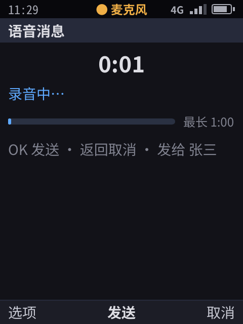
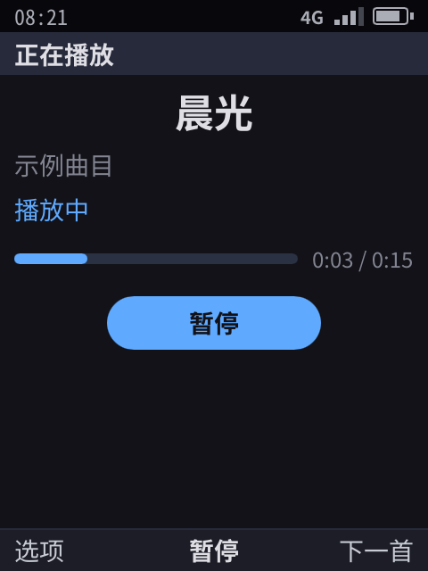
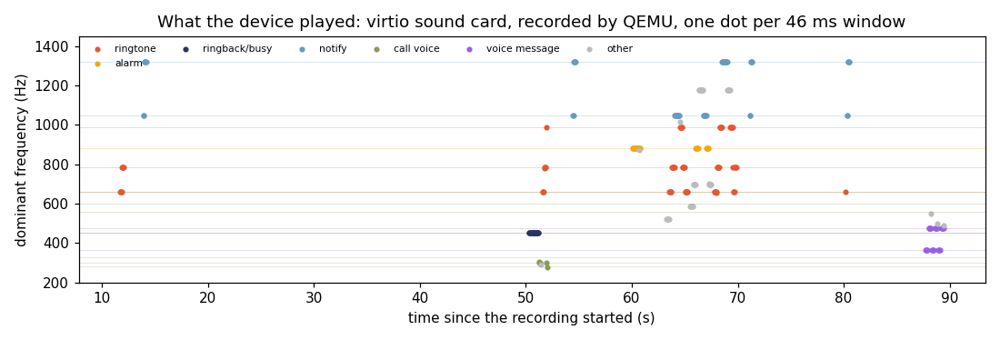

# 音频服务（R23）

> 电话、闹钟、音乐、鸿雁语音都要用声音。已实现：系统服务 `phone-audiod`、音频焦点、系统提示音、音乐应用、后台播放、录音、应用自带音频流（共享内存，经 fd 传递，§3.1）、鸿雁的语音消息、视频的声音（mediad 写进同一种环形缓冲区），以及设备上的声卡和 QEMU 录音验证。无损音乐（FLAC、WAV、AIFF、ALAC、APE、WavPack，CUE 分轨）、DSD（DSF、DFF、SACD 镜像）、按曲目自己的格式送声卡（比特完美、DoP、原生 DSD）、无缝播放和回放增益见 §9：开发机上单元测试 ✓、自测 ✓，**未上真机**（没有真的 USB 解码器和 SACD 光盘镜像）。真机通话的声音路由（ALSA UCM：听筒、免提、静音，一加 6T）见 §10：单元测试 ✓，**未上真机**。单声道、左右声道平衡和屏幕阅读器用的语音服务（引擎是模拟的，不出声）见 §11。几个输出同时接着（3.5 毫米耳机、USB-C 解码器「小尾巴」、蓝牙）时谁放媒体、谁放通话和铃声、插拔时怎么办、每个输出自己的音量和输出选择见 §12：单元测试 ✓、开发机自测 ✓，**未上真机**。蓝牙的声音（A2DP、HFP）、真实录音设备等见 §7，**未实现**。

## 0. 结论

- **应用碰不到声卡。** 沙箱里没有 `/dev/snd`（Landlock 只放行 `/dev/null`、`/dev/zero` 和两个随机数设备），音频服务的套接字只有 Shell 能连（权限 0600）。应用只能通过 broker 请求「播放媒体库里的某一首」，或者控制自己的播放流。
- **什么时候发声由系统决定。** 每路声音属于一个类别，类别有优先级：紧急警报 > 通话 > 铃声 > 闹钟 > 媒体 > 提示音。来电时音乐自动暂停，挂断后自动继续；提示音只把音乐压低。应用只能用「媒体」类别，所以不能借高优先级类别打断别人。
- **铃声、闹钟、回铃音、忙音、提示音都由系统播放**，应用冻结或没运行也照样响。
- **录音必须经过用户授权，并且有状态栏指示。** 只有前台应用或通话中的应用能录音，应用一离开前台，系统就停掉它的录音（Android 9+、iOS 也是这样）。
- **应用自己的声音不经过 Shell。** Shell 只在建立时检查一次权限，交给应用一块共享内存，之后 PCM 数据在应用和 audiod 之间直接流动（§3.1）。
- **音乐应用可以在后台播放。** 清单里声明 `background: ["audio"]`，正在放歌时离开应用也不会被冻结；暂停或放完后，下次离开时照常冻结。
- **音乐按自己的格式播放。** 只有音乐在响时，audiod 绕过 48 kHz 的混音器，按曲目自己的采样率和位深打开声卡；样本一点不改时（媒体音量最大、不开回放增益、声卡支持这个格式）就是比特完美。DSD 能原生送就原生送，用户选了 DoP 就按 DoP，否则转成 176.4 kHz PCM。通知音一响就回到混音器，一秒后再切回去（§9.5）。
- 开发机自测、像素渲染器三种形态都通过（用例数见 57（内部文档）「当前验证基线」）；设备上的结果见 §6。

## 1. 架构

```
 应用（沙箱，无 /dev/snd）
   │ phone.Ui：media.list / audio.play / audio.control / audio.state / audio.route
   ▼
 Shell broker ── 权限、只能控制自己的流、把流的事件转给所属应用
   │ 系统声音：来电铃声、回铃音、通话、闹钟、通知提示音（按通话和闹钟状态自动开关）
   │ JSON 行 RPC + 事件订阅（unix 套接字，0600）
   ▼
 phone-audiod ── 混音器（48 kHz 立体声，每 20 ms 一帧）+ 焦点策略 + 音源
   │             只有音乐在响时：绕过混音器，按曲目自己的格式（§9.5）
   ▼
 输出端：alsa（aplay → 声卡；USB 声卡各有自己的 aplay，按 §12 的策略选） | file（WAV） | null
```

和 Android、iOS 的对应关系：

| 职责 | Android | iOS | 我们 |
|------|---------|-----|------|
| 混音、输出 | AudioFlinger | 系统音频服务 | `phone-audiod` 的混音器 |
| 谁能发声、打断与恢复 | 音频焦点（AudioFocus）+ AudioPolicy | 音频会话类别 + 打断通知 | 类别优先级（§2），策略在服务里，应用不能自己定 |
| 后台播放 | 前台服务 + 媒体通知 | `audio` 后台模式 | `background: ["audio"]`，只在真正发声时生效 |
| 铃声、闹钟 | 系统应用 + 铃声流 | 系统 | Shell 直接播放，应用不参与 |

## 2. 类别与焦点

| 类别 | 谁用 | 优先级 | 对音乐的影响 |
|------|------|:---:|------|
| `alert` | 紧急警报（小区广播，[32](32-messaging.md) §7）；音量固定为最大，静音模式也响 | 6 | 暂停，结束后继续 |
| `call` | 通话中（回铃音、通话声、忙音） | 5 | 暂停，结束后继续 |
| `ring` | SIM 来电、VoIP 来电 | 4 | 暂停，结束后继续 |
| `alarm` | 闹钟 | 3 | 暂停，结束后继续 |
| `media` | 应用（音乐等） | 2 | 同一时间只有一路，新的顶掉旧的 |
| `notify` | 通知横幅 | 1 | 压低到 30%，不暂停 |

- 被高优先级打断的流标记为 `by_focus`。打断结束后只恢复这类流，用户自己按了暂停的不会被恢复。
- 每个类别有独立音量（`volume` 方法）。
- 路由 `earpiece` / `speaker` 由拨号界面的「免提」切换，需要 `phone` 权限。只有一个输出端时（开发机、QEMU）免提只是把通话增益乘 1.4；声卡由 ALSA UCM 配置路由的手机上（一加 6T），audiod 把声卡换到听筒或扬声器的通话设置（§10）。

## 3. 应用接口

| 能力 | 参数 | 说明 |
|------|------|------|
| `media.list` | — | 系统媒体库里的音频：音乐库里的曲目（§9，ID 是 `music:<音乐库里的路径>`，CUE 和 SACD 的曲目后面加 `#<序号>`），然后是 3 首合成的示例曲目。音乐曲目除了标题、艺术家、时长，还有 `album`、`album_artist`、`track`、`disc`、`genre`、`year`、`folder`、`format`（「FLAC 24/96」）、`quality`、`codec`、`rate`、`bits`、`channels`、`lossless`、`replaygain`、`cover`、`from`（`cue` / `sacd`） |
| `audio.play` | `{media, next?, at_ms?, replaygain?, dsd?}` | 播放媒体库里的一项，类别固定为 `media`，返回流。`next`：接在后面无缝播放的曲目；`at_ms`：从哪里开始；`replaygain`：`track` / `album` / 空（关）；`dsd`：`auto` / `dop` / `pcm` |
| `audio.control` | `{id, op, at_ms?, next?, replaygain?, dsd?}` | `pause` / `resume` / `stop`，只能控制自己的流；音乐另有 `seek`（`at_ms`）、`queue`（换掉接在后面的曲目，`next` 为空就是不接）、`options`（`dsd`） |
| `audio.state` | — | 自己的流：状态、位置、时长、是否因焦点暂停 |
| `audio.route` | `{route}` | `earpiece` / `speaker`，需要 `phone` 权限 |

流的状态每次变化，Shell 都会给所属应用发一个 `audio` 事件（流的 JSON），应用据此更新界面，放完时收到 `ended` 自动切下一首。音乐的流还带 `media`（正在放的那一首：排队的下一首接上时它就变了，应用据此再排下一首）、`format` 和 `output`（怎么到声卡：`mixer 48 kHz`、`pcm S32_LE 96000 Hz 2ch bit-perfect`、`dop …`、`dsd …`）。这几个字段和 `media.list` 的音乐字段现在由 Shell 和音乐应用各自定义（`shell/music.go`、`apps/music/library.go`），还没收进 `ui/caps.go`。

### 3.1 应用自带的音频流

| 能力 | 权限 | 说明 |
|------|------|------|
| `audio.stream` `{name}` | — | 播放应用自己写入的 PCM：语音消息、VoIP 解码后的声音、音效。类别由系统定：应用在通话中是 `call`，否则是 `media` |
| `audio.record` `{name}` | 麦克风（运行时授权） | 麦克风的声音写进缓冲区，由应用读取。只有前台应用或通话中的应用能用，离开前台立即停止；录音期间状态栏中间显示「● 麦克风」（像素渲染器里是橙色） |

数据怎么走：

```
 应用 ──audio.stream──▶ Shell（检查权限、定类别）──open──▶ audiod
                                                       │ 建一块 memfd：48 kHz 单声道环形缓冲区，封住大小
 应用 ◀──回复 + fd（SCM_RIGHTS）── Shell ◀──回复 + fd── audiod
   │
   └── 之后：应用写 / 读共享内存，audiod 每 20 ms 读 / 写一次；Shell 不再经手
```

- 缓冲区格式见 `audio/ring.go`：64 字节的头，记录读写位置，后面是样本。一个生产者、一个消费者。
- 两边都不信任对方写的读写位置：下标对容量取模，对端怎么改都不会越界。memfd 封住大小（`F_SEAL_SHRINK`），对端没法截短文件，也就没法让另一边访问映射内存时因 SIGBUS 崩溃；映射前检查封印，没封的拒绝。这几条都有单元测试。
- 应用 SDK：`app.GoAudio(能力, 名称, 回调)` 拿到 `AudioStream`，读写其中的 `Ring`，用完 `Close`。
- 视频的声音走同一种缓冲区，只是写的一方是 mediad 不是应用：`video.open` 时 Shell 以应用的名义开一路 `media` 类别的流，把 fd 交给 mediad，mediad 的 ffmpeg 把声音解成 48 kHz 单声道写进去。画面的时钟取 audiod 已经读走的样本数，所以音频焦点暂停了这路声音（来电），画面也停（[19](19-core-apps.md) §2）。
- 麦克风现在是模拟的：365 Hz 和 475 Hz 交替的「说话声」，既不是系统声音的频率，也不是示例曲目里的音符，所以录下的语音在设备的声卡输出里也能认出来（§6）。

**鸿雁的语音消息**：
- 在聊天页按选项菜单的「语音消息」（快捷键 r），进入录音页，显示时长和进度条，最长 1 分钟；
- 按 OK 发送，返回取消；
- 录音存成 WAV，放在应用自己的数据目录；
- 气泡显示「[语音 0:02]」，选中按 OK 播放；
- 录音时离开应用，系统会停止录音，回来后录音页提示「录音已中断」。

| 录音（状态栏有指示） | 发出的语音消息 |
|:--:|:--:|
|  |  |

`progress` 节点（进度条：`fraction` 0–1、左侧标签、右侧说明）是通用能力，音乐进度、应用商店下载、系统更新都能用。两种渲染器各画一份，应用不用拼字符。

## 4. 系统声音

声音全部是程序合成的原创音，不用诺基亚的铃声（Nokia Tune）或其他厂商的提示音：

| 声音 | 内容 | 什么时候响 |
|------|------|------------|
| 来电铃声 | E5、G5、B5 三音上行，循环 | SIM 来电、VoIP 来电（系统来电界面出现时），接听或拒接即停 |
| 闹钟 | 880 Hz 三连音，循环 | 闹钟到点，关闭或稍后提醒即停 |
| 回铃音 | 450 Hz，响 1 秒停 4 秒（国内电话网的信号音） | 拨出后对方振铃 |
| 忙音 | 450 Hz，响 0.35 秒停 0.35 秒 | 对方占线 |
| 通话声 | 低频和声，模拟对方说话 | 模拟基带的通话中（真机上由基带与声卡直连；有 UCM 通话设置时 audiod 把它放成静音，§10） |
| 提示音 | 两个短音（C6、E6） | 通知横幅出现时；通话中不响 |
| 紧急警报 | 853 Hz 和 960 Hz 同时响（CMAS、EU-Alert 的提示信号），2 秒、半秒、半秒，循环 | 紧急警报界面出现时，关掉即停 |
| 按键音 | 2 kHz 一下（12 ms），提示音类别 | 设置 › 辅助功能 › 按键反馈选了声音时每按一下键（§11）；静音模式下不响 |

### 4.1 音量键、静音模式、振动

- **音量键**（侧键；USB 键盘上是 F8、F9）在任何界面都有效，键盘锁着也一样：来电响铃时按任意一个，铃声静音，来电界面显示「铃声已静音」，电话照样在响屏；正在放音乐时调媒体音量；其余时候调铃声音量，提示条显示当前音量。
- **媒体键**（耳机线控、键盘的媒体键；USB 键盘上还有 F10 播放 / 暂停、F11 上一首、F12 下一首）同样在任何界面都有效。播放 / 暂停由系统直接控制正在播放的流；上一首、下一首是应用的事（曲目单在应用手里），系统给正在播放的应用发 `media` 事件（`next` / `previous`），相当于媒体会话。通话中按键归通话，不动音乐。待机界面显示「正在播放 <曲名>」。
- **静音模式**（「设置 › 静音模式」）：来电铃声和提示音改为振动，来电界面显示「静音模式 · 振动」；闹钟照常响。
- **声音模式和声音开关**（`shell/soundmode.go`，单元测试和自测 ✓，**未上真机**）：声音模式同安卓的三种：响铃；振动（来电和通知不响、只振动，就是上面的静音模式）；静音（来电和通知不响也不振动，来电界面显示「静音模式 · 不振动」，短信的闪信也不振）。三种模式下闹钟都照常响、照常振，和一加手机一样；紧急警报也照常响。没有声音开关的手机只有响铃和振动两种，用「静音模式」那个开关选。有声音开关的手机（SKU 的 `sound_switch`，[24](24-sku-framework.md) §7.4；一加 6T 的三段式提醒滑块：上静音，中振动，下响铃；或两档的静音开关，`SW_MUTE_DEVICE`：静音、响铃，没有振动档）由开关定模式：渲染器开着时读它的位置（启动时用 `EVIOCGABS` 或 `EVIOCGSW` 读当前位置，之后每拨一下报一次，[23](23-renderer-protocol.md)），Shell 照它定模式；开机时的位置不提示，之后每拨一下有提示条（「振动」「静音」「响铃」）；状态栏在网络旁边显示振动、静音的图标（文字界面是 📳、🔕）；「设置 › 声音与振动」不再给开关，只显示「声音模式」和开关定的模式，写明「由手机侧面的声音开关设定」，Shell 也不接受 `silent` 这个设置。来电响着时拨开关：拨离响铃，铃声停下（振动档接着振）；拨回响铃，铃声再响（按音量键静音了的来电不再响）。渲染器还没报位置（没有那个设备、渲染器没起来）时仍按「静音模式」那个开关。没有勿扰模式，没有和它合并的事。
- **振动**：`hal/vibrator` 驱动马达：安卓内核的 LED 类振动器（`/sys/class/leds/vibrator`，先写时长再激活），没有它时找主线内核的振动器，即能力里有力反馈 `FF_RUMBLE` 的输入设备（PMIC 的触觉马达、`gpio-vibrator`、`regulator-haptic`；`EVIOCSFF` 上传效果，再写一个 `EV_FF` 事件开始振）。静音模式下来电每 1.5 秒振一次，通知振一次；闹钟响时不管静音不静音都每 1.5 秒振一次。模拟器上没有马达，只记录振动请求（自测用 `vibrated` 断言）。单元测试覆盖 LED 的写法、力反馈设备的查找和内核结构体的布局（64 位）；在真的力反馈设备上振**未上真机**，32 位内核上的结构体布局只有测试代码、**未运行**。
- **正在播放**：有音乐在放时，待机界面显示「正在播放 …」，系统菜单里有「暂停播放 / 继续播放」（`shell/volume.go`）。

### 4.2 通话里的应用声音

应用在通话中（VoIP 或电话）开的音频流和录音都归「通话」类别：通话期间优先，离开前台也不停。鸿雁的视频通话接通后开两路：一路放对方的声音（原型里是模拟的语音节奏），一路读麦克风，挂断时一起关掉。

### 4.3 语音消息的压缩

语音消息用 Opus 编码（VoIP 模式，最高 16 kbit/s，20 ms 一帧，复杂度 5），存成标准的 Ogg Opus 文件（RFC 7845），任何播放器都能打开：每秒约 2 KB，是 48 kHz PCM 的五十分之一（`voice.Encode` / `voice.Decode`，包 `audio/voice`）。编码器是 libopus 用 ccgo 转译成的纯 Go（`github.com/kazzmir/opus-go`，BSD-3），不用 cgo，应用在自己的沙箱里就能编码；单独成包，只有发语音的应用链接它（聊天应用的二进制因此大 1.7 MB）。开发机上 10 秒语音编码 0.26 秒；ffprobe 识别为 48 kHz 单声道 Opus，ffmpeg 解码无误。解码时按 OpusHead 的 pre-skip 去掉编码器的前导延迟、按最后一页的 granule 位置截尾，解出的样本数和录音完全相同，与原信号逐点的相关系数约 0.8。

## 5. 实现

| 部分 | 位置 | 说明 |
|------|------|------|
| 混音器与焦点 | `audio/audio.go` | 流、类别、焦点、音量、路由、立体声混音；只有一路音乐在响时把它交出去直送声卡（`Solo`），通知音一来就收回，一秒后再交出去；单元测试覆盖焦点切换、音调频率、WAV 读写、立体声、排队换曲的事件、交出和收回 |
| 音源 | `audio/sources.go`、`mp3.go`、`opusfile/`、`vorbisfile/` | 系统提示音、合成示例曲目、WAV 文件、MP3（边解码边播；go-mp3，纯 Go，Apache-2.0）、Ogg Opus 和 Ogg Vorbis（`.opus`、`.ogg`、`.oga`，按第一个包是 `OpusHead` 还是 `\x01vorbis` 分辨；边解码边播，单声道或立体声混成单声道。Opus 用和语音消息同一个纯 Go 的 libopus；Vorbis 用纯 Go 的 jfreymuth/oggvorbis（MIT），按最近样本重采样到 48 kHz。两个解码器都只链接进 phone-audiod，Shell 只读 Ogg 头和最后一页算长度）。单元测试：440 Hz 的 MP3、520 Hz 的立体声 Opus、660 Hz 的 44.1 kHz Vorbis 解码后频率误差在 10 Hz 内，长度对得上；22.05 kHz 的 MP3 被拒绝 |
| 服务 | `cmd/phone-audiod`（`programs/audiod`） | RPC：`play`（音乐是 `track`、`next`、`start_ms`、`dsd`）、`control`（音乐另有 `seek`、`queue`、`options`）、`state`、`volume`、`route`；订阅后收到流事件；输出端 `auto` 在有声卡和 `aplay` 时用 ALSA（有 USB 声卡就用 USB 的），否则静音；ALSA 输出端先用 `aplay --dump-hw-params` 和 USB 声卡的 `/proc/asound/cardN/stream0` 问清声卡支持什么，再决定每首歌怎么送（§9.5）。输出端出错（没有声音设备）时时钟不停：混音器、录音、进度照样每 20 ms 走一步，这 20 ms 的声音丢掉；ALSA 输出端同一个设置失败后 10 秒内不再开 `aplay`，写入时直接报上次的原因（`aplay` 自己说的那一行，比如 `audio open error: Invalid argument`），一次写入 2 秒没被收下（声卡被别的程序占着时 `aplay` 等在那里）也算失败，耽误的时间随后补上（混音器和录音一下子走过去，没有声音）；日志只在出错开始、原因变了、恢复（连续写进去一秒）时各记一行，`state` 多返回 `sink_error`（为什么没有声音，好着时没有这一项）。单元测试：假的出错输出端上 50 个节拍录音和音乐各走 1 秒，只记一行日志；卡住 300 ms 的写入之后录音和音乐照样在墙上时钟的位置；假的 `aplay`（打不开声卡、不读输入）上的原因、重试间隔和超时；声卡不收曲目自己的格式时音乐不会走快 |
| 单声道、平衡、语音服务 | `audio/audio.go`、`audio/tts`、`programs/audiod` | 见 §11 |
| 无损与 DSD | `audio/flac`、`audio/tags`、`audio/cue`、`audio/dsd`、`audio/musicfile`、`audio/hifi` | 见 §9 |
| 几个输出的路由策略 | `audio/route`、`programs/audiod/outputs.go`、`usbaudio.go`、`jack.go`、`shell/audioout.go` | 见 §12 |
| UCM 通话路由 | `audio/ucm`、`programs/audiod/ucm.go` | 见 §10。单元测试用假的 alsaucm 记下每次运行的命令：开机第一次启动（经过通话 verb，通话 verb 设不了时）、拨出、免提来回、静音、挂断、两路通话和保持、通话中重启、配置里没有扬声器、只配了放音；真的 `Alsaucm` 对着假的 alsaucm 脚本测参数和报错；audiod 的参数、跟 telephonyd（假的 telephonyd 上通话中重启后接着跟）、换 PCM |
| Shell 接入 | `shell/audio.go`、`shell/music.go` | 系统声音按通话、来电、闹钟状态自动开关；应用能力；后台播放不冻结（`shell/freeze.go`）；音乐库（§9.7） |
| 共享内存环形缓冲区、模拟麦克风 | `audio/ring.go` | 单元测试：绕回、结束标记、拒绝没封印的 memfd、对端谎报读写位置 |
| fd 传递 | `wire/wire.go`、`rpc.go` | 单元测试：多条带 fd 的消息、解码器预读时 fd 不错配 |
| 语音消息 | `apps/chat` | 录音、存 WAV、回放 |
| 音乐应用 | `apps/music` | 曲目列表，按专辑、艺术家、文件夹浏览，每首显示格式；正在播放（进度条、暂停 / 继续、上一首 / 下一首、前后 10 秒、停止、怎么到声卡）；一个列表就是播放队列，无缝接下一首；播放设置（回放增益、DSD 输出）；曲目信息（§9.8） |
| 自测脚本命令 | `shell/headless.go` | `audio <类别>`、`audio paused <类别>`、`audio idle`、`require-audio` |
| 设备 | `meta-phone/recipes-kernel/linux` | 内核配置片段 `phone-sound.cfg`：ALSA + virtio 声卡 |
| | `phone-audiod.service` | 系统服务；开机自测时让出声卡给自测自己的实例 |
| | `yocto/qemu-selftest.sh` | QEMU 加 virtio 声卡，把设备放出的声音录成 WAV |
| | `yocto/audio-check.py` | 逐段分析录音的主频，认出铃声、闹钟、回铃音等，缺一个就失败；`--plot` 画出 §6 的图 |

自测里和声音有关的断言：

- 拨出时有回铃音，接通后是通话声，挂断后安静。
- 系统来电时响铃声，接听后转为通话声。
- 闹钟到点有闹钟声，关闭后安静。
- 新用例「音乐」：
  - 播放后离开应用，2 秒后进程仍在运行，没有被冻结；
  - 来电时铃声响、音乐暂停；
  - 拒接后音乐自动继续；
  - 回到应用按暂停，界面显示「已暂停」。
- 用例「音乐：无损与 DSD」（§9.9）：FLAC 24/96 按 96 kHz 送声卡；CUE 整轨专辑分成三首、整轨文件不单列，按专辑进去播第一首，不按键就接着放第二、三首；DSF 转成 176.4 kHz PCM。
- 用例「音乐：电脑经 USB……」：电脑看到的文件夹叫「相册」「视频」「音乐」「文件」，往「音乐」里拷的专辑文件夹原样保留（[27](27-usb-typec.md) §3.1）。



## 6. 设备上的验证

- **内核**：配置片段打开 ALSA 和 virtio 声卡（`CONFIG_SND_VIRTIO=y`），设备上出现 `/dev/snd/pcmC0D0p`。
- **服务**：`phone-audiod --sink auto` 检测到声卡和 `aplay`，就选择 ALSA 输出（日志：`sink alsa:plughw:0,0`）。声卡打不开时日志里是一行 `phone-audiod: sink alsa:plughw:0,0: aplay plughw:0,0 S16_LE 48000 2: audio open error: Invalid argument: no sound until it plays again`，`state` 里是 `sink_error`；以前每次失败都等一秒，一加 6T 的 chroot 里（[39](39-oneplus-6t.md) §13.4）音乐、语音消息、录音、视频因此慢了 50 倍。
- **QEMU**：`qemu-selftest.sh` 给每个模拟器加 `-audiodev wav` 和 `-device virtio-sound-pci`，把设备放出的声音录成 WAV（`build/selftest/vm<n>/audio.wav`，脚本分段在几个模拟器里同时跑，[40](40-testing.md) §1）。
- **分析**：`make yocto-selftest` 跑完后，`audio-check.py` 把几个模拟器的录音一段接一段地算在一起，逐段（46 ms）取主频，认出每段是哪种系统声音，铃声、闹钟、回铃音、语音消息缺一个就失败。
  - 结果：每次 `make yocto-selftest` 都输出 `AUDIO-CHECK: PASS`，和开机自测同时通过。
  - 语音消息识别到 1.2 秒，只出现在语音消息用例那一段。完整链路是：模拟麦克风 → 共享内存 → 鸿雁 → WAV 文件 → 共享内存 → 混音器 → virtio 声卡 → QEMU 录音。
  - 模拟麦克风用的是两首示例曲目都不用的频率，并要求至少连续 0.6 秒，否则曲目里的音符会被误认成语音消息。



图上的事件和自测用例一一对应：

| 时间 | 声音 | 用例 |
|------|------|------|
| 12 秒 | 铃声、提示音 | 鸿雁 VoIP 来电；后台消息横幅 |
| 50 秒 | 450 Hz 回铃音，然后是通话声 | 电话拨出、接通 |
| 52 秒 | 铃声 | SIM 来电 |
| 60 秒 | 880 Hz 闹钟声 | 闹钟到点 |
| 63–70 秒 | 示例曲目（灰点），中间插入铃声 | 音乐播放中来电，铃声响、音乐暂停，拒接后音乐继续 |
| 55、71、80 秒 | 提示音 | 短信、推送消息的横幅 |
| 80 秒 | 铃声 | 推送：鸿雁收到 VoIP 推送，报告来电 |
| 88–89 秒 | 365 / 475 Hz（紫点） | 鸿雁回放刚录的语音消息 |

TCG 模拟下，客户机跟不上实时，声卡数据会断续（欠载）。所以这份录音只用来判断「有没有响、响的是哪种声音」，不评估音质。

## 7. 还没做的

| 内容 | 为什么需要 | 打算 |
|------|------------|------|
| 真实录音设备 | 现在麦克风是模拟的 | 和输出端一样接 ALSA（`arecord`），量产走 PipeWire。QEMU 的 wav 后端不能采集，开发机也没有麦克风，所以这一步要到真机上验证 |
| 耳机按键、锁屏上的播放控制 | 现在只有待机界面的「正在播放」和系统菜单的暂停 / 继续 | 和输出端换 PipeWire 一起做 |
| 真实通话音频 | 真机上通话声由基带和声卡直连，不经过混音器 | 一加 6T：audiod 按 UCM 配置切通话设置（§10），**未上真机**；别的板子由设备配置给它们的 `--ucm-*` |
| 蓝牙的声音、耳机、听筒 / 扬声器真路由 | 真机必备 | 听筒 / 扬声器：一加 6T 上经 UCM（§10，**未上真机**）。3.5 毫米耳机和 USB 音频设备：§12（**未上真机**）。蓝牙：策略里已经有蓝牙这种输出（§12），但没有把声音送到蓝牙耳机的输出端（A2DP、HFP），**未实现**；打算输出端换成 PipeWire（WirePlumber 只做设备管理，策略仍留在 `phone-audiod`） |
| 回声消除 | 免提和 VoIP | WebRTC AEC，放在服务里 |
| 其余音乐解码器（AAC）；MPEG-2 / 2.5 的低采样率 MP3 | 音乐 | AAC 有专利费，走真机的硬件解码器；MP3 只支持 MPEG-1 Layer III（32 / 44.1 / 48 kHz）：go-mp3 解低采样率文件会出错而且不报错，所以直接拒绝 |
| 比特完美时的音量 | 现在比特完美要媒体音量开到最大；不是最大时按原采样率送，但在数字域调音量（不再比特完美，DoP 和原生 DSD 也就改成转 PCM） | 用声卡自己的硬件音量（ALSA 混音器的音量控件，HiBy 等播放器在 USB 独占模式下就这样），要按板子和解码器配 |
| 真的 USB 解码器、DSD 解码器 | DoP、原生 DSD、离散采样率的协商只在单元测试里对着样例文本测过，**未上真机** | 接一台支持 DSD 的 USB 解码器验证（插上就换过去，§12） |
| SACD 光盘镜像的兼容性 | 解析按公开资料写，测试用的镜像是自己的写入器生成的，**没有用真实的光盘镜像验证** | 找几张真实镜像（立体声、多声道、DST）对照修正 |
| DST 压缩帧 | 交给 ffmpeg 的 DST 解码器，我们没有 DST 编码器，测试里只能用「不压缩」的 DST 帧，所以真正压缩过的帧的解码**未验证** | 用真实的 DST 文件或镜像验证 |
| APE 解码 | 交给 ffmpeg。3.99 格式（3.98 以后的编码器都写这种）：用官方编码器 Monkey's Audio 13.50 编出的两个样例在开发机上（ffmpeg 4.2）解回逐样本相同（§9.9）；设备上的 ffmpeg 8.0 **未上真机**。3.98 以前的老格式：13.50 写不出来，只测了手写的文件头，解码**未验证** | 找一个许可清楚、3.98 以前编出的小文件放进测试；在设备上跑这些测试 |
| 封面显示 | 标签里的封面读得出来（`cover` 字段），音乐应用还不显示 | Shell 的图片节点认 `music:` 的封面（`shell/frame.go`、`shell/render.go`） |

## 8. OSS、ALSA、PipeWire 是什么关系

我们没有用 OSS。OSS（Open Sound System）是 2000 年前后的老接口，Linux 2.6 起由 ALSA 取代。**ALSA 至今仍是 Linux 内核里的音频驱动层**，Android 也建在它上面（用的是精简用户库 tinyalsa）。所谓「现代音频架构」，指的是 ALSA 之上那一层：

| 层 | 作用 | 我们现在 | 量产 |
|----|------|----------|------|
| 内核驱动 | 声卡、编解码芯片（SoC 上是 ASoC） | ALSA，QEMU 的 virtio 声卡 | ALSA ASoC，按板子写设备树 |
| 路由配置 | 听筒、扬声器、耳机、通话通路的开关 | 开发机、QEMU 没有（只有一个输出）；一加 6T 上 audiod 经 alsaucm 用声卡的 UCM 配置（§10） | ALSA UCM 配置文件 |
| 声音服务器 | 混音、重采样、蓝牙、低延迟 | phone-audiod 自己混音，`aplay` 输出 | PipeWire（Fedora、Ubuntu、postmarketOS 已默认使用），负责设备、蓝牙（BlueZ）、回声消除模块 |
| 策略 | 谁能发声、谁打断谁、谁能录音 | phone-audiod（§2） | 仍是 phone-audiod；PipeWire 的会话管理器 WirePlumber 只做设备管理 |

所以要现代化，不是把 ALSA 换掉，而是把我们的输出端从 `aplay` 换成 PipeWire（R29），策略层保持不变。


## 9. 无损音乐与 DSD

> 目标是像 HiBy Music 那样的无损播放器：认得常见的无损格式和 DSD，CUE 分轨，曲目按自己的格式送到声卡，一首接一首没有缝。状态：开发机上单元测试 ✓、自测 ✓；DSD 解码器、USB 解码器、真实的 SACD 镜像**未上真机**（§7）。

### 9.1 格式与解码

| 格式 | 文件 | 谁来解 | 说明 |
|------|------|--------|------|
| FLAC | `.flac` | 自己写的纯 Go 解码器（`audio/flac`，按 RFC 9639） | 4–32 位、任意采样率（192 kHz 及以上）、1–8 声道；有 seek 表就按表跳，没有就在帧头之间二分，跳到哪一个样本都准。单元测试：16/44.1、24/96、24/192、单声道、独立声道、只用固定预测、高阶 LPC，和 ffmpeg 的解码逐样本相同；有表、无表的跳转也逐样本相同。开发机上解 1 秒 24/96 立体声白噪声（最难压的信号）用 17 ms |
| WAV | `.wav` | 自己读（`audio/musicfile`、`audio/hifi`） | 8–32 位整数、32 / 64 位浮点、`WAVE_FORMAT_EXTENSIBLE`、超过 4 GB 的 RF64；浮点转成 32 位整数输出（因此不算比特完美） |
| AIFF / AIFF-C | `.aif` `.aiff` `.aifc` | 自己读 | 大端整数、`sowt`（小端）、32 / 64 位浮点 |
| ALAC | `.m4a` `.mp4` | ffmpeg（单独的进程，和 mediad 放视频一样） | MP4 的盒子（时长、采样率、位深、标签）自己读；同一个 `.m4a` 里是 AAC 就拒绝（AAC 有专利费，§7） |
| APE（Monkey's Audio） | `.ape` | ffmpeg | 文件头（3.98 以后和以前两种）、APEv2 标签自己读；3.99 格式的解码用真文件验证过，3.98 以前的只测了文件头 |
| WavPack | `.wv` | ffmpeg | 块头、声道数、标签自己读；WavPack 5 的 DSD 模式不支持 |
| MP3、Ogg Vorbis、Ogg Opus | `.mp3` `.ogg` `.oga` `.opus` | 原有的纯 Go 解码器 | 现在也按原采样率、立体声输出；MP3 按 LAME 头里的编码延迟和补白去头去尾，一张专辑连着放没有缝 |
| DSD | `.dsf` `.dff` | 自己读（`audio/dsd`） | DSF（索尼）和 DSDIFF（飞利浦）；DSD64、128、256 |
| DST | `.dff`（压缩过的）、SACD 镜像 | ffmpeg 的 DST 解码器，帧由我们取出、包成 DSDIFF 交给它 | 每批 10 秒放进内存文件（memfd），批与批之间多带一帧再丢掉它的输出，所以接缝处和连续解码一样；ffmpeg 自己把 DSD 转成 PCM，我们再要 176.4 kHz。DST 帧里标明「不压缩」的帧我们直接当 DSD 放（ffmpeg 对这种帧的排布有错） |
| SACD 镜像 | `.iso` | 自己解析（`audio/dsd`） | 见 §9.4 |

ffmpeg 是 LGPL，只作为单独的程序运行；解出 32 位 PCM，16 / 24 位的源只是左移，样本原样保留，所以经 ffmpeg 的格式也能比特完美。单元测试：24 位 WAV 编成 ALAC、WavPack 后经 ffmpeg 解回，逐样本相同，跳转后也相同。ffmpeg 没有 APE 编码器，APE 的样例是官方编码器 Monkey's Audio 13.50（BSD-3-Clause，在开发机上从源码编，不进仓库也不进镜像）编的，信号由测试代码生成：16/44.1 的 0.3 秒（16 KB）、24/192 的 0.4 秒（55 KB，两个 APE 帧），都是 3.99 格式（`audio/hifi/testdata`，怎么做的写在同一目录的 `README.md`）；经 ffmpeg 解回和生成的信号逐样本相同，从头放、跳转后（包括跳到 APE 帧边界前和第二个 APE 帧里）都相同。设备上的 ffmpeg 只打开需要的解码器和解复用器（`yocto/kas/phone-qemuarm64.yml`）：视频原有的 VP8、VP9、Opus、Vorbis、PNG，加上 ALAC、APE、WavPack、DST，MOV（MP4 / M4A）、APE、WV、IFF（DSDIFF）解复用器，输出 32 位 PCM。OE-core 的 ffmpeg 8.0 带层里的一个补丁（`yocto/meta-phone/recipes-multimedia/ffmpeg/`，上游 FFmpeg 8.1 的修复）：它的 Opus 解析器拒收 Matroska / WebM 文件末尾的空刷新，每次正常解完都报一行 “Error parsing Opus packet header.”，这行进了 mediad 的日志和失败记录。主机上用同一份源码加和不加补丁解示例视频验证过；镜像里的效果**未验证**（没跑 QEMU）。这几种都没有专利费：ALAC 由苹果以 Apache 2.0 开源，APE、WavPack 免费；DST 是 MPEG-4 的一部分，相关专利是 2000 年前后申请的，量产前要法务再确认。

### 9.2 标签

`audio/tags` 读 Vorbis 注释（FLAC、Ogg）、ID3v2.2 / 2.3 / 2.4（MP3，WAV、AIFF、DSF、DFF 里的 ID3 块；非同步化、扩展头、v2.4 的数据长度标志都处理）、ID3v1、APEv2（APE、WavPack），MP4 的 iTunes 标签盒子在 `audio/musicfile` 里读。取的字段：标题、艺术家、专辑、专辑艺术家、音轨号 / 总数、碟号 / 总数、流派、年份、作曲、回放增益（曲目 / 专辑的增益和峰值，Opus 的 `R128_*_GAIN`）、内嵌 CUE（FLAC、APE 的 `CUESHEET`）、封面（是否有、MIME，图片数据按需读）。编码：ID3 标为 Latin-1 的文字其实常是 GBK 或 UTF-8，按「是合法 UTF-8 就当 UTF-8，像 GBK 中文就当 GBK，否则 Latin-1」读。单元测试覆盖每种标签，另有一个用 ffmpeg 写的 ID3v2.4 对照。

### 9.3 CUE 分轨

`audio/cue` 读 `FILE`、`TRACK`、`INDEX 00 / 01`、`TITLE`、`PERFORMER`、`SONGWRITER`、`ISRC`、`CATALOG`、`REM GENRE / DATE / DISCNUMBER / REPLAYGAIN_*`；编码认 UTF-8（带不带 BOM）、UTF-16（带 BOM）、GBK（GB 18030）。

- **分界**：一首从自己的 `INDEX 01` 放到下一首的 `INDEX 01`，前奏间隙（`INDEX 00` 到 `01`）归上一首（foobar2000 的默认做法），所以相邻两首首尾相接，不重不漏。
- **多文件**：一首可以跨文件（上一首的文件放完，再放下一个文件开头到这一首的 `INDEX 01`），EAC 两种写法（间隙写在下一个文件开头，或写在上一个文件末尾）都对。
- **找文件**：`FILE` 写的名字找不到时，依次试大小写不同的同名文件、同名换了扩展名的（整轨抓成 WAV 后转成了 FLAC / APE）、和 CUE 同名的音频文件。名字里有 `..` 或绝对路径就拒绝，CUE 只能指向自己所在的文件夹。
- **整轨文件不单列**：曲库里不再单独列出 CUE 用到的文件。
- **无缝**：同一个整轨文件里的下一首不另开解码器，直接接过上一首的解码器接着读（APE 也不用重启 ffmpeg），单元测试里三首连放和整轨文件逐样本相同；APE 整轨（Monkey's Audio 编的样例）三首连放也逐样本相同，全程只起一次 ffmpeg。

### 9.4 DSD 与 SACD

- **DSF**：按 4096 字节一块、各声道轮流的布局读，最低位在前的字节翻过来。**DSDIFF**：`FRM8` 里的 `PROP`（采样率、声道、压缩方式）、`DSD ` 或 `DST ` 块，`DSTI` 帧索引（先核对再用，没有就沿着块头走），`DIIN` 里的标题和艺术家，非标准的 `ID3 ` 块。
- **SACD 镜像**：Scarlet Book 规范不公开，解析按公开资料自己写，没有参考任何 GPL 代码（如 sacd-ripper）。第 510 扇区的主目录 `SACDMTOC`（专辑信息、立体声区和多声道区目录在哪），511 扇区的 `SACDText`（专辑名、艺术家），区目录 `TWOCHTOC` / `MULCHTOC`（采样率、帧格式 DST / 不压缩 DSD、声道数、扬声器布局、曲目数），后面几个扇区里的 `SACDTRL1`（每首的起始扇区和扇区数）、`SACDTRL2`（起始时间和时长，75 帧一秒）、`SACDTTxt`（每首的标题和演唱者，按区声明的字符集：ISO 8859-1、Shift-JIS、KS C 5601、GB 2312、Big5）。音频扇区：头字节、包信息（帧起点、数据类型、长度）、每个在本扇区开始的帧的时间码，然后是包；音频包连起来就是帧（不压缩 DSD 每声道 4704 字节，按字节交错；DST 是一个编码帧）。按时间码取一首的帧，跳转先按比例估扇区再往回退。
- **区的选择**：有立体声区就放立体声区；只有多声道区时放多声道区，混成立体声（中置、环绕各 −3 dB，去掉低音声道）。
- **测试镜像**由测试里自己的写入器生成（`audio/dsd/dsdtest`，立体声不压缩 + 多声道 DST，GB 2312 文字），因此只证明读写两边一致，**与真实光盘镜像的兼容性未验证**（§7）。
- **转 PCM**（`audio/dsd` 的 `Decimator`）：一个 Kaiser 窗 sinc 低通 FIR（阻带约 80 dB），只在输出采样点上算；输入是 1 位，所以滤波器里每个字节查一次表（表里是这 8 个抽头对 256 种字节取值的和）。DSD64 → 176.4 kHz：512 抽头，−6 dB 在 37 kHz；→ 88.2 kHz：1024 抽头，−6 dB 在 28 kHz；DSD128 / 256 抽头按倍数增加，形状不变。DSD 的 0 dB（50 % 调制）对应 PCM 的 −6 dBFS，不额外加增益，不会削波。单元测试：DSD64 / 128 / 256 的 1 kHz 测试音转换后到 20 kHz 的信噪比都在 70 dB 以上，电平误差 0.3 dB 以内，空闲码转出来是静音。开发机上（Xeon E5-2670 v3）1 秒立体声 DSD64 转 176.4 kHz 用 28 ms；手机上的开销**未上真机测**，DSD256 要四倍。
- **DoP**（`audio/dsd`）：每个 24 位样本低两字节装本声道 16 个 DSD 位（先到的在高位），最高字节是轮换的标记 0x05 / 0xFA；DSD64 用 176.4 kHz，DSD128 用 352.8 kHz。**原生 DSD**：ALSA 的 `DSD_U8`、`DSD_U16_LE/BE`、`DSD_U32_LE/BE`，每帧装各声道 1 / 2 / 4 个字节，先到的字节在高位。这两种打包都有单元测试（标记交替、跨调用保持、字节顺序）。

### 9.5 送到声卡：比特完美、DoP、原生 DSD

只有一路音乐在响、一秒内没有别的声音要混时，audiod 不经混音器，按这首歌的格式打开声卡（`aplay` 换成这首歌的格式、采样率、声道数），每 20 ms 写一份；通知音、铃声一来就回到 48 kHz 立体声的混音器，一秒后再切回去（换的时候声卡缓冲里约 0.2 秒的声音会丢掉；开始播放时也有这么多延迟）。怎么送由 `hifi.Negotiate` 决定，输入是曲目的格式、声卡支持什么（`aplay --dump-hw-params` 的格式、声道、采样率范围；USB 声卡用 `/proc/asound/cardN/stream0` 里每个备用设置的精确采样率）、总增益（媒体音量 × 回放增益）和 DSD 设置：

| 曲目 | 条件 | 怎么送 |
|------|------|--------|
| PCM（FLAC、WAV、ALAC…） | 声卡支持这个采样率 | 原采样率；容器按「刚好装下」挑（16 位用 S16_LE，24 位用 S24_3LE，没有就放进 S32_LE 的高位，样本不变）；单声道复制成两路；总增益正好是 1、不是浮点源时标为比特完美 |
| PCM | 总增益不是 1 | 原采样率，在 32 位里调音量，16 / 24 位输出加 TPDF 抖动，不再比特完美 |
| PCM | 声卡不支持这个采样率（比如 USB 解码器没有 88.2 kHz） | 回混音器，重采样到 48 kHz |
| DSD | 增益为 1、不多于两声道、ALSA 提供原生 DSD 格式 | 原生 DSD（设置为「能原生就原生」时） |
| DSD | 增益为 1、用户选了 DoP、声卡支持 DSD 采样率 / 16 的 24 位 PCM | DoP |
| DSD | 其他情况（调了音量、多声道、选了 PCM） | 转成 176.4 kHz（不支持就 88.2 kHz）PCM；都不行就回混音器 |
| DST | — | ffmpeg 解出的 176.4 kHz PCM，按 PCM 走（不算比特完美） |

- 一首放完接的下一首格式相同，就在同一个 `aplay` 里接着写（没有缝）；格式不同就重新打开声卡（有一个很短的停顿，比特完美的播放器都这样）。
- DoP 不能自动打开：不认 DoP 的解码器会把它放成很响的噪声，所以是用户在「播放设置」里选的；原生 DSD 只在驱动明说支持时用。
- USB 声卡（`/proc/asound/cardN/stream0` 里有放音接口）是 §12 的一个输出，插上就放媒体，用自己的 aplay，按自己的 `stream0` 协商。
- 比特完美要媒体音量开到最大；有自己音量控件的 USB 设备除外：媒体音量调它的硬件音量，样本不动（§12.4）。板载声卡的硬件音量**未实现**（§7）。
- 模拟器的 virtio 声卡没有 DSD，开发机没有声卡（输出端是 null，什么都收，所以开发机自测看到的是「什么都支持」时的选择）。协商规则有单元测试（QEMU 式的声卡、带 DSD 备用设置的 USB 解码器样例、null），**DoP、原生 DSD 在真解码器上未上真机**。

### 9.6 无缝播放与回放增益

- 应用开始播一首时带上下一首（`next`），audiod 立刻在后台打开它（ffmpeg 的格式也提前开始解码，预读几秒）；这一首读完，同一次读取里就接着读下一首，流的 `media` 变成下一首，应用再排下一首。同一个整轨文件里的下一首直接接过解码器（§9.3）。
- 混音器那条路（有别的声音时）也一样接，重采样器不清空。
- 回放增益由应用选「按曲目 / 按专辑 / 关」，Shell 从索引里取对应的增益（没有就用另一种），按峰值限制不让它削波，audiod 在两条路上都按它调。

### 9.7 音乐库

- 音乐放在 `media/music` 里，文件夹保留（从电脑拷进来的专辑文件夹还是一个文件夹，[27](27-usb-typec.md) §3.1）。最多 8 层，跳过以点开头的名字和符号链接。电脑那一侧的列出、读、建文件夹、拷入都在库的 `os.Root` 里，到不了库外。
- 索引在内存里，每次列曲库时按文件大小和修改时间刷新，只读文件头（`audio/musicfile`），MP3 也不再整个解一遍来算时长；CUE 在它的文件夹或用到的文件变了时重读。
- 排序：文件夹、专辑、碟号、音轨号。没有专辑名的曲目归到「本机音乐」。

### 9.8 音乐应用

- 首页是全部曲目，每首显示艺术家和格式（「FLAC 24/96」「DSF DSD64」「SACD DSD64」）；按 `a` 进专辑、`r` 进艺术家、`f` 进文件夹、`g` 进播放设置（选项菜单里都有）。专辑页显示专辑艺术家和最高规格（「SACD」「24/96」），曲目按碟号、音轨号排。
- 从哪个列表点的，这个列表就是播放队列，放完一首无缝接下一首。
- 正在播放：标题、艺术家 · 专辑、状态、格式和怎么到声卡（「比特完美 · 96 kHz」「DoP（PCM 承载 DSD）送到声卡」「DSD 转成 PCM · 176.4 kHz」「和系统声音一起混音（48 kHz）」），进度条；`p` 播放 / 暂停，`←` `→` 上一首 / 下一首，`b` `f` 后退 / 快进 10 秒，`i` 曲目信息，`s` 停止。
- 播放设置：回放增益（关 / 按曲目 / 按专辑）、DSD 输出（能原生就原生 / DoP / 一律 PCM），存在应用的数据目录里。
- 回到前台时重新读曲库，电脑刚拷进来的音乐马上出现。

### 9.9 测试

| 内容 | 在哪 | 结果 |
|------|------|------|
| FLAC 解码 | `audio/flac` 单元测试 | 和 ffmpeg 逐样本相同（7 种编码参数），跳转准 |
| 文件头、时长、标签 | `audio/musicfile`、`audio/tags` 单元测试 | 用 ffmpeg 生成的 FLAC 24/96、WAV 16 / 24 / 32 / 浮点、AIFF、ALAC、WavPack、MP3、Vorbis、Opus，无损格式时长精确到样本；APE：Monkey's Audio 13.50 编出的 3.99 格式样例（16/44.1、24/192，帧数精确到样本，APEv2 标签），3.98 以前的格式只有手写的头（3.97、3.92、3.80 两种压缩级别，对应三种 APE 帧长） |
| CUE | `audio/cue`、`audio/musicfile` 单元测试 | UTF-8、带 BOM、GBK、UTF-16，多文件两种写法，找文件的退路，拒绝出文件夹的路径 |
| DSD、SACD | `audio/dsd` 单元测试 | DSF、DSDIFF（不压缩 / DST，带不带索引）、SACD 镜像（立体声 + 多声道 DST，GB 2312 文字，跳转）、转 PCM 的信噪比和电平、DoP、原生 DSD 打包；DST 包装交给 ffmpeg 后帧数对 |
| 播放、无缝、输出 | `audio/hifi` 单元测试 | 24 位 WAV 比特完美原样输出；CUE 三首连放和整轨逐样本相同、解码器接力；换格式时重新协商；SACD 两首连放；DST 区不压缩的帧按 DSD 放；ALAC、WavPack 经 ffmpeg 无损；APE 样例经 ffmpeg 解出的每个样本都等于生成的信号（从头、跳转、跨 APE 帧），作 CUE 整轨时三首连放和整轨相同、只起一次 ffmpeg，单放第二首（从 CD 帧上开始，不是整微秒）也相同；DST 分批和接缝的帧数；协商规则；48 kHz 混音路的频率、电平和回放增益；重采样器阻带 |
| 混音器 | `audio` 单元测试 | 立体声、排队换曲的事件、交出 / 收回 |
| 自测 | `shell/selftest.script` 的「音乐：无损与 DSD」 | 开发机 ✓：样例音乐（`audio/testdata`：FLAC 24/96、GBK 的 CUE + 整轨 FLAC、DSF 的头和一个周期，`scripts/stage.sh` 拼成 4.6 秒的 DSD64）；FLAC 24/96 显示「96 kHz 原采样率输出」（开发机音量不是最大），专辑的三首自动接着放，DSF 显示「DSD 转成 PCM · 176.4 kHz」 |
| 设备 | — | **未上真机**：没有接 USB 解码器、DSD 解码器，没有真实的 SACD 镜像和 DST 文件；经 ffmpeg 的测试（ALAC、APE、WavPack）只在开发机的 ffmpeg 上跑过 |

## 10. 通话的声音路由：ALSA UCM（一加 6T）

> 状态：单元测试 ✓，`scripts/yocto-check.py` ✓，镜像没有重新构建，**未上真机**。开发机、QEMU 和其他板子不变：没有 `--ucm-card` 时 audiod 不碰声卡，也不连 telephonyd。

手机的声卡要按用途接好通路：放音乐走扬声器，通话走听筒和麦克风。这些开关写在声卡的 ALSA UCM 配置里：一种用途是一个 verb（`HiFi`、`Voice Call`），verb 里可以打开几个设备（`Speaker`、`Earpiece`、`Mic`）。通话本身的声音不经过 audiod：基带的语音在 DSP 里直接接到声卡，q6voiced 在通话期间打开 q6voice 的 PCM，让这条通路跑起来。但它不换 verb，也不选听筒还是扬声器。Nura 里这是 callaudiod 的事（GPL-3.0，进不了镜像），Kario 让 phone-audiod 来做：

| 什么时候 | 6T 的 UCM 设置 | audiod 的混音放到 |
|----------|----------------|-------------------|
| 没有通话 | `HiFi` + `Speaker` | `plughw:0,2`（MultiMedia3，TFA9894 扬声器） |
| 有通话（拨号中、对方振铃、接通、保持） | `Voice Call` + `Earpiece` + `Mic` | `plughw:0,0`（MultiMedia1，听筒）：回铃音、通话中来电的铃声都在听筒里 |
| 有通话，通话界面开了免提 | `Voice Call` + `Speaker1` + `Mic` | `plughw:0,2` |
| 通话静音 | 上面两种去掉 `Mic` | 不变 |

- **通话状态从哪来**：配了通话 verb 时，audiod 像 phone-smsd 一样订阅 telephonyd：连上时先要 `calls` 列表，之后跟着每个 `call` 事件。算数的状态和 q6voiced 跟 ModemManager 时一样：拨号中、对方振铃、接通的通话有声音；保持的通话也留在通话设置里（来回切换会断续）。来电还在响铃时不算，铃声照旧从扬声器出来；已经有一路通话时再来电（呼叫等待），设置不变。
- **免提**：拨号界面的「免提」经 `audio.route` 到 audiod（以前只把通话增益乘 1.4），audiod 换到免提的设置。最后一路通话结束时回到 `HiFi`，免提记成关，下一通电话从听筒开始（Shell 原来就在这时发 `earpiece`，两边一致）。
- **静音**：telephonyd 按路记着静音（`tel.mute`），audiod 从它的事件里看到。有声音的通话全都静音时，设置里去掉麦克风（`_disdev Mic`）：基带拿麦克风不经过 audiod，q6voice 驱动也没有发送静音的控件，只能在通路上断开。保持的通话不发声，不算。换听筒、免提时静音保持。
- **怎么驱动 UCM**：每换一次设置跑一次 `alsaucm`（6T 镜像里有 `alsa-utils-alsaucm`），接口是 `ucm.Tool`。alsaucm 一退出就忘了状态，UCM 也不从声卡读回现状，所以一次运行先把现在的设置再设一遍（这些控件设成它们已有的值，什么也不变），UCM 才知道要拆掉什么，然后换到新的：`alsaucm -c hw:0 set _verb HiFi set _enadev Speaker set _verb "Voice Call" set _enadev Earpiece set _enadev Mic`。同一个 verb 里先开新设备、再关旧设备：配置里没有的设备让 alsaucm 报错退出时，旧设备还开着，通话不会没声。换免提失败时留在听筒，免提记成关（拨号界面不看 `audio.route` 的错误，按钮还显示开着）。
- **重启**：当前设置和免提开没开存在 `/run/phone/audiod-ucm.json`（重启手机就没了）。audiod 在通话中重启时照这个文件接手声卡，telephonyd 说出有哪些通话之前不动它：通话还在就什么也不跑，通话已经结束了就回到 `HiFi`。telephonyd 不在时声卡保持原样。开机后第一次启动（没有这个文件）先跑配置的引导序列（`set _boot ""`：6T 配置里听筒和麦克风的音量；镜像里没有 alsactl，以前谁也没跑它），再经过通话 verb 设 `HiFi`（`set _verb "Voice Call" set _verb HiFi set _enadev Speaker`）。经过通话 verb 是为了开机后的第一通电话：6T 的听筒走的 SLIMbus 通道（`SLIM RX0 MUX` 设成 `AIF1_PB`）只有 `Voice Call` 设，`HiFi` 和谁的关闭序列都不改回去；q6voiced 跟着 ModemManager 一拨号、一接通就打开语音 PCM，比 telephonyd 的事件经 audiod 换到 `Voice Call` 早，打开时这个通道还没设，DSP 拒绝（`Unable to set hw params for PLAYBACK: Invalid argument`），q6voiced 不再试，这一通两边都听不见；以后的电话通道已经设过，有声音（报告 008，[39](39-oneplus-6t.md) §14.20）。通话 verb 设不了时直接设 `HiFi`，错误写进日志（`phone-audiod: call verb: …`）。audiod 在 Shell 启动、第一次连它时就起来，所以开机后几秒内就设好了。单元测试 ✓，旧代码上会失败；**未上真机**。
- **模拟的对方声音**：Shell 在通话中放的「通话声」（§4）是给模拟基带用的。有通话设置时 audiod 把它放成静音：流还在，音乐照样因为它暂停。
- **配置**：`--ucm-card`、`--ucm-verb`、`--ucm-device`、`--ucm-call-verb`、`--ucm-earpiece`、`--ucm-earpiece-pcm`、`--ucm-speaker`、`--ucm-speaker-pcm`、`--ucm-mic`，由机器的 `PHONE_AUDIO_*` 变量经 `phone-qcom-audio` 的 drop-in 传进来（[39](39-oneplus-6t.md) §10），原来的 `ExecStartPre` 去掉了。没有 `--ucm-call-verb` 时只在开机设好放音；没有 `--ucm-speaker` 时通话一直在听筒。`state` 方法多返回 `ucm`（当前设置）。
- **板子的声音参数只有一个来源**：板子文件的 `[audio]`（`sku/boards/oneplus-fajita.toml`；规则见 [24](24-sku-framework.md) §2），`tools/sku.py` 把它写进 `sku.json` 的 `audio`。下表每个字段对应机器的一个变量，`tools/sku.py check`（`make sku-check`）要求两边相同，改了一边没改另一边就报错，所以整机镜像的 audiod 和 chroot 用的是同一套值：

  | `[audio]` | 机器变量 | 6T |
  |-----------|----------|----|
  | `pcm` | `PHONE_AUDIO_PCM` | `plughw:0,2` |
  | `card` | `PHONE_AUDIO_UCM_CARD` | `hw:0` |
  | `verb`、`device` | `PHONE_AUDIO_UCM_VERB`、`PHONE_AUDIO_UCM_DEVICE` | `HiFi`、`Speaker` |
  | `call_verb` | `PHONE_AUDIO_UCM_CALL_VERB` | `Voice Call` |
  | `earpiece`、`earpiece_pcm` | `PHONE_AUDIO_UCM_EARPIECE`、`PHONE_AUDIO_EARPIECE_PCM` | `Earpiece`、`plughw:0,0` |
  | `call_speaker`、`call_speaker_pcm` | `PHONE_AUDIO_UCM_CALL_SPEAKER`、`PHONE_AUDIO_CALL_SPEAKER_PCM` | `Speaker1`、`plughw:0,2` |
  | `call_mic` | `PHONE_AUDIO_UCM_CALL_MIC` | `Mic` |

  另有两项不是机器的变量，只给真机测试套件（`phone.env`）：`quiet_controls`（混音控件）和 `quiet_level`。自测和像素自测的媒体用例真的从扬声器放音，套件跑之前把这些控件调到这个音量，跑完调回原来的值（[24](24-sku-framework.md) §6.2）；6T 写的是 `RX0 Digital`–`RX4 Digital` 和 `15%`，扬声器的功放（TFA9894）在 QUAT_MI2S 上、不在这些 RX 通路上，它们管不管得到扬声器**未核实**（[39](39-oneplus-6t.md) §14.5）。

- **Shell 自己起的 audiod**（`phone-shell --services spawn`、自测）：镜像的 `sku.json` 有 `audio` 时用 `--sink alsa:<pcm>`，否则 `--sink auto`。`auto` 选的是 0 号声卡的第一个 PCM（`plughw:0,0`），在 6T 上是听筒的 MultiMedia1，`HiFi` 不给它接后端（dmesg：`MultiMedia1: ASoC: no backend DAIs enabled`），`aplay` 打不开。`audio` 写了 `card` 和 `verb` 时它还带上和系统的 audiod 一样的 `--ucm-*`（`programs/shellcmd` 的 `privateAudio`）：放音的设置总带；通话的设置只在它的 telephonyd 用 SKU 自己的基带时带（交互的 `--services spawn`），自测的通话走模拟基带，远端的声音由 audiod 自己放，不切声卡。所以整机开机自测时（系统的 audiod 不运行）、整机上由真机套件跑的自测（套件先停掉系统的 audiod，[24](24-sku-framework.md) §6.2）和 chroot 里，都由 Shell 自己的 audiod 设好 `HiFi`，和系统的 audiod 一样。以前它不带 `--ucm-*`，那些地方没人设 `HiFi`、放不出声音（时钟照走，见 §5）；单元测试 ✓，旧代码上会失败。开发机模拟的 SKU（没有 id）照旧用 `auto`。**未上真机**。
- **chroot**（[39](39-oneplus-6t.md) §13.4，**未上真机**）：用这台手机自己的镜像（有 alsaucm 和 UCM 配置）时，声卡由上面说的 Shell 自己的 audiod 用镜像的 alsaucm 设，和整机一样，`shell-start` 里通话时也切 `Voice Call`；`setup` 只记下来给 `teardown`。用没有 alsaucm 的镜像（QEMU 的）时，`setup` 用 Nura 的 alsaucm 照 `[audio]` 设好（`alsaucm -c hw:0 set _verb HiFi set _enadev Speaker`），声卡的混音状态在内核里，chroot 里的 audiod 看得到，通话 verb 不切；值从套件的 `phone.env` 读（和 `sku.json` 一起由 `tools/sku.py files` 从同一张表写出，手机上的 sh 解析不了 JSON）。哪里都没有 alsaucm 时 `setup` 说放不出声音、怎么装（`apk add alsa-utils`）。`teardown` 用设的时候那个 alsaucm 拆掉（`... set _disdev Speaker set _verb Inactive`）。板子没写 `[audio]` 就什么都不设。
- **6T 的配置里缺的**：sdm845-mainline 的 `Voice Call`（1b8d290e，分支到 2026-11-18 还在这个提交）只有 `Earpiece` 和 `Mic`。扬声器 `Speaker1` 是 Kario 加的（`fajita-voicecall-speaker.conf`，安装时接在 `VoiceCall.conf` 后面）：把通话送到 TFA9894 所在的 QUAT_MI2S_RX，用的混音控件和小米 Poco F1（同一颗 SoC、同一个内核）的 `Voice Call` 一样，镜像内核的 `q6voice-dai.c` 里有这个控件。不叫 `Speaker`，因为 `HiFi` 里已经有一个，PulseAudio 17 遇到两个 verb 里同名的设备会出错（上游因此把 `HiFi` 的 `Mic` 改成了 `Mic1`）。
- **耳机**：6T 上没有。audiod 现在读插孔（§12.5），通话也能走耳机（`--ucm-call-headphones`），但 6T 本来就没有 3.5 mm 插孔（内核仍报一个「OnePlus 6T Headset Jack」输入设备，audiod 会读它；没有插孔，它应该不会报插入，**未验证**），主线的 USB 只做设备，USB-C 耳机（模拟的、数字的）都接不上，`Voice Call` 里也没有耳机设备，所以 6T 的配置不带耳机的参数。蓝牙通话音频**未实现**。

到手机上要看的（[39](39-oneplus-6t.md) §8）：

- chroot 里的放音（**未上真机**）：`setup` 之后 `chroot /var/lib/kario-chroot/root alsaucm -c hw:0 set _verb HiFi set _enadev Speaker`（QEMU 镜像用 Nura 的 alsaucm，`setup` 已经跑过）再 `aplay -D plughw:0,2 <wav 文件>`，扬声器要响、dmesg 里没有 `no backend DAIs`；然后跑音乐、鸿雁语音消息、录音、视频四个用例（[39](39-oneplus-6t.md) §14.5），`phone-audiod.log` 里没有 `sink` 或 `alsaucm` 的错，或者只有一行。
- 接通后听筒有没有声音、对方听不听得见：`cat /run/phone/audiod-ucm.json`，`journalctl -u phone-audiod` 里有没有 `call routing` 的错。开机后的第一通也要有（[39](39-oneplus-6t.md) §14.20 第 3 步）：打之前 `amixer -c0 cget name='SLIM RX0 MUX'` 是 `AIF1_PB`。
- 免提：`Speaker1` 能不能把通话送到扬声器，回声大不大（主线的 q6voice 没有 Android 的 ACDB 校准，免提可能没有回声消除）。
- 静音：去掉 `Mic` 后对方是不是真听不到，取消静音后能不能恢复。断开解码器的输入可能让 SLIMbus 的发送口停掉；恢复不了就要改代码，静音时改调 `DEC7 Volume`（`--ucm-mic` 不能留空：麦克风就不在通话设置里了）。
- 引导序列设的音量合不合适。
- 回铃音：2G、3G 网络一般自己送回铃音，Shell 又放一遍本地的，可能两种叠在一起；呼叫等待时整段铃声在听筒里响，太响就给通话中的来电换一个提示音。

## 11. 辅助功能：单声道、左右声道平衡和语音服务

> 2026-11-21 实现。单元测试（`audio` 的 `TestMonoAndBalance`、`audio/tts`、`programs/audiod`、`shell` 的 `TestScreenReader`）✓，开发机自测「辅助功能·听觉」「辅助功能·屏幕阅读器」（[13](13-prototype.md) §5）；**未上真机**（没在真的耳机上听过平衡和单声道）。语音引擎**未实现**（下面）。

- **单声道和平衡**：设置 › 辅助功能 › 听觉的「单声道音频」「左右声道平衡」由 Shell 存着（[19](19-core-apps.md) §1.4），经 audiod 的 `channels` 方法交给混音器（`Mixer.SetChannels`；audiod 起来时、改了时发，默认的不发）：单声道把左右两路加起来平分到两边（只有一只耳朵或一只耳机也听得全），平衡 −1 到 1，向哪边偏就把另一边调低（安卓的做法：偏左 30% 时右边是 70%，左边不变），两样可以一起开。`state` 方法多报 `mono`、`balance`。开着任何一样时音乐不再绕过混音器直送声卡（§9.5 的比特完美、DoP、原生 DSD 都停，改成 48 kHz 混音），因为直送的那条路不改左右声道。
- **字幕**：手机上放的东西里还没有带文字的：视频（`video.open`）只解画面和声音，mediad 不读 WebM 里的字幕轨，语音消息没有转写；所以字幕**未实现**，设置页上写明。
- **语音服务**：屏幕阅读器（[19](19-core-apps.md) §1.4）要说的话经 audiod 的 `speech.say`（`text`、`lang`、`interrupt`：打断正在说的，否则排在它后面）、`speech.stop`、`speech.state`（引擎、是不是模拟的、正在说没有、最近说过的 64 句）。服务在 `audio/tts`：一个 `Engine` 接口（`Say` 说一句并返回要多久，`Stop`），排队和打断由服务做。放在 audiod 里，是因为说话就是声音：真的引擎合成的声音要和别的声音一起混音、受焦点管（像提示音那样把音乐压低），而 audiod 本来就管这些；引擎本身吃 CPU，接上真的引擎时放在 audiod 起的单独进程里（和 ffmpeg 一样）。
- **引擎**：现在只有 `Simulated`：它不出声，把每句话写进 audiod 的日志（`tts (simulated, no voice): zh-Hans: …`），按读屏的语速估计要说多久（汉字每秒 4 个，别的词每秒 2.5 个，标点停 0.2 秒），排队和打断照真的来。真的引擎**未实现**，原因是 2026-11-21 查过的候选里没有一个同时满足「中英文都能说、许可证进得了零 GPLv3 的镜像、小」：

  | 引擎 | 许可证 | 语言 | 大小 | 结论 |
  |------|--------|------|------|------|
  | eSpeak NG | GPL-3.0-or-later | 很多（含中文） | 小 | 进不了零 GPLv3 的镜像（[23](23-renderer-protocol.md) §7） |
  | SVOX Pico（AOSP `external/svox`） | Apache-2.0 | 英（美、英）、德、西、法、意，**没有中文** | 每种语言约 1 MB（en-US 的音库 794 KB） | 英文、西班牙文可以用，中文不行 |
  | CMU Flite | BSD 式 | 英文 | 小 | 没有中文 |
  | sherpa-onnx（Apache-2.0，2.0 起不再用 eSpeak NG）+ onnxruntime（MIT）+ 中文 VITS 模型 | 代码宽松；`vits-icefall-zh-aishell3`（30 MB 的包）用 AISHELL-3（Apache-2.0）训练，模型文件本身的许可证没写；`vits-melo-tts-zh_en`（中英，约 160 MB）来自 MeloTTS（MIT）；`matcha-icefall-zh-baker` 的数据只许非商用 | 中文（melo 也有英文） | 几十到上百 MB，加 onnxruntime | 不小，模型的许可证要核实，手机上的速度**未验证** |

  打算：英文、西班牙文用 Pico；中文先核实 `vits-icefall-zh-aishell3` 模型文件的许可证（问 k2-fsa），再在手机上量 sherpa-onnx 的速度和内存，合适就作为可选的中文引擎（像输入法词库一样单独的包）。在那之前屏幕阅读器在手机上**听不到声音**。

## 12. 几个输出同时接着：3.5 毫米耳机、USB 解码器、蓝牙

> 2026-11-27 实现。单元测试（`audio/route`、`audio`、`audio/ucm`、`programs/audiod`、`shell` 的 `TestAudioOutputs`）✓，开发机自测「音频输出」✓（替身设备）；**未上真机**：手边没有带 3.5 毫米插孔的手机（一加 6T 没有插孔，主线内核的 USB 只做设备），也没有接过真的 USB 解码器。QEMU 里热插拔 `usb-audio` **未实现**（§12.8）。

参考机（QCM6490 参考机：WCD9370 编解码芯片，3.5 毫米插孔带 MBHC 检测，`sku/boards/qcm6490-ref.toml`）同时有 3.5 毫米插孔和 USB-C：用户可能插着 3.5 毫米耳机时再插一个 USB-C 解码器（「小尾巴」，USB Audio Class），再连上蓝牙耳机。策略在 `audio/route`（不做 I/O，全部有单元测试），audiod 告诉它接着什么，按它说的放。

### 12.1 谁放什么

| 声音 | 放到哪里 | 和安卓比 |
|------|---------|---------|
| 媒体（音乐、视频、应用的音频流）、通知提示音、按键音 | 用户在输出选择里选的；没选（「自动」）就是最后接上的外接输出（耳机、USB、蓝牙）；都没有时是扬声器 | 同（最后连接的设备优先） |
| 铃声、闹钟、紧急警报 | 扬声器，加上媒体所在的外接输出，两处一起响：手机放在桌上听得到，戴着耳机也听得到 | 同（铃声在扬声器和耳机上一起响） |
| VoIP 通话（声音经过混音器：鸿雁的视频通话，回铃音） | 媒体所在的外接输出，它有麦克风就用它的，没有就用手机的；媒体在扬声器上时是听筒（没有听筒的手机是扬声器）；通话界面开了免提就是扬声器 | 同 |
| 蜂窝通话（基带的声音在 DSP 里直接到手机的编解码芯片） | 同上，但只有听筒、扬声器和 3.5 毫米插孔接得到：媒体在 USB 或蓝牙上时，插着 3.5 毫米耳机就走它，否则走听筒 | 安卓能走 USB 耳机（高通 DSP 有 USB 音频端口），主线内核没有这条路，**未实现** |

- 输出选择里选的一直有效，直到拔掉它（回到「自动」）、新接上一个设备（新设备优先，像安卓）、或者选回「自动」。
- 听筒只放通话，输出选择里没有它。

### 12.2 插上、拔掉

- **插上**：新设备马上放媒体（正在放的音乐当场换过去，不等下一首），提示条「正在 FiiO KA3 上播放」。同一个设备再报一遍（比如插孔的麦克风开关比耳机开关晚到）只更新它，不算新插。
- **拔掉正在放媒体的输出**：媒体暂停（安卓的 becoming noisy），提示条「FiiO KA3 已断开，已暂停」。这时被铃声、通话压着暂停的媒体也改成用户暂停，铃声停了不会在扬声器上自己继续。暂停在下一个 20 ms 之前完成，声音不会漏到扬声器上。
  - 和安卓的区别：安卓只在声音要落到扬声器时才暂停（拔掉 USB 时还插着有线耳机，就在有线耳机上接着放）；Kario 只要拔掉的是正在放的那个就暂停，因为剩下的耳机可能没人戴着。
- **拔掉别的输出**：什么都不变。

### 12.3 输出选择

- 选项菜单和命令面板（按 `/` 打「音频输出」）里有「音频输出：<正在用的>」，接着的不止扬声器时才出现。打开后第一项是「自动：最后连接的设备」，下面是扬声器和接着的每个设备，正在用的写「· 使用中」。
- 音量键的提示条写着调的是哪个输出：「媒体音量 60% · FiiO KA3」。
- Kario 没有安卓那种下拉的控制中心和音量面板（音量是一行提示条），所以选择放在选项菜单和命令面板里。只有电源键和音量键的手机（6T 不接键盘）打不开选项菜单，这种手机上的入口**未做**（放进电源菜单，或者给触摸一个入口）。

### 12.4 每个输出自己的音量

- 媒体音量按输出记：扬声器的是原来的「媒体音量」设置；耳机记在 `wired`；USB 设备按 `usb:<厂商>:<产品>` 记（换一个口插还是同一个）；蓝牙按地址记。都存在 Shell 的设置里（`output_volumes`），audiod 连上时 Shell 全部交给它，换输出时 audiod 自己当场换音量，不等 Shell。
- 没调过的耳机、USB、蓝牙设备从「扬声器的音量，最多 50%」开始，一插上不会很响。
- 「设置 › 声音与振动」的媒体音量显示、调整的是正在用的输出的。
- **绝对音量**：USB 设备有自己的音量控件时（ALSA 简单混音控件里有放音音量的：先找 `PCM`、`Master`、`Headphone`、`Speaker`，没有就取第一个），媒体音量调它（`amixer -M`，按耳朵听的均匀刻度），混音器里的媒体音量保持 1：音乐照样比特完美（§9.5），不再要求音量开到最大。设置失败时退回在混音器里调。
- 铃声、通知、闹钟的音量还是各一个，不分输出。

### 12.5 设备从哪来

| 设备 | 怎么发现 | 怎么放 |
|------|---------|-------|
| 3.5 毫米插孔 | 声卡的插孔检测（编解码芯片的 MBHC）是一个带开关的输入设备（「… Headset Jack」）：找 `/sys/class/input/event*/device/capabilities/sw` 里有 `SW_HEADPHONE_INSERT` 的那个，开始时用 `EVIOCGSW` 读当前状态，之后读它的事件（耳机、线路输出、麦克风三个开关，一组报告到 `EV_SYN` 才算一次变化；按 64 位内核的 `input_event` 读） | 板载声卡，经 UCM：`--ucm-headphones`（媒体用的设备，如 `Headphones`）、`--ucm-headphones-pcm`；铃声时扬声器和耳机两个设备一起开（在同一个 verb 里时）；通话用 `--ucm-call-headphones`，耳机带麦克风时 `--ucm-call-headset-mic` 换掉 `--ucm-mic`，静音时去掉的也是它 |
| USB 音频设备 | 每半秒看一次 `/proc/asound`：有 `usbid`、`stream0` 里有 `Playback:` 的声卡（snd-usb-audio 的）；`stream0` 里还有 `Capture:` 就是带麦克风的耳机。内核插拔时自己增删这些目录，不用 udev（audiod 也就不用连 udev 的套接字）。只能录音的 USB 麦克风不算输出 | 自己的 aplay，`plughw:<卡号>,0`。有 UCM 配置的（alsa-ucm-conf 给一些 USB 设备写了 `HiFi`）插上时先 `alsaucm -c hw:<卡号> set _verb HiFi`，没有就用通用的（直接放）。采样率按它的 `stream0` 里每个备用设置的精确采样率协商（§9.5），混音器那条路由 `plughw` 转换。拔掉后它的 aplay 停掉 |
| 蓝牙 | 策略里有这种输出，但还没有谁报告它（A2DP、HFP 的输出端**未实现**） | — |
| 自测的替身 | audiod 带 `--sim-outputs` 时（Shell 自测自己起的 audiod）接受 `output.sim`，`outputs` 里 `sim` 为真；手机和 QEMU 的 audiod 不带，这个用例跳过（`require-sim-outputs`） | 板载那个输出端 |

audiod 的接口：`outputs`（接着什么；媒体、VoIP 通话、蜂窝通话、铃声各到哪；通话用哪个麦克风；媒体在当前输出上的音量、是不是绝对音量；USB 设备用 UCM 还是通用配置）；`output.pick {id}`（`""` 是自动）；`volume` 多了 `output`（输出的 key，空是扬声器）；`state` 里也有 `outputs`。每次变化广播 `outputs` 事件，`noisy` 是因为它断开而暂停了媒体的那个输出。

### 12.6 板子要配什么

带 3.5 毫米插孔的板子在 audiod 的参数里加 `--ucm-headphones`（媒体不在同一个 PCM 上时再加 `--ucm-headphones-pcm`）、`--ucm-call-headphones`、`--ucm-call-headset-mic`，值来自它的 UCM 配置。现在还没有板子配：QCM6490 参考机没有 `[audio]`（它的声卡配置还没写），6T 没有插孔。要配时：板子文件的 `[audio]` 加 `headphones`、`headphones_pcm`、`call_headphones`、`call_headset_mic`，`tools/sku.py` 加对应的机器变量（`PHONE_AUDIO_UCM_HEADPHONES` 等），机器的 audiod drop-in（6T 的是 `recipes-bsp` 里的 `phone-audiod-ucm.conf.in`，这部分正迁到单独的仓库）带上这几个参数，`programs/shellcmd` 的 `privateAudio` 也带上。内核要有 `CONFIG_SND_USB_AUDIO` 和 USB 主机控制器；6T 的主线内核 USB 只做设备，6T 上 USB 音频接不上。

### 12.7 测试

| 内容 | 在哪 | 结果 |
|------|------|------|
| 策略 | `audio/route` 单元测试 | 耳机、USB 解码器、蓝牙依次接上，各自放媒体，通话跟着（有麦克风用它的）；媒体在 USB 上时蜂窝通话走插孔，没有插孔走听筒；铃声两处一起响；拔掉正在用的才暂停；选择、新设备压过选择、拔掉选中的回到自动；免提；同一个设备再报一遍 |
| 混音器 | `audio` 的 `TestNoisy` | 断开时暂停的媒体，铃声停了也不自己继续 |
| UCM | `audio/ucm` 的 `TestJack`、`TestNoJackInProfile` | 媒体到耳机、铃声两个设备一起开、通话走耳机和耳机的麦克风、静音去掉耳机的麦克风、没有麦克风的耳机用手机的、通话中拔掉回到听筒；配置里没有耳机设备时不动 |
| audiod | `programs/audiod` 的 `TestScanUSB`、`TestPlaybackControl`、`TestJack`、`TestOutputsPlugUnplug`、`TestTargets`、`TestTargetsJack`、`TestSim` | 假的 `/proc/asound`（板载声卡、解码器、USB 耳机、USB 麦克风）、假的 sysfs 和输入事件、假的 amixer：插上当场换、各自的音量、绝对音量调硬件不动样本、拔掉没在用的不暂停、拔掉在用的暂停而且铃声后不恢复；铃声时写两个声卡的 aplay，媒体只写解码器的，蜂窝通话写板载的；插孔经 UCM 的三种设置 |
| Shell | `shell` 的 `TestAudioOutputs` | 提示条；音量键调当前输出的音量、按输出记；设置里显示当前输出的；选择的列表 |
| 自测 | `shell/selftest.script` 的「音频输出」 | 开发机 ✓：放着音乐插替身耳机、替身 USB 解码器，媒体各自换过去，VoIP 通话到解码器、用手机的麦克风；拔掉解码器音乐暂停、有提示条；按播放键在耳机上继续；命令面板打开输出选择选扬声器；拔掉没在用的耳机音乐不停；收拾回原样 |
| 真机 | — | **未上真机** |

### 12.8 还没做的

- **QEMU 里真的热插拔 USB 解码器**：QEMU 有 `-device usb-audio`（USB Audio Class 1，48 kHz 立体声，只放音），测试脚本也有 QMP 套接字（`qemu-buttons.py` 已经经它触摸屏幕）。要做的：客户机内核加 `CONFIG_SND_USB_AUDIO` 和 `CONFIG_USB_XHCI_HCD`；`qemu-selftest.sh` 加 `-device qemu-xhci` 和第二个 `-audiodev`；自测加一种请求（像 `PHONE-SELFTEST-TOUCH` 那样），由 `qemu-buttons.py` 经 QMP `device_add usb-audio,id=…`、`device_del` 回应；用例检查 audiod 认出 `usb:<卡号>`、音乐换过去、拔掉暂停。不能开机就接上：audiod 会把媒体都放到 USB 上，`audio-check.py` 录的 virtio 声卡里就没有音乐了。这次不许跑 QEMU，所以只写在这里，**未实现**。
- 蓝牙的输出端（A2DP、HFP，§7）。
- 蜂窝通话走 USB 耳机、蓝牙耳机（要 DSP 的 USB 端口，或者在 audiod 里转送基带的 PCM）。
- 真的麦克风（§7）：「通话用哪个麦克风」现在只是策略的回答，录音仍是模拟的。
- 只有按键的手机上的输出选择入口（§12.3）。
- 板子的配置（§12.6）。

