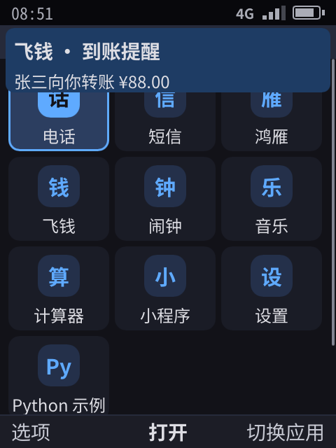
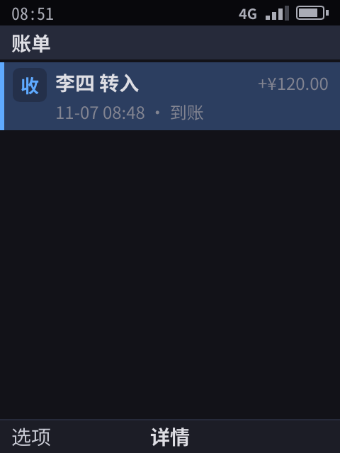

# 推送服务（R6）

> 应用离开前台 10 秒后会被冻结（[17](17-app-sandbox.md) §5），没有推送就收不到消息、到账通知和来电。已实现：设备端 `phone-pushd`、网关的开源核心 `pushgw` 和用它搭的模拟云端网关 `phone-pushgw`（TLS 或 TLCP，状态存盘，设备凭设备认证注册，心跳间隔自适应）、Shell 的分发策略（预算、优先级、合并键、VoIP 违规降级）、端到端加密（可换钥）、令牌随安装作废，飞钱和鸿雁已接入；第三方客户端首选经系统推送接入，确实要自己长连接的，有 `keepalive` 权限后能在冻结时留一条，唤醒归系统（§8，开发机、QEMU ✓，**未上真机**）。§7 列的内容**未实现**。

## 0. 结论

- **整台设备只有一条长连接。** 设备和推送网关之间由 `phone-pushd` 保持一条连接，应用不需要常驻，被冻结、甚至进程被杀掉后，也照样能收到消息。唯一的例外是商店审核过、有 `keepalive` 权限的应用自己的一条连接，它的心跳搭这条连接的唤醒（§8）。
- **推送能做什么由系统决定：**

  | 消息里有 | 系统怎么处理 | 会不会唤醒应用 |
  |----------|--------------|:---:|
  | 标题、正文 | 系统直接显示通知（需要「通知」权限） | 不会 |
  | 数据 | 交给应用：应用冻结时解冻 3 秒；进程不在时在后台启动它 | 会，有次数上限 |
  | VoIP（`kind: voip`） | 立即唤醒或启动应用，由应用报告来电，系统显示全屏来电界面（需要 `voip` 权限） | 会，不限次数 |

- **防滥用：**
  - VoIP 推送唤醒应用后，应用要在 10 秒内报告来电；24 小时内 3 次没报告，之后它的 VoIP 推送按普通数据推送处理（受每小时 20 次的预算限制），和 iOS 对 PushKit 的约束一样。
  - 数据推送每个应用每小时最多唤醒 20 次，超出的排队，等应用下次回到前台再交付。
  - 令牌由网关签名，只能投递给指定设备上的指定应用。
  - 数据最大 4 KB；消息默认保留一天；设备确认后网关才删除；重复投递按消息 ID 去重。
- **对鸿雁、飞钱，这是「稳定可用」的前提。** 国内安卓没有 FCM，安卓上的微信靠自己的长连接保活，而我们的冻结机制恰恰禁止这种常驻。所以系统推送是腾讯、阿里适配我们平台时一定会用、也一定要稳定的能力。
- 推送用例在开发机和设备上的开机自测里都通过（§6，当前基线见 57（内部文档））。

## 1. 架构

```
 应用服务器（鸿雁、飞钱的后台）
   │ HTTPS POST /v1/push {token, title, body, data, kind, ttl}
   ▼
 推送网关（云端；原型是 phone-pushgw）── 按设备排队，存储转发，确认后删除
   │ 每台设备一条长连接（心跳；断线重连后补发未确认的消息）
   ▼
 phone-pushd（设备，系统服务）── 设备身份；收到的消息在 Shell 确认前一直保留
   │ unix 套接字，0600，只有 Shell 能连
   ▼
 Shell ── 通知、唤醒或后台启动应用、预算
   │ phone.Ui：push.register → 令牌；"push" 事件
   ▼
 应用（大多数时间是冻结的）
```

和现有方案的对应关系：

| | iOS | Android（海外） | 国内安卓 | 我们 |
|---|-----|-----------------|----------|------|
| 网关 | APNs | FCM | 各厂商通道（华为、小米、OPPO、vivo 等） | 自己的网关；应用服务器只对接一套 HTTP 接口 |
| 只显示通知 | alert 推送，不唤醒应用 | notification 消息 | 通知栏消息 | 标题、正文：系统显示，不唤醒 |
| 唤醒应用 | 后台推送，系统限频 | data 消息，高优先级有配额 | 透传消息（多数要求应用在运行） | 数据：解冻 3 秒或后台启动，每小时 20 次 |
| 来电 | PushKit + CallKit，必须立刻报告来电 | 高优先级消息 + 全屏通知 | 厂商通道 + 应用保活 | `kind: voip`：立即唤醒，由应用报告来电 |

## 2. 应用服务器接口（网关）

| 接口 | 谁调用 | 说明 |
|------|--------|------|
| `POST /v1/push` `{token, kind, title, body, data, thread, collapse_id, ttl}` | 应用服务器 | 返回 `{id, online}`；设备离线时排队。`thread`是会话：同一会话的通知合并成一条，用户点开时应用收到 `thread:<会话>`，知道该打开哪个会话。`collapse_id`（最长 64 字节）：同一个应用、同一个键的新消息替换还在排队的旧消息，到了设备上也替换旧的通知和还没交付的数据（未读数、比分） |
| `POST /v1/device/register` `{device, secret, attestation}` | pushd | 设备注册：`attestation` 是密钥服务对 `push.RegisterNonce(device, secret)` 做的设备认证，证书链连到厂商根。网关配了 `--trust-root` 时，没注册的设备一律拒绝；一个设备号注册之后，只有同一台设备（同一个认证设备号）能换它的密钥 |
| `POST /v1/device/connect` `{device, secret}` | pushd | 长连接，按行返回 JSON：`hello`（带心跳间隔）、`msg`、`ping` |
| `POST /v1/device/token` `{device, secret, app}` | pushd | 为本机某个应用签发令牌 |
| `POST /v1/device/ack` `{device, secret, id}` | pushd | 消息已处理，网关可以删除 |

- **令牌** = 设备号 + 应用号，再加网关密钥算出的 HMAC。拿到飞钱令牌的服务器只能给这台设备上的飞钱发消息，也无法从令牌推算出别的应用的令牌。单元测试覆盖了伪造令牌和换密钥两种情况。
- **存储转发**：每台设备最多排 100 条，超出就丢最旧的；过了有效期的不再投递。
- **状态存盘**（`--state`）：网关的签名密钥、设备、各应用的安装代数和排队的消息都写进一个文件，网关重启后，应用服务器手里的令牌照样能用，排队的消息也还在。原型是单进程加一个文件，量产是复制的存储。
- **设备认证**（`--trust-root`）：设备的推送身份由设备证书担保，伪造的设备号连不上；没有配根时（开发环境）退回首次信任。
- **TLS**（`--tls-dir`）：网关第一次启动时生成证书并存下来，用 HTTPS 服务；pushd、应用服务器（鸿雁服务器）和自测里扮演服务器的 Shell 都钉住这张证书（`--gateway-cert`），握手时证书必须完全一致。钉的文件里可以有几张证书，网关出示其中任何一张都行：换网关的证书时镜像先钉新旧两张，网关再换（[11](11-platform-architecture.md) §15.1）。量产换成公共 CA 签的证书，镜像里钉网关的公钥（**未实现**）。
- **TLCP（国密 TLS）**（再加 `--tlcp`）：GB/T 38636，SM2 证书和密钥交换、SM4 加密、SM3 校验，签名证书和加密证书成对（双证书）。网关第一次启动时生成自己的 SM2 根证书和两张服务器证书，`cert.pem` 是这张根证书，客户端照样钉它；客户端每次握手前看钉的证书：SM2 的就走 TLCP（服务器的两张证书必须链到它，或者链到钉的另一张 SM2 根证书，主机名也要对），否则走 TLS 1.3；一个文件里两种混着就不连。所以 pushd 和应用服务器不用改配置。实现用 `gitee.com/Trisia/gotlcp`（MIT，纯 Go）；和独立实现 GmSSL 3.1 的 `tlcp_client` 互通（握手、证书链核验、HTTP 收发）。设备镜像用 TLCP（`phone-pushgw.service` 带 `--tlcp`，设备自测设 `PHONE_PUSH_TLCP=1`），开发机自测用 TLS 1.3，两条路径都有端到端覆盖。
- **自适应心跳**：连接时 pushd 带上想要的心跳间隔，从 30 秒开始；一条连接撑过 3 次心跳，就请网关把间隔加倍（`/v1/device/heartbeat`，最长 28 分钟）；连接在空闲时断了，说明超过了运营商 NAT 的超时，退回上一个撑住的间隔，以后不再试这么长。学到的间隔存在状态目录里，重启后接着用（`push.Heartbeat`）。
- **优先级**：`priority: "normal"` 的数据推送遇到冻结或不在运行的应用时先排队，等应用因为别的原因醒来时一起交付，最迟 15 分钟后系统统一唤醒一次；默认的 `high` 立即唤醒。

## 3. 设备端

**phone-pushd：**
- 第一次启动时生成设备身份（设备号 + 密钥，保存在状态目录，权限 0600）。
- 断线后按 1、2、4 秒直到 30 秒退避重连；连续 3 个心跳周期收不到任何数据就判定断线。
- 收到的消息在 Shell 确认（`ack`）之前一直保留；Shell 重连后调用 `pending` 补收。

**Shell 的决定**（`shell/push.go`）：

| 情况 | 处理 |
|------|------|
| 应用在运行且没冻结 | 直接发 `push` 事件 |
| 应用冻结，预算内 | 恢复进程，发事件，3 秒后重新冻结（VoIP 是 10 秒） |
| 进程不在，预算内 | 在后台启动应用（生命周期是 `background`），应用就绪后发事件 |
| 超出每小时 20 次 | 事件排队，应用回到前台时一起交付 |
| VoIP 推送但应用没有 `voip` 权限 | 丢弃并记日志 |
| 应用没有「通知」权限，或用户在「设置 › 应用权限」里关掉了它的通知 | 不显示通知，数据部分照常处理 |
| 应用正在前台 | 不弹系统通知，由应用自己决定怎么提示（iOS 也这样）；交给应用的事件里 `notified` 为 false |
| 发给系统频道 `system.family` 的推送（账号服务器说未成年人模式有新策略、家长要位置或报告、家长回答了要时间的请求、家长确认了重设家长 PIN 码，[19](19-core-apps.md) §1.2） | 不交给任何应用（`system.` 开头的应用号装不了），Shell 自己去账号服务器取、验签；推送里只有消息的种类（和请求号、重设号这样的随机号） |

**应用接口：**
- `push.register` 返回令牌，应用把它交给自己的服务器。
- 消息以 `push` 事件到达，值为 `{id, kind, data, sent, notified}`。`notified` 表示系统已经显示了这条推送的通知，应用就不要再发自己的通知了（应用在前台、或用户关了它的通知时为 false）。
- 系统替应用显示的通知挂上应用清单里 `notify_actions` 声明的动作（[22](22-developer-api.md) §1）。鸿雁声明了「回复」：用户在通知中心按 `r`，系统弹出输入界面，发送后在后台把文字交给鸿雁（`notif_action`，通知的 ID 是 `thread:<会话>`），鸿雁照常发出这条消息，自己不用回到前台。

**设备连到哪个网关**：推送网关的地址和要钉住的证书由产品层的 `services.env` 给出（`PHONE_PUSH_GATEWAY`、`PHONE_PUSH_GATEWAY_CERT`，[11](11-platform-architecture.md) §15；换证书时文件里有新旧两张，§15.1）；没给时用设备上模拟的网关。

## 4. 已接入的应用

| 应用 | 用法 |
|------|------|
| 飞钱 | 到账通知由服务器同时带上标题、正文和数据：通知由系统显示；数据（`{"type":"income", ...}`）把应用唤醒几秒，记入账单和余额。数据可以端到端加密，飞钱收到后用 `push.open` 解开 |
| 鸿雁（不常驻） | 应用只在上线时登录自己的服务器（模拟服务器 `phone-chatsrv`，代表鸿雁厂商的云端），把推送令牌交给它；发出的文字、照片、语音也交给服务器。对方的回复由服务器推送下来，带通知（标题是对方，正文是消息，`thread` 是会话）和数据；来电是 VoIP 推送，应用被唤醒后报告来电，系统显示全屏来电界面。机器人的回复规则在 `apps/chat/bot`，服务器和「没有服务器时的离线演示」共用这一份 |

自测用例（整套自测的用例数见 57（内部文档）「当前验证基线」）：

1. 冻结的飞钱收到带标题、正文的到账通知：横幅显示，进程**仍然冻结**；随后的数据推送把它唤醒，3 秒后重新冻结；回到飞钱，账单里有这笔到账。
2. 杀掉飞钱进程（模拟内存不足），数据推送在后台把它启动并记账；打开后账单里有这笔。
3. 给鸿雁发 VoIP 推送，系统全屏来电界面出现；消息推送进入会话。

Shell 日志确认了每个用例都走了预期的路径：
- 冻结后的到账通知没有唤醒飞钱；
- `woke com.phone.wallet for 3s`，3.5 秒后重新冻结；
- `started com.phone.wallet in the background`；
- 只运行推送用例时鸿雁没有打开过，VoIP 推送在后台启动了它。

| 到账通知（飞钱仍冻结） | 到账账单（数据推送记入） |
|:--:|:--:|
|  |  |

用例「鸿雁不常驻」：
1. 冻结等待时间设成 0.5 秒；
2. 在鸿雁里点「模拟来电」，服务器 3 秒后才发 VoIP 推送；
3. 离开鸿雁，先断言进程已经冻结，再等系统来电界面出现。

鸿雁冻结时自己的计时器是停的，所以这个来电只能来自服务器的推送。Shell 日志显示，鸿雁在冻结约 2.3 秒后被唤醒。

### 4.0 令牌随安装作废

令牌标明的是「这台设备上这一次安装的这个应用」：网关为每台设备、每个应用记一个安装代数，签进令牌。
- 卸载应用时，Shell 通知 pushd，pushd 请网关把代数加一。旧令牌立即作废，应用服务器再用它推送会收到 **410 Gone**，应该删掉这个令牌。
- 重新安装的应用拿到新代数的令牌，收不到上一次安装时那个应用的服务器发来的消息。
- 代码：`push.TokenAt` / `ParseTokenGen`，网关的 `/v1/device/revoke`，pushd 的 `unregister`；单元测试覆盖了「作废后 410、重装后新令牌能用」。

### 4.1 端到端加密

网关（我们的云服务）只转发密文，看不到聊天内容。做法参照 Web Push（RFC 8291），用标准库的原语：

1. 每个应用有一把 X25519 密钥，由系统密钥服务 keystored 生成和保管（以后放进 TEE），应用只能通过 `push.key` 拿到公钥。鸿雁上线时把公钥和推送令牌一起交给鸿雁服务器。
2. 服务器每次推送都生成一把临时密钥，用 ECDH 和 HKDF-SHA256 算出一次性的 AES-256-GCM 密钥，加密推送的数据部分。格式是 `e1.` 加上 base64url 编码的「临时公钥 | 随机数 | 密文」。
3. 网关和 Shell 只看到 `e1.…`；鸿雁收到后请密钥服务解开（`push.open`），私钥从不进入应用进程。改动过的密文解不开，别的应用的密钥也解不开。

- 通知的标题、正文由系统显示，所以仍是明文；只有数据部分是端到端加密的。和 iOS 一样，要隐藏通知内容，服务器就只发「你有一条新消息」，真正的内容放在加密的数据里。
- 代码在 `push/seal.go`（`Seal` / `Open`）和 `keystore`（`PushKey` / `OpenPush`）；单元测试检查了错钥、篡改、明文不外露、两个应用的密钥互不相通。
- 自测：鸿雁的第一个用例断言收到的推送里有加密的数据（`push-sealed`）。
- **换钥**：`push.key` 带 `rotate: true` 时密钥服务生成新密钥，旧的保留为上一把：换钥前加密、还在路上的数据仍能解开，再早的就解不开了。卸载时两把一起删除。
- **系统清空密钥**：机主解锁设备或重新上锁时，密钥服务清空所有应用的密钥，推送密钥也在内，用旧公钥加密的数据从此解不开。Shell 随即给每个在运行的应用（冻结的也恢复几秒）发 `push.key_changed` 事件，应用重新 `push.key`、把新公钥交给自己的服务器；没在运行的应用下次启动时照常取钥。鸿雁就是这样做的；自测「设备解锁」用例让鸿雁一直运行，重新上锁后断言它还是同一个进程，并且回复照样解得开。
- 还没做：真实 TEE。

### 4.2 网关集群

网关可以多实例运行（`--cluster-key` 共享密钥，`--peer-addr-file` 列出同伴），任何一个实例都能收应用服务器的推送、接设备的长连接；一个实例重启或挂掉，设备换到另一个，令牌不用换，排队的消息不丢。

- **复制**：每次状态变化（登记设备、消息入队、确认、卸载作废令牌）都变成一条幂等操作，批量发给每个同伴（全互联，失败重试，请求用集群密钥做 HMAC 并带时间，两分钟外的拒绝）。合并规则：设备记录按版本「后写者胜」；消息按 ID 只加一次；确认或被合并键替换掉的消息留墓碑，直到它过期，同伴迟到的副本不会让它复活；同一合并键只留最新的一条；卸载代数只增不减。
- **追平**：实例启动时和之后每半分钟拉同伴的快照合并（合并本身也是幂等的），所以重启的实例马上有全部设备和排队的消息，网络断过的实例也会追上。
- **令牌**：签令牌的密钥由集群密钥派生，任何实例签的令牌在所有实例都有效。
- **投递**：持有设备长连接的实例负责投递；推送打到别的实例时，复制过去的那条操作触发投递。
- **设备端**：pushd 的 `--gateway-file` 可以列多个文件（每个实例的地址文件），连接断了马上换下一个实例，所有实例都失败才退避；取令牌、确认、撤销也先试当前实例再试其他的。应用服务器（鸿雁服务器）同样按顺序试，连不上的跳过，被拒（令牌作废、太大）不再重试。
- **验证**：单元测试 `TestCluster`（A 签的令牌在 B 能用；推到 B 的消息由 A 送达连在 A 上的设备；确认同步过去，合并快照不会让已确认的消息复活；A 挂掉期间消息在 B 排队，重起的 A 从 B 拉回状态，旧令牌照用；没有集群签名的请求被拒）。自测里 Shell 起两个实例（共用服务器身份和集群密钥），用例「推送网关集群」：推到设备没连着的实例由连着的送达；杀掉设备连着的实例，设备马上换过去，消息照到；被杀的实例由监护进程重启后从同伴拉回状态，推给它的消息也送达。

### 4.3 合并唤醒射频

蜂窝射频每醒一次都要在高功耗状态停留好几秒，所以长连接的保活不该单独把它叫醒：

- **网关**：连接上发出任何消息，下一次 ping 就推迟一个完整的间隔（流量本身就维持了 NAT 映射），所以只有真正空闲的连接才收 ping。单元测试 `TestTrafficDefersPing`：消息之后下一次 ping 至少隔一个完整间隔。
- **设备**：别的流量已经把射频叫醒时，Shell 告诉 pushd（`radio_active`），pushd 请网关把下一次 ping 推后一个间隔（每半个间隔最多一次）。现在由后台定时任务批量开始、系统为某个应用自己连接的心跳单独唤醒（§8.2）时触发；手机从挂起里醒来本身不算，维护唤醒只叫醒 CPU（[28](28-battery.md) §8）。真机上应改用调制解调器报告的射频状态（**未实现**，依赖硬件）。
- **限次算上挂起的时间**：pushd 的「每半个间隔最多一次」按 `CLOCK_BOOTTIME` 算，挂起的时间算在里面，墙上时间被调也不跟着跳。以前按 Go 的单调时钟算，它在挂起时停着：手机睡了 20 分钟醒来，它只算醒着的几秒，系统为应用心跳单独醒的那一次 pushd 就不搭，网关的 ping 到时还要再叫醒射频一次（单元测试 `TestRideCountsTheTimeSuspended`，旧代码失败）。
- **推送连接自己的 TCP keep-alive**（**未实现**）：pushd 拨出去的连接和网关接受的连接都开着内核的 TCP keep-alive，用的是 Go 的默认值：空闲 15 秒后探测，每 15 秒一次，9 次没回应就断（开发机上用 `getsockopt` 看到的，两端一样）。连接走蜂窝网络时，手机醒着这探测每 15 秒就把射频叫起来一次；网关那端不管手机睡没睡都照发，挂起的手机要么被它叫醒，要么不回应、约 2.5 分钟后被网关的内核断开（推断，**未上真机**）。上面的合并和 [28](28-battery.md) §8 的估算都假定这条连接上只有网关的 ping；该像应用自己的连接那样把它关掉（§8.2）。开发机和设备自测的网关都在本机，不经射频，看不出来。

## 5. 实现

网关分两层（D11）。开源的核心是 `pushgw` 包：设备协议、存储转发、令牌、状态存盘、集群（§4.2）。`cmd/phone-pushgw` 是用它搭的模拟网关，只多了命令行参数：应用服务器拿着令牌就能推送，不限流，所有实例是一个副本集。量产的推送服务不开源，用的是同一个核心，另加了应用服务器鉴权、限流和分片（63（内部文档））。核心为它留了扩展点：每次推送前问这个请求能不能给这个应用发（`Authorize`）、是不是发得太快（`Limit`，超了回 429 和 `Retry-After`），设备该由哪些实例服务（`Owner`），路由可以在 `Routes()` 上添加；没设扩展点时行为和接口都和原来一样。

| 部分 | 位置 |
|------|------|
| 消息格式、令牌 | `push`（含单元测试） |
| 网关核心 | `pushgw`：设备协议、存储转发、集群、扩展点（含单元测试） |
| 模拟网关 | `cmd/phone-pushgw`（`pushgw` 加命令行参数） |
| 模拟的鸿雁服务器 | `cmd/phone-chatsrv`；应用从环境变量 `PHONE_CHAT_SERVER` 得知它的地址（应用在沙箱里读不了系统的运行目录）；`POST /v1/deliver` 是另一个账号主动发来的消息，同样马上推送（用户没登录时 404），待机比较的消息流量用它（[40](40-testing.md) §9） |
| 设备服务 | `cmd/phone-pushd` |
| Shell 分发、预算、后台启动 | `shell/push.go`；生命周期改动在 `shell/core.go` |
| 能力 | `push.register`（`ui/caps.go`）；后台定时任务 `job.schedule` 和推送共用唤醒逻辑（`deliverBackground`，`shell/jobs.go`） |
| 网关集群 | `pushgw/cluster.go`（复制、快照合并、集群签名），`push.Gateways`（客户端的实例列表） |
| 自测脚本命令 | `push [voip] [other] <应用> <标题> \| <正文> \| <数据>`（扮演应用服务器，走完整链路；`other` 发给设备没连着的实例）、`pushgw-kill`（杀掉设备连着的实例）、`appkill <应用>`、`require-push`、`require-pushgw-cluster` |
| 设备 | `phone-pushgw.service`（产品层没给出云端网关时，模拟网关跑在设备上；状态在 `/var/lib/phone/pushgw-state.json`，信任 `/var/lib/phone/factory/root.pub`）、`phone-pushd.service`（在 keystored 之后启动，地址和证书读 `services.env`） |

## 6. 设备上的验证

- **镜像**：带 `phone-pushgw.service` 和 `phone-pushd.service`，开机时由 systemd 启动（串口输出里有这两个服务的启动记录）。
- **开机自测**：Shell 另起一套私有的网关和 pushd（随机端口）。私有网关同样带 `--state` 和 `--trust-root`，所以 pushd 要先凭设备认证注册才连得上（网关日志 `registered (attested PH-…)`）；推送用例都在设备上通过。设备上的应用跑在沙箱里（独立 uid、命名空间、Landlock、seccomp），所以这也验证了冻结、解冻和后台启动在沙箱里同样有效。
- **稳定性**：应用 SDK 曾有一个数据竞争，会让「设置」用例偶发失败；修复后设备上连续运行全部通过。

## 7. 还没做的

| 内容 | 为什么 | 打算 |
|------|--------|------|
| 端到端加密（续） | 数据部分已加密（鸿雁、飞钱），密钥在 keystored，可以换钥（§4.1） | TEE |
| 移动网络优化（续） | 合并唤醒已做（§4.3）；收益要在真机上量；推送连接两端 Go 默认的 TCP keep-alive 还开着（§4.3） | 真机上接调制解调器的射频状态（Linux 的 IDLETIMER 或基带上报），代替「后台任务开始」这个近似；关掉推送连接两端的 TCP keep-alive |
| 网关集群（续） | 多实例和复制已做（§4.2）；同伴是静态列表、全互联 | 模拟网关保持一个副本集；分片属于量产的推送服务（§5） |
| 应用自己的连接（续） | 开发机上 ✓（§8.5），Shell 重启后接着管（§8.2，原地重启也有自测，开发机、QEMU ✓）；TypeScript 应用的是一个保活的 WebSocket（§8.3），两个引擎上开发机 ✓；沙箱里以应用的 uid 连接、流量记到应用名下（原生、TypeScript 各一个自测用例）QEMU ✓（2026-11-27），跑它们时修了一个错：拨主机名时套接字成了 Shell 的（§8.5 表后）；**未上真机**，真机射频上的耗电没验证；kario-jsrt 在交过来的套接字上说 TLS 只在开发机上测过 | 设备上跑「应用自己的长连接在真的沙箱里」和「TypeScript 应用的保活 WebSocket 在真的沙箱里」；QEMU 上测 `wss://`（要一个沙箱里的应用信的测试证书）；真机上量一次唤醒（[28](28-battery.md) §8） |

## 8. 第三方客户端的长连接

微信这类客户端在安卓上靠自己的长连接收消息、自己定时发心跳。在 Kario 上应用离开前台 10 秒就冻结（[17](17-app-sandbox.md) §5），它的计时器停了，心跳发不出去，运营商 NAT 的映射一过期连接就断了。平台的政策分两层：首选经系统推送（§8.1）；确实离不开自己的连接的，允许一条，但什么时候唤醒归系统（§8.2）。两者的耗电对比见 [28](28-battery.md) §8。

### 8.1 首选：经系统推送（合作方接入）

客户端的服务器在有消息时经推送网关发给设备，客户端不常驻，这是不多花一点待机电量的办法：整机只有 pushd 一条连接的心跳。鸿雁就是这样做的（§4），合作方照着接：

1. **登记**：应用上线（登录、每次启动）时 `push.register` 拿令牌，`push.key` 拿端到端加密的公钥，连同用户的账号交给自己的服务器。令牌标明「这台设备上这一次安装的这个应用」，卸载后网关回 410，服务器删掉它（§4.0）；系统清空密钥后应用收到 `push.key_changed`，再交一次公钥（§4.1）。
2. **发消息**：服务器 `POST /v1/push`（§2）。要用户看到的放 `title`、`body`（系统显示，不唤醒应用，要「通知」权限），`thread` 设成会话（同一会话合并成一条，点开时应用知道打开哪个），未读数这类只要最新的用 `collapse_id`；要应用处理的放 `data`（≤ 4 KB，用 `push.Seal` 加密），它解冻应用 3 秒，每个应用每小时至多 20 次；不急的数据带 `priority: "normal"`，等应用醒来时一起给。网关回 `online: false` 时设备离线，消息排着，上线后补发。
3. **来电**：`kind: "voip"`，应用在 10 秒内报告来电，系统显示全屏来电界面（要 `voip` 权限，§0 的约束）。
4. **醒着时用自己的连接**：应用在前台、或被推送唤醒时，照常用自己的连接收发和补拉漏掉的消息；离开前台不用保活，推送里的数据（或「有新消息」）足够它在下一次醒来时去拉。
5. **服务器那边**：模拟网关（`cmd/phone-pushgw`）任何拿着令牌的服务器都能推，开发、联调用它；量产的推送服务另加应用服务器的鉴权和限流（63（内部文档）），接口不变。服务器端的参考实现是 `cmd/phone-chatsrv`（鸿雁的服务器）。

开发者文档里的对应部分：能力 [22](22-developer-api.md) §4.2，后台规则 §6。

### 8.2 允许的例外：一条自己的连接（`net.keepalive`）

还没（或不能）让服务器经系统推送的客户端，可以在冻结时保留**一条**自己的连接，唤醒归系统：

| 规则 | 做法 |
|------|------|
| 谁能用 | 声明 `net` 和 `keepalive` 权限的原生应用（Go、C），和 TypeScript 应用（它的那一条是一个 WebSocket，§8.3）；`keepalive` 要在 `purposes` 写用途，商店对有它的应用**每个版本**都人工审核（`appstore` 的 `check`）。开发商店（开发者模式）装的不审 |
| 一个应用一条 | `net.keepalive {host, port, every_s}`（[22](22-developer-api.md) §4.7）：系统以应用的身份连上服务器（设备上是它的 uid，防火墙、流量统计和别的连接一样），把套接字随回复交给应用；再调一次换掉旧的，`close: true` 关掉；应用结束、被卸载时关掉。TCP，协议（TLS 在内）由应用自己说。系统手里留一份同一个套接字，只看有没有数据、不读 |
| 心跳由系统安排 | 应用不用自己的计时器发心跳，等系统的 `keepalive` 事件（`beat`）再发，系统解冻它 2 秒。系统按 `every_s`（60–3600 秒）排：上次心跳半个间隔以后，任何一次本来就有的唤醒（推送连接上的一行：心跳、`hello` 或一条推送；一批后台任务；某条连接上来了数据）都带上它，挂起的手机最迟 15 分钟一次的维护唤醒只叫醒 CPU，不带（[28](28-battery.md) §8）；到期还没有时，系统才为它单独唤醒一次，pushd 的心跳也搭这一次（`radio_active`，§4.3）；推送心跳预计在期限后 10 秒内到时等它。像安卓的不精确闹钟那样合并：两条连接一起醒，次数约等于更频繁的那条（`push.Beat`） |
| 冻结时连接还在 | 内核替冻结的应用维持 TCP 连接；来了数据，系统解冻应用 3 秒、发 `keepalive` 事件（`data`），和数据推送一样每小时至多 20 次，超了数据留在内核里，等应用因为别的原因醒来时自己读；服务器关了连接发 `closed`。应用冻结时系统关掉这个套接字上的 TCP keep-alive：内核自己的探测会绕过系统叫醒射频 |
| 预算 | 系统单为一个应用的心跳唤醒，每小时至多 6 次；用完了它的心跳等本来就有的唤醒，挂起的手机也不再为它定唤醒闹钟（`nextWake`） |
| 看得见 | 设置 › 电池的「自己的连接」：每个应用最近一天系统为它醒了几次、几次心跳搭了别的唤醒、因数据唤醒几次，以及估的电量（[28](28-battery.md) §8） |
| Shell 重启 | Shell 原地重启（升级、自测）或崩溃后由 systemd 重启时，应用的连接交给下一个 Shell（[11](11-platform-architecture.md) §14），系统手里那份套接字跟着一起交（名字 `keep-<应用 id>-<pid>`：原地重启写在 `PHONE_HANDOFF` 里；开了 fd 存储时一连上就存进去，连接结束时取出）；心跳的安排、每小时的预算和最近一天的次数存在状态目录的 `shell/keepalive.json`。下一个 Shell 接着看同一个套接字、按原来的期限排心跳，设置 › 电池的数字不重算、不丢。fd 存储和应用的协议连接共用，自己的连接有预算：一共最多占四分之一，从不挤掉协议连接，放不下时最久没用过的那条让出位置；上一次推送心跳的时间晚了 10 秒以上才写，崩溃后最多早不到 10 秒（[28](28-battery.md) §8）。fd 存储里没有它的位置、套接字没跟过来，或那份安排没写成时，系统给应用发 `keepalive` 事件 `lost`，文字说为什么（`full`、`dropped`、`unsaved`）：它的套接字可能还通，但系统不再替它看着、不再为它唤醒，应用再调一次 `net.keepalive`（换一条新连接，旧的自己关掉）。能带过来就带：重连要多一次握手（TLS 在内）、多一次射频唤醒，服务器还会看到断线；应用不能把套接字交回系统（文件只从系统流向应用），所以带不过来时只能让它重连 |

**推送连接的窗口**：pushd 收到网关的 `hello`、`ping` 时发 `window` 事件（带心跳间隔），推送照旧是 `push` 事件；Shell 把两种都当作射频刚醒过，并由此推算下一次推送心跳约在什么时候。

### 8.3 TypeScript 应用：一个保活的 WebSocket

TypeScript 应用自己不开套接字，网络只有 `fetch` 和 `WebSocket`（[22](22-developer-api.md) §9.4）。它的那一条连接是一个 WebSocket：系统那边和原生应用的完全一样（§8.2 的同一个能力、同一次以应用的 uid 拨号、同一份副本、同样的心跳、预算和设置 › 电池），只是套接字交给运行时，运行时在上面说 TLS 和 WebSocket：

```ts
import { WebSocket, on } from "kario";

const ws = new WebSocket("wss://chat.example.com/live", [], { keepalive: 600 });
ws.onmessage = (e) => show(e.data);
on("event", (name, value) => {
  if (name === "keepalive" && value === "beat") ws.send("PING"); // 服务器要的心跳
});
```

| 规则 | 做法 |
|------|------|
| 为什么是 WebSocket，不是 TLS 流 | 两个引擎都已经有 WebSocket：kario-jsrt 自己握手、分帧（libcurl 只建连接和 TLS），`kario run` 用 Node 的 TLS 和同一套分帧；上限、超时、出错的说法、模糊测试和两个引擎上的同一批测试都现成，开发者也熟。一个 TLS 流要在两个引擎上各加一套网页里没有的接口，消息的边界还得应用自己分，QuickJS 里又没有 TLS 可借。要长连接的协议（MQTT、XMPP、STOMP、GraphQL 订阅）都有跑在 WebSocket 上的标准做法，服务器多半已经开着；只说裸 TCP 或自有二进制协议的客户端写成原生应用（§8.2）。WebSocket 的消息整条交给应用：冻结时来的数据，解冻后原样、完整地到 |
| 谁能用 | 清单里有 `net` 和 `keepalive` 的 TypeScript 应用；用途、每个版本的人工审核同 §8.2。没有 `keepalive` 时构造函数当场抛 `TypeError`，系统也照样拒绝 |
| 怎么连 | `new WebSocket(url, protocols, { keepalive: every_s })`：`every_s` 是心跳间隔（60–3600 秒），地址的规则同别的 WebSocket（`wss://`，`ws://` 只到本机回环）。运行时用地址里的主机和端口（`wss` 缺省 443、`ws` 80）调 `net.keepalive`，系统照 §8.2 以应用的 uid 拨号、自己留一份、把套接字随回复交给运行时；运行时在这个已经连上的套接字上做 TLS 和 WebSocket 的握手。kario-jsrt 让 libcurl 的 connect-only 用它：开套接字的回调交出它、套接字选项的回调说它已经连上（`CURL_SOCKOPT_ALREADY_CONNECTED`），主机名解析成系统连上的那个地址（`CURLOPT_RESOLVE`，不再查一次 DNS），证书和 CA 照旧；Node 用 `net.Socket({fd})`，`wss` 再套 `tls.connect({socket})`（套接字要经 kario-native.node 才收得到，同回复里的文件）。之后和别的 WebSocket 一样：`open`、`message`、`send`、`close`、`signal`、上限（同时最多 4 个，保活的算在里面） |
| 只经运行时 | 应用自己 `call("net.keepalive")` 被运行时拒绝：套接字只在运行时自己那次调用的回复里收，别的回复里的套接字照旧关掉（那些只收普通文件） |
| 心跳 | 系统的 `keepalive` 事件照样送到应用的 `on("event")`（`beat`、`data`、`closed`、`lost`）。收到 `beat` 应用自己在 WebSocket 上发心跳（服务器要的那条消息），系统解冻它 2 秒；运行时不替它发：心跳长什么样是服务器定的。服务器不该自己定时 ping：冻结时来的任何字节（WebSocket 的 ping 也一样）都是数据，都要解冻应用、算进每小时 20 次 |
| 一个应用一条 | 运行时一次只发一个 `net.keepalive`，后开的保活 WebSocket 等前一个的回复，所以回复的先后就是系统换连接的先后（§8.2：再调一次换掉旧的），最后拿到套接字的就是系统看着的那条。一个保活 WebSocket 拿到套接字时，运行时关掉别的保活 WebSocket：开着的照常关（关闭码 1001，原因 `replaced`），还在握手的直接断（1006 `replaced`）。还没拿到套接字就取消了的（`close()`、`signal`），回复来时运行时关掉那个套接字，也照样关掉别的保活 WebSocket（系统已经拿它换掉了它们的连接），没有下一个在等时告诉系统 `close: true` |
| 结束 | 保活 WebSocket 结束（应用关、服务器关、断了）时运行时告诉系统 `close: true`：系统关掉自己那份、不再为它唤醒；系统那份不关，服务器就看不到 TCP 连接结束。系统已经发过 `closed`、`lost` 的不再告诉；有一个 `net.keepalive` 还没回复时等它回复（成功的已经换掉了旧的，失败的再告诉），免得这个 `close` 关掉刚换上的新连接 |
| 冻结、预算、看得见、Shell 重启 | 同 §8.2：冻结时内核替它维持连接；来了数据系统解冻它、发 `data`，运行时的工作线程（Node 的事件循环）读出来，整条消息交给 `message`（`data` 事件和 `message` 谁先到不一定）；超了每小时的预算，数据留在内核里，等应用因为别的原因醒来。设置 › 电池按应用记。收到 `lost` 应用再开一个保活 WebSocket，旧的由运行时关掉 |
| `kario test` | 保活 WebSocket 不经系统，和别的 WebSocket 一样连到测试扮的服务器（[22](22-developer-api.md) §9.4），`app.event("keepalive", "beat")` 送心跳 |

### 8.4 实现

| 部分 | 位置 |
|------|------|
| 能力、权限、事件 | `ui/caps.go`（`CapNetKeepalive`、`PermKeepalive`、`KeepaliveArgs`、`KeepaliveRes`、`KeepaliveUse`），`ui/names.go`（`EventKeepalive`、`KeepaliveBeat` / `Data` / `Closed` / `Lost`，`lost` 的原因 `KeepaliveLostFull` / `Dropped` / `Unsaved`）；Go SDK 的 `OnEventText` 收到带文字的事件 |
| 合并、预算、耗电模型 | `push/keepalive.go`（`Beat`、`WakeBudget`、`WakeCost`、`LTEWake`） |
| 推送窗口 | `programs/pushd`（`window` 事件，`svc.PushWindowEvent`） |
| Shell | `shell/keepalive.go`：拨号（root 的 Shell 在锁定的线程上 `setfsuid` 成应用的 uid，同 `traffic.go` 的 `sendAs`；一个地址一个地址地拨，不用 Go 的快速回退：它把主机名的 IPv4、IPv6 地址放到各自的 goroutine 里拨，套接字建在别的线程上，就成了 Shell 的；不是在这个线程上建的套接字当拨号失败）、看着连接、搭车、单独唤醒、预算、统计；接到冻结（`freeze.go`）、例行检查（`core.go`）、推送（`push.go`）、后台任务（`jobs.go`）、挂起的唤醒时间（`sleep.go`）、卸载（`install.go`）；重启时交出、接管（`handoff.go` 的 `handoff`、`InheritedApps`、`Adopt` → `keepaliveAdopt`），fd 存储的预算（`handoff.go` 的 `storeConn`，`keepalive.go` 的 `keepaliveStore`），存、读 `keepalive.json`（`core.go` 的 `New`；推送心跳的时间：`keepalivePushed`） |
| 设置 › 电池 | `apps/settings/battery.go`，数据是 `settings.get` 的 `energy[].keepalive` |
| 商店审核 | `appstore/store.go` |
| 示例 | `examples/keepalive`（「长连接示例」：连上服务器发 `HELLO`，收到 `beat` 发 `PING`，收到 `lost` 重新连，别的行当消息）；`examples/keepalive-ts`（「保活 WebSocket 示例」，TypeScript：同样的事，消息是 WebSocket 的文本消息） |
| TypeScript（§8.3） | kario-jsrt：`jsrt/src/ws.c`（`keepalive` 选项；一次一个 `net.keepalive`、换掉旧的、`close: true`；工作线程让 libcurl 用系统的套接字），`jsrt/src/kario.c`、`dispatch.c`（运行时自己的调用：回复里的套接字直接交给 `ws.c`，应用的 `call("net.keepalive")` 拒绝；`keepalive` 事件的 `closed`、`lost` 先告诉 `ws.c`），`jsrt/src/net.c`（清单里的 `keepalive`）；Node：`sdk/ts/node/net.mjs`（同样的规则）、`runtime.mjs`（运行时自己的调用）、`kario.mjs`（`net.Socket({fd})`、`tls.connect({socket})`）、`fake.mjs`（`kario test`）；类型 `sdk/ts/index.d.ts`（`WebSocketOptions.keepalive`），`sdk/ts/ui.d.ts` 的 `KeepaliveEvent`（`tools/tsgen` 从 `ui/names.go` 生成）；Shell 不再拒绝 TypeScript 应用（`shell/keepalive.go`） |
| 自测步骤 | `shell/keepalive_headless.go`（`keep-server` 起在主机名上时 `{keepalive}` 是这个名字带它拿到的端口，带 `netns` 时服务器在自己的网络命名空间里、隔着一对 veth，带 `ws` 时说 WebSocket：每条文本消息算一行，`keep-send` 发文本消息；`keepalive-net`；`keep-conns`：服务器一共接受过几条连接、都还开着），`shell/keepalive_apart.go`（`keep-server` 带 `apart` 时服务器在 Shell 进程外自己的进程里，`shell-restart` 时还在，[40](40-testing.md) §2） |

### 8.5 测试

| 测试 | 测什么 |
|------|--------|
| `push` 的 `TestBatchedHeartbeats` | 模拟一天（不算每小时的预算）：推送心跳 28 分钟、应用心跳 28 分钟，射频一共醒 51 次、单独为应用 0 次，推送心跳晚到几秒也一样；应用心跳 60 分钟也是 51 次、0 次；推送心跳 5 分钟（NAT 短的网络）、应用 28 分钟，287 次、0 次；应用心跳比推送心跳短（10 分钟、1 分钟）时每次都是单独为它，但 pushd 的心跳搭这些唤醒，射频醒 144、1440 次，不是 195、1491 次 |
| `push` 的 `TestOwnWake`、`TestWakeBudget`、`TestPowerTable` | 什么时候单独唤醒（推送心跳在窗口里、期限前后）；每小时预算按滑动的一小时算、时钟往回拨不出错；[28](28-battery.md) §8 的表 |
| `programs/pushd` 的 `TestHeartbeatsAreWindows` | 假网关发 `hello`、`ping`、`msg`：`hello`、`ping` 各发一个 `window` 事件，带当时的心跳间隔（`hello` 改了它就带新的），`msg` 照旧是 `push` 事件 |
| `programs/pushd` 的 `TestRideCountsTheTimeSuspended` | `radio_active` 每半个间隔最多搭一次：第一次搭，13 分钟后不搭；再过 20 分钟（挂起着，单调时钟只走了几秒）照搭，网关两次被请求把 ping 推后一个间隔；`CLOCK_BOOTTIME` 读得出、跟着时间走。旧代码按单调时钟算，失败 |
| `shell` 的 `TestMaintenanceWakeIsNoRadioWindow` | 应用的心跳 28 分钟一次，手机挂起，RTC 在约 15 分钟时做维护唤醒（心跳的窗口已开）：应用没收到心跳，pushd 没收到 `radio_active`；下一次挂起醒在期限上，系统为它单独醒，应用收到心跳，pushd 收到一次 `radio_active`。旧代码每次醒来都告诉 pushd（一共 3 次），失败 |
| `shell` 的 `TestKeepaliveRefused`、`TestKeepaliveBeats`、`TestKeepaliveData`、`TestKeepaliveDataBudget`、`TestKeepaliveEnds` | 没权限、心跳间隔不合规的拒绝，TypeScript 应用不拒绝（套接字交给它的运行时，§8.3；旧代码拒绝，失败）；连上本机的测试服务器拿到套接字；窗口没开不搭、开了搭推送心跳；期限到了单独唤醒、挂起前定好唤醒时间；推送心跳在期限后 10 秒内要来就等；预算用完不再单独唤醒，别的唤醒照样搭；冻结时关掉 TCP keep-alive，来了数据解冻、发 `data`，服务器关了发 `closed`；数据超预算不唤醒；应用结束关掉连接，卸载后设置 › 电池不再列它 |
| `shell` 的 `TestKeepaliveSurvivesHandoff`、`TestKeepaliveLostAcrossRestart`、`TestKeepaliveLostWithoutItsSchedule`、`TestKeepaliveFDStore`、`TestKeepaliveOfAnAppGone`（`keepalive_restart_test.go`） | 原地重启的交接（`PHONE_HANDOFF` 列的文件留着，Shell 自己的副本关掉，下一个 Shell 在同一个状态目录上起来、接管）：下一个 Shell 有同一个套接字，心跳的间隔和上次心跳不变，设置 › 电池的次数和这一小时还能单独唤醒几次都和重启前一样、只列一次；冻结后服务器发一行，应用被唤醒（`data`）、读到这一行；应用把套接字设成阻塞的，接管后还是阻塞的。套接字没跟过来、或安排没写成：应用收到一次 `lost`，次数不变。开了 fd 存储：一连上就存成 `keep-<id>-<pid>`（存的就是这条连接），结束时取出；应用在没有 Shell 时结束了，下一个 Shell 放掉它的套接字，把它和应用的协议连接都从 fd 存储里取出（旧代码留着协议连接，一直占一个位置）。旧代码五个都失败 |
| `shell` 的 `TestKeepaliveFDStoreBudget`、`TestKeepaliveLastPushAfterACrash`（`keepalive_fdstore_test.go`） | 一个照 systemd 259 做的假 fd 存储（8 个位置，满了不说、悄悄关掉）上，6 个应用、3 条自己的连接，再起 2 个应用：自己的连接最多 2 条，最久没用过的让出位置（来过数据的那条留下），协议连接全在、存储从没拒收过；一个应用结束后，让出的那条里最近用过的放回去；让出、放回去的日志各一行。Shell 这时崩溃，从这个存储重启：没有位置的两个应用各收到一次 `lost`，文字是 `full`，日志一行；放回去的那条接着用，存储不变。一次推送心跳后崩溃，恢复的时间就是它的；之后每秒一次推送、60 次，每次崩溃恢复的时间都在 10 秒内，只写了 6 次；连接结束后不写也不读。旧代码两个都失败（存储拒收第三条；恢复的时间是零） |
| `sdk` 的 `TestEventText` | 带文字的事件（`lost` 的原因）交给 `OnEventText`，没有文字的交给 `OnEvent`；只设了 `OnEvent` 的应用照样收到 |
| `appstore` 的 `TestReviewKeepalive` | 没写用途拒收；新应用、更新的每个版本都进人工审核，TypeScript 应用也一样（商店本来就不分，旧代码也通过） |
| `jsrt` 的 `TestKeepaliveWebSocket`、`TestNodeKeepaliveWebSocket`（两个引擎同一批情形，Node 带 kario-native.node） | 假 Shell 收到 `net.keepalive {host, port, every_s}`，自己拨号、留一份，把套接字随回复交出：运行时在上面做 TLS（主机名 `example.com`，假 Shell 拨的是本机，运行时不查 DNS）和握手，`open`；`beat` 时应用发的 `PING` 到了服务器；应用被 SIGSTOP 停住时服务器发一条 100000 字节的二进制消息和一条中文文本，假 Shell 那份套接字上看得到数据在等，SIGCONT 加 `data` 事件后应用收到两条，长度、校验和、文字都对；服务器关（4001 `bye`）：`close` 事件，运行时发 `close: true`；明文 `ws://localhost` 也行（主机名解析成假 Shell 连上的地址，握手的 `Host` 照旧）；同时开两个时第二个的调用等第一个的回复，第一个拿到套接字时开着的那条被关（1001 `replaced`），第二个拿到时还在握手的第一个被断（1006 `replaced`，它连着的服务器看到连接断开），都不发 `close: true`，心跳只到最新的那条；还没拿到套接字就取消的：`close` 1006 `aborted`，回复来的套接字被关（应用的进程不再拿着它）、开着的那条被关（1001 `replaced`）、发一次 `close: true`；`lost` 以后关掉不再发 `close: true`；系统拒绝时 `error` 和 `close` 1006 带它的话，回复里没有套接字、或给的是普通文件也一样，都不发 `close: true`；没有 `keepalive` 权限、心跳间隔不合规（30、4000、600.5、`"600"`）当场抛 `TypeError`，应用自己 `call("net.keepalive")` 被拒绝、到不了 Shell。旧代码失败：在第一步（应用的调用到了 Shell）；把前面的步骤拿掉，也在下一步（不合规的间隔不报错；运行时不问系统，自己去连） |
| `shell` 的 `TestKeepServerWebSocket`、`TestKeepServerByName` | 自测的 `keep-server … ws`：握手的回答，文本消息算行（`keep-got`），`keep-send` 发一条文本消息，ping、close 有回答；别的模式报错。起在 `localhost` 上时 `{keepalive}` 是 `localhost:<端口>`，起在地址上时还是地址，都连得上 |
| `shell` 的 `TestDialAsDualStack` | 以应用的 uid 拨主机名 `localhost`（IPv4、IPv6 两个地址，服务器只在 `127.0.0.1` 上）5 次：每次的套接字都属于那个 uid。以 root 跑（`podman unshare`）时用 uid 65534；不是 root 时只能用自己的 uid，套接字属于谁看不出来，只有拨号里线程的检查会失败。旧代码以 root 跑时失败：「the socket is uid 0's, not the app's 65534」（快速回退在别的线程上建套接字）；只去掉 `FallbackDelay: -1`、留着线程的检查时，不是 root 也失败 |
| 自测「TypeScript 应用的保活 WebSocket」（开发机 ✓，2026-11-27，单独跑；QEMU ✓，2026-11-27，整套运行） | 开发商店装「保活 WebSocket 示例」，它经系统连上本机回环上说 WebSocket 的测试服务器（`keep-server 127.0.0.1:0 ws`），服务器收到 `HELLO`；冻结后服务器发一条消息，应用被解冻、日志里有它，又冻结；过了期限（`keepalive-due`）系统为它唤醒一次，服务器收到 `PING`；设置 › 电池的「自己的连接」里有它；卸载 |
| 自测「TypeScript 应用的保活 WebSocket 在真的沙箱里」（只在设备上：`require-sandbox`；QEMU ✓，2026-11-27，单独跑 3 次；**未上真机**） | WebSocket 测试服务器在本机回环上，起在主机名上（`keep-server localhost:0 ws`：镜像的 `/etc/hosts` 里 `localhost` 有 `127.0.0.1`、`::1` 两个地址，服务器只在前一个上）；开发商店装「保活 WebSocket 示例」连 `ws://localhost:<端口>/live`：系统以应用的 uid 拨这个名字，套接字交给 kario-jsrt，libcurl 把这个名字认作系统连上的地址（镜像的 libcurl 8.19 上的 `CURL_SOCKOPT_ALREADY_CONNECTED`、`CURLOPT_RESOLVE`），服务器收到 `HELLO`；`keepalive-net` 查系统那份套接字属于应用的 uid、kario-jsrt 的进程拿着同一个套接字（回环不经按应用的防火墙，流量的计数这里不查，原生应用的用例查）；冻结（真的 cgroup 冻结）后服务器发一条消息，沙箱里的应用被解冻收下；卸载。连 `127.0.0.1` 的旧写法在整套运行里过了 7 次；改成主机名后，没修拨号的镜像上失败在 `keepalive-net`（「socket of uid 0, not of the app's 10002」，见表后），修了以后过 |
| 自测「应用自己的长连接」（开发机 ✓；QEMU ✓，2026-11-27，整套运行） | 开发商店装「长连接示例」，连上本机回环上的测试服务器（`keep-server`），服务器收到 `HELLO`；冻结后服务器发一行，应用被解冻、日志里有这一行，又冻结；时间快进 400 秒后来一条推送，应用的心跳搭这次唤醒（服务器收到 `PING`，单独唤醒 0 次）；过了期限（`keepalive-due`）系统单独唤醒一次，服务器收到第二个 `PING`；设置 › 电池的「自己的连接」里有它（为它唤醒 1 次、约 0.9 mAh）；卸载 |
| 自测「应用自己的长连接在真的沙箱里」（只在设备上：`require-sandbox`、`require-netfw`；QEMU ✓，2026-11-27：整套运行里过了 10 次，单独跑 4 次；**未上真机**） | 测试服务器在自己的网络命名空间里、隔着一对 veth（`keep-server netns`，`192.168.252.2`：不走回环，按应用防火墙才计数）；开发商店装「长连接示例」连上它，服务器收到 `HELLO`，发一行应用收到；`keepalive-net`：系统那份套接字属于应用的 uid（`fstat`），应用进程拿着的是同一个套接字（`/proc/<pid>/fd`），防火墙的计数器记到它名下今天收、发都至少 120 字节，打印 `PHONE-KEEPALIVE-NET`；「设置 › 流量」的各应用移动数据里有它；卸载，流量的记录还原 |
| 自测「应用自己的长连接，Shell 重启后」（`require-restart`） | 测试服务器在 Shell 的进程外（`keep-server 127.0.0.1:0 apart`）；开发商店装「长连接示例」连上它，服务器收到 `HELLO`；冻结后服务器发一行，应用被解冻、收下（`data` 1 次）；Shell 原地重启（`shell-restart`），应用进程不变、被新的 Shell 接管（`adopted`）；又冻结后服务器再发一行，应用照样被解冻、收下，`data` 接着数成 2 次；过了期限（`keepalive-due`）系统单独唤醒一次，服务器收到 `PING`；服务器从头到尾只接受过这一条连接、它还开着（`keep-conns 1`：应用没收到 `lost`、没有重连）；卸载 |

开发机的自测不以 root 运行，Shell 用自己的 uid 拨号；设备上（root、沙箱）以应用的 uid 拨号、防火墙记到应用名下的两个用例 QEMU ✓（2026-11-27），**未上真机**。跑 TypeScript 的那个时照出一个错：Shell 拨主机名时，Go 的快速回退把它的 IPv4、IPv6 地址放到各自的 goroutine 里拨，套接字建在没有 `setfsuid` 的线程上，属于 Shell（root）而不是应用，按应用的防火墙规则和计数器（按套接字的 uid）都管不到它；以前的用例都拨地址，看不出来。已修（§8.4 的拨号，`TestDialAsDualStack`）。kario-jsrt 在镜像的 libcurl 8.19 上用交过来的套接字 ✓：`CURL_SOCKOPT_ALREADY_CONNECTED`，和主机名 `localhost` 的 `CURLOPT_RESOLVE`（8.19 收下这一条、连得上；`localhost` 是 libcurl 自己解析成回环的名字，看不出它用没用这一条）。交过来的套接字上的 TLS（`wss://`）只在开发机的 libcurl 7.61 上测过，QEMU 上**未验证**：沙箱里的应用只信系统的 CA，测试服务器没有它认的证书。原地重启的交接有了自测用例（上表最后一行）：它的测试服务器在 Shell 的进程外，重启时还在；崩溃后由 systemd 重启（fd 存储）仍只有单元测试：Shell 的进程结束了，这个服务器随它死。挂起的手机真的为心跳醒来、射频上的耗电**未上真机**。

