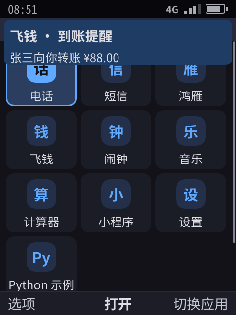
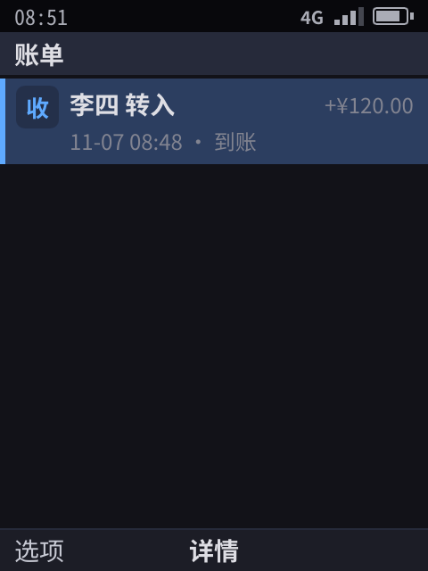

# 推送服务（R6）

> 应用离开前台 10 秒后会被冻结（[17](17-app-sandbox.md) §5），没有推送就收不到消息、到账通知和来电。已实现：设备端 `phone-pushd`、网关的开源核心 `pushgw` 和用它搭的模拟云端网关 `phone-pushgw`（TLS 或 TLCP，状态存盘，设备凭设备认证注册，心跳间隔自适应）、Shell 的分发策略（预算、优先级、合并键、VoIP 违规降级）、端到端加密（可换钥）、令牌随安装作废，飞钱和鸿雁已接入。§7 列的内容**未实现**。

## 0. 结论

- **整台设备只有一条长连接。** 设备和推送网关之间由 `phone-pushd` 保持一条连接，应用不需要常驻，被冻结、甚至进程被杀掉后，也照样能收到消息。
- **推送能做什么由系统决定：**

  | 消息里有 | 系统怎么处理 | 会不会唤醒应用 |
  |----------|--------------|:---:|
  | 标题、正文 | 系统直接显示通知（需要「通知」权限） | 不会 |
  | 数据 | 交给应用：应用冻结时解冻 3 秒；进程不在时在后台启动它 | 会，有次数上限 |
  | VoIP（`kind: voip`） | 立即唤醒或启动应用，由应用报告来电，系统显示全屏来电界面（需要 `voip` 权限） | 会，不限次数 |

- **防滥用：**
  - VoIP 推送唤醒应用后，应用要在 10 秒内报告来电；24 小时内 3 次没报告，之后它的 VoIP 推送按普通数据推送处理（受每小时 20 次的预算限制），和 iOS 对 PushKit 的约束一样。
  - 数据推送每个应用每小时最多唤醒 20 次，超出的排队，等应用下次回到前台再交付。
  - 令牌由网关签名，只能投递给指定设备上的指定应用。
  - 数据最大 4 KB；消息默认保留一天；设备确认后网关才删除；重复投递按消息 ID 去重。
- **对鸿雁、飞钱，这是「稳定可用」的前提。** 国内安卓没有 FCM，安卓上的微信靠自己的长连接保活，而我们的冻结机制恰恰禁止这种常驻。所以系统推送是腾讯、阿里适配我们平台时一定会用、也一定要稳定的能力。
- 推送用例在开发机和设备上的开机自测里都通过（§6，当前基线见 57（内部文档））。

## 1. 架构

```
 应用服务器（鸿雁、飞钱的后台）
   │ HTTPS POST /v1/push {token, title, body, data, kind, ttl}
   ▼
 推送网关（云端；原型是 phone-pushgw）── 按设备排队，存储转发，确认后删除
   │ 每台设备一条长连接（心跳；断线重连后补发未确认的消息）
   ▼
 phone-pushd（设备，系统服务）── 设备身份；收到的消息在 Shell 确认前一直保留
   │ unix 套接字，0600，只有 Shell 能连
   ▼
 Shell ── 通知、唤醒或后台启动应用、预算
   │ phone.Ui：push.register → 令牌；"push" 事件
   ▼
 应用（大多数时间是冻结的）
```

和现有方案的对应关系：

| | iOS | Android（海外） | 国内安卓 | 我们 |
|---|-----|-----------------|----------|------|
| 网关 | APNs | FCM | 各厂商通道（华为、小米、OPPO、vivo 等） | 自己的网关；应用服务器只对接一套 HTTP 接口 |
| 只显示通知 | alert 推送，不唤醒应用 | notification 消息 | 通知栏消息 | 标题、正文：系统显示，不唤醒 |
| 唤醒应用 | 后台推送，系统限频 | data 消息，高优先级有配额 | 透传消息（多数要求应用在运行） | 数据：解冻 3 秒或后台启动，每小时 20 次 |
| 来电 | PushKit + CallKit，必须立刻报告来电 | 高优先级消息 + 全屏通知 | 厂商通道 + 应用保活 | `kind: voip`：立即唤醒，由应用报告来电 |

## 2. 应用服务器接口（网关）

| 接口 | 谁调用 | 说明 |
|------|--------|------|
| `POST /v1/push` `{token, kind, title, body, data, thread, collapse_id, ttl}` | 应用服务器 | 返回 `{id, online}`；设备离线时排队。`thread`是会话：同一会话的通知合并成一条，用户点开时应用收到 `thread:<会话>`，知道该打开哪个会话。`collapse_id`（最长 64 字节）：同一个应用、同一个键的新消息替换还在排队的旧消息，到了设备上也替换旧的通知和还没交付的数据（未读数、比分） |
| `POST /v1/device/register` `{device, secret, attestation}` | pushd | 设备注册：`attestation` 是密钥服务对 `push.RegisterNonce(device, secret)` 做的设备认证，证书链连到厂商根。网关配了 `--trust-root` 时，没注册的设备一律拒绝；一个设备号注册之后，只有同一台设备（同一个认证设备号）能换它的密钥 |
| `POST /v1/device/connect` `{device, secret}` | pushd | 长连接，按行返回 JSON：`hello`（带心跳间隔）、`msg`、`ping` |
| `POST /v1/device/token` `{device, secret, app}` | pushd | 为本机某个应用签发令牌 |
| `POST /v1/device/ack` `{device, secret, id}` | pushd | 消息已处理，网关可以删除 |

- **令牌** = 设备号 + 应用号，再加网关密钥算出的 HMAC。拿到飞钱令牌的服务器只能给这台设备上的飞钱发消息，也无法从令牌推算出别的应用的令牌。单元测试覆盖了伪造令牌和换密钥两种情况。
- **存储转发**：每台设备最多排 100 条，超出就丢最旧的；过了有效期的不再投递。
- **状态存盘**（`--state`）：网关的签名密钥、设备、各应用的安装代数和排队的消息都写进一个文件，网关重启后，应用服务器手里的令牌照样能用，排队的消息也还在。原型是单进程加一个文件，量产是复制的存储。
- **设备认证**（`--trust-root`）：设备的推送身份由设备证书担保，伪造的设备号连不上；没有配根时（开发环境）退回首次信任。
- **TLS**（`--tls-dir`）：网关第一次启动时生成证书并存下来，用 HTTPS 服务；pushd、应用服务器（鸿雁服务器）和自测里扮演服务器的 Shell 都钉住这张证书（`--gateway-cert`），握手时证书必须完全一致。量产换成公共 CA 签的证书，镜像里钉网关的公钥。
- **TLCP（国密 TLS）**（再加 `--tlcp`）：GB/T 38636，SM2 证书和密钥交换、SM4 加密、SM3 校验，签名证书和加密证书成对（双证书）。网关第一次启动时生成自己的 SM2 根证书和两张服务器证书，`cert.pem` 是这张根证书，客户端照样钉它；客户端每次握手前看钉的证书：SM2 的就走 TLCP（服务器的两张证书必须链到它，主机名也要对），否则走 TLS 1.3。所以 pushd 和应用服务器不用改配置。实现用 `gitee.com/Trisia/gotlcp`（MIT，纯 Go）；和独立实现 GmSSL 3.1 的 `tlcp_client` 互通（握手、证书链核验、HTTP 收发）。设备镜像用 TLCP（`phone-pushgw.service` 带 `--tlcp`，设备自测设 `PHONE_PUSH_TLCP=1`），开发机自测用 TLS 1.3，两条路径都有端到端覆盖。
- **自适应心跳**：连接时 pushd 带上想要的心跳间隔，从 30 秒开始；一条连接撑过 3 次心跳，就请网关把间隔加倍（`/v1/device/heartbeat`，最长 28 分钟）；连接在空闲时断了，说明超过了运营商 NAT 的超时，退回上一个撑住的间隔，以后不再试这么长。学到的间隔存在状态目录里，重启后接着用（`push.Heartbeat`）。
- **优先级**：`priority: "normal"` 的数据推送遇到冻结或不在运行的应用时先排队，等应用因为别的原因醒来时一起交付，最迟 15 分钟后系统统一唤醒一次；默认的 `high` 立即唤醒。

## 3. 设备端

**phone-pushd：**
- 第一次启动时生成设备身份（设备号 + 密钥，保存在状态目录，权限 0600）。
- 断线后按 1、2、4 秒直到 30 秒退避重连；连续 3 个心跳周期收不到任何数据就判定断线。
- 收到的消息在 Shell 确认（`ack`）之前一直保留；Shell 重连后调用 `pending` 补收。

**Shell 的决定**（`shell/push.go`）：

| 情况 | 处理 |
|------|------|
| 应用在运行且没冻结 | 直接发 `push` 事件 |
| 应用冻结，预算内 | 恢复进程，发事件，3 秒后重新冻结（VoIP 是 10 秒） |
| 进程不在，预算内 | 在后台启动应用（生命周期是 `background`），应用就绪后发事件 |
| 超出每小时 20 次 | 事件排队，应用回到前台时一起交付 |
| VoIP 推送但应用没有 `voip` 权限 | 丢弃并记日志 |
| 应用没有「通知」权限，或用户在「设置 › 应用权限」里关掉了它的通知 | 不显示通知，数据部分照常处理 |
| 应用正在前台 | 不弹系统通知，由应用自己决定怎么提示（iOS 也这样）；交给应用的事件里 `notified` 为 false |

**应用接口：**
- `push.register` 返回令牌，应用把它交给自己的服务器。
- 消息以 `push` 事件到达，值为 `{id, kind, data, sent, notified}`。`notified` 表示系统已经显示了这条推送的通知，应用就不要再发自己的通知了（应用在前台、或用户关了它的通知时为 false）。
- 系统替应用显示的通知挂上应用清单里 `notify_actions` 声明的动作（[22](22-developer-api.md) §1）。鸿雁声明了「回复」：用户在通知中心按 `r`，系统弹出输入界面，发送后在后台把文字交给鸿雁（`notif_action`，通知的 ID 是 `thread:<会话>`），鸿雁照常发出这条消息，自己不用回到前台。

**设备连到哪个网关**：推送网关的地址和要钉住的证书由产品层的 `services.env` 给出（`PHONE_PUSH_GATEWAY`、`PHONE_PUSH_GATEWAY_CERT`，[11](11-platform-architecture.md) §15）；没给时用设备上模拟的网关。

## 4. 已接入的应用

| 应用 | 用法 |
|------|------|
| 飞钱 | 到账通知由服务器同时带上标题、正文和数据：通知由系统显示；数据（`{"type":"income", ...}`）把应用唤醒几秒，记入账单和余额。数据可以端到端加密，飞钱收到后用 `push.open` 解开 |
| 鸿雁（不常驻） | 应用只在上线时登录自己的服务器（模拟服务器 `phone-chatsrv`，代表鸿雁厂商的云端），把推送令牌交给它；发出的文字、照片、语音也交给服务器。对方的回复由服务器推送下来，带通知（标题是对方，正文是消息，`thread` 是会话）和数据；来电是 VoIP 推送，应用被唤醒后报告来电，系统显示全屏来电界面。机器人的回复规则在 `apps/chat/bot`，服务器和「没有服务器时的离线演示」共用这一份 |

自测用例（开发机 34/34）：

1. 冻结的飞钱收到带标题、正文的到账通知：横幅显示，进程**仍然冻结**；随后的数据推送把它唤醒，3 秒后重新冻结；回到飞钱，账单里有这笔到账。
2. 杀掉飞钱进程（模拟内存不足），数据推送在后台把它启动并记账；打开后账单里有这笔。
3. 给鸿雁发 VoIP 推送，系统全屏来电界面出现；消息推送进入会话。

Shell 日志确认了每个用例都走了预期的路径：
- 冻结后的到账通知没有唤醒飞钱；
- `woke com.phone.wallet for 3s`，3.5 秒后重新冻结；
- `started com.phone.wallet in the background`；
- 只运行推送用例时鸿雁没有打开过，VoIP 推送在后台启动了它。

| 到账通知（飞钱仍冻结） | 到账账单（数据推送记入） |
|:--:|:--:|
|  |  |

用例「鸿雁不常驻」：
1. 冻结等待时间设成 0.5 秒；
2. 在鸿雁里点「模拟来电」，服务器 3 秒后才发 VoIP 推送；
3. 离开鸿雁，先断言进程已经冻结，再等系统来电界面出现。

鸿雁冻结时自己的计时器是停的，所以这个来电只能来自服务器的推送。Shell 日志显示，鸿雁在冻结约 2.3 秒后被唤醒。

### 4.0 令牌随安装作废

令牌标明的是「这台设备上这一次安装的这个应用」：网关为每台设备、每个应用记一个安装代数，签进令牌。
- 卸载应用时，Shell 通知 pushd，pushd 请网关把代数加一。旧令牌立即作废，应用服务器再用它推送会收到 **410 Gone**，应该删掉这个令牌。
- 重新安装的应用拿到新代数的令牌，收不到上一次安装时那个应用的服务器发来的消息。
- 代码：`push.TokenAt` / `ParseTokenGen`，网关的 `/v1/device/revoke`，pushd 的 `unregister`；单元测试覆盖了「作废后 410、重装后新令牌能用」。

### 4.1 端到端加密

网关（我们的云服务）只转发密文，看不到聊天内容。做法参照 Web Push（RFC 8291），用标准库的原语：

1. 每个应用有一把 X25519 密钥，由系统密钥服务 keystored 生成和保管（以后放进 TEE），应用只能通过 `push.key` 拿到公钥。鸿雁上线时把公钥和推送令牌一起交给鸿雁服务器。
2. 服务器每次推送都生成一把临时密钥，用 ECDH 和 HKDF-SHA256 算出一次性的 AES-256-GCM 密钥，加密推送的数据部分。格式是 `e1.` 加上 base64url 编码的「临时公钥 | 随机数 | 密文」。
3. 网关和 Shell 只看到 `e1.…`；鸿雁收到后请密钥服务解开（`push.open`），私钥从不进入应用进程。改动过的密文解不开，别的应用的密钥也解不开。

- 通知的标题、正文由系统显示，所以仍是明文；只有数据部分是端到端加密的。和 iOS 一样，要隐藏通知内容，服务器就只发「你有一条新消息」，真正的内容放在加密的数据里。
- 代码在 `push/seal.go`（`Seal` / `Open`）和 `keystore`（`PushKey` / `OpenPush`）；单元测试检查了错钥、篡改、明文不外露、两个应用的密钥互不相通。
- 自测：鸿雁的第一个用例断言收到的推送里有加密的数据（`push-sealed`）。
- **换钥**：`push.key` 带 `rotate: true` 时密钥服务生成新密钥，旧的保留为上一把：换钥前加密、还在路上的数据仍能解开，再早的就解不开了。卸载时两把一起删除。
- **系统清空密钥**：机主解锁设备或重新上锁时，密钥服务清空所有应用的密钥，推送密钥也在内，用旧公钥加密的数据从此解不开。Shell 随即给每个在运行的应用（冻结的也恢复几秒）发 `push.key_changed` 事件，应用重新 `push.key`、把新公钥交给自己的服务器；没在运行的应用下次启动时照常取钥。鸿雁就是这样做的；自测「设备解锁」用例让鸿雁一直运行，重新上锁后断言它还是同一个进程，并且回复照样解得开。
- 还没做：真实 TEE。

### 4.2 网关集群

网关可以多实例运行（`--cluster-key` 共享密钥，`--peer-addr-file` 列出同伴），任何一个实例都能收应用服务器的推送、接设备的长连接；一个实例重启或挂掉，设备换到另一个，令牌不用换，排队的消息不丢。

- **复制**：每次状态变化（登记设备、消息入队、确认、卸载作废令牌）都变成一条幂等操作，批量发给每个同伴（全互联，失败重试，请求用集群密钥做 HMAC 并带时间，两分钟外的拒绝）。合并规则：设备记录按版本「后写者胜」；消息按 ID 只加一次；确认或被合并键替换掉的消息留墓碑，直到它过期，同伴迟到的副本不会让它复活；同一合并键只留最新的一条；卸载代数只增不减。
- **追平**：实例启动时和之后每半分钟拉同伴的快照合并（合并本身也是幂等的），所以重启的实例马上有全部设备和排队的消息，网络断过的实例也会追上。
- **令牌**：签令牌的密钥由集群密钥派生，任何实例签的令牌在所有实例都有效。
- **投递**：持有设备长连接的实例负责投递；推送打到别的实例时，复制过去的那条操作触发投递。
- **设备端**：pushd 的 `--gateway-file` 可以列多个文件（每个实例的地址文件），连接断了马上换下一个实例，所有实例都失败才退避；取令牌、确认、撤销也先试当前实例再试其他的。应用服务器（鸿雁服务器）同样按顺序试，连不上的跳过，被拒（令牌作废、太大）不再重试。
- **验证**：单元测试 `TestCluster`（A 签的令牌在 B 能用；推到 B 的消息由 A 送达连在 A 上的设备；确认同步过去，合并快照不会让已确认的消息复活；A 挂掉期间消息在 B 排队，重起的 A 从 B 拉回状态，旧令牌照用；没有集群签名的请求被拒）。自测里 Shell 起两个实例（共用服务器身份和集群密钥），用例「推送网关集群」：推到设备没连着的实例由连着的送达；杀掉设备连着的实例，设备马上换过去，消息照到；被杀的实例由监护进程重启后从同伴拉回状态，推给它的消息也送达。

### 4.3 合并唤醒射频

蜂窝射频每醒一次都要在高功耗状态停留好几秒，所以长连接的保活不该单独把它叫醒：

- **网关**：连接上发出任何消息，下一次 ping 就推迟一个完整的间隔（流量本身就维持了 NAT 映射），所以只有真正空闲的连接才收 ping。单元测试 `TestTrafficDefersPing`：消息之后下一次 ping 至少隔一个完整间隔。
- **设备**：别的流量已经把射频叫醒时，Shell 告诉 pushd（`radio_active`），pushd 请网关把下一次 ping 推后一个间隔（每半个间隔最多一次）。现在由后台定时任务批量开始时触发；真机上应改用调制解调器报告的射频状态（**未实现**，依赖硬件）。

## 5. 实现

网关分两层（D11）。开源的核心是 `pushgw` 包：设备协议、存储转发、令牌、状态存盘、集群（§4.2）。`cmd/phone-pushgw` 是用它搭的模拟网关，只多了命令行参数：应用服务器拿着令牌就能推送，不限流，所有实例是一个副本集。量产的推送服务不开源，用的是同一个核心，另加了应用服务器鉴权、限流和分片（63（内部文档））。核心为它留了扩展点：每次推送前问这个请求能不能给这个应用发（`Authorize`）、是不是发得太快（`Limit`，超了回 429 和 `Retry-After`），设备该由哪些实例服务（`Owner`），路由可以在 `Routes()` 上添加；没设扩展点时行为和接口都和原来一样。

| 部分 | 位置 |
|------|------|
| 消息格式、令牌 | `push`（含单元测试） |
| 网关核心 | `pushgw`：设备协议、存储转发、集群、扩展点（含单元测试） |
| 模拟网关 | `cmd/phone-pushgw`（`pushgw` 加命令行参数） |
| 模拟的鸿雁服务器 | `cmd/phone-chatsrv`；应用从环境变量 `PHONE_CHAT_SERVER` 得知它的地址（应用在沙箱里读不了系统的运行目录） |
| 设备服务 | `cmd/phone-pushd` |
| Shell 分发、预算、后台启动 | `shell/push.go`；生命周期改动在 `shell/core.go` |
| 能力 | `push.register`（`ui/caps.go`）；后台定时任务 `job.schedule` 和推送共用唤醒逻辑（`deliverBackground`，`shell/jobs.go`） |
| 网关集群 | `pushgw/cluster.go`（复制、快照合并、集群签名），`push.Gateways`（客户端的实例列表） |
| 自测脚本命令 | `push [voip] [other] <应用> <标题> \| <正文> \| <数据>`（扮演应用服务器，走完整链路；`other` 发给设备没连着的实例）、`pushgw-kill`（杀掉设备连着的实例）、`appkill <应用>`、`require-push`、`require-pushgw-cluster` |
| 设备 | `phone-pushgw.service`（产品层没给出云端网关时，模拟网关跑在设备上；状态在 `/var/lib/phone/pushgw-state.json`，信任 `/var/lib/phone/factory/root.pub`）、`phone-pushd.service`（在 keystored 之后启动，地址和证书读 `services.env`） |

## 6. 设备上的验证

- **镜像**：带 `phone-pushgw.service` 和 `phone-pushd.service`，开机时由 systemd 启动（串口输出里有这两个服务的启动记录）。
- **开机自测**：Shell 另起一套私有的网关和 pushd（随机端口）。私有网关同样带 `--state` 和 `--trust-root`，所以 pushd 要先凭设备认证注册才连得上（网关日志 `registered (attested PH-…)`）；推送用例都在设备上通过。设备上的应用跑在沙箱里（独立 uid、命名空间、Landlock、seccomp），所以这也验证了冻结、解冻和后台启动在沙箱里同样有效。
- **稳定性**：应用 SDK 曾有一个数据竞争，会让「设置」用例偶发失败；修复后设备上连续运行全部通过。

## 7. 还没做的

| 内容 | 为什么 | 打算 |
|------|--------|------|
| 端到端加密（续） | 数据部分已加密（鸿雁、飞钱），密钥在 keystored，可以换钥（§4.1） | TEE |
| 移动网络优化（续） | 合并唤醒已做（§4.3）；收益要在真机上量 | 真机上接调制解调器的射频状态（Linux 的 IDLETIMER 或基带上报），代替「后台任务开始」这个近似 |
| 网关集群（续） | 多实例和复制已做（§4.2）；同伴是静态列表、全互联 | 模拟网关保持一个副本集；分片属于量产的推送服务（§5） |

