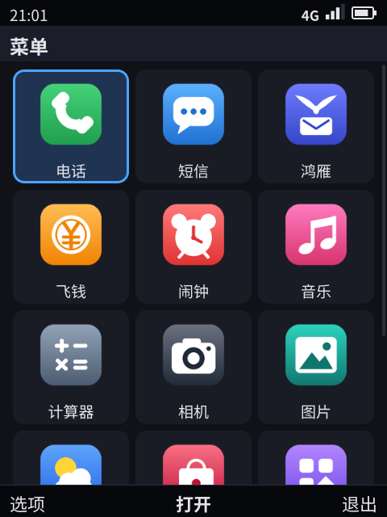
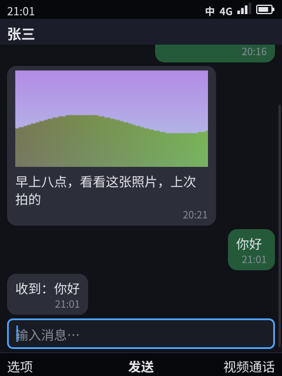
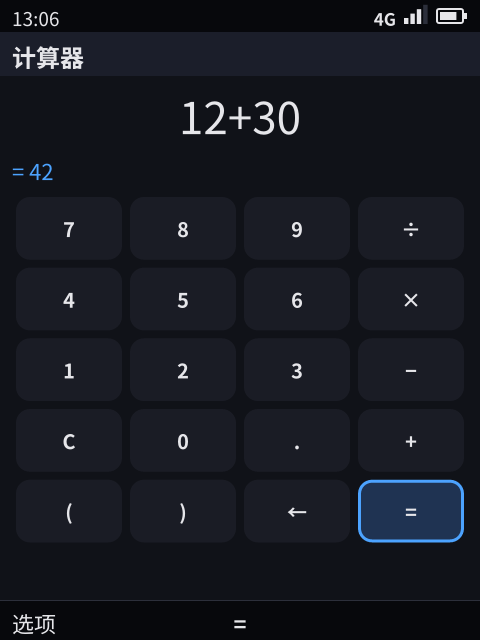
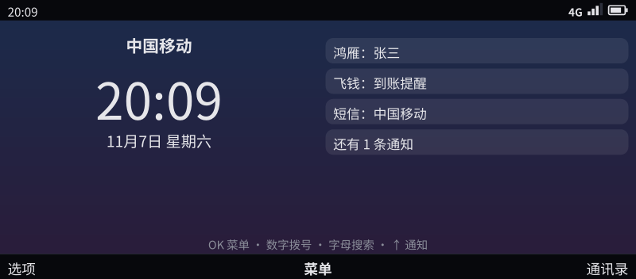

# 渲染器协议（phone.frame/1）：可替换的像素界面

> 像素渲染器是一个**可替换的插槽**。有两个渲染器，都在 kario 里：自研的 phone-paint（Apache-2.0）是设备上的渲染器；phone-gui（Slint，GPL-3.0-only）用来对照它，不进设备镜像（§10）。本文是 Shell 和渲染器之间的协议规范，社区写自己的渲染器也按它。
>
> 状态：协议 v1、握手、版本检查、增量帧（`patch`）、排版回报（`layout`）、媒体帧经共享内存直通（`shm`）、镜像里的插槽、两个渲染器（都有动效）、渲染器沙箱、看门狗、许可证检查已实现。**未实现**：dmabuf（§9）。

## 0. 为什么是一份协议，而不是一个库

| 要求 | 做法 |
|------|------|
| 平台开源，渲染器可以闭源 | 渲染器是**独立程序**，由 Shell 启动，两边只通过本协议交换 JSON 行（标准输入、标准输出）。不链接、不共享库，许可证互不影响（§8） |
| 换渲染器，行为不变 | 焦点、导航、菜单、权限、输入法这些语义全在 Shell。渲染器只做两件事：把帧画出来，把按键交回去。所以同一套自测换个渲染器照样要通过（§6） |
| 不被某个工具包绑住 | 帧里只有语义（标题、条目、输入框、宫格、浮层），没有 Slint 的概念。平台代码不能依赖渲染器是怎么写的 |

渲染器是**受信任的系统组件**：它能看到屏幕上的一切，包括付款码这类安全画面。所以它以系统身份运行，不是应用；安全画面的规则见 §5。

## 1. 进程与传输

- 启动：`phone-shell --gui <程序>`。`--gui auto` 表示镜像里的插槽 `<前缀>/lib/phone/renderer`，它是一个指向实际渲染器的链接。
- Shell → 渲染器：标准输入，每行一条 JSON 消息。
- 渲染器 → Shell：标准输出，每行一条 JSON 消息。
- 标准错误：日志，Shell 写进运行目录的 `gui.log`（设备模式下同时打到控制台）。
- 测试时 Shell 会加参数 `--headless --snap-dir <目录>`：不接显示设备，在内存里画，按要求写 PNG。其他参数由渲染器自己定义。
- 帧里会出现文件路径：应用图标的 PNG。渲染器直接读这些文件。图标来自应用包，所以读之前必须检查大小（≤ 512 KB）和尺寸（≤ 256×256）。相册缩略图和壁纸不给路径：声明了 `shm` 的渲染器从共享内存取（§4.2），其他渲染器的像素直接放在帧里（`pixels`）。
- **Shell 监管渲染器**：渲染器退出（崩溃、被内核结束）后，Shell 重新启动它并发一帧完整的画面；状态全在 Shell，什么也不丢。一分钟内崩溃 3 次，就换到备用渲染器 `<前缀>/lib/phone/renderer-fallback`（装了的话；`--gui-fallback` 可指定），没有备用就放慢节奏继续重启（`shell/watchdog.go`）。

## 2. 握手与版本

Shell 先发 `hello`：

```json
{"t": "hello", "proto": "phone.frame/1", "device": {"id": "bar-t9", "keypad": "t9", "width": 480, "height": 640, "scale": 2}}
```

全键盘的 SKU 在 `device` 里另带 `fn`：Fn 层，按键自己的字符到按住 Fn 时打出的字符（`{"w": "1", ".": "0", ...}`，来自键盘配置的 `[fn]` 表，[24](24-sku-framework.md) §1）。屏幕的模式比形态尺寸大时（开发板接 HDMI 显示器），phone-paint 仍按形态尺寸画，放在屏幕正中。

渲染器回 `ready`：

```json
{"t": "ready", "proto": "phone.frame/1",
 "renderer": {"name": "phone-paint", "version": "0.1.0", "license": "Apache-2.0", "toolkit": "tiny-skia + ab_glyph"},
 "features": ["snap", "images"],
 "display": {"width": 480, "height": 640, "scale": 2}}
```

版本规则：
- `proto` 是 `phone.frame/<主版本>[.<次版本>]`。**主版本必须相同**，否则 Shell 拒绝启动并报出双方的版本；渲染器发现 Shell 的主版本不同，以退出码 3 退出。
- 次版本只加东西：新字段都是可选的，新消息类型对方不认识就忽略。双方都要忽略不认识的字段和消息。
- `ready` 不带 `proto` 的渲染器一律拒绝。10 秒内没有 `ready`，Shell 放弃并关掉它。

`renderer` 里的身份（`name`、`version`、`license`、`toolkit`）会记进 Shell 日志、「关于本机」和兼容测试报告。

`features` 是渲染器声明的能力：

| 功能 | 含义 |
|------|------|
| `snap` | 能按 `snap` 写 PNG 截图。自测和兼容测试的像素检查需要它；没有它时，截图步骤报错而不是悄悄跳过 |
| `kms` | 自己驱动显示（DRM/KMS） |
| `keys` | 自己读键盘，把按键发给 Shell |
| `images` | 能画 `image` 字段（像素图）和 PNG 路径 |
| `anim` | 有动效（焦点移动、浮层出现）。没有动效的渲染器照样合格 |
| `sandboxed` | 打开显示和输入设备之后已经降权：没有网络、不是 root、不能再提权（§5） |
| `landlock` | 文件访问也被 Landlock 限制在字体和图标目录（§5） |
| `seccomp` | 系统调用过滤，至少拒绝运行程序（§5） |
| `patch` | 收得了 `patch` 消息（§3）：Shell 改发增量 |
| `layout` | 每排好一帧、几何变了，就发 `layout`（§3）。没有它照样合格 |
| `shm` | 从侧通道（`hello` 的 `side_fd`）收媒体表面，按帧里的 `surface` 从共享内存取像素（§4.2）。没有它，Shell 照旧把像素放进帧里 |
| `power` | 收得了 `power`：按 Shell 的意思关掉、打开面板（phone-paint 关掉 CRTC，面板驱动随之给面板和背光断电），关着时不画帧，打开时画关着期间收到的最后一帧 |
| `mouse` | 鼠标当按键用：滚轮上下（横向滚轮左右）移动焦点，左键 OK，右键返回，中键选项。键盘和鼠标开机后插上也认（§5） |
| `pointer` | 鼠标有指针：一动就画出来，打字时隐去；指针在时左键点在正文节点上发 `tap`，点在软键栏上发对应的软键（左 `tab`、中 `enter`、右 `f2`），有浮层时发 `enter`，指针不在时左键仍是 `enter`。Shell 不需要它也照样工作 |

`display` 是渲染器**实际**驱动的面板。设备上以显示模式为准，不以设备档案为准。渲染器启动时不知道尺寸，可以先不带；知道或者变化时，再发一条 `display` 消息。Shell 的版面决定（例如宫格列数：竖屏 3 列、宽屏 5 列）随它调整。

## 3. 消息

| 方向 | `t` | 字段 | 说明 |
|------|-----|------|------|
| Shell → 渲染器 | `hello` | `proto`、`device`、`side_fd` | 第一条消息；`side_fd` 是渲染器继承的侧通道（§4.2） |
| | `frame` | 见 §4 | 完整的一帧。内容变了才发 |
| | `patch` | `patch` | 增量的一帧：对上一帧的 JSON 合并补丁（RFC 7386），只发给声明了 `patch` 的渲染器（§4.1） |
| | `snap` | `name`、`echo` | 把当前画面写成 `<name>.png`，画完、动效停下后再写。`echo` 为 true 时，回复里带上渲染器手里的帧 |
| | `quit` | — | 退出。3 秒不退，Shell 结束它 |
| | `power` | `on` | 面板开（true）或关（false）：屏幕超时、按键唤醒（Shell 的屏幕管理，[11](11-platform-architecture.md)）。只发给声明了 `power` 的渲染器 |
| 渲染器 → Shell | `ready` | `proto`、`renderer`、`features`、`display` | 对 `hello` 的回答 |
| | `display` | `display` | 面板尺寸变了 |
| | `key` | `key`、`text`、`long` | 一次按键 |
| | `power` | `on`、`err` | 对 `power` 的回答：面板现在的状态；`err` 非空表示没关成 / 没开成 |
| | `input` | `name`、`kind`、`added` | 一个键盘（`keyboard`）或鼠标（`mouse`）接上（`added` 为 true）或拔掉了，比如 USB-C 上的外接键盘 |
| | `snapped` | `name`、`err`、`frame` | `snap` 完成；`err` 非空表示失败；`frame` 是要求 `echo` 时渲染器合并出来的帧 |
| | `tap` | `screen`、`node`、`tile` | 指针点在帧 `screen` 正文的第 `node` 个节点上（网格里是第 `tile` 个图块，别的节点是 0）。Shell 把焦点移过去再当 OK 处理；`screen` 不是它最后发的那一帧、有对话框、键盘锁着，或者那个节点不能获得焦点时不理 |
| | `layout` | `layout`：`screen`、`area`、`offset`、`nodes` | 刚排好的帧的几何（逻辑像素）：正文区高度、滚动偏移、`body` 里每个节点的 `y`（相对正文顶端）和 `h`。渲染器声明了 `kms`（它就是屏幕）时，Shell 用它判断焦点节点是否比正文区高、在里面每次滚多少（可视区的 80%，相邻两屏留重叠），不再按文本排版估算；以后也给无障碍和触摸用 |

按键：
- 功能键放在 `key`：`enter`、`esc`、`tab`、`up`、`down`、`left`、`right`、`backspace`、`f2`、`f3`、`f4`（也可以写 `end`，挂断键）、`call`（通话键）、`ime`（中 / 英）、`sym`（符号）。
- 字符键 `key` 为空，字符放在 `text`。
- 长按：`long` 为 true，九宫格上按住 600 ms 算长按。
- 按键的含义（打字、导航、软键）全由 Shell 决定，渲染器只负责如实上报。

## 4. 帧

每一帧描述完整的画面。Shell 只在内容变化时发送；渲染器声明了 `patch` 时，可能改发对上一帧的补丁（§4.1）。

| 字段 | 说明 |
|------|------|
| `t` | 固定为 `frame` |
| `screen` | 当前界面的编号（调试和截图用） |
| `status` | 状态栏，见下 |
| `title` | 标题栏 |
| `loading` | 非空时显示加载提示 |
| `body` | 节点列表，见下 |
| `focus` | 获得焦点的节点在 `body` 里的序号，-1 表示没有 |
| `scroll` | 滚动位置：`pos`（0 顶部到 1 底部）、`frac`（焦点节点比屏幕还高时，在节点内部的位置，否则 -1） |
| `soft` | 三个软键的文字：左、中、右 |
| `ime` | 输入法的候选行，见下 |
| `toast` | 短暂提示 |
| `banner` | 通知横幅的几行文字 |
| `overlay` | 系统浮层，见下；有浮层时它盖在一切之上 |
| `boot` | 开机画面：`progress`（0–1）、`brand`（系统名） |
| `idle` | 待机界面：`time`、`date`、`operator`、`lines`（主动待机信息）、`hint`；`wallpaper`：壁纸（像素图，屏幕大小，只经共享内存给声明了 `shm` 的渲染器；键盘锁着时是锁屏壁纸）。有壁纸时文字一律用白色，上面压一层从上往下变淡的黑色 |
| `layout` | 正文内容比正文区短时放在哪：空（顶部）、`center`（居中稍偏下，留出的空白 55% 在上面，音乐的正在播放、看图）、`bottom`（贴底，计算器） |
| `theme` | 配色：空（深色）、`light`（浅色）、`retro`（复古绿）、`amber`（琥珀）。设置 › 主题改它；渲染器按它换整套颜色，照片和网页不变 |
| `zoom` | 设置 › 大字号：大于 0 时渲染器把整帧放大这么多倍（缩放比例乘上它，逻辑尺寸相应变小），排版回报按放大后的尺寸算；没有时是正常大小。phone-paint 处理，phone-gui 忽略 |

`status`（状态栏）：`time`；`mid`（中间的指示文字）和 `mid_kind`（`call` 通话、`secure` 安全画面、`mic` 录音、`location` 定位，渲染器按它选颜色）；`ime`（输入法状态）；`net`；`signal`（0–4 格）；`battery`（百分比）；`charging`（接着电源，可选）；`locked`（键盘锁，画一把锁）。

`body` 里的节点（`FrameNode`）：

| 字段 | 说明 |
|------|------|
| `kind` | `text`、`section`、`item`、`input`、`button`、`image`、`media`、`doc`、`progress`，以及 Shell 合成的 `grid`（宫格）和 `bubble`（聊天气泡）。`bubble` 的正文在 `title`（同时有 `text` 时，`text` 是正文，`title` 是发送者），时间和状态在 `subtitle` / `trailing`，`out` 表示自己发出 |
| `style` | 文字样式：`dim`、`accent`、`title`、`ok`、`warn`、`big`、`display`（计算器的结果：按屏宽放到最大、右对齐） |
| `text`、`title`、`subtitle`、`trailing`、`badge`、`icon`、`label` | 文字内容；`icon` 是文本界面用的单字图标 |
| `icon_image` | 图标的 PNG 路径（系统列出应用时） |
| `placeholder`、`value`、`preedit`、`secret` | 输入框：提示、内容、输入法正在拼的部分、是否按密码显示 |
| `out` | 气泡是自己发出的 |
| `focused` | 有焦点 |
| `image`、`pip` | 像素图（见下）；`pip` 是视频通话里的小窗 |
| `waiting` | 媒体还没到时的提示 |
| `fill` | 图像占满正文区（网页），不按图片的高度上限缩小 |
| `doc` | 文档：按行排好的文字段，每段（`FrameRun`）有 `text`、`col`（起始列）、`width`、`box`（框线字符）、`fg`、`bg`、`bold`、`italic`、`under` |
| `columns`、`tiles`、`sel` | 宫格：列数、格子、选中的格子（-1 表示没有） |
| `fraction` | 进度条的比例（0–1） |

宫格的格子（`FrameTile`）：`icon`、`image`（PNG 路径，有它就不画 `icon`）、`pixels`（像素图，格式同 `FrameImage`；照片缩略图用它，渲染器不直接读相册文件）、`title`、`badge`、`focused`；`photo`：这一格是照片或视频（图片应用的网格），图铺满格子、不画标题，焦点是一圈描边，`badge` 画在图上（视频的时长）。照片格子离焦点所在行超过 4 行时不带 `pixels`，画一个空格子：帧的大小只跟一屏有关，跟相册有多少张无关。

像素图（`FrameImage`）：`w`、`h`、`rgb`（base64，`w × h × 3` 字节）、`secure`（安全画面，见 §5）、`pixelated`（放大时不平滑）；或者 `surface`、`seq`：像素在共享内存里（§4.2），不带 `rgb`。应用的画布节点（`canvas`，[22](22-developer-api.md) §3）由 Shell 画成像素，到渲染器这里就是一个 `image` 节点（`pixelated`，一个单位一个像素），渲染器不用认识画布。

输入法的候选行（`FrameIMERow`）：`items`、`sel`、`active`（当前在选这一行）、`numbered`（按数字选）、`more`（还有下一页）。

浮层（`FrameOverlay`）：

| 字段 | 说明 |
|------|------|
| `kind` | `menu`、`confirm`、`perm`、`auth`、`scan`、`capture`、`picker`、`incoming`、`alarm` |
| `title`、`lines`、`warn`、`note`、`note_bad`、`footer` | 文字；`note_bad` 表示提示是错误 |
| `items`、`query` | 菜单项（`FrameMenuItem`：`header` 分组标题、`text`、`key` 快捷键、`sel` 选中）；命令面板的搜索词。权限框（`perm`）也用 `items` 列出请求的每一项权限，必须逐项画出来 |
| `choices`、`choice` | 按钮和当前选中的按钮 |
| `pin` | 可信确认的密码位数：已输入、总长度 |
| `image`、`phase` | 取景框画面；动画位置 0–1（扫描线、来电），-1 表示没有 |
| `tiles`、`columns` | 选择器和分享面板的宫格 |

规则：
- 渲染器必须画出所有节点类型和浮层类型。遇到不认识的类型（新的次版本），至少把它的文字画出来，不能整个丢掉。
- 浮层是系统界面：永远画在最上层，应用内容不能盖住它。

### 4.1 增量帧（`patch`）

- 补丁是 JSON 合并补丁（RFC 7386）：只列变了的成员；值为 `null` 表示删掉这个成员；对象逐个成员合并；数组和其他值整个替换。
- 渲染器保存上一帧的 JSON，收到 `patch` 后合并，再按 §4 解析。重启后的渲染器先收到一个完整的 `frame`。
- 一个扩展：长度不变的数组按元素打补丁，写成 `{"$set": {"<下标>": <元素的补丁>}}`。焦点在宫格里移动时，只发两个元素的 `focused` 变化，不重发整排缩略图。帧里不会出现名为 `$set` 的成员，所以不会和普通内容混淆。
- Shell 只在补丁比整帧小时才发补丁，所以 `frame` 和 `patch` 会交替出现。
- **端到端核对**：对声明了 `patch` 的渲染器，Shell 每次 `snap` 都带 `echo`，渲染器把合并出来的帧放进 `snapped`，Shell 和自己的帧逐字段比较，不一致就让这一步失败。自测里的每个截图步骤都顺带检查了补丁。
- 效果：开发机上整套自测（直板九宫格，phone-paint），345 帧里 343 帧作为补丁发送，共 5.2 MB，整帧要 9.8 MB。状态栏时钟、动画的相位、输入法候选、宫格里的焦点这类小变化只发几十个字节；剩下的大头是视频通话的画面，每帧都在变，由共享内存直通解决（§4.2）。

### 4.2 媒体表面（`shm`）

视频画面不放进帧里：

- **共享内存**：mediad 为每路视频建一块 memfd：32 字节的头（`PHSURF1\0`、宽、高、最新的格、两格的帧号，小端），后面两格 RGB。mediad 写不在显示的那一格，写完再切过去；大小封死，读的一方映射后不会失效。读的一方取最新那格，拷贝前后对一次帧号（中途被覆盖要连写两帧，15 帧每秒时几乎不会发生），对不上就重拷。
- **交接**：Shell 向 mediad 订阅 `surface`，收到 fd；经侧通道发给渲染器一条 `{"t": "surface", "id", "w", "h"}`，fd 随消息（`SCM_RIGHTS`），每个表面只发一次，渲染器重启后重发。侧通道是 Shell 启动渲染器时建的 `SOCK_SEQPACKET` 套接字对，渲染器继承为 fd 3，降权、seccomp（禁止新建套接字）之后照样能收。
- **每帧**：mediad 只告诉 Shell 新帧号（4 个字节），Shell 在帧里写 `{"surface": id, "seq": n}`，补丁只有几十个字节；渲染器按 `surface` 从共享内存取像素。
- **效果**：同一段视频通话（开发机，直板九宫格），走共享内存时发给渲染器 54 KB，走 base64（渲染器没有 `shm`）534 KB。两个渲染器都声明 `shm`；文本界面仍按旧路订阅整帧。
- **网页**：`web` 节点在帧里是 `kind: "media"`、`fill: true`，表面名 `web:<应用>/<界面>/<节点>`。表面由网页视图进程 `phone-webview` 建，布局相同，经它和 Shell 之间的控制通道交给 Shell，Shell 照上面的方式转给渲染器；没有 `shm` 的渲染器收到 base64 的整帧。
- **同名表面换了内存**（同一个节点打开了新的页面）：Shell 记着每个表面名发出去的是哪块共享内存（按 inode），变了就重发一次 `surface`；渲染器收到同名表面时换成新的映射、解除旧的。
- **Shell 自己的表面**：照片缩略图（`thumb:<照片>@<边长>`，按宫格一格的大小裁好）和壁纸（`wallpaper:idle`、`wallpaper:lock`，屏幕大小）由 Shell 建、写一次。换了壁纸，`seq` 加一，帧就变了，新表面随之发出。视频（`video.open`）的画面是 mediad 的表面，表面名是播放器的编号。
- **不再用的表面**：一帧不再提到某个表面，Shell 在这一帧之后经侧通道发 `{"t": "drop", "id"}`（不带 fd），渲染器解除映射；以后又要用时 Shell 重发 `surface`。Shell 那边，缩略图表面在不再出现的那一帧就关掉，所以翻过去的照片不占内存。

## 5. 安全要求

- **安全画面**：`secure` 为 true 的像素图（付款码）在截图里必须遮挡。状态栏 `mid_kind` 为 `secure`，表示当前是安全画面（付款码、可信确认），要用醒目的颜色提示。除了显示面板，渲染器不能把画面交给任何别的进程。
- **按键只来自键盘**：渲染器不能自己合成按键。
- **浮层不能被盖住**（§4）。
- **渲染器要降权**：它能看到付款码，又要解码应用包里的图标，是攻击面。两个渲染器都做了四层，自检通过才在 `features` 里报出来：
  | 层 | phone-paint | phone-gui |
  |----|-------------|-----------|
  | `sandboxed`：空网络命名空间、nobody、no_new_privs | 以 root 打开显卡之后降权；键盘鼠标由降权前分出的输入助手打开 | 一启动就降权，只保留 video、input 两个组；显卡由第一个打开它的进程自动成为 DRM master，不需要 root；键盘由 libinput 自己打开 |
  | `landlock`：文件白名单 | 只读 `/usr`、已安装应用的图标目录 | 再加 libinput 要读的 `/sys`、`/run/udev`、`/etc/udev`，以及读写 `/dev/dri`、`/dev/input` |
  | `seccomp`：系统调用过滤 | 应用沙箱拒绝的那些，加上 `execve`、`socket`、`fork` | 应用沙箱拒绝的那些，加上 `execve`（libinput 要用 netlink 套接字，不能拒绝 `socket`；没有网络由网络命名空间保证） |
  | 自检 | 读不到 `/etc/shadow`、`/etc/passwd`，连不上本机端口，`socket()` 被拒 | 读不到 `/etc/shadow`、`/etc/passwd`，连不上本机端口，`ptrace` 被拒 |
  照片缩略图和壁纸由 Shell 给像素（内嵌或共享内存），渲染器读不到相册。
- **后插上的键盘鼠标**：phone-paint 降权以后打不开 `/dev` 下的任何东西，所以降权前分出一个输入助手进程（`paint/src/input.rs`，和 seatd、logind 给合成器开设备的做法一样）：它用 inotify 看 `/dev/input`，打开新的键盘鼠标，经套接字把文件描述符交给渲染器。助手自己只留读设备节点的能力（`CAP_DAC_READ_SEARCH`），以 nobody 运行，没有网络，Landlock 只放行 `/dev/input`，关掉继承来的其他描述符（显卡的也在内），而且不从渲染器读任何东西：渲染器被攻破也没法让它打开别的文件。

## 6. 一致性检查：换渲染器时跑什么

| 检查 | 命令 | 证明什么 |
|------|------|----------|
| 完整自测 | `phone-shell --selftest --gui <渲染器> --device <形态> --pixel-dir <目录>` | 每个用例在这个渲染器下都通过，每个截图步骤都出图（需要 `snap`） |
| 兼容测试 | `phone-shell --cts <报告> --gui <渲染器>` | 报告的 `renderer` 字段记下渲染器的身份和功能，随报告一起签名 |
| 握手 | `go test ./shell -run TestRendererHandshake` | 同主版本能接上，主版本不同、不报版本都被拒绝 |
| 文档 | `go test ./shell -run TestRendererDoc` | 帧里的每个字段、每种消息都写进了本文 |
| 看门狗 | 自测用例「渲染器崩溃」（`gui-crash`） | 渲染器被杀掉后，看门狗启动新进程、重新握手、补发当前整帧，之后的截图照常；开发机和设备开机自测都跑 |

## 7. 在镜像里换渲染器（Yocto）

- `phone-renderer` 是一个虚拟的运行时包名，镜像只要求有它（`PHONE_IMAGE_PACKAGES`）。
- phone-paint 和 phone-gui 的配方都 `RPROVIDES` 并 `RCONFLICTS` 它，安装 `/usr/lib/phone/renderer` 链接。两个配方互相冲突，一个镜像里只有一个渲染器。Shell 的 `--gui-fallback auto` 会找 `/usr/lib/phone/renderer-fallback`，设备上只有 phone-paint，没有配方装它。
- `yocto/kas/phone-qemuarm64.yml`：`PREFERRED_RPROVIDER_phone-renderer = "phone-paint"`，镜像零 GPLv3；kario-internal 的产品镜像用同一份配置。对照用的 `yocto/kas/phone-gui.yml`（`make yocto-build KASEXTRA=yocto/kas/phone-gui.yml`）用 `:forcevariable` 换成 phone-gui（kas 按名字排序写入各段，不加会被覆盖），它是这个镜像里唯一允许的 GPLv3 包（`INCOMPATIBLE_LICENSE_EXCEPTIONS`；bitbake 的 `license-exception` 检查只报告、不判定失败），只用来测试，不出货。
- 显示服务 `phone-display.service` 属于 phone-fw，用 `--gui auto` 启动插槽里的渲染器；开机自测也一样。
- **镜像不含 GPLv3**：`INCOMPATIBLE_LICENSE = "GPL-3.0* LGPL-3.0* AGPL-3.0*"`，不用承担 GPLv3 第 6 条「安装信息」的义务。内核、busybox 等 GPLv2 组件的源码义务照旧；libgcc、libstdc++ 带 GCC 运行库例外，允许任何程序使用。Poky 加 systemd 里要处理的阻碍（都写在 `kas/phone-qemuarm64.yml` 的 `no-gplv3` 段，每条一个）：
  - GNU tar：基础包组和 systemd 要它，busybox 代替（oe-core 的 `no-gplv3.inc`）；
  - 测试包（ptest）要 make、bash、coreutils 一类：关掉 ptest；
  - bash：alsa-utils 的辅助脚本、systemd 的 kernel-install、e2fsprogs 的 e2scrub、opkg-utils、bash 补全、libpam 的测试包都要它，镜像都不装，去掉依赖并跳过脚本解释器检查；
  - gdbm：Python、Perl 的 gdbm 模块关掉；systemd 的 ukify、glib 的代码生成器、openssl 的 Perl 脚本、opkg-utils 的 Python 部分都不装，去掉它们对 Python、Perl 的依赖；
  - 含 GPLv3 部分的子包（bzip2 的语言文件、部分 kbd 键盘布局）直接排除，QA 只报警告。
  - 结果：镜像 104 个包，开机自测、兼容测试、声卡检查、DRM 上屏全部通过（[13](13-prototype.md) §5）。
- **产品层**（闭源，单独的仓库）：出厂配置（产品镜像的 kas 配置、云端服务的地址和信任根）✓；机型 BSP **未实现**（R16）。

## 8. 许可边界

| 部分 | 许可 | 位置 |
|------|------|------|
| 平台：Shell、系统服务、SDK、应用、telephonyd、Yocto 层 | Apache-2.0 | `LICENSE` |
| phone-paint | Apache-2.0；依赖全是宽松许可证 | `LICENSE` |
| phone-gui | GPL-3.0-only（`gui/COPYING`），Slint 用它的 GPLv3 选项 | `gui/LICENSE` |

- `make license-check`（也在 `make test` 里）核对：
  - 平台的每个 Go 依赖都是宽松许可证。没有许可证文件的依赖要人工核实后登记（如 `go-localereader`，README 写明 MIT）。
  - phone-paint 的每个 Rust 依赖都有宽松许可证的选项。
  - phone-gui 是 GPL-3.0-only，每个 Rust 依赖都有 GPL-3.0 能用的选项（宽松许可证，或 GPL-3.0 本身：Slint 的 crate）。
- 拆出去的平台仓库里没有渲染器，许可证检查只查平台部分。
- 应用和渲染器之间隔着 Shell：应用只讲 `phone.Ui`，从不接触渲染器，所以渲染器用什么许可都不影响应用（58（内部文档） §3.2）。

## 9. 还没做的

| 内容 | 说明 |
|------|------|
| GPU 渲染 | 要真机（R21） |
| dmabuf（R21） | 视频帧用 dmabuf 直接上 DRM 平面（硬件合成），连渲染器的拷贝也省掉；要真机 |

## 10. 两个渲染器

| 项 | phone-paint（设备上） | phone-gui（对比用，GPLv3） |
|----|---------------------|-------------------|
| 绘制 | tiny-skia（形状、图片）加 ab_glyph（文字） | Slint 的软件渲染器 |
| 依赖 | 74 个 crate，全部有宽松许可证的选项 | 491 个 crate；12 个 Slint crate 按 GPL-3.0，其余宽松 |
| 许可 | Apache-2.0 | GPL-3.0-only；不进设备镜像 |
| 镜像 | `yocto/kas/phone-qemuarm64.yml` | 再加 `yocto/kas/phone-gui.yml`（对照用） |
| 程序大小、代码量 | 约 1.4 MB；Rust 约 2,750 行 | 约 8.7 MB；Rust 加 Slint 约 2,600 行 |
| 能力 | 无界面模式 `snap`、`images`、`patch`、`layout`、`power`、`shm`；设备上 `kms`、`keys`、`images`、`patch`、`anim`、`layout`、`power`、`mouse`、`pointer`、`shm`、`sandboxed`、`landlock`、`seccomp`（DRM/KMS dumb buffer 加 evdev，不依赖 libinput 和 xkb） | 无界面模式 `snap`、`images`、`anim`、`patch`、`layout`、`shm`；设备上 `kms`、`keys`、`images`、`anim`、`patch`、`layout`、`shm`、`sandboxed`、`landlock`、`seccomp`（排版几何取自 Slint 布局里每个节点的位置） |
| 设计 | 平面、高对比、按网格对齐；焦点渐变（120ms）、滚动缓动（140ms）；设计系统定稿：四套主题的配色、十级字号、间距、圆角和对比度规则，代码和文档由测试对上（[26](26-design-system.md)） | 圆角卡片、动效；四套主题（前十种颜色和文本界面同一份色板，另有卡片、分隔线、气泡、状态色和待机渐变），来电、闹钟、开机、安全遮挡这些固定深色的画面不随主题变 |

验证：同一套自测在两个渲染器、三种形态下全部通过（`make pixel-selftest` 是 phone-paint，`make gui-selftest` 是 phone-gui）；设备上两种镜像的开机自测、兼容测试、DRM 上屏都通过，报告里的 `renderer` 是插槽里的那一个，签名核对通过（当前基线见 57（内部文档））。

| 主菜单（直板九宫格） | 鸿雁 | 设备 DRM 上屏：计算器 | 横屏宽键盘：待机 |
|:--:|:--:|:--:|:--:|
|  |  |  |  |

设备模式下，phone-paint 记着屏幕上现在的画面，新的一帧只把变了的矩形拷进 dumb buffer，DirtyFB 也只报这一块（`kms.rs` 的 `damage`）；画面没变就什么都不做。virtio-gpu 这类按需刷新的驱动，写完 dumb buffer 必须调用 DirtyFB，否则屏幕一直是黑的。

**自己写渲染器的工作量不大**：协议是语义层的，节点和浮层合起来不到二十种；中文不需要复杂的字形排版，按字符排列就行。所以不需要复制或改进 Slint，按我们的协议从头写一个专用渲染器就够了，著作权完全在我们手里。
