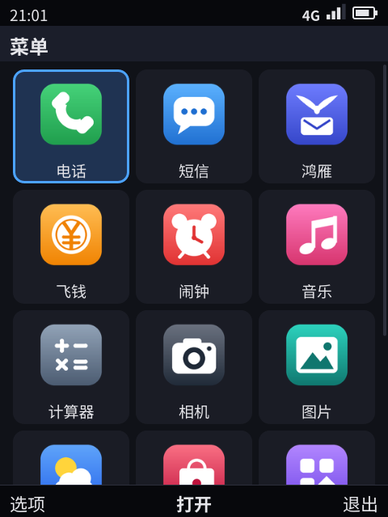
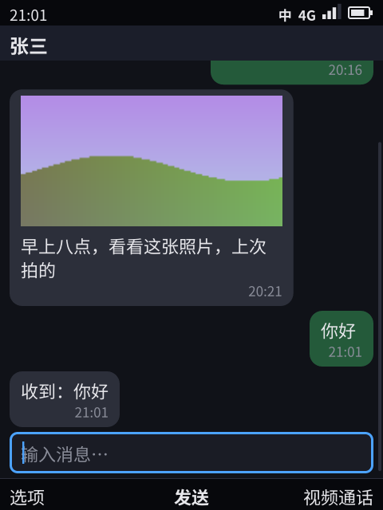
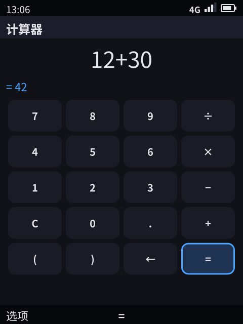
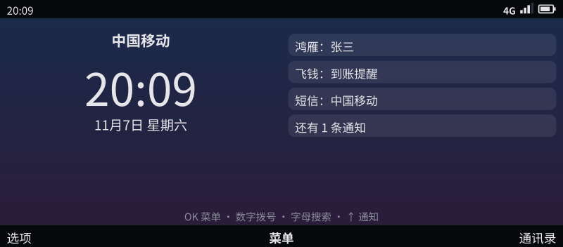

# 渲染器协议（phone.frame/1）：可替换的像素界面

> 像素渲染器是一个**可替换的插槽**。有两个渲染器，都在 kario 里：自研的 phone-paint（Apache-2.0）是设备上的渲染器；phone-gui（Slint，GPL-3.0-only）用来对照它，不进设备镜像（§10）。本文是 Shell 和渲染器之间的协议规范，社区写自己的渲染器也按它。
>
> 状态：协议 v1、握手、版本检查、增量帧（`patch`）、排版回报（`layout`）、媒体帧经共享内存直通（`shm`）、镜像里的插槽、两个渲染器（都有动效）、渲染器沙箱、看门狗、许可证检查、刷新率（`rate`、`motion`，phone-paint）已实现；phone-paint 可选的 GPU 合成（`gpu`）只在 QEMU 上用软件 GPU 验证过（[42](42-gpu-rendering.md) §7），可选的在 GPU 上栅格化只在开发机的 llvmpipe 上验证过；这两样和真机上切换刷新率**未上真机**。设置 › 辅助功能的高对比度文字、粗体文字、颜色反转和校正、放大（帧里的字段，§4）和按键的计时（`keys` 消息，§3）2026-11-21 实现，phone-paint 处理（颜色滤镜和放大只在 CPU 路径上，§4），单元测试 ✓，**未上真机**；phone-gui 不处理（**未实现**）。触摸屏（功能 `touch`、消息 `touch`，§2、§3）2026-11-25 实现：phone-paint 读有触摸屏的 SKU 的触摸屏，跟着一根手指，把它放到画面上、说按在什么上，Shell 换成按键（[10](10-keyboard-interaction-model.md) §2.1）；单元测试 ✓，QEMU 上 ✓（virtio 多点触摸设备：画面板的 phone-paint 读它，`make yocto-gui`；开机自测的两个触摸用例），一加 6T 上**未上真机**；phone-gui 不读触摸屏（**未实现**）。**未实现**：dmabuf（§9）。

## 0. 为什么是一份协议，而不是一个库

| 要求 | 做法 |
|------|------|
| 平台开源，渲染器可以闭源 | 渲染器是**独立程序**，由 Shell 启动，两边只通过本协议交换 JSON 行（标准输入、标准输出）。不链接、不共享库，许可证互不影响（§8） |
| 换渲染器，行为不变 | 焦点、导航、菜单、权限、输入法这些语义全在 Shell。渲染器只做两件事：把帧画出来，把按键交回去。所以同一套自测换个渲染器照样要通过（§6） |
| 不被某个工具包绑住 | 帧里只有语义（标题、条目、输入框、宫格、浮层），没有 Slint 的概念。平台代码不能依赖渲染器是怎么写的 |

渲染器是**受信任的系统组件**：它能看到屏幕上的一切，包括付款码这类安全画面。所以它以系统身份运行，不是应用；安全画面的规则见 §5。

## 1. 进程与传输

- 启动：`phone-shell --gui <程序>`。`--gui auto` 表示镜像里的插槽 `<前缀>/lib/phone/renderer`，它是一个指向实际渲染器的链接。
- Shell → 渲染器：标准输入，每行一条 JSON 消息。
- 渲染器 → Shell：标准输出，每行一条 JSON 消息。
- 标准错误：日志，Shell 写进运行目录的 `gui.log`（设备模式下同时打到控制台）。
- 测试时 Shell 会加参数 `--headless --snap-dir <目录>`：不接显示设备，在内存里画，按要求写 PNG。其他参数由渲染器自己定义。
- 帧里会出现文件路径：应用图标的 PNG。渲染器直接读这些文件。图标来自应用包，所以读之前必须检查大小（≤ 512 KB）和尺寸（≤ 256×256）。相册缩略图和壁纸不给路径：声明了 `shm` 的渲染器从共享内存取（§4.2），其他渲染器的像素直接放在帧里（`pixels`）。
- **Shell 监管渲染器**：渲染器退出（崩溃、被内核结束）后，Shell 重新启动它并发一帧完整的画面；状态全在 Shell，什么也不丢。一分钟内崩溃 3 次，就换到备用渲染器 `<前缀>/lib/phone/renderer-fallback`（装了的话；`--gui-fallback` 可指定），没有备用就放慢节奏继续重启（`shell/watchdog.go`）。

## 2. 握手与版本

Shell 先发 `hello`：

```json
{"t": "hello", "proto": "phone.frame/1", "device": {"id": "bar-t9", "keypad": "t9", "width": 480, "height": 640, "scale": 2}}
```

全键盘的 SKU 在 `device` 里另带 `fn`：Fn 层，按键自己的字符到按住 Fn 时打出的字符（`{"w": "1", ".": "0", ...}`，来自键盘配置的 `[fn]` 表，[24](24-sku-framework.md) §1）。读键盘的渲染器按诺基亚的习惯处理 Fn：按住时、点一下以后的下一个键、快速点两下锁定以后的每个键都打出 Fn 层的字符，再点一下解锁；状态变了就报给 Shell（§3 的 `fn-once`、`fn-lock`、`fn-off`），Shell 在状态栏显示。Shift 一样：按住时大写，点一下只管下一个字母，快速点两下锁定大写（`shift-once`、`shift-lock`、`shift-off`）。有 Fn 层字符的键不连发：按下时照常报字母，按住 600 ms 时再报一次长按，带 `retype`（这个字母按下时已经报过），由 Shell 换成 Fn 层的字符（文字框里，诺基亚 E71 的另一种出数字的办法）。键盘配置没有 Ctrl 键时 `device` 另带 `ctrl`：哪个组合当 Ctrl 用（`"fn+sym"`：先按 Fn + Sym，下一个键就是 Ctrl + 这个键，照 E71）。编辑文字的组合键由渲染器翻成键名报给 Shell（§3；各键做什么见 [18](18-nokia-form-factors.md) §4.2）。phone-paint 这样做，phone-gui 不处理 Fn 层和这些组合（**未实现**）。自带键盘的整机（KaiOS 一类的矩阵键盘）的 `device` 另带 `keymap`：这台手机报的键码 → 读成的键码（`{"139": 59, "2": 513}`：`KEY_MENU` 当 `KEY_F1`，`KEY_1` 当 `KEY_NUMERIC_1`，来自板子的 `[keymap]`，[24](24-sku-framework.md) §7.4）；读键盘的渲染器先查它再照常处理，表里没有的键码照原样读，有表里任何一个键的输入设备都当键盘。phone-paint 这样做，phone-gui 不读它（**未实现**）。显示屏有触摸屏的 SKU（`sku.json` 的 `touch`，[24](24-sku-framework.md) §7.4）的 `device` 另带 `touch: true`：读输入设备的渲染器这时才读触摸屏（§3 的 `touch`）；没有它时触摸屏既不当键盘、也不当鼠标（QEMU 的多点触摸设备报 `BTN_LEFT`），不读。屏幕的模式比形态尺寸大时（开发板接 HDMI 显示器），phone-paint 仍按形态尺寸画，放在屏幕正中。板子在 `sku.json` 里写了 GPU 的做法时，`device` 另带 `gpu`（没设 `PHONE_PAINT_GPU` 时 phone-paint 默认走哪条路：`compose`、`raster`，没有就是 CPU）和 `gpu_render`（显示设备不能渲染时 GPU 的 render node 的内核驱动名），见 [42](42-gpu-rendering.md) §3、§4；phone-gui 不读（**未实现**）。

有硬件声音开关的 SKU（`sku.json` 的 `sound_switch`，[24](24-sku-framework.md) §7.4）在 `device` 里另带 `sound_switch`：开关的输入设备名（一加 6T 是 `"Alert slider"`）。读输入设备的渲染器打开这个名字、报 `ABS_SND_PROFILE`（三档的滑块）或开关 `SW_MUTE_DEVICE`（两档的静音开关：置位是 `silent`，否则 `ring`）的设备，不当键盘：启动时用 `EVIOCGABS` 或 `EVIOCGSW` 读它在哪一档，之后每拨一下，发 `sound_switch`（§3）给 Shell；它不算 `input` 里的设备（phone-paint 的 `paint/src/sound_switch.rs`，Rust 单元测试 ✓，**未上真机**；phone-gui 不读它）。不认识这个字段的渲染器不读开关，Shell 照旧按「静音模式」的设置（[20](20-audio.md) §4.1）。

读键盘的渲染器按 Shell 的 `keys` 消息（§3，设置 › 辅助功能）给按键计时：按住的键由渲染器自己重复（重复延迟、每秒几次，0 是不重复；内核自己的重复丢掉，所以没有自动重复的键盘也会重复），长按到了时间就报，不管这个键重复不重复（九宫格的数字、带 Fn 层字符的字母、挂断键、Backspace 的删词）；慢速键：按住这么久才算按下，之前松开的当没按过；粘滞键：Shift 在任何键盘上都像诺基亚的那样点一下管下一个字母、点两下锁定（没有 Fn 层的 USB 键盘也一样，Shift 点一下再按方向键是选字），Ctrl、Alt 点一下管下一个键。Alt + 一个键（或粘滞键时先点 Alt）报这个键的长按（`long`），和终端里一样；Alt + Backspace 是按住的 Backspace。电源键的长按不跟设置走，固定 600 ms。两个音量键同时按下是辅助功能快捷方式：先按下的那个照常调了一格音量，第二个按下后两个键的重复都不再调音量，松开一个时报 `a11y`，两个一起按住到长按的时间报 `a11y` 带 `long`（只报一次）。phone-paint 这样做（`paint/src/keygate.rs`、`kms.rs`），**未上真机**；phone-gui 不处理 `keys`（**未实现**）。

渲染器回 `ready`：

```json
{"t": "ready", "proto": "phone.frame/1",
 "renderer": {"name": "phone-paint", "version": "0.1.0", "license": "Apache-2.0", "toolkit": "tiny-skia + ab_glyph"},
 "features": ["snap", "images"],
 "display": {"width": 480, "height": 640, "scale": 2}}
```

版本规则：
- `proto` 是 `phone.frame/<主版本>[.<次版本>]`。两边说同一个主版本：Shell 在 `hello` 里给出它说的，渲染器在 `ready` 的 `proto` 里说它选了哪个，此后两边都按它说。Shell 只说一个主版本时（现在，`phone.frame/1`）`hello` 只带 `proto`；换主版本的过渡期里 Shell 同时说前一个主版本，至少一个发布版，`hello` 的 `proto` 写其中最老的（不会协商的渲染器只看它），`protos` 从新到旧列出全部：`{"proto": "phone.frame/1", "protos": ["phone.frame/2", "phone.frame/1"]}`。说得了几个主版本的渲染器取 `protos` 里它说的最新的一个；只说一个的看 `proto`（或 `protos`）里有没有它，没有就以退出码 3 退出。`ready` 的主版本不是 Shell 说的，Shell 拒绝启动并报出双方的版本（`renderer speaks phone.frame/3, this shell speaks phone.frame/2 and phone.frame/1`）。
- 说旧主版本的渲染器：Shell 把发给它的每一行从自己的形式转成那个主版本的，把它发来的每一行转回来（`shell/gui.go` 的 `frameVersions` 里那一项的 `out`、`in`，可以用 `ui.ProtoForm` 的改名规则：消息类型和顶层字段改名，和 [22](22-developer-api.md) §2.1 的一样），转不了的行丢掉并记日志。帧里面的字段（`patch` 的路径也是）和侧通道（§4.2）上的消息改了，要另写代码（**未实现**，还没有这样的变化）。过渡期过了，从 `frameVersions` 去掉旧的一项。
- 到现在只有 `phone.frame/1` 一个主版本，phone-paint 和 phone-gui 只说它、只看 `proto`。机制在开发机上用一个只在测试里编出来的 `phone.frame/0` 走过（`display` 叫 `screen`、`quit` 叫 `bye`，`TestRendererMajors`）。
- 次版本只加东西：新字段都是可选的，新消息类型对方不认识就忽略。双方都要忽略不认识的字段和消息。触摸屏（2026-11-25）就是这样加进 `phone.frame/1` 的：`device` 的 `touch`、`layout` 的 `top`、`input` 的 `touchscreen` 和两个方向的 `touch` 消息都是新加的；不认识它们的 Shell 不在 `device` 里写 `touch`，渲染器就不读触摸屏，也不给它发 `touch`；不认识它们的渲染器不声明 `touch`，Shell 就不发也不听 `touch`；两边照旧只有按键。输入到上屏的计时（2026-11-26，§3.1）也是这样加的（[22](22-developer-api.md) §2.1 的规则：只加可选的字段、能力和消息，不改名、不改含义）：功能 `latency`、`hello` 的 `stats`、`key` 和 `touch` 的 `in`、`frame` 和 `patch` 顶层的 `in` 和 `start`、`shown` 和 `stats` 两种消息；不认识它们的 Shell 不发 `in`、`start`、`stats`，也不听 `shown`，渲染器报来的 `in` 是它不认识的字段，照样忽略；不声明 `latency` 的渲染器不带 `in`，Shell 就什么都不加。
- `ready` 不带 `proto` 的渲染器一律拒绝。10 秒内没有 `ready`，Shell 放弃并关掉它。

`renderer` 里的身份（`name`、`version`、`license`、`toolkit`）会记进 Shell 日志、「关于本机」和兼容测试报告。

`features` 是渲染器声明的能力：

| 功能 | 含义 |
|------|------|
| `snap` | 能按 `snap` 写 PNG 截图。自测和兼容测试的像素检查需要它；没有它时，截图步骤报错而不是悄悄跳过 |
| `kms` | 自己驱动显示（DRM/KMS） |
| `keys` | 自己读键盘，把按键发给 Shell；Shell 给它发 `keys` 消息（按键的计时，§3） |
| `images` | 能画 `image` 字段（像素图）和 PNG 路径 |
| `anim` | 有动效（焦点移动、浮层出现）。没有动效的渲染器照样合格 |
| `sandboxed` | 打开显示和输入设备之后已经降权：没有网络、不是 root、不能再提权（§5） |
| `landlock` | 文件访问也被 Landlock 限制在字体和图标目录（§5） |
| `seccomp` | 系统调用过滤，至少拒绝运行程序（§5） |
| `patch` | 收得了 `patch` 消息（§3）：Shell 改发增量 |
| `layout` | 每排好一帧、几何变了，就发 `layout`（§3）。没有它照样合格 |
| `shm` | 从侧通道（`hello` 的 `side_fd`）收媒体表面，按帧里的 `surface` 从共享内存取像素（§4.2）。没有它，Shell 照旧把像素放进帧里 |
| `power` | 收得了 `power`：按 Shell 的意思关掉、打开面板（phone-paint 关掉 CRTC，面板驱动随之给面板和背光断电），关着时不画帧，打开时画关着期间收到的最后一帧。排在一起的几个 `power` 照最后一个做、每个都回答；开关以前等正在翻的页完成（phone-paint 最多等 0.5 s），打开以后翻一页验证（[28](28-battery.md) §7） |
| `phase` | 浮层的相位（扫描线、来电和闹钟的脉动）自己按时间推进（§4 浮层的 `period`）：Shell 只发起点 0 和周期，相位走着帧不变，Shell 不为它发帧；快照画起点。没有它，Shell 照旧把当时的相位写进帧里（[37](37-motion.md) §3） |
| `mouse` | 鼠标当按键用：滚轮上下（横向滚轮左右）移动焦点，左键 OK，右键返回，中键选项。键盘和鼠标开机后插上也认（§5） |
| `pointer` | 鼠标有指针：一动就画出来，打字时隐去；指针在时左键点在正文节点上发 `tap`，点在软键栏上发对应的软键（左 `tab`、中 `enter`、右 `f2`），有浮层时发 `enter`，指针不在时左键仍是 `enter`。Shell 不需要它也照样工作 |
| `touch` | 读触摸屏（`hello` 的 `device` 带 `touch` 时）：跟着第一根落下的手指，到它抬起为止，别的手指不管；把它在面板上的位置换到画面上（居中、留黑的行、转了 90° 的面板都算上），发 `touch`（§3），落下时说按在什么上。面板关着时、放大镜开着时不报；落在画面外（留黑的行）的手指不跟，移出画面的停在边上。无头时也声明它：Shell 发来的 `touch` 当作画面大小的触摸屏上的手指，回答一样的 `touch`（自测的触摸步骤）。没有它，Shell 照旧只有按键 |
| `timing` | `hello` 带 `timing: true` 时，每收到一帧（`frame` 或 `patch`）就回一条 `drawn`，说这一帧花了多少时间（§3）。Shell 只在录性能时间线（`kario run -profile`，[29](29-app-development.md) §3）时要；phone-paint 只在无头时有（它像真屏幕那样画一遍并计时，[37](37-motion.md) §5 的那套），画真屏幕时没有（**未实现**）。没有它照样合格 |
| `gpu` | 合成交给 GPU（phone-paint：设了 `PHONE_PAINT_GPU=1`、GLES 2 在 GPU 上能用时，或设了 `soft`，连软件光栅器也用的测试模式；[37](37-motion.md) §5 第 8 条，[42](42-gpu-rendering.md)；设 `PHONE_PAINT_GPU=raster` 时显示清单也由 GPU 画，第 10 条）。只是报告，Shell 不需要它；画面和不用 GPU 时一样，最多差 2 级 |
| `latency` | 给它报的每个输入编号、计它到上屏的时间（§3.1）：`key`、`touch` 带 `in`；Shell 在第一帧显示它效果的 `frame` 或 `patch` 里写回它，在应用第一页的帧里带 `start`；渲染器回 `shown`，收到 `stats` 时把数字写进 `hello` 的 `stats` 文件。phone-paint 画真屏幕和无头时都有（`paint/src/perf.rs`）；phone-gui 没有（**未实现**）。没有它照样合格 |
| `rate` | 收得了 `rate`：按 phone-displayd 选的刷新率出帧（动效每步一个面板周期，不比面板快），驱动面板的渲染器把面板切到那个刷新率的模式（同样尺寸、逐行；phone-paint 有 `gpu` 时也切，缓冲照旧），回答切到了哪个；动画开始、停下时发 `motion`（[08](08-display-adaptive-refresh.md) §3）。没有它，Shell 不发 `rate`，面板停在开机的模式 |

`display` 是渲染器**实际**驱动的面板。设备上以显示模式为准，不以设备档案为准。渲染器启动时不知道尺寸，可以先不带；知道或者变化时，再发一条 `display` 消息。Shell 的版面决定（例如宫格列数：竖屏 3 列、宽屏 5 列）随它调整。

## 3. 消息

| 方向 | `t` | 字段 | 说明 |
|------|-----|------|------|
| Shell → 渲染器 | `hello` | `proto`、`device`、`side_fd`、`timing`、`stats` | 第一条消息；`side_fd` 是渲染器继承的侧通道（§4.2）；`timing` 为 true 时要每一帧的 `drawn`（声明了 `timing` 的渲染器才回）；`stats` 是声明了 `latency` 的渲染器写数字的文件（Shell 的运行目录里的 `paint-stats.json`，§3.1；截图用的无头渲染器没有） |
| | `frame` | 见 §4；`in`、`start` | 完整的一帧。内容变了才发。给声明了 `latency` 的渲染器时顶层可以带 `in`、`start`（§3.1） |
| | `patch` | `patch`、`in`、`start` | 增量的一帧：对上一帧的 JSON 合并补丁（RFC 7386），只发给声明了 `patch` 的渲染器（§4.1）；`in`、`start` 和 `frame` 的一样 |
| | `snap` | `name`、`echo` | 把当前画面写成 `<name>.png`，画完、动效停下后再写。`echo` 为 true 时，回复里带上渲染器手里的帧 |
| | `quit` | — | 退出。3 秒不退，Shell 结束它 |
| | `stats` | — | 现在把数字写进 `hello` 的 `stats` 文件（§3.1；`phone-shell --dump` 发它）。只发给声明了 `latency` 的渲染器 |
| | `power` | `on` | 面板开（true）或关（false）：屏幕超时、按键唤醒（Shell 的屏幕管理，[11](11-platform-architecture.md)）。只发给声明了 `power` 的渲染器；Shell 一次只要一个，收到回答、再过 250 ms 才发下一个，只在面板要变时发（[28](28-battery.md) §7） |
| | `rate` | `hz` | phone-displayd 选的刷新率（[08](08-display-adaptive-refresh.md)）：变了才发，渲染器（重新）启动后再发一次。只发给声明了 `rate` 的渲染器 |
| | `keys` | `repeat_delay`、`repeat_rate`、`long_press`、`slow`、`sticky`、`power_long` | 按键怎么计时（设置 › 辅助功能，§2）：重复前按住多少毫秒、每秒重复几次（0 不重复）、长按的毫秒、慢速键的毫秒（0 关）、粘滞键、电源键长按（电源菜单）的毫秒（长按的时间，但不短于 500）。渲染器启动后发一次，改了再发；只发给声明了 `keys` 的渲染器。默认 250、30、600、0、false、600（内核的重复和以前的长按） |
| | `touch` | `phase`、`x`、`y` | 只发给无头、声明了 `touch` 的渲染器（自测的 `touch`、`touchscreen` 步骤）：画面上的一根手指，渲染器回答和它自己的触摸屏一样的 `touch`（落下时带 `hit`）。画面板的渲染器不收它：触摸只来自触摸屏（§5） |
| 渲染器 → Shell | `ready` | `proto`、`renderer`、`features`、`display` | 对 `hello` 的回答 |
| | `display` | `display` | 面板尺寸变了 |
| | `key` | `key`、`text`、`long`、`ms`、`in` | 一次按键；电源键另带 `ms`：按了多少毫秒（短按是到松开，长按是到长按的时间）；声明了 `latency` 的渲染器另带 `in`：这个输入的编号（§3.1，电源键没有） |
| | `power` | `on`、`err`、`ms`、`warn` | 对 `power` 的回答：面板现在的状态；`err` 非空表示没关成 / 没开成；`ms` 是这次开关用了多少毫秒；`warn` 是开成了、但渲染器觉得不对的地方（phone-paint：打开以后 0.5 s 里翻页没完成，面板可能没起来；之前的翻页一直没完成）。打开面板的回答带着 `warn` 时，Shell 把面板关掉再开一次（只一次），背光等第二次开好再亮（[28](28-battery.md) §7） |
| | `input` | `name`、`kind`、`added`、`ok` | 一个键盘（`keyboard`）、鼠标（`mouse`）或触摸屏（`touchscreen`，只在 `device` 带 `touch` 时）接上（`added` 为 true）或拔掉了，比如 USB-C 上的外接键盘；`ok`：它按得出 OK（读成回车的键，按板子的 keymap 换算后也算；鼠标左键；触摸屏的点按能选），手机的电源键、音量键按不出。接着的设备都按不出 OK 时，Shell 让电源键回答电源菜单（[28](28-battery.md) §7）；没有 `ok` 的渲染器当它按得出 |
| | `sound_switch` | `position` | 声音开关在哪一档（`device` 带 `sound_switch` 时）：`ring`、`vibrate` 或 `silent`（内核的 `SND_PROFILE_RING`、`_VIBRATE`、`_SILENT`；两档的静音开关只有 `ring` 和 `silent`）；打开设备时报一次当前的，之后每拨一下报一次。Shell 照它定声音模式，第一次报的不出提示条（[20](20-audio.md) §4.1） |
| | `snapped` | `name`、`err`、`frame` | `snap` 完成；`err` 非空表示失败；`frame` 是要求 `echo` 时渲染器合并出来的帧 |
| | `rate` | `hz`、`err` | 对 `rate` 的回答：面板现在的刷新率；`err` 非空表示没切成（面板没有这个刷新率的模式，或 `set_crtc` 失败），`hz` 是还在用的那个。无界面的渲染器照收到的回答。Shell 转给 phone-displayd |
| | `motion` | `on` | 动画开始（true：滚动缓动、焦点滑动、转场、横幅和提示条滑动）或停下（false），每段一次；Shell 转给 phone-displayd，它在动画期间用高刷，停下后保持 400 ms。光标闪烁、转圈这类慢的变化不报 |
| | `tap` | `screen`、`node`、`tile` | 指针点在帧 `screen` 正文的第 `node` 个节点上（网格里是第 `tile` 个图块，别的节点是 0）。Shell 把焦点移过去再当 OK 处理；`screen` 不是它最后发的那一帧、有对话框、键盘锁着，或者那个节点不能获得焦点时不理 |
| | `touch` | `phase`、`x`、`y`、`hit` | 触摸屏上跟着的那根手指（声明了 `touch` 的渲染器）：`phase` 是 `down`、`move`（离上次报的至少一个逻辑像素才报）、`up` 或 `cancel`（设备没了、丢了事件、面板关了）；`x`、`y` 是它在画面上的位置，逻辑像素，和 `layout` 一样按大字号放大后的算；`down` 带 `hit`：手指落在什么上，照渲染器画的那一帧（下表）；列表正在滚、高亮正在滑的时候，照那时面板上那一步画的（phone-paint 在动画的两步之间就拿触摸屏的报告，不等动画完，Rust 单元测试 `a_touch_during_a_scroll_is_on_what_shows`）。点、拖、划、长按都由 Shell 认出来、换成按键（[10](10-keyboard-interaction-model.md) §2.1）；Shell 只听声明了 `touch` 的渲染器的。声明了 `latency` 的渲染器每一报另带 `in`（§3.1） |
| | `shown` | `app`、`ms` | 帧的 `start` 说的那个应用的第一页上屏了：从它的进程启动到上屏的毫秒，整数（§3.1）。Shell 记一行日志 |
| | `layout` | `layout`：`screen`、`area`、`offset`、`top`、`left`、`width`、`content`、`nodes` | 刚排好的帧的几何（逻辑像素）：正文区高度、滚动偏移、`body` 里每个节点的 `y`（相对正文顶端）和 `h`；`top` 是 `y` 为 0 的地方在画面上的高度（不减滚动偏移，phone-paint 报它，自测的触摸步骤按它找一行）；`left`、`width` 是节点画在画面上的左边和宽度（点进度条按它算点在哪个十分之一），`content` 是正文排完的总高度（拖动按它知道能滚多远、整页是不是都看得见，[10](10-keyboard-interaction-model.md) §2.1）。渲染器声明了 `kms`（它就是屏幕）时，Shell 用它判断焦点节点是否比正文区高、在里面每次滚多少（可视区的 80%，相邻两屏留重叠），不再按文本排版估算；以后也给无障碍用 |
| | `drawn` | `n`、`parse_ms`、`layout_ms`、`draw_ms`、`transition_ms` | 第 `n` 帧（从 1 数起，`frame` 和 `patch` 一样算）花的时间，毫秒：读进来、排版、像真屏幕那样画的每一步（帧里的动效每个面板周期一步：最后一次 `rate` 的刷新率，没有时 60 Hz，16.7 ms）、它引出的转场的每一步。只在 `hello` 要了时发；Shell 把它写进性能时间线（`shell/trace.go`），时间是这台机器的，不是手机的 |

按键：
- 功能键放在 `key`：`enter`、`esc`、`tab`、`up`、`down`、`left`、`right`、`backspace`、`f2`、`f3`、`f4`（也可以写 `end`，挂断键）、`call`（通话键）、`ime`（中 / 英）、`sym`（符号）、`a11y`（辅助功能快捷方式：两个音量键同时按，§2；带 `long` 是一起按住）；全键盘 Fn 的状态 `fn-once`（点了一下）、`fn-lock`（锁定）、`fn-off`（回到字母），Shift 的状态 `shift-once`、`shift-lock`、`shift-off`，它们不是按键，只改状态栏的模式指示；全键盘编辑文字的键 `first`、`last`（Fn + ← →、Home、End）、`pageup`、`pagedown`（Fn + ↑ ↓）、`delete`（Shift 或 Fn + 退格、Delete）、`copy`、`cut`、`paste`、`selectall`、`undo`（Ctrl + C、X、V、A、Z）、`lang`（Shift + Chr、Fn + 空格：输入语言）。按住 Shift 的方向键、`first`、`last` 另带 `shift` 为 true（选字）。九宫格上这些都不报。
- 字符键 `key` 为空，字符放在 `text`。按住 Chr 时按下的字符键另带 `chr`：同一个键连着按的第几下（1 起），Shell 打出它的第 n 个变体、替换前一个；Chr 单独点一下（松开时）报 `sym`。
- 长按：`long` 为 true，九宫格上按住 600 ms 算长按；电源键按住到 `power_long` 的时间、内核也说它还按着才算长按，没到时间就松开是短按，都只报一次，自动重复不另报（[28](28-battery.md) §7）；全键盘上有 Fn 层字符的键按住 600 ms 也报长按，另带 `retype: true`：按下时已经报过这个字符，长按要替换它；全键盘上退格按住 600 ms 以后，连发的每一下都带 `long`（删一个词）。
- 按键的含义（打字、导航、软键）全由 Shell 决定，渲染器只负责如实上报。

触摸落在什么上（`touch` 的 `hit`，只在 `down`）：渲染器照它画的那一帧说，Shell 不知道东西画在哪。

| `area` | 另带 | 是什么 |
|--------|------|--------|
| `soft` | `soft`：0、1、2 | 软键栏，从左到右三等分 |
| `status` | — | 状态栏 |
| `title` | — | 标题栏 |
| `ime` | `row` | 输入法的候选行，从上数（Shell 现在不用它） |
| `body` | `screen`；`node`、`tile` | 帧 `screen` 的正文：第 `node` 个节点（宫格里是第 `tile` 格，别的节点是 0）；落在节点之间没有 `node` |
| `overlay` | `kind`；`item`、`choice` 或 `tile` | 种类为 `kind` 的浮层：落在它 `items` 的第 `item` 项（菜单的一项、符号表的一格，分组标题不算）、`choices` 的第 `choice` 个按钮或 `tiles` 的第 `tile` 格上；落在浮层别处时三个都没有。菜单和对话框下面的软键栏照样是 `soft`；整屏的浮层（取景框、选择器、来电、闹钟）盖住软键栏 |
| `outside` | `kind` | 菜单或对话框外面变暗的地方 |
| `idle`、`boot` | — | 待机界面、开机画面 |

### 3.1 从输入到上屏（`latency`）

声明了 `latency` 的渲染器给它报的每个输入编号：`key` 和 `touch` 的每一报（`down`、`move`、`up`、`cancel`）带 `in`，从 1 起只增不减的整数（电源键不编号）。它记下这个输入是什么时候的：读输入设备的渲染器用内核给事件打的时间戳，先用 `EVIOCSCLOCKID` 把设备的时钟换成 `CLOCK_MONOTONIC`（换不成，或者时间戳在将来、早于 10 秒前，用读到它的时刻）；自己放出来的输入（phone-paint 的 `PHONE_PAINT_PLAY`，[39](39-oneplus-6t.md) §8.1）用放出的时刻。

Shell 处理完一个带 `in` 的输入就记下它；下一条发出去的 `frame` 或 `patch` 在顶层带 `in`：从上一帧以来处理完的输入的编号，一个数组。这一帧就是第一帧显示它们效果的。没有帧要发（输入什么都没改）时 Shell 丢掉这些编号，除非前台应用还欠着回答（它的动作还没回来、有为它按住的键、它的第一页还没到），这时最多等 2 秒，等它的帧；息屏时全部丢掉。

Shell 启动的应用（不是接管过来的、不是系统的），它第一页（帧的 `screen` 不为空）的那一帧在顶层带 `start`：`{"app": "<应用 id>", "at": <进程启动的时刻，CLOCK_MONOTONIC 的微秒>}`，启动后 30 秒内才带。渲染器把这一帧上屏时回 `shown`；Shell 记成 `com.example.notes first page shown 212ms after start`，和 `ready 24ms after start` 那一行一样从进程启动算起。

上屏的时刻：这一帧要翻页时是那次翻页完成的时刻（DRM 的翻页事件；驱动的 `DRM_CAP_TIMESTAMP_MONOTONIC` 是 1 时用事件里的 vblank 时间，否则用读到事件的时刻）；原地画（不翻页）时是交给显示的时刻；什么都没画（和屏幕上的一样）时这个输入记作 `unchanged`，不算时间。无头时是画完的时刻（像真屏幕那样画一遍，[37](37-motion.md) §5）。渲染器先从帧里拿掉 `in` 和 `start` 再存，快照和 `echo` 里没有它们。

渲染器一直在记（每一类最近 4096 个）：每一帧画（`draw_ms`）和交给显示（`present_ms`）的毫秒，两者之和是帧时间（`frame_ms`）；动效里相邻两次翻页的间隔，比 1.5 个面板周期长的算晚了（`late`），照周期算少翻的页算丢了（`dropped`）；按键、连发、触摸各自从输入到上屏的毫秒；每个应用从启动到第一页上屏的毫秒。3 秒没有帧显示的输入算没回答（`unanswered`）。收到 `stats`、`PHONE_PAINT_PLAY` 放完、渲染器退出时，它把这些的个数、p50、p95、p99、最大值，连同门槛的判断（[39](39-oneplus-6t.md) §8.1），写成 JSON 到 `hello` 的 `stats` 文件，整个换掉；`phone-paint --stats [文件...]` 把一个或几个这样的文件排成一张表（默认 `/run/phone/paint-stats.json`）。Shell 被 SIGKILL 时渲染器跟着被杀（`Pdeathsig`），退出时那一次写不成：要数字先 `phone-shell --dump`。

phone-paint 这样做（`paint/src/perf.rs`，Rust 单元测试用合成的时间戳；Shell 这边 `shell/latency_test.go`；开发机上无头跑过 `tools/perf/host.sh`），**未上真机**。

## 4. 帧

每一帧描述完整的画面。Shell 只在内容变化时发送；渲染器声明了 `patch` 时，可能改发对上一帧的补丁（§4.1）。

| 字段 | 说明 |
|------|------|
| `t` | 固定为 `frame` |
| `screen` | 当前界面的编号（调试和截图用） |
| `status` | 状态栏，见下 |
| `title` | 标题栏 |
| `loading` | 非空时显示加载提示 |
| `skeleton` | 应用还没交第一页（这时 `loading` 写着正在启动）：渲染器可以在标题下画一张页面的轮廓（几行列表的形状）代替 `loading` 的文字；第一页到了就原地换上，Shell 不给它标转场（[37](37-motion.md) §3）。phone-paint 这样画，还在标题栏右端画一个转圈；别的渲染器照旧显示 `loading` |
| `body` | 节点列表，见下 |
| `focus` | 获得焦点的节点在 `body` 里的序号，-1 表示没有 |
| `scroll` | 滚动位置：`pos`（0 顶部到 1 底部）、`frac`（焦点节点比屏幕还高时，在节点内部的位置，否则 -1）；`offset`（可选）：手指把正文拖到了这个滚动偏移（逻辑像素，和 `layout` 的 `offset` 一样），渲染器照它画、不追焦点、不缓动，焦点在哪都一样；下一个按键以后不再给 |
| `soft` | 三个软键的文字：左、中、右 |
| `ime` | 输入法的候选行，见下 |
| `toast` | 短暂提示 |
| `banner` | 通知横幅的几行文字 |
| `overlay` | 系统浮层，见下；有浮层时它盖在一切之上 |
| `boot` | 开机画面：`progress`（0–1）、`brand`（系统名） |
| `idle` | 待机界面：`time`、`date`、`operator`、`lines`（主动待机信息）、`hint`；`wallpaper`：壁纸（像素图，屏幕大小，只经共享内存给声明了 `shm` 的渲染器；键盘锁着时是锁屏壁纸）。有壁纸时文字一律用白色，上面压一层从上往下变淡的黑色 |
| `layout` | 正文内容比正文区短时放在哪：空（顶部）、`center`（居中稍偏下，留出的空白 55% 在上面，音乐的正在播放、看图）、`bottom`（贴底，计算器） |
| `theme` | 配色：空（深色）、`light`（浅色）、`retro`（复古绿）、`amber`（琥珀）。设置 › 主题改它；渲染器按它换整套颜色，照片和网页不变 |
| `zoom` | 设置 › 大字号：大于 0 时渲染器把整帧放大这么多倍（缩放比例乘上它，逻辑尺寸相应变小），排版回报按放大后的尺寸算；没有时是正常大小。phone-paint 处理，phone-gui 忽略 |
| `transition` | 这一帧怎么接上一帧（[37](37-motion.md)）：`kind` 为 `push`（打开下一级或应用）、`pop`（返回、回待机）、`rise`（菜单或对话框弹出）、`sink`（它们关掉），`n` 每次加一，补丁留下这个成员时据它分辨是不是新的一次。只在那一帧上；画真屏幕的渲染器从屏上的上一帧过渡到这一帧（整页左右推入推回、面板从下面升起或落下），快照照旧画结束时的样子。phone-paint 处理，其他渲染器忽略 |
| `bump` | 这一帧前面的按键什么都没动（列表到头：焦点和滚动都没变，[37](37-motion.md) §3）：往哪边，`dx` 或 `dy` 为 -1 或 1（省略的是 0）；`n` 每次加一，补丁留下这个成员时据它分辨是不是新的一次。只在按键后的那一帧上，例如 `{"dy": 1, "n": 7}`。画真屏幕的渲染器可以把焦点高亮往那边轻推一下再回来，让人知道按键没丢，只是到头了；快照照旧画停着的样子。phone-paint 这样做（120 ms，3 个逻辑像素），其他渲染器忽略 |
| `motion` | 设置 › 动画效果：空（标准）、`reduced`（没有转场，横幅和提示条不滑动，列表、宫格和输入法候选行的焦点和滚动照样缓动，选中行被截断的文字照样滚出来，到头照样轻推；电量低于 15% 没在充电时标准也减弱成这样）、`off`（什么都不动，相位、充电的电池、光标、转圈、截断的文字也停下，到头也不推）。画真屏幕的渲染器可以让 `banner`、`toast` 出现和消失时滑进滑出（只在标准时）、焦点在宫格和候选行里滑过去、选中行被「…」截断的文字滚出来（自己计时，[37](37-motion.md) §3），快照照旧画结束时的样子；phone-paint 这样做，其他渲染器可以忽略。背光渐变是 Shell 的事，不在协议里 |
| `contrast`、`bold` | 设置 › 辅助功能：`contrast` 为 true 时文字用离底色最远的黑或白，状态色加深或变浅到能当文字读（[26](26-design-system.md) §5.1），底色不变；`bold` 为 true 时所有文字用粗体，按粗体量宽度（放不下照常截断）。phone-paint 处理，phone-gui 忽略 |
| `invert`、`daltonize` | 设置 › 辅助功能，作用在画好的整个画面上（截图也是）：`invert` 颜色反转，亮暗对调、色相不变（BT.601 的亮度 Y 换成 1 − Y，色度不动，安卓的做法；在编码后的值上做，中灰还是中灰）；`daltonize` 颜色校正：`deuteranomaly`（绿色弱）、`protanomaly`（红色弱）、`tritanomaly`（蓝色弱），在线性 RGB 里按安卓 Daltonizer 的办法（LMS 里把缺的锥细胞看不出的那部分差分给另外两种，各 0.7）。两样都开时先校正再反转。都没有时渲染器什么也不做，画面和截图逐字节和以前一样。phone-paint 处理，phone-gui 忽略 |
| `magnify` | 放大镜（辅助功能快捷方式打开）：大于 1 时整屏放大这么多倍，围着焦点（焦点所在的行或格子、菜单里选中的项、对话框）：渲染器按这么大的缩放比例把帧重画一遍，取面板大小的一块；焦点比这一块高时露出它的上端；逻辑尺寸和排版回报不变。开着放大或颜色滤镜时 phone-paint 不画转场，有 `gpu` 也在 CPU 上合成（GPU 路径还做不了这些：开着其中一样时关掉 GPU，都关了再启动，[37](37-motion.md) §5 第 8 条）。phone-paint 处理，phone-gui 忽略 |

`status`（状态栏）：`time`；`mid`（中间的指示文字）和 `mid_kind`（`call` 通话、`secure` 安全画面、`mic` 录音、`input` 电脑正在经开发者通道按键、`location` 有应用在后台用位置，渲染器按它选颜色，不认识的按普通文字画）；`ime`（输入法状态）；`net`；`signal`（0–4 格）；`battery`（百分比）；`percent`（电池旁边写出百分比，设置 › 通知与状态栏 › 显示电量百分比，默认开）；`charging`（接着电源，可选；phone-paint 在电池旁画一道闪电，没充满时电池从电量处一格格充满、再从头来，自己计时，待机界面在日期下面另画一个大电池，[37](37-motion.md) §3）；`locked`（键盘锁，画一把锁）；`location`（有应用正在用定位，信号左边画定位图标）；`vpn`（VPN 隧道连着，网络类型左边画一把钥匙，文本渲染器写 `VPN`）；`hotspot`（个人热点开着，网络旁边画热点图标，可选）；`sound`（声音模式不是响铃时：`vibrate` 或 `silent`，热点图标左边画振动或划掉的铃铛的图标，文本渲染器写 📳、🔕，可选）；`speed`（实时网速的文字，如 `12K/s`、`1.2M/s`，设置里打开「显示实时网速」才有，放在最左边）。

`body` 里的节点（`FrameNode`）：

| 字段 | 说明 |
|------|------|
| `kind` | `text`、`section`、`item`、`input`、`button`、`image`、`media`、`doc`、`progress`，以及 Shell 合成的 `grid`（宫格）和 `bubble`（聊天气泡）。`bubble` 的正文在 `title`（同时有 `text` 时，`text` 是正文，`title` 是发送者），时间和状态在 `subtitle` / `trailing`，`out` 表示自己发出 |
| `style` | 文字样式：`dim`、`accent`、`title`、`ok`、`warn`、`big`、`display`（计算器的结果：按屏宽放到最大、右对齐） |
| `text`、`title`、`subtitle`、`trailing`、`badge`、`icon`、`label` | 文字内容；`icon` 是文本界面用的单字图标 |
| `icon_image` | 图标的 PNG 路径（系统列出应用时） |
| `placeholder`、`value`、`preedit`、`secret` | 输入框：提示、内容、输入法正在拼的部分、是否按密码显示 |
| `caret_back`、`selection` | 有焦点的输入框：光标在 `value` 结尾往前第几个字符处（`preedit` 画在光标处）；选中的字符 `[from, to)`。光标在结尾、没有选中时都省略，不认识它们的渲染器照旧把光标画在结尾 |
| `out` | 气泡是自己发出的 |
| `focused` | 有焦点 |
| `image`、`pip` | 像素图（见下）；`pip` 是视频通话里的小窗；`item` 的 `image`（联系人的照片）画在图标的位置 |
| `waiting` | 媒体还没到时的提示 |
| `fill` | 图像占满正文区（网页），不按图片的高度上限缩小 |
| `doc` | 文档：按行排好的文字段，每段（`FrameRun`）有 `text`、`col`（起始列）、`width`、`box`（框线字符）、`fg`、`bg`、`bold`、`italic`、`under` |
| `columns`、`tiles`、`sel` | 宫格：列数、格子、选中的格子（-1 表示没有） |
| `fraction` | 进度条的比例（0–1） |

宫格的格子（`FrameTile`）：`icon`、`image`（PNG 路径，有它就不画 `icon`）、`pixels`（像素图，格式同 `FrameImage`；照片缩略图用它，渲染器不直接读相册文件）、`title`、`subtitle`（只给没有图标的格子：写在标题下面的第二行，日历一天的农历；这时 `badge` 画成角上的一个点）、`badge`、`focused`；`photo`：这一格是照片或视频（图片应用的网格），图铺满格子、不画标题，焦点是一圈描边，`badge` 画在图上（视频的时长）。照片格子离焦点所在行超过 4 行时不带 `pixels`，画一个空格子：帧的大小只跟一屏有关，跟相册有多少张无关。

像素图（`FrameImage`）：`w`、`h`、`rgb`（base64，`w × h × 3` 字节）、`secure`（安全画面，见 §5）、`pixelated`（放大时不平滑）；或者 `surface`、`seq`：像素在共享内存里（§4.2），不带 `rgb`。应用的画布节点（`canvas`，[22](22-developer-api.md) §3）由 Shell 画成像素，到渲染器这里就是一个 `image` 节点（`pixelated`，一个单位一个像素），渲染器不用认识画布。

输入法的候选行（`FrameIMERow`）：`items`、`sel`、`active`（当前在选这一行）、`numbered`（按数字选）、`more`（还有下一页）。

浮层（`FrameOverlay`）：

| 字段 | 说明 |
|------|------|
| `kind` | `menu`、`confirm`、`perm`、`auth`、`scan`、`capture`、`picker`、`incoming`、`alarm` |
| `title`、`lines`、`warn`、`note`、`note_bad`、`footer` | 文字；`note_bad` 表示提示是错误 |
| `items`、`query` | 菜单项（`FrameMenuItem`：`header` 分组标题、`text`、`key` 快捷键、`sel` 选中）；命令面板的搜索词。权限框（`perm`）也用 `items` 列出请求的每一项权限，必须逐项画出来 |
| `choices`、`choice` | 按钮和当前选中的按钮 |
| `pin` | 可信确认的密码位数：已输入、总长度 |
| `image`、`phase`、`period` | 取景框画面；动画位置 0–1（扫描线、来电），-1 表示没有；`period`：一个周期多少毫秒（扫描线 2400、来电 1500、闹钟和紧急警报 1000），只发给声明了 `phase` 的渲染器，这时 `phase` 是起点（0），渲染器从这个浮层出现起自己推进，快照画起点；没有 `period` 时 `phase` 是 Shell 建帧那一刻的位置 |
| `tiles`、`columns` | 选择器和分享面板的宫格 |

规则：
- 渲染器必须画出所有节点类型和浮层类型。遇到不认识的类型（新的次版本），至少把它的文字画出来，不能整个丢掉。
- 浮层是系统界面：永远画在最上层，应用内容不能盖住它。

### 4.1 增量帧（`patch`）

- 补丁是 JSON 合并补丁（RFC 7386）：只列变了的成员；值为 `null` 表示删掉这个成员；对象逐个成员合并；数组和其他值整个替换。
- 渲染器保存上一帧的 JSON，收到 `patch` 后合并，再按 §4 解析。重启后的渲染器先收到一个完整的 `frame`。
- 一个扩展：长度不变的数组按元素打补丁，写成 `{"$set": {"<下标>": <元素的补丁>}}`。焦点在宫格里移动时，只发两个元素的 `focused` 变化，不重发整排缩略图。帧里不会出现名为 `$set` 的成员，所以不会和普通内容混淆。
- Shell 只在补丁比整帧小时才发补丁，所以 `frame` 和 `patch` 会交替出现。
- **端到端核对**：对声明了 `patch` 的渲染器，Shell 每次 `snap` 都带 `echo`，渲染器把合并出来的帧放进 `snapped`，Shell 和自己的帧逐字段比较，不一致就让这一步失败。自测里的每个截图步骤都顺带检查了补丁。
- 效果：开发机上整套自测（直板九宫格，phone-paint），345 帧里 343 帧作为补丁发送，共 5.2 MB，整帧要 9.8 MB。状态栏时钟、动画的相位（声明了 `phase` 的渲染器自己推进，不再为它收帧）、输入法候选、宫格里的焦点这类小变化只发几十个字节；剩下的大头是视频通话的画面，每帧都在变，由共享内存直通解决（§4.2）。

### 4.2 媒体表面（`shm`）

视频画面不放进帧里：

- **共享内存**：mediad 为每路视频建一块 memfd：32 字节的头（`PHSURF1\0`、宽、高、最新的格、两格的帧号，小端），后面两格 RGB。mediad 写不在显示的那一格，写完再切过去；大小封死，读的一方映射后不会失效。读的一方取最新那格，拷贝前后对一次帧号（中途被覆盖要连写两帧，15 帧每秒时几乎不会发生），对不上就重拷。
- **交接**：Shell 向 mediad 订阅 `surface`，收到 fd；经侧通道发给渲染器一条 `{"t": "surface", "id", "w", "h"}`，fd 随消息（`SCM_RIGHTS`），每个表面只发一次，渲染器重启后重发。侧通道是 Shell 启动渲染器时建的 `SOCK_SEQPACKET` 套接字对，渲染器继承为 fd 3，降权、seccomp（禁止新建套接字）之后照样能收。
- **每帧**：mediad 只告诉 Shell 新帧号（4 个字节），Shell 在帧里写 `{"surface": id, "seq": n}`，补丁只有几十个字节；渲染器按 `surface` 从共享内存取像素。
- **效果**：同一段视频通话（开发机，直板九宫格），走共享内存时发给渲染器 54 KB，走 base64（渲染器没有 `shm`）534 KB。两个渲染器都声明 `shm`；文本界面仍按旧路订阅整帧。
- **网页**：`web` 节点在帧里是 `kind: "media"`、`fill: true`，表面名 `web:<应用>/<界面>/<节点>`。表面由网页视图进程 `phone-webview` 建，布局相同，经它和 Shell 之间的控制通道交给 Shell，Shell 照上面的方式转给渲染器；没有 `shm` 的渲染器收到 base64 的整帧。
- **同名表面换了内存**（同一个节点打开了新的页面）：Shell 记着每个表面名发出去的是哪块共享内存（按 inode），变了就重发一次 `surface`；渲染器收到同名表面时换成新的映射、解除旧的。
- **Shell 自己的表面**：照片缩略图（`thumb:<照片>@<边长>`，按宫格一格的大小裁好）和壁纸（`wallpaper:idle`、`wallpaper:lock`，屏幕大小）由 Shell 建、写一次。换了壁纸，`seq` 加一，帧就变了，新表面随之发出。视频（`video.open`）的画面是 mediad 的表面，表面名是播放器的编号。
- **不再用的表面**：一帧不再提到某个表面，Shell 在这一帧之后经侧通道发 `{"t": "drop", "id"}`（不带 fd），渲染器解除映射；以后又要用时 Shell 重发 `surface`。Shell 那边，缩略图表面在不再出现的那一帧就关掉，所以翻过去的照片不占内存。

## 5. 安全要求

- **安全画面**：`secure` 为 true 的像素图（付款码）在截图里必须遮挡。状态栏 `mid_kind` 为 `secure`，表示当前是安全画面（付款码、可信确认），要用醒目的颜色提示。除了显示面板，渲染器不能把画面交给任何别的进程。所以开发者通道的截屏（`kario device screenshot`，[27](27-usb-typec.md) §4）不找面板上的渲染器要：Shell 另起同一个渲染器的无头实例（设备上以 nobody、没有网络运行），把面板那一帧交给它画成 PNG；安全画面的那一帧先换成一块 `secure` 的图，所以截图里遮住。
- **按键只来自键盘**：渲染器不能自己合成按键。**触摸只来自触摸屏**：画面板的渲染器不收 Shell 发来的 `touch`，只有无头的收（自测）；Shell 把触摸换成的按键带着手指落下的时间，在它之后才弹出的对话框不拿它当回答（`shell/input.go`），触摸不点亮屏幕，键盘锁着时除了浮层（来电）不理触摸，通话中除了响着的来电不理触摸。
- **浮层不能被盖住**（§4）。
- **渲染器要降权**：它能看到付款码，又要解码应用包里的图标，是攻击面。两个渲染器都做了四层，自检通过才在 `features` 里报出来：
  | 层 | phone-paint | phone-gui |
  |----|-------------|-----------|
  | `sandboxed`：空网络命名空间、nobody、no_new_privs | 以 root 打开显卡之后降权；键盘鼠标由降权前分出的输入助手打开 | 一启动就降权，只保留 video、input 两个组；显卡由第一个打开它的进程自动成为 DRM master，不需要 root；键盘由 libinput 自己打开 |
  | `landlock`：文件白名单 | 只读 `/usr`、已安装应用的图标目录 | 再加 libinput 要读的 `/sys`、`/run/udev`、`/etc/udev`，以及读写 `/dev/dri`、`/dev/input` |
  | `seccomp`：系统调用过滤 | 应用沙箱拒绝的那些，加上 `execve`、`socket`、`fork` | 应用沙箱拒绝的那些，加上 `execve`（libinput 要用 netlink 套接字，不能拒绝 `socket`；没有网络由网络命名空间保证） |
  | 自检 | 读不到 `/etc/shadow`、`/etc/passwd`，连不上本机端口，`socket()` 被拒 | 读不到 `/etc/shadow`、`/etc/passwd`，连不上本机端口，`ptrace` 被拒 |
  照片缩略图和壁纸由 Shell 给像素（内嵌或共享内存），渲染器读不到相册。
- **后插上的键盘鼠标**：phone-paint 降权以后打不开 `/dev` 下的任何东西，所以降权前分出一个输入助手进程（`paint/src/input.rs`，和 seatd、logind 给合成器开设备的做法一样）：它用 inotify 看 `/dev/input`，打开新的键盘鼠标（和触摸屏，`device` 带 `touch` 时），经套接字把文件描述符交给渲染器。助手自己只留读设备节点的能力（`CAP_DAC_READ_SEARCH`），以 nobody 运行，没有网络，Landlock 只放行 `/dev/input`，关掉继承来的其他描述符，而且不从渲染器读任何东西：渲染器被攻破也没法让它打开别的文件。它在打开显卡之前分出：之后分出的话，它继承显卡两块扫描缓冲区的映射，活多久就占着显示的 DRM master 多久，一加 6T 上渲染器退出以后它留下来，下一个渲染器就打不开屏幕（2026-11-24，[11](11-platform-architecture.md) §14）。它随渲染器结束：降权会清掉父进程退出信号，它降权以后重新设上；渲染器那端的套接字关了它也结束。

## 6. 一致性检查：换渲染器时跑什么

| 检查 | 命令 | 证明什么 |
|------|------|----------|
| 完整自测 | `phone-shell --selftest --gui <渲染器> --device <形态> --pixel-dir <目录>` | 每个用例在这个渲染器下都通过，每个截图步骤都出图（需要 `snap`） |
| 兼容测试 | `phone-shell --cts <报告> --gui <渲染器>` | 报告的 `renderer` 字段记下渲染器的身份和功能，随报告一起签名 |
| 握手 | `go test ./shell -run TestRendererHandshake` | 同主版本能接上，主版本不同、不报版本都被拒绝 |
| 换主版本 | `go test ./shell -run TestRendererMajors` | 过渡期里 `hello` 的 `proto` 是旧的、`protos` 有两个：只说旧主版本的渲染器（测试里编出来的 `phone.frame/0`）接得上，它发来的、发给它的都按它的形式转；两个都说的拿到新的；只有一个主版本时旧渲染器以退出码 3 退出，报了 Shell 不说的主版本的被拒绝 |
| 文档 | `go test ./shell -run TestRendererDoc` | 帧里的每个字段、每种消息都写进了本文 |
| 看门狗 | 自测用例「渲染器崩溃」（`gui-crash`） | 渲染器被杀掉后，看门狗启动新进程、重新握手、补发当前整帧，之后的截图照常；开发机和设备开机自测都跑 |

## 7. 在镜像里换渲染器（Yocto）

- `phone-renderer` 是一个虚拟的运行时包名，镜像只要求有它（`PHONE_IMAGE_PACKAGES`）。
- phone-paint 和 phone-gui 的配方都 `RPROVIDES` 并 `RCONFLICTS` 它，安装 `/usr/lib/phone/renderer` 链接。两个配方互相冲突，一个镜像里只有一个渲染器。Shell 的 `--gui-fallback auto` 会找 `/usr/lib/phone/renderer-fallback`，设备上只有 phone-paint，没有配方装它。
- `yocto/kas/phone-qemuarm64.yml`：`PREFERRED_RPROVIDER_phone-renderer = "phone-paint"`，镜像零 GPLv3；kario-internal 的产品镜像用同一份配置。对照用的 `yocto/kas/phone-gui.yml`（`make yocto-build KASEXTRA=yocto/kas/phone-gui.yml`）用 `:forcevariable` 换成 phone-gui（kas 按名字排序写入各段，不加会被覆盖），它是这个镜像里唯一允许的 GPLv3 包（`INCOMPATIBLE_LICENSE_EXCEPTIONS`；bitbake 的 `license-exception` 检查只报告、不判定失败），只用来测试，不出货。
- 显示服务 `phone-display.service` 属于 phone-fw，用 `--gui auto` 启动插槽里的渲染器；开机自测也一样。
- **镜像不含 GPLv3**：`INCOMPATIBLE_LICENSE = "GPL-3.0* LGPL-3.0* AGPL-3.0*"`，不用承担 GPLv3 第 6 条「安装信息」的义务。内核、busybox 等 GPLv2 组件的源码义务照旧；libgcc、libstdc++ 带 GCC 运行库例外，允许任何程序使用。Poky 加 systemd 里要处理的阻碍（都写在 `kas/phone-qemuarm64.yml` 的 `no-gplv3` 段，每条一个）：
  - GNU tar：基础包组和 systemd 要它，busybox 代替（oe-core 的 `no-gplv3.inc`）；
  - 测试包（ptest）要 make、bash、coreutils 一类：关掉 ptest；
  - bash：alsa-utils 的辅助脚本、systemd 的 kernel-install、e2fsprogs 的 e2scrub、opkg-utils、bash 补全、libpam 的测试包都要它，镜像都不装，去掉依赖并跳过脚本解释器检查；
  - gdbm：Python、Perl 的 gdbm 模块关掉；systemd 的 ukify、glib 的代码生成器、openssl 的 Perl 脚本、opkg-utils 的 Python 部分都不装，去掉它们对 Python、Perl 的依赖；
  - 含 GPLv3 部分的子包（bzip2 的语言文件、部分 kbd 键盘布局）直接排除，QA 只报警告。
  - 结果：镜像 104 个包，开机自测、兼容测试、声卡检查、DRM 上屏全部通过（[13](13-prototype.md) §5）。
- **产品层**（闭源，单独的仓库）：出厂配置（产品镜像的 kas 配置、云端服务的地址和信任根）✓；机型 BSP **未实现**（R16）。

## 8. 许可边界

| 部分 | 许可 | 位置 |
|------|------|------|
| 平台：Shell、系统服务、SDK、应用、telephonyd、Yocto 层 | Apache-2.0 | `LICENSE` |
| phone-paint | Apache-2.0；依赖全是宽松许可证 | `LICENSE` |
| phone-gui | GPL-3.0-only（`gui/COPYING`），Slint 用它的 GPLv3 选项 | `gui/LICENSE` |

- `make license-check`（也在 `make test` 里）核对：
  - 平台的每个 Go 依赖都是宽松许可证。没有许可证文件的依赖要人工核实后登记（如 `go-localereader`，README 写明 MIT）。
  - phone-paint 的每个 Rust 依赖都有宽松许可证的选项。
  - phone-gui 是 GPL-3.0-only，每个 Rust 依赖都有 GPL-3.0 能用的选项（宽松许可证，或 GPL-3.0 本身：Slint 的 crate）。
- 拆出去的平台仓库里没有渲染器，许可证检查只查平台部分。
- 应用和渲染器之间隔着 Shell：应用只讲 `phone.Ui`，从不接触渲染器，所以渲染器用什么许可都不影响应用（58（内部文档） §3.2）。

## 9. 还没做的

| 内容 | 说明 |
|------|------|
| GPU 渲染 | phone-paint 的 GPU 合成可选（`gpu`，[37](37-motion.md) §5 第 8 条），在开发机的 llvmpipe 上和经 softpipe 在 QEMU 的 virtio-gpu 上测过（GBM surface、翻页、沙箱、回退；[42](42-gpu-rendering.md) §7）；在 GPU 上栅格化也可选（设 `PHONE_PAINT_GPU=raster`，GPU 画的每种操作和 CPU 逐字节相同，[37](37-motion.md) §5 第 10 条），只在开发机的 llvmpipe 上测过；都**未上真机** |
| dmabuf（R21） | **未实现**，要真机。设计：mediad 拿硬件解码器（V4L2）或相机导出的 dmabuf（NV12 一类，带格式和修饰符），经帧套接字交给 Shell，Shell 经侧通道原样转给渲染器（和 `shm` 一样：缓冲的 fd 只传一次，之后每帧只传缓冲的序号），帧里的 `image` 照旧写 `surface`；渲染器声明了新功能 `dmabuf` 才这样发，否则照旧走共享内存。phone-paint 的 GPU 路径用 `EGL_EXT_image_dma_buf_import` 把它变成 `GL_TEXTURE_EXTERNAL_OES` 纹理（YUV 转 RGB 由驱动做），合成时当一张图层放在 `image` 的位置，连渲染器的拷贝也省掉；有空的 DRM 覆盖平面时可以直接上平面（硬件合成），GPU 都不用。CPU 路径不声明它。开发机上 llvmpipe 的无表面 EGL 没有 `EGL_EXT_image_dma_buf_import`，测不了 |

## 10. 两个渲染器

| 项 | phone-paint（设备上） | phone-gui（对比用，GPLv3） |
|----|---------------------|-------------------|
| 绘制 | tiny-skia（形状、图片）加 ab_glyph（文字） | Slint 的软件渲染器 |
| 依赖 | 92 个 crate，全部有宽松许可证的选项（GPU 路径的 khronos-egl、glow、libloading 带来 18 个，其中 16 个是 glow 只在 WebAssembly 上用的，不编进设备上的程序；Mesa 不链接，运行时才打开） | 491 个 crate；12 个 Slint crate 按 GPL-3.0，其余宽松 |
| 许可 | Apache-2.0 | GPL-3.0-only；不进设备镜像 |
| 镜像 | `yocto/kas/phone-qemuarm64.yml` | 再加 `yocto/kas/phone-gui.yml`（对照用） |
| 程序大小、代码量 | 约 2.2 MB（x86-64 发布版，GPU 路径约占 0.2 MB）；Rust 约 9,500 行（不含单元测试） | 约 8.7 MB；Rust 加 Slint 约 2,600 行 |
| 能力 | 无界面模式 `snap`、`images`、`patch`、`layout`、`power`、`timing`、`phase`、`rate`、`touch`、`shm`；设备上 `kms`、`keys`、`images`、`patch`、`anim`、`layout`、`power`、`mouse`、`pointer`、`phase`、`rate`、`shm`、`sandboxed`、`landlock`、`seccomp`，SKU 有触摸屏时 `touch`，可选 `gpu`（DRM/KMS dumb buffer 加 evdev，不依赖 libinput 和 xkb；`gpu` 时 GLES 2 加 GBM） | 无界面模式 `snap`、`images`、`anim`、`patch`、`layout`、`shm`；设备上 `kms`、`keys`、`images`、`anim`、`patch`、`layout`、`shm`、`sandboxed`、`landlock`、`seccomp`（排版几何取自 Slint 布局里每个节点的位置） |
| 设计 | 平面、高对比、按网格对齐；焦点在列表、宫格和候选行里滑过去（100 ms）、滚动缓动（140 ms）、转场、横幅和提示条滑进滑出（[37](37-motion.md)）；设计系统定稿：四套主题的配色、十级字号、间距、圆角和对比度规则，代码和文档由测试对上（[26](26-design-system.md)） | 圆角卡片、动效；四套主题（前十种颜色和文本界面同一份色板，另有卡片、分隔线、气泡、状态色和待机渐变），来电、闹钟、开机、安全遮挡这些固定深色的画面不随主题变 |

验证：同一套自测在两个渲染器、三种形态下全部通过（`make pixel-selftest` 是 phone-paint，`make gui-selftest` 是 phone-gui）；设备上两种镜像的开机自测、兼容测试、DRM 上屏都通过，报告里的 `renderer` 是插槽里的那一个，签名核对通过（当前基线见 57（内部文档））。

| 主菜单（直板九宫格） | 鸿雁 | 设备 DRM 上屏：计算器 | 横屏宽键盘：待机 |
|:--:|:--:|:--:|:--:|
|  |  |  |  |

设备模式下，phone-paint 把每一帧记成绘制清单，和上一帧的比，只重画变了的矩形（`layers.rs`，[37](37-motion.md) §5），正文按屏高分段画成图层，滚动只拷贝行；拷进 dumb buffer 的也只是这块缓冲上次写入以后变过的矩形，DirtyFB 只报这些矩形（`kms.rs`）；画面没变就什么都不做。virtio-gpu 这类按需刷新的驱动，写完 dumb buffer 必须调用 DirtyFB，否则屏幕一直是黑的。设了 `PHONE_PAINT_GPU=1` 时，图层拆开、只把画过的矩形上传成纹理，由 GPU 合成、经 GBM 表面翻页上屏，不写 dumb buffer（[37](37-motion.md) §5 第 8 条，**未上真机**）。

**自己写渲染器的工作量不大**：协议是语义层的，节点和浮层合起来不到二十种；中文不需要复杂的字形排版，按字符排列就行。所以不需要复制或改进 Slint，按我们的协议从头写一个专用渲染器就够了，著作权完全在我们手里。
