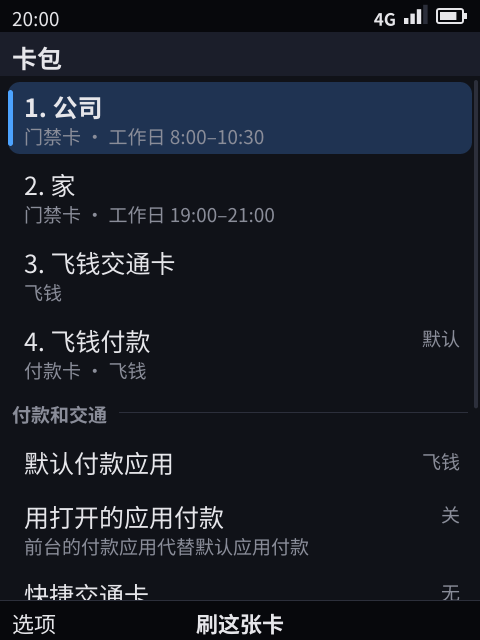
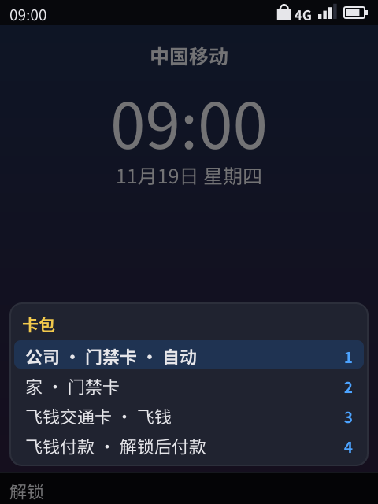
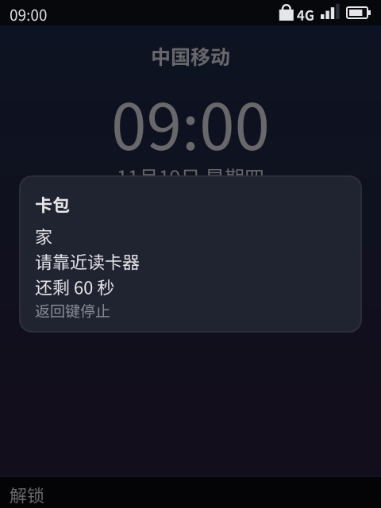
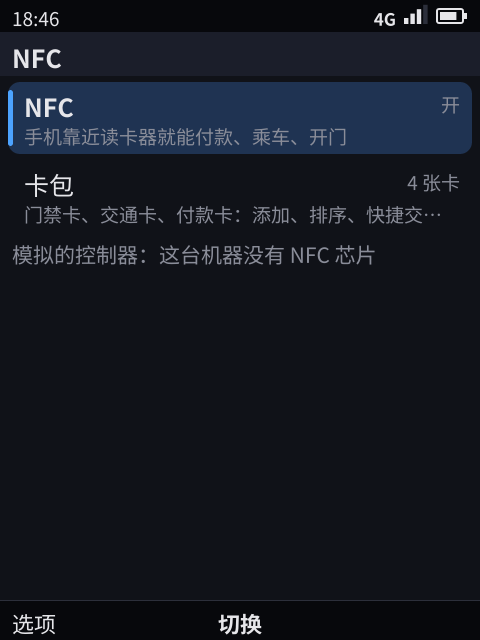

# NFC：门禁卡、交通卡、付款卡（卡模拟）

> 状态：**原型 ✓（模拟控制器）**。系统服务 `phone-nfcd`、硬件层 `hal/nfc`（模拟控制器和 NCI 后端的骨架）、系统应用「卡包」（`apps/cards`）、锁着息屏时不按键就能刷的门禁卡和快捷交通卡、按使用时间选门禁卡、每张卡「息屏、锁着时能不能用」、连按两下电源键的快速选卡（没有电源键的机型用挂断键）、设置 › NFC 的开关、飞钱的交通卡和付款卡、按地区的节假日日历分工作日和休息日（日历由更新服务器签名下发；平台不带真的日历，**未实现**）、给应用的读卡模式（运行时权限、系统的读卡界面、和 CPU 卡交换命令的会话，只在模拟控制器上）和「读卡器离开」事件、卡包里退出「添加门禁卡」当场停止读卡都已实现，单元测试 ✓，开发机自测 8 个用例 ✓（文本界面；前 5 个也在像素渲染器下 ✓），整套自测 133 个用例 ✓（§9）。**真机未验证**：NCI 后端只对着假控制器测过，控制器自己应答 UID 卡、它的中断叫醒挂起的手机都只在模拟里走过，**未上真机**（§8）。测试机红米 Note 4X 没有 NFC 芯片；一加 6T 有 NXP 的 NFC 控制器，是以后验证 NCI 后端的机器。

## 0. 结论

- **一部手机顶几张卡。** 门禁卡（大多是只认卡号的 UID 卡）、交通卡、付款卡都在系统的卡包里，可以有好几张门禁卡、好几张交通卡。手机一次以一个身份应答读卡器：一张门禁卡的 UID，或者「主机卡模拟」（HCE，ISO-DEP），或者两样同时（固定 UID 加 ISO-DEP，像双界面卡）。
- **卡由系统应用「卡包」管，像小米手机的卡包。** 它列出所有卡（系统保存的门禁卡、应用提供的交通卡和付款卡，写着是哪个应用的），读实体卡添加门禁卡，改名、删除、排顺序，设快捷交通卡和默认付款应用，每张卡设「息屏、锁着时能不能用」（门禁卡和快捷交通卡默认能，付款卡永远要先解锁），并写出每张门禁卡平时在什么时段刷。设置 › NFC 只剩 NFC 开关和打开卡包的一行。
- **锁着不用按键。** 息屏、锁着、整机挂起时，门禁卡和快捷交通卡自己应答读卡器，屏幕一直不亮，像小米的门禁卡和 iPhone 的快捷交通卡：nfcd 事先把这时最可能用的门禁卡的 UID（和快捷交通卡的 ISO-DEP）摆进控制器，UID 卡由控制器自己答；HCE 的命令要主机答，读卡器的场叫醒系统（[28](28-battery.md) 的系统睡眠，`sleepWake`）。锁屏上原来的 → 快捷键去掉了。
- **门禁卡按使用时间选，不按读卡器选。** 每张门禁卡记下每次刷成功的时间（一天里的钟点，工作日还是休息日，存 60 天，越早的越轻）；门禁读卡器来了，手机出示此刻最可能用的那张：每次刷卡在一天的钟点上按一个约一小时宽的平滑核算分，工作日和休息日分开算（休息日是周末，有地区的节假日日历时再加上法定节假日、去掉调休上班的周末）；读卡器不认就换下一张，下一次刷就是它。附近钟点一条记录都没有时按卡包里的顺序。读卡器的轮询特征只在亮屏时作次要提示（§4）。
- **快速选卡：连按两下电源键。** 像小米双击电源键打开卡包、iPhone 双击侧边按钮打开钱包：任何界面（锁着也行）连按两下电源键，锁屏上面弹出卡的列表，选一张就出示 60 秒，给少数自动选错的时候用。键模型里新加了电源键 `power`；没有单独电源键的键盘机，挂断键按诺基亚的习惯兼作电源键：按住是关机，在待机界面或锁屏上停一下再连按两下是快速选卡（[18](18-nokia-form-factors.md) §5.1、[10](10-keyboard-interaction-model.md) §1）。
- **和安卓对齐。** 应用在清单里声明卡（AID 组、类别 `payment` / `other`、要不要解锁），读卡器选中它的 AID 后，系统把每条命令（APDU）作为事件交给它，它用 `nfc.reply` 回答，对应 Android 的 `HostApduService`；付款卡只给卡包里选的默认付款应用，像 Android 的「非接触式付款」。
- **应用不用常驻。** 刷卡时交通卡的应用可能已经冻结，甚至没在运行：系统像推送那样把它解冻几秒，或在后台启动它，再把命令交给它（刷卡是用户的动作，不占推送的唤醒预算）。读卡器用完它的卡时，还在运行的应用收到 `nfc.deactivated`（Android 的 `onDeactivated`）。
- **应用也能读卡。** 像 Android 的 `enableReaderMode`、iOS 的 Core NFC：应用要运行时权限 `nfc_reader`，读卡时系统弹出读卡界面（「把卡贴在手机背面」），读到的实体卡的 UID 交给应用，CPU 卡还能在至多 30 秒的会话里和它交换命令；飞钱用它读实体交通卡的余额。只在模拟控制器上（§6、§8）。

## 1. 和 Android、iOS、国内手机钱包对照

| 方面 | Android | iOS / 国内手机钱包 | Kario | 状态 |
|------|---------|--------------------|-------|------|
| 应用的卡（HCE） | `HostApduService`，`apduservice.xml` 里声明 AID 组、类别、`requireDeviceUnlock`、`requireDeviceScreenOn` | iOS 18 起开放 HCE（部分地区）；国内钱包各自实现 | 清单的 `nfc`：AID 组、类别、`requires_unlock`、`express`；`nfc.apdu` 事件 + `nfc.reply` 能力，需要 `nfc` 权限 | ✓（模拟控制器） |
| 管卡的地方 | 设置 › 非接触式付款；各应用自己管卡 | iOS 的「钱包」；小米、华为的「卡包」 / 「钱包」系统应用 | 系统应用「卡包」：所有卡、添加门禁卡、顺序、快捷交通卡、默认付款应用、每张卡息屏能不能用（§5） | ✓ |
| 读卡器离开 | `onDeactivated` | — | `nfc.deactivated` 事件：`link_loss`（场没了、读卡器让卡休眠或 DESELECT）、`deselected`（选了别的 AID）；只给还在运行的应用 | ✓（模拟控制器） |
| 付款卡 | 设置 ›「非接触式付款」选默认付款应用，只有一个时自动用它；「除非另一个付款应用已打开」 | Wallet 的默认卡 | 卡包 › 默认付款应用（只有一个时自动用它）、「用打开的应用付款」；付款卡只在解锁、亮屏时应答 | ✓ |
| 前台优先 | `setPreferredService` | — | 只有付款卡按上面的设置让前台的付款应用优先；其他类别 | **未实现** |
| AID 冲突 | `other` 类有几个应用声明同一 AID 时弹框让用户选 | — | 不弹框：按卡的顺序，被拒以后换声明同一 AID 的下一张卡（§4） | ✓（做法不同） |
| 安全芯片里的卡 | `OffHostApduService`：路由到 eSE 或 SIM | Apple Pay 的卡在安全芯片里 | 设计：路由表里把 AID 的目标从主机（DH）换成 eSE / UICC 的 NFCEE | **未实现** |
| 读卡模式 | `enableReaderMode` | Core NFC | 系统自己用（卡包添加门禁卡时读实体卡）；应用用 `nfc.read`（运行时权限 `nfc_reader`，系统的读卡界面）和 `nfc.transceive`（和 CPU 卡交换命令的会话，至多 30 秒）（§6） | ✓（模拟控制器）；NCI 上只有 UID、没有会话，**未实现** |
| 先看读卡器再选卡 | Android 15 观察模式 + 轮询帧过滤 | iOS 看读卡器的 ECP 帧选快捷交通卡、门禁卡 | 亮屏时 nfcd 看轮询帧里的厂商帧，知道读卡器是闸机、门还是收银台；读卡器的轮询特征只作门禁卡的次要提示（§4） | 模拟控制器 ✓；NCI 上**未实现**（要厂商扩展） |
| 门禁卡 | 没有公开接口 | 国内手机钱包用读卡模式读出未加密卡的 UID，再按这个 UID 模拟 | 同左：卡包里「添加门禁卡」；按使用时间选（§4）；加密卡要控制器支持和卡的密钥 | UID 卡 ✓（模拟）；加密卡**未实现** |
| 快捷交通卡 | 无（交通卡应用自己声明不要解锁） | iOS 快捷交通卡：息屏、锁着都能刷 | 卡包 › 快捷交通卡（清单里 `express: true` 的卡），默认息屏可刷 | ✓ |
| 息屏、挂起时刷卡 | Android 12 起 HCE 服务可以声明 `requireDeviceScreenOn: false` | 小米的门禁卡、iPhone 的快捷交通卡息屏可刷，不用按键 | 控制器按 nfcd 事先摆好的身份自己应答：UID 卡不等主处理器，HCE 由场叫醒的系统答；屏幕不亮（§3、§4、§8） | 模拟 ✓；**未上真机** |
| 快速选卡 | 原生安卓双击电源键默认打开相机，部分厂商可以设成钱包 | iPhone 双击侧边按钮、小米双击电源键打开钱包 / 卡包 | 连按两下电源键（没有电源键时在待机界面连按两下挂断键）打开快速选卡（§5） | ✓ |

## 2. 架构

```
 读卡器（门禁、闸机、收银台）
   │ 13.56 MHz：轮询帧、防冲突、ISO-DEP 的 APDU
   ▼
 NFC 控制器（真机：NXP PN7160 / PN553 一类，NCI；开发机、QEMU：模拟控制器）
   │ hal/nfc.Controller：场强、轮询帧、激活、APDU、读卡模式；息屏时按摆好的身份自己应答；真机上中断是唤醒源
   ▼
 phone-nfcd（系统服务，nfcd.sock）── 选卡、换卡、按使用时间选门禁卡；门禁卡的 UID、刷卡时间、用户的选择存盘
   │ wire RPC + 事件（场的开关、APDU、刷卡结果）；只有 Shell 连它
   ▼
 Shell ── 锁屏、亮屏、前台应用、应用声明的卡、Shell 的时钟 → nfcd；场在时不挂起；快速选卡、倒计时、提示；电源键
   │ phone.Ui：nfc.apdu 事件 / nfc.reply；nfc.state / nfc.set（system 权限）
   ▼
 应用：卡包（系统应用，管卡）；飞钱（交通卡、付款卡；冻结的解冻，不在的后台启动）
```

| 部分 | 位置 |
|------|------|
| 控制器接口、模拟控制器、模拟读卡器、NCI 后端、唤醒源；读卡模式里留住 CPU 卡交换命令（可选的 `Exchanger`，只有模拟控制器）、模拟的 CPU 卡（`TransitApplet`） | `hal/nfc`（`nfc.go`、`sim.go`、`nci.go`、`wake.go`，含单元测试） |
| 选卡、换卡、按使用时间选门禁卡（按节假日日历分日子）、门禁卡、读卡模式（卡包的读卡和应用的读卡会话，一次一个，可以取消） | `programs/nfcd`（`engine.go`、`reader.go`，含单元测试）；程序名 `phone-nfcd`，状态 `<状态目录>/nfc/state.json`（0600） |
| 节假日日历的格式和签名（手机和更新服务器共用） | `ota/holidays.go`；更新服务器 `kario-otasrv`（不开源）发 `holidays.json` |
| 方法名和 Shell 与 nfcd 之间的结构 | `svc/nfcd.go` |
| 应用接口、清单检查 | `ui/nfc.go`（`CheckNFCCards`，安装器和商店后台共用） |
| 卡包 | `apps/cards`（`com.phone.cards`，系统应用，`system` 权限，主菜单） |
| Shell：策略、事件、能力 | `shell/nfc.go`；应用的读卡和读卡界面 `shell/nfcread.go`；取节假日日历 `shell/holidays.go`；快速选卡、出示、挂断键兼作电源键 `shell/cards.go`；电源键 `shell/keys.go`；挂起时的场 `shell/sleep.go`；自测命令 `shell/nfc_headless.go` |
| 设置 › NFC | `apps/settings/nfc.go` |
| 飞钱的交通卡和付款卡 | `apps/wallet/nfc.go`，清单 `apps/wallet/manifest.json` 的 `nfc` |
| 电源键的键码 | 像素渲染器 `paint/src/kms.rs`（`KEY_POWER` → `power`，短按松开时发；按住满 600 ms 发长按，键还按着就发：按键自动重复时按重复，不重复的电源键按渲染器自己的计时）、`paint/src/input.rs`（只有电源键的输入设备也打开） |
| 镜像 | `phone-nfcd.service`（`phone-fw` 配方，开机启动，用模拟控制器） |

## 3. 哪张卡什么时候能应答

| 卡 | 亮屏、解锁 | 亮屏、锁着 | 息屏（含挂起） |
|----|:--:|:--:|:--:|
| 门禁卡（系统复制的 UID 卡），「息屏、锁着时也能用」开着（默认） | ✓ | ✓ | ✓ |
| 门禁卡，用户在卡包里关掉了它 | ✓ | — | — |
| 应用的 `other` 卡（交通卡等） | ✓ | 清单里 `requires_unlock: true` 时不行，否则 ✓ | 用户在卡包里打开了「息屏、锁着时也能用」时 ✓（`requires_unlock` 的卡不能开） |
| 快捷交通卡（用户在卡包里选的、清单里 `express: true` 的卡） | ✓ | ✓ | ✓（默认；用户可以关掉） |
| 付款卡（`payment`） | 只有付款应用的：✓ | — | — |
| 设置 › NFC 关掉时 | — | — | — |

- 付款应用：「用打开的应用付款」打开、前台的应用有付款卡时是它；否则是卡包里选的默认付款应用；没选、又只有一个应用有付款卡时就是它。
- Shell 把锁屏（`c.locked()`，锁屏模型 [31](31-lock-and-biometrics.md)）、亮屏、前台应用、应用声明的卡和 Shell 的时钟（相对系统时钟的偏移、时区的 UTC 偏移）交给 nfcd，变化时再交一次：Shell 的例行检查里比对（亮屏时每半秒一次，息屏时 5 秒一次），息屏、自动锁屏本身就发生在这次检查里，按电源键息屏时当场交过去。nfcd 按使用时间选卡用的就是 Shell 的时钟，自测的 `timeshift`、`nfc clock` 拨的也是它。
- 门禁卡、快捷交通卡息屏时刷成功，Shell 不点亮屏幕；读卡器不认、换了卡时的提示也不亮屏（下一次刷就是换上的卡）。只有付款卡因为锁着、其他卡因为息屏不能应答时，Shell 才亮屏提示「解锁手机后才能用「X」」/「亮屏后才能用「X」」。
- **挂起**：读卡器的场一来，nfcd 告诉 Shell（`field` 事件）；场在的时候 Shell 不让手机挂起（[28](28-battery.md) 的系统睡眠，理由「NFC reader」），叫醒后照例至少醒 10 秒。真机上叫醒手机的是控制器的中断：nfcd 打开 NCI 设备时把它所属设备的 `power/wakeup` 设成 `enabled`（`nfc.WakeSource`，驱动要提供这个属性），控制器在挂起时照样监听（§8）。开发机上的模拟睡眠先「睡」2 秒，这期间读卡器的场来了就当场醒（醒的原因「simulated NFC field」），没来才由模拟的 RTC 把时钟拨到唤醒时间。

## 4. 选卡与自动换卡

**亮屏时看轮询帧（观察模式）。** 屏幕亮着时，读卡器的场一出现，控制器先不应答，只把读卡器的轮询帧交给 nfcd（Android 15 的观察模式）。第一轮轮询结束（`off` 帧）时 nfcd 决定出示哪张卡。有的读卡器在轮询里加一帧说明自己是什么（**厂商帧**），像苹果的 ECP 帧告诉 iPhone 这是闸机、门禁还是收银台。模拟读卡器用我们自己的格式：`4B 50`（「KP」）、类别（1 交通、2 门禁、3 付款）、4 字节编号。真读卡器的 ECP 格式没有公开，nfcd 只认模拟的这种（真读卡器的厂商帧**未实现**）。

**息屏时控制器自己应答。** 屏幕一关手机就可能挂起，主处理器来不及为每个读卡器做决定，所以息屏时（以及没有观察模式的控制器，§8）nfcd 不用观察模式，而是事先把身份摆进控制器：此刻排在最前的门禁卡的 UID，加上 ISO-DEP（应用有卡时就开，路由表里是这时能应答的应用卡的 AID）。只认 UID 的门禁读卡器读到 UID 就开门，控制器自己完成，不等主处理器；闸机、收银台走 ISO-DEP，命令交给被场叫醒的主机。这个身份在场结束、策略变化（锁屏、亮屏、时钟、卡）和醒着时每分钟重新算，变了才重设控制器；挂起的手机至少每 15 分钟被 RTC 叫醒一次做例行维护（[28](28-battery.md)），醒来后 Shell 把策略再交一次，nfcd 按那时的钟点重新摆，所以摆好的卡最多旧 15 分钟；读卡器不认时照样换卡（下面），下一次刷就是换上的卡。

**门禁卡按使用时间选。** 每次门禁卡刷成功，nfcd 记下「卡、时间」（Shell 的时钟、当时的时区，存在状态文件里，至多 400 条，60 天前的丢掉）。给门禁卡排先后时，每张卡的分数是它每次刷卡的分量之和：

- 钟点：刷卡时刻和此刻在一天里相差 d 分钟（跨午夜也算），核 K(d) = (1 − (d/150)²)²，d ≥ 150 时为 0（四次核，标准差约一小时，平滑地从 1 降到 0）；
- 新旧：分量再乘 2^(−天数 / 14)，每两周减半；
- 日子：只算和今天同一类的日子，工作日或休息日，两类日子互不借用。没有节假日日历时工作日是周一到周五，休息日是周六、周日；有地区的日历时，日历里的节假日是休息日，调休上班的周末是工作日（下面）。哪天按刷卡那一刻所在时区的日期算。

分数高的先出示；分数一样（多半是附近钟点都没有记录，比如新加的卡）时，亮屏时先看读卡器的提示（下面），再按卡包里的顺序。卡包里写出每张门禁卡的「常用时段」：每次刷卡前后 60 分钟连成的时段，重叠的合并，每类日子取分量最重的 3 段，按钟点排好、两头取到半点。

例子（自测 ✓）：卡包里「家」在前、「公司」在后。第一个工作日 9:00 没有记录，公司大门先拿到排第一的「家」，不认，换成「公司」，第二次刷开，记下「公司 9:00」；9:40 再刷，9:00 那次离得近，第一次就出示「公司」；下一个工作日 9:00 也是。把「公司」在卡包里排到第一以后，20:00 附近没有记录，家门按顺序先拿到「公司」，不认，换成「家」刷开；再下一个工作日 20:00，「家」有了这个钟点的记录，比顺序优先，第一次就出示「家」，9:00 照旧先出示「公司」。卡包里分别写着「门禁卡 · 工作日 8:00–10:30」和「门禁卡 · 工作日 19:00–21:00」。

**节假日日历。** 更新服务器在 `latest.json` 旁边发 `holidays.json`（`ota.Holidays`）：按地区（ISO 3166 的两个字母）列出法定节假日（`days_off`）和调休上班的周末（`workdays`），日期是那个地区自己的；签法和 `latest.json` 一样，只是签名里多了文件名（`ota.DataMessage`，[25](25-system-update.md) §0）。有更新服务器时 Shell 每天取一次（失败了一小时后再试），核对签名、签发时间、不比手里的旧，存在 `<状态目录>/shell/holidays.json`，把手机的地区（设置 › 地区，自动时取 SIM 卡的国家，[19](19-core-apps.md)）的日子随策略交给 nfcd；换了地区，下一次策略就是新地区的。没有日历或日历里没有这个地区时照旧按周一到周五。

```json
{"format": "kario-holidays/1",
 "regions": {"CN": {"source": "<通知的名称和日期>", "days_off": ["<YYYY-MM-DD>", "…"], "workdays": ["<YYYY-MM-DD>", "…"]}}}
```

平台不带日历，也不编造日期：中国的放假和调休每年由国务院办公厅发通知定，要有人对着通知核对后放到更新服务器上（真的日历数据**未实现**）。自测用的是测试日历（`nfc holidays fixture`，§7），不是官方的：锁着、息屏时（没有读卡器的提示），调休上班的周六 20:00，家门第一次就出示「家」（工作日 20:00 的刷卡算数）；放假的周三 20:00 算休息日，休息日还没有记录，按卡包里的顺序先出示「公司」，换成「家」刷开；之后「家」的常用时段里多了休息日的 19:00–21:00（自测 ✓，查的是卡包拿到的 `usual`；卡包上「休息日 …」的写法由单元测试核对）。

**读卡器的轮询特征，只作次要提示。** 亮屏时（观察模式下）nfcd 还记得哪张门禁卡被哪个读卡器收过（读卡器轮询里自己的厂商帧算出的特征，至多 32 个，60 天），只在时间分数一样时用来排先后，排在卡包的顺序之前。不当主规则的原因：普通读卡器的轮询（开场、轮询 A、关场）同一类都一样，分不出家门和公司的门，只有带厂商帧的读卡器才分得出；只有亮屏、有观察模式的控制器才看得到轮询（息屏时控制器自己应答，NCI 上还要厂商扩展）；而用户按时间刷卡的习惯在所有控制器上都看得到，主人要的也是按使用时间选。

**先出示哪张。** 依次看：
1. 用户在快速选卡或卡包里选的卡（60 秒内）；
2. 读卡器刚拒绝过一张卡时排到下一张的卡（2 分钟内的下一次刷卡）；
3. 能应答的卡里：厂商帧说的类别（门禁卡、快捷交通卡、付款卡）在前，再按卡包里的顺序，门禁卡占的那些位置按上面的分数重排；2 分钟内被拒过的卡不排。

读卡器说自己是收银台、而付款卡只是因为锁着（或息屏）不能应答时，手机什么都不出示，并亮屏提示「解锁手机后才能用「飞钱付款」」，而不是拿门禁卡去碰运气；用户就在收银台前解锁的话，nfcd 一拿到新的锁屏状态（§3），读卡器还在轮询就出示付款卡（单元测试 ✓）。息屏时同样：收银台经 ISO-DEP 选 PPSE，nfcd 回 `6A82` 并亮屏提示先解锁（自测 ✓）。

**HCE 的路由。** 出示应用的卡时，手机以 ISO-DEP 应答，那张卡的 AID 排在前面，其他能应答的应用卡的 AID 也都在：读卡器选哪个 AID，命令就交给哪张卡的应用（两张卡声明同一 AID 时给排在前面的）。选的 AID 属于一张这时不能应答的卡（比如锁着时的付款卡）时，nfcd 回 `6A82`，并提示要解锁。不知道读卡器是什么（息屏时，或没有厂商帧）时，门禁卡的 UID 和 ISO-DEP 一起出示（§8 的双界面身份）。

**算不算刷成功。**

| 出示的卡 | 成功 | 失败 |
|----------|------|------|
| UID 卡（门禁卡；读卡器没讲 ISO-DEP） | 读卡器激活一次、然后让卡休眠（HLTA），没有再轮询它 | 读卡器又轮询它（重新激活）、或者没让它休眠就撤场；一次都没激活不算 |
| 应用的卡（HCE） | 最后一条命令的回答没有出错（`9000`、`61xx`、`62xx`、`63xx`），应用都及时答了 | 回答出错（如 `6A82`、`6985`、`9401`），应用没答完读卡器就走了，或者读卡器一条命令都没发 |

门禁读卡器不会告诉卡「我认了你」，所以 UID 卡的判断是推测：认卡的读卡器多半让卡休眠、开门；不认的多半接着轮询。模拟读卡器按这个规律做，**真读卡器上未核实**。

**换卡。** 失败时，nfcd 在候选里挑下一张（门禁卡失败时只换另一张门禁卡，应用的卡已经在 ISO-DEP 里了；应用的卡失败时，只有声明了读卡器所选 AID 的另一张卡才有意义，读卡器一条命令都没发时也可以是门禁卡），作为下一次刷卡先出示的卡，Shell 提示「已换成「X」，请再刷一次」（息屏时不亮屏）；用户正在出示选的卡时，出示的换成这一张，倒计时重新开始。成功时清掉被拒的记录和「下一张」，结束出示，门禁卡记下这次刷卡的时间。

## 5. 卡包、快速选卡、电源键、设置

**卡包**（系统应用 `com.phone.cards`，主菜单里，`system` 权限）：按卡的顺序列出所有卡（「1. 家」……），每张卡下面一行写它是什么：门禁卡写常用时段（「门禁卡 · 工作日 8:00–10:00、12:00–14:00 · 休息日 10:00–12:00」，还没刷过时写 UID 的末两位；关掉了息屏可用时写「门禁卡 · 解锁后才能刷」），交通卡写应用名（息屏可用时加「· 息屏可刷」），付款卡写「付款卡 · 应用名」；快捷交通卡、默认付款卡标在右边。OK 出示这张卡（系统的倒计时，见下）；卡的选项：门禁卡改名、删除（确认），能当快捷交通卡的卡「设为快捷交通卡」/「不再作为快捷交通卡」，付款卡以外的卡「只在解锁时可用」/「息屏、锁着时也能用」（`requires_unlock` 的卡没有这一项），每张卡上移、下移。下面一组「付款和交通」：默认付款应用、用打开的应用付款、快捷交通卡；最后两行说明门禁卡和快捷交通卡息屏、锁着不用按键就能刷、按使用时间选，以及 OK 出示和连按两下电源键。页面选项里「添加门禁卡」。卡包用的全是 `nfc.state` / `nfc.set`（§6），UID 留在 nfcd 里，卡包只拿到末两位。

**添加门禁卡**：卡包写「把卡贴在手机背面」，nfcd 用读卡模式读卡（至多 20 秒；退出这一页时卡包发 `nfc.set` 的 `cancel_read`，当场停止，不占着读卡器）：
- 未加密的 UID 卡：nfcd 把它记下等着添加，卡包请用户起名（默认「门禁卡 N」），保存后 UID 存进 nfcd 的状态文件，应用拿不到；
- 加密的 MIFARE Classic 卡：提示复制要用卡的密钥，手机没有（**未实现**：要控制器能模拟扇区，还要从物业拿到密钥）；
- 智能卡（CPU 卡，ISO-DEP）：提示请在发卡方的应用里添加；
- 已经在卡包里的卡（同一 UID）：提示它在卡包里叫什么。

**快速选卡**：**连按两下电源键**（400 ms 内），在任何界面、锁着也行，像小米双击电源键打开卡包、iPhone 双击侧边按钮打开钱包。第一下照常（亮屏时息屏，息屏时亮屏），第二下点亮屏幕并弹出快速选卡（系统弹层，锁着的界面一样在后面；放在 Shell 里，又快又能盖在锁屏上）：按卡包的顺序列出卡，此刻门禁读卡器会自动拿到的那张标着「自动」，数字键 1–9 直选，选一张就出示；锁着时选付款卡提示先解锁。通话中、来电或闹钟响着时不算。没有单独电源键的键盘机用挂断键：在待机界面或锁屏上（停一下之后）400 ms 内连按两下挂断键。第一下在那里本来就没事可做（已经在待机，或者只是点亮屏幕），所以和挂断键按一下回待机不冲突；从应用里、通话中按的挂断键照旧回待机、挂断，不算第一下，连着狂按挂断键也不会打开它。自测脚本一开始把挂断键的连按关掉（脚本的按键比人快，上一个用例最后的挂断键和下一个用例开头的挂断键会被当成连按），测它的用例用 `nfc picker on` 打开；电源键的连按一直开着。

**电源键**（键名 `power`，像素渲染器把 `KEY_POWER` 映射成它，[10](10-keyboard-interaction-model.md) §1、[18](18-nokia-form-factors.md) §5.1）：按一下息屏（锁不锁照息屏的规则，[31](31-lock-and-biometrics.md) §2.1）或亮屏；来电响铃时按一下静音；连按两下快速选卡；按住满 600 ms、键还按着时打开电源菜单（不自动重复的电源键由渲染器自己计时，§9）（「关机」「重启」，在手机上交给 systemd，开发机上只提示「这不是手机，不关机」）。没有电源键的机型，按住挂断键也打开这个菜单（诺基亚的按住红键关机）。

**出示**：弹层写卡名、「请靠近读卡器」和剩余秒数，60 秒后或刷成功 1.5 秒后自己关掉；返回键停止出示。

**设置 › NFC**：只有 NFC 开关和「卡包」一行（写着有几张卡，OK 打开卡包，经 `nfc.set` 的 `open_cards`），最后一行写明控制器（开发机上是「模拟的控制器：这台机器没有 NFC 芯片」）。

| 卡包 | 锁屏上的快速选卡 | 出示 | 设置 › NFC |
|:--:|:--:|:--:|:--:|
|  |  |  |  |

## 6. 应用接口

清单（[22](22-developer-api.md) §1）：

```json
"permissions": ["nfc"],
"nfc": [
  {"id": "transit", "category": "other", "description": "飞钱交通卡", "aids": ["F0465154524E53"], "express": true,
   "locales": {"en": "Feiqian transit card"}},
  {"id": "pay", "category": "payment", "description": "飞钱付款", "aids": ["325041592E5359532E4444463031", "F0465150415901"]}
]
```

| 字段 | 说明 |
|------|------|
| `id` | 小写字母、数字、`-`、`_`，至多 16 个，清单里唯一；事件里用它说是哪张卡 |
| `category` | `payment`（只给默认付款应用、只在解锁时）或 `other` |
| `description` | 卡包里的名字，1–32 个字；`locales` 按语言给译名 |
| `aids` | 1–16 个 AID（十六进制，5–16 字节）；一个 AID 只能在一张卡里；PPSE（`2PAY.SYS.DDF01`）只能在付款卡里 |
| `requires_unlock` | `other` 卡锁着时不应答，用户也不能让它息屏可用 |
| `express` | `other` 卡可以被用户设成快捷交通卡 |

装应用时（`shell/install.go`）和商店后台（`appstore`）用同一个 `ui.CheckNFCCards` 检查，有卡没声明 `nfc` 权限的装不上。一个应用最多 8 张卡。

能力和事件（[22](22-developer-api.md) §4.11、§5）：
- `nfc.apdu` 事件：`{session, card, aid, apdu}`，读卡器选中这张卡的 AID 之后的每一条命令（包括 SELECT 本身），十六进制；
- `nfc.reply`：`{session, apdu}`，回答最近这一条命令，以状态字结尾（`9000` 成功）；只有命令交给的那个应用能答，读卡器走了以后再答会报错；
- `nfc.state` / `nfc.set`：卡包和设置用（`system` 权限，Shell 的 broker 按权限把关）。`nfc.state` 给出卡（门禁卡带常用时段 `usual`；每张卡的 `locked`：息屏、锁着时能不能用，`locked_fixed`：不能改）、此刻门禁读卡器先拿到的门禁卡 `door_first` 和用户的选择；`nfc.set` 的键除了开关、默认付款应用、快捷交通卡、顺序，还有 `locked`（`card`、`on`）、卡包的 `read`（读卡模式，回答里的 `read` 说读到了什么）、`cancel_read`（停掉正在等卡的 `read`）、`add_door`、`rename`、`delete`、`present`（由 Shell 出示并显示倒计时）、`open_cards`（由 Shell 打开卡包）。
- `nfc.deactivated` 事件：`{session, card, reason}`，读卡器用完了这张卡：`link_loss`（场没了、读卡器让卡休眠或 DESELECT）或 `deselected`（读卡器选了别的 AID），每次选中一张卡至多一次；只给还在运行的应用（冻结的解冻一秒），已经结束的不为它启动。

读卡模式（`nfc.read`、`nfc.transceive`，[22](22-developer-api.md) §4.11）：应用在清单里声明运行时权限 `nfc_reader` 并在 `purposes` 里写用途，第一次读卡时系统问用户。只有前台应用能读，同一时间只有一个读卡（卡包的也算）。`nfc.read` 弹出系统的读卡界面，写着是哪个应用要读，返回键停止（应用得到 `cancelled`）；读到卡时答 UID、ATQA、SAK、是不是 ISO-DEP。CPU 卡（ISO-DEP）在控制器留得住它时还有一个会话：`nfc.transceive` 在里面一条条发命令、拿回答，界面改成「请让卡停在手机背面」；会话在应用 `close`、用户按返回、卡拿开、30 秒到了，或者应用结束、离开前台时结束，界面随之关掉。卡模拟照常进行：读卡时手机照样能被读卡器刷。

应用要快：读卡器每条命令只等一会儿。模拟读卡器每条命令等 3 秒（乘自测的超时倍数）；真闸机给的时间短得多，冷启动可能来不及（**未上真机**，打算：快捷交通卡的应用在息屏时预先解冻，或者把卡放进安全芯片，§10）。

## 7. 模拟读卡器和简化的交易流程

自测和 nfcd 的单元测试用 `hal/nfc` 里的三种模拟读卡器。交通和付款的命令是**我们自己的简化流程**，没有密钥、MAC，不是任何运营商或 EMV 的规范；金额是 4 字节大端的「分」。模拟控制器在场来之前已经摆好身份时，第一轮轮询就应答（控制器自己应答）；没摆时它只报轮询帧，等 nfcd 决定（观察模式）。

| 读卡器 | 轮询 | 做什么 | 认 |
|--------|------|--------|----|
| 门禁（`DoorReader`） | A，厂商帧类别 2 | 读 UID（卡带不带 ISO-DEP 都一样） | UID 在名单里：让卡休眠；否则重新轮询 |
| 闸机（`TransitGate`） | A、B，类别 1 | `00 A4 04 00` SELECT 卡的 AID → `80 5C 00 02 04` 读余额 → `80 54 01 00 08 <票价> <闸机号> 04` 扣费，卡回新余额；余额不够回 `9401` | 三步都是 `9000` |
| 收银台（`PaymentTerminal`） | A、B，类别 3 | SELECT PPSE，在回答的目录里找它支持的 AID（`4F`）→ SELECT 这个 AID → `80 70 00 00 08 <金额> <终端号> 08`，卡回 8 字节密文 | 都是 `9000` |

飞钱的交通卡把余额存在应用数据里（`transit.json`，起始 ¥20.00，闸机启动它时也读得到）；付款卡用应用密钥（`keystore.sign`，键名 `nfcpay`）给这笔交易签名，取签名摘要的前 8 字节作密文，记一笔「感应付款」账单。读卡模式下贴在手机上的模拟 CPU 卡（`TransitApplet`）是同一个简化流程的实体交通卡：答它自己 AID 的 SELECT 和读余额，飞钱的「读交通卡余额」就读它。

自测脚本命令（`shell/headless.go`、`shell/nfc_headless.go`）：

| 命令 | 作用 |
|------|------|
| `require-nfc` | 没有 phone-nfcd 时跳过这个用例 |
| `nfc card <uid> [encrypted\|cpu]`、`nfc card none` | 把一张实体卡贴在手机背面（读卡模式读得到），或拿走 |
| `nfc card <uid> transit <aid> <分>` | 贴一张简化流程的实体交通卡（CPU 卡，余额以分计），读卡会话里答 SELECT 和读余额 |
| `nfc reader <名字> door <uid>[,…]` / `gate <aid> <票价>` / `pay <aid> <金额>` | 定义一台模拟读卡器 |
| `nfc tap <名字> ok\|fail [<卡名>]` | 把手机靠近读卡器（Shell 照常运行，命令经应用往返），断言读卡器认或不认、看到的是哪张卡 |
| `nfc clock <时:分> [workday\|weekend\|holiday\|makeup]` | 把 Shell 的时钟往后拨到下一个这个钟点（可以要求是周一到周五、周末，或节假日日历里的节假日、调休上班日），nfcd 随下一次策略拿到 |
| `nfc holidays fixture\|none` | 测试日历（不是官方的）：明天以后的第一个周六调休上班，之后的周三放假；由一个临时的更新服务器用临时密钥签名，Shell 照常取、核对、存下，交给 nfcd；`none` 忘掉日历 |
| `nfc deactivated <应用> <卡> <原因>` | 断言 Shell 最近交给应用的 `nfc.deactivated` 是这张卡、这个原因 |
| `nfc usual <卡名> workday\|dayoff <时:分>-<时:分>` | 断言 nfcd 给卡包的这张门禁卡的常用时段里，工作日或休息日有这一段（卡包那一行比自测的屏幕宽） |
| `nfc asleep`、`nfc woken` | 等模拟的睡眠开始；断言上一次睡眠是读卡器的场叫醒的 |
| `nfc picker on\|off` | 挂断键的连按打开快速选卡（脚本开始时关着） |
| `key power [次数]`、`long power`、`long end` | 按电源键（`key power 2` 是连按两下）；按住电源键、挂断键 |

## 8. 硬件层与 NCI 后端

`hal/nfc.Controller`：`Events()`（场开关、轮询帧、激活、休眠、APDU）、`Present(身份)`（UID 卡、HCE 加 AID 路由表，或者两样一起；`nil` 不应答）、`Respond(APDU)`、`Read(ctx)`（读卡模式，到时或取消就停）、`Info()`（有没有观察模式、是不是模拟的）；读卡会话要可选的 `Exchanger`（`Exchange` 给刚读到的 CPU 卡发命令，`Release` 放开它），现在只有模拟控制器有，NCI 上要轮询模式的数据连接（读卡时的 ISO-DEP 接口、按 credit 收发），**未实现**，应用在 NCI 控制器上读卡只拿到 UID。nfcd 的控制器按主板配置（`sku.json` 的 `nfc`，[24](24-sku-framework.md)）选：模拟器是 `sim`，有 NCI 控制器的板子写 `nci:<设备>`，没有 NFC 的板子不写，nfcd 就直接退出；开发机没有 `sku.json`，用 `sim`；`--controller` 可以改。

NCI 后端（`hal/nfc/nci.go`）是 NXP PN7160（NCI 2.0）、PN553（NCI 1.0）这类控制器在原始 NCI 设备上的样子：NXP 的 `nxpnfc` / `pn5xx_i2c` 驱动让每次读写就是一个 NCI 包，Android 的 NCI 栈就这样用。主线内核的 `nxp-nci` 驱动把 NCI 留在内核（net/nfc）里，经 netlink 给用户态的接口不包括主机卡模拟（**未核实**能不能绕过）。已经写好、对着假控制器单元测试过的部分：

| 用途 | NCI 消息 | 代码 |
|------|----------|------|
| 包格式 | 控制包（MT、PBF、GID、OID）和数据包（连接号），先读 3 字节头再读负载 | `Packet`、`ReadPacket` |
| 复位、初始化 | `CORE_RESET_CMD` / `RSP` / `NTF`、`CORE_INIT_CMD` / `RSP`（1.0 和 2.0 两种格式） | `NewNCI` |
| 场强通知 | `CORE_SET_CONFIG` 的 `RF_FIELD_INFO`，`RF_FIELD_INFO_NTF` | `NewNCI` |
| 卡的身份 | `CORE_SET_CONFIG` 的 `LA_NFCID1`（UID；空的让控制器随机生成）和 `LA_SEL_INFO`（SAK：UID 卡 `08`，ISO-DEP `20`；双界面身份是固定 UID 加 `20`） | `Present` |
| 路由表 | `RF_SET_LISTEN_MODE_ROUTING`：ISO-DEP 协议和每个 AID 都到主机，放不下时分几条（More）；电源状态只设「开机」（switched on） | `ListenRouting` |
| 监听、读卡 | `RF_DISCOVER`（监听 A、B 或轮询 A、B）、`RF_INTF_ACTIVATED_NTF`（读卡时从里面取 UID、SAK、ATQA）、`RF_DEACTIVATE` | `Present`、`Read` |
| APDU | 静态 RF 连接（0）上的数据包，PBF 分段、按 credit 发送（`CORE_CONN_CREDITS_NTF`） | `DataPackets`、`Respond` |
| 唤醒源 | 设备节点的 `/sys/dev/char/<主>:<次>/device/power/wakeup`（没有时用节点自己的 `power/wakeup`）写 `enabled`，中断叫醒挂起的手机 | `WakeSource`（假的 sysfs 上单元测试 ✓） |

**硬件要做到的**（息屏、锁屏、挂起时也能刷，都**未上真机**）：
- **控制器的场中断是唤醒源**：读卡器的场（`RF_FIELD_INFO_NTF`）和给主机的命令都要叫醒挂起的手机；nfcd 用 `WakeSource` 打开，驱动要提供 `power/wakeup`（`device_init_wakeup`，或设备树里的 `wakeup-source`）；挂起时控制器照样供电、监听。
- **控制器自己模拟 UID 卡**：按 `LA_NFCID1` 的固定 UID 完成防冲突、选卡、休眠，不等主处理器（场的通知照样叫醒主处理器，nfcd 记下刷卡、判断成没成功）。NXP 的控制器上模拟固定 UID 要厂商设置（**未核实**）。
- **双界面身份**：固定 UID 加 ISO-DEP（SAK `20`）一起应答，门禁读卡器读 UID、闸机走 ISO-DEP。真门禁读卡器认不认带 ISO-DEP 位的 SAK（有的只认 `08` 的 MIFARE 卡）**未核实**；不认的话，息屏时要在 UID 卡和 ISO-DEP 之间选一个（门禁卡多的用户选 UID）。
- nfcd 从不告诉控制器屏幕关了、手机锁了（NCI 2.0 的电源子状态 `CORE_SET_POWER_SUB_STATE`），所以控制器一直处在「开机」状态、按路由表监听；锁屏和亮屏的规则由 nfcd 自己按 §3 执行，息屏时换成摆好的身份（§4）。挂起时的耗电、叫醒到 nfcd 答命令要多久都没量过。

**未实现**（都要真机）：在真控制器上跑；NXP 的厂商初始化（固件下载、专有命令）；观察模式的厂商扩展（Android 用的专有 NCI 消息）；UID 卡模拟在 NXP 上要的厂商设置；设备节点和权限（单元文件里加 `DeviceAllow`）。板子在 SKU 里写明 NFC 控制器 ✓（`nfc = "sim"` 或 `"nci:/dev/<节点>"`，不写就是没有，nfcd 照此打开控制器或者直接退出）和有没有单独的电源键 ✓（`power_key`，有的话挂断键不再兼作电源键，[24](24-sku-framework.md)）。

**测试机**：红米 Note 4X 没有 NFC 芯片，只能用模拟控制器。一加 6T 有 NXP 的 NFC 控制器（具体型号**未核实**，一般说是 PN553 一类），是验证 NCI 后端的机器；它在主线内核上用哪个驱动、有没有原始 NCI 设备也**未核实**。

## 9. 验证

- 单元测试：`hal/nfc`（NCI 包格式、初始化 1.0 / 2.0、HCE 的路由表和分段收发、按 credit 发送、读卡模式、UID 卡身份、双界面身份；模拟读卡器对门禁卡、交通卡、付款卡、不应答的手机，场来之前摆好的身份第一轮就应答，双界面身份既开门又过闸机；唤醒源在假的 sysfs 上）；`programs/nfcd`（读卡模式添加门禁卡：加密卡、CPU 卡、没有卡、重复的卡；改名、删除；按使用时间选门禁卡：没有记录按顺序、换卡、40 分钟后还认那次刷卡、三个半小时后不认、顺序改了以后 20:00 先按顺序、第二天时间分数胜过顺序、重启后还记得、周末和工作日分开、60 天前的不再算；分数随钟点平滑下降、150 分钟外为 0、跨午夜、两周减半；常用时段的合并、取半点、跨午夜；读卡器提示只在时间分数一样时用、只在亮屏（观察模式）时有；每张卡息屏能不能用：默认、关掉门禁卡、付款卡不能开、关掉快捷交通卡；门禁卡息屏锁着能刷、场的开关事件；没有观察模式时按时段摆卡；快捷交通卡息屏可用、不是快捷卡时提示亮屏；锁着时付款提示解锁、在收银台前解锁后当场付款；两个付款应用时默认的和前台的；卡的顺序、关掉 NFC；应用不回答时超时；两个应用声明同一 AID 时换卡；取消卡包的读卡后马上能再读；应用的读卡会话：读余额、别的应用碰不到、关掉以后不能再发、只认 UID 的卡没有会话、等卡时关掉当场停、卡拿开、30 秒到了，读卡时卡包读不了；读卡器离开：闸机、收银台各一次 `link_loss`，先后选两张卡时前一张 `deselected`，门禁卡不通知应用；节假日日历：没有日历时按周一到周五，节假日是休息日，调休的周六是工作日，按刷卡时区的日期，周三放假时按顺序、调休的周六按工作日的刷卡、节假日的刷卡算进休息日的常用时段）；`hal/nfc`（读卡取消就停，CPU 卡的会话：选 AID、读余额、拿开或换了卡就断）；`ota`（日历的格式检查，签名带文件名，挪不到 `latest.json` 上）；`shell`（电源键按一下息屏、亮屏，连按两下快速选卡、标出自动的那张、选卡后关掉，按住电源菜单、开发机上不关机；挂断键在待机界面连按两下打开快速选卡、狂按不打开、关掉时不打开、按住电源菜单）；`paint`（电源键松开时发、按住发长按；不自动重复时渲染器计时，满 600 ms 键还按着就发长按，松开不再发；自动重复时只发一次；短按松开时发）；`apps/cards`（常用时段的写法、休息日、息屏能不能用的写法、卡的标记和选项）；`ui`（清单检查）；`appstore`（商店后台拒绝不合格的 `nfc`）；`apps/wallet`（交通卡扣费、付款目录）。
- 开发机自测 8 个用例 ✓：
  1. 打开卡包；读卡模式复制两张门禁卡，起名「家」「公司」；加密的卡、已经在卡包里的卡复制不了；设置 › NFC 只有开关和「卡包」一行，OK 打开卡包；
  2. 锁着、息屏、手机挂起（模拟睡眠）时不按任何键，只认「公司」的门在工作日 9:00 先拿到排第一的「家」，读卡器的场叫醒了手机（Shell 日志 `sleep: woke after 0s (simulated NFC field)`），换成「公司」第二次刷开；9:40 和下一个工作日 9:00 第一次就出示「公司」；在卡包里把「公司」上移到第一；20:00 家门先按顺序拿到「公司」，换成「家」刷开；再下一个工作日 9:00 先出示「公司」，20:00 先出示「家」；每次刷卡后屏幕都还关着；卡包里写着「门禁卡 · 工作日 8:00–10:30」「门禁卡 · 工作日 19:00–21:00」；
  3. 锁屏上连按两下电源键（`key power 2`）打开快速选卡，9:00 标着「公司 · 门禁卡 · 自动」，选「家」出示，家门第一次就开；出示结束后公司大门照旧先出示「公司」；打开挂断键的连按后，锁屏上连按两下挂断键也打开快速选卡；解锁、打开计算器后连按两下挂断键只回到待机，不打开它；
  4. 卡包里把飞钱交通卡设成快捷交通卡，它那一行写着「飞钱 · 息屏可刷」；飞钱冻结、手机锁着、息屏时过闸机扣 ¥2.00，屏幕不亮，飞钱里余额 ¥18.00；
  5. 卡包里选飞钱为默认付款应用；锁着、息屏时收银台刷不了，屏幕亮起提示「解锁手机后才能用「飞钱付款」」；解锁后收银台付款成功（飞钱不在运行，由系统在后台启动），飞钱里有一笔「感应付款」；
  6. 卡包里进「添加门禁卡」后马上按返回，读卡当场停止；接着再进，贴上「家」那张卡马上就读到（提示名字是「家」）；
  7. 飞钱的交通卡页「读交通卡余额」：先问一次「读取 NFC 卡」的权限，系统的读卡界面写着「为「飞钱」读卡」；贴上余额 ¥12.34 的 CPU 卡，飞钱经会话读出「卡上余额 ¥12.34」，界面自己关掉；只认 UID 的卡没有会话（「不是飞钱能读的交通卡」）；等卡时按返回，飞钱得到「已停止读卡」；过闸机以后飞钱收到 `nfc.deactivated`（`transit`、`link_loss`）；
  8. 测试日历（更新服务器签名、Shell 取到）：锁着、息屏时，调休上班的周六 20:00 家门第一次就出示「家」；放假的周三 20:00 按顺序先出示「公司」，换成「家」刷开；「家」的常用时段里有了休息日的 19:00–21:00。
- Shell 日志确认了路径：`sleep: simulated until 09:16:04` 之后 `sleep: woke after 0s (simulated NFC field)`，读卡器的场结束模拟的睡眠，「家」由场来之前摆好的身份应答（`nfc: door:1 "家" ok=false next="公司" reason="refused"`）。
- 像素渲染器（phone-paint，`bar-t9`）下前 5 个用例 ✓，§5 的截图就是那次的；后 3 个只在文本界面下跑过。文本界面下整套自测 133 个用例 ✓（含锁屏、挂起的用例；同一次的兼容测试 PASS，85 个能力都调用过，`nfc.read`、`nfc.transceive` 在内）。
- **未上真机**：控制器自己应答 UID 卡、它的中断叫醒手机、挂起时的耗电、真读卡器上「刷成功」的判断和双界面身份都没在真机上验证过；电源键按住满 600 ms 时，自动重复的键由重复当场报长按，不自动重复的电源键（多数是 gpio-keys）由渲染器自己计时（`poll` 等到 600 ms）当场报，单元测试 ✓，真机的电源键上**未验证**；挂断键的按住由渲染器按自动重复报出（满 600 ms 报一次，按下照常当场发），真机键盘上**未验证**。

## 10. 未实现

| 内容 | 为什么 | 打算 |
|------|--------|------|
| 真控制器（NCI 上真机） | 要有 NFC 的机器 | 一加 6T 上先跑原始 NCI 设备；§8 列的厂商初始化、观察模式扩展、唤醒源、固定 UID |
| 加密门禁卡（MIFARE Classic 扇区） | 要控制器能模拟扇区，还要卡的密钥 | 依赖硬件，和物业 / 发卡方合作 |
| 安全芯片里的卡（`OffHostApduService`：eSE、SIM） | 要有 eSE 或支持 NFC 的 SIM 卡（SWP） | 路由表里把 AID 交给 NFCEE；真的交通联合卡、银行卡多半要这样 |
| NCI 上给应用的读卡会话 | 要轮询模式下的数据连接（读卡时的 ISO-DEP 接口、按 credit 收发），没有真控制器对着写 | 和 NCI 上真机一起做；现在 NCI 上应用读卡只拿到 UID |
| 真的节假日日历 | 日期由各地政府定（中国是国务院办公厅每年的通知），平台不编造；格式、签名、下发、按日历分日子都有了 | 主人对着通知核对后放到更新服务器（`holidays.json`），每年发新通知时更新 |
| 前台优先（付款以外）、AID 冲突时弹框选 | 先按顺序和换卡解决 | 看使用情况 |
| 真读卡器的厂商帧（ECP 一类） | 格式不公开 | 有真读卡器时抓帧 |
| 闸机的时间 | 真闸机要的时间比模拟的短；冷启动可能来不及 | 快捷交通卡的应用息屏时预先解冻，或者放进安全芯片 |
| 运营商、银行的真实流程（交通联合、PBOC、EMV） | 原型只用简化流程 | 由发卡方的应用实现，平台提供 APDU 通道 |
