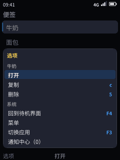
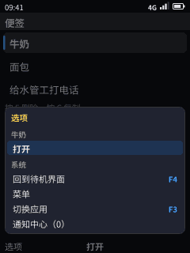
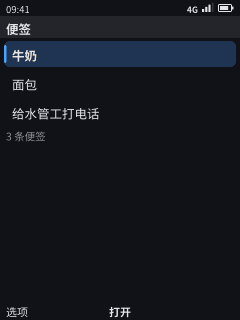
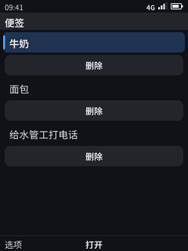
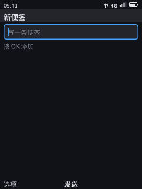
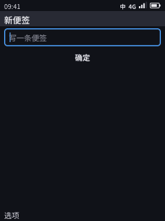
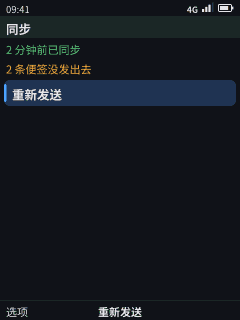
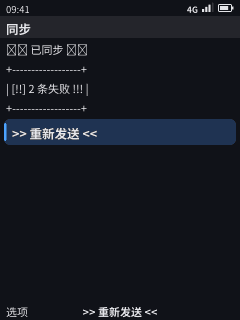
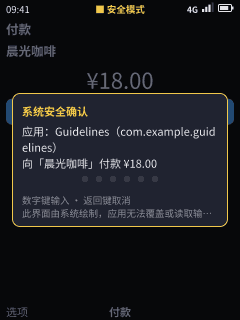
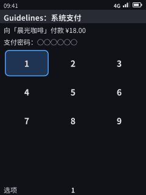

# 应用规范：界面、审核和隐私标签

> 给写 Kario 应用的人：界面怎么设计（从 [10](10-keyboard-interaction-model.md) 和 [26](26-design-system.md) 整理）、商店审什么（[07](07-ecosystem-and-store.md) §4.1、[22](22-developer-api.md) §12 已实现的检查加上人工审核的标准）、隐私怎么公示。
> 状态：界面规范和审核指南是成文的约定，其中系统强制的部分已实现并标出；§1.3 有正反例截图（脚本生成，`make guideline-shots`）；隐私标签已实现（§3：清单、核实、商店应用的「详情」页、审核台、官方商店的网页目录；能上网的应用必须有，这是官方商店的规则，已上架的应用有宽限期）；这篇和 22、29、34 在开发者门户（不开源）里也能读到（[29](29-app-development.md) §4）。写应用的步骤见 [34](34-app-tutorial.md)。

## 0. 先说结论

- 应用只说「有什么内容、能做什么」，焦点、菜单、软键、返回、输入法、确认框、权限框、配色和字号都是系统的。所以规范比 iOS 的短：系统强制的规则（10 §3）不用记，也违反不了；这里写的是系统管不到、审核要看的部分。
- 一页一件事，OK 做主操作，其余的进「选项」，右软键放这一页最常用的事；每个动作在菜单里都找得到。
- 审核先跑和设备安装时同一套自动检查，新应用和要新权限的更新再进人工审核；人工审核看的是用途是不是真话、权限是不是最少、按键是不是够用、有没有冒充系统。

## 1. 界面规范

### 1.1 系统替应用做的

| 方面 | 系统怎么做 | 应用该做的 |
|------|------------|------------|
| 焦点和方向键 | 按阅读顺序移动，宫格（`columns`）里二维移动，焦点永远可见 | 给可操作的节点稳定的 `id`（焦点跟着 id 走，列表变了焦点不乱跳） |
| 选项菜单、命令面板 | 左软键「选项」列出焦点节点的动作和本页动作，带快捷键；`/` 搜全部动作 | 动作写清楚的标签，常用的给 `key` |
| 返回 | 返回键回上一级，保留滚动位置和没发出的输入 | 页面用 push 叠起来，不要自己做「返回」按钮 |
| 确认 | `group: "danger"` 或 `confirm` 时先弹系统的确认框 | 删除、清空、付款前都标上 |
| 输入法 | 九宫格、全键盘、拼音、笔画、符号表都是系统的；粘贴也是 | 输入框给 `placeholder`，按内容选 `keyboard`（`number`、`phone`、`email`） |
| 权限 | 第一次用时系统弹框，写着清单里的用途 | 用途写真话（§2.2）；被拒以后能降级就降级 |
| 外观 | 四套主题、十档字号、大字号、像素界面和文本界面 | 只用节点的 `style`（`dim`、`accent`、`title`、`ok`、`warn`、`big`、`display`），不写颜色、不用空格对齐 |
| 被系统结束后回来 | 先显示原来的页，输入框里没发的字和焦点还在 | 离开前交出重建页面要的状态（KarioUI：`state(..., { save })` 和页面参数，34 §6） |

### 1.2 一页怎么摆

- 标题说清楚这是哪里，一行放得下（竖屏一行约 20 个汉字，10 §6）。标题里不要有「系统」：系统会在前面加上应用名（22 §8）。
- 主操作给 OK（`primary`），一个节点只有一个；次要操作进「选项」。右软键（`right`）放这一页最常用的事：新建、发送、全部删除。
- 列表项 OK 打开详情，删除、分享、复制作为它的动作进菜单，不要在每一项后面摆按钮节点。
- 一个输入框配它的 `submit`，按 OK 就提交；不要在输入框下面再摆一个「确定」按钮。
- 长内容用 `doc`（Markdown，链接自动进菜单）；长列表做搜索（`live` 输入框）或分页：一页最多 1000 个节点，栈最多 32 页（22 §8）。
- 等得久的事显示 `progress` 或一行 `dim` 文字；处理动作的循环要随时回 `ping`，5 秒不回系统就提示「没有响应」。
- 九宫格机型上数字键在输入框外是快捷键：不要只靠字母键触发功能。隐藏动作（`hidden`）只用于屏幕上本来就有对应按钮的场合（计算器的数字键）。
- 文字整句翻译：`tr("已添加「%s」", 名字)` 这样的整句进翻译表，不要拼接词语；日期、数字的顺序因语言而异（22 §9.1）。
- 画布（`canvas`）只用于游戏、地图、图表；要读的文字放在普通节点里，画布里不写字（22 §3）。

### 1.3 这样做，不要那样做

| 这样做 | 不要那样做 |
|--------|------------|
| 每个功能在「选项」菜单里都找得到 | 只有某个快捷键才能触发的功能 |
| 列表项 OK 打开，删除在菜单里并标 `danger` | 每一项后面跟一个「删除」按钮节点 |
| 输入框加 `submit` | 输入框下面再放一个「确定」按钮 |
| 状态用 `ok`、`warn` 样式的文字 | 用表情、颜色字符、ASCII 画框表示状态 |
| 付款、签名用系统的可信确认（`auth.confirm`） | 自己画 PIN 键盘、自己画「系统」对话框 |
| 第一次要用相机时才申请，被拒后给出不用相机的路 | 一启动就把所有权限要一遍 |
| 要后台收消息用推送和后台任务（22 §6） | 用 `voip` 后台模式保活 |

前五行的样子（竖屏九宫格机型，phone-paint 画的，和像素自测的截图同一条路；左边这样做，右边不要那样做）。后两行讲的是什么时候申请、在后台怎么做，一张截图看不出，没有配图；写法见 [34](34-app-tutorial.md) §7（权限）和 §7.1–§7.2（推送、后台任务）。

| 哪一行 | 这样做 | 不要那样做 |
|--------|--------|------------|
| 功能都在菜单里 |  |  |
| 删除在菜单里 |  |  |
| 输入框加 `submit` |  |  |
| 状态用样式 |  |  |
| 付款用可信确认 |  |  |

这些页面是 `examples/guidelines`（KarioUI 写的，「don't」那几页故意做错）。改了页面、设计系统或渲染器以后重新生成：在 Kario 的源码树里 `make guideline-shots`（要 `make build` 和 `make paint`，脚本 `scripts/guideline-shots.sh`）。它把示例当开发者应用装进开发机上的 Shell（`--dev-app`），按 `examples/guidelines/shots.script` 逐页打开，phone-paint 无头出图，简体中文和英文各一遍；时钟定在 09:41，同一份代码出的图逐字节相同。图从 480×640 缩到一半、减到 16 色（`tools/pngshrink`），每张 1–5 KB，放在 `docs/img/33/`（英文的是 `*.en.png`）。

## 2. 审核指南

### 2.1 自动检查

商店收到包先跑这些检查，设备安装时再跑一遍（同一份代码），不过就拒收：

| 检查 | 在哪里实现 |
|------|------------|
| 签名和证书链通到本商店的根，文件和签名清单一一对应 | `pkg.Open`、`appstore` |
| 开发者已核验，应用 ID 是反向域名、不以 `system.` 开头、没被下架过，更新出自同一个开发者且版本更高 | `appstore`、`shell/install.go` |
| 不声明 `system`、`install`，没有 `granted`，没有不认识的权限 | `appstore`、`shell/install.go`、`kario build` |
| 每个运行时权限都有用途（1–80 个字），用途只给声明了的权限 | `appstore`、`kario build` |
| `locales` 只有四种语言，长度限制和清单本身一样，不翻译清单里没有的设置、权限、命令、调起、通知动作 | `i18n.CheckAppText` |
| TypeScript 应用：没有 `exec`、没有可执行文件、没有字节码，`main` 是包根下的 `.js`；机器码只能是 `native` 声明的模块 `lib/<架构>/<名字>.so`：64 位共享库、架构对、导出 `kario_native_init`、接口版本对，商店要有 `arm64` 的（22 §9.3） | `jsrt.Check`（`appstore`、`shell/install.go`、`kario build`） |
| 非接触卡：要 `nfc` 权限，卡的 ID、类别和 AID 合规 | `ui.CheckNFCCards` |
| 隐私标签：类别和用途是规定的那些；没有 `net` 权限就不能声明发出数据；有 `net` 时每个运行时权限打开的数据都要交代（§3） | `ui.CheckPrivacy`（`appstore`、`shell/install.go`、`kario build`） |
| 隐私标签必填：有 `net` 权限的应用要有 `privacy`；已上架、能上网又没有标签的应用，它的更新在宽限期内还收（§3） | `appstore`（`RequirePrivacy`、`PrivacyGrace`）；官方商店后端默认打开 |
| 国内公开商店：要有备案号，格式对 | 官方商店后端（不开源） |

`kario build` 在开发者机器上就跑其中针对清单的那部分，过了 `kario build` 的包在这几项上不会被拒；只有隐私标签必填一项 `kario build` 只提示、不算错（不上商店的应用在开发机和开发者模式下照样能跑），提示里写着要补什么。

### 2.2 人工审核看什么

新应用和要新权限的更新进人工审核队列（07 §4.1），审核员按这张表看：

| 看什么 | 通过的样子 |
|--------|------------|
| 用途是真话 | 用途写的事应用里确实有，而且只在那时用：「扫码付款」的相机只在扫码页申请 |
| 权限最少 | 声明的权限都用得到；用 `media.pick`、`scan.qr` 这类系统界面就够的，不要整块的 `photos`、`camera` |
| 按键够用 | 所有功能用方向键、OK、软键和菜单都做得了；画布应用另看键盘可达（07 §0） |
| 不冒充系统 | 不仿系统的对话框、PIN 输入、付款确认；付款走 `auth.confirm` |
| 后台守规矩 | 消息靠推送，定期同步靠后台任务；`voip` 只给真有通话的应用 |
| 不扣费、不骚扰 | 打电话、发短信系统每次都让用户确认（22 §4.2），审核再看是不是诱导用户点确认 |
| 内容合规 | 符合上架地区的法规；国内公开商店要备案号 |
| 和隐私标签一致 | 声明发出的数据和权限、用途、功能对得上：要账号的应用写了 `account`，带分析、广告库的写了 `usage`、`identifiers`；审核台的待审列表有「隐私标签」一列（§3） |
| 原生代码 | 只用 TypeScript 的应用只审 JS 和清单；带原生模块的应用（`native`，22 §9.3）照原生应用审，每个版本都审：模块做的是应用说的事（编解码、图片、加密、数据库、网络协议）；看库导入的符号，有 `dlopen`、`mmap`/`mprotect` 可执行页、`fork`/`exec`、自己开套接字的要说明（不加载、不生成包外的代码，带 JIT 的说明用途，不开子进程，网络照样要 `net` 和隐私标签）；不碰运行时的描述符和信号处理 |

审核员退回时写理由，开发者在门户里看到；上架后的应用可以被举报，员工处理后可以下架（07 §4.1）。

## 3. 隐私标签

商店公示的是：

| 公示什么 | 从哪里来 | 在哪里看到 |
|----------|----------|------------|
| 权限 | 清单的 `permissions` | 系统的安装确认框；商店应用的「详情」页（按手机的语言）；目录里的 `permissions` |
| 每个运行时权限的用途 | 清单的 `purposes`，各语言在 `locales` | 系统的授权框；「详情」页（跟在权限后面）；目录里的 `purposes`（按语言） |
| 隐私标签 | 清单的 `privacy` | 「详情」页的「隐私」；审核台的待审列表；目录里的 `privacy`；官方商店的网页目录（`/apps` 的「隐私」一列，和「详情」页的说法一样） |
| 开发者、统一社会信用代码、备案号 | 开发者注册、清单的 `filing` | 「详情」页；目录 |
| 含原生代码 | 清单的 `native` | 系统的安装确认框（列出模块名）；「详情」页；目录里的 `native` |

隐私标签是开发者声明「哪些数据发出手机、做什么用、是否和身份关联、给不给第三方」，像 App Store 的「App 隐私」、Google Play 的「数据安全」。清单里这样写（一个查天气的应用）：

```json
"permissions": ["net", "location", "contacts"],
"purposes": { "location": "Show the weather where you are", "contacts": "Send the forecast to a friend" },
"privacy": {
  "collects": [
    { "data": "location", "use": ["app"] },
    { "data": "usage", "use": ["analytics"], "shared": true }
  ],
  "local": ["contacts"]
}
```

| 字段 | 含义 |
|------|------|
| `collects` | 发出手机的数据，每类一项：`data` 是类别；`use` 是用途，至少一个：`app`（应用功能）、`analytics`（分析）、`ads`（广告）；`linked`：和用户身份关联（账号、手机号）；`shared`：给第三方（分析、广告公司） |
| `local` | 读得到、只在手机上用、不发出去的类别 |

类别（`ui/privacy.go`）：`account` 姓名、手机号和邮箱，`contacts` 通讯录，`location` 位置，`photos` 照片和视频，`audio` 录音，`messages` 通讯内容，`payment` 付款和卡片信息，`identifiers` 标识符，`usage` 使用数据，`diagnostics` 诊断数据。「详情」页按这个顺序列，四种语言的说法是系统的，开发者只填类别。

系统核实它核实得了的部分（`ui.CheckPrivacy`，`kario build`、设备安装、商店后台跑同一份代码）：

- 类别和用途只能是上面那些，一类只写一次。
- 没有 `net` 权限的应用上不了网，`collects` 必须为空；「详情」页直接写「数据不出手机：这个应用不能上网（系统核实）」，不看开发者写了什么。
- 有 `net` 的应用，每个运行时权限打开的数据都要写进 `collects` 或 `local`：`camera`、`photos` 是照片和视频，`microphone` 是录音，`contacts` 是通讯录，`location` 是位置，`nfc.reader` 是付款和卡片信息。漏了就拒收。
- 已上架应用的更新多发出一类数据，和多要权限一样进人工审核（「collects new data: …」）。分批发布时，还留在旧版本的手机看到的是旧版本的标签。

**必填**：能上网（有 `net` 权限）的应用必须写 `privacy`，这是商店的一条规则（`appstore` 的 `RequirePrivacy`，官方商店后端默认打开，`--require-privacy=false` 关掉；模拟商店 `phone-storesrv` 不开）。不能上网的应用不用写：系统自己知道它发不出数据，「详情」页照样写「数据不出手机」。拒收时回答里写明要补什么：`collects` 和 `local` 各放什么，以及这个应用的权限打开了哪几类数据、每类都要写进其中一个（`ui.PrivacyHint`）；`kario build` 对能上网又没有标签的应用提示同样的话，`kario publish` 和门户把商店的回答原样显示。
**宽限期**：规则打开之前就上架、能上网又没有标签的应用，它的更新在宽限期内还收（官方商店后端的 `--privacy-grace 日期`，到那天的 0 点（UTC）为止；不给就没有宽限期）。收下时回答里带 `warning`：从哪天起不再收没有标签的更新、要补什么，`kario publish` 打印出来。宽限期内上架的版本「详情」页还写「开发者没有提供隐私信息」；新应用、原来有标签的应用去掉标签、原来不能上网的应用加上 `net` 却不写标签，都不在宽限之列。

`usage`、`identifiers` 这类不靠权限拿到的数据系统核实不了，标签由开发者负责，审核员按 §2.2 核对，和实际不符照违规处理。官方商店的网页目录（`/apps`）每个应用一列「隐私」，说法和「详情」页一样（按页面的语言）：不能上网的写「数据不出手机」，有标签的逐类列出发出什么、做什么用、只在手机上用什么，宽限期里上架、没有标签的写「开发者没有提供隐私信息」。

## 4. 没做的

| 项目 | 说明 |
|------|------|
| 正反例截图只有一种机型 | 只出了竖屏九宫格（bar-t9）的；横屏全键盘、宽屏的没出，大字号、别的主题也没出 |
| 原生代码只用包里的 | 模块加载完以后系统用 seccomp 封住可执行内存（[22](22-developer-api.md) §9.3）；模块的 `init` 在那之前做什么，还靠审核（§2.2） |
