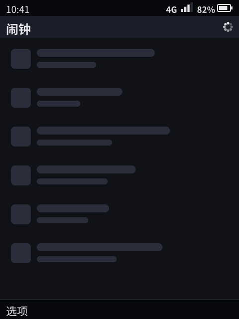

# 动效：哪些动画适合 Kario，怎么做到流畅

> 2026-11-17 的调查和计划，同一天做了第一批；2026-11-18 做了第二批：脏矩形和图层、横幅和提示条的滑动、背光渐变、整屏重画的缓存；2026-11-20 做了第三批：正文图层（滚动只拷贝）、应用启动时的骨架页、光标闪烁和转圈、图片按显示尺寸缓存和整数混合、像素自测最后自动报告每步耗时；2026-11-21 做了第四批：GPU 合成（§5 第 8 条，GLES 2，设 `PHONE_PAINT_GPU=1` 才用，默认和出错时照旧在 CPU 上合成；**未上真机**，Adreno、Mali、PowerVR 都没试过）、宫格和输入法候选行里的焦点滑动、充电时电池的动画、相位动画改由渲染器推进（协议加了浮层的 `period` 和功能 `phase`）、真屏幕上自动收集每步耗时，并在 QEMU 的 virtio-gpu 屏上跑了一遍，找出并改掉了三处我们自己的节奏问题；同一天动效还改成按面板的刷新率走（phone-displayd，[08](08-display-adaptive-refresh.md)）：每步一个面板周期，原来的 16 ms 换成面板的周期（60 Hz 时 16.7 ms，120 Hz 时 8.3 ms），CPU 和 GPU 路径都是，动画开始和停下时渲染器告诉 Shell（`motion`），按键和动画时刷新率升到屏的最高一档（§5 第 9 条）；同一天还做了在 GPU 上栅格化（§5 第 10 条，L2：设 `PHONE_PAINT_GPU=raster` 才用，GPU 按显示清单直接画图层，GPU 画的每种操作都和 CPU 逐字节相同；**未上真机**）；2026-11-24 做了第五批，取自几个单色 OLED 小屏菜单框架的想法（§4.1）：选中的行被「…」截断时文字自己滚出来（跑马灯）、换目标时速度不跳的缓动、列表到头时高亮轻推一下（§3）（§3、§5 每项写着状态）。§2 的数字是开发机上的实测，§2.3 有 QEMU 上的数字（TCG 模拟的 CPU 和屏，**不是手机的**），手机上的数字是**估算**；§2.4、§2.5 的 GPU 是 Mesa 的 llvmpipe（在 CPU 上跑的光栅化器），数字不代表手机；动画在 QEMU 的 virtio-gpu 上看过，真机上**还没看过**（**未上真机**）；切换刷新率只在自测的模拟屏上试过（**未上真机**）。

## 0. 结论

- **能做到流畅，但不能靠「每帧从头画一遍」。** 原来 phone-paint 每个动画帧都把整屏重新栅格化（文字、圆角、图片全画一遍）。开发机上一屏中位数 2.2 ms、慢的 5–11 ms；换到手机的 CPU 上估计要慢 2.5–6 倍，慢的界面一帧 15–60 ms，60 帧（每帧 16.7 ms）跟不上。现在设备上每一帧先记成一张绘制清单，和上一帧的清单比，只重画变了的矩形（§5 第 2 条）：真实界面序列上平均每步从 2.6 ms 降到 1.1 ms，只变一部分的步从 2.5 ms 降到 0.4 ms，什么都没变的步 0.04 ms（§2.1）；正文再画成图层、滚动只拷贝以后，平均每步又从 0.9–1.1 ms 降到 0.5–0.6 ms，整屏都变的步（换页、滚动）从 2.0–2.5 ms 降到 1.0–1.4 ms（§2.2）。
- **流畅的办法是「画一次、只挪」**：新界面只完整画一次，放进一块离屏图层；动画的每一帧只是把几块不透明图层按偏移拷到屏幕上，开发机上一帧 0.1 ms，手机上估计不到 1 ms。再加上双缓冲和按显示刷新翻页（原来只有一块缓冲、没有垂直同步，动起来会撕裂）。
- **适合我们的动画是短的、有方向的、跟着按键走的**（§3）：焦点高亮滑过去、整页左右推入推出、菜单和对话框从下面升起、横幅从上面滑下、滚动缓动、亮灭屏用背光渐变。时长 100–200 ms，比触屏手机短（诺基亚 E72 的用户就抱怨过转场拖慢操作）。
- **不做的**：毛玻璃模糊、视差、3D 翻转、带回弹的弹簧动画、整屏透明叠化当默认转场、会让按键等动画的任何东西（§4）。
- **设置里给开关**：「动画效果：标准 / 减弱 / 关闭」，和诺基亚 S60 的「主题效果」、iOS 的「减弱动态效果」、安卓的「移除动画」一样；低电量和省电模式自动减弱。

## 1. 现状（代码）

| 项 | 现在 |
|----|------|
| 缓动 | `paint/src/paint.rs` 的 `Ease`：从静止起缓出三次方（ease-out cubic）；动着的时候换目标，从当前位置、按当前速度接着走：一条三次 Hermite 曲线，起点是现在的位置和速度，终点是目标、速度为零，时长照旧，所以位置和速度都不跳；接着走的速度裁到曲线不会越过目标（Kario 没有回弹），新目标在背后时从零开始；起点速度正好是平均速度的 3 倍时这条曲线就是缓出三次方，所以从静止起的一次移动和以前逐位相同（§3） |
| 滚动 | 140 ms（`SCROLL_MS`）；滚动偏移取整到面板像素，正文画成按屏高分段的图层（`paint/src/canvas.rs` 的 `Body`），每步只拷贝窗口里的行（§5 第 2 条） |
| 焦点 | 列表里高亮在两行之间滑过去，100 ms（`FOCUS_MS`）；宫格（主菜单的图标、日历的月份、计算器的按键、图片的网格）和输入法的候选行里高亮从一格滑到另一格，同样 100 ms 缓出，中途换目标从当前位置、按当前速度接着走（`paint/src/paint.rs` 的 `Glide`：列表的行是它的上沿和高度，宫格是列和行，候选是 x 和宽度，两个数各用一个 `Ease`）：宫格里所有格子先画底色，再画高亮，再画格子上的东西，照片网格的高亮是一圈描边，在照片上面滑；候选行先画高亮再画字，高亮盖住多少，字就浅多少；每步只重画高亮经过的格子；动画效果「减弱」时宫格和候选行和列表一样照样滑，「关闭」时都不滑 |
| 横幅、提示条 | 渲染器自己计时（`paint/src/motion.rs` 的 `Slide`）：通知横幅从状态栏后面滑下来、提示条从软键栏（或候选行）后面升上来，150 ms 缓出；离开 100 ms 缓入；中途反向从当前位置接着走，用剩下那段路的时间。横幅和提示条只画一次，画进自己的透明图层，每步只按偏移贴这一条 |
| 背光 | 渐变，不跳（`hal/backlight` 的 `Fader`）：亮屏 150 ms、调暗和熄屏 300 ms、换亮度（设置、自动亮度）250 ms；沿 CIE 明度插值（每一步看上去一样大），亮起缓出、变黑缓入，按硬件自己的级数写（比百分之一细）；中途换目标从当前亮度接着走。熄屏时先渐暗到最暗，再让渲染器关面板（面板驱动关面板时连背光一起关，会把渐变截断）；渐暗途中按键，从当前亮度亮回来；面板关了以后亮屏，等渲染器说面板开了再渐亮（[28](28-battery.md) §7）。键盘背光一样 |
| 光标、转圈 | 渲染器自己计时（`paint/src/motion.rs` 的 `CARET_MS`、`SPIN_MS`）：输入框的光标亮 500 ms、灭 500 ms，打字或挪光标时立刻亮；转圈是一圈 8 个点，最亮的那个每 125 ms 走一格，1 s 一圈；不动的时候渲染器按下一次变化的时间醒来，只画光标或转圈那一小块；快照里光标总是亮的、转圈停在起点；动画效果「关闭」时都不动 |
| 启动中的应用 | 应用还没交第一页时 Shell 在帧里标 `skeleton`（[23](23-renderer-protocol.md) §4），phone-paint 画骨架页：标题、标题栏右端的转圈、几行列表的形状，不写「正在启动」；第一页到了原地换上，不再推一次（`shell/motion.go`） |
| 充电的电池 | 渲染器自己计时（`paint/src/motion.rs` 的 `CHARGE_MS`、`CHARGE_STEPS`）：接着电源、没充满时，状态栏的电池从电量处每 500 ms 多充一截，四步到满再从头来，电池旁边画一道闪电；待机界面（插上电源时亮起的那一屏，[28](28-battery.md) §1）在日期下面画一个两倍大的电池和百分比，一起动；每步只画电池那一小块（状态栏里不到屏幕的 0.2%，待机界面上两块加起来不到 1%）；快照里停在电量处；动画效果「关闭」时不动 |
| 相位动画 | 浮层的 `phase`（0–1）：扫码的扫描线（2.4 s 一个周期）、来电的脉动（1.5 s）、闹钟和紧急警报的脉动（1 s）。声明了 `phase` 的渲染器（phone-paint）只收到起点 0 和周期 `period`，从浮层出现起自己按时间推进，16 ms 最多走一步（`PHASE_MS`）；扫描线挪过的距离、脉动的半径变化取整到面板像素，挪不到一个像素的步什么都不画（脉动 1.5 s 里约 20 步有变化）；相位走着帧不变，Shell 不为它发帧（[23](23-renderer-protocol.md) §4，`shell/motion.go` 的 `overlayPhase`）；快照画起点，所以来电、闹钟、扫码的截图每次一样（以前是 Shell 建帧那一刻的位置）；动画效果「关闭」时不动；别的渲染器照旧收到 Shell 建帧时的相位 |
| 跑马灯 | 渲染器自己计时（`paint/src/motion.rs` 的 `MARQUEE_*`、`marquee_at`）：列表里选中的行（`item`）的标题或副标题、菜单里选中的项被「…」截断时（`canvas.rs` 的 `fit`），先照旧显示截断的样子 1 s，再以每秒 30 个逻辑像素把藏着的结尾滚出来，一步一个面板像素，到头停 1 s，回到截断的样子再来；一行的标题和副标题一起滚（按长的那行计时，短的先到头等着）；文字只画在这一行的框里（`Op::Marquee`），哪边有藏着的字，哪边的边缘 8 个逻辑像素渐隐；焦点一移开，下一帧就是截断的样子；菜单或对话框盖着时正文的行不滚；快照画截断的样子 |
| 列表到头 | 按键什么都没动（焦点和滚动都没变）时，Shell 在下一帧标 `bump`（[23](23-renderer-protocol.md) §4，`shell/motion.go`），渲染器把焦点高亮往那边推 3 个逻辑像素再回来（`paint/src/motion.rs` 的 `BUMP_MS`、`BUMP_PX`、`nudge`）：前 60 ms 缓出推出去，后 60 ms 缓入回来，不越过停着的位置；列表的行在自己原处画推开的高亮（3 像素正好是行间距 `GAP`，不盖住邻行），宫格的高亮按格子滑动那套画 |
| 开机动画 | `shell/boot.go` |
| 出帧 | 每帧（缓动的每一步也是）先记成绘制清单（`paint/src/canvas.rs`：画什么、在哪、什么颜色），和上一帧的清单比出脏矩形，只在脏矩形里重画（`paint/src/layers.rs`）；两层：页面层（正文、标题栏、输入法候选行、软键栏）和上层（状态栏、横幅、浮层、提示条），上层变了只把页面层的像素拷回来再画上层，页面不重画；正文在页面层里另有自己的分段图层，滚动只拷贝。能翻页、翻页又等垂直消隐时跟着翻页完成的事件走；翻页完成的事件里帧号不往前走（virtio-gpu 没有垂直消隐，翻页马上完成，帧号总是 0）或者不能翻页时，按面板正在用的模式的刷新率自己计时（phone-displayd 选的刷新率，Shell 的 `rate`；没来之前是面板开机的模式）：下一帧画好以后，等到上一帧交出去满一个周期（60 Hz 是 16.7 ms，120 Hz 是 8.3 ms）再交给面板，和等垂直消隐一样（`paint/src/kms.rs` 的 `wait_frame`、`paint/src/pace.rs`；以前这时动画步一步接一步地画，比面板快、白耗 CPU，§2.3）；GPU 路径的帧也这样走；什么都没变的一步也等一个周期；转场（§3）不重画，只拷两张图（`paint/src/motion.rs`） |
| 上屏 | 两块 DRM 哑缓冲轮换：帧画进不在屏上的那块，只拷这块上次写入以后变过的矩形（记着每块缓冲欠下的脏矩形；不知道时逐像素比）；翻页（`page_flip`，带完成事件）在下一个垂直消隐时换上去；驱动不能翻页、或连着三次等不到事件时退回一块缓冲原地写加 `dirty_framebuffer`（每个脏矩形一个裁剪框，`paint/src/kms.rs`）。两块缓冲开机时映射一次，一直留着（以前每帧映射一次，每帧都要把页重新缺页调进来）；转场除了第一步，每步告诉上屏只有动的那几行变了（页面推入推回是状态栏和软键栏之间，面板升降是状态栏以下），不用整屏比对；像素一次一个字地换成面板的格式（§2.3）。修了一个错：一帧回到两帧以前的样子时（提示条出来又消失、动画关着），不在屏上的那块正好已经是这一帧，原来不翻页就当它在屏上了，屏幕一直停在提示条那帧 |
| 快照 | 画缓动结束时的样子（协议规定），所以像素自测不受动画影响；快照照旧整屏直接画，不经过清单（同一套绘制代码，像素一样，§2.1）；相位动画画起点，充电的电池画在电量处；宫格和候选行改成分几遍画（底色、高亮、内容）以后，像素和以前一格一格画逐字节相同（单元测试 `grid_passes_draw_what_a_tile_at_a_time_did`、`the_candidate_row_draws_as_it_did`；像素自测里渲染器收到的帧拿改动前后的 phone-paint 各画一遍，除了充电的待机界面都逐字节相同，§2.3）；正文也是分段画再拷贝，滚动偏移取整，所以滚过的页面比 2026-11-20 以前最多挪半个面板像素，字形边缘因为整数混合差 1–2 级（看不出来） |
| GPU 合成 | 设了 `PHONE_PAINT_GPU=1` 才用（默认不用）：CPU 照旧记清单、画脏矩形，只是图层拆开画，只把画过的矩形上传成纹理；一个 GLES 2 着色器按 CPU 的整数算法合成整屏，转场是对前后两屏的着色器，经 GBM 表面和翻页上屏；没有 EGL、驱动只是软件光栅化器、或出错时退回 CPU（`paint/src/gpu.rs`，§5 第 8 条）；`rate` 在 GPU 的缓冲在屏上时也切模式（§5 第 8 条）；**未上真机** |
| 在 GPU 上栅格化 | 设了 `PHONE_PAINT_GPU=raster` 才用（默认不用）：CPU 只记清单、算脏矩形，页面层、上层和正文的段由 GPU 按清单画进纹理，再照 GPU 合成上屏；GPU 画的每种操作（清空、矩形、圆角矩形、圆、渐变、文字、图片、滑动的图层）都和 CPU 逐字节相同，多边形和伸出图外的圆角矩形、圆由 CPU 画在透明底上再叠上去（`paint/src/raster.rs`，§5 第 10 条）；**未上真机** |

## 2. 实测

开发机（Intel Xeon E5-2670 v3，Haswell，睿频 3.1 GHz，单线程），phone-paint 发布版，直板九宫格形态 480×640，整套像素自测里的 100 个快照界面，每个界面连画 40 次取中位数：

| 测的东西 | 开发机 | 手机上（**估算**：A73 2.0 GHz 约慢 2.5–3 倍，A53 / A55 约慢 5–6 倍，按单核跑分的比例，**未上真机**） |
|----------|--------|------|
| 整屏重画，100 个界面的中位数 | 2.2 ms | 6 ms / 12 ms |
| 整屏重画，90% 分位 | 5.4 ms | 15 ms / 30 ms |
| 整屏重画，最慢（NFC 选卡，带卡面图片） | 10.9 ms | 30 ms / 60 ms |
| 待机界面 / 主菜单宫格 / 聊天 | 1.4 / 5.1 / 2.9 ms | — |
| 一整屏不透明拷贝（memcpy，1.2 MB） | 0.1 ms | 0.3 ms / 0.6 ms |
| tiny-skia 带混合地贴一整屏图层（`draw_pixmap`） | 2.3 ms | 6 ms / 13 ms |

- 慢的是带图片的界面（壁纸、图库、相机、卡面）和逐像素的浮点混合；文字不是大头：试着给字形加缓存（每个字的覆盖率位图按 1/4 像素的横向位置缓存），中位数只从 2.2 ms 降到 1.6 ms，90% 分位从 5.4 ms 降到 4.7 ms。
- 所以动画帧要避开整屏重画，也要避开整屏的透明混合；不透明的按行拷贝几乎不花时间。
- tiny-skia 在 aarch64 上有 NEON 的实现，上面的倍数按这个估；要在 SD662、T610 的开发板上实测（**依赖硬件**）。
- §2.1–§2.4 的步数是按每步 16 ms 量的（2026-11-21 以前 `--bench` 和自测计时的时钟）；现在两者都按面板的周期走（没给 `rate` 时 60 Hz，16.7 ms），有的动效少一步（180 ms 的推入从 12 步变成 11 步），每步的耗时不受影响。

### 2.1 脏矩形以后（2026-11-18）

同一台开发机（和别的任务共用，单次计时会抖，所以每种画法连跑三遍、每一步取最快的一遍），直板九宫格 480×640。帧是像素自测的几组用例（待机、鸿雁、电话、通讯录、闹钟、计算器、菜单、锁屏、亮度、动画效果）里渲染器真收到的 170 帧（`PHONE_PAINT_DUMP` 记下的），每帧后面跟着它引起的动画步（按 60 Hz 推进时钟），共 328 步。`phone-paint --bench <帧文件>` 用三种画法各画一遍：原来的（每步整屏重画、什么都不留）、整屏重画但留着解码好的图片、图标和字形轮廓，和现在的（记清单、只画脏矩形）；三种画法每一步的画面逐字节相同，不同就报错。不含上屏（开发机上没有面板）。

| 每步耗时（ms） | 步数 | 中位数 | 90% 分位 | 最慢 | 平均 |
|------|------|------|------|------|------|
| 原来：整屏重画，什么都不留 | 328 | 2.27 | 4.99 | 7.62 | 2.60 |
| 整屏重画，留着图片、图标、字形轮廓 | 328 | 1.54 | 4.12 | 7.01 | 2.20 |
| 现在：记清单，只画脏矩形 | 328 | 0.67 | 2.97 | 5.79 | 1.10 |
| 　其中整屏都变了（换页、滚动的每一步）：原来 / 现在 | 150 | 2.01 / 1.62 | 4.92 / 3.32 | 7.62 / 5.79 | 2.69 / 2.02 |
| 　其中只变了一部分：原来 / 现在 | 120 | 2.45 / 0.38 | 5.66 / 0.87 | 7.39 / 2.73 | 2.78 / 0.47 |
| 　其中什么都没变：原来 / 现在 | 58 | 2.24 / 0.03 | 2.42 / 0.05 | 5.52 / 0.09 | 2.04 / 0.04 |

- 现在每步重画的面积中位数是屏幕的 33%，平均 50%：整屏都变的步主要是换页和滚动（当时正文每一步都在动、都要重画；正文图层后来做了，§2.2）。状态栏时钟走一分钟只重画时间那一块（不到屏幕的 1%），列表里焦点下移一行重画两行（约 23%），横幅进出、提示条进出每步只画那一条（约 12%、3%），页面层不动（单元测试）。
- 记清单本身很便宜：平均每帧 42 个绘制操作，0.05 ms。
- 手机上的数字按 §2 的倍数估：只变一部分的步约 1–2.5 ms，整屏的步约 4–10 ms（**估算，未上真机**）。在开发板上跑 `phone-paint --bench` 就能实测（帧文件在开发机上用 `PHONE_PAINT_DUMP=<文件>` 跑自测记下来，拷过去）。
- 原来的数字和 §2 的 2.2 ms 不完全可比：这里包括动画步、按序列画（缓存跨帧），机器负载也不同。上表是机器较闲时的一遍；负载很重时（平均负载 100 以上）三遍：原来平均 3.1–3.7 ms，现在 1.4–1.7 ms，现在约是原来的 45–50%；只留缓存的整屏重画那时和原来分不出来，较闲时快 12–15%。

### 2.2 正文图层、图片缓存和整数混合以后（2026-11-20）

同一台开发机（平均负载 6–10，48 核），直板九宫格 480×640，`phone-paint --bench`，每种画法连跑三遍、每步取最快的一遍。两份帧文件，都是 2026-11-20 用 `PHONE_PAINT_DUMP` 从像素自测的用例里记下的（改动以前的 Shell 和渲染器）：A 是 §2.1 那几组用例（待机、鸿雁的会话和消息菜单、电话、通讯录、闹钟、计算器、菜单、锁屏 PIN 码、亮度、动画效果），81 帧、230 步；B 是 A 里闹钟以前的那几组（待机、鸿雁、电话、通讯录），再加设置的权限页、两种输入法、文档节点、编辑联系人这些长列表和长页面，144 帧、367 步。「以前」是 a618f80 的 phone-paint，「现在」是这一批的，同一份帧文件，两个程序交替各跑两遍（下表是第二遍；第一遍各项的平均值和它差 0.15 ms 以内）；每个程序自己的三种画法每一步的画面都逐字节相同。

| 每步耗时（ms） | 步数 | 中位数 | 90% 分位 | 最慢 | 平均 |
|------|------|------|------|------|------|
| A，以前：记清单，只画脏矩形 | 230 | 0.49 | 2.77 | 4.27 | 0.93 |
| A，现在：再加正文图层、图片缓存、整数混合 | 230 | 0.34 | 1.81 | 3.95 | 0.63 |
| A，整屏都变的步：以前 / 现在 | 92 / 77 | 1.52 / 1.04 | 3.05 / 2.91 | 4.27 / 3.95 | 1.97 / 1.41 |
| B，以前 | 367 | 0.36 | 2.90 | 4.53 | 1.13 |
| B，现在 | 367 | 0.18 | 0.93 | 3.84 | 0.47 |
| B，整屏都变的步：以前 / 现在 | 152 / 136 | 2.63 / 0.80 | 3.19 / 1.72 | 4.53 / 3.84 | 2.48 / 0.97 |
| A，整屏重画、留着缓存：以前 / 现在 | 230 | 1.45 / 1.38 | 3.32 / 2.79 | 5.52 / 4.42 | 1.90 / 1.59 |
| B，整屏重画、留着缓存：以前 / 现在 | 367 | 1.99 / 1.44 | 3.63 / 3.30 | 5.78 / 4.19 | 2.20 / 1.66 |

- 「整屏都变」按各自的脏矩形分：现在滚动偏移取整到面板像素，缓动最后挪不到半个像素的几步什么都不变，所以现在这类步少一些。整屏都变的步现在主要是换页；滚动的步只拷贝正文的行，再画标题栏、软键栏和状态栏。
- 正文图层：`--bench` 的最后一行是每步画进正文分段的面积，中位数是 0，平均是一屏的 14%（A）、8%（B），都在帧刚到的那一步（这次滚动要经过的正文这时画好，所以这一步屏幕上可能什么都还没变，B 里这样的步最慢 2 ms）；滚动的第二步起正文一个像素都不画（单元测试 `scrolling_copies_the_body`）。
- 整屏重画快的部分（换页时新页面第一次画就是这个）：把字形的混合换回浮点运算单独编一版，B 上整屏重画平均 2.07–2.10 ms，所以整数混合约占 20%（开发机是 x86-64，`f32::round` 在这里是库函数调用；aarch64 有一条指令，手机上的好处估计小一些，**未上真机**）；把图片缓存关掉单独编一版，A（有主菜单的图标宫格）上整屏重画平均 1.67–1.69 ms、最慢 4.99–5.28 ms，图片缓存约占 6–10%、最慢的那一步快约 13%。
- 手机上按 §2 的倍数估：整屏都变的步平均约 2.5–4 ms（A73）、5–8.5 ms（A53 / A55），**估算，未上真机**。
- 自测里的同一组用例（A 的那 11 个，`PHONE_PAINT_STEPS`，§5 第 6 条）最后报告：217 步，中位数 0.33 ms，95% 分位 2.85 ms，最慢 6.09 ms；转场 307 步，中位数 0.15 ms，95% 分位 0.61 ms；没有慢于 25 ms 的。这是单遍、自测同时在跑的数字，比上表的「三遍取最快」高。

### 2.3 宫格和候选的滑动，QEMU 的 virtio-gpu 屏上的实测（2026-11-21）

开发机同上（平均负载 12–15），直板九宫格 480×640，`phone-paint --bench`，每种画法连跑三遍、每步取最快的一遍。帧文件按渲染器收到的样子拼的：主菜单（14 个图标，用应用包里的图标）里焦点走 14 次（有两次要滚动）、月历（35 格，带农历）里 9 次、输入法两行候选里 10 次（换行那一次不滑），共 36 帧、268 步（挪一次焦点约 7 步：100 ms 按 60 Hz）；三种画法每一步的画面逐字节相同。

| 每步耗时（ms） | 步数 | 中位数 | 90% 分位 | 最慢 | 每步重画的面积（中位数） |
|------|------|------|------|------|------|
| 主菜单：焦点滑动的步（只变一部分） | 84 | 0.37 | 0.44 | 0.98 | 屏幕的 8% |
| 月历：焦点滑动的步 | 72 | 0.23 | 0.27 | 0.32 | 1.1% |
| 候选行：焦点滑动的步 | 64 | 0.13 | 0.16 | 0.35 | 2.2% |
| 整个文件：现在 / 原来（每步整屏重画、什么都不留） | 268 | 0.25 / 2.8–3.3 | 0.8 / 5.9 | 2.5 / 6.8–6.9 | — |

- 手机上按 §2 的倍数估：主菜单滑动一步约 1–2 ms，月历、候选行不到 1.5 ms（**估算，未上真机**）。
- 像素不变：像素自测的 33 个用例（直板九宫格两段、横屏宽键盘一段）里渲染器收到的 399 帧（`PHONE_PAINT_DUMP`），拿改动以前（5d08d68）和以后的 phone-paint 各画成快照：397 帧逐字节相同，另外 2 帧是插着电源的待机界面（新画的电池和闪电）。来电、闹钟、扫码的帧也在里面，起点和以前起点的样子逐字节相同（横屏宽键盘的缩放是 1.6，一开始把脉动的半径整个取整到面板像素，起点挪了不到一个像素，改成只取整变化的那部分）。自测里这三种截图从此总是起点；以前是 Shell 建帧那一刻的位置，每次都不一样，和以前的截图没法逐字节比。
- 同样这三份帧文件拿 `--bench` 画（里面有月历里焦点的 15 次移动和候选的一次移动，其余是这些用例的普通界面）：每一步三种画法的画面逐字节相同；现在每步的中位数 0.59 / 0.23 / 0.44 ms、平均 0.62 / 0.61 / 0.63 ms，原来的画法 1.73 / 1.42 / 1.48 ms、2.17 / 1.95 / 1.89 ms（直板九宫格两份 600、256 步，横屏宽键盘 257 步）。
- 开发机的像素自测报告（`PHONE-GUI-MOTION:`，直板九宫格那两段）：600 步，中位数 0.71 ms，95% 分位 4.12 ms，最慢 16.2 ms，转场 623 步，中位数 0.15 ms；256 步，中位数 0.33 ms，95% 分位 3.82 ms，最慢 17.7 ms，转场 547 步，中位数 0.16 ms；都没有慢于 25 ms 的。

QEMU：`make yocto-gui`（qemuarm64，TCG 在上面那台开发机上模拟 aarch64；virtio-gpu 屏 480×640；Linux 6.18；这一批的镜像），同样的按键跑了四遍（[13](13-prototype.md) §5.1）：开机后的 7 步，再加主菜单、月历、计算器里的焦点滑动，设置首页的滚动，选项菜单升起落下，鸿雁里输入法候选的滑动，飞钱扫码的扫描线。下表是驱动脚本最后打出的 `PHONE-GUI-MOTION:`（第 1 遍找出了问题，那时的按键和后几遍略有不同，没放进表里）。这些是**模拟器的数字**：TCG 解释执行 aarch64，内存访问、缺页、NEON 都比真机慢得多、慢得也不一样，只能拿来找节奏问题、看改动前后的变化，**不是手机的数字**。

| 每步（ms，中位数 / 95% 分位） | 第 2 遍：扫描缓冲每帧映射 | 第 3 遍：扫描缓冲常驻映射 | 第 4 遍：再把计时挪到交出去以前 |
|------|------|------|------|
| 转场：每步合成 | 1.8 / 6.8 | 1.7 / 5.2 | 1.6 / 4.7 |
| 转场：交给面板 | 26.5 / 36.6 | 6.9 / 10.9 | 7.0 / 9.6 |
| 转场：两帧之间 | 28.3 / 39.9 | 15.6 / 20.6 | 13.7 / 16.5 |
| 转场：隔了 25 ms 以上的帧 | 220（共 233） | 1（共 407） | 0（共 473） |
| 缓动（宫格和候选的滑动、滚动）：每步画 | 5.4 / 17.4 | 5.4 / 14.1 | 5.1 / 12.9 |
| 缓动：交给面板 | 6.4 / 29.9 | 1.1 / 8.1 | 1.2 / 8.1 |
| 缓动：两帧之间 | 18.5 / 41.7 | 19.1 / 27.6 | 13.6 / 19.0 |
| 缓动：隔了 25 ms 以上的帧 | 50（共 206） | 22（共 248） | 6（共 341） |
| 只因计时画的帧（扫描线、光标、转圈）：画 / 交给面板 | 2.3 / 5.0，2.4 / 9.9 | 2.4 / 4.6，0.5 / 1.7 | 2.3 / 2.6，0.5 / 4.3 |

找出并改掉的（都是我们自己的）：
- **virtio-gpu 没有垂直消隐**：翻页马上完成，事件里的帧号总是 0（等翻页 0.1 ms）。原来把翻页完成当作垂直消隐，动画的步一步接一步地画，比面板快、白耗 CPU；现在看出帧号不往前走就按模式的刷新率自己计时。第一遍（这一条已经改了）宫格滑动的步隔 16 ms 左右。
- **每帧映射一次扫描缓冲**：每帧都要把拷到的页重新缺页调进来；改成开机时映射一次以后，转场交给面板从 26.5 ms 降到 6.9 ms，两帧之间从 28 ms 降到 16 ms 以下，隔了 25 ms 以上的帧从 220 降到 0–1。真机上缺页便宜得多，每帧几百次缺页照样省掉（**未上真机**）。
- **计时等在画以前**：滑动每步隔一帧加上画的时间（第 3 遍 19.1 ms）；改成画完、交给面板以前再等，和垂直消隐一样。QEMU 给 virtio-gpu 的 EDID 默认 75 Hz，所以第 4 遍两帧隔 13.3 ms 多一点。
- 转场每步原来整屏比对两次才知道哪里变了，现在告诉上屏动的那几行；颜色一次换一个字：模拟器上看不太出来（第 1 遍各段转场交给面板的中位数大多在 26–37 ms，第 2 遍合起来 26.5 ms），开发机上省掉两次 1.2 MB 的比对。
- **撕裂**：翻页换的是整块缓冲，virtio-gpu 交给宿主机的也是整块；第 4 遍推入主菜单时每 40 ms 截一次屏，30 张里 6 种画面（起点、旧页压暗、新页滑进来的三个位置、终点），每张都是完整的一帧，没有撕开的。
- 没改的：相机和扫码的取景框每来一帧相机画面就整屏重画，模拟器上一帧 0.5–0.65 s（驱动脚本「不动的帧」那一行的 95% 分位 0.52 s 就是它们：每帧把 192×144 的画面双线性放大到取景框，tiny-skia 的浮点管线在 TCG 上很慢；开发机的像素自测里（扫码也在里面）最慢的一步 16–18 ms）。这不是动效，留着；手机上要看真机。
- 充电的电池在 QEMU 上没看到：模拟器的电池是模拟的、不充电。

### 2.4 GPU 合成（2026-11-21，llvmpipe 上，不代表手机）

同一台开发机（平均负载 7–12），直板九宫格 480×640，`phone-paint --bench`，每种画法三遍、每步取最快的一遍。开发机没有能用的 GPU（只有服务器的 mgag200 显示芯片，而且没有权限打开），GPU 路径（§5 第 8 条）跑在 Mesa 23.1 的 llvmpipe 上：它在 CPU 上执行着色器，默认用多个线程。所以下表 GPU 路径的数字只说明这套代码能跑、画面和 CPU 路径对得上，**不说明手机上的 GPU 有多快**（Adreno、Mali、PowerVR 都**没试过**）。帧文件是 2026-11-21 用 `PHONE_PAINT_DUMP` 从像素自测的用例记下的：A 是 §2.2 那 11 个用例，95 帧、239 步；B 是 A 里闹钟以前的那几组，再加设置的权限页、文档节点、编辑联系人（两个输入法的用例单独跑时要靠前面用例留下的状态，没放进来），69 帧、221 步。GPU 路径每步从记清单算起，画拆开的图层、上传、合成，到 GPU 做完（`glFinish`）为止；两条路都不含上屏。

| 每步耗时（ms） | 步数 | 中位数 | 90% 分位 | 最慢 | 平均 |
|------|------|------|------|------|------|
| A，CPU 路径：记清单，只画脏矩形 | 239 | 0.36 | 1.52 | 4.58 | 0.62 |
| A，GPU 路径（llvmpipe，线程数默认） | 239 | 1.06 | 2.91 | 6.08 | 1.27 |
| A，GPU 路径里整屏都变 / 只变一部分 / 什么都没变的步 | 91 / 77 / 71 | 2.12 / 1.06 / 0.05 | 4.03 / 1.55 / 0.08 | 6.08 / 3.28 / 0.15 | 2.28 / 1.20 / 0.06 |
| A，GPU 路径，llvmpipe 只用一个线程（`LP_NUM_THREADS=1`） | 239 | 12.78 | 14.72 | 18.04 | 9.53 |
| A，转场每步：CPU 按行拷贝 / GPU / GPU 一个线程 | 355 | 0.17 / 0.49 / 7.12 | 0.20 / 0.60 / 7.91 | 0.79 / 0.71 / 9.06 | 0.19 / 0.50 / 7.27 |
| B，CPU 路径 / GPU 路径 / GPU 一个线程 | 221 | 0.31 / 1.15 / 12.84 | 1.44 / 2.85 / 14.43 | 4.45 / 5.92 / 17.21 | 0.59 / 1.27 / 9.62 |
| B，转场每步：CPU / GPU | 263 | 0.17 / 0.53 | 0.21 / 0.67 | 0.80 / 1.00 | 0.18 / 0.55 |

- 画面：每一步 GPU 合成的整屏都和 CPU 按同样的拆法、同样的整数算出来的（`Layers::composed`）逐字节相同；和 CPU 路径的画面比，A 里 96 / 239 步、B 里 84 / 221 步逐字节相同，其余的每个通道最多差 2 级（A）、1 级（B）。差在混合的先后：GPU 路径的上层和正文上面的滚动条、转圈画在透明底上再叠上去，CPU 路径直接画在页面上；不透明的地方两边一样，半透明的地方（抗锯齿的边、对话框的遮罩）tiny-skia 的舍入和叠上去时整数混合的舍入不同，差 1 级，两层半透明叠在一起（遮罩上对话框圆角的边）差 2 级。整屏半透明的遮罩下（对话框）一屏最多 72% 的像素差 1 级，B 里差的都不到屏幕的 0.1%。没有 sRGB：纹理和帧缓冲都按存的值混合，和 tiny-skia 一样不转成线性再混，所以没有伽马造成的差别。转场每一步和 CPU 的逐字节相同（单元测试）。
- llvmpipe 上 GPU 路径反而慢：合成每帧要给整屏每个像素读 6 张纹理、做整数混合，llvmpipe 在 CPU 上做这些，比 CPU 路径只画脏矩形、转场只拷贝行费；只用一个线程时一帧 13 ms 左右。所以设备上驱动若只是软件光栅化器（Mesa 找不到 GPU 驱动时会退到 llvmpipe，单元测试里拿 `/dev/null` 当显卡就是这样），GPU 路径直接不用。
- 上传：每步上传的面积中位数是屏幕的 0.9%（A）、0.3%（B）；帧刚到、整屏都变的那一步要传页面层、上层和正文的段，最多 3–4 屏；滚动的步只传滚动条（单元测试：不到屏幕的 2%），横幅、提示条滑动的步什么都不传（只挪它的纹理），转场什么都不传。
- 自测的报告（A 的 11 个用例，`PHONE_PAINT_STEPS`，单遍，自测同时在跑）：设 `PHONE_PAINT_GPU=1` 时 219 步，中位数 0.98 ms，95% 分位 5.09 ms，最慢 35.08 ms（1 步慢于 25 ms）；转场 301 步，中位数 0.49 ms，95% 分位 0.58 ms。同一天不设它：239 步，中位数 0.50 ms，95% 分位 3.56 ms，最慢 12.30 ms；转场 355 步，中位数 0.16 ms，95% 分位 0.73 ms；没有慢于 25 ms 的。步数不同是因为自测按真实时间跑，两遍收到的帧不完全一样。都是 llvmpipe 和这台机器的数字。
- QEMU 的显示上经 softpipe（TCG 下模拟的软件 GPU，[42](42-gpu-rendering.md) §7.2）：一帧要半分钟左右；它说明 GBM、翻页、沙箱和画面在那里都行，说明不了快慢。
- 手机上 GPU 合成和上传要多久**未上真机**：在开发板上跑 `phone-paint --bench`，GPU 那几行就是那块 GPU 的数字（无表面的 EGL 会找到它的渲染节点；第一行写着 GL 渲染器的名字）。

### 2.5 在 GPU 上栅格化（2026-11-21，llvmpipe 上，不代表手机）

同一台开发机（平均负载 12 左右，同时有别的测试在跑），直板九宫格 480×640，`phone-paint --bench`，每种画法三遍、每步取最快的一遍，GPU 还是 Mesa 23.1 的 llvmpipe（§2.4）：它在 CPU 上跑着色器，所以下表 L2 的数字只说明这套代码能跑、画面和 CPU 的相同，**说明不了手机上的 GPU**。帧文件是 §2.4 的 A 和 B；动画每步按 60 Hz 的周期 16.7 ms 推进（§2 末条），所以 A 是 227 步、B 是 207 步。L2（§5 第 10 条）每步从记清单算起，列作业、GPU 画图层、合成，到 GPU 做完（`glFinish`）为止；几条路都不含上屏。

| 每步耗时（ms） | 步数 | 中位数 | 90% 分位 | 最慢 | 平均 |
|------|------|------|------|------|------|
| A，CPU 路径：记清单，只画脏矩形 | 227 | 0.39 | 1.58 | 4.57 | 0.66 |
| A，GPU 合成（L1，§2.4） | 227 | 1.13 | 3.04 | 5.85 | 1.35 |
| A，GPU 栅格化（L2，framebuffer fetch 读下面的像素） | 227 | 1.28 | 6.35 | 15.94 | 2.18 |
| A，L2 里整屏都变 / 只变一部分 / 什么都没变的步 | 90 / 74 / 63 | 2.62 / 1.39 / 0.05 | 7.74 / 3.21 / 0.08 | 15.94 / 8.00 / 0.13 | 4.03 / 1.73 / 0.06 |
| A，L2 拷贝下面的像素（`PHONE_PAINT_RASTER_FETCH=0`） | 227 | 1.44 | 9.81 | 21.81 | 3.45 |
| A，llvmpipe 只用一个线程：CPU / L1 / L2 | 227 | 0.38 / 13.51 / 13.47 | 1.60 / 14.92 / 32.94 | 4.53 / 17.74 / 76.55 | 0.64 / 10.13 / 15.45 |
| B，CPU / L1 / L2 | 207 | 0.40 / 1.07 / 1.29 | 1.51 / 2.52 / 4.49 | 4.39 / 5.78 / 16.05 | 0.62 / 1.21 / 1.78 |

L2 画的操作（三遍里的第一遍），GPU 画了多少，和 CPU 路径一个一个画它们的时间占比（同一遍里把每个作业在 CPU 上再画一次，按种类计时，不算进上表）：

| 操作 | A：个数 | A：GPU 画的个数 / 像素 | A：CPU 路径的时间 | B：个数 | B：GPU 画的个数 / 像素 | B：CPU 路径的时间 |
|------|------|------|------|------|------|------|
| 文字 | 1073 | 100% / 100% | 42% | 1395 | 100% / 100% | 43% |
| 矩形 | 847 | 100% / 100% | 29% | 665 | 100% / 100% | 32% |
| 圆角矩形 | 642 | 98.0% / 98.9% | 26% | 415 | 96.6% / 98.6% | 22% |
| 清空 | 79 | 100% / 100% | 3% | 60 | 100% / 100% | 3% |
| 圆 | 74 | 100% / 100% | 1% | 16 | 100% / 100% | 0.2% |
| 图片 | 1 | 100% / 100% | 0.1% | 2 | 100% / 100% | 0.1% |
| 合计 | 2716 | 99.5% / 99.6%（3353 万像素） | 118 ms | 2553 | 99.5% / 99.6%（2463 万像素） | 72 ms |

- 画面：两个文件的每一步，GPU 画的每张图层（页面层、上层、正文的段）都和 CPU 拆开画的（`Layers::split`）逐字节相同，只有交给 CPU 的圆角矩形（伸出正文的段或屏幕边、tiny-skia 会裁剪的那 2–3%）的矩形里差 1 级（A 所有步加起来 3700 个像素次，B 7524 个）；合成的整屏和 CPU 路径的比，A 88 / 227 步、B 73 / 207 步逐字节相同，其余最多差 2 级（A）、1 级（B），和 L1 一样差在混合的先后（§2.4）。这两个文件里没有多边形（都没在充电）。
- 哪些操作占大头：CPU 路径栅格化的时间里文字约 42%、矩形 29–32%、圆角矩形 22–26%，这三样都由 GPU 画；清空、圆、图片加起来不到 5%。像素以矩形和圆角矩形最多。
- llvmpipe 上 L2 反而慢，整屏都变的那一步更明显：每个操作一次绘制，新页面那一步上百次，llvmpipe 对每次绘制都在 CPU 上分块、跑着色器；不用 framebuffer fetch 时每次拷贝下面的像素前还得先把前面的画完，更慢。手机的 GPU 上这些是专门的硬件并行做的，值不值得**未上真机**。
- 字形图集：A 三遍共栅格化 1696 个字形，第二、三遍几乎都命中。
- 当天另记的帧文件 C（直板九宫格上 13 个用例全过：待机、鸿雁的会话和消息菜单、电话、新建和编辑联系人、闹钟、计算器、锁屏 PIN、亮度、动画效果、权限页、文档节点；109 帧、286 步）：GPU 画了 99.6% 的操作、99.8% 的像素，CPU 路径栅格化的时间里文字 42%、矩形 34%、圆角矩形 20%；每张图层同样只在交给 CPU 的矩形里差 1 级。同一个文件按另两种形态的尺寸画（`--size`）：全键盘直板 640×480@2 上 GPU 画了 99.0% 的操作，横屏宽键盘 800×352@1.6 上 98.5%：它的正文段只有 352 行高，跨段的圆角矩形多，8% 的圆角矩形交给了 CPU（把 tiny-skia 裁剪边的那部分也移植过来，这些也能交给 GPU，**未实现**）；两种尺寸的图层也都只在那些矩形里差 1 级。
- 自测的报告（C 的 13 个用例，`PHONE_PAINT_STEPS`，单遍，同时有别的测试在跑，和上表每步取最快的一遍不能直接比）：不设 `PHONE_PAINT_GPU` 时 509 步，中位数 0.31 ms，95% 分位 2.38 ms，最慢 6.57 ms，转场 841 步，中位数 0.15 ms，95% 分位 0.29 ms；设 `PHONE_PAINT_GPU=raster` 时 462 步，中位数 0.12 ms，95% 分位 2.47 ms，最慢 14.08 ms，转场 729 步，中位数 0.15 ms，95% 分位 0.61 ms；两遍都没有慢于 25 ms 的，步数不同是因为自测按真实时间跑。两遍的 16 张快照逐字节相同，只有开机动画那张差 2 个像素（它拍在动画中途，两遍 CPU 之间也差）：快照不走 GPU。

## 3. 选哪些动画

原则：
- **按键的结果马上生效**：Shell 的状态立刻是新的，动画只是渲染器里的补间；动画中再按键，从当前位置、按当前速度接着走向新目标（`Ease`，§1），按住连发时不排队、不累积延迟，也不一顿一顿。
- **短**：键盘手机上导航很频繁，比 Material 3 的默认时长（进入 250–400 ms）短一档。
- **有方向**：往里走（打开、进入下一级）从右推入，返回从左推回；临时的东西（菜单、对话框）从下面升起，通知从上面下来。方向告诉用户「在哪一层」。
- **缓动**：进入、移动用缓出（ease-out，接近 Material 3 的 standard decelerate `cubic-bezier(0, 0, 0, 1)`），退出用缓入（ease-in，接近 standard accelerate `cubic-bezier(0.3, 0, 1, 1)`），退出比进入短。

| 动画 | 用在哪 | 时长、缓动 | 怎么做（代价） | 优先 | 状态 |
|------|--------|------------|----------------|------|------|
| 焦点高亮滑动 | 列表、宫格、设置、输入法候选里移动焦点 | 100 ms 缓出；连按时直接接着走 | 只重画旧、新两行或两格（脏矩形），高亮条在两者之间插值 | 1 | 列表里的滑动 ✓（单元测试）；脏矩形 ✓（每步只画两行之间那一段，§2.1）；宫格和输入法候选行的滑动 ✓（每步的画面和整屏重画逐字节相同、只画高亮经过的格子，单元测试 `highlights_glide_over_grids_and_candidates`；主菜单一步平均画屏幕的 8%，月历约 1%，候选行约 2%，§2.3）；动画效果「减弱」时宫格和候选行和列表一样照样滑，「关闭」时不滑；在 QEMU 的 virtio-gpu 屏上看过（模拟器，§2.3），**未上真机** |
| 滚动 | 翻页、焦点走出可视区 | 140 ms 缓出 | 正文画成一张比屏幕高的图层，每帧拷一个窗口 | 1 | ✓（正文按屏高分段画成图层，滚动偏移取整到面板像素：这次滚动经过的正文在帧到的那一步画好，之后每步只拷贝行，正文一个像素都不画；每步的画面和整屏重画逐字节相同，单元测试；一次跳过两屏以上时只留看得见的段，每步画新露出来的）；在 QEMU 的 virtio-gpu 屏上看过（设置首页、主菜单，模拟器，§2.3），**未上真机** |
| 整页推入、推回 | 打开下一级、返回；应用在 ← → 的动作里换上的同一层的下一页（图片的下一张：→ 推入，← 推回） | 进入 180 ms，返回 150 ms，都缓出 | 新页画一次，两页图层左右平移（不透明拷贝）；旧页只移动三分之一、压暗一点（压暗的副本只做一次）；状态栏和软键栏不动 | 1 | ✓（Shell 在帧里标 `push` / `pop`，[23](23-renderer-protocol.md) §4；合成有单元测试；← → 换上的下一页是 `TestTheNextPageSlidesIn`，2026-11-26）；在 QEMU 的 virtio-gpu 屏上看过（模拟器，§2.3），**未上真机** |
| 菜单、对话框、系统确认框升起 | 选项菜单、权限、支付确认、PIN | 进入 150 ms 缓出，退出 100 ms 缓入 | 背景压暗一次，面板图层从底边升上来（菜单从软键栏后面升起，居中的对话框只升一小段）；关掉时落下 | 1 | ✓（`rise` / `sink`）；在 QEMU 的 virtio-gpu 屏上看过（选项菜单，模拟器，§2.3），**未上真机** |
| 横幅、提示条 | 新消息横幅、toast | 进入 150 ms，停留后 100 ms 退出 | 只动顶部或底部那一条 | 2 | ✓（渲染器计时，中途可以反向；每步的画面和整屏重画一样、页面层不重画，单元测试）；减弱和关闭时直接出现、消失；真屏幕上**还没看过** |
| 亮屏、熄屏、调暗 | 按键亮屏、超时熄屏 | 亮 150 ms，暗 300 ms | 背光分几级渐变，不重画，不花 CPU（[28](28-battery.md) §1） | 1 | ✓（`hal/backlight` 的 `Fader`，sysfs 和模拟的背光；单元测试用假的 sysfs 目录，Shell 的测试和亮度自测 ✓）；动画效果「关闭」时直接跳（减弱时照样渐变：屏幕上什么都不动，只多写几次 sysfs）；**未上真机** |
| 打开应用 | 从主菜单、命令面板打开 | 180 ms 缓出 | 和整页推入一样；应用还没交第一页时先推入一张只有标题的骨架页，不让按键等 | 2 | ✓（Shell 在帧里标 `skeleton`，推入的是骨架页：标题、转圈、几行列表的形状，下图；第一页到了原地换上，不再推一次；这时按的键照旧先存着，第一页到了按顺序交给应用，一个不丢，也不等动画，Shell 的测试 `TestAppSkeleton`、渲染器的单元测试）；真屏幕上**还没看过** |
| 小部件 | 光标闪烁、进度条、转圈、充电电量 | 光标 500 ms 一亮一灭，转圈 1 s 一圈（线性） | 只重画那一小块 | 2 | 只重画那一块 ✓（脏矩形）；光标闪烁 ✓、转圈 ✓（加载中的页面和骨架页；每步只画光标或转圈那一块，不到屏幕的 1%，画面和整屏重画逐字节相同，单元测试）；充电的电池 ✓（状态栏和待机界面，500 ms 一步，每步只画电池，单元测试 `the_charging_battery_fills_in_its_own_rectangle`；像素自测的截图 `78-charging`；QEMU 上模拟的电池不充电，没看过，**未上真机**） |
| 相位动画 | 扫码线、来电和闹钟脉动 | 照旧 | 改成渲染器自己按时间推进，Shell 不用为它发帧 | 3 | ✓（协议：浮层的 `period` 和功能 `phase`，[23](23-renderer-protocol.md) §2、§4；渲染器 16 ms 最多一步，只画扫描线或脉动的圈，一个周期后回到起点，单元测试 `an_overlays_phase_runs_by_itself`；Shell 的测试 `TestOverlayPhase`；扫描线在 QEMU 的 virtio-gpu 屏上看过，模拟器，§2.3；**未上真机**） |
| 换目标时速度连续 | 按住方向键连发时列表、宫格、候选行里的焦点滑动，滚动 | 照旧 100 ms、140 ms；从静止起照旧缓出 | 三次 Hermite：从当前位置、当前速度到目标、速度为零，时长不变；速度裁到不越过目标，反向时从零开始（不用临界阻尼的弹簧：它要无限长才停住，时长得另外截断，§1） | 1 | ✓（换目标前后位置和速度都连续、同方向换目标时不回头也不越过目标、从静止起和以前的缓出三次方逐位相同、时长和终点照旧，单元测试 `ease_keeps_its_speed_on_a_new_target`；每 70 ms 换一次目标的连发，速度每 1/4 ms 的变化不超过平均速度的 1/20，`a_held_key_glides_without_jolts`，旧的缓动在换目标处从平均的约 1/5 跳到 2 倍多；列表的高亮同样，`the_list_highlight_keeps_its_speed`；这三个测试在旧代码上都失败）；按住 30 次/秒的默认连发时，高亮以大约每秒 30 行的速度几乎匀速地走（旧的每 33 ms 从每秒约 20 行跳回 43 行，一顿一顿）；真屏幕上**还没看过**，**未上真机** |
| 选中行的跑马灯 | 列表里选中的行（标题、副标题，设置页的副标题也是）、菜单里选中的项被「…」截断时 | 停 1 s，每秒 30 逻辑像素滚到头（2 倍缩放时正好每个 60 Hz 帧一个面板像素；接近安卓跑马灯的每秒 30 dp：直板 480×640 的 2.8 英寸屏上一个逻辑像素约 1.1 dp；正文字号下每秒约 2.5 个汉字或 5 个字母，边动边读得过来），停 1 s，回到截断的样子再来；不往回滚（倒着走的字没法读） | 渲染器自己计时，像相位动画，Shell 不为它发帧；每步只画这一行里文字的框（脏矩形），挪不到一个面板像素就不画 | 2 | ✓（哪些行滚、每步只画这一行（到截断的样子和从它出来的那两步再加上文字自己的边距）、每步和整屏重画逐字节相同、开头和中途拍的快照都和截断的文字逐字节相同、到头时结尾正好在框的右边、焦点移开立刻停、菜单盖着时滚菜单项不滚正文、动画效果「关闭」时不动，单元测试 `a_focused_rows_cut_text_scrolls_into_view`、`a_marquee_dwells_scrolls_pauses_and_starts_again`；GPU 栅格化（L2）时由 CPU 画、在容差内，`each_kind_paints_the_cpus_pixels`）；开发机上一步 0.53 ms（中位数，95% 分位 0.62 ms），画屏幕的 9%（这一行文字的框）；像素基线不变；真屏幕上**还没看过**，**未上真机** |
| 列表到头轻推 | 列表的 ↑↓ 到头（第一项上按 ↑、最后一项上按 ↓，滚动也到头了）、`first`/`last`（全键盘的 Fn + ← →）和翻页键已经在那一头、宫格最后一格上按 →（→ 在行末会走到下一行；← 在第一格上照旧返回） | 120 ms：60 ms 缓出推出 3 逻辑像素，60 ms 缓入回来，不越过原位；按住连发时推完一次再推下一次 | 协议的 `bump`（[23](23-renderer-protocol.md) §4）；只重画高亮碰到的行 | 1 | ✓（Shell：哪些按键算到头、会滚动的不算、`bump` 只在下一帧带一次、编号递增，测试 `TestEndOfListBump`、`TestBumpFrame`；高块到底以后再按 ↓ 不再跳回块顶（这个错在旧代码上，`TestTallBlockEndStays` 在旧代码上失败），`TestBumpAtATallBlocksEnd`；屏幕阅读器说「列表开头」「列表末尾」「这一行末尾」（它只说变了的东西，到头时什么都没变，以前就什么都不说），按需朗读时不说，`TestBumpSpoken`；渲染器：推出去再回来、每步和整屏重画逐字节相同、只画焦点所在行附近（宫格是高亮碰到的格子）、最后一步和停着的画面逐字节相同、同一个 `bump` 不重复、减弱照样推、关闭不推，`a_bump_nudges_the_highlight_and_back`、`a_bump_goes_out_and_back`）；只推正文（列表、宫格）的高亮，菜单的选中项不推（**未实现**）；真屏幕上**还没看过**，**未上真机** |
| 开机动画 | 开机 | 照旧 | — | — | ✓ |

| 应用还没交第一页（骨架页，phone-paint） |
|:--:|
|  |

## 4. 不做的

| 不做 | 为什么 |
|------|--------|
| 毛玻璃模糊、实时阴影 | 每帧整屏卷积，CPU 上做不起 |
| 视差、动态壁纸 | 白耗电；安卓 Go 版在低内存机型上也去掉了动态壁纸 |
| 3D 翻转、立方体转场（S60 第五版的主题效果） | 要透视变换和重采样，又慢又晃眼 |
| 带回弹的弹簧动画（LUMEN 一类的小屏框架所有动画都用欠阻尼的弹簧） | 适合手指拖拽；按键导航时回弹只是让位置晚到，越过目标再回来也让人看不出焦点停在哪 |
| 开关拨过头再弹回 | 同上：状态是瞬间变的，过冲只是假装有惯性 |
| 按下时压扁、松开时弹起 | 按键手机上没有手指按着的那个元素，按下的是硬键；压扁的是焦点项，等于每按一下 OK 就让画面晃一下 |
| 菜单里选中的图标晃动、转动 | 一直在动的东西抢注意力，还要整格重画（不是挪），白耗电 |
| 主屏做成左右转的轮播（一次一个大图标） | 主屏是 3 列宫格，按数字 1–9 直达（[18](18-nokia-form-factors.md)）；轮播一次只看得见一个，要一格格转过去，也没法按数字直达 |
| 整屏透明叠化当默认转场 | 每帧整屏混合（§2：手机上 6–13 ms），留给「减弱」模式里很短的淡入 |
| 超过 300 ms 的转场、让按键等动画结束 | 诺基亚 E72 的用户评测里，转场拖慢操作是主要抱怨，要专门关掉主题效果 |

### 4.1 看过的小屏菜单框架

2026-11-24 看了几个给 128×64 单色 OLED 加几个按键用的 C 语言菜单框架，问它们的动效适不适合 Kario：[LUMEN](https://github.com/Xulijun180/LUMEN)（AGPL-3.0：所有动画用弹簧或贝塞尔曲线，页面切换可以中途反向，滚动数字、跑马灯、选中时会动的矢量图标）和 [kk_ui](https://gitee.com/keysking/kk_ui)、[kk_oled](https://gitee.com/keysking/kk_oled)（MIT，1 位单色，无回弹的非线性动画，菜单和信息页的滚动）。**没有拿任何代码**：LUMEN 是 AGPL-3.0，它的代码连片段也不能进 Kario（平台是 Apache-2.0，[23](23-renderer-protocol.md) §8）；kk_ui 是 MIT，也没有用到它的代码。拿了三个想法，按我们自己的原则（短、有方向、跟着按键、能打断、不过冲、不让按键等）用通用的办法重新写：选中行的跑马灯、换目标时速度连续、列表到头轻推（§3）。上面的表里是没拿的。滚动数字（数字变化时像机械计数器一样逐位滚动，比如电量、计时器、计算器的结果）是候选，**未实现**：要按位比较新旧文字、每位单独裁剪，只在数字所在那一小块重画，和充电的电池一样便宜；要先想好哪些数字值得滚（时钟每分钟滚一下可能太花）。

## 5. 怎么做到流畅（渲染器的改动）

1. **双缓冲、按垂直同步翻页**（✓，**未上真机**）：两块哑缓冲轮换，DRM 翻页（page flip），等翻页完成的事件再画下一帧，替掉 `sleep(16 ms)`；不撕裂，帧和面板的刷新率对齐。不能翻页的驱动照旧原地写加脏矩形，每步等一个面板周期。翻页不等垂直消隐的驱动（virtio-gpu：翻页完成的事件里帧号总是 0）按面板正在用的模式的刷新率自己计时（✓，QEMU 上量过，§2.3）。翻页被拒时第一次用 `set_crtc` 把这一帧放上去、下一帧再翻，连着第二次才改成原地写；挂着的翻页（EBUSY）等它完成再翻一次；第一次被拒时日志写出内核看到的 CRTC、平面和帧缓冲，和违反了哪条翻页的规矩（[42](42-gpu-rendering.md) §4.3：一加 6T 在 Nura 上报过 EINVAL，原因没查出来，**未上真机**）。
2. **图层和脏矩形**（✓，**未上真机**）：转场在屏上的上一帧和刚画好的这一帧之间合成（✓）。每帧记成绘制清单，一个操作在一张清单里、不在另一张里，它画到的地方就是脏的；两张都有、顺序变了的，从顺序变了那个起都算脏；脏矩形相近的合并，超过 8 个合成一个，超过屏幕 60% 就整屏重画。在脏矩形里重画时，伸出矩形的操作（字形、圆角）画进一张草稿图，只把矩形拷过去；矩形类的操作（底色、遮罩、图片）先裁到矩形外两个像素再画，所以矩形里的像素和整屏重画逐字节相同（单元测试比对每一种改动；`--bench` 比对真实序列的每一步）。图层有两张：页面层和上层（状态栏、横幅、浮层、提示条）；横幅和提示条滑动时另画进自己的透明图层，只在它那一条里叠上去，所以状态栏时钟走、横幅进出都不重画页面。正文（✓）另记一张清单，坐标是页面没滚动时的位置，按屏高分段画（`paint/src/canvas.rs` 的 `Body`，第 k 段是正文的第 k 屏，各段各自往上挪整数行画），再把看得见的行拷到页面上；整屏重画和快照也这样分段画再拷贝，所以两条路的像素逐字节相同。滚动偏移取整到面板像素。实时显示记着这些段（`paint/src/layers.rs`）：正文的清单变了，只在段里重画变了的地方，再映射成页面的脏矩形；偏移变了只拷贝行。这次滚动从哪到哪（缓动的起点和终点）中间的正文都记进清单，在帧到的那一步画好，之后的步只拷贝；一次跳过两屏以上时只留看得见的段。内存：页面层、屏幕、草稿各 1.2 MB，横幅和提示条滑动时各多 1.2 MB，正文每段 1.2 MB，最多 4 段（一般 1–2 段）、再留 1 张备用。
3. **合成只做不透明的按行拷贝**，压暗只在转场开始时做一次（✓，`paint/src/motion.rs`）。
4. **协议里标出转场**（✓）：Shell 比较前后两帧在哪（哪个应用、页面栈多深、有没有浮层、这一页是不是应用在 ← → 的动作里换上的），在帧里写 `transition`（`push`、`pop`、`rise`、`sink`，带序号 `n`），渲染器据此选动画。返回（点标题栏、从左边缘划、返回键）不管到哪都是 `pop`，从应用的第一页回到打开它的系统界面也是（挂断键 F4 回待机本来就是）：以前先比应用，从应用返回主菜单时应用换了就当成推入；应用在 → 的动作里换上的页面一直记着「从右边来」，后来返回到它（设置里 → 改了值的那一行打开过下一级再回来）也放成推入。现在 Shell 数返回的步数，这一帧之前返回过就是 `pop`；页面「从右边来」只在它刚换上时算（2026-11-27，报告 008，单元测试 `TestBackIsAPop`，改之前失败，**未上真机**）；全屏的浮层（来电、闹钟、取景框）和选择器不做；快照照旧画结束时的样子（[23](23-renderer-protocol.md)，`shell/motion.go`）。横幅、提示条、背光不用协议：渲染器从帧里看出横幅和提示条出现、消失，背光是 Shell 的事。宫格和候选行的焦点滑动、充电的电池也不用协议：渲染器从帧里的选中格、`charging` 看出来。相位动画用协议（✓）：声明了 `phase` 的渲染器，Shell 在浮层里只发起点和 `period`，相位走着帧不变。
5. **整屏重画也要快**（新页面第一次画就是打开的延迟）：留着解码好的图片（按内容或共享内存的帧号）、应用图标（按文件的大小和时间）和字形轮廓（Noto CJK 是 CFF 轮廓，每次画都要重新解释）（✓，机器较闲时整屏重画平均快 12–15%，§2.1；像素不变）。图片按显示的大小和位置缩放一次（✓，`paint/src/canvas.rs` 的 `Patch`：缩放好的像素，按图片、变换和画布大小缓存），以后重画、正文分段、快照都只把这些像素叠上去，每种画法用的是同一份像素；字形覆盖率的混合和待机壁纸的渐变遮罩改成整数运算（✓，原来字形的每个像素要四次 `roundf`，渐变是 tiny-skia 的浮点管线）。两样合起来整屏重画平均快约 16–25%：整数混合单独快约 20%（B），图片缓存在有图标宫格的序列上单独快约 6–10%（A，§2.2）；像素和以前比字形边缘差 1–2 级，看不出来。
6. **量出来**：设了 `PHONE_PAINT_TRACE` 时渲染器每段动画打一行：每步（记清单加画脏矩形）和转场每步的 50%、95% 分位，每步重画了屏幕的多少，晚于面板当时刷新率一个半周期（60 Hz 时 25 ms）的帧数（✓）；`PHONE_PAINT_DUMP=<文件>` 把收到的每一帧（合并补丁以后）记成一行，`phone-paint --bench <文件> [--size 480x640@2]` 按 §2.1 的三种画法计时并比对画面（✓），再一行是每步画进正文分段的面积；EGL 能用时接着按 GPU 路径计时（§2.4）：每步和 CPU 按拆开的图层算出来的逐字节对比、和 CPU 路径的画面比差几级（超过 2 级就报错），每帧引起的转场两条路各计一遍；再按 L2 计时（§2.5，第 10 条）：每步的每张图层和 CPU 拆开画的逐像素比，超过容差就报错，并列出每种操作的个数、GPU 画了多少、CPU 路径画它们的时间。像素自测自动收集（✓）：`make pixel-selftest` 给每种形态设 `PHONE_PAINT_STEPS=build/pixel/<形态>/motion.jsonl`，无头的 phone-paint 把收到的每一帧再按实时显示的画法画一遍（记清单、画脏矩形，这一帧引起的每个动画步按 Shell 给的刷新率推进时钟（没给时 60 Hz；2026-11-21 以前是每步 16 ms，所以 60 Hz 下一段转场少一步，180 ms 的推入从 12 步变成 11 步），转场的每步合成一次；不上屏），每步计时，每帧一行（`paint/src/timing.rs`；再设 `PHONE_PAINT_GPU=1` 时计的是 GPU 路径，`=raster` 时是 L2，每步到 GPU 做完为止）；Shell 在自测最后打一行 `PHONE-GUI-MOTION:`，写这些步的 50%、95% 分位和最慢、转场每步的 50%、95% 分位，和慢于 25 ms 的步数（`shell/motion.go` 的 `MotionReport`）。只报告不判定，机器慢、忙都不会让自测失败；渲染器被杀掉重启时接着记。真屏幕上自动收集（✓）：`PHONE_PAINT_TRACE` 每段动画的那一行另写交给面板的时间（拷进扫描缓冲、要求翻页，不含等上一次翻页）、等翻页的时间、两帧之间隔多久，后面跟着到现在为止所有帧的合计和只因计时而画的帧（光标、转圈、充电的电池、相位）的合计；只有一帧、什么都没动起来的帧只记进合计；`PHONE_PAINT_STEPS=<文件>` 在实时显示上也写，在降权以前打开，每段动画一行，多了 `present`（交给面板）、`gap`（两帧之间）和 `flips`（到现在为止要求的和完成的翻页）。`make yocto-gui` 用内核参数 `systemd.setenv=` 给所有服务设上这两个变量（`PHONE_PAINT_STEPS` 写到控制台），驱动脚本最后打出 `PHONE-GUI-MOTION:`：合计一行，再按转场、缓动（滑动、滚动、横幅）、不动的帧各一行（`yocto/qemu-gui-drive.py`，§2.3），再一行 `PHONE-GUI-FLIPS:` 写翻页。开发板上用同样的内核参数就能收集，**未上真机**（依赖硬件）。目标是转场期间 95% 分位不超过 16.7 ms。
7. **设置 › 显示与亮度 › 动画效果**（✓）：标准 / 减弱（没有转场，横幅和提示条不滑动，列表、宫格和候选行的焦点和滚动照样缓动，背光照样渐变，光标、转圈、充电的电池、相位照样动，跑马灯照样滚（它让截断的字看得到，是功能），列表到头照样轻推）/ 关闭（全部瞬时，背光也直接跳，光标、转圈、充电的电池、相位、跑马灯都停下，到头也不推）；电量低于 15%、没在充电时标准自动减弱（省电模式还没有）。
8. **GPU 合成**（✓ 可选：设 `PHONE_PAINT_GPU=1`、或者没设而板子的 `paint_gpu` 是 `compose` 才用，现在所有板子都是 `off`，[42](42-gpu-rendering.md) §3；QEMU 上用软件 GPU 验证过，[42](42-gpu-rendering.md) §7；**未上真机**，Adreno、Mali、PowerVR 都没试过）：栅格化照旧在 CPU 上（tiny-skia、ab_glyph），合成和上屏交给 GPU（GLES 2，经 EGL；SD662 的 Adreno 610 走 Mesa 的 Freedreno，T610 的 Mali-G52 走 Panfrost，PowerVR 在 Mesa 里只有还在早期的 Vulkan 驱动，GLES 要经 Zink）。480×640 用上面的办法在 CPU 上就够，GPU 合成是给更大的屏、更慢的 CPU 和以后的视频平面准备的，用不用要在真机上量了再定。`paint/src/gpu.rs`、`paint/src/gbm.rs`：
   - 图层拆开（`Layers::split`，`paint/src/layers.rs`）：页面层不含正文，正文那几行透明，只留清单里画在正文后面的（滚动条、骨架页、转圈），画在正文前面的不画；正文的段照旧；上层单独画在透明底上；滑动的横幅、提示条后面没有上层的东西压着时各成一张图（最多两张），否则照旧画进上层。滚动只改正文的偏移，不算页面层的脏矩形。
   - 上传：每张图记着画过的矩形，GPU 只上传这些（`glTexSubImage2D`；GLES 3 或有 `GL_EXT_unpack_subimage` 时按原图的行跨度直接传，否则先拷成紧凑的一块）；纹理取最近的像素，不缩放。
   - 合成：一个片元着色器一遍画满整屏：看得见的两段正文放在正文的行里，叠上页面层、上层和两张滑动的图；混合用 CPU 的整数算法（`canvas.rs` 的 `over`；除以 255 用 `(t + (t >> 8)) >> 8`，对所有可能的值都和 CPU 的相同，单元测试），所以片元着色器的 highp 至少要 20 位（没有的 GPU，如 Mali-400 一类，用 CPU 路径）。合成进两张轮换的离屏图，画面没变就不合成。和 CPU 路径的画面最多差 2 级（§2.4 写了差在哪）。
   - 转场（§3）是对前后两张离屏图的着色器，滑动、面板升降、压暗和遮罩都用 `motion.rs` 的同一套整数（`motion::Plan`），每步一次绘制，不拷贝、不上传，每步和 CPU 的逐字节相同（单元测试）。
   - 显示和 GPU 是两个设备（Mali、PowerVR、Vivante 加另一个显示控制器）：沙箱之前和 card 一起打开 GPU 的 render node，GBM 和 EGL 建在它上面，线性缓冲导出成 dmabuf、显示设备经 PRIME 导入再翻页，翻页前 `glFinish`（`paint/src/node.rs`，[42](42-gpu-rendering.md) §4.1；QEMU 上用 card 的第二个文件验证，真的两个设备**未上真机**）。
   - 上屏：GBM 表面（扫描输出用，XRGB8888，屏幕模式的大小），EGL 窗口表面画进去；`eglSwapBuffers` 以后锁住这块缓冲、给它建帧缓冲，翻页（`kms.rs` 的 `scan_out`：第一帧 `set_crtc`，以后是带完成事件的 page flip，等上一次翻完再翻，和哑缓冲同一套节奏和退路），上一次翻页以前在屏上的那块还给表面。横屏手机的竖屏面板转 90°、大显示器上居中，都在上屏那一遍做；鼠标指针单独画成一小张图叠上去。关屏再亮屏用最后一帧的帧缓冲。
   - 刷新率（第 9 条）：`rate` 在 GPU 的帧缓冲在屏上时也切模式（`kms.rs` 的 `set_rate` 用屏上那块帧缓冲，哑缓冲的或 GPU 的）；另一档刷新率的模式尺寸一样，GBM 表面和它的缓冲照旧能用，之后马上按新模式的节奏出帧。GPU 上的转场也和 CPU 的一样在两步之间接 `rate`。只在无头的 llvmpipe 上试过（按周期走的步数，单元测试 `steps_follow_the_rate`）；GBM 缓冲底下切模式**未验证**（开发机没有能打开的显卡），**未上真机**。
   - 设置 › 辅助功能的颜色反转、颜色校正和放大（[23](23-renderer-protocol.md) §4，`paint/src/look.rs`）不再让 GPU 让开：颜色滤镜是上屏那一遍的着色器，照 `look.rs` 的算法（llvmpipe 上反转和 CPU 逐字节相同，校正最多差 1 级）；放大镜的画面照旧由 CPU 按放大后的比例重画、剪出焦点周围，当纹理代替合成的屏幕上屏，只传变了的那块（`paint/src/main.rs` 的 `looks`；测试 `the_filters_are_the_cpus`、`the_magnifiers_picture_takes_the_screens_place`、`the_gpu_shows_a_look_as_the_cpu_path`；[42](42-gpu-rendering.md) §4.2）。开着其中一样时照旧不做转场。高对比度文字和粗体文字由 CPU 画，不需要 GPU 做什么。
   - 启动和退路：libEGL、libGLESv2、libgbm 运行时才打开（不链接 Mesa，镜像里没有 Mesa 照样启动；用 `RTLD_NODELETE` 打开，Mesa 的退出处理不能比它的代码活得长）。GPU 在沙箱生效以后才开始：Mesa 起的线程（llvmpipe 一开就是几十个）也在 Landlock 和 seccomp 里，Landlock 只管它生效以后起的线程；显示和 GPU 是两个设备时 GPU 的 render node 在沙箱之前和 card 一起打开，在沙箱里打不开的（sysfs 里的设备信息、磁盘上的着色器缓存）就不用（这个决定和代价见 [42](42-gpu-rendering.md) §4）。没有库、没有 highp、驱动只是软件光栅化器（llvmpipe、softpipe；只有设 `PHONE_PAINT_GPU=soft` 才用，这是给没有 GPU 的 QEMU 显示用的测试模式）、GBM 表面给不出第一块缓冲，都退回 CPU 路径，在 `gui.log` 写原因；用着出错（交换、翻页失败）就把面板交回哑缓冲，以后都在 CPU 上画，那一帧整屏重画（`PHONE_PAINT_GPU_FAIL=<n>` 让上屏的第 n 帧出错，测这条退路）。在用时 `ready` 的 `features` 里有 `gpu`（[23](23-renderer-protocol.md) §2）。
   - 测试（开发机上 Mesa 的 llvmpipe，无表面的 EGL）：拆开的图层在 GPU 上合成的整屏和 `Layers::composed` 逐字节相同，和 CPU 路径最多差 2 级；滚动的步只传滚动条，横幅滑动的步什么都不传；每种转场的每一步和 CPU 的相同；转 90°、居中、窗口的行序和指针；没有 libEGL、显卡是 `/dev/null` 时说明原因、不崩；在 seccomp 下照样合成（开发机的内核没有 Landlock）；测试模式接受 `1` 拒绝的软件光栅化器；故意的出错出在它那一帧。GBM、翻页和 Landlock：开发机上没有能打开的显卡；经 softpipe 在 QEMU 的 virtio-gpu 上验证过（`make yocto-gui-gpu`，[42](42-gpu-rendering.md) §7：在整个沙箱里报 `gpu`，翻了页，截屏和 CPU 路径的一样，用着出错交回 CPU），是模拟器，不是手机的数字。
   - 镜像：Mesa 26.0.5（MIT，不含 GPLv3）进了 QEMU 镜像，带 EGL、GLES 2、GBM 和 gallium 的 softpipe，不要 LLVM、X11、Wayland（17.5 MB，[42](42-gpu-rendering.md) §5）；OnePlus 6T 的配置另加 freedreno（2026-11-25 起构建过，[42](42-gpu-rendering.md) §5；GPU 测试镜像 009 在手机上 GPU 没起来、退回 CPU 画，之后的改动**未上真机**，[39](39-oneplus-6t.md) §8.1）；phone-paint 的包推荐 Mesa 的包。镜像不设 `PHONE_PAINT_GPU`：由显示服务的 systemd drop-in 设，或者板子文件的 `paint_gpu`（经 `sku.json` 和握手，环境变量优先；所有板子都是 `off`，一加 6T 要等 [39](39-oneplus-6t.md) §8.1、§14.4 过了，[42](42-gpu-rendering.md) §3），或者只给一个镜像用构建开关 `PHONE_PAINT_GPU_DEFAULT`（`yocto/kas/paint-gpu.yml`，写进那个镜像的 `sku.json`，[42](42-gpu-rendering.md) §3）。
   - 视频帧经 dmabuf 当纹理（`EGL_EXT_image_dma_buf_import`）**未实现**，设计见 [23](23-renderer-protocol.md) §9。
9. **按刷新率出帧**（✓，**未上真机**，[08](08-display-adaptive-refresh.md)）：渲染器收到 Shell 转来的 `rate`（phone-displayd 选的刷新率）后把面板切到那个刷新率的模式（同样尺寸，`set_crtc`；GPU 路径也是，第 8 条），之后每步一个面板周期（第一个 `rate` 来之前按面板开机时那个模式的周期）；动画中途来的 `rate` 在两步之间就切，不等动画画完，两条路的转场里也是（`paint/src/main.rs` 的 `Inbox::rates`）。帧到得比面板快时（按住方向键连发），排着的帧合成一帧再画，不画面板显示不了的帧；翻页不等垂直消隐时两帧之间至少隔当前模式的一个周期（第 1 条：`paint/src/kms.rs` 的 `wait_frame` 加 `paint/src/pace.rs`，两条路同一套节奏，画的循环里没有第二个计时）。每段动画开始时发 `motion` `on`、画完发 `off`，Shell 转给 displayd：动画期间用高刷，停下后保持 400 ms；光标、转圈、充电的电池、浮层的相位这类慢的变化不报，相位在哪档刷新率下都是 16 ms 最多走一步（`PHASE_MS`）。快照不受影响（画结束时的样子）。真屏上切换模式会不会闪、几帧生效，要选定的 120 Hz 屏才知道。
10. **在 GPU 上栅格化（L2）**（✓ 可选：设 `PHONE_PAINT_GPU=raster`、或者没设而板子的 `paint_gpu` 是 `raster` 才用，默认不用，`=1` 照旧只是第 8 条的合成；**未上真机**）：在第 8 条之上，显示清单也交给 GPU 画：CPU 只记清单、算脏矩形，页面层、上层和正文的段由 GPU 按清单直接画进它们的纹理（纹理同时是帧缓冲），每个要重画的矩形是一个作业，用 scissor 裁在矩形里，再照第 8 条合成、上屏；CPU 一张图层都不画、不留。`paint/src/raster.rs`、`paint/src/scan.rs`：
   - 作业（`Layers::raster`，`paint/src/layers.rs`）：拆法和脏矩形都和第 8 条一样，只是 CPU 要画的每个矩形记成一个作业（哪张图、哪个矩形、底色是透明还是正文的底色、要画的操作、正文的段往上挪几行），GPU 按顺序画。
   - 每种操作都按 CPU 的算法画，所以像素和 CPU 的相同：矩形的边按 tiny-skia 的定点覆盖率（1/256 像素，`fill_dot8`），在着色器里算；圆角矩形和圆由 CPU 按 tiny-skia 的边算出每个 1/4 像素行的跨度（同样的定点，曲线拆成同样的线段，每行几次整数运算，`scan.rs` 移植自 tiny-skia，保留了它的 BSD-3 许可），片元着色器按 tiny-skia 的 4×4 超采样把跨度变成覆盖率；混合照 tiny-skia 的 lowp 整数（不透明的画笔按 Source 插值，半透明的先乘覆盖率再叠）。文字的覆盖率就是 ab_glyph 给 CPU 的那份，放进 8 位的字形图集（GLES 2 的 `LUMINANCE` 纹理，1024×1024），按字体、字形、字号和笔、基线的小数部分存（ab_glyph 只按小数部分摆轮廓，同一个字在同样的小数位置到哪都一样），第一次显示时才栅格化（中日韩字也是，不预先烤），满了把最久没用、又够高的一段相邻的架子腾出来并成一排（正在画的那个操作用的不动），再按 `blend` 的整数叠加；图片用 CPU 缩放好的像素（`Patch`）、没被拿出去单独合成的滑动图层用它那几行当纹理，都按键缓存，按 `over` 叠加；渐变用 CPU 算的每行透明度。下面的像素：有 `GL_EXT_shader_framebuffer_fetch` 时用 GLSL ES 3.00 的 `inout` 直接读（llvmpipe 在 GLSL ES 1.00 的 `gl_LastFragData` 读出来的值不能用），没有时（或这样的着色器编译不过时）每个操作画以前把它那块拷一份（`glCopyTexSubImage2D`），文字按互不重叠的几组分批。不开 `GL_FRAMEBUFFER_SRGB`，也不用 GL 的混合，像 tiny-skia 一样按存的值算。
   - CPU 退路：GPU 画不了的操作由 CPU 画在透明底上（和 CPU 路径同一份代码），只传它那块，再叠上去：多边形（界面里只有充电的闪电），伸出图层、tiny-skia 会裁剪的圆角矩形和圆（正文段的上下边、屏幕边，§2.5 里占 2–3%），比图集还大的字；`PHONE_PAINT_RASTER_CPU=round,text,...` 把列出的几种一律交给 CPU，`PHONE_PAINT_RASTER_FETCH=0` 不用 framebuffer fetch（都是排查用）。
   - 容差：GPU 画的每一种操作（清空、矩形、圆角矩形、圆、渐变、文字、图片、滑动的图层）都**逐字节**和 CPU 相同，容差为 0；交给 CPU 的和直接画的最多差 3 级（tiny-skia 的舍入和 `over` 的舍入，多边形的填充、描边、叠加各一次，实测）。测试和 `--bench` 都这样判：一个像素只许差它所在的那几个 CPU 退路矩形各 3 级（`Raster::inexact` 记着图层里哪些矩形还是 CPU 画的，被 GPU 重画过就去掉），别处一级都不许差。快照和无头自测的快照不走这条路，逐字节的基线不变。
   - 测试（开发机上 Mesa 的 llvmpipe）：每种操作在 5 种缩放下随机 40 个，不透明和半透明，叠在各种底色上，GPU 画的页面层和上层和 CPU 拆开画的比，framebuffer fetch 和拷贝两条路都比（`each_kind_paints_the_cpus_pixels`）；圆角矩形和圆的跨度算出的覆盖率和 tiny-skia 的逐像素相同（3000 个形状，`spans_cover_as_tiny_skia_does`）；字形图集放满以后换出最久没用的、再显示时重新栅格化、比图集大的字交给 CPU，每帧都和 CPU 相同（`the_glyph_atlas_keeps_what_was_used_last`）；成对的帧和滚动、横幅、提示条、宫格、候选、充电的每一步，每张图层（包括正文的段）和合成的整屏都和 CPU 的相同（`the_gpu_rasters_the_cpu_layers`）；无头计时在 CPU、L1、L2 三条路上都走得通（`each_frame_writes_its_steps`、`steps_follow_the_rate`）。像素自测的 164 帧（§2.4 的 A、B）用改动前后的 phone-paint 画成快照，逐字节相同。
   - 顺带改了一个错：多边形的范围原来按边宽的一倍留边，粗边的尖角斜接伸得更远（tiny-skia 的斜接上限是 4，最远伸出边宽的两倍），脏矩形和 GPU 都会漏掉那几个像素；现在留两倍（单元测试 `a_polygon_paints_inside_its_box`，在旧代码上失败）。界面里的闪电边很细，以前碰不到。
   - 为什么不是 SDF：先试过在着色器里按真实形状算圆角矩形和圆（同样 4×4 采样），但 tiny-skia 把曲线拆成折线，圆还先近似成二次曲线（误差到 1/4 像素），结果圆角矩形约 10% 的边缘像素差 1–3 个采样（全对比度下最多 48 级），圆约 35% 差到 4 个采样（64 级）；改成 CPU 按 tiny-skia 的边算跨度、GPU 算覆盖率以后逐字节相同，CPU 每个形状只多做每行几次整数运算。
   - 在 llvmpipe 上 L2 比 L1 和 CPU 路径都慢（§2.5），说明不了手机。手机上值不值得、帧时间和功耗都**未上真机**；要在手机上确认的：驱动有没有 `GL_EXT_shader_framebuffer_fetch` 以及读出来对不对（freedreno），每个操作一次绘制（没有 fetch 时还有一次拷贝）在分块渲染的 GPU（Adreno 的 GMEM）上的代价，highp 的整数运算是否逐字节，`--bench` 里 L2 的几行。

## 6. 顺序

第 1–5 步已做（第 5 步：缓存（字形、图片按显示尺寸）、整数混合、正文图层，优先 2 的横幅、提示条、骨架页、光标和转圈，宫格和候选的焦点滑动、充电时电池的动画，优先 3 的相位动画改由渲染器推进）；GPU 合成和在 GPU 上栅格化做了，可选（§5 第 8、10 条；合成在 QEMU 上用软件 GPU 验证过；**未上真机**）；第 6 步在 QEMU 的 virtio-gpu 屏上做了一遍（模拟器，§2.3），开发板上实测（GPU 路径也要量）**依赖硬件**。

1. 双缓冲和翻页、每帧计时（§5 第 1、6 条）。
2. 图层和整页推入推回、菜单升起（§3 优先 1）。
3. 焦点滑动和脏矩形、背光渐变。
4. 设置里的开关和省电时自动减弱。
5. 字形和图片缓存，优先 2、3 的动画。
6. 在开发板上实测，按实测改时长和档位。
