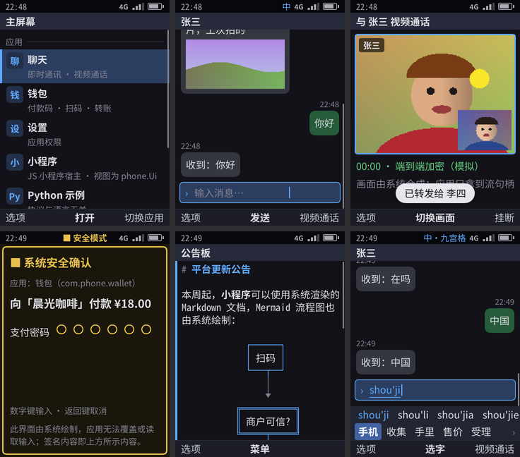
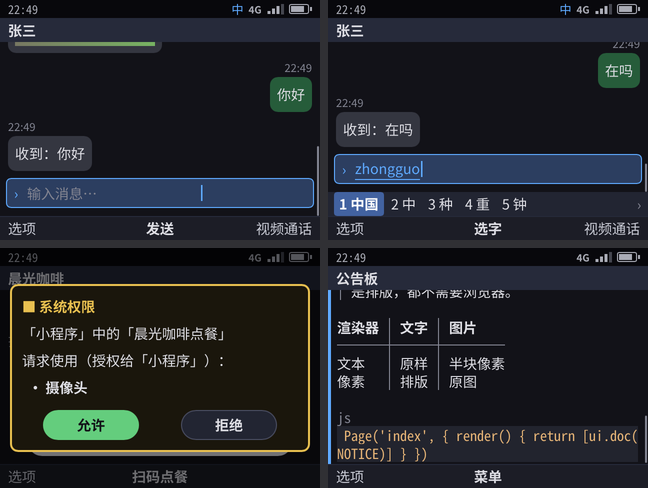
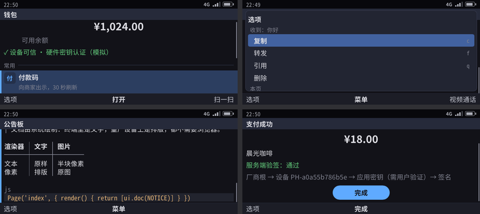
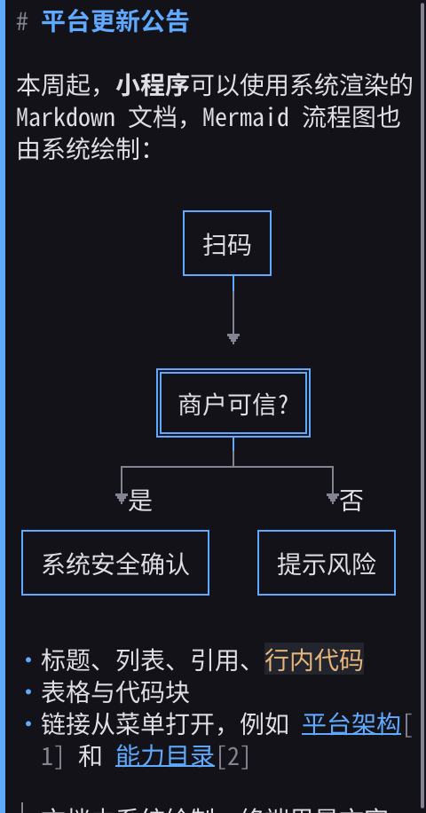
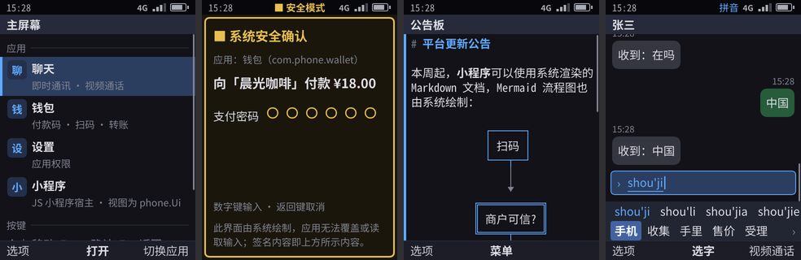
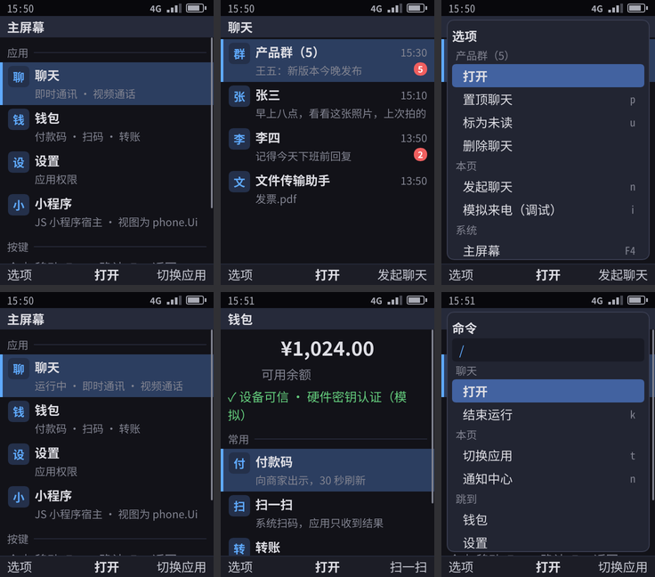

> English translation of [the Chinese original](../06-gui-architecture.md). The Chinese text is authoritative; keep both in sync.

# GUI architecture (keyboard-first pixel UI)

Why the production UI uses pixel rendering: [09-ui-feasibility-review.md](09-ui-feasibility-review.md). Key grammar and node table: [10-keyboard-interaction-model.md](10-keyboard-interaction-model.md). Display infrastructure: [08-display-adaptive-refresh.md](08-display-adaptive-refresh.md). Specification of the protocol between the Shell and the renderers: [23-renderer-protocol.md](23-renderer-protocol.md).

## 1. Structure: one core, replaceable renderers

```
App ──phone.Ui──► phone-shell (Go): focus · menu · back stack · IME · system UI · broker
                        │  ├─► text renderer (terminal / serial / SSH)
                        │  └─► frames (JSON lines, stdin) ──► pixel renderer ──► DRM/KMS
                        ◄────────── keys (JSON lines, stdout) ◄── evdev / libinput
```

- **All Shell logic exists only once, in Go**: focus, menus, back stack, input method, capability broker and system UI. A renderer is a pure projection, so system UI behavior, security rules and selftests are exactly the same in the text and pixel UIs.
- **The pixel renderer is a slot** (`/usr/lib/phone/renderer`). There are two implementations, both in this repository: the device uses phone-paint, and phone-gui is used for comparison (an image with phone-gui in the slot can also be built, §7):

  | | phone-paint (device default) | phone-gui (for comparison) |
  |--|--|--|
  | Implementation | In-house: tiny-skia for drawing, ab_glyph for text layout, drm for direct output, evdev for reading keys | Slint 1.18 software renderer, `backend-linuxkms-noseat` |
  | License | Apache-2.0, with all dependencies under permissive licenses | GPL-3.0-only (Slint used under its GPLv3 option): used to cross-check phone-paint, not shipped in the device image (58 (internal document) §3.3) |
  | Animation | Focus highlight fade (120ms), list scroll easing (140ms, ease-out; if the target changes midway, it continues from the current position), only on a real screen; screenshots show the settled frame | Focus highlight fade (120ms), list scroll easing (140ms) |
  | Layout report | Reports each node's position and height to the Shell every frame (`layout`); when it is the real screen, "scroll first, then move focus" for oversized nodes follows its pixel geometry (each scroll moves 80% of the viewport) | Reports the same, with geometry taken from each node's position in the Slint layout |
  | Device skin | `--skin`: every screenshot is additionally saved as a `.skin.png` placed inside a phone body with a modernized T9 keypad (12-key) or QWERTY keyboard (`make skins`, drawn by phone-paint, for reviewing the look; design system in [26](26-design-system.md)) | — |

- **A frame describes "what is on screen", not "what it looks like"** (`shell/frame.go`): status bar, title, node list (with focus), soft keys, IME candidates, toast, banner, idle screen, topmost system UI (menu, confirmation dialog, permission dialog, trusted payment, QR scanner, incoming call). Only pixels that the system itself decodes or generates are sent with the frame, such as QR codes, gallery thumbnails and media frames; apps can never send pixels.
- **Scrolling is passed as intent**: the two renderers use different layout units (character rows vs pixels), so the Shell sends the focus, the content scroll ratio and the ratio scrolled within an oversized focused block; each renderer converts these according to its own layout and guarantees that the focus is visible. When the renderer has reported its layout geometry and it is the screen itself, "is the focused block oversized, and how far does each scroll move" is also computed from its pixel geometry.
- **telephonyd** (C++23) is a separate system service that the Shell reaches over a Unix socket ([04](04-ui-language-telephonyd.md)); renderers never touch any system service.

## 2. Device form factors

`shell/device.go`:

| Form factor | Physical pixels | Scale | Reference |
|------|----------|------|------|
| `bar-t9` | 480×640 | 2× | Nokia 6300 / N73 / 8110 4G |
| `bar-qwerty` | 640×480 | 2× | Nokia E71 / E63 / E72 |
| `communicator` | 800×352 | 1.6× | Nokia E90 / 9300 / N900 |

The renderer reports the panel's actual resolution during the handshake, and the Shell picks the form factor from it; if the panel changes at runtime, the renderer sends a `display` message ([23](23-renderer-protocol.md) §3).

## 3. Design language and rendering rules

- **TUI style**: text first, grid-aligned, high contrast, focus always visible, no hidden gestures.
- **Fonts**: body text uses Noto Sans CJK SC; documents and Mermaid diagrams use Noto Sans Mono CJK SC, in which a Chinese character takes exactly the width of two Latin characters. Glyphs missing from Noto CJK (superscripts and subscripts in formulas, some math symbols) fall back to DejaVu Sans.
- **Documents are laid out on a character grid**: the Shell uses the same layout engine as the terminal and gives the starting column of every text run according to the device's column count (32 / 43 / 69 columns), so line breaking, Chinese line-breaking rules and Mermaid diagrams are identical in both UIs.
- **Box-drawing characters are drawn as vectors**: box-drawing characters such as ─ │ ┌ ╔ ═ ╤ and arrows such as ▼ are not drawn with font glyphs but as lines inside the character cell: thin lines 1px, heavy lines 2px, and a double line as a 3px solid band with a gap. Box-drawing glyphs in CJK fonts are full-width, so using the glyphs directly misaligns them.
- **Grids**: the number of columns in the main menu is decided by the Shell according to the screen (3 in portrait, 4 in 4:3 landscape, 5 on wide screens), because up/down/left/right movement in the grid is computed in the Shell; the calculator has 4 columns of keys; when a cell in a grid has focus, scrolling follows the row that cell is in.
- **Idle screen**: `idle` in the frame (time, date, operator, active-standby information, hints). The renderer draws the wallpaper, a large clock and information lines, and no title bar; on wide screens the clock and the information sit side by side; how many information lines are shown depends on the remaining height.
- **Center soft key**: `Screen.Center` is the action that OK performs when nothing on the page has focus (「菜单」 (Menu) on the idle screen, 「发送」 (Send) on the voice-recording page); for an input field, the center soft key shows the name of its submit action (「拨打」 (Call) for the dial field).
- **App icons**: grid tiles and system list items carry a PNG path, which the renderer reads and caches; before reading, it checks that the file is ≤ 512 KB and the image is ≤ 256×256.
- **Recording indicator**: `mid_kind: "mic"` in the middle of the status bar is shown in orange (the warning color).
- **Secure screen**: secure nodes such as a payment code are displayed normally on the panel, and appear in screenshots as 「安全内容 · 截图已遮挡」 (Secure content · masked in screenshot).
- **Refresh rate**: 60Hz baseline; when a 120Hz panel is chosen, `phone-displayd` does 60↔120 adaptive switching ([08](08-display-adaptive-refresh.md), **not implemented**).

## 4. Experience targets

- From each key press to the first frame of focus movement: within one frame (at the chosen refresh rate)
- No empty frames are committed for static screens
- Full-screen incoming call **< 100ms**
- If a 120Hz panel is used: interaction and animation at **120Hz + 1% low ≥ 110fps** (08 §7)

## 5. How to run

```bash
cd kario
make paint               # phone-paint, cargo build --release
make pixel-selftest      # full selftest once per device form factor (drawn by phone-paint), PNGs written to build/pixel/<device>/
make preview             # view the pixel UI in a browser and operate it with the keyboard (http://127.0.0.1:8790)
make skins               # also put every screenshot into a phone body, build/skins/<device>/
make gui-selftest        # the same selftest drawn by phone-gui, for comparison
build/usr/bin/phone-shell --selftest --gui paint/target/release/phone-paint --device bar-t9 --pixel-dir out/
```

On the device (Yocto recipe `phone-paint` or `phone-gui`; bitbake downloads and verifies the Rust dependencies one by one according to `Cargo.lock`):
- Kernel parameter `phone.selftest=1`: during the boot selftest, the pixel renderer also produces images, and the PNGs are sent back to the host over the serial port.
- Kernel parameter `phone.gui=1`: the Shell starts the renderer in the slot with `--gui auto`, drawing on the virtio-gpu screen.

## 6. Screenshots

Dev machine (software rendering, the same code as on the device):

| Bar phone, T9 keypad (480×640) | Bar phone, QWERTY keyboard (640×480) | Landscape, wide keyboard (800×352) |
|:--:|:--:|:--:|
|  |  |  |

Mermaid flowchart (box lines are drawn as vectors; double-line boxes are decision nodes):



On the device (AArch64 QEMU, headless rendering during the boot selftest):



The display path on the device (AArch64 QEMU, kernel parameter `phone.gui=1`): the renderer draws via DRM/KMS onto a 480×640 virtio-gpu screen; keys pressed on the USB keyboard from the QEMU monitor are read by the renderer and forwarded to the Shell; the monitor's `screendump` captures the real framebuffer. In order: home screen after boot → OK opens chat → Tab options menu → back to the home screen (chat shows 「运行中」 (Running)) → ↓ OK opens the wallet → `/` command palette.



## 7. Measurements and lessons learned

| Item | Value |
|----|----|
| Selftest (dev machine) | Both renderers run the full selftest in all three form factors; every snap step produces a PNG |
| Device (QEMU AArch64) | Both images produce images during the boot selftest; in DRM mode the calculator and calls can be operated |
| Fonts | Noto Sans CJK regular + bold OTC, 40 MB in total (can be replaced on the device with a subset containing only Simplified Chinese) |
| Pitfalls hit on the device | ① the machine configuration overrides the display resolution in local.conf, so `:forcevariable` is needed; ② the getty on tty1 grabs the screen, so add `Conflicts=getty@tty1.service` to the service; ③ when phone-gui lacks `xkeyboard-config`, xkbcommon cannot build a keymap; ④ after writing a dumb buffer you must call DirtyFB, otherwise virtio-gpu does not refresh |

## 8. Not done yet

| Item | Notes |
|----|------|
| GPU rendering | QEMU has no virgl, so real hardware is needed; first confirm whether software rendering can hold a steady 60Hz on the target SoC |
| Media zero-copy (continued) | Pixels already go from mediad straight to the renderer through shared memory ([23](23-renderer-protocol.md) §4.2, for both renderers); production switches to dmabuf on DRM planes, which needs real hardware |
