> English translation of [the Chinese original](../13-prototype.md). The Chinese text is authoritative; keep both in sync.

# Code prototype: phone.Ui + TUI Shell + super-app samples

> Status: **prototype**, with automated end-to-end verification on the dev machine and on the Yocto image (QEMU) (§5). For which parts are simulated see §6. Architecture in [11](11-platform-architecture.md), capability catalog in [12](12-super-app-capabilities.md).

## 1. What it is

The [kario repository](../../) is a runnable platform prototype:

- **phone-shell**: text renderer + focus / menus / back stack + system UI (permissions, trusted confirmation, code scanning, incoming calls, symbol table) + capability broker + background freezing.
- **Pixel renderers**: phone-paint (the renderer on the device, our own, Apache-2.0) and phone-gui (Rust + Slint, GPL-3.0-only, for comparison) draw the frames the Shell sends; three Nokia-style form factors ([06](06-gui-architecture.md), [18](18-nokia-form-factors.md), [23](23-renderer-protocol.md)).
- **phone-sandbox**: app launcher that applies namespaces, a separate uid, Landlock, seccomp and rlimits before starting the app ([17](17-app-sandbox.md)).
- **System services**:
  - `phone-mediad`: camera, call media, code scanning.
  - `phone-keystored`: device / app keys, device attestation, user-confirmed signatures.
  - `phone-audiod`: mixing, audio focus, system sounds ([20](20-audio.md)).
  - `phone-imed`: input method engine and user dictionary; the dictionary is mapped into memory from `share/phone/ime.dict`; if it crashes, the Shell keeps typing with its built-in engine ([16](16-input-method.md) §1).
  - `phone-pushd`: a single long-lived push connection for the whole device, plus the simulated cloud gateway `phone-pushgw` ([21](21-push.md)).
  - `phone-displayd`: the screen's refresh rate, switching 60 ⟷ 120 Hz automatically (keys, animations, the foreground app's hints, a video's frame rate, the setting, the battery's and the thermal cap), the renderer switching the display mode by it; a simulated 60/120 Hz panel on the developer machine and in selftests ([08](08-display-adaptive-refresh.md)).
  - `phone-smsd`: the store of SMS and multimedia messages, conversations (groups too), one block list for calls and messages, delivery states, verification codes, flash messages and the emergency-alert record; telephonyd keeps a received message until smsd has stored and acknowledged it; MMS goes to and from the MMSC over the MMS access point (MVP, [32](32-messaging.md)).
  - `phone-chatsrv`: the simulated Hongyan server, standing in for the app vendor's cloud. Hongyan's messages and incoming calls are delivered by it through push; Hongyan itself does not stay resident.
  - `phone-storesrv`: the simulated store backend, built on the store backend's open core `appstore`: developer registration, automatic review, signed catalog, downloads, crash reports, reports on apps ([07](07-ecosystem-and-store.md) §4.1); developer tool `phone-pkg`.
  - In the image, the system services are a single program, `kario-system`, and each service name is a link to it ([25](25-system-update.md) §3).
- **phone-telephonyd** (C++23): calls, sending and receiving SMS and cell broadcasts, network status; simulated baseband backend ([04](04-ui-language-telephonyd.md)).
- **Twenty apps**: Phone (smart dialing, call log, call screen), Messages, Alarm (rung by the system on time), Calculator, Calendar (a TypeScript system app: the month, the lunar calendar and solar terms, repeating events, reminders as the system's scheduled notifications, importing and exporting `.ics`, [19](19-core-apps.md) §1), Music (background playback), Camera (system viewfinder), Photos (system photo library), Weather (background refresh, idle-screen widget), Browser (web view), App store (catalog, delta updates, automatic updates while charging), Hongyan (WeChat-like demo, with video calls), Feiqian (Alipay-like demo, with payment code, scan-to-pay and transfers), Cards (卡包; system app managing NFC cards, [30](30-nfc.md)), Settings (system app: permissions, Wi-Fi, Bluetooth, sandbox self-check), Mini-programs (JS mini-program host with 3 built-in mini-programs), Snake (canvas app sample), Python sample (speaks the protocol directly, without the SDK), C++ sample (C interface), TypeScript sample (compiled by kario build, run by kario-jsrt, [29](29-app-development.md)).
- **Wi-Fi and Bluetooth**: the Shell manages iwd and BlueZ over the system bus; on the dev machine the networks and devices are simulated ([11](11-platform-architecture.md) §16).
- **VPN**: WireGuard, with profiles imported from Files, or using a key pair the phone makes itself; on the device the Shell writes systemd-networkd's files to bring the tunnel up, on the dev machine the tunnel is simulated; always-on, blocking connections without the VPN and per-app VPN go through the per-app firewall ([11](11-platform-architecture.md) §16).
- **Contacts and calendar sync**: a CardDAV client in the Shell (`carddav/`) keeps the contacts in two-way sync with the address books of the Kario account and other CardDAV servers (iCloud, Nextcloud, Fastmail), e-mail and postal addresses, photos and groups too, several accounts signed in to in Settings › Accounts; with 「日历」 (Calendar) on for one of them, a CalDAV client in the Shell (`caldav/`) syncs the events both ways with the calendar app through the system's inbox and outbox ([19](19-core-apps.md) §1.1; interoperation with real servers **not verified**).
- **Boot animation, idle screen and main menu**: boot lands on a Nokia-style idle screen, and OK opens the main menu grid; on the idle screen you dial by pressing the number directly, and on the QWERTY keyboard typing starts a search; in the main menu the number keys 1–9 and `*` `0` `#` go straight to cells 1 to 12; app icons are original images ([18](18-nokia-form-factors.md) §5.1).
- **Markdown document node**: rendered by the system, without a browser; Mermaid diagrams in it are drawn as character box diagrams, code blocks are colored by language, and formulas are converted to Unicode text ([14](14-tui-route-and-app-framework.md) §6, §8.1, §8.2).
- **System input method**: QWERTY keyboard / T9 keypad, Chinese and English candidates, predictions, punctuation, keyboard types for input fields ([16](16-input-method.md)).
- **TypeScript mini-programs**: `app.ts` / `app.tsx` have their types stripped at load time, and JSX is compiled into `h()` calls that produce `phone.Ui` nodes; `phone.d.ts` is for type checking during development ([14](14-tui-route-and-app-framework.md) §8.4).
- **Sandbox**: every app is started through `phone-sandbox`; on the dev machine only the layers that need no root (seccomp, rlimit) apply, on the device all of them do.
- **Yocto layer** `meta-phone`: Wrynose 6.0 LTS, qemuarm64, systemd.

## 2. Screenshots

Generated automatically by the selftest ([tools/snap2png](../../tools/snap2png/) converts snapshots to PNG). The payment code is a secure screen, so the system masks it in screenshots.

| Home screen | Chat | Message menu (= long press) |
|:--:|:--:|:--:|
| 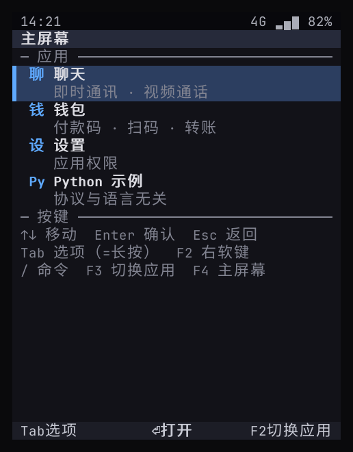 | 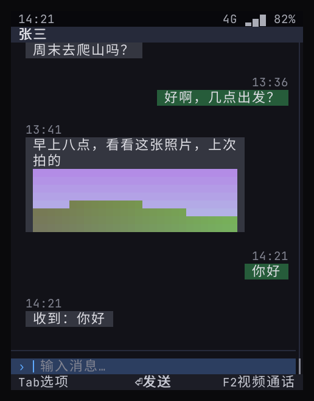 | 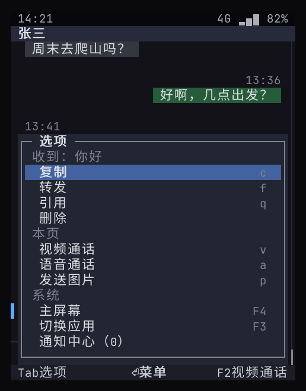 |

| System permission grant | Video call (remote + local picture-in-picture) | Incoming call (app in the background) |
|:--:|:--:|:--:|
| 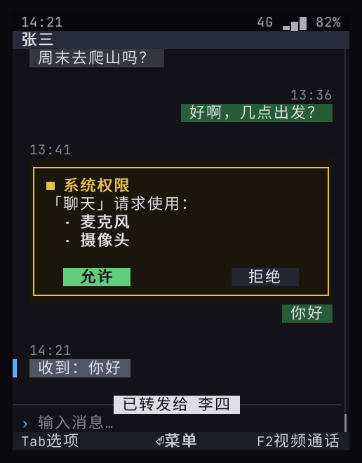 | 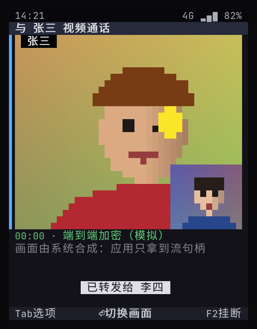 | 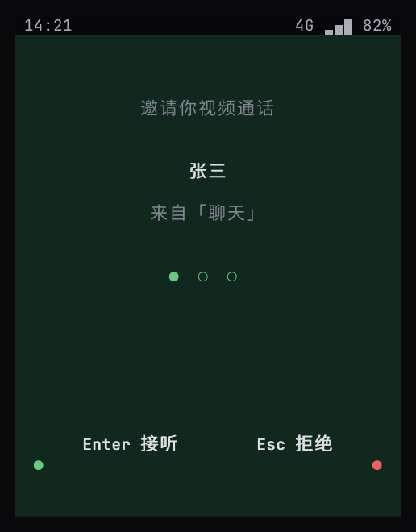 |

| Wallet (device trusted) | Payment code (masked in the screenshot) | System scanner |
|:--:|:--:|:--:|
| 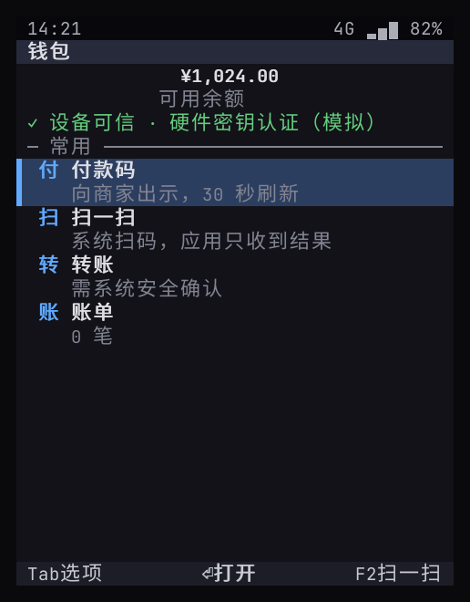 | 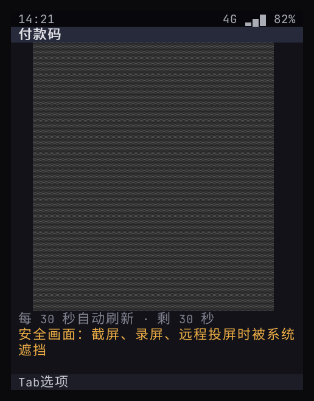 | 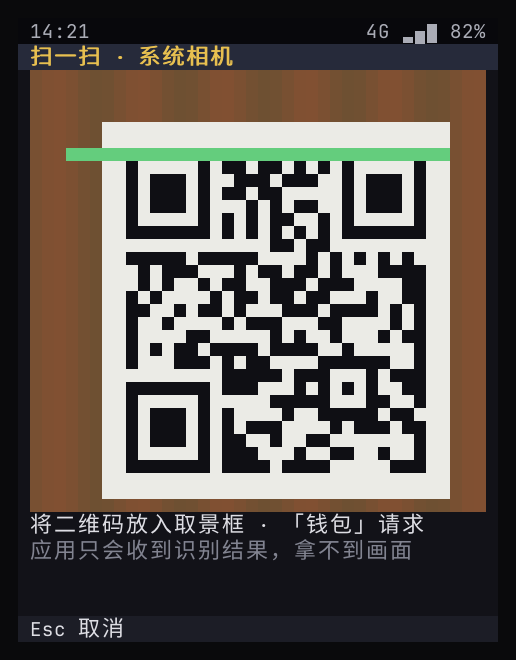 |

| System secure confirmation | Payment succeeded (signature verified by the server) | Markdown document node |
|:--:|:--:|:--:|
| 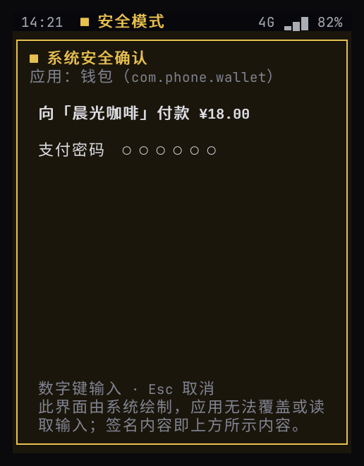 | 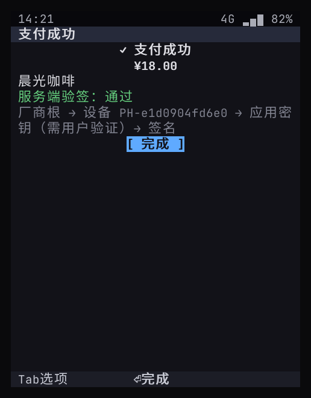 | 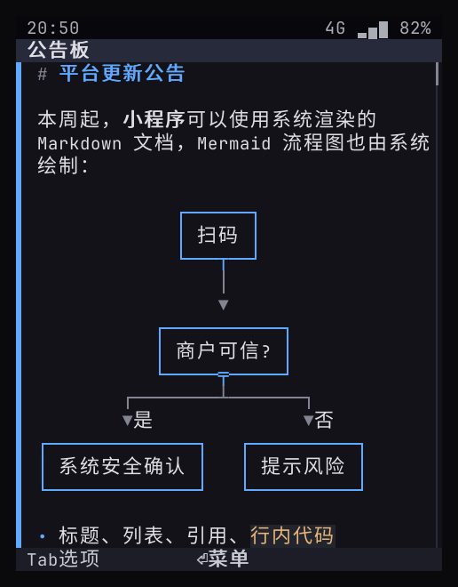 |

| Mini-program requests permission (origin labeled) | Mini-program payment (system secure confirmation labels the origin) |
|:--:|:--:|
| 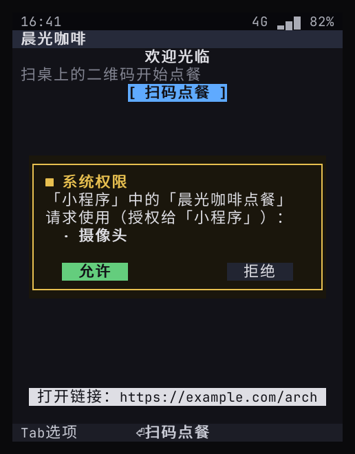 | 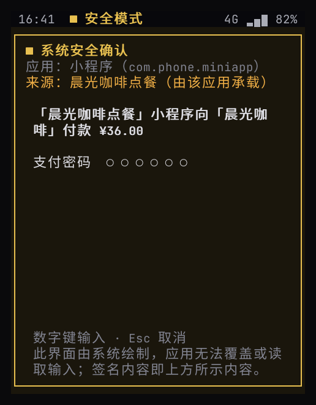 |

| Input method: QWERTY pinyin | Input method: T9 pinyin | Input method: English completion |
|:--:|:--:|:--:|
| 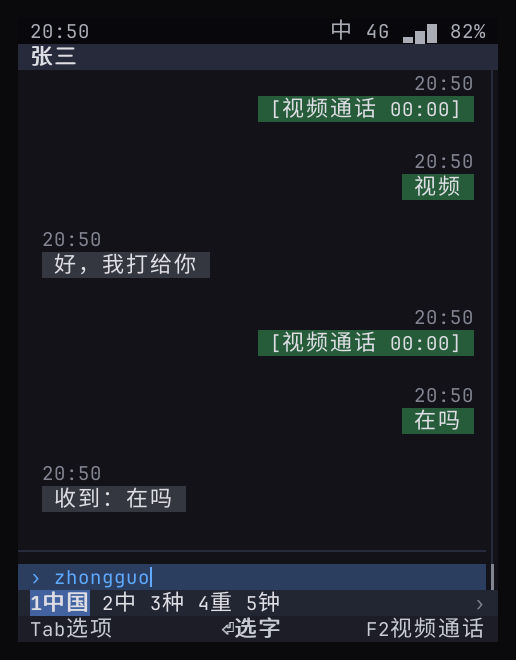 | 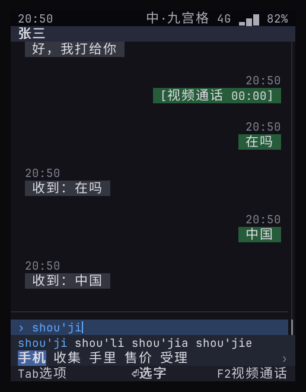 | 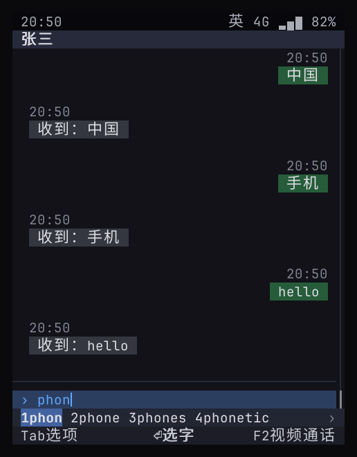 |

Pixel renderer (phone-gui, the same selftest scenario, three form factors):

| Bar phone, T9 keypad 480×640 | Bar phone, QWERTY keyboard 640×480 | Landscape, wide keyboard 800×352 |
|:--:|:--:|:--:|
| 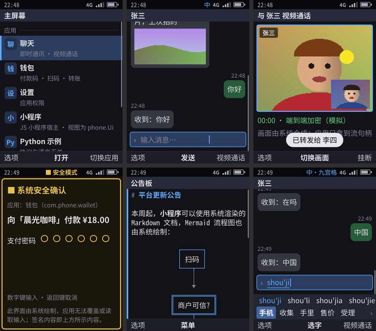 | 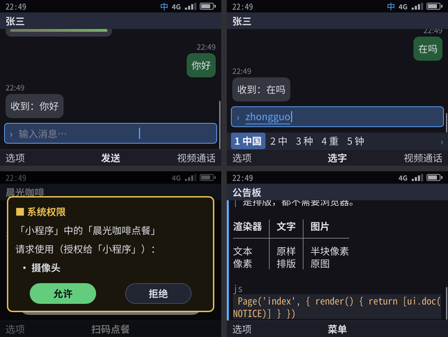 | 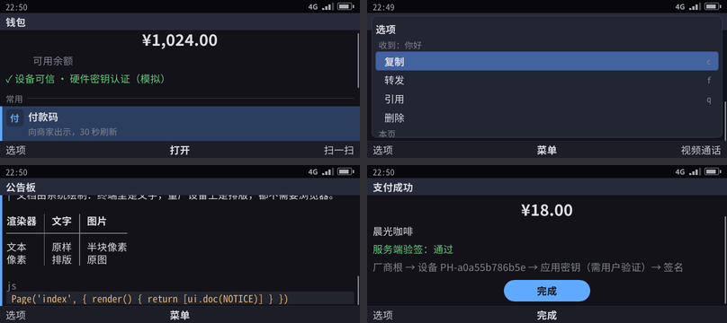 |

## 3. Layout

```
kario/
├── ui/              phone.Ui v0 protocol types + capability catalog
├── wire/            JSON-lines framing, service RPC, fd passing (SCM_RIGHTS)
├── canvas/          cell canvas: CJK double-width characters, true color, half-block pixels, secure-screen masking
├── shell/           Shell: rendering, focus / menus / back stack, system UI, broker, built-in selftest scripts
├── ime/             input method engine: pinyin / T9 / English candidates, predictions, Nokia-style multi-tap; data/ is the AOSP dictionary, compiled at build time into share/phone/ime.dict for memory mapping
├── sandbox/         app sandbox: Landlock, seccomp, namespaces, rlimit (cmd/phone-sandbox is the launcher)
├── paint/           phone-paint: the pixel renderer on the device (Rust: tiny-skia, ab_glyph, DRM/KMS, evdev; design system in src/design.rs; input.rs is the privileged helper that hands over keyboards and mice as they are plugged in; gpu.rs and gbm.rs are the optional GLES 2 compositing and GBM scanout)
├── hal/             hardware layer: a thin layer over the mainline kernel's device classes (LED, backlight, power supply, USB device mode); which instance to use comes from the SKU's configuration, and each class has a simulated backend
├── obex/            OBEX: Bluetooth file transfer (Object Push), the phone book's server and client (PBAP), the messages' client (MAP), on the RFCOMM / L2CAP connections BlueZ hands over; btphone/ is a simulated old phone for the tests and the selftest
├── contacts/        Contacts: the Shell's contacts store (written whole and atomically, 0600), reading and writing vCard 2.1 / 3.0 / 4.0 (fuzzed)
├── carddav/         CardDAV client: discovery (RFC 6764), two-way sync by sync-collection (or ETags), the conflict merge rule (document 19 §1.1); davtest/ is an in-memory CardDAV server for the tests and the selftest
├── switchrecv/      the receiver of the switching protocol kario-switch/1 (document 36); oldphone/ is the old phone's side, written from the protocol apart from the receiver, for the tests and the selftest
├── i18n/            UI text translation: English in the code, translations in locale/<lang>.json (default zh-Hans)
├── gui/             phone-gui: pixel renderer for comparison (Rust + Slint, GPL-3.0-only; ui/phone.slint, src/main.rs)
├── media/           media plane: frame format, subscriptions, synthetic picture sources; qrscan/ the scanner's decoder (runs in mediad)
├── keystore/        key service logic + server-side verification library
├── gm/              Chinese national (GM) cryptography: SM3 digest, SM2 signatures (software implementation; moves into the TEE in mass production)
├── sdk/             Go app SDK; sdk/c is the C ABI SDK (phoneui.h) and a C++ sample, sdk/c/include/kario_native.h the interface of native modules; sdk/ts is @kario/sdk, the types of TypeScript apps (ui.d.ts generated from ui/ by tools/tsgen)
├── jsrt/            kario-jsrt: the runtime of TypeScript apps (C: QuickJS-ng plus the kario module, speaking the protocol through sdk/c; src/native.c loads native modules); the Go package jsrt is the check the installer and the store share
├── telephonyd/      phone-telephonyd (C++23, CMake): event loop, simulated baseband, call log, the SMS smsd has not acknowledged
├── audio/           audio: mixer, focus policy, synthetic sound sources, shared-memory ring buffer, simulated microphone (cmd/phone-audiod is the service)
├── push/            push: message format, gateway tokens (cmd/phone-pushd device service, cmd/phone-pushgw simulated gateway)
├── programs/        code of the system services, one package each (shellcmd · pushd · keystored · imed · audiod · mediad · nfcd · smsd · displayd · sandboxcmd · ctsverify)
├── cmd/             kario-system (the system services combined into one program) · separate development builds of each service, phone-shell etc. · phone-imedict (compiles the dictionary at build time) · phone-pushgw · phone-chatsrv (simulated Hongyan server) · phone-storesrv (simulated store backend) · phone-pkg (developer tool) · kario (new / build / package for TypeScript apps, esbuild built in) · phone-provision · phone-cts-verify · phone-ota-verify
├── appstore/        open core of the store backend (catalog, review, downloads, revocation, reports; the official backend extends it)
├── ota/             system update protocol: the signature on latest.json, reports from phones (signed, plus the report after one day); the format of the holiday calendar, signed and served the same way; incremental packages (delta), dm-verity (verity)
├── apps/            dialer · messages · contacts · clock · calc · calendar (TypeScript) · music · camera · gallery · weather · store · browser · chat (Hongyan) · wallet (Feiqian) · settings · miniapp (JS mini-program host + programs/) · snake (canvas app sample) · hello-py
├── shell/doc.go     Markdown document node rendering
├── shell/mermaid.go Mermaid diagrams (embedded lovely-mermaid, run by goja)
├── shell/imebar.go  input method integration: target input field, candidate bar, capitals at sentence starts
├── shell/textedit.go input fields' caret, selection, copy and paste, undo; listkeys.go letter jumps in lists, start / end / page keys, the writing language menu
├── shell/frame.go   frames for the pixel renderer; gui.go drives phone-gui; device.go form factors
├── shell/freeze.go  background freezing; symbols.go system symbol table
├── shell/telephony.go subscribes to telephonyd, system incoming-call screen; broker_phone.go phone / alarm capabilities
├── shell/contacts.go contacts: the store, the system's confirmation before writes, importing and exporting vCards from and to Files, cards received over Bluetooth
├── shell/airplane.go airplane mode and mobile data; radios.go Wi-Fi and Bluetooth; btobex.go Bluetooth file transfer and phone book; hotspot.go the personal hotspot; switch.go moving from an old phone (switch_bt.go over Bluetooth); vpn.go the VPN
├── shell/airplane.go airplane mode, mobile data and data roaming; apn.go access point names; cellnet.go the cellular interface's addresses; radios.go Wi-Fi and Bluetooth; btobex.go Bluetooth file transfer and phone book; hotspot.go the personal hotspot; switch.go moving from an old phone; vpn.go the VPN
├── shell/contacts.go contacts: the store, the system's confirmation before writes, importing and exporting vCards from and to Files, cards received over Bluetooth; accounts.go the contacts account and its sync
├── shell/airplane.go airplane mode and mobile data; radios.go Wi-Fi and Bluetooth; btobex.go Bluetooth file transfer and phone book; hotspot.go the personal hotspot; switch.go moving from an old phone; vpn.go the VPN
├── vpn/            WireGuard configurations parsed and checked, systemd-networkd's files, netlink (handshake, routes, the selftest's server in a namespace)
├── shell/messaging.go subscribes to phone-smsd: SMS notifications (copy code), the emergency-alert screen, SMS capabilities
├── shell/alarm.go   system alarm service; grid.go grids; boot.go boot animation
├── shell/audio.go   audiod integration: system sounds, app playback; push.go push dispatch, wake-up budget, background launch
├── shell/media.go   system photo library (photos, thumbnails, access rules); photo.go system viewfinder and photo picker
├── shell/sandbox.go separate uid per app
├── scripts/stage.sh installs into the device directory layout (shared by the dev build and the Yocto recipes)
├── tools/snap2png/  snapshot to PNG (for the docs, separate Go module)
├── tools/tsgen/     generates sdk/ts/ui.d.ts and jsrt/src/languages.h from ui/ and i18n/ (make test fails when they are stale)
├── tools/imedict/   generates the input method dictionary from the AOSP word lists
├── tools/icons.py   draws the system app icons (apps/*/icon.png)
├── tools/cratesinc.py generates bitbake's crate download list from Cargo.lock
└── yocto/           kas configuration, meta-phone layer, QEMU selftest scripts, parallel download script for the source mirror
```

## 4. Running

```bash
cd kario
make run             # interactive in the terminal (terminal ≥ 44×27 recommended; a phone frame is drawn around it)
make preview         # pixel UI in the browser: http://127.0.0.1:8790, the keyboard acts as the phone keys
make selftest        # end-to-end selftest, snapshots go to build/snapshots/, JUnit report to build/selftest-junit.xml
make selftest ONLY='视频'   # run only the cases whose name matches (视频 = "video")
make test            # go vet + go test
make yocto-build     # build the Yocto image (hours the first time, incremental afterwards)
make yocto-selftest  # boot the image in QEMU, run the boot selftest, print the result and power off
make yocto-selftest ONLY='蓝牙'   # development only: run only the cases whose name matches (蓝牙 = "Bluetooth"; in hex as phone.selftest-only= on the kernel command line); no sound, compatibility report or fd store check, the cases alone decide
make yocto-selftest ONLY='蓝牙' SELFTEST_ENV='NAME=value'   # development only: environment variables for phone-shell in the image (in hex as phone.selftest-env=), as a case's require-env wants
python3 yocto/btvirt-test.py   # btvirt (the emulator's virtual Bluetooth controllers) with the layer's BlueZ patches, under AddressSanitizer on the build machine; --unpatched runs the release as it is (which fails)
make yocto-run       # QEMU interactive: log in as root on the serial console, type phone
make yocto-vnc       # QEMU boots into the pixel UI, operated over VNC (127.0.0.1:5900), see §4.1
make paint           # build the pixel renderer phone-paint (cargo build --release)
make pixel-selftest  # run the selftest once per form factor (drawn by phone-paint), PNGs go to build/pixel/<form-factor>/
make gui-selftest    # the same selftest drawn by phone-gui, for comparison
make yocto-gui       # QEMU: the renderer draws to the virtio-gpu screen, the monitor injects keys and takes screenshots
make telephonyd      # build only telephonyd and run its unit tests (already included in make build)
make lsp             # write the C/C++ compile_commands.json and link it next to the sources, so the IDE can jump (§4.2)
make skus            # list every SKU; each SKU is a target: make sku-<name> builds its firmware package
make yocto-stress    # use SMS, Hongyan, photos, video and the browser over and over on the 1 GB web image; the system must stay usable throughout (§5.1)
```

| Key | Action |
|----|------|
| ↑ ↓ ← → | Move focus; in an input field with text ← → move the caret |
| Shift + arrows, Home / End, PgUp / PgDn | In an input field select, go to the start / end; in a list the first / last item, a page ([18](18-nokia-form-factors.md) §4.2) |
| Delete, Alt + Backspace | Delete after the caret; delete the word before it |
| Ctrl + X / V / A / Z | Cut, paste, select all, undo (copy is in the options menu) |
| Enter | OK (primary action) |
| Esc | Back |
| Tab | Options menu (= long press; F1 does the same) |
| F2 | Right soft key |
| F3 / F4 | Switch app / home screen |
| F6 or Ctrl+Space | Switch the input method between Chinese / English (`#` in T9 mode) |
| F7 | Chr / Sym: system symbol table (`*` in T9 mode) |
| Alt + key | Long press (T9: long-press a digit to type the digit, long-press `#` to switch to 123) |
| `/` | Command palette |
| Ctrl+C | Quit |

`phone-shell --device bar-t9` (or `--keypad t9`) simulates the T9 keypad: 2–9 type pinyin or English, `0` separates syllables / types a space, `*` gives the next match or the symbol table, `#` cycles through 拼音 → 智能英文 → Abc → abc → ABC (Pinyin → Smart English → Abc → abc → ABC), and long-pressing `#` switches to 123 ([18](18-nokia-form-factors.md) §3).

The wallet's payment PIN is the prototype default **123456**. Five wrong entries in a row lock it (delete `~/.local/state/phone-sim` to reset).

### 4.1 Try it yourself

**A. Text UI in the terminal** (fastest, no image build needed):

```bash
cd ~/code/kario-os/kario
make run                                      # bar phone, QWERTY keyboard
build/usr/bin/phone-shell --device bar-t9     # bar phone, T9 keypad
```

Keys are as in the table above; in addition, F5 is the call key (green key) and F4 is end call / back to idle (red key). Here, web nodes only show the title, the address and the focus; the page itself needs the pixel UI.

**A2. Pixel UI in the browser** (no image build, no VNC): `make preview` (drawn by phone-paint), then open `http://127.0.0.1:8790`; on a remote machine, run `ssh -L 8790:127.0.0.1:8790 <machine>` first. The keyboard and the buttons on the web page are the phone keys.

**B. Pixel UI of the device image** (boots in QEMU, operated over VNC):

1. You need an image: `make yocto-build` (skip this if it is already built). To try the web view, use `make yocto-web-build` instead; `yocto-vnc` boots the most recently built image.
2. `make yocto-vnc`: QEMU boots straight into the pixel UI in about 2 minutes (ARM is emulated in software on x86, much slower than real hardware).
3. Forward the server's port 5900 to your own computer: forward 5900 in Cursor's Ports panel, or run `ssh -L 5900:127.0.0.1:5900 <server>`.
4. Connect a VNC client (RealVNC Viewer, TigerVNC, etc.) to `localhost:5900`, and click the picture once so that it receives the keyboard.
5. Keys: arrow keys, Enter = OK, Esc = Back, Tab = left soft key 「选项」 (Options), F2 = right soft key, F5 = call key, F4 = end call / back to idle, F3 = switch app. The form factor is the T9 bar phone: number keys 2–9 type pinyin, `#` switches the input mode, `*` picks candidates or symbols.
6. To finish: in the terminal running `make yocto-vnc`, press Ctrl+A, then X. The image boots in snapshot mode, so changes are not kept.

**C. Screenshot set** (no interaction): `make skins` draws each selftest step as an image inside a phone body (`build/skins/<form-factor>/`); `make web-selftest` produces a few of the web view (`build/pixel-web/`).

**Suggested walkthrough**:

| Scenario | How | What to look at |
|------|--------|--------|
| Making a call (simulated baseband) | On the idle screen type `10086` directly, dial with the call key, hang up with the end key | Dialing, in-call screen, call log |
| Hongyan chat | Press `/`, type 「鸿雁」 (Hongyan) and press Enter, open the conversation with 张三 (Zhang San), send 「文章」 ("article") | Input method, message bubbles, push |
| Official account article | Select the link Zhang San replied with: OK opens reader mode; in 「选项」 (Options), choose 「网页」 (Web page) to see the page as it is (pixel UI) | Arrow keys move between links; 「分享这篇文章」 (Share this article) opens the system share panel |
| Web form (web image) | Send Zhang San 「搜索」 ("search") and open the reply with 「网页」 (Web page) | 「清空记录」 (Clear history) opens a system confirmation dialog; typing in text fields; drop-downs open a system menu; OK submits |
| Video call | Send Zhang San 「视频」 ("video"); he calls back; answer with the call key | Incoming-call screen, the picture during the call |
| Payment | Open 「飞钱」 (Feiqian): payment code, scan to pay, payment PIN 123456 | System secure confirmation; the secure screen is masked in screenshots |
| Command palette | Press `/` at any time and type an app name or a command | Get there directly without going through menus |
| Menu folders | On the idle screen press OK for the main menu, enter 「工具」 (Tools), press `1` to go straight to Calculator | Nokia-style categories: everyday apps in the main menu, tools and apps each in their own folder; number keys go straight to an item |
| Photos (JPEG) | 主菜单 › 图片 (Main menu › Photos) | 8 real public-domain photos in a grid, images only, no text; OK opens the full-size view, ← → pages through, 选项 › 详细信息 (Options › Details) shows the size and `image/jpeg` |
| Wallpaper | While viewing a full-size photo, 选项 › 设为壁纸 › 待机和锁屏 (Options › Set as wallpaper › Idle and lock screen); end key back to idle; left soft key then `*` locks the keypad | The idle screen and the lock screen both show this photo, with white text over a gradient overlay; 设置 › 壁纸 (Settings › Wallpaper) restores the default |
| Local video | The cell in Photos marked 「▶ 0:15」 (sample: wetland), OK | Played with system decoding (the pixel UI shows the picture, the text UI uses half-block pixels); OK pauses / resumes, ← → skips 5 seconds, the back key closes it |
| Mermaid | 主菜单 › 应用 › 小程序 › 公告板 (Main menu › Apps › Mini-programs › Bulletin board) | A Markdown document drawn by the system: Mermaid flowchart, table, code highlighting, formulas |
| Themes | 设置 › 主题 › 复古绿 (Settings › Theme › Retro green) (or 浅色 (Light), 琥珀 (Amber)) | The whole UI changes color scheme; photos stay the same |
| Browser (web image) | 主菜单 › 浏览器 (Main menu › Browser), enter a URL or search terms | Address bar, bookmarks, find in page (`s`), zoom in / out (`+` `-`); downloads from web pages go into 「文件」 (Files) |
| Settings | In 「设置」 (Settings): app permissions, data usage, sound (← → adjusts the volume), SIM lock (PIN 1234), sandbox self-check | Permissions can be revoked; the PIN is entered in system UI; on the device every item of the sandbox self-check meets expectations |

Whenever a step feels awkward on the keys, you can't find the way in, or you feel a touchscreen is indispensable, write it into the one-week self-use log (57 (internal document) R9).

### 4.2 Reading the code in an IDE (LSP)

| Language | Language server | What it needs |
|------|------------|--------|
| Go | gopls | The `go.mod` at the repository root; nothing generated. In the internal repository `make server` links a `go.work` at the root (to `build/go.work`), so the server code jumps into the open repository |
| C / C++ (telephonyd, sdk/c) | clangd | CMake's exported compile commands: `make build` (or just `make lsp`, which compiles nothing) links `build/telephonyd/compile_commands.json` and `build/capi/compile_commands.json` into `telephonyd/` and `sdk/c/`; `make lsp` also puts a merged one at the root |
| Rust (paint, gui) | rust-analyzer | Each crate's `Cargo.toml`; nothing generated (it downloads the dependencies itself the first time) |

The links and the merged file are in `.gitignore`. After changing the compilers (`CXX23`, `CC14`) run `make lsp` again.

## 5. Verification results

For the current number of cases and the results, see "Current verification baseline" in 57 (internal document); this section explains what each environment verifies.

| Environment | Result |
|------|------|
| Dev machine (Rocky 8.10 x86_64, Go 1.25, GCC 14, non-root) | `make selftest` passes completely (root-only sandbox and cgroup cases are skipped automatically), in about 100 seconds; `make cts` PASS: every case passes and every capability was called ([22](22-developer-api.md) §11); `make build` also runs telephonyd's C++ unit tests |
| Pixel renderer (`make pixel-selftest`, drawn by phone-paint) | One PNG per snap step (UI screenshots in [19](19-core-apps.md) §2); a last line `PHONE-GUI-MOTION:` reports how long phone-paint takes a step drawn the live display's way (a report, not a check, [37](37-motion.md) §5; with `PHONE_PAINT_GPU=1` the GPU path's, on the developer machine Mesa's llvmpipe) |
| Both renderers (phone-paint: `make pixel-selftest`, `make yocto-selftest`, `make yocto-gui`; phone-gui: `make gui-selftest`, and the image with `KASEXTRA=yocto/kas/phone-gui.yml`) | The same selftest passes completely with both renderers in all three form factors, including the watchdog restarting the renderer after it is killed; on the device, the boot selftest, the CTS and DRM display output all pass for both images |
| `make test` (license check + go vet + unit tests + end-to-end) | Passes; the key tests cover a tampered amount, someone else's key, a device whose root is not this vendor's, PIN lockout, nonce replay and path traversal; the canvas tests cover Chinese line-breaking rules; the input method tests cover full pinyin, abbreviated pinyin, partial commit, T9 and English; the Mermaid tests cover 9 diagram types |
| Fuzzing (`make fuzz`, [17](17-app-sandbox.md) §9) | 50 targets (`make fuzz` now has 68; the SMS backup XML's `smsbackup`, added later, ran 1.5 minutes; the `location` one, kario-jsrt's WebSocket frames (C, ASan, UBSan) and scanning's `media/qrscan`, added later, ran 5 minutes each on their own, the calendar's `.ics` parser 1 minute, `obex`'s `FuzzOldPhone` and `FuzzParsers` for moving from an old phone over Bluetooth 5 and 6 minutes, the MMS side's `mms` WAP push and PDU targets 2 minutes each, `phonenum`'s numbers 1.5 minutes and `ui`'s alert areas 1 minute; 48 in Go; 2 in C/C++, built with ASan and UBSan and fed lines through a socket and a pipe), run on the 48-core development machine alongside other work, each target for 2–25 minutes with 1–8 processes, about 5.5 hours in all (targets × time), about 330 million inputs; the USB host side (MTP 25 minutes, WebDAV and the helper 16 minutes each), Bluetooth (the OBEX server 18 minutes, the client 10 minutes) and NFC's NCI (10 minutes) the longest. 22 problems fixed, each with a regression seen failing before the fix: 3 Shell crashes scanning the music library (WAV, MP3 and WavPack headers), sparse files exhausting memory when installing a package before its signature is checked, an app's doc node of nested quotes making the Shell allocate 1.3 GB, 3 hangs or endless playback in DSD and SACD, third-party decoders' panics ending audiod, unbounded allocations and extent tree amplification in NFC command reassembly, voice messages, WAV, xz and ext4, negative sizes and wraparound in bsdiff, xz and GPT, JSON recursion overflowing the stack in libphoneui and telephonyd (ASan); the USB, Bluetooth and SMS parsers showed no problem. `make test` runs all seeds and regressions every time, about 1.5 seconds more |
| Middleware robustness (`TestHostileApps`, `TestServiceFaults` in `make test`; developer machine, not root) | None of the 13 hostile apps crashed the Shell: the event loop's p99 latency peaked at 7.1 ms (messages close to 4 MB, absurd pages; 0.09 ms under a message flood), the well-behaved app's round trip p99 at 11 ms, and the Shell's heap grew by at most 10 MB; a frame of the absurd page went from 6.5 s to 27 ms; the over-long line, malformed lines, the wrong protocol version and the app that never reads were ended with their reason, forked children ended with their app. Calls to a service that hangs or answers with the wrong id failed within their deadline, to one that answers garbage or an over-long line or crashes at once, and the service was used again once it was back ([22](22-developer-api.md) §8.1) |
| One action at a time (`TestKeysWaitForTheAction`, `TestKeysGoToADialogRequest`, `TestHeldKeysGoOnWithoutAnAnswer`) | A fake app answers a choice with "replace the top page" only after 300 ms, and Back follows the choice at once: Back waits for the answer before it leaves the page, and the page gone back to is not replaced (without the wait it is: the test was checked to fail so); the same wait applies while another request of the app's is out (an SMS waiting for the network's receipt), and keys are not held while a request that may bring up a dialog is out; an app that never answers gets its keys after 500 ms all the same ([11](11-platform-architecture.md) §16.1) |
| A dialog only takes keys pressed after it shows (`TestDialogAnswersAreSeen`, `TestHeldKeysDoNotAnswerADialog`) | Neither an Enter pressed before a consent dialog came up nor one in its first 500 ms answers it, the arrow keys move the choice at once and Back denies at once; a Back pressed before an incoming call rang does not hang it up; an Enter held behind an action and replayed onto a confirmation that came up meanwhile does not count (both tests were first checked to fail without this) |
| Protocol compatibility (`TestCompatTranscripts`, `TestProtoVersions`; `make compat-old OLD_REV=0a4ff0b`) | All 18 recorded transcripts (Go, TypeScript, C++ and Python apps) sent unchanged to the current Shell are accepted; the 17 app binaries of `0a4ff0b` (16 Go apps and the Python sample) all start, show a page and take keys on the current Shell and services, with no malformed or unknown message and no crash ([22](22-developer-api.md) §2.1) |
| `make soak` (developer machine, 32 minutes) | All 68 rounds passed, no service restarted. Shell: descriptors 74→72, goroutines 32→32, heap 5.8→6.2 MB, RSS 44.0→48.4 MB (range 43.0–49.1), none growing steadily; every service's descriptors unchanged, the largest RSS rise phone-smsd's, 24.8→32.2 MB (the SMS it stores, three more each round), a sustained growth of 2.4 MB, below the 16 MB limit |
| `make yocto-soak` (QEMU) | The soak on the device (`soak-boot.sh`, one Shell running `SOAK_ROUNDS` rounds, sampled every 30 seconds): 20 rounds in 771 s passed (the code of 2026-11-16), 0 service restarts, the Shell's and the services' descriptors and memory within the limits |
| `make mm-selftest` (Debian container: telephonyd's ModemManager backend + private D-Bus + simulated ModemManager) | Calls (DTMF included: `Call.SendDtmf`; a second call during a call is `HoldAndAccept`, then `CreateCall`), SMS, SIM PIN / PUK (emergency numbers dialled while it is locked), the SIM's emergency numbers (`Sim.EmergencyNumbers`), and the baseband and ModemManager coming and going all go through the real D-Bus interfaces, 33 cases ([04](04-ui-language-telephonyd.md)) |
| `make sku-check` (part of `make test`) | Every SKU expands without errors: key code table, wiring labels, form-factor dimensions, and a whole phone's panel, scale and text size; the A/B slot selection logic and the RAUC backend; the chroot kit's dry run (every step's plan, nothing changed) and shellcheck ([24](24-sku-framework.md) §6.2, §7.4, [25](25-system-update.md)) |
| `make yocto-ota-test` (QEMU, A/B disk) | 13 boots in a row: no update offered when the staged rollout has not reached the device or is paused, untrusted bundles refused, delta install into the other slot, the slot marked good once the Shell is up with the renderer and apps, rollback after the renderer fails to come up three times (the slot it returns to reporting `rollback` to the server), a corrupted slot and a swapped descriptor rejected on the spot; the last two are automatic updates with the real RAUC: nothing installs on the simulated Wi-Fi the user marked metered, and once marked not metered the update installs into the other slot in the background with a notification, healthy at the next boot ([25](25-system-update.md) §3; the `rollback` report and the last two **not run yet**) |
| `make yocto-ota-delta` (QEMU, A/B disk) | Installs this version through Settings on a saved base with a cross-version delta bundle (the RAUC bundle carries the applier; block operations like Android's payload): the rebuilt slot's root hash must be the signed descriptor's, and B comes up with the Shell and the renderer; a delta made for another version is refused by the install hook; a rollback to the base when the new slot is not healthy, B then updating A with a package without the applier (the image's applier), a power cut while it writes, a damaged package falling back to the full bundle; then the download is compared with an adaptive install of the full bundle ([25](25-system-update.md) §5.5). On the emulator ✓: `0a4ff0b` → the end of round 5, the incremental package 6.9 MB, the install downloaded 8.08 MB, against 69.6 MB adaptively and a 137.8 MB full bundle; the applier wrote 509 MB in 45.9 seconds with a memory peak of 22.3 MB. The power cut lane now installs again after the cut: it must resume from the applier's checkpoint and download less than the whole incremental package ([25](25-system-update.md) §5.6; run on QEMU on 2026-11-15: the power went at 226 MiB of A written, the next install resumed at operation 49 of 86, skipped 3.6 MB of payload and downloaded 4.13 MB, the whole incremental package being 4.2 MB). The three steps added since ran on 2026-11-19 ✓: the same package installed whole once more, the applier reading the payload straight from the bundle's device, must download under 5% of the package twice (29.8% with the published code, 1.0% after the changes); the test server stops for 90 seconds once 60% of the package went out, the Shell installs again a while later, the applier resumes at its checkpoint, and the whole download must be under 1.5 times the package (1.76 times with the published code, 1.15 after the changes); the stop file created half way (as the Shell stops an automatic install), the applier stops at a checkpoint, A is neither the slot to start next nor has a descriptor, and the next install resumes at the checkpoint ([25](25-system-update.md) §5.5) |
| Resuming system updates and automatic updates (host: the unit tests of `ota/delta`, `cmd/phone-ota-delta` and `shell` in `make test`, and the three 「系统更新」 (System update) cases on a simulated A/B phone in `make selftest`) | An incremental install with the power cut every few writes or syncs (writes not yet synced partly lost) and with the network lost: each install after it comes out byte for byte the target, reading less of the payload by the part skipped; when the network goes or the install is told to stop, the checkpoint is recorded at the operation (or piece) it stopped at, and the next install reads only the payload after it; checkpoints that do not match are ignored; a download that stops is tried again by the Shell after 30 seconds, 2 minutes and 8 minutes; automatic updates install only on Wi-Fi that is not metered, with the battery at least half full or charging, and not in a call, stop half way when the conditions go away (an incremental package's applier at a checkpoint once the stop file appears, a full bundle by cutting its download through the Shell's loopback proxy; what the user installs is not stopped), Settings says they are paused, and they go on once the conditions hold; a new system still on trial gets no automatic update; with tonight chosen the phone restarts at night with the screen off and no alarm due ([25](25-system-update.md) §5.6, §6); patches in pieces (format 2) applied as they download make the same bytes as whole patches, an install resumes after a power cut in the middle of a patch, and a damaged piece is refused before it is applied; the fixed synthetic system's payload stays at or under 330000 bytes; a payload read straight from a bundle made by mksquashfs (compressed blocks too, read from the device and decompressed by the applier; only a tail in a fragment block through the file) reads no device block twice, and does not turn to the file when the device fails; metered detection (DHCP's `ANDROID_METERED`, a phone hotspot's addresses), the user's choice, and background jobs that run only on an unmetered network ([25](25-system-update.md) §5.1, §5.5, §6.1). The two cases on a simulated A/B phone pass inside the QEMU image too; resuming after a power cut ran on QEMU (the row above); automatic updates with real RAUC on the A/B disk **not run**, not run on a real device |
| `make yocto-ota-release` (QEMU, A/B disk, kario-internal) | Earlier releases' A/B disks install a later release through Settings, from that release's own `latest.json` and bundles: the incremental package when that version's Shell picks deltas, the full bundle when it does not; earlier releases with another machine string are not booted, and the report says they have no update path ([25](25-system-update.md) §5.4) |
| Native modules (host: the unit tests of `jsrt`, `cmd/kario`, `appstore`, `shell`, `apps/store` in `make test`, the selftest case "native modules" in `make selftest`; [29](29-app-development.md) §5.3) | The same cases pass on kario-jsrt and under Node (`kario-native.node`): numbers, strings, bytes changed in place, JSON, errors, asynchronous calls on worker threads (three at once), 50 events from the module's own thread in order; refused with a reason each: undeclared, a bad name, not in the package, a symbolic link out of it, the other architecture, not ELF, no entry points, the wrong interface version, a failing `init`; a crash in native code names the module and the function in the log. The package checks (the installer wants its own architecture, the store and `kario package` `arm64`, every version goes to the human review); the sample `examples/imgproc`'s 4 `kario test` cases; the selftest installs it from the store, the dialog says it contains native code, the blur takes 5.2 ms in C and 249 ms in TypeScript on QuickJS (48 times), the same pixels. On QEMU ✓ (C 21 ms, TypeScript 4993 ms), **not on a real phone** |
| The files of replies and the network of TypeScript apps (host: `jsrt`'s `TestReplyFiles`, `TestNet` and their Node twins in `make test`, `sdk/c`'s `phoneui_test`; the 「TypeScript 应用」 (TypeScript app) case of `make selftest`; `FuzzWebSocketFrames` of `make fuzz`; [22](22-developer-api.md) §9.2, §9.4) | The same cases pass on kario-jsrt and on Node. Files: a picked photo (`read`, `readAll`, `size`, `close`), several files at once, one over 16 MB, one that is no regular file, the limit of 64 open, a result dropped, a failed call, the rings of a playback and of a recording, a ring not sealed, the process's descriptors back to their number each time. Network: 9 MB read as a stream, an endless stream cancelled and the server seeing the disconnect, the silence timeout of a stream and the timeout of a whole read, the two ways of reading excluding each other; cancelling before the request, while it waits, with a reason, by `AbortSignal.timeout`, while a stream is read; cookies sent and kept only with `include`, the lasting one across processes and the session one not; WebSocket echo, protocols, handshake headers, ping, a server closing, three wrong handshakes, a frame too big (1009), text that is not UTF-8 (1007), cancelling, `ws://` on the loopback, the constructor's refusals; a server flooding while the app is busy for 1.5 seconds leaves kario-jsrt's memory peak under 96 MB. In the selftest the TypeScript sample gets a photo through the system's picker and reads its size and header. Fuzzing 5 minutes without a problem. The selftest part ✓ on QEMU with both images, the unit-test part runs on the developer machine only, **not on a real phone** |
| Location (host: the unit tests of `location` and `shell` in `make test`, the location cases of `make selftest`, the `location` fuzz target; [22](22-developer-api.md) §4.7) | NMEA 0183: the GGA, RMC, GSA, GSV and VTG of the standard parse as they are (position, altitude, speed, course, satellites, the accuracy from HDOP, the time with its date); southern and western hemispheres, a receiver that sends only GGA, midnight, and epochs without a fix, a bad checksum or `NaN` give no position; what the simulated receiver writes into a named pipe the Stream reads back the same, and the reading end closed and opened again picks it up again. The service: background apps, apps without the grant and apps that did not declare it are refused; the receiver comes on while a request waits and goes off 5 seconds after the fix was handed out; a timeout's error carries the receiver's, and a failed receiver is tried again after a while; a watch pauses in the background and the receiver goes off, and back in the foreground it comes on again with the current fix first; the interval and distance filters, nothing after the grant was taken back; with the master switch off a waiting request fails, a watch gets `location.off`, the receiver goes off at once, and a request for a provider service is stopped too; an approximate fix lands in the centre of a cell of about 2 km: 2000 noisy fixes all land in the same cell, and in the same cell another day; at a cell's edge ±250 m of noise keeps the cell, 600 m into the next row changes it; cells are about 2 km both ways at every latitude and stay on Earth at the poles and the antimeridian; the recent access is kept, survives a restart and is gone after a day. The grant dialog: Precise, Approximate and Deny, the arrow keys going round; Approximate gives only the cell; a request for the approximate location only offers just Approximate and Deny, and an approximate watch does not resend the same cell within 10 minutes; on the narrowest screen (36 columns) the buttons do not overlap in any of the four languages. Background location: "all the time" only for an app that declares it, itself, never "ask"; given, it allows the location too; the location denied or back to ask takes it back (ask resets the precision too); the permission list shows it denied until given; without it a background request is refused without a dialog and a watch pauses; with it the background request is answered, the watch goes on, the recent access records background use, nothing while frozen, the `location` background mode is not frozen, and a mini-program in the background is refused; the reminder: looked at once an hour, once a week, and again only after another use, remembered across a restart. Network location: Wi-Fi and the cell placed by the fake service (marked network, no satellites); not asked once the receiver fixes, nor without the grant, with the master switch off or with the network location off, which also deletes the answers on the phone; a phone without a receiver has the network location alone; the product's service, key file and environment variable, SUPL server and no orbit download from the composition layer, malformed ones not used. The `location` package: no hidden network, no `_nomap` / `_optout`, no randomised or multicast address, at most 20 and no Wi-Fi with fewer than 2; the HTTP service's request (not placed by IP, with the key) and answers (404, 403, out of range), the key never in an error; answers reused by overlapping access points and by cell, a week's life, "not known" kept an hour, requests per hour, the gap between two, doubling waits after failures, kept across a restart and deleted when turned off; A-GNSS against a simulated ModemManager: the SUPL server set and the orbits injected, then the GPS on with A-GPS, the old sources back at the end, no second injection of the same data, and a fix whatever step fails; the cell string read for GSM / UMTS / LTE / NR; orbits downloaded once a day, a week's old copy used while the servers are down, no retry within the hour. The fuzz target ran 5 minutes without a problem. A phone's GNSS, A-GNSS, iwd's access points and ModemManager's cell are **not yet tried on a real device**, real network location services and SUPL and XTRA servers **not verified**; the pipe case on QEMU ✓ |
| Code recognition (host: the unit tests of `media/qrscan`, `media` and `programs/mediad` in `make test`, the two scanning cases of `make selftest`, the `media/qrscan` fuzz target; [11](11-platform-architecture.md) §9) | The decoder, gozxing (a Go port of ZXing, MIT, ZXing's own parts Apache-2.0; 0.55 MB more in the arm64 kario-system, the Shell does not link it), runs in phone-mediad and decodes four 640×480 grey frames a second until it reads a code, one frame at a time. Unit tests: versions 1, 2, 4, 7, 10, 15, 25 and 40 at levels L, M, Q and H are all read; a code filling most of the frame is read in 323 of 324 poses at any rotation, tilted (the far edge down to 80% as wide), defocused (a box blur of 3–5 pixels) and noisy (±20); a card held up to the synthetic camera and the same card over vivid's colour bars are read in all of 240 frames each; a mirrored code is read; bytes that are not UTF-8 become U+FFFD; frames without a code (a wooden table, colour bars, grey, noise, a checkerboard, a card with only the finder patterns) give nothing; out-of-bounds frames (too small, too big, 4K, the wrong number of pixels) are refused before decoding. What reads badly (ZXing's own limits): a version 1 code has no alignment pattern and is not read tilted more than 5%; a code a third of the frame high (about 4.6 pixels a module) loses about one frame in six to defocus, which the next frame makes up while scanning; codes above version 10 must face the camera; light-on-dark codes are not read. Speed (developer machine, Xeon E5-2670 v3): 2.4 ms a frame with a code, 2.1 ms without, 6.3 ms for pure noise (the slowest kind), 9.4 ms at 1280×960; at 5–6 times slower, a Cortex-A53 needs about 12–15 ms, at worst about 40 ms (**estimate**). The fuzz target found one problem, see [17](17-app-sandbox.md) §9.3; after the fix it ran 5 minutes (1.5 million inputs) without a problem. The scanning cases on the emulator **have not run yet**; a real phone camera **not yet tried on a real device** |
| Interactive mode (driven by a Python pseudo-terminal) | Home screen rendering, Enter opens an app, Tab options menu, Ctrl+C exits cleanly ✓ |
| Yocto Wrynose qemuarm64 (TCG emulation, root) | The image (phone-paint) contains no GPLv3 components; in the phone-gui comparison image, phone-gui is the only GPLv3 component; both renderers drop privileges and run under Landlock and seccomp. The boot selftest passes completely (including the sandbox self-check, cgroup and memory limit overrun, low-memory cleanup, not responding, crash logging, signature verification at install and before launch, emergency calls, renderer crash restart), the CTS PASSes, the renderer is started through the slot, and the report signature verifies on the host (the Python case is skipped because the image has no python3; telephonyd, audiod and pushd run on the device; the pixel renderer produces images at the same time; the sound played by the device is recorded and its analysis passes), see §5.1 |

Selftest cases ([shell/selftest.script](../../shell/selftest.script)); each one goes through the full chain (case names stay in Chinese, as in the script):

| Case | What it proves |
|------|-----------|
| 待机界面，OK 进主菜单 (Idle screen, OK opens the main menu) | Manifest loading; system screens also go through `phone.Ui`; `Screen.Center` makes OK open the menu |
| 命令面板跳转并收发消息 (Jump via the command palette, send and receive messages) | App process, input field, `/` command palette |
| 消息菜单（等价长按） (Message menu (equivalent to a long press)) | The Shell generates the menu from the element's actions |
| 转发到其他会话 (Forward to another conversation) | Multi-page flow, back stack |
| 视频通话：运行时授权 + 媒体流 (Video call: runtime grant + media stream) | Broker grant, media-plane frames reach the screen |
| 最小化后从系统通话指示返回 (After minimizing, return via the system call indicator) | Background call, status bar indicator, system events |
| 来电：应用在后台，系统全屏接听 (Incoming call: app in the background, answered full-screen by the system) | CallKit-style system incoming-call screen |
| 后台消息：横幅与通知中心 (Background message: banner and notification center) | Notifications, banner, selecting it opens the app back at the conversation |
| 钱包：设备认证 (Wallet: device attestation) | nonce + certificate chain verification |
| 付款码是安全画面 (The payment code is a secure screen) | Masked in snapshots (`▒`) |
| 系统扫码 + 可信支付确认 (System scanner + trusted payment confirmation) | Recognition is real: with no code in front of the camera, frames are decoded and nothing comes out; a Wi-Fi QR code held up makes Feiqian say it does not recognise it; then the shop's payment code is read from the picture and handed to Feiqian (on the emulator the code is laid over vivid's picture, `scan-code`); the scanner hands over only the result; wrong / correct PIN; server-side signature verification |
| 转账表单 (Transfer form) | Multi-field form, what you see is what you sign |
| 账单与危险操作二次确认 (Bills and second confirmation of dangerous operations) | Uniform confirmation for danger actions |
| 撤销权限后能力调用被拒绝 (Capability calls are rejected after the permission is revoked) | Settings app (system permission) + broker rejection |
| 沙箱：已生效的限制层全部符合预期 (Sandbox: every active restriction layer meets expectations) | On the dev machine, seccomp blocks dangerous system calls; the self-check has no failed items |
| 输入法：全键盘拼音、候选与联想 (Input method: QWERTY pinyin, candidates and predictions) | `zhongguo` → candidate 「中国」 ("China") → predictions appear after the commit → sent successfully |
| 输入法：九宫格拼音 (Input method: T9 pinyin) | `746854` → pinyin row `shou'ji` + candidate 「手机」 ("mobile phone") → sent successfully |
| 输入法：九宫格英文与全键盘英文补全（全键盘的英文句首自动大写） (Input method: T9 English and QWERTY English completion, the QWERTY sentence start capitalised) | `#` switches to English, `43556` → hello; QWERTY `phon` → Phone (capitalised at the start of the field, the candidates follow) |
| 输入法：诺基亚式按键 (Input method: Nokia-style keys) | `##` switches to Abc, multi-tap types Hello, long-press 5, `*` symbol table, long-press `#` switches to 123 |
| 全键盘的数字（照诺基亚 E71） (QWERTY digits, after the Nokia E71) | With the qwerty-v1 Fn layer given, typing `wer` on the idle screen lists 「拨号 123」 (Dial 123) in the results and the call key opens the dialer with 123; typing `sd` there makes it 12345; typing `wet` (`t` has no digit behind it) shows no dial row; in Hongyan's input box long presses of `w` `e` `r` type 123; with Shift tapped or locked the status bar shows Abc, ABC |
| 全键盘的编辑（照诺基亚 E71） (QWERTY editing, after the Nokia E71) | In Hongyan's input box: Shift + Chr (`key lang`) opens 「输入语言」 (Writing language), English is picked and the status bar shows Abc; typing `caf` and then `e` with Chr held (`chr e`) gives 「Café」; Shift + ← selects 「ok」, Ctrl + C copies it (toast 「已复制」, Copied), pasted at the end it makes 「Café ok ok」; holding Backspace deletes the last word, Undo brings it back; Fn + ← goes to the start, where `oh` is capitalised to 「Oh Café ok ok」; the options menu has 「粘贴「ok」」 (Paste) and 「全选」 (Select all); sent, the bot answers 「收到：Oh Café ok ok」; back in Chinese, 「你好」, then Chr opens the symbol table, `.` turns it into the full stop's variants and 「……」 is picked, Chr held with `,` twice gives 「、」, and the bot answers 「收到：你好……、」 (pixel snapshots `21b`–`21e`: the language menu, the selection, the options menu, the variants) |
| 全键盘的列表 (QWERTY lists) | On the Settings home typing `x` goes to 「显示与亮度」 (Display and brightness) and `d` to 「电池」 (Battery), by their pinyin, and OK opens that page; Fn + → (`key last`) goes to the last item 「应用崩溃记录」 (App crashes), Fn + ← (`key first`) to the first, 「我的设备」 (My device) |
| 文档节点 (Document node) | Markdown is rendered by the system; the Mermaid flowchart is drawn as a box diagram; links go into the menu automatically, and after one is selected the app receives the URL |
| 小程序：JS 逻辑 + 数据绑定 + 本地存储 (Mini-program: JS logic + data binding + local storage) | kario-jsrt runtime (a process per mini-program), `setData` re-renders, storage survives reopening |
| 小程序：扫码点餐 + 支付 (Mini-program: scan to order + payment) | A mini-program written in TypeScript calls the system scanner and secure confirmation through the host (the table's code is held up only once the scanning screen is open); the dialog labels the mini-program's name; the host's server verifies the signature; prints `PHONE-SCAN`: which camera, how many frames were decoded and read, how long a frame takes |
| 小程序关掉后留着 (A closed mini-program stays) | One latte ordered on the order page (total ¥18.00), Q exits to the list of mini-programs, and opened again it is on the order page with the total still ¥18.00 (its runtime did not end; the host had it send its pages again); back goes to its first page 「欢迎光临」 (Welcome), back again closes it; at the end the host is ended (the runtime it kept ends with it). Passes on the dev machine; passes on both QEMU images; **not verified on hardware** |
| 沙箱：独立 uid、命名空间、Landlock (Sandbox: separate uid, namespaces, Landlock) | 11 self-checks: cannot read private keys or other apps' data, cannot connect to the key service, cannot execute code it wrote itself, cannot write the shared temporary directory, cannot see other processes, has no network, cannot listen on ports, dangerous system calls are blocked; can write its own data directory and read the public root public key (needs root, runs only on the device) |
| 后台冻结 (Background freezing) | 1 second after leaving Feiqian (shortened for the selftest) the process is stopped (`/proc` state T); after returning it resumes and responds to keys; Hongyan does not stay resident and is frozen as well |
| 鸿雁不常驻 (Hongyan does not stay resident) | After it is frozen, a VoIP push from the server 3 seconds later wakes it, it reports an incoming call, and the system full-screen incoming-call screen appears |
| 电话：智能拨号、拨出、接通、通话中按键发 DTMF、挂断 (Phone: smart dialing, dialing out, connecting, DTMF keys in a call, hanging up) | Typing `94` filters out 张三 (Zhang San, zhang) and 中国移动 (China Mobile, zhong); after dialing, the call goes through calling, ringing and in call; after hanging up, the call log shows 「已拨」 (Dialed); in the call `1` `0` `#` `2` `4` are pressed (`w` for `1` on a full keyboard, and `e`, `s` send 2 and 4 without Fn, no longer taken by the hang-up and speaker shortcuts) and the call screen shows the keys sent, 10#24; `l` turns the speaker on, the end key hangs up |
| 电话：系统来电 (Phone: system incoming call) | `tel ring` makes the simulated baseband ring; the system full-screen incoming-call screen shows the contact name, and after answering the call is handed to the Phone app |
| 电话：电话应用还没启动时一口气拨号 (Phone: dialling in one go before the Phone app has started) | With the Phone app ended first, `152` typed on the standby screen and OK at once dial 152 (「正在呼叫 152…」, Calling 152…); `10086` and the call key at once do the same. On the old code OK overtook the 5 and the 2 and dialled 「1」 (the unit test `TestKeysAfterTheFirstPageKeepTheirPlace` fails on the old code) |
| 电话：基带迟迟不应答拨号 (Phone: a modem slow to answer the dial) | `tel slow 3000`: the modem answers `dial` 3 seconds late; within 400 ms of OK the call screen 「正在呼叫 152…」 is up, Back works as usual, once the modem has answered the status bar shows 「● 正在呼叫…」 and the call key brings the call back; hung up before the modem answers, the call is hung up as soon as the answer comes and no call is left in the status bar |
| 电话：通话转到后台、回到通话 (Phone: a call to the background and back) | Back and the right soft key 「最小化」 (Minimize) put the call in the background: the standby screen's status bar reads 「● 通话 00:0x」 and its hint 「通话键 回到通话」 (call key: back to the call), the calculator shows the indicator too; the call key, 「返回通话」 (Back to the call, `R`) in the options menu and the first row of the notification centre, 「电话 · 通话」, all bring the call screen back |
| 电话：第二路通话 (Phone: a second call) | While the call still rings out (`tel slow 0 8000`), digits on the standby screen only say 「通话还在接通：按通话键回到通话」 (still connecting: press Call to go back to the call); once connected, digits open the 「新通话」 (New call) page and Back returns to the call; dialling 10086 holds 152 (「另一路：152，已保持」, also: 152, on hold), and with two calls digits say 「已有两个通话：按通话键回到通话」 (two calls already: …); `o` swaps, with one hung up the other stays held, `h` resumes it |
| 电话：后台挂断 (Phone: hanging up in the background) | With the call in the background, `tel hangup 152` has the other party hang up: the system says 「和 152 的通话结束」 (call with 152 ended), the status bar's indicator goes, the call key opens the recent calls; in the calculator, the end key hangs up the call in the background and the calculator stays |
| 电话：呼叫等待 (Phone: call waiting) | A `tel ring` during a call: the system's incoming-call screen says 「接听后和 152 的通话保持」 (answering puts the call with 152 on hold); answered with the call key, both calls are on the call screen, and with the new one hung up the held one is still there; the next call declined with the end key, the first call is back; a caller hanging up while it rings (`tel hangup`) is a missed call, and the standby screen shows 「电话：未接来电」 (Phone: missed call) |
| 锁屏：通话中上锁 (Lock screen: locking during a call) | The screen going off during a call locks the phone, and lighting it shows the call screen, which Back and the right soft key cannot leave; after hanging up the lock screen is back within 5 seconds; with the call in the background the keypad is locked, the lock screen says 「通话键 回到通话」 and the call key brings the call back without unlocking |
| 通讯录 (Contacts, 14 cases) | The idle screen's right soft key opens Contacts; a new contact 「赵六」 with two numbers (the second set to "work" in the Options menu) and notes; the search box finds it by `zl` (pinyin initials) and `95` (keypad digits), and smart dialling in Phone lists it for `95` too; the call key on its page calls at once (no confirmation), on Phone's call screen, and "Send message" opens the conversation with it, Back returning to Contacts; renamed 「赵小六」 with the work number removed; "Save number" on a declined unknown number in the call log has Contacts create the contact (number filled in), back in Phone the entry shows the name, and once deleted in Contacts only the number again; the same from a Messages conversation with an unknown number, whose title becomes the name; the runner's `file-put` puts a `.vcf` into Files (one new contact, one already there), the import lists it, says 1 new and 1 already there and adds it once confirmed; `s` in the import menu picks 「SIM 卡上的联系人」 (Contacts on the SIM card), the system reads the simulated SIM card's three contacts through telephonyd and adds them once confirmed, and a second import says they are all there already; the paired headset sends a vCard 2.1 over Bluetooth (a Chinese name in quoted-printable), it goes into Files and the system asks whether to add it; exporting them all as a vCard into Files (confirmed by the system, the file not given to the app), which the import then lists; deleting is confirmed first, cancelling keeps the contact, after the yes smart dialling no longer finds it; groups: 「家人」 (Family) made, 妈妈 (Mum) added through the search, the group's page lists her alone, her contact page names 「家人」, and she stays once the group is deleted; merging duplicates: two contacts both named 「周七」 imported (different numbers, one with notes), 「合并重复的联系人」 (Merge duplicates) lists the set, and once confirmed they are one with both numbers and the notes; e-mail, addresses and photos: an imported card brings its e-mail and postal address, typing part of the e-mail address (`kario.test`) in the search finds it, and its page lists both; a new contact 「周八」 gets an e-mail address (its type set to 「工作」 (Work) in Options) and an address filled in on the address page, its page lists them, a photo is chosen from Gallery in the system's picker and then removed after a confirmation; the cases delete the contacts and groups they added |
| 短信 (SMS) | Write a new message to 王五 (Wang Wu) and receive an automatic reply; back on the home screen, an SMS arrives from 10086 and a banner appears |
| 短信：通知、回复、送达 (SMS: notification, reply, delivery) | An SMS arrives while Messages is closed; opening it from the notification centre opens that conversation; replying 「你好」 the input reads 「还可输入 68 字 · 1 条」 (68 left · 1 SMS), and once delivered the message is marked 「已送达」 (Delivered) |
| 短信：复制验证码 (SMS: copy code) | A bank's verification-code SMS; `c` in the notification centre copies the code, and pasting in a new message gives 482913 |
| 短信：删除 (SMS: delete) | Deleting a message in a conversation, then the whole conversation, each confirmed first |
| 短信：拦截 (SMS: block) | Once 10690666 is blocked its message raises no banner and stays out of the notification centre, it is in 「已拦截」 (Blocked); unblocking |
| 短信：smsd 崩溃 (SMS: smsd crash) | phone-smsd is killed; a message arriving then stays in telephonyd (1 unacknowledged), and when smsd is back it takes it, notifies, and telephonyd's queue is empty |
| 短信：telephonyd 崩溃 (SMS: telephonyd crash) | telephonyd queues a message and is killed before handing it to smsd (`sim.sms` with `held`); the restarted telephonyd reads it back from `telephony.json`, smsd takes it when it reconnects, notifies, and the queue is empty |
| 紧急警报 (Emergency alert) | A national cell broadcast while locked with the screen off: the screen lights, the full-screen alert covers the lock screen, the `alert` sound, vibration, still locked after OK; once extreme is off in Settings, an alert of that level does not come up, and both are in Messages › Emergency alerts |
| 彩信 (MMS) | The runner starts a fake MMSC (`mms offer`) and the simulated baseband delivers a WAP push carrying the MMS notification from the operator's gateway number; smsd stores the notification, fetches and unpacks the message; the notification shows the text, the conversation opened from it the text and the picture (`图片 · photo.png`), and the picture is in the album; the conversation's "Attach a picture" picks one in the system's photo picker, some text goes with it, the fake MMSC takes the m-send.req (`mms sent 1`) and the bubble reads "Sent" ([32](32-messaging.md) §11) |
| 闪信 (Flash message) | The simulated baseband sends a class 0 message: the system dialog comes up at once ("Flash message from China Mobile"), and telephonyd's unacknowledged queue empties once it was shown; closed with Back it is gone (Messages' search finds nothing), the second one kept with OK is in Messages' conversation list ([32](32-messaging.md) §12) |
| 拦截名单 (Block list) | A stranger's call declined, then "Block number" from Phone's recent calls (confirmed first); the next call from it neither rings nor raises the call screen and reads "Blocked" in the call log; its message is not notified and sits in Messages' "Blocked"; Settings › Blocked numbers blocks the prefix `1066*`, whose message goes to "Blocked" too; both unblocked in Settings at the end ([32](32-messaging.md) §6) |
| 默认短信应用 (Default SMS app) | In developer mode the store's sample SMS app `smslite` is installed and picked in Settings › Apps › Default apps, the system asking first; new messages are then notified as it, the system's Messages is refused deleting a conversation ("only the default SMS app can do this") while `smslite` deletes it; picking Messages again asks nothing, and the sample is uninstalled ([32](32-messaging.md) §8) |
| 短信：草稿 (SMS: draft) | A new message with recipients and text left unsent: the list reads 「草稿：周五开会别忘了」 (Draft: …); still there after phone-smsd is killed; opening the conversation, the input holds the draft; emptied and left, the draft and the conversation that had only it are gone ([32](32-messaging.md) §4) |
| 短信：定时发送 (SMS: scheduled sending) | 「定时发送」 (Send later) in New message's options, a date and a time (an hour ahead to start with), the right soft key 「定时」 (Schedule); the conversation reads 「定时发送 · time」, the list 「定时：」; still there after phone-smsd is killed; the runner's `sms due` has smsd send it at once (`schedule.sim`, taken only with the simulated baseband), then 「已送达」 (Delivered); the conversation deleted ([32](32-messaging.md) §5.1) |
| 短信：按关键词拦截 (SMS: blocking by word) | The word 「代开发票」 added in 「已拦截」 (Blocked); a message 「本公司代开 发票」 (with a space between the characters) raises no banner, stays out of the notification centre and is in Blocked; the word unblocked, that conversation deleted ([32](32-messaging.md) §6) |
| 短信：恢复和备份 (SMS: restore and backup) | The runner's `file-put` puts an Android "SMS Backup & Restore" backup (two messages, an emoji as surrogate-pair references) into Files; 「从文件恢复」 (Restore from Files) lists it, the system says 2 messages and adds them once confirmed; restoring again, 「已恢复 0 条」 (0 restored); 「备份到文件」 (Back up to Files): the system says how many and `sms-…xml`, and once confirmed it is in Files; search finds the restored message, its conversation is deleted, `files-drop` takes both files out ([32](32-messaging.md) §4.1) |
| 彩信：名片 (MMS: contact card) | The runner's `mms vcard` sends an MMS with a vCard (李雷, Li Lei); the conversation reads 「名片：李雷.vcf」 (Contact card: …), OK on 「加入通讯录」 (Add to Contacts) has the system say 1 new contact and add it once confirmed; the conversation and the contact deleted ([32](32-messaging.md) §11) |
| 验证码交给应用、联系人选择器 (A code handed to an app, the contact picker) | `smslite` installed in developer mode: 「选择联系人」 (Choose a contact) in its options opens the system's picker (「选择联系人 · 给「简讯」」), typing `lisi` and choosing 李四 (Li Si) puts only 13800000002 in its number field; after 「等验证码」 (Wait for a verification code) a bank's message with a code arrives, the system says 「「简讯」要这条短信里的验证码」 (SMS Lite asks for the verification code of this message), and once agreed the app shows 739201; the sample uninstalled, that message deleted ([12](12-super-app-capabilities.md) §2, §5) |
| 闹钟 (Alarm) | Create an alarm 「+2」 (2 minutes from now), `timeshift 180` fast-forwards 3 minutes, the system rings full-screen and vibrates |
| 计算器 (Calculator) | `12 * 30` then Enter gives 42 (`*` is 「+」); `6 * * 2 =` gives 4 (pressing `*` repeatedly switches to 「−」) |
| 日历 (Calendar, 5 cases) | The month: Monday first, today says 「今天」 (Today), each day has its lunar date and solar term under it, and the test holiday calendar's days are marked 「休」 and 「班」 (`nfc holidays fixture`); in the grid the system moves → ←, at its edges they step into another month, `#` `*` change the month, `0` goes back to today, and the day OK opens says 「明天」 (tomorrow), 「N 天后」 (in N days) or 「N 天前」 (N days ago) with the whole lunar date (snapshots `60-calendar-month`, `61-calendar-day`). A new event: the editor's default reminder is 10 minutes before, and once saved the system has 1 scheduled notification (`scheduled`); back on standby until the calendar is frozen, `timeshift 4900` (a new event starts by default on the full hour at least half an hour away, so its reminder is at most 80 minutes away), the system shows the notification with the calendar still frozen; opened from the notification center it is that event, and once deleted the scheduled notification is gone. Weekly: 5 times in the next 30 days, one changed (a new title, still 5), one deleted (4 left). Import: `file-put` puts a `.ics` with the Asia/Shanghai zone, 3 weekly occurrences and a reminder 30 minutes before into Files; the calendar picks it in the system's file list, the summary says 「1 个新日程」 (1 new event), and once imported search finds it and its details say 「每周星期二，共 3 次」 (every week on Tuesday, 3 times) and 「提前 30 分钟」 (30 minutes before); the system's import entry point (`calendar-import`) imports another file in the background and says how many in a notification, and after `calendar-undo` search no longer finds it while the first is still there. Hourly repetition and the user's own invitation: the system imports an event every 4 hours on Mondays with two RDATEs; search finds its 2030-11-04 08:00 occurrence, its details say 「每 4 小时，星期一」 (every 4 hours, on Monday) and 「另外：2030-11-06 15:00…」 (and on …); in a new event `7` invites attendees (the user's own address first, then two), one is taken out; sending the invitation, the system asks to save 「邀请 ….ics」 (Invitation …) to Files, then shows the share sheet (cancelled); the one taken out gets 「取消通知 ….ics」 (Cancellation …), and deleting the event makes a cancellation too; `calendar-undo` and `files-drop` clean up (✓ on the developer machine, 2026-11-21; QEMU **not run**). These cases run last: `clock-reset` first sets the Shell's clock back to the real time (the apps' clock is the real one). Passed on the developer machine on the 9-key and the full keyboard, and on QEMU with both images (2026-11-18); **not tried on a phone** |
| 音乐 (Music) | Not frozen while playing in the background; on an incoming call the music pauses and the ringtone sounds, and after the call is rejected the music continues; after pausing, the UI shows 「已暂停」 (Paused) ([20](20-audio.md)) |
| 电话、闹钟的声音 (Sounds of calls and alarms) | Dialing out plays a ringback tone, a connected call has call audio, an incoming call rings, an alarm plays the alarm sound, and everything is quiet afterwards (the streams actually playing are queried from audiod) |
| 推送：通知不唤醒，数据短暂唤醒 (Push: notifications don't wake the app, data wakes it briefly) | A frozen Feiqian stays frozen when it gets a payment-received notification; a data push resumes it for 3 seconds to record the entry, then it is frozen again ([21](21-push.md)) |
| 推送：进程不在时后台启动 (Push: background launch when the process is gone) | After Feiqian is killed, a data push launches it in the background and it records the entry |
| 推送：VoIP 与消息 (Push: VoIP and messages) | After Hongyan gets a VoIP push it reports an incoming call, and the system full-screen incoming-call screen appears; a message push goes into the conversation |
| 鸿雁：语音消息 (Hongyan: voice messages) | While recording, the status bar shows 「● 麦克风」 (● Microphone); after sending, the indicator disappears, the bubble shows the duration, and the bot replies; selecting the bubble plays it, and a media stream appears in audiod (on the device, this speech was recognized in the recording from the sound card) |
| 录音：离开前台即停止 (Recording: stops when leaving the foreground) | Pressing F4 while recording makes the system stop the recording, and the indicator disappears; back in Hongyan, the recording page shows 「录音已中断」 (Recording interrupted) |
| 相机：系统取景框 (Camera: system viewfinder) | The viewfinder really shows the camera picture (waits until 5 frames reach the screen); OK takes a photo, and a toast says it was saved to Photos |
| 图片：系统相册 (Photos: system photo library) | The Photos app, pre-granted 「相册」 (Photo library), lists the sample photos and the photo just taken; opening the full-size view shows the dimensions |
| 鸿雁：发图 (Hongyan: sending a photo) | The system picker appears; after a photo is selected, the app receives a read-only file and reads its size; the photo bubble is displayed by the system |
| 通话键、挂断键 (Call key, end key) | On the idle screen the call key opens recent calls, and pressing it again calls back; during a call the end key hangs up; during an incoming call the end key rejects and the call key answers |
| 键盘锁 (Keypad lock) | Left soft key then `*` locks; it shows 「键盘已锁」 (Keypad locked) only once, and a small lock appears in the status bar; while locked, digits and OK do nothing, and it shows 「按「解锁」再按 *」 (Press "Unlock", then *); left soft key then `*` unlocks |
| 挂断键：菜单打开时也直接回待机 (End key: straight back to idle even with a menu open) | Open the options menu in an app and press the end key: the menu closes and you are back on the idle screen |
| 设置：声音、自动键盘锁、关于本机 (Settings: sound, automatic keypad lock, about phone) | After the media volume is raised, the volume in audiod changes accordingly; with automatic keypad lock set to 15 seconds, the idle screen locks automatically after a `timeshift` fast-forward; about phone shows the system name and version |
| 亮度 (Brightness) | Opens 「设置 · 亮度」 (Settings · Brightness) from the command palette and adjusts it with ← → on the 「显示与亮度」 (Display and brightness) page; the backlight (simulated on the developer machine and QEMU, as the page says) follows to 70% and 90%, then back to 80% |
| 自动亮度 (Auto brightness) | Opens 「设置 · 自动亮度」 (Settings · Auto brightness); `lux` gives the simulated light sensor its readings: at 5 lux the backlight goes down to 36%, at 20000 lux up to 100% with the keyboard backlight off, back at 300 lux to the 80% set with the keyboard backlight on again; switched off, it stays at 80% in the dark too |
| 动画效果 (Animations) | Opens 「设置 · 动画效果」 (Settings · Animations); → steps to reduced (the page says transitions are gone) and off, ← back to standard; the motion itself is drawn only on a real screen, not in the selftests on the developer machine or QEMU (`make yocto-gui` shows it on QEMU's screen, see the display in §5.1) |
| 刷新率 (Refresh rate) | On the simulated 60/120 Hz panel (a private phone-displayd, in QEMU's boot selftest too): with Settings open and nothing moving it is 60 Hz; ↓ and Fn + → (`key last`, to the bottom) on its first page raise it to 120 Hz (`display went 120`), and 400 ms after they stop it is back at 60 Hz; `display report` prints the panel, the rate and the switches |
| 刷新率设置 (Refresh rate setting) | Opens 「设置 · 刷新率」 (Settings · Refresh rate; the row is there only when the panel has more than one rate), → to 「标准 60 Hz」 (Standard 60 Hz): the reason is the setting, and keys leave it at 60 Hz (`display stayed 60`); → again to 「高 120 Hz」 (High 120 Hz): 120 Hz with nothing moving; after `power 9` at most 60 Hz (`cap:battery`), `power 82` back to 120; after `display thermal hot` at most 60 Hz (`cap:thermal`), `cool` back to 120; → back to automatic, and 60 Hz once nothing moves |
| 辅助功能·视觉 (Accessibility: seeing) | Opens 「设置 · 高对比度文字」 (Settings · High-contrast text, in Settings › Accessibility) from the command palette and turns on high-contrast text, bold text and colour inversion, and sets colour correction to deuteranomaly; `frame-a11y` checks the frame's `contrast`, `bold`, `invert` and `daltonize`, and the pixel selftest takes `93-a11y-seeing`; all off again, the frame no longer has them ([19](19-core-apps.md) §1.4) |
| 辅助功能·放大 (Accessibility: magnifier) | On 「设置 · 放大」 (Settings · Magnification) both volume keys at once (`key a11y`): a toast says it is magnified 2×, the frame carries `magnify: 2`, the pixel selftest takes `93-a11y-magnifier`; → makes it 3× and the frame follows, ← back; pressed again it is undone; with the accessibility shortcut set to colour inversion it turns colour inversion on and off (the magnifier stays off), then back to the magnifier |
| 辅助功能·按键 (Accessibility: keys) | Key repeat delay to 0.5 s, repeat rate to no repeat, long press 1 s, slow keys 0.3 s, sticky keys on (these go only to a renderer that reads the keyboard; the selftest's keys do not pass a keyboard and are not affected); with key feedback set to sound and vibration a key press vibrates once (`vibrated`); all back as they were |
| 辅助功能·听觉 (Accessibility: hearing) | Mono audio on, phone-audiod reports mono (`audio-channels`); with the left/right balance 20% to the left its balance is −0.2; back to the centre and mono off, it plays stereo again |
| 辅助功能·屏幕阅读器 (Accessibility: screen reader) | Screen reader on: it says 「屏幕阅读器已打开」 (Screen reader on), then the focused item (「…开关，已开启，第 1 项，共 17 项」, "…switch, on, item 1 of 17"); ↓ reads the next; with reading set to on demand moving the focus says nothing (`unspoken`), holding both volume keys (`long a11y`) reads the focused item; back to reading on focus it says only the state that changed; turned off it says 「屏幕阅读器已关闭」 (Screen reader off); every line goes through phone-audiod's speech service (`spoken` checks its record too), whose engine is simulated |
| 图片：删除照片要系统确认 (Photos: deleting a photo needs system confirmation) | The Photos app requests the deletion, a system confirmation dialog appears, and after confirming, the photo disappears from the photo library |
| 剪贴板 (Clipboard) | Copy a message in Hongyan, choose 「粘贴「…」」 (Paste "…") in the input field's system menu, and the message sent is the copied text |
| 状态栏：网速和电量百分比 (Status bar: network speed and battery percentage) | With "Show network speed" on, the bytes per second appear leftmost at the top right (e.g. `0.0K/s`); with "Show battery percentage" off, the battery has no percentage beside it; restoring both brings back the defaults |
| 屏幕使用时间 (Screen time) | 「设置 · 屏幕使用时间」 (Settings · Screen time) from the palette, a daily limit of 15 minutes for the calculator; `screen-use` counts 11 minutes in for it and the system says 「今天还剩」 (left today); 5 more and the calculator gives way to the system's screen-time screen (「今天的限额已用完」, today's limit is used up), and 「再用 15 分钟」 (15 more minutes) opens it again; after 「现在开始停用时间」 (Start downtime now) Snake opens the same screen (「停用时间到」, downtime until), Phone works as ever, and after 「结束这次停用时间」 (End downtime for now) Snake opens; the limit back to none at the end ([19](19-core-apps.md) §1.2) |
| 未成年人模式 (Minor mode) | Turned on in Settings › Digital wellbeing › Minor mode by setting a parental PIN on the system's screen (once on the full keyboard, again on the 9-key pad); Mum allowed in 「允许的联系人」 (Allowed contacts) without being asked again (the PIN was just entered); a stranger's call neither rings nor shows and is logged as blocked, Mum's rings, the stranger's message is not notified and a call to the stranger is refused (「无法拨打：…未成年人模式」, nothing in the call log); Snake is not found in the palette; turning developer mode on asks for the parental PIN first (still off after cancelling); turning minor mode off, a wrong PIN says how many tries are left, the right one turns it off and Snake opens again ([19](19-core-apps.md) §1.2, [31](31-lock-and-biometrics.md) §10) |
| 家长远程管理 (Remote management) | `parent-server on` puts an account server simulated in the Shell in place (its policy key standing for the product's); with minor mode on, the remote management page first says what the parent will see, and 「关联家长的账号」 (Link a parent's account) shows an 8-digit pairing code and a QR code (a secure surface); `parent-bind` plays the parent entering the code, the phone asks whether to allow it, and once allowed says mum@kario.test manages it; `parent-policy` plays the parent saving rules (only Calculator and Clock, Mum, Clock 30 minutes a day), the server signs them and pushes through the push gateway, the phone fetches and checks them, the page says 「第 1 版，… 生效」 (version 1, applied …), and Weather is not found in the palette; `parent-report` asks for today's use and the server's report holds Clock's limit; `parent-locate` asks where the phone is, the server gets the simulated receiver's coordinates, and the notification centre has 「已发送这台手机的位置」 (the phone's location was sent); version 2 drops the limit and the report follows; after `parent-unbind` a notification says 「未成年人模式不再远程管理」 (minor mode is no longer managed remotely) and the page offers linking again; every step requires the server's push to have gone through the gateway; minor mode turned off with the PIN at the end ([19](19-core-apps.md) §1.2) |
| 问家长要时间 (Ask a parent for more time) | The simulated account server again, minor mode on and linked; `parent-policy` gives Calculator 15 minutes a day; after `screen-use` counts 60 minutes Calculator opens the 「屏幕使用时间」 screen, whose 「问家长」 (Ask a parent) says 「mum@kario.test 在自己的手机上回答」 (mum@kario.test answers on their phone); inside, `fill` leaves the note 「作业写完了」 (homework done) and 「多用 30 分钟」 (30 more minutes) is chosen, and the screen says 「正在等回答」 (waiting for the answer); `parent-asked` waits for the server to hold that note, `parent-answer 20` plays the parent allowing only 20 minutes, the server signs and pushes through the gateway, the phone checks the grant and Calculator opens by itself, and the notification centre has 「家长多给了时间」 (More time from your parent); held back again after 25 more minutes, it asks for 15, and after `parent-answer no` the notification centre has 「家长没有同意多给时间」 (No more time from your parent); after `parent-unbind` 「问家长」 says 「没有关联家长的账号，没人可问」 (no parent's account is linked to ask); minor mode turned off with the PIN and Calculator back to no limit at the end ([19](19-core-apps.md) §1.2) |
| 忘记家长 PIN 码 (Forgot the parental PIN) | The simulated account server, minor mode on and linked; minor mode's 「忘记家长 PIN 码」 (Forgot the parental PIN) says the new one is set here once the parent confirms, and pressed it says 「已申请，正在等 mum@kario.test 在家长网页上确认」 (asked, waiting for mum@kario.test to confirm on their page); `parent-reset confirm` plays the parent, signed in afresh, confirming; the server signs and pushes through the gateway, the phone checks the reset and the row becomes 「请在 … 前设置：mum@kario.test 确认了重设」 (set it before …: mum@kario.test confirmed the reset); the new PIN typed twice on the system's 「重设家长 PIN 码」 (Reset the parental PIN) screen, a toast says 「家长 PIN 码已重设」 (Parental PIN reset), and `parent-reset done` waits for the server to record it; turning minor mode off, the old PIN is wrong and only the new one turns it off, which unlinks too (`parent-bound no`) ([19](19-core-apps.md) §1.2, [31](31-lock-and-biometrics.md) §10) |
| 恢复出厂设置（设备） (Factory reset on the device) | On the device only (`require-sandbox`, `require-device`: root, and a board's `sku.json`): the image has `/usr/lib/phone/data-wipe` and `phone-wipe.service` comes before `sysinit.target` and is enabled; it runs (`device-wipe`) on a `/var/lib` and a persistent area made in a temporary directory with a request left: the device keys and the factory certificate stay as they were, a new 32-byte data salt is written, the lock-screen PIN, contacts and Wi-Fi networks are emptied, the rest of `/var/lib` is untouched, the request is gone ([31](31-lock-and-biometrics.md) §11.1); passes on both QEMU images |
| 恢复出厂设置 (Factory reset) | Needs a restart in place (`require-reboot`: phone-shell has it, `go test ./shell`'s parts skip it); `device-id save` notes the device ID, the device key and the roots; `carddav-server` and `theft-server on` put the Shell's simulated account server in place; a lock-screen PIN set, the Kario account signed in in Settings › Accounts, `theft-bound yes` waits for the server's binding; 「设置 · 恢复出厂设置」 (Settings · Factory reset) opens the page, which says what is erased, that the device certificate stays, 「关：恢复出厂设置后不要求登录 r***t…」 (Off: after the reset the phone does not ask for r***t…) and that the lock-screen PIN is needed; 「清除全部数据」 (Erase everything) brings the system's PIN screen and last confirmation (saying the anti-theft lock comes off), and after confirming `rebooted`: phone-shell stops the apps and services and starts itself over in place, erasing the selftest's state directory before the services start; then `device-id same`, `state-file` checks the account and the lock-screen PIN are gone and the roots stay, not locked, `theft-bound no`, no account in Settings › Accounts ([31](31-lock-and-biometrics.md) §11) |
| 防盗锁 (Anti-theft lock) | A restart in place too; with the Kario account signed in and a lock-screen PIN set, locked; 4 wrong PINs each explained, the 5th costs a 30-second wait, and the screen gains 「忘了 PIN 码？按 #」 (Forgot the PIN? #); # brings the system's confirmation 「不用 PIN 码清除这台手机？」 (Erase this phone without its PIN?), which says l***t@kario.test is asked for afterwards; after confirming `rebooted`, and the phone starts on the anti-theft lock's screen; checking with OK the server says it is still bound; the left soft key sends a code, `theft-code wrong` types a wrong one (refused), `theft-code` the right one: 「防盗锁已解除」 (The anti-theft lock is off), `theft-bound no`, the menu opens again ([31](31-lock-and-biometrics.md) §11.4) |
| 天气：定位与后台刷新 (Weather: location and background refresh) | The first location request brings up the 「位置」 (Location) permission prompt, and the status bar shows a location icon 📍 at the top right; after leaving, the app is frozen; after `timeshift` one hour, the system wakes it to run a background task and then freezes it again; coming back shows 「后台刷新 1 次」 (Background refresh: 1 time) |
| 定位：持续定位只给前台 (Location: continuous location only in the foreground) | Weather › 「我的位置」 (My location) uses `location.watch`: the receiver comes on, the status bar shows the location icon, and the coordinates, accuracy, altitude and satellites appear; the receiver moves to Shanghai and heads east at 12.5 m/s, the page follows and shows 45.0 km/h; back on the idle screen the receiver goes off within 5 seconds and the icon goes away; the receiver moves to Shenzhen, and back in Weather the receiver comes on again and the page updates; Back turns the receiver off; the recent access in 「设置 › 位置」 (Settings › Location) has Weather |
| 设置 › 位置 (Settings › Location) | The page lists the master switch, the simulated receiver, the apps that accessed location in the last 24 hours, and the apps with the location permission; with the switch off Weather's My location shows 「无法定位」 (No location) and the receiver stays off; with it on again, Weather is given only its approximate location, and My location shows 「大致位置」 (Approximate location) and ±2000 m with no satellites; back to precise, the satellites return |
| 定位：授权框里选精确、大致或拒绝 (Location: Precise, Approximate or Deny in the grant dialog) | 「设置 › 应用权限」 (Settings › App permissions) puts Weather's location back to 「下次询问」 (Ask next time); Weather opened again, the dialog shows 「精确」 (Precise), 「大致」 (Approximate), 「拒绝」 (Deny) and 「大致：约 2 公里的范围」 (Approximate: a 2 km area); Right and OK choose Approximate, and My location shows 「大致位置」 and ±2000 m; on App permissions Weather's location row says 「大致位置」, and `p` makes it 「精确位置」 (Precise location), the satellites back |
| 定位：「始终允许」只能在设置里给 (Location: "all the time" only from Settings) | Weather has the location "while in use" only: woken by its background job after being frozen, its location request is refused, and the recent access shows no background use; in 「设置 › 位置」 Weather is 「使用时允许」 (Allowed while in use), and `b` makes it 「始终允许」 (Allowed all the time); woken again, it gets the location in the background and the recent access records it; the system posts 「有应用在后台使用了你的位置」 (Apps used your location in the background), which opens 「设置 › 位置」 with Weather's recent access saying 「在后台使用」 (used in the background); finally, on 「设置 › 应用权限」, Weather's 「后台使用位置」 (Location in the background) is set to 「仅使用时」 (Only while in use) |
| 定位：卫星定位不到时用网络定位 (Location: network location while the satellites give no fix) | The receiver moved to Shanghai with its satellites taken away: after 5 seconds the fake network location service gives My location Shanghai's coordinates, saying 「由 Wi-Fi 和移动网络定位」 (placed by Wi-Fi and the mobile network); with the satellites back the satellite fix returns (satellites shown, the source line gone); 「设置 › 位置」 lists 「Wi-Fi 和移动网络定位」 (Wi-Fi and mobile network location) with 「模拟的服务」 (the simulated service); turned off, and the satellites taken away again, My location stays 「正在定位…」 (Waiting for a fix…); finally the network location on again and the receiver back in Beijing |
| 定位：NMEA 管道（本机） (Location: NMEA pipe, developer machine) | The developer machine's receiver is replaced by a named pipe in the run directory (as on QEMU), and the selftest writes NMEA sentences into it; Weather's My location gets the coordinates of Chengdu and the satellites, and follows a move; after Back the Shell no longer reads the pipe; at the end the simulated receiver is back |
| 定位（设备）：QEMU 的 NMEA 管道 (Location, device: QEMU's NMEA pipe) | Runs only on a device whose SKU says `fifo:` (QEMU): the receiver is checked to be the pipe, then as the row above, the coordinates coming through the real NMEA parser (passed on QEMU: 5 fixes, Chengdu, ±4.5 m, 8 satellites) |
| 分享：照片 (Share: photo) | The Photos app shares a photo; the system panel lists only Hongyan, which can receive images; after a conversation is picked the photo is sent, and the bot replies 「这张拍得好」 ("Nice shot"), which shows that the photo was granted to Hongyan |
| 分享：文字 (Share: text) | Weather shares today's weather; the panel lists Messages and Hongyan; after Messages is picked, the new message page already has the text filled in |
| 原生模块 (Native modules) | `examples/imgproc` (`lib/<arch>/imgproc.so`), signed with the development store, installed from the store, the dialog saying 「含原生代码（imgproc）」 (contains native code); in the app native code, a worker thread and TypeScript blur once each, and Compare says the pixels agree and the native code is tens of times faster, the numbers printed as a `PHONE-APP-LOG` line (passes on QEMU: C 21 ms, TypeScript 4993 ms) |
| 应用商店：签名包的安装与卸载 (App store: installing and uninstalling a signed package) | A package with one corrupted byte is rejected; a valid package brings up a system confirmation dialog (version, developer, issuing store, permissions); once installed, 「便签」 (Notes) runs from the install directory and saves data; after uninstalling and reinstalling, the data is empty |
| cgroup（仅设备） (cgroup (device only)) | Calculator's group has a 192 MB memory limit, a limit of 128 processes and a foreground CPU weight of 400; after leaving, the freezer takes effect and the weight drops to 50; after returning it is thawed |
| 内核特性（仅设备） (Kernel features (device only)) | The kernel probe at start (`shell/kernel.go`) finds no protection missing and nothing done another way on QEMU's mainline kernel (`kernel missing none`, `kernel fallback none`, printing `PHONE-KERNEL`); what an old kernel lacks and how the system degrades is in [24](24-sku-framework.md) §7.5 (**not verified** on QEMU) |
| 兼容测试（只在 `--cts` 下） (CTS (only under `--cts`)) | All 6 out-of-permission calls by the CTS app are rejected; a background task interval under 15 minutes is rejected; with the phone permission, the app answers, mutes, holds, resumes and hangs up an incoming call itself; without the contacts permission, changing, deleting and exporting contacts are refused, and a new contact is first shown by the system and not saved when the user says no; (device only) a probe keeps allocating memory, and once it exceeds the limit the system ends it and tells the user why |
| 菜单：数字键直达 (Menu: number keys go straight to an app) | On a T9 device, press OK on the idle screen for the main menu, then 3 opens Contacts; `*` (cell 10) opens 「工具」 (Tools), where 1 opens Calculator |
| 待机：直接拨号、打字搜索 (Idle: direct dialing, type-to-search) | On T9, pressing 1 on the idle screen enters dialing; typing 0086 next smart-matches 中国移动 (China Mobile); on the QWERTY keyboard, typing 「飞」 (fēi, the first character of Feiqian's Chinese name) on the idle screen and pressing Enter on the search result opens Feiqian |
| Python 应用 (Python app) | The protocol is language-independent (skipped automatically when the image has no python3) |
| 拨号码 (Dial codes) | In Phone, typing `*#06#` shows the IMEI (the phone answers this itself); `*101#` gets the carrier's three-line menu, and replying 2 gets the data balance; a question the network sends by itself is answered in the Phone app |
| 墓碑 (Tombstone) | In a Hongyan conversation, write a draft without sending it and go back to idle, then end Hongyan the way the low-memory cleanup does; going back from 「切换应用」 (Switch app), you are still in that conversation, the draft is still there, and once it is sent the bot replies as usual |
| 画布应用：贪吃蛇 (Canvas app: Snake) | The Nokia-style yellow-green LCD is graphics handed over by the app, and the system draws it in both the text and the pixel UI; the level and walls or wrap-around change by key and through the Options menu; it starts, pauses (opening the Options menu pauses it too: the `focus` event), crashes, and OK after game over returns to the level screen; ended by low memory and opened again, the level is still there; Back still returns to idle |
| Wi-Fi 和蓝牙 (Wi-Fi and Bluetooth) | In Settings, pick an encrypted network, enter the password on a separate page, and it connects; turn Bluetooth off and on again, open 「配对新设备」 (Pair new device, which searches as it opens), it finds a headset, and once it is paired the page closes by itself and the headset is listed under 「已配对的设备」 (Paired devices) (a headset has no screen, so there is no pairing code to check; devices that show one are covered by a unit test). On the emulator this runs on the real iwd and BlueZ: mac80211_hwsim's second radio is the access point, btvirt's second virtual controller the headset (one that can display and confirm, so BlueZ sometimes has the phone's side compare a code, which the case then confirms; see 「换机（模拟器，蓝牙）」) |
| 企业 Wi-Fi（802.1X） (Enterprise Wi-Fi, 802.1X) | An enterprise network asks for the user name, password and server domain; with a wrong domain (`evil.example`) it does not connect, with the right one it connects over PEAP (MSCHAPv2 inside); after forgetting the network it connects again over TTLS / PAP. On the dev machine a simulated network checks the domain; on the emulator the real iwd talks to hostapd's own EAP server (the third mac80211_hwsim radio, only in the qemuarm64 image), whose CA and server certificate the selftest generates at test time (not in git, not in the image), and iwd checks against that CA and the domain; hostapd's MSCHAPv2 needs the MD4 and DES of OpenSSL's legacy module (installed in the emulator's image only), and it hands out no addresses, so the test network has a static IPv4 address. Passes on the emulator (without hostapd or a free radio in the image the case is skipped; here it passed, not skipped); **not verified on hardware** |
| 蓝牙传文件和电话本 (Bluetooth file transfer and phone book) | A file the paired headset sends goes into Files once the user accepts it; refused, the sender gets "forbidden"; in Settings › Bluetooth, OK on the device, "Send a file", the system lists Files and the chosen one goes over; before a car kit reads the phone book the system asks once, then it gets the contacts (vCard 2.1). The OBEX is the Shell's own (package `obex`; its unit tests also cover an RFCOMM-like byte stream and L2CAP-like one-packet reads, multi-packet objects, vCard 3.0, listings searched by name, the call history, refused and oversized files; over L2CAP the server and the client use Single Response Mode, a request with another Connection ID gets 0xD3, and the car kit's vCard property selector is followed, [36](36-device-switch.md) §8.1). Leaving out obexd was measured: the Yocto build's libicudata is 33.2 MB, libicui18n 3.7 MB, libicuuc 2.3 MB, libical 1.8 MB (installed size), 41 MB in all, and libical is used only by obexd's PBAP back end (`phonebook-dummy.c`); the own implementation is about 49 KB of code in `kario-system` (arm64; `go tool nm` symbol sizes, 25 KB in package obex, 24 KB in the Shell; with the PBAP and MAP clients package obex is 51 KB, the selftest's simulated old phone `obex/btphone` 16 KB more, the Shell's part not measured again); obexd itself was not built or measured. On the emulator the other side is btvirt's second controller (passes); with other vendors' phones and car kits **not verified on hardware** |
| 飞行模式和移动数据 (Airplane mode and mobile data) | Turning airplane mode on from Settings' first page shows ✈ in the status bar and turns the modem's radio, Wi-Fi and Bluetooth off; Wi-Fi is turned on in airplane mode; after airplane mode ends Bluetooth is back and Wi-Fi still on; airplane mode on again from the power menu keeps Wi-Fi on this time (the user turned it on last time) and turns Bluetooth off; with the keypad locked, 112 goes out, the modem powering up by itself, and airplane mode ends with it, Bluetooth back; with mobile data off the status bar no longer shows 4G, and shows it again once it is on; on the device a further case checks that the firewall closes the cellular interface telephonyd reports (passes on the emulator). telephonyd's unit tests cover calls, SMS, USSD and incoming calls refused with the radio off, 112 still connecting, the radio kept on during an emergency call, and both switches surviving a restart; the ModemManager back end's cases pass against the simulated ModemManager (`make mm-selftest`); **not verified on hardware** |
| 接入点（2 个用例） (Access point names, 2 cases) | The simulated China Mobile SIM (460 00) uses `cmnet` from telephonyd's APN database: typing 「设置 · 接入点名称」 (Settings · Access point names) in the command palette opens the Mobile network page, whose mobile data row reads 「已连接 · cmnet · 100.80.12.34」 (Connected · cmnet · 100.80.12.34); the APN page reads 「中国移动 · SIM 卡网络 460 00」 (China Mobile · SIM network 460 00) and lists the internet `cmnet` (in use), the MMS `cmwap` and the IMS `ims`. Editing: the `cmnet` in use is opened, its APN changed to `cmnet.kario` and its IP type to IPv4, and saved; the list and the mobile data row follow (the data link uses it now); after confirming 「恢复默认」 (Reset to default) the database's `cmnet`, IPv4/IPv6, is back. Passes on the dev machine; the database's choice, the user's changes and reconnecting on ModemManager are covered by telephonyd's unit tests and `make mm-selftest`, the Settings pages and the edit page by Settings' unit tests; **not verified on hardware** |
| 数据漫游（2 个用例） (Data roaming, 2 cases) | `tel roaming 26202` has the simulated phone roam onto a German network: with data roaming off the status bar shows R and no longer 4G, the Mobile network page's data roaming row reads 「正在国外漫游 · 移动数据关着」 (Roaming abroad now · mobile data off) and the mobile data row says it is off while roaming abroad; roaming onto another carrier's network at home (`tel roaming 46001`) keeps data as usual, without R. Turning data roaming on first warns of roaming charges, and once confirmed the status bar shows 「4G R」; turning it off disconnects again, and back on the home network the R goes. Passes on the dev machine; **not verified on hardware** |
| 流量与流量套餐 (Data usage and the data plan) | The selftest charges 410 MB of mobile data and 2 GB of Wi-Fi to the store and the browser (`data-charge`): 「设置 › 移动网络 › 流量」 (Settings › Mobile network › Data usage) shows 410 MB of mobile data this cycle, the store above the browser, and Wi-Fi apart; the data plan is set to 1 GB a month, the warning at 80% by default (819.2 MB); 450 MB more charged on the idle screen bring a 「流量提醒」 (Data warning) in Settings' name; with 「用完套餐时关闭移动数据」 (Turn mobile data off at the limit) on, 200 MB more make the status bar's 4G go, the notification centre's 「移动数据已关闭」 (Mobile data is off) opens the data usage page, which says this cycle's plan is used up; the mobile data row under Mobile network says why it is off, turning it on asks first, and once confirmed 4G comes back and more charges no longer turn it off, the page saying it stays on past the plan; 5 MB charged while roaming in Germany show apart as roaming abroad this cycle, not against the plan; at the end the plan goes back as it was and the counts are put back (`data-usage save`, `restore`). Passes on the dev machine; **not verified on hardware** |
| 流量套餐的硬上限和防火墙（设备） (The hard limit and the firewall, device) | Only on a device with the per-app firewall (`require-netfw`): with a 1 MB plan used up and the hard limit on (`setting data_limit_off 1`), the firewall closes the mobile interface telephonyd reports (`data-cut simwwan0`); confirming mobile data on in Settings opens it again (`data-cut none`). Passes on both QEMU images |
| 移动网卡的地址（设备） (The cellular interface's addresses, device) | Runs only where the Shell configures the cellular interface (root, with systemd-networkd, `require-cell-net`): a veth pair stands in for the simulated modem's `simwwan0` (its other end in a network namespace of its own), and the case checks that systemd-networkd gave it, from telephonyd's `data_ip`, `100.80.12.34/30`, MTU 1400 and the default route via `100.80.12.33` (metric 2048), and that systemd-resolved has its DNS servers for the interface; with mobile data off its IPv4 address goes and its file becomes Unmanaged, and once on it is configured again. Skipped on the dev machine; ✓ on the emulator with both images (2026-11-20); **not verified on hardware** |
| VPN | The selftest puts a WireGuard configuration into Files (a split tunnel, its keys made at test time); Settings › VPN imports it from the system's file list, and Settings never gets the private key; once connected the status bar shows VPN (the pixel renderers draw a key) and the page shows it connected, the details the address, server and the addresses through the tunnel; disconnecting takes the indicator away; deleting asks first. On the dev machine the tunnel is simulated; on the device the same case uses the real systemd-networkd (the endpoint is a documentation address, so there is no handshake) and after disconnecting also checks that the interface and the policy rules are gone (✓ on the emulator with both images). Parsing and checking (good and bad files, fuzzing), the networkd files (compared word for word with `vpn/testdata`'s samples) and the state transitions (a fake backend) are unit-tested |
| VPN 始终开启、屏蔽和按应用 (VPN always-on, block and per-app) | Runs only on the dev machine's simulated tunnel (`require-vpn sim`): a full-tunnel configuration in Files (`vpn-file … full`), once imported, is made always on in its details and connects at once; 「屏蔽未使用 VPN 的连接」 (Block connections without VPN) goes on (`vpn-lock on`); the simulated tunnel going away (`vpn-drop`) comes back by itself, and moving to wwan0 underneath (`vpn-net`) connects it again; in 「走 VPN 的应用」 (Apps through the VPN), with only the chosen apps and the browser ticked the browser's packets go into the tunnel and the store's do not, with all but the chosen apps the other way round (`vpn-route`, decided by the Shell's policies, which logs `PHONE-VPN-ROUTE:`), then back to all apps; disconnecting asks first, and afterwards always-on and the block are off; the profile is deleted. Passes on the dev machine; unit tests also check the retries with backoff from 2 s after a failure, connecting again on a network change, no other profile connecting while one is always on, the block needing always-on and what it lets through (the servers, a named one by its resolved addresses, the hotspot's and the USB cable's interfaces), where an app's packets go in each mode, the split tunnel made again for per-app routing and the full one not, and server names turned into the addresses found; `netfw`'s unit tests check the rules of the block's chain and of the two per-app chains |
| VPN 始终开启，Shell 重启后 (VPN always-on after a Shell restart) | Runs only on the dev machine (`require-vpn sim`, `require-restart`): a profile made always on and connected, then the Shell restarts in place (`shell-restart`) and the new Shell connects it by itself (the simulated tunnel is down after the restart); disconnected (after confirming) and deleted. Passes on the dev machine |
| VPN（设备） (VPN, device) | Runs only on a device with systemd-networkd: Settings makes the phone's key pair, the selftest starts a WireGuard server in a network namespace (behind a veth pair, accepting only that public key) and puts a full-tunnel profile without a private key into Files; after importing and connecting it checks: a handshake, the tunnel's own packets leave by the veth, any other address goes into the tunnel, a TCP echo reaches the server's tunnel address, a name resolves through the server's DNS (systemd-resolved asking the tunnel's interface), and what the app store's uid sends passes the per-app firewall into the tunnel; it prints a `PHONE-VPN:` line; after disconnecting the interface and the policy rules are gone. ✓ on the emulator with both images (it needs the kernel's WireGuard, `phone-vpn.cfg`); **not verified on hardware** |
| VPN 始终开启和按应用（设备） (VPN always-on and per-app, device) | Runs only on a device with systemd-networkd (`require-vpn-peer`, `require-netfw`): another key pair, the server in a network namespace, its full-tunnel profile imported and made always on in its details, connected at once; `vpn-check` checks the handshake, the echo, a name through its DNS and the store's packets in the tunnel; with the block on the firewall has its `vpn-lock` chain (`vpn-lock on`) and the store's packets still go into the tunnel; with the tunnel's interface deleted (`vpn-drop`) the Shell connects it again by itself and the handshake comes again; with the browser kept out, what the browser's uid sends carries the tunnel's mark and goes around the tunnel (`vpn-route … direct`: not blocked, the tunnel's counter does not move, the source masqueraded as the interface it leaves by) while the store's goes in, and the other way round with only the chosen apps; back to all apps, and after disconnecting (confirmed) the block's chain is gone (`vpn-lock off`). ✓ on the emulator with both images (2026-11-20); **not verified on hardware** |
| VPN 屏蔽未使用 VPN 的连接（设备） (VPN block without the VPN, device) | Runs only on a device with systemd-networkd: with an always-on split tunnel (`vpn-file`'s sample, its endpoint a documentation address) and the block on, what the store sends to an address outside the tunnel is blocked by the firewall (`vpn-route … blocked`: EPERM); with the store kept out, the Shell puts the split tunnel's routes into the tunnel's own table and makes the tunnel again, and the store's packets go out with the mark (`direct`); back to all apps they are blocked again; after disconnecting (confirmed) the block is gone and the store sends again; the profile is deleted. ✓ on the emulator with both images (2026-11-20); **not verified on hardware** |
| 通讯录同步（CardDAV） (Contacts sync, CardDAV, 3 cases) | The selftest starts an in-memory CardDAV server in the Shell (`carddav/davtest`, on 127.0.0.1, its paths laid out as the Kario account server's) as the product's Kario account server, holding one card with a photo, an e-mail address and a group (`CATEGORIES`); Settings › Accounts signs in to the Kario account: a wrong password is said on the sign-in page and leaves no account; then, back on the list of accounts, the account is opened, and it syncs both ways: the server's 「云端李雷」 comes into the contacts with the e-mail address, in the group 「同事」 (Colleagues), and the phone's go up; the number changed on the server, 「立即同步」 (Sync now) brings it to the phone; with the network taken away the account's page says 「等待网络」 (waiting for a network), and the sync goes as soon as it is back (told to the Shell as a network event); after 「退出登录并删除它的联系人」 (sign out and remove its contacts) Li Lei is gone, the phone's own contacts stay, nothing is deleted on the server, and the emptied group is deleted in Contacts. The second case: the server has another book, 「工作」 (Work: Mr Wang's card with an e-mail and a postal address, and a group card 「项目组」 (Project team), iPhone's way, with him in it); after signing in the account's page lists both books with only the first syncing; with 「工作」 on, Mr Wang comes in with his e-mail and postal address, in 「项目组」; with 「新联系人存到」 (New contacts go to) set to 「工作」, 「测试孙九」 made in Contacts goes up to that book; added to 「项目组」, the server's group card gets another member; a photo chosen for him from Gallery puts a JPEG on his card on the server, and removing it takes it off; turning 「工作」 off and removing its contacts takes Mr Wang off the phone; at the end it signs out and deletes Sun and the emptied groups. The third case: the server's read-only 「System」 book holds 「只读赵六」 (a birthday, an organization and title, a web address); the account's page says it is read-only and off; turned on, Zhao comes into the contacts, his page says read-only, 「主任 · 总部」 (title · organization), the birthday and the web address; 「编辑」 (Edit) opens a copy, saved in the book it may write to, and the copy (with the birthday) appears on the server; the copy moved to 「只在手机上」 (on the phone only) goes from the server; the calendar's search finds 「只读赵六的生日」 (Zhao's birthday), saying how old and that it comes from Contacts; signing out with its contacts removed, and deleting the copy, cleans up (✓ on the developer machine, 2026-11-21). Discovery (`.well-known`, the principal, the home, DNS SRV and TXT, the home's several books, the read-only ones after those it may write to), the first sync both ways and linking the same person (also one on the phone alone), sync-token increments and the phone's own writes not read again, a token gone stale starting over, a 412 to a write and the merge rule (numbers, e-mail and postal addresses as sets, the photo), deletions on both sides and "an edit beats a delete", properties the phone does not show kept as they were, e-mail and postal addresses rewritten, photos kept as they came and written back so (not rewritten when unchanged; a photo at a URL fetched only from the book's own server, once a URL, at most 1 MB, the card keeping the URL until the phone's photo changes; one on another server, too large or not a picture not fetched), read-only books (read, never written; what the phone changed or deleted gets the server's back; the phone's own not linked into them; their groups the server's), moves to another book (the old book's card deleted and taken out of its group card, a new card in the new book with the photo and groups), nicknames, organizations and titles, birthdays and anniversaries (without a year, iPhone's X-APPLE-OMIT-YEAR and its X-ABDATE labelled as the anniversary), web addresses read, written and merged, an old sync state read again for these fields, the system refusing changes, deletions and moves of read-only contacts, only the system's calendar app reading the birthdays (`contacts.dates`), both kinds of groups (`CATEGORIES` and group cards: members, renames, deletions, both sides changing, a new book's default), several books each with its own, an old sync state read again whole, an old account record upgraded, a wrong password, a server down and the backoff, a network event retrying at once (at most every 10 seconds), a large address book in pages (1,200 cards, 100 a page, 50 a batch), ETags and the CTag without sync-collection, a server rewriting cards and giving no ETag, a book taking vCard 4.0 only, a card too large, a full address book on the server, the user changing a contact during a sync, a contacts store that cannot be written are unit-tested in `carddav`, `contacts`, `keystore` and `shell`; `carddav`'s `TestInterop` (given a server and an account through environment variables) ran against the real Kario account server built on this machine ✓ (2026-11-18, [19](19-core-apps.md) §1.1); iCloud, Nextcloud, Google, Fastmail **not verified**, **not tried on a phone**; QEMU **not run yet** |
| 日历同步（CalDAV） (Calendar sync, CalDAV) | The simulated Kario account server the selftest starts in the Shell is a CalDAV server too (`caldav/davtest`, on the same address, its paths laid out as the Kario account server's), with 「yunduan-huiyi」 in its calendar; Settings › Accounts signs in to the Kario account and turns 「日历」 (Calendar) on (snapshot `accounts-calendar`): the server's event comes into the calendar (the calendar app woken in the background by `calendar.sync:` takes it with `calendar.pull`), 「shouji-richeng」 made in the calendar goes up through `calendar.push` and the system's sync, the server's own X- property kept; the event renamed on the server, 「立即同步」 (Sync now) brings the new name into the calendar; after 「退出登录并删除它的联系人」 (sign out and remove its contacts) the events that came from the server are gone and the one made on the phone stays (deleted at the end, the phone as it was). Discovery (`.well-known/caldav`, `calendar-home-set`, read-only calendars and ones of tasks passed over), the first sync taking the server's event of the same UID, the phone's change written into the server's object without losing its other properties, the server's changes and deletions reaching the calendar, conflicts (in the pull and as a 412) where the server wins and the phone's change is kept as a copy, deletions both ways and "a change beats a delete", a forgotten token, pages, ETags and the CTag without sync-collection, a server that rewrites objects without an ETag, ones too large or unreadable kept for later, a server down and the backoff, changes waiting in the outbox offline, the inbox waiting while the calendar is full, turning 「日历」 off, the two capabilities for the system's calendar app only: covered by the unit tests of `caldav`, `shell` (`TestCalendarSync`) and the calendar app; `caldav`'s `TestInterop` ran against the real Kario account server built on this machine ✓ ([19](19-core-apps.md) §1.1). Run only on the developer machine (**not run** on QEMU); iCloud, Nextcloud, Fastmail **not verified**, **not tried on a phone** |
| 个人热点 (Personal hotspot) | Typing 「设置 · 个人热点」 (Settings · Personal hotspot) in the command palette opens the item below 「移动网络」 (Mobile network) on Settings' first page; on a page of its own the password becomes `kario-hotspot-1`, the hotspot goes on, the status bar shows 📡 and Wi-Fi goes off; a simulated tablet joins with the new password (`hotspot-client`) and the page shows 「已连接 1 台设备」 (1 device connected); once it is off the icon goes and Wi-Fi is back. Runs only on the dev machine's simulated Wi-Fi (`require-hotspot sim`), where it passes; unit tests further check that the password never reaches the log, that a wrong or an old password does not join, that a new password restarts a hotspot that is on, that Wi-Fi off before the hotspot stays off after it, that turning Wi-Fi on and airplane mode both turn the hotspot off, that the NAT and forwarding follow the default route when it changes, and that forwarding is back as it was once the hotspot is off |
| 个人热点的选项 (Personal hotspot options) | With the hotspot on, in Settings › Personal hotspot: with the security on WPA2/WPA3 transition mode a simulated WPA2-only device joins (`hotspot-client … wpa2`), with WPA3 only the hotspot restarts and keeps it off (`refused`, which logs `PHONE-HOTSPOT-CLIENT:`), and back to WPA2; with the network hidden a device nearby does not see it in a scan, shown again it does (`hotspot-seen`); on 5 GHz a 2.4 GHz-only device cannot join, and back; with the maximum at 1 device the first joins and the second is refused, the page reading 「1 台，最多 1 台」 (1 of at most 1); after the devices download 2 KB and upload 1 KB (`hotspot-traffic`) the data counts for this session and today (`hotspot-usage`, the page reading 「本次 ↓2.0 KB ↑1.0 KB」 (this session ↓2.0 KB ↑1.0 KB)); the connected devices' page lists 「平板」 (Tablet) with its MAC; at the end the limit goes back to none and the hotspot off. Runs only on the dev machine's simulated Wi-Fi (`require-hotspot sim`: the simulated hotspot can do every option, iwd's access point has no WPA3 and no hiding), passes there; unit tests also check that an access point like iwd's is not given WPA3, hiding or 5 GHz, that a new limit does not restart the hotspot and the other options do, that the data counting goes on across a restart of the access point and starts afresh the next day, nl80211's stations, channels and new-station events and the request that sends a station away, the DHCP parsing and the kernel's filter (run in the BPF virtual machine), and that the device sent away past the limit is the one that just associated |
| 个人热点每天的上限 (The hotspot's daily limit) | Only on the dev machine's simulated hotspot (`require-hotspot sim`): in Settings › Personal hotspot the devices' daily limit goes to 500 MB and the hotspot on, and the simulated tablet joins; at 400 MB downloaded a 「热点流量提醒」 (Hotspot data warning) comes in Settings' name, at 100 MB more the hotspot goes off and Wi-Fi comes back, and the notification centre's 「个人热点已关闭」 (Personal hotspot is off) opens the hotspot page, which says today's limit is used up; turning it on again asks first, and then more downloads leave it on; the data usage page shows the devices' 510 MB under 「热点上的设备」 (Hotspot devices); at the end the limit goes back to none, the hotspot off and the counts back. Passes on the dev machine; not tested on the emulator (iwd's hotspot counts the same way) |
| 个人热点（模拟器） (Personal hotspot, emulator) | The same password change in Settings and the hotspot on; then the firewall is checked to share the default route's interface (eth0 on the emulator) with the hotspot, forwarding on for both (`hotspot-share default`); the third simulated radio moves into a network namespace of its own, wpa_supplicant joins with the new password and udhcpc takes an address from iwd (`hotspot-client`, which logs `PHONE-HOTSPOT-CLIENT:`), and the page shows 「已连接 1 台设备」 (1 device connected); this device pings the phone and QEMU's gateway 10.0.2.2 behind the NAT (`hotspot-ping`, which logs `PHONE-HOTSPOT-PING:`); the access point interface's counters counted at least 200 bytes (`hotspot-usage`), the device list has it under the host name udhcpc asked for an address with, 「平板」 (Tablet) (`hotspot-report 平板`, which logs `PHONE-HOTSPOT:` with the security and bands the access point can do), and so does the connected devices' page; once the hotspot is off the firewall's two chains are gone and forwarding is back as it was (`hotspot-share none`), the radio comes back to the phone and Wi-Fi is back. Runs only with iwd, wpa_supplicant (installed in the emulator's image only) and a free radio (`require-hotspot iwd`), skipped on the dev machine; ✓ on the emulator with both images (2026-11-20); **not verified on hardware** |
| 换机 (Moving from an old phone) | Typing 「设置 · 从旧手机迁移」 (Settings · Move from an old phone) in the command palette opens the item in 「我的设备」 (My device); its page opens and `s` starts receiving: the simulated Wi-Fi is not connected, so the Shell turns the personal hotspot on (📡 in the status bar); the page opens on the pairing QR code (right under the instruction, masked in the snapshot, `masked`), with 「等待旧手机…」 (Waiting for the old phone…) and the hotspot's name and password below it (in the text interface the code is taller than a screen, so they are reached by scrolling); the runner plays the old phone (`switch-send`: with `switchrecv/oldphone`, a client written apart from [36](36-device-switch.md) that shares no code with the Shell, after joining the simulated hotspot with the password on the page), pairs and sends `shell/switch_sample.json`'s 2 contacts (Chinese names, vCard 3.0 and 4.0), 3 calls, 2 messages, 1 calendar event and 1 photo, printing `PHONE-SWITCH:`; then the hotspot goes off and the page lists each kind's count; Contacts finds the two new contacts, Messages has the imported conversation, Phone's recent calls the three calls (two named by the contacts), Files the photo and the `.ics` (`files`); 「撤销这次导入」 (Undo this import), confirmed, takes all of it out. Runs on a developer machine's simulated Wi-Fi only (`require-hotspot sim`), passes there; **not run on the emulator**, **not tried on a phone**; when the session ends the calendar app has imported the event (searching the calendar for 「爬山」 finds it), and after undo it does not |
| 换机（同一 Wi-Fi） (Moving from an old phone, same Wi-Fi) | Runs on a developer machine's simulated Wi-Fi only (`require-hotspot sim`): the phone first joins the Wi-Fi "Kario-Test" (`wifi-ap`, `wifi-join`, printing `PHONE-WIFI:`); receiving starts without the hotspot (no 📡), the page opens on the QR code, with 「经 Wi-Fi 接收」 (Receiving over Wi-Fi), "Kario-Test", 「旧手机要连同一个 Wi-Fi 网络」 (The old phone has to be on the same Wi-Fi network) and why the old phone may not connect and how to 「改用热点」 (Use the hotspot instead) below it; `switch-send` reads the code's `wifi` (no `ssid`, `psk`), checks that the simulated phone is on that network, connects to the code's address (`127.0.0.1` on the developer machine), printing `PHONE-SWITCH: pairing with … over Wi-Fi "Kario-Test"`, sends 2 contacts and 1 photo, and the import is undone; receiving starts on Wi-Fi again, the phone moves to "Kario-Office" (`wifi-join`) and receiving stops, the top of the page saying 「接收已停止：手机从 Wi-Fi「Kario-Test」换到了「Kario-Office」」 (Receiving stopped: the phone moved from Wi-Fi "Kario-Test" to "Kario-Office"); 「改用热点接收」 (Receive over the hotspot, `h`) starts again on the hotspot (📡), the old phone joins it and sends, and that is undone; last, receiving starts on Wi-Fi and 「改用热点」 (`h`) gives the hotspot's code, and stopping turns the hotspot off. Passes on the developer machine; **not tried on a phone** |
| 换机（蓝牙） (Moving from an old phone, Bluetooth) | Runs on a developer machine's simulated Bluetooth only (`require-bt sim`): `bt-oldphone android 旧安卓` puts a simulated Android phone nearby (`obex/btphone`: vCard 2.1 as Android writes it, Chinese names in quoted-printable, card 0 its own, bMessages and message listings); in Settings › Bluetooth, Bluetooth off and on again, found on 「配对新设备」 (Pair new device) and paired by comparing the code (the page closes once it is paired); in Move from an old phone `b` (Move over Bluetooth) lists the paired devices and it is picked; the page says 「请在「旧安卓」上允许」 (Allow it on "旧安卓"), with no QR code (snapshot `switch-bt-ask`), and the old phone's user allows both times (`bt-oldphone-allow yes`); afterwards the page lists contacts 3 (without the old phone's own card), call log 3, messages 4 and 「有 1 项没有导入」 (1 item did not come in: the withheld number); contacts finds 诸葛明 and 上官燕, Messages has the sent 「好的，九点西湖边见」 and the MMS's text, the recent calls 诸葛明, 上官燕 and 10086; after the undo contacts has them no more; then a simulated iPhone paired (`bt-oldphone iphone 旧 iPhone`: vCard 3.0, no card 0, an empty message listing, no sent folder) gives contacts 2 and call log 3, and messages say 「经蓝牙只过来了一部分」 (Only part of them came over Bluetooth); undone. Passes on a developer machine; **not tried on a phone** |
| 换机（模拟器） (Moving from an old phone, emulator) | Only on a device with iwd: Wi-Fi is turned off in Settings first, then receiving starts and the Shell has iwd start the personal hotspot (192.168.43.1); the runner starts the old phone on the free simulated radio (wpa_supplicant in a network namespace of its own, joining with the name and password from the QR code), and `switch-send` makes its connections from that namespace, through the hotspot and the phone's firewall to port 47800; after pairing it sends the same data; the case checks that the hotspot goes off at the end, the counts per kind, that Contacts and Messages have the data and Files the photo, that undo removes it all, and finally turns Wi-Fi on again in Settings |
| 换机（模拟器，同一 Wi-Fi） (Moving from an old phone, emulator, same Wi-Fi) | Only on a device with iwd (`require-hotspot iwd`): the phone is on the test access point "Kario-Test" (`wifi-ap`: iwd's access point on the second simulated radio, left as it is when up already; `wifi-join` joins it unless on it already, and waits for an address); receiving starts without the hotspot, and the page says it receives over Wi-Fi "Kario-Test"; `wifi-client` moves the free third simulated radio into a network namespace of its own, where wpa_supplicant joins "Kario-Test" with that network's password and udhcpc takes an address from the access point (iwd's DHCP server; no router needed, printing `PHONE-WIFI-CLIENT:`); `switch-send` checks that the old phone is on the code's `wifi`, makes its connection from that namespace, over the radio to port 47800 of the phone's address on this network, and sends 2 contacts and 1 photo; `wifi-client-off` gives the radio back, and the import is undone. It relies on the image's iwd having network configuration on (`EnableNetworkConfiguration=true` in `main.conf`), so that an access point started with `AccessPoint.Start` takes an address from iwd's pool and hands out addresses by DHCP (the phone showing 「已连接」 (Connected) in 「Wi-Fi 和蓝牙」 relies on it too); the phone's and the access point's interfaces are in the same network namespace, on the same subnet, so the old phone's connection is in the subnet whichever of them it comes in on. ✓ on QEMU with both images (2026-11-20); **not tried on a phone** |
| 换机（模拟器，蓝牙） (Moving from an old phone, emulator, Bluetooth) | Passes on QEMU ✓ (after btvirt's fixes on 2026-11-20: the Bluetooth and moving cases alone 5 times in a row, the whole `make yocto-selftest` twice: once all 223 cases, the compatibility run and the fd store check passing, once stopping at a compatibility case near the end, an app exceeding its memory limit, after 215 passed, a case that has nothing to do with Bluetooth; two whole runs on 2026-11-19). On 2026-11-20 it ran for a while only where `KARIO_SELFTEST_BT_OLDPHONE` was set: in 4 of 6 whole runs btvirt died of SIGBUS (both virtual controllers gone) and the later contact card over Bluetooth failed with it. It was btvirt's own bug (BlueZ 5.86's `emulator/btdev.c` and `src/shared/mainloop.c`); a btvirt with a fault handler gave the backtrace on QEMU: when an inquiry ends, `inquiry_timeout` removes the inquiry result timer while its event waits in the same epoll batch, and the main loop then calls that timer's freed callback (glibc writes a random tcache key into a freed block), jumping to a misaligned address (pc garbage, lr in `mainloop_run`); `inquiry_timeout` also frees its own timer inside its callback and reads it afterwards. Then a search Settings started went on after the page was left (it stops now, see 「蓝牙搜索跟着页面」), so the phone's side inquired about every 16 s and the crash came at no fixed moment, sometimes within this case. The layer patches bluez5 with BlueZ's three fixes from after 5.86 (`0001`–`0003`, Backport). The kernel's warning in `hci_conn_timeout` that a connection's reference count is below zero was another btvirt bug: when the same two controllers pair a second time it no longer asks the responder for its IO capability (it looks at the `io_cap` left from the last pairing), so the responder's kernel (the old phone's side) gets Simple Pairing Complete without an IO Capability Request (visible in btmon); the kernel holds the connection at the latter and drops it at the former, one too many, and warns when the connection idles out. The layer's `0004` (ours, Upstream-Status: Pending) asks on every pairing. The warning did not appear in the runs after the fix, but neither did it in the three traced runs before it (it needs the old phone's side of the connection to reach its idle timeout first), so that `0004` removes it is judged from btmon and the kernel's code, with no before and after seen on QEMU; on the build machine `btvirt-test.py` shows the release asking the responder one IO Capability Request too few on the second pairing. `yocto/btvirt-test.py` runs these cases under AddressSanitizer on the build machine; the release as it is fails all of them. The pairing code is not always shown: with both adapters in one bluetoothd, BlueZ takes the two sides' simultaneous confirmations for one, asks the agent for whichever comes first and confirms the other itself (`agent_has_request` returns `-EINPROGRESS`), and which comes first depends on which controller's event the kernel handles first, hence `key-if` in the case. Runs on BlueZ only (`require-bt bluez`): `bt-oldphone android 旧手机` makes btvirt's second virtual controller an Android old phone: on its side the Shell answers with the simulated phone's phone book and messages (`obex/btphone`), a MAP service record is published for it (while the selftest runs the phone's side has one too), and the two are unpaired on both sides, so pairing again reads these services; in Settings › Bluetooth, Bluetooth off and on again, a search and pairing on 「配对新设备」 (Pair new device) (comparing the code when BlueZ asks for that; the page closes once it is paired); moving over Bluetooth from it, allowed both times, the Shell reads the phone book, call log (in Single Response Mode when over L2CAP; on QEMU BlueZ handed over RFCOMM connections only, so that path is not reached) and messages on the connections BlueZ hands over; the counts as on the developer machine (contacts 3, call log 3, messages 4), contacts finds 诸葛明, undone; finally `bt-peer Kario 耳机` gives the other device the headset's name again, one round of search on 「配对新设备」 (`bt-inquiry yes`: btmon sees at least one inquiry), and the case waits until the phone's Settings › Bluetooth shows that name too (the name the phone keeps changes only with the next inquiry or connection: before, the search Settings never stopped did that for the case; without the wait, a contact card over Bluetooth right after says 「来自：旧手机」, from the old phone). What made it fail on QEMU before was the Settings › Bluetooth page's refreshing: a refresh asked for after a switch was pressed but before the system answered (it read the radio as it was before), and an older refresh answered after a newer one, put the page back as it had been, and the next key landed on another row (the Bluetooth switch where the search was meant, Stop searching where the pairing was); such refreshes are no longer shown. In an earlier run the phone book's (PBAP) connection did not reach the Shell within 30 s and reading messages then got `br-connection-busy`; that did not happen again in these runs (both sides' connections arrived within 0.2 s), and its cause was not found. **Not tried on a phone** |
| 蓝牙搜索跟着页面 (Bluetooth search follows the page) | Settings › Bluetooth › Pair new device searches for nearby devices only while it is in front, as Android Settings' page to pair a device does ([19](19-core-apps.md)): with Settings stopped (`appstop`) no search runs (`radio bt-search off`; before, a search started in an earlier case went on after its page was left), the Bluetooth page itself does not search, and 「配对新设备」 (Pair new device) does as it opens (`radio bt-search on`); on the emulator btmon on the phone's controller sees HCI Inquiry commands within 25 s (`bt-inquiry yes`, printing `PHONE-BT-INQUIRY`); leaving it with Back stops the search, and not one inquiry follows in 25 s (`bt-inquiry no`); opened again it searches, and going to the idle screen (the app to the background) stops it again, no inquiry in 25 s. The rest is unit-tested: the Shell keeps which app started the search, lets only an app in front with the screen on start one, and stops it when that app leaves the foreground, is frozen or ends, and when the screen goes off (`TestBTSearchEndsWithTheApp`); Settings stops it under another page or in the background and searches again on coming back, keeps searching under a system dialog (the palette, the pairing code), stops it when a device is picked to pair, searches again when the pairing fails, closes the page once it is paired, and turns Bluetooth on first if it is off when the page opens (`TestPairPageSearchesWhileInFront`); both were first confirmed to fail with the old behaviour. Developer machine ✓ (the simulated Bluetooth: `bt-inquiry` looks at whether it searches), QEMU ✓ (2026-11-21: 2 inquiries in 25 s with the page open, 0 in 25 s after Back and 0 in 25 s after going to the idle screen) |
| 应用商店后台：分批发布与自动更新 (Store backend: staged rollout and automatic updates) | While the new version's staged rollout is at 0%, this phone does not see it; after the developer sets it to 100%, 「可更新」 (Update available) appears; on Wi-Fi that is not metered, with the charger plugged in, after `timeshift` six hours the store has installed it in the background and posts 「已自动更新」 ("updated automatically") (the store's automatic updates are a background job that runs only on an unmetered network); after the store takes the app down, the background job fetches the list without the store being opened, and the app can no longer launch |
| Wi-Fi 计费网络 (Metered Wi-Fi) | The simulated phone hotspot 「Pixel-Hotspot」 sends `ANDROID_METERED` in DHCP (`wifi-ap … metered`); once joined, 「设置 › Wi-Fi」 (Settings › Wi-Fi) says 「按流量计费：手机热点」 (Metered: a phone's hotspot); with automatic updates on, the Shell on a simulated A/B phone says it does not install on a metered network; `m` on that network switches it to yes, then no (「不按流量计费（你的设置）」, Not metered (your choice)), and an hour later 9.0.0 is installed in the background; `m` again goes back to automatic, and forgetting the network removes the choice too. Only on a developer machine's simulated Wi-Fi (`require-metered-ap`: iwd's access point sends no vendor options), passed there; **not tried on a phone** |
| 后台任务遇到计费网络 (A background job meets a metered network) | The phone joins the Wi-Fi 「Kario-Test」 and the calculator (which has no background jobs of its own, so no other job's wake keeps it from freezing) schedules a background job that wants the charger and an unmetered network (`job-add … charging unmetered`); with the network set to unmetered in Settings › Wi-Fi, the charger in and a `timeshift`, the job runs once; with the network set to metered the system stops it (`job … stops 1`: the calculator gets `job.stop`) and the calculator is frozen seconds later; set back to unmetered, the job runs again at once (`job … runs 2`); at the end the choice goes back to automatic, the job is cancelled, the charger pulled and the network forgotten. Passes on the dev machine; passes on both QEMU images (iwd); **not verified on hardware** |
| 后台数据 (Background data) | In Settings › Data usage › Data Saver the store's page is opened and its "Background data" turned off: with Settings in front the store's mobile data is blocked (`net-blocked … background_data`; `net-send … blocked`: on the device UDP sent as the store's uid gets the firewall's EPERM, on the dev machine the Shell's policy answers); with the store opened it is let go and sends, back on the standby screen blocked again; the store schedules a background job that needs a network (`job-add … network`), which after `timeshift` is due but waits on mobile data (`job … waits blocked`) and runs once the phone joins the Wi-Fi 「Kario-Test」; at the end the job is cancelled, background data turned on and the network forgotten. Passes on the dev machine; passes on both QEMU images (the real firewall); **not tried on a phone** |
| 应用的流量上限 (An app's data limit) | With 50 MB of mobile data charged to the browser, its page is opened from the data usage page and its "Mobile data limit" set to 100 MB; 35 MB more on the standby screen bring 「「浏览器」快用完移动数据上限了」 ("“Browser” is near its mobile data limit") in Settings' name; 20 MB more block its mobile data (`net-blocked … app_limit`, `net-send … blocked`), and 「「浏览器」的移动数据上限用完了」 ("“Browser” used up its mobile data limit") in the notification center opens its page, which says it is blocked, while its line on the data usage page says the limit is used up; raising the limit to 200 MB lets it go; at the end the limit is removed and the record restored (`data-usage save`, `restore`). Passes on the dev machine; passes on both QEMU images |
| 流量节省 (Data Saver) | Data Saver is turned on in Settings › Data usage › Data Saver: the mobile data of the browser and the store, not on the screen, is blocked (`net-blocked … background_data`), and the browser cannot send; "Unrestricted data" on the browser's page lets it go and send; Data Saver off lets the store go too; at the end the browser is set back. Passes on the dev machine; passes on both QEMU images |
| 后台任务拔掉电源 (A background job when the charger is pulled) | The calculator schedules a background job that runs only on external power (`job-add … charging`); after a `timeshift` the charger goes in, the job runs once and the calculator runs in the background; with the charger pulled the system stops the job (`job … stops 1`: the calculator gets `job.stop` with reason `unplugged`), the calculator is frozen seconds later and the job does not run on the battery; plugged in again, the job runs again at once (`job … runs 2`); at the end the job is cancelled and the charger pulled. Passes on the dev machine; passes on both QEMU images; **not verified on hardware** |
| NFC：卡包、门禁卡、快速选卡、交通卡、付款、读卡（8 个用例） (NFC: card pack, door cards, quick card picker, transit card, payment, reading (8 cases)) | On the simulated controller and simulated readers: reader mode copies door cards; locked, screen off and in simulated suspend, door cards and the express transit card answer by themselves without lighting the screen, and the reader's field wakes the phone; door cards are chosen by time of use, workdays apart from days off, by the holiday calendar (signed system data from the update server; a test calendar, not the official one) a make-up Saturday counting as a workday and a Wednesday holiday as a day off; pressing the power key twice opens the quick card picker; a payment card does not answer while locked, and after unlocking Feiqian, started in the background, pays; leaving "Add door card" stops reading at once; apps' reader mode (runtime permission, the system's reading sheet, a command session with a CPU card) and the "reader left" event ([30](30-nfc.md) §9; **not verified on hardware**) |
| USB 文件共享在单独的沙箱进程里 (USB file sharing in a separate sandboxed process) | The helper cannot open files by path, create sockets or run programs; with cgroups it is in a group of its own (64 MB of memory, no swap, 64 processes), and on a developer machine without cgroup delegation it stays in the Shell's group as apps do; the Shell refuses its out-of-bounds requests; a file over the folder's limit is refused (413); if it crashes the Shell restarts it, and it ends when the cable is pulled ([27](27-usb-typec.md) §3.2; the group and limits pass on QEMU) |
| USB 文件传输（MTP） (USB file transfer (MTP)) | First the kernel is checked for FunctionFS (on the emulator also dummy_hcd); with file transfer chosen in Settings › USB, the trusted computer (a simulated cable on the developer machine, dummy_hcd over usbfs on the emulator) sees four storages, Photos, Videos, Music and Files, reads property lists the way Windows does, downloads, reads in pieces, uploads and makes a folder in Music; deleting, renaming and copying text into Photos are refused; the sandboxed helper carries the files over FunctionFS; on the emulator libmtp's mtp-detect, mtp-files and mtp-getfile also detect the device, list files and copy one ([27](27-usb-typec.md) §3.3; emulator ✓; **not verified on hardware** with real computers: none of Windows, macOS or Linux tried) |
| 开发者模式：按键、打字 (Developer mode: keys and typing) | The computer presses keys and types through `phone-dev key` and `type` (`dev type /` opens the command palette, `dev key esc` closes it), and the status bar says "● Keys from the computer"; the device unlock confirmation `setting device_unlocked 1` brings up takes no OK from the computer (the phone says to use its own keys, the dialog stays), while the computer's Esc cancels it; with the keypad locked every key from the computer is refused, and only the person's own "Unlock" then * unlocks it ([27](27-usb-typec.md) §4; developer machine ✓) |
| 开发者模式：推拉文件 (Developer mode: pushing and pulling files) | `dev push` and `dev pull` into and out of the developer directory, `dev-rm` removing what was pushed; `/etc/passwd`, `..` and a system app's data are refused; with KarioUI Notes installed in developer mode a file is pushed into its data and pulled back, and its data goes when it is uninstalled (developer machine ✓) |
| 开发者模式：问题报告、系统日志、旁加载更新、重启 (Developer mode: bug report, system log, sideloaded update, restart) | `dev bugreport`'s zip has README.txt, about.json, sku.json, apps.txt, crashes.json, shell.log and the rest; `dev syslog -u shell` has the request's own log line; on the simulated A/B phone (`ota sim`) an unsigned bundle is refused by the simulated RAUC, a signed one goes into slot b, and `dev reboot` restarts into it (`ota restarts 1`); `dev reboot bootloader` says it restarts (the selftest never really restarts) (developer machine ✓) |
| 开发者模式：截屏 (Developer mode: screenshot) | Needs a pixel renderer: `dev screenshot` gets a PNG of the screen back (`92-dev-screenshot` in the snapshot directory); the wallet's payment code page comes out as one "Secure screen" block, and the computer is told "masked" (`93-dev-screenshot-masked`) (developer machine with phone-paint ✓) |
| 开发者模式在模拟器上：推拉文件、按键、日志、端口转发 (Developer mode on the emulator: files, keys, log, port forwarding) | Emulator only (`require-usb-host`, `require-netfw`): files pushed and pulled, keys pressed and systemd's journal read over real SSH (dbclient); `dev-forward` forwards a port of the computer, from its network namespace with `dbclient -L`, to an echo service on the phone's loopback: once the Shell holds the forwarding (its answer back on the computer through the session), the bytes really come back through port 22; then, while one forwarded connection keeps carrying bytes both ways (16 KB a round), developer mode goes off: a new SSH connection does not get in (not connected within 3 s), the open session still echoes, and once the computer closes the forwarded connection dbclient exits at once, told why, and 22 closes to the open connections too after they drain ([27](27-usb-typec.md) §3), printing `PHONE-DEV-FORWARD`; a failure quotes the Shell's developer link log, the echo service's open connections and the bytes unacknowledged on the cable. Passes on QEMU ✓ (2026-11-21: dbclient exited 3.02 s after developer mode went off, 3 s of which were the check for a new connection, so as soon as the computer closed the forwarded connection; 53 more echoes came back through the open session before that; 22 closed to the open connection 3.7 s later); the same step fails on an image lacking only the drain: dbclient still running 83 s after developer mode went off, not one echo back after it, 336 bytes unacknowledged on the phone. The step's older form (developer mode off only once the forwarded connection had closed and nothing was unacknowledged on the cable) passed 5 times in a row and in two whole runs on 2026-11-20. Before, one whole run had the forwarding still going 80 s after developer mode went off, and for a while it ran only where `KARIO_SELFTEST_DEV_SSH` was set: the step turned developer mode off just after closing its forwarded connection, and from then on what comes in on port 22 is dropped, so neither dbclient's closing of that connection nor its acknowledgements of the phone's data got through, the phone's TCP stalled, and what the Shell said on ending the request in time (the log has "ended: developer mode is off") never reached the computer; dbclient waited for that channel. Closing the forwarded connection only after developer mode went off fails the same way on QEMU, which reproduced it. Another run that passed did not test the cut at all: the Shell did not hold the forwarding yet (dbclient forwards by itself), and the request came after developer mode was off and was refused. Now 22 closes to the open connections only after they drain, so such a session ends too. The logic is covered by `TestDevForward` and `TestUSBFirewallDrains` on the developer machine |

### 5.1 Yocto / QEMU

| Item | Value |
|----|-----|
| Distribution | Poky 6.0.4 (Wrynose), systemd 259.5, kernel 6.18.54-yocto-standard, GCC 15.3 |
| Machine | qemuarm64 (AArch64, TCG emulation on an x86 host) |
| Image | `phone-image`: contains `phone-fw`, the renderer in the slot (phone-paint; the comparison image uses phone-gui instead. Rust is cross-compiled with Yocto's own Rust 1.94, and crates are downloaded and verified by bitbake according to `Cargo.lock`), `phone-telephonyd` (C++23, CMake, GCC 15), `fonts-noto-cjk`, dropbear; the image contains no GPLv3 components, and in the comparison image phone-gui is the only GPLv3 component |
| `phone-fw` recipe | Cross-compiled with Wrynose's own Go 1.26; the dependencies are Go modules that bitbake downloads and verifies according to `phone-fw-go-mods.inc` (`gomod://`; `tools/gomodinc.py` generates it from go.mod and go.sum, `make gomods`; `make test` fails if the list is out of date), and the licenses are registered in `phone-fw-licenses.inc`; no network access at compile time; the install layout is the same as in the dev build (`scripts/stage.sh`) |
| Sources | By default, a tarball that `make yocto-src` packs from the working tree (including uncommitted changes); `make yocto-build SRC=git` makes the recipes build from git commits instead (`classes-recipe/phone-src.bbclass`: HEAD by default, fetched through `/kario` mounted by kas; `GIT=github` fetches from GitHub); product releases are built this way from the commits of the two repositories |
| Selftest method | Kernel parameter `phone.selftest=1` → `phone-selftest.service` runs the same scenario → prints the result → powers off automatically; on failure it also prints the state of each app process (kernel wait channel), the Shell trace (script steps, foreground switches, system overlays) and the service and app logs |
| Result | `PHONE-SELFTEST-RESULT: PASS` (all cases, with the renderer in the slot producing images at the same time), followed by `PHONE-CTS: PASS`; the report is retrieved over the serial console and its signature is checked with `phone-cts-verify`; then `audio-check.py` analyzes the sound recorded by QEMU: `AUDIO-CHECK: PASS` ([20](20-audio.md) §6). For the number of cases see 57 (internal document) |
| Low-memory stress test | `make yocto-stress`: the web view image on a 1 GB SKU (`qemu-t9-1g`), music playing in the background, 5 rounds of "send an SMS and get the reply → send and receive in Hongyan → look at photos → open the browser while a video plays and load three pages" (`stress.script`). Every step has to finish in its time, the renderer must not be restarted, no system service may be ended or restarted, and the kernel's OOM killer must not act outside an app's own memory limit; available memory and memory pressure (PSI) are sampled every 2 seconds meanwhile. Result: all 5 rounds pass, at least 493 MB stayed available (of 975 MB), there was no memory pressure, and the low-memory killer was not needed. Earlier failing runs found two problems, both fixed: the web process tree thrashed in its 256 MB group (pressure full up to 72%, the whole machine slowed down), so 1 GB models now give it 384 MB; and a restarted app or web process stayed in its last group, whose dead tree's page cache was still charged to it, so the browser's web process after a revival from its tombstone was ended by WebKit as soon as it started and the next one hung; now the group is deleted and made afresh ([17](17-app-sandbox.md) §5). In those runs the low-memory killer ended background pages and apps, and the system services and the renderer were never lost |

Display (`make yocto-gui`): with the kernel parameter `phone.gui=1`, phone-shell drives the renderer in the slot to draw on the virtio-gpu screen (480×640) through DRM/KMS; the QEMU monitor injects USB keyboard key presses and captures the framebuffer, and all 7 steps (idle → menu → Phone → options → Calculator → Messages → direct dialing from idle) take effect; audiod and pushd also run as system services in this setup (screenshots in [19](19-core-apps.md) §2). Then 7 steps set things moving: the focus gliding in the main menu, a month and the calculator, Settings' first page scrolling, the options menu rising and sinking, the focus gliding along Hongyan's input-method candidates, and the wallet's scan line; the kernel parameters `systemd.setenv=PHONE_PAINT_TRACE=1` and `systemd.setenv=PHONE_PAINT_STEPS=/dev/console` have phone-paint report each burst of motion on the console, and the drive script ends with `PHONE-GUI-MOTION:` (the sums, and a line each for transitions, easing and frames that moved nothing; the emulator's figures, [37](37-motion.md) §2.3); last, screendumps taken back to back while a page is pushed in look for a torn picture.

Build notes (this machine: 48 cores, internet access through the company proxy):

- The first build takes about 2 hours, and the bottleneck is the network: the kernel git repository is about 4.2GB, and a single connection only gets about 0.4MB/s. The proxy throttles per connection, so [yocto/fetch-mirror.sh](../../yocto/fetch-mirror.sh) downloads the official Yocto source mirror tarballs in 24 parallel segments (about 10MB/s, 8 minutes) and puts them into `DL_DIR`, where bitbake unpacks and uses them directly.
- After that, changing code and running `make yocto-build` again only rebuilds the changed recipes and the image, which takes a few minutes; sstate and the download cache live in `~/yocto/cache` and can be reused across builds.
- **Where the time goes** (one incremental build measured with Yocto's buildstats, and the memory limit checked):
  - Memory is not the bottleneck. This user's memory limit is 48 GB, and the task with the highest peak in an incremental build (compiling phone-gui) used only 2.5 GB; the limit was only ever hit back when WebKit was compiled with 24-way parallelism. So lifting the memory limit would barely help the current tasks.
  - The real big items:
    - compiling phone-gui, about 140 seconds;
    - generating SPDX / SBOM, about 100 seconds;
    - packaging the root filesystem, about 70 seconds;
    - the QEMU boot selftest, about 3.5 minutes: AArch64 emulated on x86, without KVM.
  - The source tarball is generated with `gzip -n`, so identical sources produce an identical file; otherwise it would carry a new timestamp every time, bitbake would think the sources had changed, and even a Go-only change would rebuild the renderer.
  - What else could be done:
    - run several QEMU selftests in parallel (48 cores, while one selftest only uses 4 virtual cores);
    - find an ARM64 server (Kunpeng, Ampere) to run KVM, which would make emulation an order of magnitude faster;
    - turn off SPDX for dev builds. However, this changes the signatures of all tasks, so the first build afterwards rebuilds everything, and release builds still need the SBOM to meet the GPL obligations.

## 6. What is simulated, what is not done

| Part | Prototype | Mass production |
|------|------|------|
| Camera, remote end of calls, code recognition | The camera goes through V4L2 (vivid on the emulator), with a synthetic picture when there is no camera; the remote end of calls is a synthetic picture; scanning really decodes the camera's picture (the synthetic camera films a QR code card on a table, on the emulator the card is laid over vivid's picture); no network transport | libcamera, hardware codecs, recognition on a real phone camera (**not yet tried on a real device**), network transport |
| Keys | Software Ed25519, app keys optionally Chinese national SM2; on the dev machine, the vendor root key is generated on the device at first boot, and after provisioning a certificate issued by the certifier's CA is used | TEE + factory provisioning, the root key is not on the device |
| Trusted input | Shell overlay that apps cannot read | TEE trusted UI path |
| Sandbox | `phone-sandbox`: separate uid, namespaces, Landlock, seccomp, rlimit; on the device one cgroup per app (memory, processes, CPU weight, freezer), falling back to SIGSTOP on the dev machine; per-app firewall and background apps ended first under memory pressure ✓ | cgroup limits tuned per device, I/O weight ([17](17-app-sandbox.md) §8) |
| Rendering | Text renderer + two pixel renderers (software rendering); phone-paint's video frames over shared memory, not through the Shell ✓, animations ✓, incremental frames (`patch`) ✓; phone-paint's optional GPU compositing (GLES 2, to the panel through GBM, at most 2 levels from the CPU path's pictures; tested only on llvmpipe on the developer machine, [37](37-motion.md) §5) | GPU compositing verified on real GPUs (Adreno, Mali, PowerVR), the GBM scanout verified, Mesa in the images; rasterizing on the GPU; media dmabuf passthrough (design in [23](23-renderer-protocol.md) §9) |
| Protocol transport | JSON lines | Binary + incremental updates |
| Mini-programs | One `kario-jsrt` process each, signed mini-program packages, grants and keys tracked per mini-program, a closed one kept 5 minutes and opened again where it was ✓ | How many are kept by how short the system is of memory ([29](29-app-development.md) §5.4) |
| Input method | Separate process `phone-imed`, binary dictionary mapped into memory (about 4 MB of private memory); user dictionary, fuzzy pinyin; stroke input ✓ | Checking and licensing the stroke data, the emoji and symbol panel, Shuangpin ([16](16-input-method.md) §8) |
| Baseband | telephonyd's simulated baseband: call audio is synthetic, SMS get automatic replies | ModemManager backend; call audio connected directly between the baseband and the sound card |
| Video | mediad decodes in software with ffmpeg, built only with royalty-free WebM (VP8 / VP9, Opus / Vorbis), at 15 frames per second paced by the media service; the sample is a 15-second public-domain video | Hardware decoding (H.264 / HEVC, a V4L2 decoder or the vendor's VPU), decode buffers sent to the display through dmabuf (R21) |
| Audio | audiod mixes by itself and outputs through aplay; a real music library (the tracks in the media library); the microphone is a simulated signal | PipeWire sinks (Bluetooth, headphones), ALSA UCM routing, decoders, recording ([20](20-audio.md) §7) |
| Push | The simulated gateway runs on this machine or on the device, with a pinned TLS certificate (TLCP optional); devices register with device attestation; the data part is end-to-end encrypted; beta test phones have no provisioned device certificate, so the gateway cannot tell whether they are real devices | The official push service (not open source), device certificates provisioned at the factory ([21](21-push.md) §7, [22](22-developer-api.md) §11) |
| Location | A simulated receiver writes NMEA 0183 sentences (in Beijing by default; the selftest can move it and take its satellites away), read through the real parser (`location/`); QEMU reads a named pipe in the run directory, which the selftest writes NMEA into; the network location is a fake service (it gives the simulated receiver's position), with simulated access points and a simulated cell; A-GNSS only in unit tests against a simulated ModemManager | The kernel GNSS subsystem's `/dev/gnssN`, a serial port, or ModemManager's Location interface (the code is there, **not yet tried on a real device**); A-GNSS's SUPL and XTRA, iwd's access points, ModemManager's cell, the product's network location service (**not yet tried on a real device**, **not verified**) |
| VPN | A simulated tunnel on the dev machine (up at once, a “handshake” a second later, bytes growing with time); on the device systemd-networkd and the kernel's WireGuard, the selftest's server in a network namespace on the same device | Real VPN servers and networks (**not verified on hardware**); always-on, the block and per-app VPN go by the Shell's policies on the dev machine, and the two device cases ✓ on the emulator with both images; IKEv2/IPsec and a VPN interface for apps **not implemented** |
| Contacts sync | The unit tests and the selftest run against an in-memory CardDAV server (`carddav/davtest`); whether there is a network and whether it is metered, the selftest says with `carddav-net`; DNS SRV only against a fake resolver | The Kario account server deployed behind HTTPS, iCloud, Nextcloud, Google, Fastmail **not verified** (the Kario account server over HTTP on this machine ✓, 2026-11-18); the network's events (netlink, telephonyd's mobile data) only on the device, replaced by `carddav-net` on a developer machine |
| Calendar sync | The unit tests and the selftest run against an in-memory CalDAV server (`caldav/davtest`); the network is the contacts' (`carddav-net`) | The Kario account server deployed behind HTTPS, iCloud, Nextcloud, Fastmail **not verified** (the Kario account server on this machine over HTTP ✓); server-side scheduling (RFC 6638) **not implemented**; whether a scheduling server honours the `SCHEDULE-AGENT=CLIENT` the phone writes on the attendees of its own events is **not verified** |
| Weather data | Simulated forecast generated from the city and the date | A weather provider's API |
| Web view, app store | The web view is WPE WebKit (a separate image, `KASEXTRA=yocto/kas/web.yml`); the store is the open core plus the simulated backend | Video in web pages needs hardware decoding (R39); the official store backend is not open source ([07](07-ecosystem-and-store.md) §4.1) |

## 7. Where to start reading the code

| Concern | Location |
|--------|------|
| App identity cannot be forged: socketpair → fd 3 | `shell/core.go` `spawn` |
| Broker: declaration check, runtime grant, dispatch to services | `shell/broker.go` |
| System UI: permissions, trusted confirmation, code scanning, incoming calls | `shell/overlay.go` |
| Code recognition: mediad decodes the camera's picture | `programs/mediad/scan.go`; the decoder `media/qrscan`; the QR code card of the synthetic pictures `media/card.go` |
| Subscribing to media frames only for visible screens | `shell/render.go` `reconcileSubs` |
| What you see is what you sign, server-side verification | `keystore/verify.go` |
| Chinese national SM2 / SM3 | `gm/` |
| Input method service, binary dictionary | `cmd/phone-imed`, `ime/dict.go`, `shell/imeclient.go` |
| Memory report (last step of the selftest) | `shell/memreport.go` |
| How to write an app | `apps/chat`, `apps/wallet`, `apps/hello-py/hello.py` |
| How to write a TypeScript app | `examples/hello-ts/src/main.ts`; interface `sdk/ts/index.d.ts`; runtime `jsrt/src/`; command line `cmd/kario`; how the Shell starts it `shell/jsapp.go`; native modules `examples/imgproc`, `sdk/c/include/kario_native.h`, `jsrt/src/native.c`, `sdk/ts/node/native.c` under Node |
| How to write a mini-program | `apps/miniapp/programs/*/app.{js,ts}` (`Page` / `setData` / `phone.*`), types in `apps/miniapp/types/phone.d.ts`, host in `apps/miniapp/main.go`, `typescript.go`, each mini-program's kario-jsrt process and the bridge in `runtime.go`, `runtime.js` |
| Markdown / Mermaid rendering | `shell/doc.go`, `shell/mermaid.go`, `shell/highlight.go` (code highlighting), `shell/texmath.go` (formulas) |
| Input method | Engine `ime/`; Shell integration in `shell/imebar.go` |
| Sandbox | Launch: `shell/sandbox.go`; enforcement: `sandbox/`; self-check: `apps/settings/probe.go` |
| Pixel renderer | Frames: `shell/frame.go`; process: `shell/gui.go`; UI: `paint/src/` (phone-gui, for comparison: `gui/ui/phone.slint`) |
| How push and background tasks wake apps | `shell/push.go` `deliverBackground`, `shell/jobs.go` |
| System settings, clipboard, location | `shell/settings.go`, `shell/clipboard.go`, `shell/location.go` (the receivers: `location/`, the NMEA parser, pipes and serial ports, ModemManager, the simulated receiver) |
| Renderer protocol (replaceable slot) | Shell side `shell/gui.go`; alternative renderer `gui/src/main.rs`; our own renderer `paint/src/` (`frame.rs` protocol, `canvas.rs` drawing, `paint.rs` layout); specification [23](23-renderer-protocol.md) |
| System name | `brand.json` (installed to `share/phone/brand.json`), `loadBrand` in `shell/device.go` |
| Publishing and contributing | `scripts/publish.sh` (`make publish`), `scripts/check-dco.sh`, `scripts/const-check.py`; the Actions workflows `ci.yml` (run by the plan of `scripts/ci-plan.py`, gate `pr-ok`), `codeql.yml`, `ai-review.yml` (`scripts/ai-review.py`), `release.yml`; see [36](38-contributing.md) |
| App packages and installation | Format and signing `pkg/`; install policy `shell/install.go`; store skeleton `apps/store`; sample third-party app `examples/notes` |
| License boundary | `scripts/license-check.py` (`make license-check`) |
| Renderer watchdog | `shell/watchdog.go` |
| Sandbox checklist (shared by Settings and the CTS) | `sandbox/selfcheck_linux.go` |
| CTS | Report and signing `shell/cts.go`; verification `cmd/phone-cts-verify`; cases `shell/cts.script`; CTS app `cts/probe` |

## 8. Next round

All remaining work is tracked in 57-backlog.md (internal document).
