> English translation of [the Chinese original](../13-prototype.md). The Chinese text is authoritative; keep both in sync.

# Code prototype: phone.Ui + TUI Shell + super-app samples

> Status: **prototype**, with automated end-to-end verification on the dev machine and on the Yocto image (QEMU) (§5). For which parts are simulated see §6. Architecture in [11](11-platform-architecture.md), capability catalog in [12](12-super-app-capabilities.md).

## 1. What it is

The [kario repository](../../) is a runnable platform prototype:

- **phone-shell**: text renderer + focus / menus / back stack + system UI (permissions, trusted confirmation, code scanning, incoming calls, symbol table) + capability broker + background freezing.
- **Pixel renderers**: phone-paint (the renderer on the device, our own, Apache-2.0) and phone-gui (Rust + Slint, GPL-3.0-only, for comparison) draw the frames the Shell sends; three Nokia-style form factors ([06](06-gui-architecture.md), [18](18-nokia-form-factors.md), [23](23-renderer-protocol.md)).
- **phone-sandbox**: app launcher that applies namespaces, a separate uid, Landlock, seccomp and rlimits before starting the app ([17](17-app-sandbox.md)).
- **System services**:
  - `phone-mediad`: camera, call media, code scanning.
  - `phone-keystored`: device / app keys, device attestation, user-confirmed signatures.
  - `phone-audiod`: mixing, audio focus, system sounds ([20](20-audio.md)).
  - `phone-imed`: input method engine and user dictionary; the dictionary is mapped into memory from `share/phone/ime.dict`; if it crashes, the Shell keeps typing with its built-in engine ([16](16-input-method.md) §1).
  - `phone-pushd`: a single long-lived push connection for the whole device, plus the simulated cloud gateway `phone-pushgw` ([21](21-push.md)).
  - `phone-smsd`: SMS storage, conversations, blocking, delivery states, verification codes and the emergency-alert record; telephonyd keeps a received message until smsd has stored and acknowledged it ([32](32-messaging.md)).
  - `phone-chatsrv`: the simulated Hongyan server, standing in for the app vendor's cloud. Hongyan's messages and incoming calls are delivered by it through push; Hongyan itself does not stay resident.
  - `phone-storesrv`: the simulated store backend, built on the store backend's open core `appstore`: developer registration, automatic review, signed catalog, downloads, crash reports, reports on apps ([07](07-ecosystem-and-store.md) §4.1); developer tool `phone-pkg`.
  - In the image, the system services are a single program, `kario-system`, and each service name is a link to it ([25](25-system-update.md) §3).
- **phone-telephonyd** (C++23): calls, sending and receiving SMS and cell broadcasts, network status; simulated baseband backend ([04](04-ui-language-telephonyd.md)).
- **Eighteen apps**: Phone (smart dialing, call log, call screen), Messages, Alarm (rung by the system on time), Calculator, Music (background playback), Camera (system viewfinder), Photos (system photo library), Weather (background refresh, idle-screen widget), Browser (web view), App store (catalog, delta updates, automatic updates while charging), Hongyan (WeChat-like demo, with video calls), Feiqian (Alipay-like demo, with payment code, scan-to-pay and transfers), Settings (system app: permissions, Wi-Fi, Bluetooth, sandbox self-check), Mini-programs (JS mini-program host with 3 built-in mini-programs), Snake (canvas app sample), Python sample (speaks the protocol directly, without the SDK), C++ sample (C interface), TypeScript sample (compiled by kario build, run by kario-jsrt, [29](29-app-development.md)).
- **Wi-Fi and Bluetooth**: the Shell manages iwd and BlueZ over the system bus; on the dev machine the networks and devices are simulated ([11](11-platform-architecture.md) §16).
- **Boot animation, idle screen and main menu**: boot lands on a Nokia-style idle screen, and OK opens the main menu grid; on the idle screen you dial by pressing the number directly, and on the QWERTY keyboard typing starts a search; in the main menu the number keys 1–9 go straight to apps; app icons are original images ([18](18-nokia-form-factors.md) §5.1).
- **Markdown document node**: rendered by the system, without a browser; Mermaid diagrams in it are drawn as character box diagrams, code blocks are colored by language, and formulas are converted to Unicode text ([14](14-tui-route-and-app-framework.md) §6, §8.1, §8.2).
- **System input method**: QWERTY keyboard / T9 keypad, Chinese and English candidates, predictions, punctuation, keyboard types for input fields ([16](16-input-method.md)).
- **TypeScript mini-programs**: `app.ts` / `app.tsx` have their types stripped at load time, and JSX is compiled into `h()` calls that produce `phone.Ui` nodes; `phone.d.ts` is for type checking during development ([14](14-tui-route-and-app-framework.md) §8.4).
- **Sandbox**: every app is started through `phone-sandbox`; on the dev machine only the layers that need no root (seccomp, rlimit) apply, on the device all of them do.
- **Yocto layer** `meta-phone`: Wrynose 6.0 LTS, qemuarm64, systemd.

## 2. Screenshots

Generated automatically by the selftest ([tools/snap2png](../../tools/snap2png/) converts snapshots to PNG). The payment code is a secure screen, so the system masks it in screenshots.

| Home screen | Chat | Message menu (= long press) |
|:--:|:--:|:--:|
| 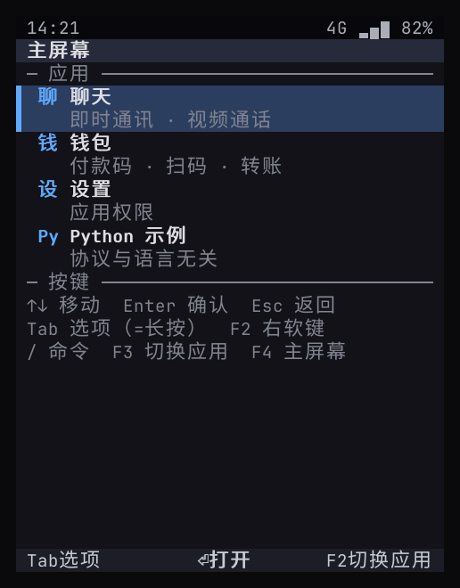 | 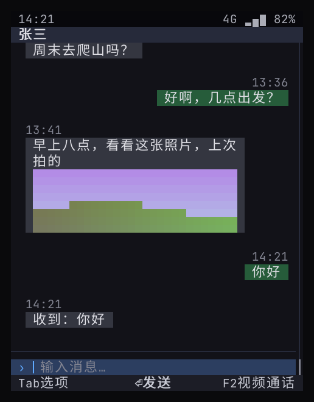 | 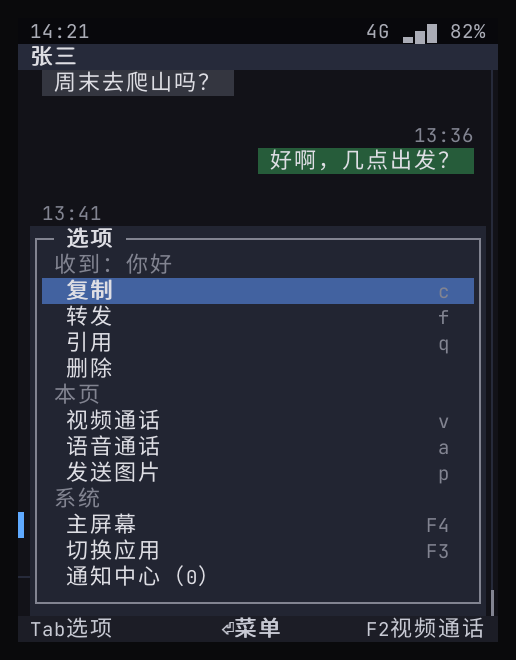 |

| System permission grant | Video call (remote + local picture-in-picture) | Incoming call (app in the background) |
|:--:|:--:|:--:|
| 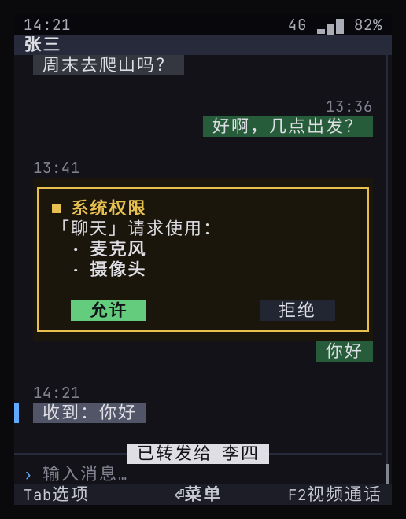 | 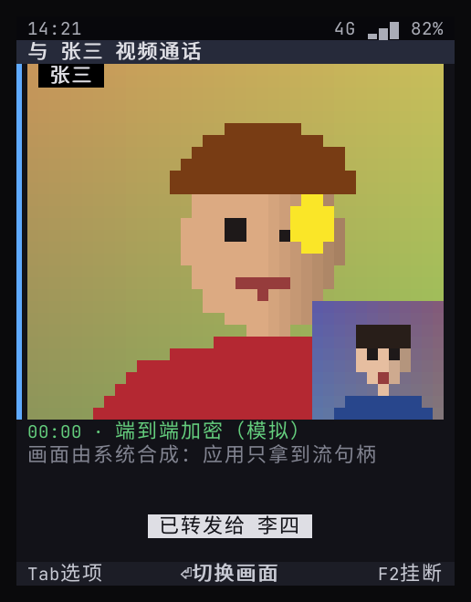 | 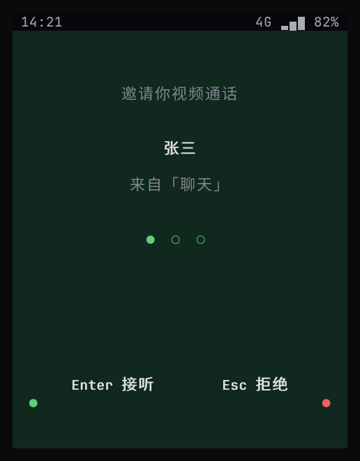 |

| Wallet (device trusted) | Payment code (masked in the screenshot) | System scanner |
|:--:|:--:|:--:|
| 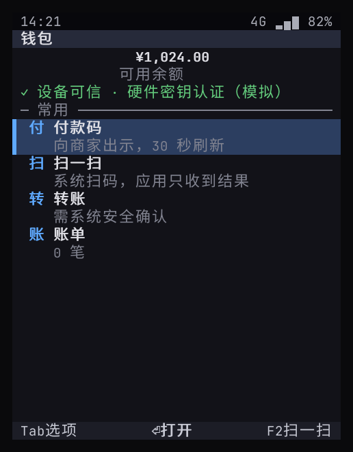 | 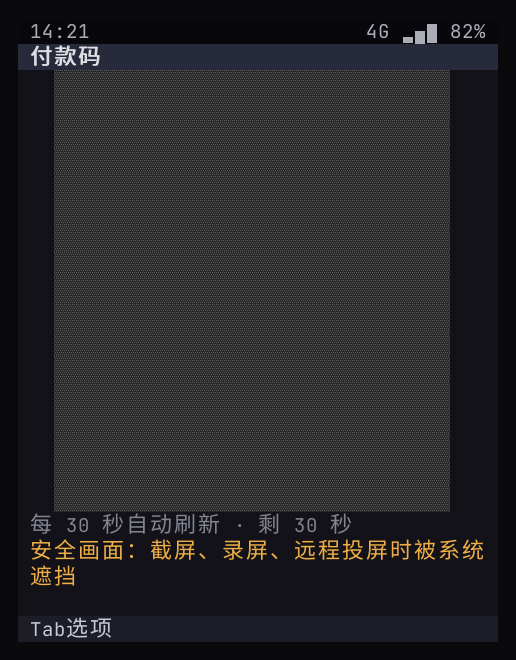 | 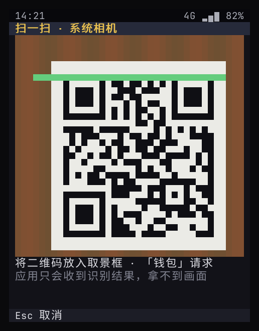 |

| System secure confirmation | Payment succeeded (signature verified by the server) | Markdown document node |
|:--:|:--:|:--:|
| 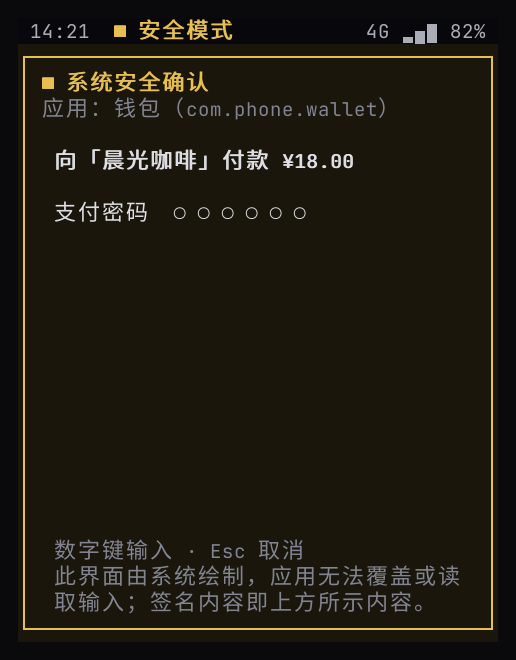 | 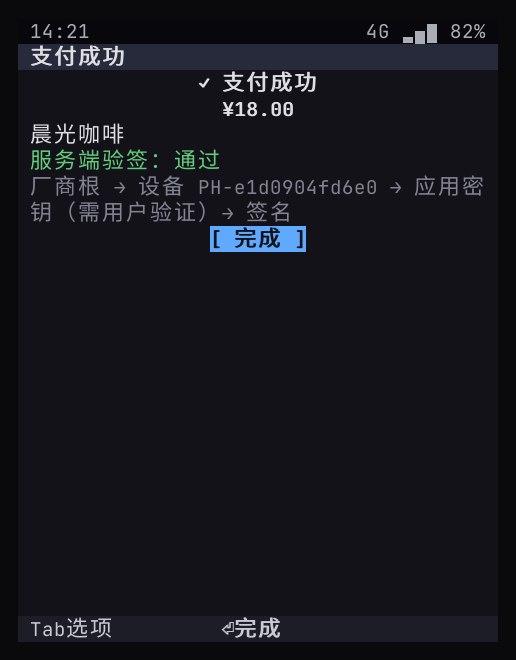 | 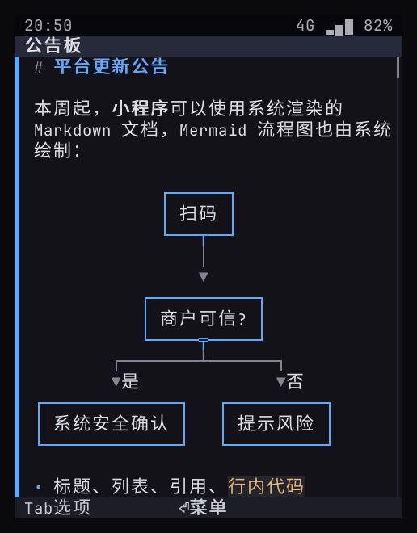 |

| Mini-program requests permission (origin labeled) | Mini-program payment (system secure confirmation labels the origin) |
|:--:|:--:|
| 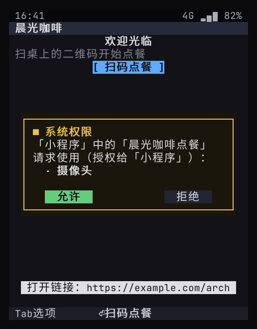 | 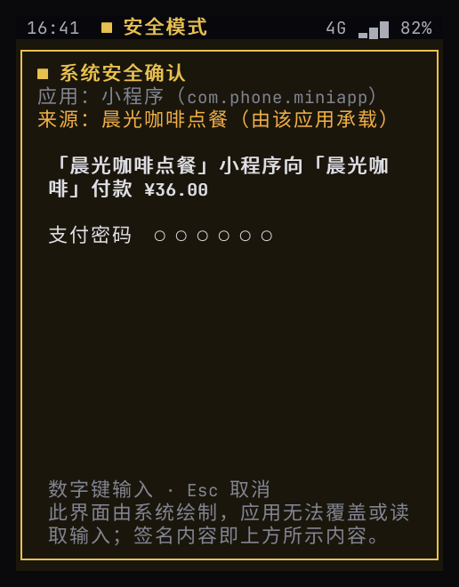 |

| Input method: QWERTY pinyin | Input method: T9 pinyin | Input method: English completion |
|:--:|:--:|:--:|
| 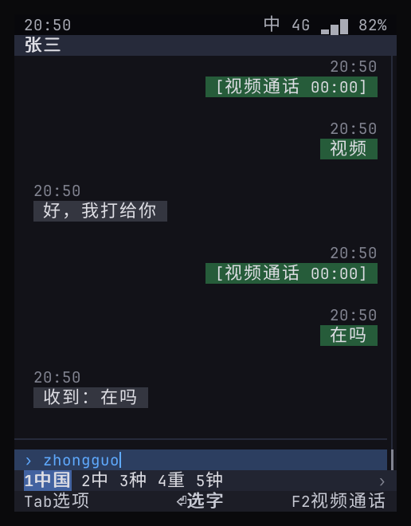 | 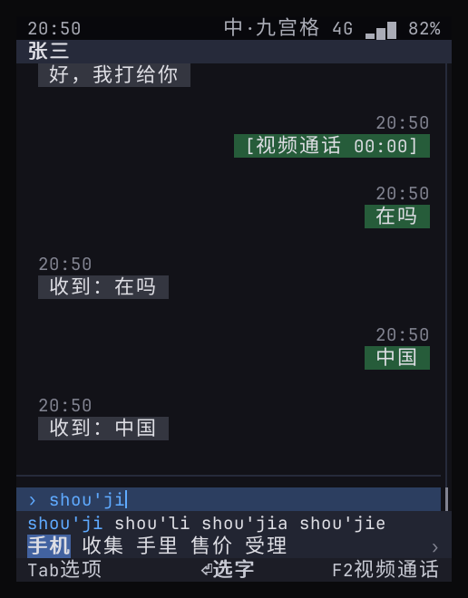 | 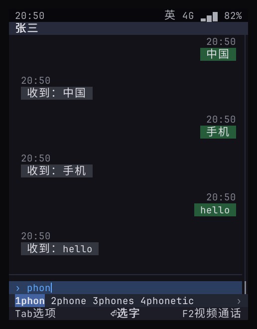 |

Pixel renderer (phone-gui, the same selftest scenario, three form factors):

| Bar phone, T9 keypad 480×640 | Bar phone, QWERTY keyboard 640×480 | Landscape, wide keyboard 800×352 |
|:--:|:--:|:--:|
| 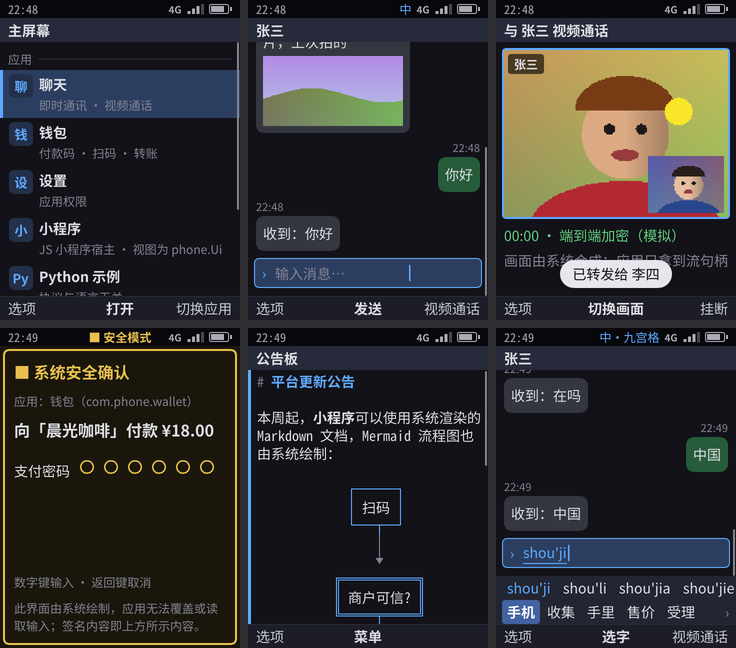 | 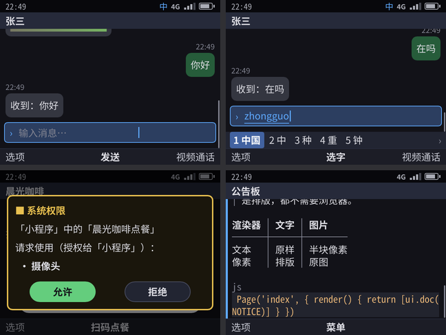 | 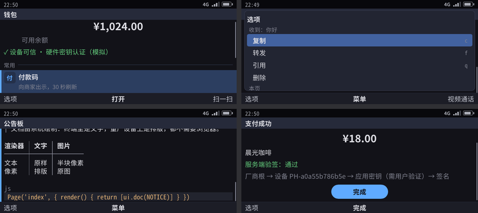 |

## 3. Layout

```
kario/
├── ui/              phone.Ui v0 protocol types + capability catalog
├── wire/            JSON-lines framing, service RPC, fd passing (SCM_RIGHTS)
├── canvas/          cell canvas: CJK double-width characters, true color, half-block pixels, secure-screen masking
├── shell/           Shell: rendering, focus / menus / back stack, system UI, broker, built-in selftest scripts
├── ime/             input method engine: pinyin / T9 / English candidates, predictions, Nokia-style multi-tap; data/ is the AOSP dictionary, compiled at build time into share/phone/ime.dict for memory mapping
├── sandbox/         app sandbox: Landlock, seccomp, namespaces, rlimit (cmd/phone-sandbox is the launcher)
├── paint/           phone-paint: the pixel renderer on the device (Rust: tiny-skia, ab_glyph, DRM/KMS, evdev; design system in src/design.rs; input.rs is the privileged helper that hands over keyboards and mice as they are plugged in)
├── hal/             hardware layer: a thin layer over the mainline kernel's device classes (LED, backlight, power supply, USB device mode); which instance to use comes from the SKU's configuration, and each class has a simulated backend
├── obex/            OBEX: Bluetooth file transfer (Object Push) and the phone book server (PBAP), on the RFCOMM / L2CAP connections BlueZ hands over
├── i18n/            UI text translation: English in the code, translations in locale/<lang>.json (default zh-Hans)
├── gui/             phone-gui: pixel renderer for comparison (Rust + Slint, GPL-3.0-only; ui/phone.slint, src/main.rs)
├── media/           media plane: frame format, subscriptions, synthetic picture sources
├── keystore/        key service logic + server-side verification library
├── gm/              Chinese national (GM) cryptography: SM3 digest, SM2 signatures (software implementation; moves into the TEE in mass production)
├── sdk/             Go app SDK; sdk/c is the C ABI SDK (phoneui.h) and a C++ sample; sdk/ts is @kario/sdk, the types of TypeScript apps (ui.d.ts generated from ui/ by tools/tsgen)
├── jsrt/            kario-jsrt: the runtime of TypeScript apps (C: QuickJS-ng plus the kario module, speaking the protocol through sdk/c); the Go package jsrt is the check the installer and the store share
├── telephonyd/      phone-telephonyd (C++23, CMake): event loop, simulated baseband, call log, the SMS smsd has not acknowledged
├── audio/           audio: mixer, focus policy, synthetic sound sources, shared-memory ring buffer, simulated microphone (cmd/phone-audiod is the service)
├── push/            push: message format, gateway tokens (cmd/phone-pushd device service, cmd/phone-pushgw simulated gateway)
├── programs/        code of the system services, one package each (shellcmd · pushd · keystored · imed · audiod · mediad · nfcd · smsd · sandboxcmd · ctsverify)
├── cmd/             kario-system (the system services combined into one program) · separate development builds of each service, phone-shell etc. · phone-imedict (compiles the dictionary at build time) · phone-pushgw · phone-chatsrv (simulated Hongyan server) · phone-storesrv (simulated store backend) · phone-pkg (developer tool) · kario (new / build / package for TypeScript apps, esbuild built in) · phone-provision · phone-cts-verify · phone-ota-verify
├── appstore/        open core of the store backend (catalog, review, downloads, revocation, reports; the official backend extends it)
├── ota/             system update protocol: the signature on latest.json, reports from phones (signed, plus the report after one day); the format of the holiday calendar, signed and served the same way; incremental packages (delta), dm-verity (verity)
├── apps/            dialer · messages · clock · calc · music · camera · gallery · weather · store · browser · chat (Hongyan) · wallet (Feiqian) · settings · miniapp (JS mini-program host + programs/) · snake (canvas app sample) · hello-py
├── shell/doc.go     Markdown document node rendering
├── shell/mermaid.go Mermaid diagrams (embedded lovely-mermaid, run by goja)
├── shell/imebar.go  input method integration: target input field, candidate bar
├── shell/frame.go   frames for the pixel renderer; gui.go drives phone-gui; device.go form factors
├── shell/freeze.go  background freezing; symbols.go system symbol table
├── shell/telephony.go subscribes to telephonyd, system incoming-call screen, contacts; broker_phone.go phone / alarm capabilities
├── shell/airplane.go airplane mode and mobile data; radios.go Wi-Fi and Bluetooth; btobex.go Bluetooth file transfer and phone book
├── shell/messaging.go subscribes to phone-smsd: SMS notifications (copy code), the emergency-alert screen, SMS capabilities
├── shell/alarm.go   system alarm service; grid.go grids; boot.go boot animation
├── shell/audio.go   audiod integration: system sounds, app playback; push.go push dispatch, wake-up budget, background launch
├── shell/media.go   system photo library (photos, thumbnails, access rules); photo.go system viewfinder and photo picker
├── shell/sandbox.go separate uid per app
├── scripts/stage.sh installs into the device directory layout (shared by the dev build and the Yocto recipes)
├── tools/snap2png/  snapshot to PNG (for the docs, separate Go module)
├── tools/tsgen/     generates sdk/ts/ui.d.ts and jsrt/src/languages.h from ui/ and i18n/ (make test fails when they are stale)
├── tools/imedict/   generates the input method dictionary from the AOSP word lists
├── tools/icons.py   draws the system app icons (apps/*/icon.png)
├── tools/cratesinc.py generates bitbake's crate download list from Cargo.lock
└── yocto/           kas configuration, meta-phone layer, QEMU selftest scripts, parallel download script for the source mirror
```

## 4. Running

```bash
cd kario
make run             # interactive in the terminal (terminal ≥ 44×27 recommended; a phone frame is drawn around it)
make preview         # pixel UI in the browser: http://127.0.0.1:8790, the keyboard acts as the phone keys
make selftest        # end-to-end selftest, snapshots go to build/snapshots/, JUnit report to build/selftest-junit.xml
make selftest ONLY='视频'   # run only the cases whose name matches (视频 = "video")
make test            # go vet + go test
make yocto-build     # build the Yocto image (hours the first time, incremental afterwards)
make yocto-selftest  # boot the image in QEMU, run the boot selftest, print the result and power off
make yocto-run       # QEMU interactive: log in as root on the serial console, type phone
make yocto-vnc       # QEMU boots into the pixel UI, operated over VNC (127.0.0.1:5900), see §4.1
make paint           # build the pixel renderer phone-paint (cargo build --release)
make pixel-selftest  # run the selftest once per form factor (drawn by phone-paint), PNGs go to build/pixel/<form-factor>/
make gui-selftest    # the same selftest drawn by phone-gui, for comparison
make yocto-gui       # QEMU: the renderer draws to the virtio-gpu screen, the monitor injects keys and takes screenshots
make telephonyd      # build only telephonyd and run its unit tests (already included in make build)
make lsp             # write the C/C++ compile_commands.json and link it next to the sources, so the IDE can jump (§4.2)
make skus            # list every SKU; each SKU is a target: make sku-<name> builds its firmware package
make yocto-stress    # use SMS, Hongyan, photos, video and the browser over and over on the 1 GB web image; the system must stay usable throughout (§5.1)
```

| Key | Action |
|----|------|
| ↑ ↓ ← → | Move focus |
| Enter | OK (primary action) |
| Esc | Back |
| Tab | Options menu (= long press; F1 does the same) |
| F2 | Right soft key |
| F3 / F4 | Switch app / home screen |
| F6 or Ctrl+Space | Switch the input method between Chinese / English (`#` in T9 mode) |
| F7 | Chr / Sym: system symbol table (`*` in T9 mode) |
| Alt + key | Long press (T9: long-press a digit to type the digit, long-press `#` to switch to 123) |
| `/` | Command palette |
| Ctrl+C | Quit |

`phone-shell --device bar-t9` (or `--keypad t9`) simulates the T9 keypad: 2–9 type pinyin or English, `0` separates syllables / types a space, `*` gives the next match or the symbol table, `#` cycles through 拼音 → 智能英文 → Abc → abc → ABC (Pinyin → Smart English → Abc → abc → ABC), and long-pressing `#` switches to 123 ([18](18-nokia-form-factors.md) §3).

The wallet's payment PIN is the prototype default **123456**. Five wrong entries in a row lock it (delete `~/.local/state/phone-sim` to reset).

### 4.1 Try it yourself

**A. Text UI in the terminal** (fastest, no image build needed):

```bash
cd ~/code/kario-os/kario
make run                                      # bar phone, QWERTY keyboard
build/usr/bin/phone-shell --device bar-t9     # bar phone, T9 keypad
```

Keys are as in the table above; in addition, F5 is the call key (green key) and F4 is end call / back to idle (red key). Here, web nodes only show the title, the address and the focus; the page itself needs the pixel UI.

**A2. Pixel UI in the browser** (no image build, no VNC): `make preview` (drawn by phone-paint), then open `http://127.0.0.1:8790`; on a remote machine, run `ssh -L 8790:127.0.0.1:8790 <machine>` first. The keyboard and the buttons on the web page are the phone keys.

**B. Pixel UI of the device image** (boots in QEMU, operated over VNC):

1. You need an image: `make yocto-build` (skip this if it is already built). To try the web view, use `make yocto-web-build` instead; `yocto-vnc` boots the most recently built image.
2. `make yocto-vnc`: QEMU boots straight into the pixel UI in about 2 minutes (ARM is emulated in software on x86, much slower than real hardware).
3. Forward the server's port 5900 to your own computer: forward 5900 in Cursor's Ports panel, or run `ssh -L 5900:127.0.0.1:5900 <server>`.
4. Connect a VNC client (RealVNC Viewer, TigerVNC, etc.) to `localhost:5900`, and click the picture once so that it receives the keyboard.
5. Keys: arrow keys, Enter = OK, Esc = Back, Tab = left soft key 「选项」 (Options), F2 = right soft key, F5 = call key, F4 = end call / back to idle, F3 = switch app. The form factor is the T9 bar phone: number keys 2–9 type pinyin, `#` switches the input mode, `*` picks candidates or symbols.
6. To finish: in the terminal running `make yocto-vnc`, press Ctrl+A, then X. The image boots in snapshot mode, so changes are not kept.

**C. Screenshot set** (no interaction): `make skins` draws each selftest step as an image inside a phone body (`build/skins/<form-factor>/`); `make web-selftest` produces a few of the web view (`build/pixel-web/`).

**Suggested walkthrough**:

| Scenario | How | What to look at |
|------|--------|--------|
| Making a call (simulated baseband) | On the idle screen type `10086` directly, dial with the call key, hang up with the end key | Dialing, in-call screen, call log |
| Hongyan chat | Press `/`, type 「鸿雁」 (Hongyan) and press Enter, open the conversation with 张三 (Zhang San), send 「文章」 ("article") | Input method, message bubbles, push |
| Official account article | Select the link Zhang San replied with: OK opens reader mode; in 「选项」 (Options), choose 「网页」 (Web page) to see the page as it is (pixel UI) | Arrow keys move between links; 「分享这篇文章」 (Share this article) opens the system share panel |
| Web form (web image) | Send Zhang San 「搜索」 ("search") and open the reply with 「网页」 (Web page) | 「清空记录」 (Clear history) opens a system confirmation dialog; typing in text fields; drop-downs open a system menu; OK submits |
| Video call | Send Zhang San 「视频」 ("video"); he calls back; answer with the call key | Incoming-call screen, the picture during the call |
| Payment | Open 「飞钱」 (Feiqian): payment code, scan to pay, payment PIN 123456 | System secure confirmation; the secure screen is masked in screenshots |
| Command palette | Press `/` at any time and type an app name or a command | Get there directly without going through menus |
| Menu folders | On the idle screen press OK for the main menu, enter 「工具」 (Tools), press `1` to go straight to Calculator | Nokia-style categories: everyday apps in the main menu, tools and apps each in their own folder; number keys go straight to an item |
| Photos (JPEG) | 主菜单 › 图片 (Main menu › Photos) | 8 real public-domain photos in a grid, images only, no text; OK opens the full-size view, ← → pages through, 选项 › 详细信息 (Options › Details) shows the size and `image/jpeg` |
| Wallpaper | While viewing a full-size photo, 选项 › 设为壁纸 › 待机和锁屏 (Options › Set as wallpaper › Idle and lock screen); end key back to idle; left soft key then `*` locks the keypad | The idle screen and the lock screen both show this photo, with white text over a gradient overlay; 设置 › 壁纸 (Settings › Wallpaper) restores the default |
| Local video | The cell in Photos marked 「▶ 0:15」 (sample: wetland), OK | Played with system decoding (the pixel UI shows the picture, the text UI uses half-block pixels); OK pauses / resumes, ← → skips 5 seconds, the back key closes it |
| Mermaid | 主菜单 › 应用 › 小程序 › 公告板 (Main menu › Apps › Mini-programs › Bulletin board) | A Markdown document drawn by the system: Mermaid flowchart, table, code highlighting, formulas |
| Themes | 设置 › 主题 › 复古绿 (Settings › Theme › Retro green) (or 浅色 (Light), 琥珀 (Amber)) | The whole UI changes color scheme; photos stay the same |
| Browser (web image) | 主菜单 › 浏览器 (Main menu › Browser), enter a URL or search terms | Address bar, bookmarks, find in page (`s`), zoom in / out (`+` `-`); downloads from web pages go into 「文件」 (Files) |
| Settings | In 「设置」 (Settings): app permissions, data usage, sound (← → adjusts the volume), SIM lock (PIN 1234), sandbox self-check | Permissions can be revoked; the PIN is entered in system UI; on the device every item of the sandbox self-check meets expectations |

Whenever a step feels awkward on the keys, you can't find the way in, or you feel a touchscreen is indispensable, write it into the one-week self-use log (57 (internal document) R9).

### 4.2 Reading the code in an IDE (LSP)

| Language | Language server | What it needs |
|------|------------|--------|
| Go | gopls | The `go.mod` at the repository root; nothing generated. In the internal repository `make server` links a `go.work` at the root (to `build/go.work`), so the server code jumps into the open repository |
| C / C++ (telephonyd, sdk/c) | clangd | CMake's exported compile commands: `make build` (or just `make lsp`, which compiles nothing) links `build/telephonyd/compile_commands.json` and `build/capi/compile_commands.json` into `telephonyd/` and `sdk/c/`; `make lsp` also puts a merged one at the root |
| Rust (paint, gui) | rust-analyzer | Each crate's `Cargo.toml`; nothing generated (it downloads the dependencies itself the first time) |

The links and the merged file are in `.gitignore`. After changing the compilers (`CXX23`, `CC14`) run `make lsp` again.

## 5. Verification results

For the current number of cases and the results, see "Current verification baseline" in 57 (internal document); this section explains what each environment verifies.

| Environment | Result |
|------|------|
| Dev machine (Rocky 8.10 x86_64, Go 1.25, GCC 14, non-root) | `make selftest` passes completely (root-only sandbox and cgroup cases are skipped automatically), in about 100 seconds; `make cts` PASS: every case passes and every capability was called ([22](22-developer-api.md) §11); `make build` also runs telephonyd's C++ unit tests |
| Pixel renderer (`make pixel-selftest`, drawn by phone-paint) | One PNG per snap step (UI screenshots in [19](19-core-apps.md) §2) |
| Both renderers (phone-paint: `make pixel-selftest`, `make yocto-selftest`, `make yocto-gui`; phone-gui: `make gui-selftest`, and the image with `KASEXTRA=yocto/kas/phone-gui.yml`) | The same selftest passes completely with both renderers in all three form factors, including the watchdog restarting the renderer after it is killed; on the device, the boot selftest, the CTS and DRM display output all pass for both images |
| `make test` (license check + go vet + unit tests + end-to-end) | Passes; the key tests cover a tampered amount, someone else's key, a device whose root is not this vendor's, PIN lockout, nonce replay and path traversal; the canvas tests cover Chinese line-breaking rules; the input method tests cover full pinyin, abbreviated pinyin, partial commit, T9 and English; the Mermaid tests cover 9 diagram types |
| `make mm-selftest` (Debian container: telephonyd's ModemManager backend + private D-Bus + simulated ModemManager) | Calls, SMS, SIM PIN / PUK, and the baseband and ModemManager coming and going all go through the real D-Bus interfaces ([04](04-ui-language-telephonyd.md)) |
| `make sku-check` (part of `make test`) | Every SKU expands without errors: key code table, wiring labels, form-factor dimensions; the A/B slot selection logic and the RAUC backend ([24](24-sku-framework.md), [25](25-system-update.md)) |
| `make yocto-ota-test` (QEMU, A/B disk) | 11 boots in a row: no update offered when the staged rollout has not reached the device or is paused, untrusted bundles refused, delta install into the other slot, the slot marked good once the Shell is up with the renderer and apps, rollback after the renderer fails to come up three times, a corrupted slot and a swapped descriptor rejected on the spot ([25](25-system-update.md) §3) |
| `make yocto-ota-delta` (QEMU, A/B disk) | Installs this version through Settings on a saved base with a cross-version delta bundle (the RAUC bundle carries the applier; block operations like Android's payload): the rebuilt slot's root hash must be the signed descriptor's, and B comes up with the Shell and the renderer; a delta made for another version is refused by the install hook; a rollback to the base when the new slot is not healthy, B then updating A with a package without the applier (the image's applier), a power cut while it writes, a damaged package falling back to the full bundle; then the download is compared with an adaptive install of the full bundle ([25](25-system-update.md) §5.5). On the emulator ✓: `0a4ff0b` → the end of round 5, the incremental package 6.9 MB, the install downloaded 8.08 MB, against 69.6 MB adaptively and a 137.8 MB full bundle; the applier wrote 509 MB in 45.9 seconds with a memory peak of 22.3 MB |
| `make yocto-ota-release` (QEMU, A/B disk, kario-internal) | Earlier releases' A/B disks install a later release through Settings, from that release's own `latest.json` and bundles: the incremental package when that version's Shell picks deltas, the full bundle when it does not; earlier releases with another machine string are not booted, and the report says they have no update path ([25](25-system-update.md) §5.4) |
| Interactive mode (driven by a Python pseudo-terminal) | Home screen rendering, Enter opens an app, Tab options menu, Ctrl+C exits cleanly ✓ |
| Yocto Wrynose qemuarm64 (TCG emulation, root) | The image (phone-paint) contains no GPLv3 components; in the phone-gui comparison image, phone-gui is the only GPLv3 component; both renderers drop privileges and run under Landlock and seccomp. The boot selftest passes completely (including the sandbox self-check, cgroup and memory limit overrun, low-memory cleanup, not responding, crash logging, signature verification at install and before launch, emergency calls, renderer crash restart), the CTS PASSes, the renderer is started through the slot, and the report signature verifies on the host (the Python case is skipped because the image has no python3; telephonyd, audiod and pushd run on the device; the pixel renderer produces images at the same time; the sound played by the device is recorded and its analysis passes), see §5.1 |

Selftest cases ([shell/selftest.script](../../shell/selftest.script)); each one goes through the full chain (case names stay in Chinese, as in the script):

| Case | What it proves |
|------|-----------|
| 待机界面，OK 进主菜单 (Idle screen, OK opens the main menu) | Manifest loading; system screens also go through `phone.Ui`; `Screen.Center` makes OK open the menu |
| 命令面板跳转并收发消息 (Jump via the command palette, send and receive messages) | App process, input field, `/` command palette |
| 消息菜单（等价长按） (Message menu (equivalent to a long press)) | The Shell generates the menu from the element's actions |
| 转发到其他会话 (Forward to another conversation) | Multi-page flow, back stack |
| 视频通话：运行时授权 + 媒体流 (Video call: runtime grant + media stream) | Broker grant, media-plane frames reach the screen |
| 最小化后从系统通话指示返回 (After minimizing, return via the system call indicator) | Background call, status bar indicator, system events |
| 来电：应用在后台，系统全屏接听 (Incoming call: app in the background, answered full-screen by the system) | CallKit-style system incoming-call screen |
| 后台消息：横幅与通知中心 (Background message: banner and notification center) | Notifications, banner, selecting it opens the app back at the conversation |
| 钱包：设备认证 (Wallet: device attestation) | nonce + certificate chain verification |
| 付款码是安全画面 (The payment code is a secure screen) | Masked in snapshots (`▒`) |
| 系统扫码 + 可信支付确认 (System scanner + trusted payment confirmation) | The scanner hands over only the result; wrong / correct PIN; server-side signature verification |
| 转账表单 (Transfer form) | Multi-field form, what you see is what you sign |
| 账单与危险操作二次确认 (Bills and second confirmation of dangerous operations) | Uniform confirmation for danger actions |
| 撤销权限后能力调用被拒绝 (Capability calls are rejected after the permission is revoked) | Settings app (system permission) + broker rejection |
| 沙箱：已生效的限制层全部符合预期 (Sandbox: every active restriction layer meets expectations) | On the dev machine, seccomp blocks dangerous system calls; the self-check has no failed items |
| 输入法：全键盘拼音、候选与联想 (Input method: QWERTY pinyin, candidates and predictions) | `zhongguo` → candidate 「中国」 ("China") → predictions appear after the commit → sent successfully |
| 输入法：九宫格拼音 (Input method: T9 pinyin) | `746854` → pinyin row `shou'ji` + candidate 「手机」 ("mobile phone") → sent successfully |
| 输入法：九宫格英文与全键盘英文补全 (Input method: T9 English and QWERTY English completion) | `#` switches to English, `43556` → hello; QWERTY `phon` → phone |
| 输入法：诺基亚式按键 (Input method: Nokia-style keys) | `##` switches to Abc, multi-tap types Hello, long-press 5, `*` symbol table, long-press `#` switches to 123 |
| 文档节点 (Document node) | Markdown is rendered by the system; the Mermaid flowchart is drawn as a box diagram; links go into the menu automatically, and after one is selected the app receives the URL |
| 小程序：JS 逻辑 + 数据绑定 + 本地存储 (Mini-program: JS logic + data binding + local storage) | goja runtime, `setData` re-renders, storage survives reopening |
| 小程序：扫码点餐 + 支付 (Mini-program: scan to order + payment) | A mini-program written in TypeScript calls the system scanner and secure confirmation through the host; the dialog labels the mini-program's name; the host's server verifies the signature |
| 沙箱：独立 uid、命名空间、Landlock (Sandbox: separate uid, namespaces, Landlock) | 11 self-checks: cannot read private keys or other apps' data, cannot connect to the key service, cannot execute code it wrote itself, cannot write the shared temporary directory, cannot see other processes, has no network, cannot listen on ports, dangerous system calls are blocked; can write its own data directory and read the public root public key (needs root, runs only on the device) |
| 后台冻结 (Background freezing) | 1 second after leaving Feiqian (shortened for the selftest) the process is stopped (`/proc` state T); after returning it resumes and responds to keys; Hongyan does not stay resident and is frozen as well |
| 鸿雁不常驻 (Hongyan does not stay resident) | After it is frozen, a VoIP push from the server 3 seconds later wakes it, it reports an incoming call, and the system full-screen incoming-call screen appears |
| 电话：智能拨号、拨出、接通、挂断 (Phone: smart dialing, dialing out, connecting, hanging up) | Typing `94` filters out 张三 (Zhang San, zhang) and 中国移动 (China Mobile, zhong); after dialing, the call goes through calling, ringing and in call; after hanging up, the call log shows 「已拨」 (Dialed) |
| 电话：系统来电 (Phone: system incoming call) | `tel ring` makes the simulated baseband ring; the system full-screen incoming-call screen shows the contact name, and after answering the call is handed to the Phone app |
| 短信 (SMS) | Write a new message to 王五 (Wang Wu) and receive an automatic reply; back on the home screen, an SMS arrives from 10086 and a banner appears |
| 短信：通知、回复、送达 (SMS: notification, reply, delivery) | An SMS arrives while Messages is closed; opening it from the notification centre opens that conversation; replying 「你好」 the input reads 「还可输入 68 字 · 1 条」 (68 left · 1 SMS), and once delivered the message is marked 「已送达」 (Delivered) |
| 短信：复制验证码 (SMS: copy code) | A bank's verification-code SMS; `c` in the notification centre copies the code, and pasting in a new message gives 482913 |
| 短信：删除 (SMS: delete) | Deleting a message in a conversation, then the whole conversation, each confirmed first |
| 短信：拦截 (SMS: block) | Once 10690666 is blocked its message raises no banner and stays out of the notification centre, it is in 「已拦截」 (Blocked); unblocking |
| 短信：smsd 崩溃 (SMS: smsd crash) | phone-smsd is killed; a message arriving then stays in telephonyd (1 unacknowledged), and when smsd is back it takes it, notifies, and telephonyd's queue is empty |
| 短信：telephonyd 崩溃 (SMS: telephonyd crash) | telephonyd queues a message and is killed before handing it to smsd (`sim.sms` with `held`); the restarted telephonyd reads it back from `telephony.json`, smsd takes it when it reconnects, notifies, and the queue is empty |
| 紧急警报 (Emergency alert) | A national cell broadcast while locked with the screen off: the screen lights, the full-screen alert covers the lock screen, the `alert` sound, vibration, still locked after OK; once extreme is off in Settings, an alert of that level does not come up, and both are in Messages › Emergency alerts |
| 闹钟 (Alarm) | Create an alarm 「+2」 (2 minutes from now), `timeshift 180` fast-forwards 3 minutes, the system rings full-screen |
| 计算器 (Calculator) | `12 * 30` then Enter gives 42 (`*` is 「+」); `6 * * 2 =` gives 4 (pressing `*` repeatedly switches to 「−」) |
| 音乐 (Music) | Not frozen while playing in the background; on an incoming call the music pauses and the ringtone sounds, and after the call is rejected the music continues; after pausing, the UI shows 「已暂停」 (Paused) ([20](20-audio.md)) |
| 电话、闹钟的声音 (Sounds of calls and alarms) | Dialing out plays a ringback tone, a connected call has call audio, an incoming call rings, an alarm plays the alarm sound, and everything is quiet afterwards (the streams actually playing are queried from audiod) |
| 推送：通知不唤醒，数据短暂唤醒 (Push: notifications don't wake the app, data wakes it briefly) | A frozen Feiqian stays frozen when it gets a payment-received notification; a data push resumes it for 3 seconds to record the entry, then it is frozen again ([21](21-push.md)) |
| 推送：进程不在时后台启动 (Push: background launch when the process is gone) | After Feiqian is killed, a data push launches it in the background and it records the entry |
| 推送：VoIP 与消息 (Push: VoIP and messages) | After Hongyan gets a VoIP push it reports an incoming call, and the system full-screen incoming-call screen appears; a message push goes into the conversation |
| 鸿雁：语音消息 (Hongyan: voice messages) | While recording, the status bar shows 「● 麦克风」 (● Microphone); after sending, the indicator disappears, the bubble shows the duration, and the bot replies; selecting the bubble plays it, and a media stream appears in audiod (on the device, this speech was recognized in the recording from the sound card) |
| 录音：离开前台即停止 (Recording: stops when leaving the foreground) | Pressing F4 while recording makes the system stop the recording, and the indicator disappears; back in Hongyan, the recording page shows 「录音已中断」 (Recording interrupted) |
| 相机：系统取景框 (Camera: system viewfinder) | The viewfinder really shows the camera picture (waits until 5 frames reach the screen); OK takes a photo, and a toast says it was saved to Photos |
| 图片：系统相册 (Photos: system photo library) | The Photos app, pre-granted 「相册」 (Photo library), lists the sample photos and the photo just taken; opening the full-size view shows the dimensions |
| 鸿雁：发图 (Hongyan: sending a photo) | The system picker appears; after a photo is selected, the app receives a read-only file and reads its size; the photo bubble is displayed by the system |
| 通话键、挂断键 (Call key, end key) | On the idle screen the call key opens recent calls, and pressing it again calls back; during a call the end key hangs up; during an incoming call the end key rejects and the call key answers |
| 键盘锁 (Keypad lock) | Left soft key then `*` locks; it shows 「键盘已锁」 (Keypad locked) only once, and a small lock appears in the status bar; while locked, digits and OK do nothing, and it shows 「按「解锁」再按 *」 (Press "Unlock", then *); left soft key then `*` unlocks |
| 挂断键：菜单打开时也直接回待机 (End key: straight back to idle even with a menu open) | Open the options menu in an app and press the end key: the menu closes and you are back on the idle screen |
| 设置：声音、自动键盘锁、关于本机 (Settings: sound, automatic keypad lock, about phone) | After the media volume is raised, the volume in audiod changes accordingly; with automatic keypad lock set to 15 seconds, the idle screen locks automatically after a `timeshift` fast-forward; about phone shows the system name and version |
| 图片：删除照片要系统确认 (Photos: deleting a photo needs system confirmation) | The Photos app requests the deletion, a system confirmation dialog appears, and after confirming, the photo disappears from the photo library |
| 剪贴板 (Clipboard) | Copy a message in Hongyan, choose 「粘贴「…」」 (Paste "…") in the input field's system menu, and the message sent is the copied text |
| 天气：定位与后台刷新 (Weather: location and background refresh) | The first location request brings up the 「位置」 (Location) permission prompt, and the status bar shows 「● 位置」 (● Location); after leaving, the app is frozen; after `timeshift` one hour, the system wakes it to run a background task and then freezes it again; coming back shows 「后台刷新 1 次」 (Background refresh: 1 time) |
| 分享：照片 (Share: photo) | The Photos app shares a photo; the system panel lists only Hongyan, which can receive images; after a conversation is picked the photo is sent, and the bot replies 「这张拍得好」 ("Nice shot"), which shows that the photo was granted to Hongyan |
| 分享：文字 (Share: text) | Weather shares today's weather; the panel lists Messages and Hongyan; after Messages is picked, the new message page already has the text filled in |
| 应用商店：签名包的安装与卸载 (App store: installing and uninstalling a signed package) | A package with one corrupted byte is rejected; a valid package brings up a system confirmation dialog (version, developer, issuing store, permissions); once installed, 「便签」 (Notes) runs from the install directory and saves data; after uninstalling and reinstalling, the data is empty |
| cgroup（仅设备） (cgroup (device only)) | Calculator's group has a 192 MB memory limit, a limit of 128 processes and a foreground CPU weight of 400; after leaving, the freezer takes effect and the weight drops to 50; after returning it is thawed |
| 兼容测试（只在 `--cts` 下） (CTS (only under `--cts`)) | All 6 out-of-permission calls by the CTS app are rejected; a background task interval under 15 minutes is rejected; with the phone permission, the app answers, mutes, holds, resumes and hangs up an incoming call itself; (device only) a probe keeps allocating memory, and once it exceeds the limit the system ends it and tells the user why |
| 菜单：数字键直达 (Menu: number keys go straight to an app) | On a T9 device, press OK on the idle screen for the main menu, then 7 opens Calculator |
| 待机：直接拨号、打字搜索 (Idle: direct dialing, type-to-search) | On T9, pressing 1 on the idle screen enters dialing; typing 0086 next smart-matches 中国移动 (China Mobile); on the QWERTY keyboard, typing 「飞」 (fēi, the first character of Feiqian's Chinese name) on the idle screen and pressing Enter on the search result opens Feiqian |
| Python 应用 (Python app) | The protocol is language-independent (skipped automatically when the image has no python3) |
| 拨号码 (Dial codes) | In Phone, typing `*#06#` shows the IMEI (the phone answers this itself); `*101#` gets the carrier's three-line menu, and replying 2 gets the data balance; a question the network sends by itself is answered in the Phone app |
| 墓碑 (Tombstone) | In a Hongyan conversation, write a draft without sending it and go back to idle, then end Hongyan the way the low-memory cleanup does; going back from 「切换应用」 (Switch app), you are still in that conversation, the draft is still there, and once it is sent the bot replies as usual |
| 画布应用：贪吃蛇 (Canvas app: Snake) | The Nokia-style yellow-green LCD is graphics handed over by the app, and the system draws it in both the text and the pixel UI; the level and walls or wrap-around change by key and through the Options menu; it starts, pauses (opening the Options menu pauses it too: the `focus` event), crashes, and OK after game over returns to the level screen; ended by low memory and opened again, the level is still there; Back still returns to idle |
| Wi-Fi 和蓝牙 (Wi-Fi and Bluetooth) | In Settings, pick an encrypted network, enter the password on a separate page, and it connects; turn Bluetooth off and on again, it finds a headset, and once paired the headset is listed under 「已配对的设备」 (Paired devices) (a headset has no screen, so there is no pairing code to check; devices that show one are covered by a unit test). On the emulator this runs on the real iwd and BlueZ: mac80211_hwsim's second radio is the access point, btvirt's second virtual controller the headset |
| 企业 Wi-Fi（802.1X） (Enterprise Wi-Fi, 802.1X) | An enterprise network asks for the user name, password and server domain; with a wrong domain (`evil.example`) it does not connect, with the right one it connects over PEAP (MSCHAPv2 inside); after forgetting the network it connects again over TTLS / PAP. On the dev machine a simulated network checks the domain; on the emulator the real iwd talks to hostapd's own EAP server (the third mac80211_hwsim radio, only in the qemuarm64 image), whose CA and server certificate the selftest generates at test time (not in git, not in the image), and iwd checks against that CA and the domain; hostapd's MSCHAPv2 needs the MD4 and DES of OpenSSL's legacy module (installed in the emulator's image only), and it hands out no addresses, so the test network has a static IPv4 address. Passes on the emulator (without hostapd or a free radio in the image the case is skipped; here it passed, not skipped); **not verified on hardware** |
| 蓝牙传文件和电话本 (Bluetooth file transfer and phone book) | A file the paired headset sends goes into Files once the user accepts it; refused, the sender gets "forbidden"; in Settings › Bluetooth, OK on the device, "Send a file", the system lists Files and the chosen one goes over; before a car kit reads the phone book the system asks once, then it gets the contacts (vCard 2.1). The OBEX is the Shell's own (package `obex`; its unit tests also cover an RFCOMM-like byte stream and L2CAP-like one-packet reads, multi-packet objects, vCard 3.0, listings searched by name, the call history, refused and oversized files). Leaving out obexd was measured: the Yocto build's libicudata is 33.2 MB, libicui18n 3.7 MB, libicuuc 2.3 MB, libical 1.8 MB (installed size), 41 MB in all, and libical is used only by obexd's PBAP back end (`phonebook-dummy.c`); the own implementation is about 49 KB of code in `kario-system` (arm64; `go tool nm` symbol sizes, 25 KB in package obex, 24 KB in the Shell); obexd itself was not built or measured. On the emulator the other side is btvirt's second controller (passes); with other vendors' phones and car kits **not verified on hardware** |
| 飞行模式和移动数据 (Airplane mode and mobile data) | Turning airplane mode on from Settings' first page shows ✈ in the status bar and turns the modem's radio, Wi-Fi and Bluetooth off; Wi-Fi is turned on in airplane mode; after airplane mode ends Bluetooth is back and Wi-Fi still on; airplane mode on again from the power menu keeps Wi-Fi on this time (the user turned it on last time) and turns Bluetooth off; with the keypad locked, 112 goes out, the modem powering up by itself, and airplane mode ends with it, Bluetooth back; with mobile data off the status bar no longer shows 4G, and shows it again once it is on; on the device a further case checks that the firewall closes the cellular interface telephonyd reports (passes on the emulator). telephonyd's unit tests cover calls, SMS, USSD and incoming calls refused with the radio off, 112 still connecting, the radio kept on during an emergency call, and both switches surviving a restart; the ModemManager back end's cases pass against the simulated ModemManager (`make mm-selftest`); **not verified on hardware** |
| 应用商店后台：分批发布与自动更新 (Store backend: staged rollout and automatic updates) | While the new version's staged rollout is at 0%, this phone does not see it; after the developer sets it to 100%, 「可更新」 (Update available) appears; with the charger plugged in, after `timeshift` six hours the store has installed it in the background and posts 「已自动更新」 ("updated automatically"); after the store takes the app down, the background job fetches the list without the store being opened, and the app can no longer launch |
| NFC：卡包、门禁卡、快速选卡、交通卡、付款、读卡（8 个用例） (NFC: card pack, door cards, quick card picker, transit card, payment, reading (8 cases)) | On the simulated controller and simulated readers: reader mode copies door cards; locked, screen off and in simulated suspend, door cards and the express transit card answer by themselves without lighting the screen, and the reader's field wakes the phone; door cards are chosen by time of use, workdays apart from days off, by the holiday calendar (signed system data from the update server; a test calendar, not the official one) a make-up Saturday counting as a workday and a Wednesday holiday as a day off; pressing the power key twice opens the quick card picker; a payment card does not answer while locked, and after unlocking Feiqian, started in the background, pays; leaving "Add door card" stops reading at once; apps' reader mode (runtime permission, the system's reading sheet, a command session with a CPU card) and the "reader left" event ([30](30-nfc.md) §9; **not verified on hardware**) |
| USB 文件共享在单独的沙箱进程里 (USB file sharing in a separate sandboxed process) | The helper cannot open files by path, create sockets or run programs; with cgroups it is in a group of its own (64 MB of memory, no swap, 64 processes), and on a developer machine without cgroup delegation it stays in the Shell's group as apps do; the Shell refuses its out-of-bounds requests; a file over the folder's limit is refused (413); if it crashes the Shell restarts it, and it ends when the cable is pulled ([27](27-usb-typec.md) §3.2; the group and limits on the emulator **to be run**) |
| USB 文件传输（MTP） (USB file transfer (MTP)) | First the kernel is checked for FunctionFS (on the emulator also dummy_hcd); with file transfer chosen in Settings › USB, the trusted computer (a simulated cable on the developer machine, dummy_hcd over usbfs on the emulator) sees four storages, Photos, Videos, Music and Files, reads property lists the way Windows does, downloads, reads in pieces, uploads and makes a folder in Music; deleting, renaming and copying text into Photos are refused; the sandboxed helper carries the files over FunctionFS; on the emulator libmtp's mtp-detect, mtp-files and mtp-getfile also detect the device, list files and copy one ([27](27-usb-typec.md) §3.3; emulator ✓; **not verified on hardware** with real computers: none of Windows, macOS or Linux tried) |

### 5.1 Yocto / QEMU

| Item | Value |
|----|-----|
| Distribution | Poky 6.0.4 (Wrynose), systemd 259.5, kernel 6.18.54-yocto-standard, GCC 15.3 |
| Machine | qemuarm64 (AArch64, TCG emulation on an x86 host) |
| Image | `phone-image`: contains `phone-fw`, the renderer in the slot (phone-paint; the comparison image uses phone-gui instead. Rust is cross-compiled with Yocto's own Rust 1.94, and crates are downloaded and verified by bitbake according to `Cargo.lock`), `phone-telephonyd` (C++23, CMake, GCC 15), `fonts-noto-cjk`, dropbear; the image contains no GPLv3 components, and in the comparison image phone-gui is the only GPLv3 component |
| `phone-fw` recipe | Cross-compiled with Wrynose's own Go 1.26; the dependencies are Go modules that bitbake downloads and verifies according to `phone-fw-go-mods.inc` (`gomod://`; `tools/gomodinc.py` generates it from go.mod and go.sum, `make gomods`; `make test` fails if the list is out of date), and the licenses are registered in `phone-fw-licenses.inc`; no network access at compile time; the install layout is the same as in the dev build (`scripts/stage.sh`) |
| Sources | By default, a tarball that `make yocto-src` packs from the working tree (including uncommitted changes); `make yocto-build SRC=git` makes the recipes build from git commits instead (`classes-recipe/phone-src.bbclass`: HEAD by default, fetched through `/kario` mounted by kas; `GIT=github` fetches from GitHub); product releases are built this way from the commits of the two repositories |
| Selftest method | Kernel parameter `phone.selftest=1` → `phone-selftest.service` runs the same scenario → prints the result → powers off automatically; on failure it also prints the state of each app process (kernel wait channel), the Shell trace (script steps, foreground switches, system overlays) and the service and app logs |
| Result | `PHONE-SELFTEST-RESULT: PASS` (all cases, with the renderer in the slot producing images at the same time), followed by `PHONE-CTS: PASS`; the report is retrieved over the serial console and its signature is checked with `phone-cts-verify`; then `audio-check.py` analyzes the sound recorded by QEMU: `AUDIO-CHECK: PASS` ([20](20-audio.md) §6). For the number of cases see 57 (internal document) |
| Low-memory stress test | `make yocto-stress`: the web view image on a 1 GB SKU (`qemu-t9-1g`), music playing in the background, 5 rounds of "send an SMS and get the reply → send and receive in Hongyan → look at photos → open the browser while a video plays and load three pages" (`stress.script`). Every step has to finish in its time, the renderer must not be restarted, no system service may be ended or restarted, and the kernel's OOM killer must not act outside an app's own memory limit; available memory and memory pressure (PSI) are sampled every 2 seconds meanwhile. Result: all 5 rounds pass, at least 493 MB stayed available (of 975 MB), there was no memory pressure, and the low-memory killer was not needed. Earlier failing runs found two problems, both fixed: the web process tree thrashed in its 256 MB group (pressure full up to 72%, the whole machine slowed down), so 1 GB models now give it 384 MB; and a restarted app or web process stayed in its last group, whose dead tree's page cache was still charged to it, so the browser's web process after a revival from its tombstone was ended by WebKit as soon as it started and the next one hung; now the group is deleted and made afresh ([17](17-app-sandbox.md) §5). In those runs the low-memory killer ended background pages and apps, and the system services and the renderer were never lost |

Display (`make yocto-gui`): with the kernel parameter `phone.gui=1`, phone-shell drives the renderer in the slot to draw on the virtio-gpu screen (480×640) through DRM/KMS; the QEMU monitor injects USB keyboard key presses and captures the framebuffer, and all 7 steps (idle → menu → Phone → options → Calculator → Messages → direct dialing from idle) take effect; audiod and pushd also run as system services in this setup (screenshots in [19](19-core-apps.md) §2).

Build notes (this machine: 48 cores, internet access through the company proxy):

- The first build takes about 2 hours, and the bottleneck is the network: the kernel git repository is about 4.2GB, and a single connection only gets about 0.4MB/s. The proxy throttles per connection, so [yocto/fetch-mirror.sh](../../yocto/fetch-mirror.sh) downloads the official Yocto source mirror tarballs in 24 parallel segments (about 10MB/s, 8 minutes) and puts them into `DL_DIR`, where bitbake unpacks and uses them directly.
- After that, changing code and running `make yocto-build` again only rebuilds the changed recipes and the image, which takes a few minutes; sstate and the download cache live in `~/yocto/cache` and can be reused across builds.
- **Where the time goes** (one incremental build measured with Yocto's buildstats, and the memory limit checked):
  - Memory is not the bottleneck. This user's memory limit is 48 GB, and the task with the highest peak in an incremental build (compiling phone-gui) used only 2.5 GB; the limit was only ever hit back when WebKit was compiled with 24-way parallelism. So lifting the memory limit would barely help the current tasks.
  - The real big items:
    - compiling phone-gui, about 140 seconds;
    - generating SPDX / SBOM, about 100 seconds;
    - packaging the root filesystem, about 70 seconds;
    - the QEMU boot selftest, about 3.5 minutes: AArch64 emulated on x86, without KVM.
  - The source tarball is generated with `gzip -n`, so identical sources produce an identical file; otherwise it would carry a new timestamp every time, bitbake would think the sources had changed, and even a Go-only change would rebuild the renderer.
  - What else could be done:
    - run several QEMU selftests in parallel (48 cores, while one selftest only uses 4 virtual cores);
    - find an ARM64 server (Kunpeng, Ampere) to run KVM, which would make emulation an order of magnitude faster;
    - turn off SPDX for dev builds. However, this changes the signatures of all tasks, so the first build afterwards rebuilds everything, and release builds still need the SBOM to meet the GPL obligations.

## 6. What is simulated, what is not done

| Part | Prototype | Mass production |
|------|------|------|
| Camera, remote end of calls, code recognition | Synthetic pictures (photos are synthetic too); the scan result is simply the text drawn in the picture; no network transport | V4L2 / libcamera, hardware codecs, real recognition, network transport |
| Keys | Software Ed25519, app keys optionally Chinese national SM2; on the dev machine, the vendor root key is generated on the device at first boot, and after provisioning a certificate issued by the certifier's CA is used | TEE + factory provisioning, the root key is not on the device |
| Trusted input | Shell overlay that apps cannot read | TEE trusted UI path |
| Sandbox | `phone-sandbox`: separate uid, namespaces, Landlock, seccomp, rlimit; on the device one cgroup per app (memory, processes, CPU weight, freezer), falling back to SIGSTOP on the dev machine | Per-app firewall; background apps ended first under memory pressure |
| Rendering | Text renderer + two pixel renderers (software rendering; video frames forwarded through the Shell) | GPU rendering, phone-paint animations, incremental frames, media dmabuf passthrough |
| Protocol transport | JSON lines | Binary + incremental updates |
| Mini-programs | Built into the host binary; for permissions there are only declaration checks and origin labeling, and grants still belong to the host | Signed distribution; grants and keys tracked per mini-program (R5) |
| Input method | Separate process `phone-imed`, binary dictionary mapped into memory (about 4 MB of private memory); user dictionary, fuzzy pinyin | Stroke input ([16](16-input-method.md) §8) |
| Baseband | telephonyd's simulated baseband: call audio is synthetic, SMS get automatic replies | ModemManager backend; call audio connected directly between the baseband and the sound card |
| Video | mediad decodes in software with ffmpeg, built only with royalty-free WebM (VP8 / VP9, Opus / Vorbis), at 15 frames per second paced by the media service; the sample is a 15-second public-domain video | Hardware decoding (H.264 / HEVC, a V4L2 decoder or the vendor's VPU), decode buffers sent to the display through dmabuf (R21) |
| Audio | audiod mixes by itself and outputs through aplay; the tracks are synthetic samples; the microphone is a simulated signal | PipeWire sinks (Bluetooth, headphones), ALSA UCM routing, decoders, recording ([20](20-audio.md) §7) |
| Push | The simulated gateway runs on this machine or on the device, with a pinned TLS certificate (TLCP optional); devices register with device attestation; the data part is end-to-end encrypted; beta test phones have no provisioned device certificate, so the gateway cannot tell whether they are real devices | The official push service (not open source), device certificates provisioned at the factory ([21](21-push.md) §7, [22](22-developer-api.md) §11) |
| Location | Simulated (fixed in Beijing, 30-meter accuracy) | ModemManager Location or gpsd |
| Weather data | Simulated forecast generated from the city and the date | A weather provider's API |
| Web view, app store | The web view is WPE WebKit (a separate image, `KASEXTRA=yocto/kas/web.yml`); the store is the open core plus the simulated backend | Video in web pages needs hardware decoding (R39); the official store backend is not open source ([07](07-ecosystem-and-store.md) §4.1) |

## 7. Where to start reading the code

| Concern | Location |
|--------|------|
| App identity cannot be forged: socketpair → fd 3 | `shell/core.go` `spawn` |
| Broker: declaration check, runtime grant, dispatch to services | `shell/broker.go` |
| System UI: permissions, trusted confirmation, code scanning, incoming calls | `shell/overlay.go` |
| Subscribing to media frames only for visible screens | `shell/render.go` `reconcileSubs` |
| What you see is what you sign, server-side verification | `keystore/verify.go` |
| Chinese national SM2 / SM3 | `gm/` |
| Input method service, binary dictionary | `cmd/phone-imed`, `ime/dict.go`, `shell/imeclient.go` |
| Memory report (last step of the selftest) | `shell/memreport.go` |
| How to write an app | `apps/chat`, `apps/wallet`, `apps/hello-py/hello.py` |
| How to write a TypeScript app | `examples/hello-ts/src/main.ts`; interface `sdk/ts/index.d.ts`; runtime `jsrt/src/`; command line `cmd/kario`; how the Shell starts it `shell/jsapp.go` |
| How to write a mini-program | `apps/miniapp/programs/*/app.{js,ts}` (`Page` / `setData` / `phone.*`), types in `apps/miniapp/types/phone.d.ts`, host in `apps/miniapp/main.go`, `typescript.go` |
| Markdown / Mermaid rendering | `shell/doc.go`, `shell/mermaid.go`, `shell/highlight.go` (code highlighting), `shell/texmath.go` (formulas) |
| Input method | Engine `ime/`; Shell integration in `shell/imebar.go` |
| Sandbox | Launch: `shell/sandbox.go`; enforcement: `sandbox/`; self-check: `apps/settings/probe.go` |
| Pixel renderer | Frames: `shell/frame.go`; process: `shell/gui.go`; UI: `gui/ui/phone.slint` |
| How push and background tasks wake apps | `shell/push.go` `deliverBackground`, `shell/jobs.go` |
| System settings, clipboard, location | `shell/settings.go`, `shell/clipboard.go`, `shell/location.go` |
| Renderer protocol (replaceable slot) | Shell side `shell/gui.go`; alternative renderer `gui/src/main.rs`; our own renderer `paint/src/` (`frame.rs` protocol, `canvas.rs` drawing, `paint.rs` layout); specification [23](23-renderer-protocol.md) |
| System name | `brand.json` (installed to `share/phone/brand.json`), `loadBrand` in `shell/device.go` |
| Publishing and contributing | `scripts/publish.sh` (`make publish`), `scripts/check-dco.sh`, `scripts/const-check.py`; the Actions workflows `ci.yml`, `release.yml` |
| App packages and installation | Format and signing `pkg/`; install policy `shell/install.go`; store skeleton `apps/store`; sample third-party app `examples/notes` |
| License boundary | `scripts/license-check.py` (`make license-check`) |
| Renderer watchdog | `shell/watchdog.go` |
| Sandbox checklist (shared by Settings and the CTS) | `sandbox/selfcheck_linux.go` |
| CTS | Report and signing `shell/cts.go`; verification `cmd/phone-cts-verify`; cases `shell/cts.script`; CTS app `cts/probe` |

## 8. Next round

All remaining work is tracked in 57-backlog.md (internal document).
