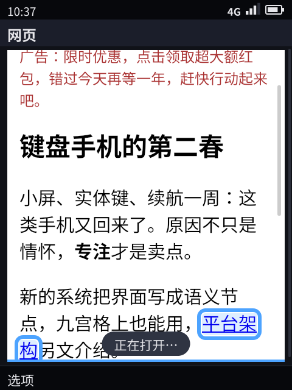
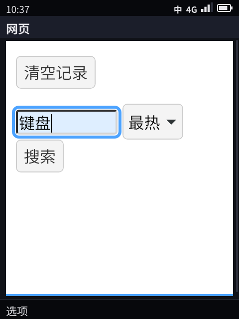
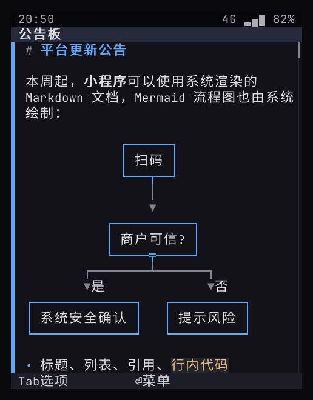
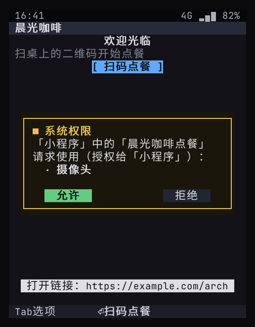
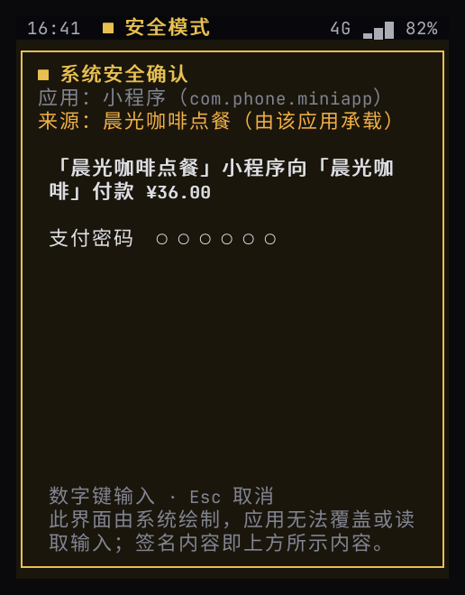

> English translation of [the Chinese original](../14-tui-route-and-app-framework.md). The Chinese text is authoritative; keep both in sync.

# Re-review: the TUI technical route and the app framework (compared with DeepSeek Harness / dsh-TUI)

> Subject of the study: DeepSeek Harness (DSH) and its terminal front ends dsh-TUI and dsh-tui. The recommendation in the conclusions is recorded as **D5, confirmed by measurements ([15](15-web-vs-semantic-benchmark.md))**. The code built on it is in §6; the remaining work is in 57-backlog.md (internal document).

## 0. Conclusions first

1. **dsh-TUI is not a headless browser.** It is React components in a Node.js process, laid out by Ink / Yoga and written straight to the terminal's character grid. Markdown is turned into styled text by a JS parsing library, and images go through the Kitty / Sixel terminal graphics protocols. Another project with the same name, dsh-tui, is based on pi-tui, and DSH's early official TUI was based on OpenTUI (SolidJS). A browser only appears in DSH's other front end, the web app (`dsh-web-app`), which sits alongside the TUI.
2. **We can render Markdown and Mermaid as well as it does without a browser.** A `doc` node has been added: the system renders Markdown (headings, lists, quotes, inline code, tables, code blocks), and links go into the menu automatically. Mermaid uses the same library as dsh-TUI, lovely-mermaid, and is drawn as character box diagrams. The terminal and the device share this code (§6, §8.1).
3. **A browser as the foundation makes "rendering" richer, but not "platform capabilities".** What super apps really depend on (push, trusted payment, device attestation, the system incoming-call screen, camera privacy, key interaction) is not provided by the browser. The system still has to provide it and then expose it through a JS bridge (this is exactly what WeChat JSSDK does). The cost is memory (measured at about 8–10×, see [15](15-web-vs-semantic-benchmark.md)), power, attack surface, the key-driven experience, and system UI that web pages can spoof; in the terminal it needs a Chromium-class engine and the layout comes out misaligned (§4).
4. **D5 (decided): stay "semantic-first"; the browser comes in as a controlled component.** The app framework has four tiers: native `phone.Ui` apps → system-rendered documents → JS mini-programs (JS logic + `phone.Ui` views) → a web view component (WPE WebKit, hosting existing H5 content). The first three tiers have prototypes (§5).
5. **Plugin ecosystems are a different matter.** DSH plugins are a fully trusted composition inside one process (Cordis), suited to tools on the developer's own machine. We have to host unfamiliar third parties and payments, so process isolation plus a capability broker are mandatory. What we can borrow is its composition layer, hot reload, "one event log, many front ends", and plugin-declared commands / panels / settings, applied to system extensions and the developer experience, not to third-party apps (§2).

## 1. Survey: what they are

| Subject | Facts (sources at the end) |
|------|-------------------|
| **DeepSeek Harness (DSH)** | An "everything is a plugin" agent framework built on **Cordis** (a plugin meta-framework by Shigma, the author of Koishi). Plugins contribute services, typed events and **revocable side effects** to a shared context; the model adapters, the tool registry, the session log and the agent loop itself are all plugins and can be swapped in the configuration. |
| How DSH is composed | **profile** = an ordered list of **bundles** + the user's own `cordis.patch.yml` + `--patch` overlays. A bundle is an npm package with a `dsh.bundle.patch`, installed by pnpm; a patch replaces or inserts configuration lines by id; hot reload is supported. Front ends: web (a browser app), headless, SDK (JSON-RPC) and ACP; the community has several more TUIs. |
| **dsh-TUI** (ccch1mneyyy) | Node ≥ 22.19. Self-described pipeline: `dsh profile → dsh-base → dsh-TUI Cordis patch → 会话事件 → React 组件 → Ink/Yoga 渲染器 → 终端` (session events → React components → Ink/Yoga renderer → terminal). Features: streaming Markdown, tool cards, Kitty / Sixel images, LaTeX to Unicode or images, mouse, sidebar panels (plugins can register panels), plugin-declared settings pages, OSC 777 / 9 / 99 system notifications; long sessions are rendered by visible window. |
| **dsh-tui** (the dsh-tui organization) | Based on `@earendil-works/pi-tui`; the official TUI recovered from the DSH repository history, installed as an out-of-tree bundle. |
| Your guess: "the content is a headless browser" | **No.** Rendering a browser into a terminal does have precedent (Carbonyl: Chromium writing directly to the terminal; Browsh: headless Firefox), but that is a different kind of thing, and DSH's TUI does not use it. |

## 2. Plugin ecosystems and our design

| Dimension | DSH (Cordis plugins) | This platform |
|------|--------------------|--------|
| Unit of extension | A plugin inside the same Node process | One process per app |
| Trust model | Full trust: a plugin can read and write everything in the process | Untrusted by default: an app can only request capabilities through the broker |
| Isolation | None | A separate uid per app (prototype on the device ✓) + capability broker; Landlock / seccomp later |
| Composition | Ordered patch layers that replace configuration lines by id | manifest + broker; product configuration layers on the system side ✓ (§2.1) |
| Hot reload | Yes (revocable side effects) | No (the app restarts) |
| UI extension | Plugins register commands, panels, settings pages, tool cards | Apps only declare pages and actions; the system presents them uniformly |
| Distribution | npm / pnpm | Signed `.phoneapp` packages + app store (design) |
| Aimed at | The developer's own machine | Ordinary users' phones, including payments |

**Conclusion**: the two solve different problems. A super app cannot be built as an in-process plugin: a single plugin could read the payment keys and forge system UI.

**What we can borrow (recorded in 57 (internal document)):**

| Borrowed idea | Where it lands |
|------|----------|
| The composition layer (bundle / profile / patch) | **System extensions**: one Shell image, many product variants, composed from configuration layers ✓ (§2.1) |
| Plugin-declared contribution points (commands, panels, settings) | In the manifest, apps declare commands (they go into the command palette), settings (four kinds: switch, choice, number, text; the system presents, validates and saves them under 「设置 › 应用设置」 (Settings › App settings)) and idle-screen widgets (one line of text; select it with ↓ and press OK to jump straight to the app's deep link), all presented uniformly by the Shell ✓ ([22](22-developer-api.md) §2) |
| The session log is the source of truth, front ends are projections | We already work this way: the `phone.Ui` tree is the source of truth, and the text renderer, the pixel renderer and the headless selftest are all projections; this is written into the architecture principles |
| Render intent (tool cards' terminal / diff / generic) | The same idea as semantic nodes; node types for code, diffs and terminal output can be added |
| Hot reload, `--dump-config`-style diagnostics | In the emulator, editing a JS mini-program refreshes it instantly; `phone-shell --dump` prints the current UI tree ✓ |

### 2.1 Product configuration layers (implemented)

`share/phone/profile.d/*.json` are stacked layer by layer in file-name order, and each layer is a JSON merge patch (RFC 7386, the same rule as frame patches). `00-base` ships with the image, and product and OEM layers sort after it; when developer mode is on, the `profile.d` in the state directory is included too. The layers in the image live on the read-only, verified system partition and need no separate signature; the owner's own layers only take effect in developer mode. `phone-shell --dump-profile` prints the merged result and which layer last set each key (DSH's `--dump-config`).

| Key | Purpose |
|----|------|
| `product` | Product name, shown in 「关于本机」 (About phone) |
| `hidden_apps` | System apps this product does not ship (not listed, not launched) |
| `app_order` | Order in the main menu; overrides `order` in the app manifests |
| `settings` | Defaults for system settings (values the user has changed still take precedence) |
| `providers` | Hands a capability to a system service implementation (`"location.get": "service:gnss"`): the broker first checks permissions as usual, then forwards the call together with the caller's identity (the app, or "host/mini-program") to the `capability` method on `<run>/<name>.sock`, and returns the reply to the app unchanged. An OEM swapping out implementations such as location or step counting does not have to change the Shell |

**No in-process plugins**: DSH's node renderers and settings-page plugins run inside the host process and are fully trusted. On our side, how a node "looks" is handed entirely to a replaceable renderer slot ([23](23-renderer-protocol.md)), and new node types go through a minor version of the protocol; capability implementations are handed to provider services running as separate processes. Neither requires loading OEM code into the Shell process, so crashes and privilege overreach stay isolated outside it. Verification: the unit tests `TestProfileLayers` (stacking order, member-by-member merging of objects, deletion with `null`, source recording, the developer layer only taking effect in developer mode, invalid provider references rejected) and `TestProviderRouting` (the capability is forwarded to the provider service with the caller's identity, and the reply is returned unchanged).

## 3. Re-review of the TUI technical routes

| Approach | Examples | How it works | Pros | Cons |
|------|------|------|------|------|
| Component tree → terminal character grid | dsh-TUI (React / Ink / Yoga), OpenTUI, pi-tui, **this platform** (Go / Bubble Tea + an in-house canvas) | Components → layout → character grid + true color; images via Kitty / Sixel / half-block characters | Light, fast, works over SSH | Limited layout: no proportional fonts, no complex CSS |
| Browser layout downsampled into the terminal | Carbonyl, Browsh | The browser first renders to pixels, which are then converted to characters | Perfect web compatibility | Text unreadable on small screens; resource-heavy |
| Browser drawing directly to the screen | KaiOS, Firefox OS, webOS | Gecko / WebKit draws straight to the screen | Many developers, the web ecosystem | Memory and power; every app has to implement its own D-pad navigation; system UI can be spoofed |

What this means for us:

- On production devices our "TUI" is not a terminal but a pixel screen. So the real choice is between "**semantic tree + system renderer**" and "**browser engine drawing directly to the screen**".
- In a terminal (development, SSH, serial console) the browser route can only rely on modified Chromium builds such as Carbonyl. **Correction (measured, see [15](15-web-vs-semantic-benchmark.md) §3)**: Carbonyl outputs text as terminal characters, so the text is readable. The problem is that it lays out in pixels and then maps the result onto the character grid: Chinese character spacing gets stretched, content overflows the screen width, there is an extra address-bar line, key presses don't reach the page, and behind it all sits a full Chromium. The semantic route lays out directly on the character grid.
- Renderer language: TUIs in the Node ecosystem are mature, but the device would have to carry an extra Node runtime (tens of MB of memory, slow startup). Go is a single binary, and frame-level video compositing already works in the prototype. **Stay with Go; do not switch to Node.**

## 4. With a browser as the foundation, are capabilities really richer?

| Capability | Provided by the browser? | Notes |
|------|:---:|------|
| Rich layout (Markdown / HTML / CSS) | ✓ | The common part is covered by the `doc` node; full HTML goes to the web view component |
| Existing H5 content (WeChat official account articles, campaign pages) | ✓ | The browser's truly irreplaceable value → tier 4, the web view |
| Audio/video playback, WebRTC | ✓ | WebRTC can be one option for the call transport stack, but authorization, incoming-call takeover and background calls still belong to the system |
| The JS / WebAssembly ecosystem | ✓ | The mini-program logic layer only needs a standalone JS engine, no DOM (a prototype exists) |
| Push while the app is not in the foreground | ✗ | Web Push depends on the browser vendor's push service, which is unavailable in China |
| Trusted payment confirmation, TEE keys, device attestation | ✗ | WebAuthn covers login, but there is no "what you see is what you sign" payment confirmation |
| System incoming-call screen, in-call indicator | ✗ | — |
| Keyboard-first interaction | ✗ (needs per-app adaptation) | KaiOS requires every app to implement its own D-pad navigation; otherwise it falls back to a virtual cursor |
| Protection against spoofed system UI | ✗ | A web page can draw an identical payment confirmation dialog |
| Text renderer (SSH / serial) | △ | Needs Carbonyl (Chromium); the text is readable but the layout is misaligned, see §3 |
| Resources | Cost | Measured: the same chat page takes about 300 MB in WPE, about 400 MB in Chromium, and 39 MB in the current implementation ([15](15-web-vs-semantic-benchmark.md)) |

**Conclusion**: the browser adds "content and rendering"; the platform's core capabilities still live in the system layer.

WeChat's own route is the evidence. A mini-program is split into a **logic layer** (a JS engine: V8 on Android, JavaScriptCore on iOS, no DOM) and a **view layer** (declarative WXML / WXSS). The view layer can be rendered by a WebView or by Tencent's in-house **Skyline** engine: for performance, Tencent took rendering out of the WebView, which also removed the overhead of "one WebView instance per page". In this structure `phone.Ui` sits exactly where WXML does: what a vendor has to build is a mapping of "components → semantic nodes", not "pages → pixels".

### 4.1 KaiOS: why a browser-based phone OS has no WeChat or Alipay

**What KaiOS is**: a fork of Firefox OS. Underneath are the kernel, the HAL and the radio interface from the vendor's Android BSP (it calls this layer Gonk); on top sits the Gecko engine, and both the system UI and the apps are web apps. Version 2.5 uses Gecko 48; versions 3.x and 4.0 use Gecko 84 / 123, are sold only in the US, and cannot sideload apps. The hardware has 256 MB–1 GB of RAM and a 240×320 screen.

**Technically a slimmed-down version can be built; commercially nobody wants to build it**:

- **WhatsApp did build one**: the KaiOS version had messaging and voice messages, and from 2021 even voice calls on 512 MB models. In June 2024 Meta stopped new users from using it, and it was shut down entirely in early 2025, citing trade-offs based on usage and feature development. It could be built, but maintaining a separate web-based, D-pad client for a small platform stopped paying off once the market share shrank.
- **Alipay only ever did a payment code**: on the Nokia 105 4G (Unisoc T107, not KaiOS), after binding it by scanning with a smartphone, the phone can show a payment code on its own. This was a custom feature from Alibaba AIoT and Unisoc. The full Alipay and WeChat apps never shipped on KaiOS; keypad phones in China that want WeChat take the Android route (Duoqin Qin and others).
- **Low-level limitations raised the cost of adaptation**:
  - Only web technology can be used: vendors' existing cross-platform C++ cores (networking, database, cryptography, audio/video engine) can't be reused and have to be rewritten in JS; version 2.5 doesn't even have WebAssembly.
  - The background is restricted: there are only Service Workers (at most 30 seconds per event) and an unreliable alarm API; push goes through Web Push, which can't be used in China. The background needs of instant messaging and VoIP could only be met by negotiating private APIs with KaiOS.
  - The UI has to be built from scratch: every app builds its own 240×320 UI and D-pad navigation, which amounts to a new client.
  - The hardware floor is low (256–512 MB), so features have to be cut until the app runs.

So what was missing was not any single low-level capability. The cost of "building a separate client for a small platform" far exceeded the benefit: the low-level limitations raised the cost, and the market share meant nobody was willing to pay it.

**How we differ**:

| | KaiOS | This platform |
|--|-------|--------|
| How apps write their UI | Web pages; each app draws everything itself and implements its own D-pad navigation | Semantic nodes (`phone.Ui`); the system lays them out and handles navigation according to the form factor and keyboard; the same client works on the T9 keypad, the QWERTY keyboard and in landscape |
| Language | JS (WebAssembly from 3.x) | Native processes in any language (Go, C / C++, Python, JS / TS mini-programs); vendors' C++ core libraries are used directly through the C ABI SDK ([22](22-developer-api.md) §9) |
| Background and push | Service Worker, 30 seconds; Web Push unavailable in China | System push over a long-lived connection with a wake-up budget, a VoIP background mode, scheduled tasks ([21](21-push.md), [17](17-app-sandbox.md) §5) |
| Payment and security | Web APIs, no system-level payment confirmation | System trusted confirmation, secure screen, device certificates and app keys ([11](11-platform-architecture.md) §7) |
| Mini-programs and H5 | Both are web pages | A JS mini-program host (logic layer + semantic view, isomorphic to WeChat mini-programs); existing H5 goes through the web view (§5) |
| Hardware | 256 MB–1 GB | 2–4 GB ([24](24-sku-framework.md)) |
| Openness | Closed source; no sideloading from 3.x | Apache-2.0; compatibility test suite (CTS) and certification ([22](22-developer-api.md) §11) |

**Will we run into the same dilemma?** On the question of "will the super apps come", yes. Technology can push the adaptation cost down, but the decision rests with Tencent and Alibaba, and they look at our user numbers; WhatsApp's exit shows that even after building a client, a vendor may pull it for lack of market share. Countermeasures:

1. Don't depend on WeChat at launch: position the device as a second phone / focus phone (D1), and start with scenarios where we can build complete apps ourselves.
2. Push the adaptation cost to the minimum: vendors reuse their existing backends and C++ cores and only write a semantic UI layer; the mini-program model is isomorphic to WeChat's, so migrating means adapting data binding and component mapping, not a rewrite.
3. Go for small, concrete integrations first: features such as payment codes and health codes, which Alipay has already done on feature phones. We have a system-level secure screen and trusted confirmation, so an integration only takes a few APIs ([12](12-super-app-capabilities.md)).
4. Existing content goes through the web view: official account articles, H5 campaign pages. Whether a merchant's web checkout can complete a payment inside the web view is **unverified**.
5. Scale comes from partnerships with carriers and handset makers, not from waiting for apps to arrive.

## 5. The revised app framework (D5 decided)

| Tier | How it is written | Who renders | Used for | Status |
|----|------|--------|------|------|
| 1. Native semantic apps | Any language, outputting `phone.Ui` | System | System apps, the main body of super apps | Prototype ✓ |
| 2. System-rendered documents | Markdown (an HTML subset later) | System | Articles, help, rich text in chat | **Prototype ✓** |
| 3. JS mini-programs | JS logic (no DOM) + `phone.Ui` views, hosted by a host app | System | Super apps' mini-programs, lightweight apps | **Prototype ✓** |
| 4. Web view component | HTML / CSS / JS (existing H5) | Text side: reader mode (the system document node); pixel side: WPE WebKit, composited through a media surface | Official account articles, campaign pages, the mini-program web-view | **Prototype ✓** (reader mode, the pixel-side `web` node) |
| Exception: canvas apps | Any language; graphics (rectangles, lines, circles, points, polygons) in a `canvas` node | System (drawn as pixels; an image on the pixel side, half-block characters on the text side) | Games, maps, charts | **Prototype ✓** (Snake, [07](07-ecosystem-and-store.md) §0) |

**Tier 4: the web view**

On the text side, reader mode (`web/reader`) is implemented. The page is fetched and parsed **inside the host app's own sandbox** (using its network permission); the system never parses untrusted HTML. The body is taken from `<article>` / `<main>`, or, if neither exists, from the element with the most paragraph text of its own. Scripts, styles, forms, navigation, headers, footers and sidebars are removed; headings, paragraphs, lists, quotes, code, tables and image captions are converted to Markdown and handed to the system's `doc` node for layout, with links going into the menu (only http / https are kept; `javascript:` and `file:` are always dropped). In Hongyan, the menu of a message that contains a URL gets an extra item 「阅读模式」 (Reader mode). The selftest case 「网页阅读模式」 (web reader mode) opens an official account article on the mock server and checks that the body is present, that the ads / login prompt / copyright footer are gone, and that the links are in the menu.

On the pixel side there is the `web` node ([22](22-developer-api.md) §3): the app only supplies the URL, and the page is rendered by a `phone-webview` process started by the system (`webview`: C, using WPE WebKit's GObject API, the same way Igalia's Cog and GNOME Web embed it; the injected scripts are the separate files `nav.js` and `bridge.js`, turned into header files at build time).

- **Processes**: **one web process per host app**. All `web` nodes in the app are views inside it and share one network process and one set of cookies and caches. A view is kept as long as the screen containing its node is still in the app's screen stack; when it is not on screen the engine is told it is "not visible" (painting paused, timers throttled), and when you return to that screen the page state is still there. The process exits 30 seconds after its last view goes away and ends immediately when the app exits; when system memory runs low, the web processes of background apps are the first to be killed (the app itself stays, and the page reloads when you come back to it, [17](17-app-sandbox.md) §5.1). If the process crashes, the page that was on screen is reopened in a new process, with at most 3 restarts per minute.
- **Permissions and resources**: on the device it runs in the sandbox ([17](17-app-sandbox.md)) under the host app's web uid (`<app>/web`, distinct from the app's own uid), with its data in `<app data>/web/`. Network access follows the host app's network permission, and traffic is accounted to the host. The web process has its own cgroup (next to the app's group). Its memory limit follows the SKU's memory tier (384 MB on 1 GB models, 512 MB on 2 GB models, 768 MB on 4 GB models, 512 MB without a SKU; WPE's process tree, the view, the web process and the network process, takes about 250 MB for an ordinary page, and a smaller limit has it thrash inside its own group), and WebKit is told 60% of it; when the limit is exceeded, caches are cleared first, then the web process is killed and the page reloaded. WebKit's cache model follows the memory tier too: no page cache and no memory cache on 1 GB models (going back reloads the page), a document browser's on 2 GB models, a web browser's on 4 GB models (`--cache-model`). When the app is frozen, its web process is frozen with it.
- **CPU or GPU**: by default the sandbox gives the web process no GPU device, and Skia draws on the CPU. When the SKU turns on `web_gpu` and the board has a render node, the sandbox lets through only the render node (`/dev/dri/renderD*`, not the display device), and WebKit draws on the GPU. Today all frames reach the renderer through shared memory, so after the GPU has drawn them they still have to be read back into memory. The real power saving comes from handing GPU buffers (dmabuf) directly to the renderer for compositing, which has to wait for a real device with a GPU (R21).
- **Engine integration**: WPE's legacy API (libwpe + WPEBackend-fdo, shared-memory buffers) renders off-screen, so the wpewebkit already in the image needs no change to its build options. Each frame is converted from BGRX to RGB and written into the view's own double-buffered media surface (the same layout as video, [23](23-renderer-protocol.md) §4.2). The surface's fd is handed to the Shell, which passes it on to the renderer; frames only carry the surface name and frame number, and pixels never pass through the Shell. Pages are laid out in logical pixels and scaled up to physical pixels by the device scale factor, so they lay out at mobile web page width.
- **Interaction**: the injected script implements spatial navigation; the arrow keys move between links, buttons, input fields and drop-downs. A candidate must lie beyond the edge of the focused element (a button a few pixels shorter on the same row does not count as "below"), and the nearest one is chosen by edge-to-edge distance plus twice the horizontal offset. If the target is within one screen, focus moves there (scrolling only as far as needed, so the text in between stays on screen); if it is farther, the page first scrolls by 0.8 of a screen. OK clicks the focused element. The back key first goes back within the page (the back-forward cache keeps page state), and only when there is no more history does it hand over to the system, which closes the screen.
- **Forms**: when focus is on a text field, keys go through the system input method (T9 keypad, QWERTY keyboard, pinyin candidates). The Shell mirrors the field's contents on its own side and, on every change, writes them back to the page through the native setter and fires an `input` event (so frameworks like React receive it); password, number and phone-number fields bypass the input method. OK submits: a Return key event is sent to the page first, and if the page doesn't intercept it, the form is submitted. A drop-down (`<select>`) is opened with a real space-key press, its options are shown in a system menu, and the choice is written back to the page.
- **Dialogs**: the page's `alert` and `confirm` are shown as system confirmation dialogs, and `prompt` as a system screen with an input field (typed with the system input method; OK or Cancel returns the result to the page). All of them are labeled 「「鸿雁」里的网页 <主机>」 (web page <host> in "Hongyan"). Confirmations for leaving a page are always allowed.
- **Files**: content the engine can't display (attachments, archives) is saved as a download into the web process's own directory. When the download finishes, the Shell moves it into the system 「文件」 (Files) area (16 MB max), grants it to that web page's origin, and shows a toast and a notification 「已下载到文件」 (Downloaded to Files). For the page's `<input type=file>`, the Shell lists the files of matching type in the 「文件」 area (the system menu says which web page is asking) and copies the selected file to the web process, handing over that one file only.
- **Page control** (`web.control`, [22](22-developer-api.md) §4.6.1): reload, back and forward, stop, zoom (0.5–3×), find in page (highlights all matches, `n` for the next one, toast 「找到 N 处」 (N matches found)), and clearing this app's website data (cookies, cache, local storage; the web process is killed first). Per-site management (`sites`): a system screen lists the websites that have data stored for this app and what each one has stored (cookies, site storage, cache); pick one and confirm to delete only that site's data. The app can neither see the list nor touch the data. The page's address, title, loading state, whether it can go back or forward, and the zoom level are reported to the host app through `web` events.
- **Content blocking**: when the host app's setting `content_blocking` is on, the web process starts with the system rules (`share/phone/web/blocklist.json`, in WebKit's content blocker format, compiled once and then cached), which block requests for ad and tracking scripts. Changing the setting restarts the web process.
- **Navigation and security**: only http and https (plus about, data and blob) are opened; `file:`, `tel:` and other apps' private schemes are not opened, and the Shell logs them; `target=_blank` and `window.open` open in the same view. Web permission requests for location, notifications, camera and microphone are always denied; a page can only reach system capabilities through `phone.call`. A page that can't be opened, an untrusted certificate, and a web process that keeps crashing each show an explanation page (titled 「打不开这个网页」 (Can't open this page), 「连接不安全」 (Connection not secure) and 「这个网页多次崩溃」 (This page crashed repeatedly), respectively). The user agent contains 「Kario/0.6」.
- **Capabilities**: `phone.call(capability, params)` in the page returns a Promise. It travels over the control channel to the Shell and is handled by the broker under the host app's identity with the origin 「网页 <主机>」 (web page <host>): grants are recorded under that origin, and the system UI states which web page is asking (the share sheet shows 「「鸿雁」里的网页 … 分享…」 (web page … in "Hongyan" shares …)). The capabilities available to web pages are an allowlist: share, copy, location and secure confirmation. Signing keys, code scanning, camera, photos, files and the like are not open to web pages, so a web page can bring up the system's secure confirmation but cannot complete a payment signature.
- **Text renderer**: the same node shows the title, the address, the focused link, the text being typed (including the IME's uncommitted composition) and key hints, and the arrow keys still move within the page (you need the pixel UI to actually see the page). On devices without a web view, it suggests using reader mode instead.
- **Still missing for production grade**: video inside web pages (the web image dropped the GStreamer plugins to stay free of GPLv3, and H.264 needs hardware decoding, which comes with the real device) and fullscreen are **not implemented** (R39); a screen reader is not planned (it is very rarely used on keypad phones); passing GPU buffers straight to the renderer comes with R21.

**Browser app** (`apps/browser`, 「浏览器」 (Browser) in the menu): the home page has the address bar (a URL or search terms; the search engine, Bing or Baidu, is chosen in the app settings), bookmarks and recent visits; once a page is open, the whole screen is a `web` node. The options menu has address bar (`g`), reload (`r`), add bookmark (`b`), find in page (`s`, `n` for the next match), zoom in / out (`+` / `-`), forward (`f`), share link (`h`), website data (`d`, delete per site) and clear website data (`x`). After a downloaded WebM video goes into 「文件」 (Files), the system asks whether to add it to 「图片」 (Pictures) as well. The back key first goes back within the page. History and bookmarks are stored in the app's own data directory. The web engine is the existing slim open-source engine WPE WebKit (the WebKit port for embedded use, which comes without a browser shell); we only write the shell. Web views that are not on screen are not painted, the web process exits 30 seconds after the last web view goes away and ends immediately when the app exits, so as long as you don't open the browser there is no load.

The selftest case 「网页视图」 (web view) (needs `phone-webview` and the pixel renderer, otherwise it is skipped) opens the same official account article in Hongyan, and the article is shown as designed (after every focus move the case checks that the web view sent a new frame and that it is not a solid color, so a black or white screen from a rendering failure fails the case). The arrow keys move from 「首页」 (Home) in the page header to 「平台架构」 (Platform architecture) in the body. The case goes back to the idle screen and then returns to Hongyan from the command palette: focus is still on 「平台架构」 and the page was not reloaded. It opens the link and goes back with the back key. It then moves to the 「分享这篇文章」 (Share this article) button; the page calls `phone.call('share.open')`, the system share sheet labels the web page origin, and after cancelling, the page gets an error. The case 「网页表单」 (web form) opens the site search page in the same app and checks that no second web process was started; the page's confirm dialog appears as a system dialog labeled with the web page origin; it types 「键盘」 (keyboard) into the text field, picks 「最热」 (Most popular) in the drop-down through the system menu, and after submitting with OK the page title becomes 「搜索：键盘（最热）」 (Search: keyboard (Most popular)); after going back, the page is restored from the back-forward cache and the text is still in the field. The case 「浏览器」 (browser) enters the mock server's tools page in the address bar; the page's ad script is blocked (the page title becomes 「工具页：没有广告」 (Tools page: no ads)); find in page for 「键盘」 reports 「找到 1 处」 (1 match found); it adds a bookmark; it clicks 「下载说明书」 (Download the manual), and `manual.txt` lands in the 「文件」 (Files) area; the system presents the page's file picker and lists the file there (with its size), and after it is selected the page shows 「已选：manual.txt」 (Selected: manual.txt); the page's `prompt` brings up the system 「网页提问」 (Web page question) screen, and after 「键盘机」 (keypad phone) is entered the page displays it; the back key returns to the browser home page, where the bookmark and the recent visits are present. The development machine has no WPE packages, so `make web-selftest` builds and runs `phone-webview` in a Debian container; on the device it runs as part of the boot selftest of the web image (`kas/web.yml`).

| The article shown as designed, with the arrow keys resting on a link in the body | Forms: the IME writes into the text field, and the drop-down is chosen through the system menu |
|:--:|:--:|
|  |  |


## 6. Implemented (prototype)

| Item | Key points | Verification |
|------|------|------|
| `doc` node | Parsed with goldmark and laid out by the system on the character grid; links automatically become menu actions (`link:N`, whose value is the URL); long documents that exceed the screen scroll first, then move focus; Chinese line-breaking rules (closing brackets and punctuation never start a line) | Selftest 「文档节点」 (document node); unit tests |
| JS mini-program host (`apps/miniapp`) | goja engine, a separate runtime per mini-program; callbacks that run over 300ms are interrupted; `Page({data, render, onAction})` + `setData` data binding; a `phone.*` bridge (`scanCode`, `requestPayment`, storage, navigation) that first checks the permissions the mini-program itself declared | Selftests 「小程序：数据绑定」 (mini-program: data binding) and 「扫码点餐 + 支付」 (scan to order + pay) |
| Origin labeling, `origin` | When a host requests a capability on behalf of a mini-program, the permission dialog, the scanner screen and the secure confirmation dialog all state 「X 小程序（在 Y 中）」 (mini-program X (in Y)); the grant still belongs to the host app | Same as above (screenshots 13, 14) |
| A separate uid per app | When the Shell runs as root, each app gets its own uid and owns only its own data directory; system service sockets and key files are out of the apps' reach | 「沙箱自检 5/5」 (sandbox self-check 5/5) on QEMU |
| Mermaid diagrams | ```` ```mermaid ```` code blocks in a `doc` are drawn by the system as character box diagrams (§8.1) | Selftest 「文档节点」 (document node); 4 unit tests |
| Code highlighting, formulas | Code blocks are colored by language; `$…$`, `$$…$$` and ```` ```math ```` are converted to Unicode text (§8.2) | Unit tests: tokenization for 12 languages, LaTeX conversion, a `$` in a price not mistaken for a formula |
| TypeScript mini-programs | `app.ts` has its types stripped at load time; `phone.d.ts` provides the types (§8.4) | The ordering mini-program rewritten in TS passes the selftest; `tsc` strict mode passes |
| TSX views | The JSX in `app.tsx` is compiled into `h()` calls, and what it produces is still `phone.Ui` nodes (§8.4) | The notes mini-program rewritten in TSX passes the selftest; unit tests check the shape of the nodes |
| System input method | T9 keypad / QWERTY keyboard, Chinese and English candidates and predictions ([16](16-input-method.md)) | 3 selftest cases; 8 unit tests |

| Document node | Mini-program authorization (origin labeled) | Mini-program payment (system secure confirmation) |
|:--:|:--:|:--:|
|  |  |  |

## 7. Decision status

**D5 (decided)**: adopt the "semantic-first" four-tier structure (§5). The browser is not the foundation, only a tier-4 component started on demand; DSH-style in-process plugins are used only for OEM system extensions, never for third-party apps. The decision is based on the measured comparison in [15](15-web-vs-semantic-benchmark.md).

## 8. Q&A

### 8.1 Does Mermaid need a browser? How does dsh-TUI do it?

- **The official mermaid.js does need a browser**: it lays out with the DOM and SVG, and its command-line version `mmdc` runs headless Chromium underneath.
- **dsh-TUI doesn't use it.** It uses **lovely-mermaid** (Apache-2.0), a pure-JS rewrite of Mermaid's parsing and layout that outputs Unicode box-drawing character art directly and needs no DOM. Its other rendering components follow the same idea: Markdown with marked, code highlighting with highlight.js, formulas with MathJax converted to Unicode or images; none of them need a browser.
- **We use the same library**: bundled into a single 87 KB JS file, embedded in the Shell and run in goja.
  - It supports flowcharts, sequence diagrams, state diagrams, class diagrams, ER diagrams, pie charts (drawn as bars), mind maps, timelines and gitGraph; all 9 are actually rendered in the unit tests (including Chinese text).
  - Small-screen adaptation: when a horizontal flowchart (LR) is too wide, it is automatically redrawn vertically (TD); if it still doesn't fit, the source is shown together with a note on how many columns it needs.
  - Performance (on the local machine): the first load plus the first diagram takes about 40 ms, and each diagram after that about 10 ms; a single render that takes longer than 800 ms is interrupted.
- The pixel renderer (R1) draws the same character diagram (in a monospace font); later, if needed, its layout result can be drawn as vector lines instead.

### 8.2 The dsh-TUI renderer, the DSH plugin system and this platform: a three-way comparison

| | dsh-TUI (renderer) | DSH (plugin system) | This platform |
|---|---|---|---|
| What it is | A chat UI front end in the terminal | The extension mechanism of an agent framework | The app framework + system renderer of a phone OS |
| Runtime | Node.js ≥ 22 | Node.js (Cordis) | The Shell and the host are single Go binaries; mini-program JS runs in goja |
| Who draws the UI | **The app draws it**: React components, laid out into a character grid by Ink / Yoga | Plugins register panels and commands, and the front end draws them | **The app only describes, the system draws**: the app provides a `phone.Ui` semantic tree |
| Keys, focus, back | Each component handles them itself | — | Unified by the system: focus, menus, back stack, input method |
| Markdown / Mermaid | marked / lovely-mermaid | — | goldmark / lovely-mermaid (the same library) |
| Code highlighting, formulas | highlight.js, MathJax | — | A small built-in tokenizer; LaTeX to Unicode (see below) |
| Images | Kitty / Sixel terminal graphics protocols | — | Half-block characters in the terminal; pixels drawn directly on the device |
| Extension boundary | Same process | Same process, **fully trusted** | **One process per app + a separate uid + capability broker** |
| Swapping front ends | — | One session log, several front ends: web / TUI / SDK | One `phone.Ui` tree, several renderers: text / pixel / selftest |
| Aimed at | Developer desktops | Developers | Ordinary users' phones, unfamiliar third parties, payments |

**Code highlighting and formulas** are both handled in the Shell's layout engine; the pixel renderer just draws styled character runs, so the two UIs look the same:

- **Code highlighting**: one table per language (keywords, comment markers, string quotes), tokenized line by line, with block comments allowed to span lines; four color classes: keywords, strings, comments, numbers. Supported: Go, JS / TS, Python, Rust, C, C++, Java / Kotlin, Shell, JSON, TOML, YAML and SQL; other languages stay monochrome. We don't use a full highlighting library such as chroma: it would add several MB to the Shell, and four color classes are enough on a small screen.
- **Formulas**: `$…$` inline, `$$…$$` or ```` ```math ```` on a line of their own. There is no typesetting; formulas are converted to Unicode text: `x^2 + y^2 = r^2` → x² + y² = r², `\sum_{i=1}^{n} a_i` → ∑ᵢ₌₁ⁿ aᵢ, `\frac{a+b}{2}` → (a+b)/2, `\sqrt{x+1}` → √(x+1), `\mathbb{R}` → ℝ. Anything without a Unicode form falls back to a readable notation, e.g. `e^{i\pi}` → e^(iπ); accents (`\hat`, `\bar`) keep only the letter. Detection of `$` follows pandoc's rules, so 「价格 $5 到 $10」 (price $5 to $10) is not treated as a formula. The pixel renderer falls back to DejaVu Sans for superscript and subscript characters that Noto CJK lacks.

**The fundamental difference is "who draws the UI".** dsh-TUI lets the app (its React components) draw itself. That is flexible, but each app's key conventions and styling may differ, and a web page or component can also draw a fake payment dialog. This platform has apps describe only content and actions, and the system draws everything uniformly. The cost is that expressiveness is limited by the semantic nodes; in return, the key-driven experience on small screens is consistent, system UI cannot be spoofed, and the same app can use a different renderer in the terminal, on a pixel screen and in selftests.

**The difference between the plugin systems is the "trust boundary".** DSH plugins run in the same process as the host and can read and write everything, which suits developers composing tools on their own machines. Super apps and payments can't work that way, so third-party apps are always process-isolated. The parts of DSH worth borrowing (the composition layer, contribution points, hot reload) we use only for OEM system extensions and the developer experience (§2, §2.1).

### 8.3 What lies underneath "semantic UI + JS"

```
Mini-program source (TypeScript / JavaScript)
   │  At load time: esbuild strips the types (TS)
   ▼
goja: a JS interpreter written in pure Go (ES5.1 + most of ES2015+; no DOM, no JIT)
   │  Page({data, render, onAction}) / setData / phone.* (scan, pay, storage, navigation)
   ▼
Host app phone-app-miniapp: a Go process with its own uid, one JS runtime per mini-program, callbacks limited to 300 ms
   │  phone.Ui: JSON lines, passed through the Shell to the app's fd 3 (socketpair)
   ▼
Shell (Go): focus, menus, back stack, input method, system dialogs, capability broker
   │  Renderers: text (Bubble Tea + in-house character canvas, CJK double width, true color, half-block pixels) ‖ pixel (Slint, R1)
   ▼
Terminal / serial console / SSH ‖ phone screen (DRM/KMS)
```

- **No Node.js, no browser, no DOM.** JS only handles logic and data; `render()` returns semantic nodes, and the Shell draws the UI.
- Native apps skip the top two layers and output `phone.Ui` directly from any language (Go and Python examples exist).
- Structurally this matches WeChat mini-programs: the logic layer is a JS engine, and the view is a declarative semantic tree (the counterpart of WXML) rendered by the system (the counterpart of Skyline).
- goja is an interpreter and much slower than V8 with its JIT, but it is enough for UI logic; the mini-program host process measures about 14 MB. If performance ever falls short, it can be replaced with QuickJS or V8 without changing app code.

### 8.4 Can it switch to TypeScript?

**Yes, and it is implemented.**

- Put `app.tsx`, `app.ts` or `app.js` in the mini-program directory (looked up in that order). At load time the host strips the types with esbuild (a Go library compiled into the host) and then hands the code to goja. Syntax errors report the line and column numbers.
- **Type checking happens at development time.** `apps/miniapp/types/phone.d.ts` declares `Page`, `setData`, `phone.*` and all node types, and `tsc --noEmit` checks them in strict mode. The ordering mini-program has been rewritten in TS, and both `tsc` and the selftest pass.
- **In production**, TS is compiled to JS at the packaging and signing stage. Only JS runs on the device, and the host no longer needs to carry esbuild (the host binary is currently 21.8 MB, part of which is esbuild).
- **TSX views**: esbuild compiles `<item title="x"/>` into `h("item", {title: "x"})`, and `h()` and `Fragment` are provided by the host's preloaded script. An element is the `phone.Ui` node of the same name; text children are concatenated into the node's `text`; functions are components; arrays are flattened. There is no virtual DOM and no diffing: `render()` produces the whole semantic tree every time, and comparison and partial refresh are the job of the Shell and the renderer (the `patch` in [23](23-renderer-protocol.md)). `phone.d.ts` contains the JSX element types, and `tsc` checks them with `"jsx": "react"` and `"jsxFactory": "h"`.

```tsx
render() {
  return <>
    <input id="new" placeholder="写一条便签，Enter 保存" submit="add" clear={true} />
    <section>共 {notes.length} 条</section>
    {notes.map((n, i) => <item id={"n" + i} title={n} actions={[ui.danger("del", "删除")]} />)}
  </>;
}
```

## Sources

- DeepSeek Harness architecture: <https://github.com/deepseek-ai/deepseek-harness/blob/master/docs/architecture.md>
- dsh-TUI: <https://github.com/ccch1mneyyy/dsh-TUI>; dsh-tui: <https://github.com/dsh-tui/dsh-tui>; release discussion: <https://github.com/deepseek-ai/deepseek-harness/discussions/4587>
- Cordis: <https://cordis.moe/>
- WeChat mini-program runtime environment and Skyline: <https://developers.weixin.qq.com/miniprogram/dev/framework/runtime/env.html>, <https://developers.weixin.qq.com/miniprogram/dev/framework/runtime/skyline/introduction.html>
- Carbonyl: <https://github.com/fathyb/carbonyl>; Browsh: <https://github.com/browsh-org/browsh>
- KaiOS: versions and apps (<https://kaios.dev/faq/>), background execution (<https://kaios.dev/2023/10/running-in-the-background-on-kaios/>), platform architecture (<https://consumer.kaiostech.com/platform>)
- WhatsApp ends support for KaiOS: <https://faq.whatsapp.com/420008397294796>, <https://announce.data.kaiostech.com/>; WhatsApp voice calls on KaiOS: <https://kaiostech.com/knowledge-base/activate-whatsapp-voip/>
- Alipay payment code on the Nokia 105 4G (Unisoc T107): <https://news.qq.com/rain/a/20210709A0ATXL00>
