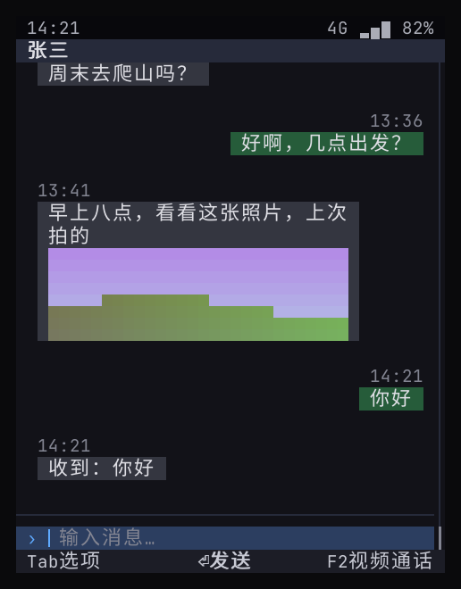
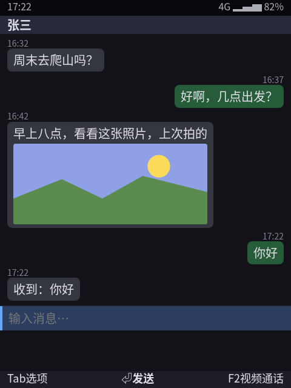
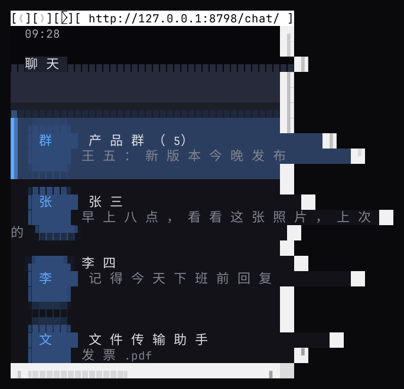

> English translation of [the Chinese original](../15-web-vs-semantic-benchmark.md). The Chinese text is authoritative; keep both in sync.

# Measured comparison: current implementation (semantic UI) vs the web route

> Purpose: provide measured evidence for D5 (how top-level apps are built). The same chat app was built twice: the existing `apps/chat` (Go, `phone.Ui`), and a newly written web version `web/chat` (HTML / CSS / JS, with the keyboard interaction implemented by hand). Measurement scripts: `bench/bench.py` (startup time, PSS / RSS of the whole process tree, idle CPU), `bench/web-keys.mjs` (end-to-end key handling of the web version), `bench/term-shot.py` (terminal screenshots).
> This machine: Rocky 8.10, x86_64, 48 cores; WPE runs in a Debian trixie container (this machine has no WPE packages), with no GPU, so it uses software rendering. Device (AArch64 QEMU) results are in §5.

## 0. Conclusions first

1. **Memory differs by an order of magnitude.** Showing the same chat list, the whole current implementation takes **39MB** (including the Shell, the chat app, and the two system services for media and keys); WPE takes **about 300MB** and Chromium **about 400MB**, and the web side does not yet count any system services.
2. **The gap grows when more apps are open.** In the current implementation each additional app costs about **8MB** (one Go process), and a JS mini-program about **14MB**; one WPE content process costs about **200MB** (software rendering), and one Chromium renderer process about **40–110MB**. On a phone with 2GB of RAM, the web route can keep only a handful of apps resident.
3. **On this machine both start in under 1 second** (current implementation 0.07 seconds, WPE / Chromium around 0.3 seconds); **on the device (AArch64 QEMU) the current implementation takes 1.1 seconds and WPE 6.7 seconds**, with memory at 66 MB vs 413 MB and installed size at 12.8 MB vs 211 MB (§5).
4. **The real advantages of the web are layout and existing H5 content**, which the measurements confirm: the web version in Chromium looks on par with the existing implementation and has stronger rich-layout capabilities.
5. **The cost of the web is not only resources.** **57% of the web app's code is a home-made keyboard interaction layer** (focus, menus, back stack, soft keys), and while writing it I also introduced an input-field state-sync bug; in a terminal it can only be displayed through Carbonyl (that is, Chromium), where the text is readable but the layout is misaligned, and key presses did not reach the page.
6. **Conclusion (D5 decided)**: top-level apps are built on the semantic UI (tiers 1–3); the web engine is only a tier-4 component that starts when H5 content is opened and is reclaimed when it is closed, never a resident runtime for apps. Developers who want to write apps in JS take tier 3, JS mini-programs: they keep JS, at a cost of about 14MB.

## 1. What was measured

| Route | Contents | Version |
|------|------|------|
| Current implementation | `phone-shell` + `phone-app-chat` + `phone-mediad` + `phone-keystored`, text renderer in a terminal | This repository |
| WPE | cog (headless platform) loading the web chat page, 480×640 | cog 0.18.4, WPE WebKit 2.48.3 (Debian trixie) |
| Chromium | Headless mode loading the same page, 480×640 | Chrome for Testing 158 |
| JS mini-program | `phone-app-miniapp` running 「晨光咖啡点餐」 (Morning Light Coffee ordering) (goja) | This repository |

Fairness notes:
- The current implementation **does not have a pixel renderer yet** (R1, not done), so the numbers are for the text renderer; a pixel renderer will add memory, to be measured with R1.
- The current implementation's numbers **include** the two system services for media and keys (about 14MB); the web side **includes no** system services at all, so the web numbers are a lower bound.
- The web version has fewer features than the existing chat app: no video calls, incoming calls or notifications (these need WebRTC + system interfaces), so the code-size comparison is biased in favor of the web.

## 2. Results

| Metric | Current implementation | JS mini-program (tier 3) | WPE 2.48 | Chromium 158 |
|------|---------:|---------:|---------:|---------:|
| Cold start to the chat list | **0.07 s** (including starting two services, the home screen and launching the app) | — | 0.30 s (2.6 s the first time: building the font cache) | 0.34 s (after eliminating the D-Bus timeout, see §4) |
| Resident memory PSS (whole process tree) | **39–41 MB**, 4 processes | 50 MB, 4 processes | 302–309 MB, 3 processes | 393–412 MB, 13 processes |
| Largest process among them | Shell 16–20 MB | Mini-program host 14 MB | WebProcess about 198 MB | Browser main process about 110 MB |
| Each additional app (estimate) | **≈ 8 MB** | ≈ 14 MB | ≈ 200 MB (one WebProcess) | ≈ 40–110 MB (one renderer process) |
| Idle CPU | 0.8–1.0% (the status bar clock redraws every 500ms; can be optimized) | 1.0% | 16–17% (the headless platform's own frame loop; not comparable) | 0.4% |
| Installed size | 41 MB (3 services + 5 apps, including the JS engine, not stripped) | Included in the column to the left | about 175 MB (engine + ICU + GStreamer, etc.) | 413 MB |

Per-process breakdown (from the last run):

| Current implementation | PSS | WPE | PSS | Chromium (top 4) | PSS |
|----------|----:|-----|----:|------------------|----:|
| phone-shell | 20 MB | WPEWebProcess | 198 MB | chrome (browser) | 109 MB |
| phone-app-chat | 8 MB | cog | 64 MB | chrome | 64 MB |
| phone-keystored | 7 MB | WPENetworkProcess | 43 MB | chrome | 42 MB |
| phone-mediad | 7 MB | | | chrome | 37 MB |

## 3. Development and interaction

| Aspect | Current implementation | Web version |
|------|----------|--------|
| Chat app code | `apps/chat/main.go`, 458 lines (including video calls, incoming calls, notifications and bot replies) | 269 lines (197 non-blank lines of JS), **of which the keyboard interaction layer is 113 lines = 57%**; no video calls, incoming calls or notifications |
| Keyboard reachability (same flow: pick a conversation, send a message, message menu, quote, forward, back) | All selftests pass; guaranteed by the system | 7/7 pass (`web-keys.mjs`), but focus, menus, back stack and soft keys are all written by the app itself; on the first run 「引用」 (Quote) failed: the input field's value lived both in the DOM and in a JS variable and was overwritten on redraw; it passes after the fix |
| Protection against spoofing system UI | Apps can only submit semantic nodes; they can imitate a dialog's content with text, but cannot draw the border and colors of a system dialog; the 「安全模式」 (Secure mode) indicator in the status bar is drawn by the system | A web page can draw a pixel-identical dialog; the only way to tell them apart is for the system to own the status bar and full-screen overlays |
| Rich layout, existing H5 | Markdown `doc` node; no H5 support | Full |

| Current implementation (terminal, 40×24) | Web version (Chromium, 480×640 pixels) | Web version in a terminal (Carbonyl, 40×24) |
|:--:|:--:|:--:|
|  |  |  |

For terminals (SSH, serial, development machine), the claim in [14](14-tui-route-and-app-framework.md) §3 needs correcting: Carbonyl outputs the text as terminal characters, so **the text is readable**; it is not "completely unreadable". The actual problems are these three:
- The page is laid out in CSS pixels and then mapped onto character cells, so Chinese characters get spread apart and the content overflows the 40 columns;
- There is an extra line for the browser address bar;
- Key presses (Down, Enter) did not reach the page, so the screenshot stays on the list page.

To work well in a terminal you would need styles written specifically for character cells and would have to sort out which keys belong to the browser shell, and behind it there would still be a full Chromium.

## 4. Problems during measurement (recorded as they happened)

- **Chromium initially took 25 seconds to start every time**: that is exactly the default D-Bus call timeout; it was waiting for desktop services that do not exist on this server (such as a keyring). With `DBUS_SESSION_BUS_ADDRESS=disabled:` and `--password-store=basic` it dropped to 0.34 seconds; the table uses the latter.
- **By default Chromium uses the corporate proxy from the environment** and could not reach the local test server; `--no-proxy-server` was needed.
- **WPE's idle CPU** is 16–17% both in default mode and in Skia CPU rendering mode, while the same page in Chromium uses only 0.4%; we attribute this to the fixed frame loop of cog's headless platform. A real device uses the DRM platform, which follows vsync and only redraws changed regions, so this metric is not comparable.
- **The web version I wrote failed to run the first time**: a `top()` defined in a plain script clashed with the browser global `window.top`; it worked after renaming.
- **No GPU**: both WPE and Chromium use software rendering. With a GPU, CPU-side memory would be somewhat lower, but GPU memory is counted separately and does not show up in PSS.

## 5. On the device (AArch64, Yocto, QEMU)

WPE WebKit 2.52.6 + cog have been added to `yocto/kas/web.yml`, and the image includes a boot-time measurement service (kernel parameter `phone.bench=1`): within the same virtual machine it measures the current implementation first and then WPE, prints the results and powers off automatically.

Measured (qemuarm64, TCG emulation on an x86 host, 2GB RAM, 3 runs per item):

| Metric | Current implementation | WPE 2.52 (cog headless) | Ratio |
|------|---------:|---------:|---:|
| Cold start to the chat list | **1.09 s** | 6.70 s | 6× |
| Resident memory PSS (whole process tree) | **66.4 MB**, 4 processes | 412.5 MB, 3 processes | 6× |
| Excluding system services (Shell + chat app only) | **37.6 MB** | 412.5 MB (no system services at all) | 11× |
| Idle CPU | 8.2% | 104.8% | — |
| Installed size (stripped by Yocto) | **12.8 MB** (Shell, services, all apps) | 211 MB (engine + cog + dependency libraries) | 17× |

| Current implementation | PSS | WPE | PSS |
|----------|----:|-----|----:|
| phone-shell | 22.6 MB | WPEWebProcess | 381.9 MB |
| phone-keystored | 15.4 MB | WPENetworkProcess | 20.4 MB |
| phone-app-chat | 15.0 MB | cog | 19.8 MB |
| phone-mediad | 14.8 MB | | |

Interpretation:
- **The order-of-magnitude conclusion stands, and the gap is larger than on this machine.** Memory differs by about 8× on this machine and by 6× (with system services) to 11× (without) on the device; startup takes under 1 second for both on this machine, while WPE needs 6.7 seconds on the device.
- The table above was measured while the Go programs still linked the Go standard library dynamically (`libstd.so`): on the device, the three small processes (the chat app and the two services) each used about 7–8 MB more than on this machine, and the current implementation rose from 39 MB to 66 MB. WebProcess rose from 198 MB to 382 MB.
- **The extra 7–8 MB came from the linking mode, and this has been fixed.** On aarch64, Yocto by default links every Go program against a shared `libstd.so` (`GO_DYNLINK`). This library contains a 5.9 MB pointer table (`.data.rel.ro`, 240,000 relocations), which the dynamic linker rewrites in every process at load time, turning it into private dirty pages of that process. The phone-fw recipe now turns off `GO_DYNLINK` and cgo, so each program is a static PIE that only relocates its own ~0.25 MB. Measured after the device selftests finished: small apps (calculator, phone, alarm, music) dropped from about 12 MB to 3.3–3.8 MB, the same as on this machine; keystored dropped from 11.6 MB to 4.3 MB; the whole process tree (Shell, renderer, 8 services, 10 apps) dropped from about 314 MB to 191 MB. The device kernel has no transparent huge pages, so they play no part here; transparent huge pages on this machine are covered in [11](11-platform-architecture.md) §5.
- TCG emulation inflates CPU time considerably, so for idle CPU only the relative comparison is meaningful; WPE's 104.8% comes mainly from the headless platform's fixed frame loop (§4) and will be much lower on a real device using the DRM platform.
- The current implementation was measured booting into the chat list without using the input method; the input method is now a separate process, `phone-imed`, with about 4 MB of private memory ([16](16-input-method.md) §6). The WPE side has no input method.

Build notes: the first build of WPE 2.52 failed. Its image decoders unconditionally reference GStreamer headers, but with the `video` switch removed GStreamer was not among the dependencies; `video` has been added back to `web.yml`. The second build was killed by the OOM killer at step 8118/9293: the build user's cgroup limit is 48 GB and a single compiler process peaked at about 5.5 GB, so WebKit's parallelism was limited to 8. ccache is enabled for WebKit alone (meta-phone's dynamic layer `dynamic-layers/webkit`, which only takes effect when meta-webkit is in the build; it is not enabled globally because the ccache class exports its settings to every task, so enabling it globally would invalidate the entire sstate): a full build with a cold cache takes 108 minutes, and a rebuild after task signatures change while the sources and compiler flags stay the same takes only 3.2 minutes. The cache lives under `ccache/` in the build directory and survives cleaning `tmp/`; inside the kas container, the ccache used is the one Yocto builds itself, not the host's.

## 6. Implications for how top-level apps are built

| Option | Memory (measured on this machine) | Keyboard experience | Terminal rendering | Existing H5 | Suited to |
|------|------|------|------|------|------|
| A. Semantic UI apps (tier 1) | ≈ 8 MB per app | Guaranteed by the system | Native | Not supported | System apps, the main body of super apps |
| B. JS mini-programs (tier 3) | ≈ 14 MB each | Guaranteed by the system | Native | Not supported | Developers who want JS, super apps' mini-programs |
| C. Web view component (tier 4) | ≈ 40–200 MB each, reclaimed after use | Engine spatial navigation + app cooperation | Degrades to reading mode | Supported | Articles, campaign pages, mini-program web-view |
| D. Browser as the app foundation | Engine from 300–400 MB, +40–200 MB per app | Each app writes its own (57% of the code in this example) | Needs a Chromium-class engine; misaligned layout | Supported | — |

**D5 (decided)**: A + B are adopted as the way top-level apps are built, C as an on-demand component, and D is not adopted. The device data (§5) has been filled in; the order-of-magnitude conclusion stands, and the gap is larger than on this machine.
