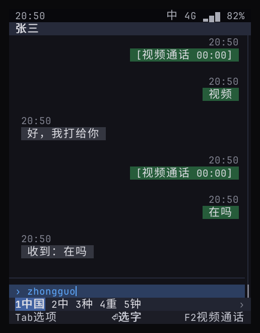
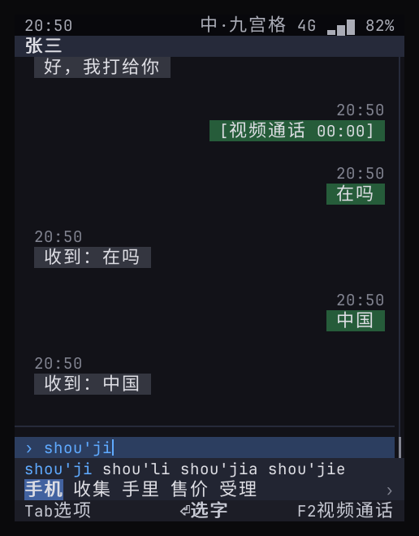
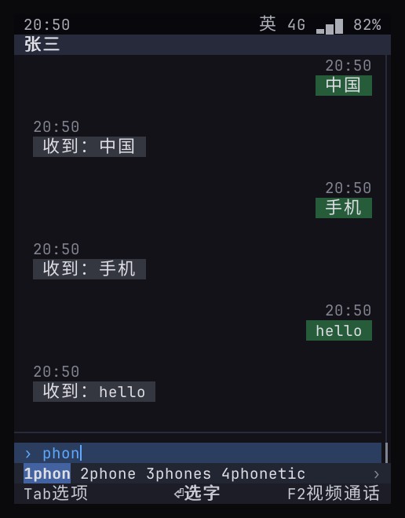

> English translation of [the Chinese original](../16-input-method.md). The Chinese text is authoritative; keep both in sync.

# Input method: T9 keypad and QWERTY keyboard, Chinese and English, candidates and predictions

> Status: **prototype ✓** (`ime` + the separate process `phone-imed`; 6 selftest cases on this machine and on the device + unit tests). The keys follow Nokia's conventions; the rationale and the differences are in [18](18-nokia-form-factors.md). Production to-dos are in §8, the remaining work in 57 (internal document).

## 0. Conclusions

- The input method is a **system service**, on the same layer as the security confirmation dialog: keys go to the input method first, and apps only receive the committed text, never the raw key presses; password fields bypass the input method.
- **Two keyboards, one engine**: the QWERTY keyboard and the T9 keypad.
- **Chinese**: full pinyin, incomplete syllables (`zhongg`), initial-letter abbreviations (`zg` → 中国, "China"), partial commit (commit 「我们」 ("we") first, and the remaining `zhongguo` keeps being composed), and **predictions** after a commit (中国 → 人 / 特色 / 政府…, i.e. "China" → "people" / "characteristics" / "government"…); the T9 keypad adds a **pinyin selection** row (`shou'ji / shou'li …`).
- **English**: the QWERTY keyboard does prefix **completion** (`phon` → phone / phones / phonetic); the T9 keypad does classic **T9 prediction** (`43556` → hello, words of the same length first).
- **Punctuation**: Chinese mode converts to full-width automatically (，。？！), but stays half-width right after a digit (`6.5`, `1,000`).
- **Input fields can declare a keyboard type**: `number` / `phone` type digits directly, `email` switches to English automatically (the counterpart of Android's inputType).
- **Dictionaries**: the AOSP Google Pinyin IME dictionary with 65105 entries + the AOSP LatinIME English word list with 60,000 words, both Apache-2.0.

## 1. Where it sits in the architecture

```
Keys ──► Shell ──RPC──► phone-imed (ime engine + user dictionary)
          ▲  every call brings back the full state  │ composing, candidates, predictions
          │                                         ▼  dictionary: share/phone/ime.dict, mapped into memory
   System draws the candidate bar ◄── state snapshot (pre-edit, candidate row, mode)
          │
   Committed text ──► input field value ──► app receives an action (with the values of all input fields on the page)
```

The `phone.Ui` protocol is unchanged: apps only receive the input field values on submit.

- **Separate process**: `phone-imed` holds the engine and the user dictionary; the Shell forwards keys to it and caches the state it gets back (pre-edit, candidate row, mode indicator, whether to open the symbol table) for drawing, so drawing never waits on the service. Each call is limited to 2 seconds, so even a hung input method cannot hang the Shell.
- **Crash isolation**: if `phone-imed` crashes, only the current composition is lost. The Shell immediately switches to its built-in copy of the same engine and typing continues (without the user dictionary, which belongs only to `imed`); it reconnects after 2 seconds. On the device, systemd restarts the service through socket activation; when the Shell started the service itself, the Shell restarts it. A word that is half-composed in the built-in engine is finished in the built-in engine before switching back to `imed`.
- **Sandbox**: the systemd unit grants no network and no devices, and everything except its own state directory is read-only.

## 2. Keys

The keys follow Nokia: the T9 keypad follows Series 40 / S60, the QWERTY keyboard follows the E71 / E90. The key-by-key rationale is in [18](18-nokia-form-factors.md) §3 and §4.

**T9 keypad**

| Key | Pinyin | Smart English | Abc / abc / ABC (multi-tap) |
|----|------|----------|--------------------------|
| 2–9 | The digit string is split by syllable encoding | T9 prediction | Repeated presses cycle through letters; confirmed after about 1 second or with ▶ |

Stroke mode (§5.3): 1 horizontal, 2 vertical, 3 left-falling, 4 dot, 5 turning, typed in writing order; 6 stands in for a stroke you cannot remember; 7–9 are unused; after ▼, 1–5 select a character and OK commits, the same as in pinyin. The pre-edit area shows the strokes typed so far as 一丨丿丶乛 (the symbols for horizontal, vertical, left-falling, dot and turning).
| `*` | Next pinyin | Next word | Open the symbol table |
| `0` | Syllable separator | Commit and add a space | Space |
| `1` | Syllable separator | Commit and open the punctuation bar | Punctuation by multi-tap |
| ▼ | Enter numbered mode; after that, 1–5 select a character directly | Same as left | — |
| ▲ | Back to the pinyin row; ◀ ▶ choose a pinyin, OK / ▼ lock it | Page through | — |
| ◀ ▶ | Move the candidate highlight | ▶ commits without a space, ◀ previous word | ▶ confirms the current letter |
| OK | Commit | Commit | Confirm the current letter |
| C / Backspace | Delete one digit | Same as left | Cancel the current letter |
| Back | Cancel the composition / close the prediction bar | Same as left | Same as left |

| When not composing | Effect |
|------------|------|
| `#` short press | Switch mode: pinyin → strokes → smart English → Abc → abc → ABC (the order on China-market Nokia phones) |
| `#` long press | Switch to 123; long-press again to return to the previous mode |
| `*` short / long press | Open the system symbol table (press `*` again to page through it) |
| `1` | Open the punctuation bar |
| Long-press a digit | Type that digit directly |

After a commit the prediction bar appears with the first item highlighted, and OK picks it (the S60 approach); to send the message, first press Back to close the prediction bar.

**QWERTY keyboard**

| Key | Chinese | English |
|----|------|------|
| Letters | Pinyin | Compose a word |
| Space | Commit the current candidate | Commit and add a space |
| 1–5 | Pick the nth candidate | Same as left |
| ◀ ▶ / ▲ ▼ | Move the highlight / page through | Same as left |
| OK | Commit the current candidate | Same as left |
| Shift + letter | Type an uppercase English letter directly | — |
| Ctrl + Space | Toggle Chinese / English (F6 also works in a terminal) | Same as left |
| Chr / Sym | Open the system symbol table (F7 in a terminal) | Same as left |

When not composing, these keys keep their usual meaning: OK submits, Back goes back, the arrow keys move focus. On the QWERTY keyboard, once the prediction bar appears you press ◀ ▶ to move into it and choose; pressing OK directly still submits.

## 3. UI

| QWERTY pinyin | T9 pinyin (pinyin row + candidate row) | English completion |
|:--:|:--:|:--:|
|  |  |  |

- The input field shows the pinyin being composed (underlined); on the T9 keypad it shows the current pinyin reading.
- The candidate bar sits above the soft-key bar and **takes up body lines**, so the input field always stays visible.
- The right side of the status bar shows the mode: `中` (Chinese), `英` (English), `123`, and `中·九宫格` (Chinese · T9) on the T9 keypad.

## 4. Keyboard types for input fields

| `keyboard` | Behavior | Example |
|------------|------|------|
| (empty) | Chinese by default, switchable | Chat, notes |
| `number` | Bypasses the input method; digits and the decimal point are typed directly | Amount |
| `phone` | Same as above | Mobile number |
| `email` | Switches to English automatically in this field and restores the previous mode on leaving it | Account, email address |

The wallet's transfer form already uses them: 「对方账户」 (Recipient account) is `email`, 「金额」 (Amount) is `number`.

## 5. Dictionaries and licenses

| Dictionary | Source | Size | Embedded size (gzip) |
|------|------|------|------|
| Chinese | AOSP PinyinIME `rawdict_utf16_65105_freq.txt` (words, frequencies, pinyin) | 65105 entries, 416 syllables | 632 KB |
| English | AOSP LatinIME `en_wordlist.combined.gz` (purely alphabetic words only, words marked offensive removed, top 60,000 kept) | 60000 words | 280 KB |
| Strokes | cnchar stroke-order data (MIT, `cnchar-order` 3.2.6), folded into five classes following the GB 13000.1 rules | 6939 characters | 41 KB |

Generator script: `tools/imedict/build.py`; license notices: `ime/data/NOTICE.*`. This LatinIME file has no bigrams, so English next-word prediction is learned from the word pairs the user has typed (§5.1).

### 5.1 User dictionary, frequency adaptation, fuzzy pinyin

- **Frequency adaptation**: the number of times the user has picked each word is recorded, and candidates with higher counts rank first (`ime/user.go`).
- **User-coined words**: when one input is picked in several segments (for `wodemingzi`, first 「我的」 ("my"), then 「名字」 ("name")), the whole span is learned as one word; the next time the same pinyin is typed, in full pinyin or on the T9 keypad, it ranks first.
- **English next word**: the word the user types right after another word is recorded, so after `good` is picked, `morning` goes into the predictions.
- The user dictionary is stored in the state directory of `phone-imed` (`ime/user.json`), holds at most 5000 words, stays on the device only, and is never uploaded.
- **Fuzzy pinyin** (「设置 › 模糊音」 (Settings › Fuzzy pinyin), QWERTY keyboard): z/zh, c/ch, s/sh, n/l, an/ang, en/eng and in/ing are treated as the same, and lookups expand these variants (including the last syllable that is not finished yet). The T9 keypad does no fuzzy matching: z and zh have digit codes of different lengths.

### 5.2 Binary dictionary

At build time, `phone-imedict` compiles the two word lists into a single read-only file, `share/phone/ime.dict` (6.6 MB), which is mapped into memory in full at run time. Lookups only touch the pages they need; those pages are clean page cache that the kernel can simply drop under memory pressure.

| Section | Contents |
|----|----|
| Header | Magic `PIMEDIC2`, checksums of the source word lists, offset and count of each section |
| String pool | Each string is one length byte followed by its content; deduplicated |
| Chinese entries | Sorted by frequency: word, pinyin (`zhong guo`) |
| English entries | Word, lowercase form, digit code, frequency |
| Index tables | Full pinyin, T9 digit code, abbreviation (at most 40 per key), by word (for predictions), English lowercase, English digit code, stroke code. Each table consists of fixed-length records (key, entry number) sorted by key, and by frequency within a key; lookups binary-search it in place |

- Only about 400 syllables are built into small tables when the file is opened (syllables, prefix expansion); everything else is read in place.
- If the file does not match the word lists embedded in the binary (different checksums), is truncated, or has a corrupted header, it is not used; data in the same format is generated in memory on the spot instead. Tests on the development machine take this path, and there is only one code path.
- In Yocto, `phone-imedict` is built a second time for the build host and run there, and the generated file is installed with the image; on the development machine `stage.sh` runs it directly.
- The stroke table is the 7th index table (the 11th section of the file): the key is the stroke code (`25112141`), and the value is the character's index among the Chinese entries (the entries are sorted by frequency, so the index is the frequency rank; rare characters missing from the word list are appended at the end, without pinyin). The magic was bumped to `PIMEDIC2` accordingly, so old files are invalidated automatically.

### 5.3 Stroke input

- **Five classes**: cnchar's 25 stroke shapes are folded into five classes following GB 13000.1: horizontal (including rising), vertical (including vertical hook), left-falling, dot (including right-falling), and turning (every other stroke with a turn). Generator script `tools/strokes-from-cnchar.py`, license notice `ime/data/NOTICE.cnchar`. A spot check of 「一 中 火 永 我 国 的 点」 (eight common characters) matches the standard stroke order.
- **Ordering**: characters whose strokes are exactly complete rank first (typing a single "horizontal" stroke puts 「一」 (yī, "one") first), and the rest follow by character frequency; 6 is a wildcard: only the part before it is used for the binary search, and what follows is compared entry by entry.
- **Data**: cnchar does not say where its stroke-order data comes from. Before production it must be fully checked against GB 13000.1 《汉字笔顺规范》 (the stroke-order specification for Chinese characters), and the data license must be confirmed (or switch to self-annotated data).

## 6. Measured resources (this machine)

| Item | Value |
|----|----|
| Dictionary open | Memory-mapped file, milliseconds; done when `imed` starts, before the first focus on a text input field |
| `phone-imed` resident | PSS about 9.8 MB, of which 4.2 MB is private memory (Go runtime and heap); the rest is about 3 MB of program code pages and about 2.6 MB of dictionary pages touched by lookups, all reclaimable clean pages |
| Shell | No longer holds a dictionary. The dictionary used to be built in the Shell's heap, which added about 25 MB of private memory to the Shell |
| Heap | After mapping the dictionary, the input method's own heap is about 0.1 MB; `imed` sets GOGC to 25, which keeps the heap at around 1 MB instead of the runtime's default 4 MB floor |
| Single candidate computation | Milliseconds |

## 7. Verification

| Case | Contents |
|------|------|
| Unit tests (`ime`) | Full pinyin, incomplete syllables, abbreviations, partial commit, T9 pinyin and pinyin selection, English completion, English T9, punctuation and mode switching; Nokia rules: multi-tap and timeout, sentence-initial capital in Abc, long-press digit, `*` next word / next pinyin / symbol table, `0` separates syllables, ▼ numbered selection, OK picks in the prediction bar |
| Selftest: QWERTY pinyin, candidates and predictions | `zhongguo` → `1中国` (candidate 1, 中国 "China") → Space commits → predictions appear → Enter sends → the bot replies 「收到：中国」 ("Received: 中国") |
| Unit test: dictionary | Query results from the mapped file and from the data generated on the spot match item by item; files that are truncated, have a wrong magic or do not match the word lists are rejected |
| Selftest: separate process | After `phone-imed` is killed, the first key is handled by the built-in engine, which types 「北京」 (Beijing) as usual and sends it; once `imed` restarts it takes over again and types 「上海」 (Shanghai) |
| Selftest: T9 pinyin | `746854` → pinyin row `shou'ji` + candidate 「手机」 ("mobile phone") → commit and send |
| Selftest: T9 English and QWERTY English | `#` switches to English, `43556` → hello; QWERTY `phon` → phone |
| Selftest: T9 strokes | `#` switches to strokes; `2512` shows 「丨乛一丨」 in the pre-edit and 「中」 (zhōng, "middle") is among the candidates; `6334` (wildcard for the first stroke) puts 「火」 (huǒ, "fire") first; after sending, the bot replies 「收到：中火」 ("Received: 中火"); the unit test `TestStrokes` additionally checks that a single "horizontal" stroke puts 「一」 (yī, "one") first and that 7–9 do not enter the stroke code |
| Selftest: Nokia-style keys | `###` switches to Abc; multi-tap types `Hello`; long-press 5 types the digit; `*` opens the symbol table and picks 「。」 (full-width period); long-press `#` switches to 123 to type 6, long-press again to switch back; after sending, the bot replies 「收到：Hello5。6」 ("Received: Hello5。6") |

## 8. Production to-dos

| Item | Description |
|----|------|
| Stroke data review and license | Fully check the stroke order of all 6939 characters against GB 13000.1 and confirm that the data source may be used commercially (§5.3) |
| Emoji and symbol panel, shuangpin (double pinyin) | As needed |
