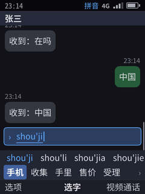
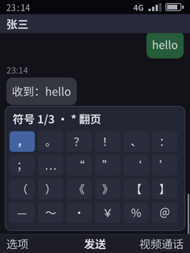
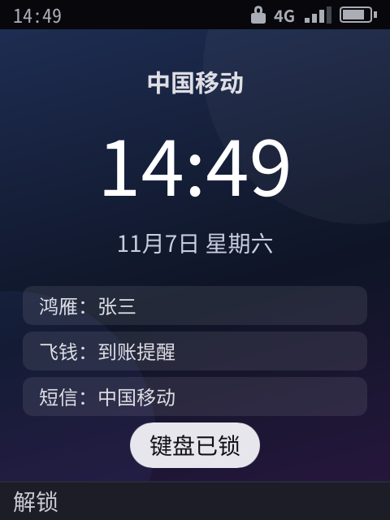
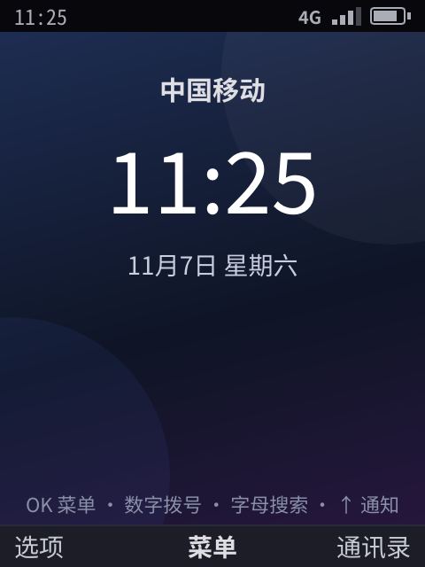
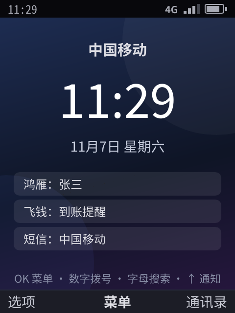
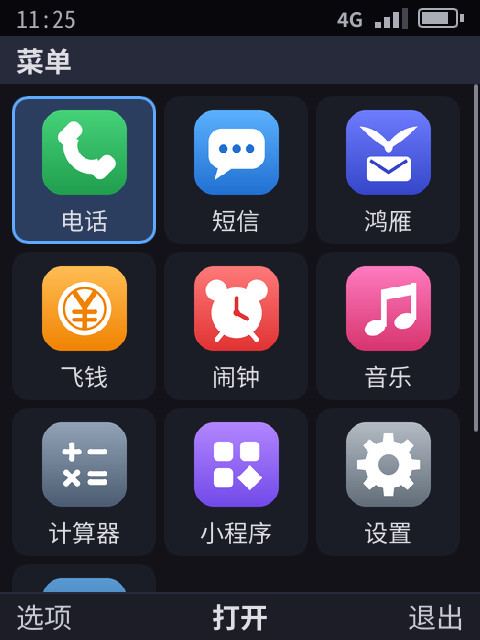
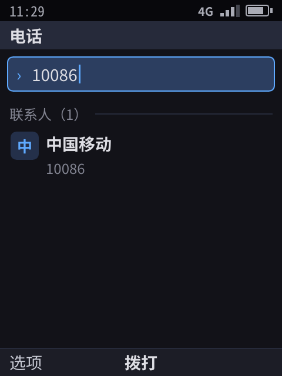
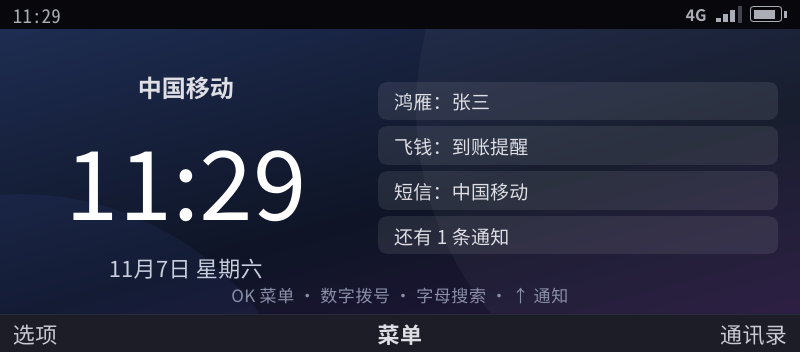
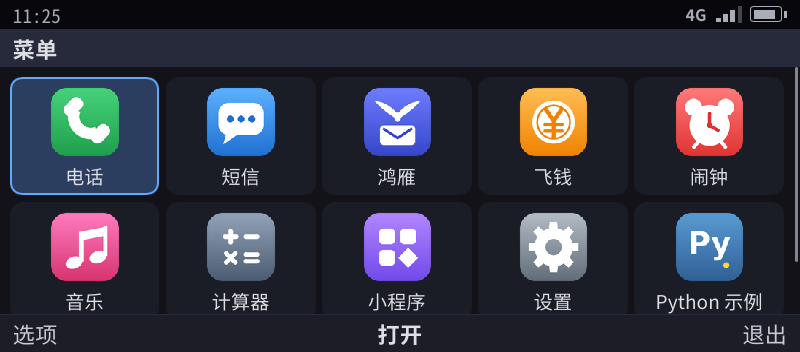

> English translation of [the Chinese original](../18-nokia-form-factors.md). The Chinese text is authoritative; keep both in sync.

# Nokia form factors and keys: T9 keypad, QWERTY keyboard, input switching aligned with Nokia

> Status:
> - Three device form factors (pixel renderer screen parameters + keyboard behavior): prototype ✓.
> - Input method keys aligned with Nokia (T9 keypad, QWERTY keyboard): prototype ✓, with unit tests and selftest cases.
> - Device body skins (drawing the keyboard area in screenshots): not done.
>
> The material comes from Nokia's official user guides (S40, S60, KaiOS), Chinese-language user guides and forums. Every conclusion is tagged with a source level: **official** means an official user guide or UI specification; **community** means several independent sources agree; **unverified** means there is only one source or the sources contradict each other. The full list of sources is at the end.

## 0. Conclusions

- For software purposes, Nokia's many models can be grouped into **three keyboard types × three screen types**. Sliders, flips and side-sliders differ only in their mechanics; in software each falls into one of these classes:

  | Form factor on this platform | Keyboard | Screen | Nokia archetypes |
  |------------|------|------|------------|
  | `bar-t9` candybar T9 keypad | 12 keys (ITU-T) + left and right soft keys + 5-way key + call / end + C key | Portrait 480×640 | 6300, N73; slider N95; flip 7390; 8110 4G |
  | `bar-qwerty` candybar QWERTY keyboard | Compact QWERTY keyboard, digits on the Fn layer | Landscape 640×480 | E71, E63, E72 |
  | `communicator` landscape wide keyboard | Full keyboard with a number row | Widescreen 800×352 | E90, 9300; side-slider N900, E7 |

- **Keys and mode switching follow Nokia's conventions** (§3, §4). Where model generations behave differently, the T9 keypad follows Series 40 6th Edition and the QWERTY keyboard follows the E71 and E90; §6 records the differences from other models.
- **Limits of borrowing**: key layouts and interaction conventions can be borrowed; Nokia's trademarks, fonts, icons, ringtones and boot animation are not used; the device body is a "homage", not a "replica". What we keep and what we replace: see 58 (internal document) §2.
- The same app needs **no code changes** across the three form factors: apps only describe nodes and actions, and the system handles key mapping, the input method and layout according to the form factor.

## 1. Form factor parameters

Defined in `shell/device.go` and selected with `phone-shell --device <form factor>`:

| Form factor | Physical pixels | Scale | Document columns | Keyboard behavior |
|------|----------|------|----------|----------|
| `bar-t9` | 480×640 | 2× | 32 | T9 keypad (§3) |
| `bar-qwerty` | 640×480 | 2× | 43 | QWERTY keyboard (§4) |
| `communicator` | 800×352 | 1.6× | 69 | QWERTY keyboard (§4); the number row enters digits directly |

Screenshots from the pixel renderer are in [06](06-gui-architecture.md) §6.

## 2. Physical key layout

### 2.1 T9 keypad (N73 as the example)

```
┌────────────────────────────────────────────────┐
│               Screen (portrait)                │
├──────────────────┬──────────┬──────────────────┤
│ Left soft key    │    ▲     │ Right soft key   │
│ 「选项」 Options │  ◀ OK ▶  │ 「返回」 Back    │
│ Call             │    ▼     │ End              │
├──────────────────┴──────────┴──────────────────┤
│  1 .,?!          2 abc          3 def          │
│  4 ghi           5 jkl          6 mno          │
│  7 pqrs          8 tuv          9 wxyz         │
│  * symbols       0 space        # mode         │
│  C clear         ✎ edit key (some S60 models)  │
└────────────────────────────────────────────────┘
```

- Letters are assigned according to ITU-T E.161 (official).
- The 1 key cycles through punctuation, and the order differs slightly between models; on the 8390, for example, it is `. , ' ? ! @ " 1 - ( ) / : _` (official).

### 2.2 Compact QWERTY keyboard (E71 / E63 / E72)

- The E71 has three modifier keys: Fn, Shift and Chr. Backspace is at the end of the second row and Enter at the end of the third row. The E71 has no separate Ctrl key; Ctrl is Fn + Chr (official). On the Chinese-market E71 the Chr key is printed with 「中」 (Chinese) (community).
- The digits are arranged like a phone keypad on the Fn layer: 5 is on the G key (which has a tactile dot), from which one can infer 1-2-3 on R T Y, 4-5-6 on F G H, 7-8-9 on V B N and 0 on M (**unverified**, needs photos of a real device to confirm).
- The E63 has a separate Ctrl key, and the E72 has a Sym key instead of Chr (official).

### 2.3 Full keyboard with a number row (E90 / 9300 / N900)

- The keyboard of the E90 (the inner-screen side) has a number row, two Shift keys, Tab, Ctrl, Chr and a large Enter key (community).
- The N900 has three rows of letters, with Fn (blue arrow), Sym/Ctrl and arrow keys (official).

## 3. T9 keypad keys (implemented)

| Key | Nokia | This platform | Source |
|------|--------|--------|------|
| `#` short press | Switches case / input method; the Chinese-market S40 cycles through pinyin, stroke, English uppercase, English lowercase, numbers | Cycles through: **pinyin → stroke → smart English → Abc → abc → ABC** | Official (order unverified) |
| `#` long press | S40: pops up a small menu where you pick 「数字模式」 (Number mode); S60: switches directly between letters and numbers | **Toggles between numbers (123) and the previous mode** | Official |
| `*` while composing | English predictive input: next matching word; S40 6th Edition Chinese: next pinyin | **English: next word; Chinese: next pinyin; punctuation: next punctuation mark** | Official |
| `*` when not composing / long press | Opens the special character table | **Opens the system symbol table** (press `*` again to page through it) | Official |
| `0` | Space; in English predictive input it commits the word and adds a space; while composing Chinese it is the syllable separator | Same as Nokia | Official |
| `1` | Punctuation cycle (in predictive input, press 1 and then `*` to change the punctuation mark) | Opens the punctuation bar; press `1` or `*` for the next one | Official |
| Digit long press | Enters that digit directly (Chinese-market S40: when there is no pending input) | Same as Nokia | Official |
| ▼ | S40: moves from the pinyin row to the candidate row; S60: once a pinyin is chosen, the candidates are numbered | **Enters numbered mode; after that, press 1–5 to pick a character directly** | Official |
| ▲ | — | Back to the pinyin row; choose a pinyin with ◀ ▶, lock it with OK or ▼ | — |
| ▶ (English) | Commits the current word without adding a space | Same as Nokia | Official |
| OK | Commits | Same as Nokia | Official |
| C / Backspace | Deletes the last key press | Same as Nokia | Official |
| Right soft key / Back | Closes the candidate window | Cancels the composition and closes the prediction bar | Official |
| Prediction | S60: after committing, a prediction bar appears with the first item highlighted, and OK picks it; the bar disappears when you type the next pinyin | Same as Nokia (on the T9 keypad the prediction bar is active by default) | Official |
| Multi-tap (Abc / abc / ABC) | Pressing the same key repeatedly cycles through its letters; confirmed after about 1 second without a press, or by pressing ▶ | Same as Nokia; in Abc mode the first letter of a sentence is capitalized automatically | Official |

## 4. QWERTY keyboard keys (implemented)

| Action | Nokia (E71 / E63 / E90 / N900) | This platform | Source |
|------|----------------------------------|--------|------|
| Chinese / English switch | **Ctrl + Space** (forums for the Chinese-market E63 / E71 / E90 agree; on the N900 it officially switches the input language) | Ctrl + Space (F6 also works in the terminal) | Community + N900 official |
| Special character table | Chr (E71 / E63 / E90) or Sym (E72 / N97 / E7) | **Chr / Sym opens the system symbol table** (F7 in the terminal) | Official |
| Committing a candidate | Third-party input methods: Space or OK commits the first candidate | Space or OK commits the current candidate; 1–5 picks the n-th one | Community |
| Uppercase | Shift pressed once capitalizes one letter, pressed twice locks | In Chinese mode, Shift + letter enters an uppercase English letter directly | Official |
| Digits | E71: Fn + key, Fn pressed twice locks; E90: number row | Handled by the keyboard driver's keycode table (the Fn layer is hardware layout, not the input method's business); in the terminal just press the digits | Official |
| Prediction | — | After committing, a prediction bar appears; press ◀ ▶ to start choosing; pressing OK right away sends | — |
| Input language selector | Shift + Chr (E90 official, E71 community) | Not done: currently there are only Chinese and English | Official / community |

## 5. Mode indicator

The status bar shows the current mode. On the T9 keypad it shows 「拼音 / 笔画 / 智能英文 / Abc / abc / ABC / 123」 (Pinyin / Stroke / Smart English / Abc / abc / ABC / 123); on the QWERTY keyboard it shows 「中 / 英」 (Chinese / English).

| T9 keypad pinyin | System symbol table |
|:--:|:--:|
|  |  |

## 5.1 Idle screen and main menu (implemented)

After boot the phone shows the **idle screen** rather than going straight into the grid, following the logic of Nokia S40:

| Pressed on the idle screen | Result | Nokia counterpart |
|--------------|------|--------------|
| OK (middle soft key 「菜单」 (Menu)) | Opens the main menu grid | S40: middle key = Menu |
| Right soft key 「通讯录」 (Contacts) | Opens the contacts in the Phone app | S40: right soft key = Contacts |
| Left soft key 「选项」 (Options) | Notification centre, switching apps, etc. | On S40 the left soft key is the 「转至」 (Go to) shortcut; we replaced it with system entries that are used more often |
| Digits, `*`, `#` | Goes straight into dialing with the pressed key already filled in; keep typing to get smart matching | Every Nokia: just type the number on the idle screen |
| Letters (QWERTY models) | Opens global search with the pressed letter as the search term | BlackBerry's "type to search"; the Nokia E series had a similar contact search |
| ↑ | Notification centre (if a widget is selected, it first moves back up one row) | The key-driven version of a modern phone's pull-down notification shade |
| ↓ | Moves between idle-screen widgets (the selected row is marked with 「▶」); OK opens the app the row belongs to, going straight to the deep link the app set for that row; Back deselects | S40's "Active standby" |
| Call key (green key) | Opens recent calls with focus on the most recent one; press again to call back | Every Nokia: the green key shows dialed numbers, pressing it twice redials |
| Left soft key, then `*` | Locks the keypad (see "Keypad lock" below) | S40's keypad lock |
| F4 (end key) | Returns to the idle screen; held, opens the power menu (power off, restart): on keypad phones without a separate power key the end key is the power key too | The red key returns to idle; holding it switches off |
| The end key pressed twice on the idle or lock screen (after a pause, within 400 ms) | Opens the quick card view (NFC: door, transit and payment cards), also while locked; the chosen card is presented for 60 seconds ([30](30-nfc.md) §5). There its first press has nothing to do (the phone is on idle already, or the press only lights the screen), so it does not clash with "one press returns to idle"; a press from an app or a call still returns to idle or hangs up and is no first press; pressing the red key again and again never opens it; not while a call or an alarm rings | The "double press of the power key" when the end key is the power key: as Xiaomi's double press of the power key opens its card pack and the iPhone's double press of the side button opens Wallet |
| Power key (where the board has a separate one; key name `power`) | A press turns the screen off (the lock follows the screen-off rules) or on; silences a ringing call; two presses (within 400 ms, on any screen, locked too) open the quick card view; held, it opens the power menu | Android phones' power key, the iPhone's side button; Xiaomi's double press of the power key opens its card pack |
| Side volume keys (F8, F9 on a USB keyboard) | While an incoming call is ringing: silences the ringtone; while music is playing: adjusts the media volume; otherwise: adjusts the ringtone volume (works on any screen, even with the keypad locked) | Every phone |
| Media keys: headset remote, the keyboard's play / pause, previous, next (plus F10, F11, F12 on a USB keyboard) | Play / pause directly controls the sound that is playing; previous and next are handed to the app that is playing; during a call they leave the music alone (works on any screen, even with the keypad locked) | Every phone |

On any screen:
- The **call key** triggers the action with ID `call` / `dial` on the focused element or the page: on contacts and call log entries it calls, in the dial box it dials out. When the dial box is empty, it jumps to the most recent call log entry; when the page has no such action, it opens recent calls.
- The **end key** triggers the action with ID `hangup` on the page: on the call screens of Phone and Hongyan it hangs up. Without such an action it returns to the idle screen.
- **During an incoming call**, the call key answers and the end key rejects.

Apps don't need to write any code for these two keys; they only need to name their actions by convention ([22](22-developer-api.md) §3).

When a menu or dialog is open, the end key first closes it and then returns to the idle screen or hangs up, just like Nokia's red key. Full-screen alerts such as incoming calls and alarms are the exception: during an incoming call the end key rejects, and for an alarm the user has to choose 「停止」 (Stop) or 「稍后提醒」 (Snooze) explicitly.

Keypad lock (aligned with Nokia S40):
- When locking, 「键盘已锁」 (Keypad locked) pops up once; the idle screen does not keep a permanent hint text;
- While locked, the status bar shows a small lock, the left soft key shows 「解锁」 (Unlock), and the other soft keys are empty;
- Pressing any other key shows 「按「解锁」再按 *」 (Press "Unlock", then *); pressing the left soft key shows 「现在按 *」 (Now press *); pressing `*` within 3 seconds unlocks, with the toast 「键盘已解锁」 (Keypad unlocked);
- Incoming calls, alarms and keys during a call work as usual; the end key still returns to the idle screen;
- **Emergency calls don't require unlocking**: while locked, typing 112, 110, 119, 120, 122 (and 911, 999) directly shows 「紧急号码 112 · 按通话键拨打」 (Emergency number 112 · press the call key to dial); pressing the call key dials it, the call screen belongs to the Phone app, and after hanging up the keypad is still locked;
- **Automatic keypad lock**: Settings → Keypad lock, with the options Off, 15 seconds, 30 seconds and 1 minute. After the idle screen has been showing that long without a key press, the keypad locks automatically; it does not lock while an app is in the foreground, during a call, or while an overlay is showing.

| Keypad lock (candybar T9 keypad) |
|:--:|
|  |

- **Left and right arrow keys**: if the focused element or the page binds an action to ← →, that action runs (volume down / up, previous / next track, previous / next picture). Without a binding, ← goes back one level and → opens the focused item, so, as with Nokia's 5-way key, left and right also take you in and out of menus. In grids and input fields they move as before.

In the main menu:
- The number of grid columns depends on the screen: 3 columns in portrait, 4 in 4:3 landscape, 5 on widescreen (the E90's inner screen has a wide grid);
- Pressing a digit 1–9 jumps straight to the cell at that position (a menu grid with digit shortcuts, as on S40);
- Like Nokia, it uses folders: the main menu only holds the everyday apps (Phone, Messages, Hongyan, Feiqian, Pictures, Camera, Music, Browser, Store, Cards, Settings); Calculator, Alarm and Weather go into 「工具」 (Tools), mini-programs and samples go into 「应用」 (Apps), and apps installed from the store go into 「应用」 by default. An app picks its folder in its manifest with `folder` (`tools`, `apps`). Folders are grids too, with the same digit shortcuts;
- The right soft key 「退出」 (Exit) or the back key returns to the idle screen.

The idle screen shows the carrier, the clock, the date and the day of the week, and below them the "active standby" information rows: the latest notification, the next alarm, the song that is playing; whatever doesn't fit is left out.
- The pixel renderer draws a gradient wallpaper, or a photo wallpaper set by the user (Settings › Wallpaper; the lock screen can have a separate one);
- On widescreen, the clock and the information rows sit side by side;
- The text renderer shows the same content with ordinary nodes.

App icons are images (original artwork drawn by `tools/icons.py`, not Nokia's icons):
- In the manifest, `icon_image` points to a PNG in the app directory;
- The pixel renderer reads it itself and, before reading, checks the file size (≤ 512 KB) and the image dimensions (≤ 256×256), because icons come from the app package;
- The text renderer still shows a single-character icon.

| Idle | Active standby information | Main menu (icons) | Dialing directly from idle |
|:--:|:--:|:--:|:--:|
|  |  |  |  |

| Landscape wide keyboard: idle | Landscape wide keyboard: 5-column main menu |
|:--:|:--:|
|  |  |

## 6. Differences from Nokia (recorded as they are)

| Item | Difference | Reason |
|----|------|------|
| English predictive input | Nokia shows only one word inline, changed with `*`; we show an extra row of candidates, which can be changed with either `*` or ◀ ▶ | The screen is larger, so more candidates are visible at a glance |
| Chinese `*` | Uses the S40 6th Edition behavior (next pinyin); on S60, `*` is the tone key | The two generations conflict; we chose to have `*` mean "next" in both Chinese and English |
| Tones | Not supported; while composing Chinese, the 1 key also acts as a separator | The dictionary has no tone information |
| Prediction bar | On the T9 keypad, OK picks the predicted word (as on S60), so to send you first press Back to close the prediction bar; on the QWERTY keyboard the prediction bar does not take over OK | On the QWERTY keyboard it is handier for OK to send, and this is also the common behavior of third-party input methods on the E71 |
| Long press | On the device, holding a key for 600ms counts as a long press; in the terminal emulator, Alt + key is used instead | Terminals don't receive key-release events |
| Stroke input, fuzzy pinyin, user phrases | ✓ | See [16](16-input-method.md) §5 |

## 7. Emulator key mapping

| Phone key | Terminal (`phone-shell`) | Pixel renderer (`phone-gui`, USB keyboard on the device) |
|--------|----------------------|----------------------------------------------|
| 5-way key / OK | Arrow keys / Enter | Same as the terminal |
| Back / right soft key close | Esc | Esc |
| Left soft key 「选项」 (Options) | Tab (or F1) | Tab / F1 |
| Right soft key | F2 | F2 |
| Call key | F5 | F5 |
| End (back to idle) / tasks | F4 / F3 | F4 / F3 |
| Power key | None (`key power` in scripts, `long power` to hold it) | The board's power key (`KEY_POWER`): a press counts on release, holding it 600ms is a long press |
| `*` `#` 0–9 | The keys of the same name; Alt + key = long press | The keys of the same name; holding for 600ms = long press (T9 keypad form factor) |
| Chinese / English | F6 or Ctrl + Space | F6 or Ctrl + Space |
| Chr / Sym | F7 | F7 |

## 8. Unverified items and to-dos

| Item | Notes |
|----|------|
| Exact layout of the E71's number layer and bottom row | Needs photos of a real device |
| Multi-tap order of the 1 key and 0 key on the 6300 and N95 | Differs by model; needs the original user guide text |
| Candidate numbering, the role of Space and the tone key in Nokia's built-in QWERTY pinyin | Not enough information |
| Device body skins | Draw the T9 keypad and QWERTY keyboard areas in the screenshots, to make reviews easier |
| Keyboard driver | evdev keycode tables for the T9 keypad and the QWERTY keyboard (including the Fn layer), to be done in R16 once hardware is available |

## Sources

- S40: [6300 user guide (hosted by Vodafone)](https://www.vodafone.de/media/downloads/help-devices/Nokia_6300_APAC_UG_en.pdf), [6300 Chinese user guide](https://www.manuallib.com/download/pdf15/NOKIA-6300-OWNER-MANUAL.PDF), [6316s Chinese user guide](http://download-support.webapps.microsoft.com/files/support/china/phones/guides/Nokia_6316s_UG_zh-CN.pdf), [2720 fold](https://manualsdump.com/en/manuals/nokia-2720model/220008/16)
- S60: [S60 UI specification](https://devlib.symbian.slions.net/s3/GUID-B35E6CAD-C9C8-467E-85CF-9781DEC8BF7C.html), [N95 8GB](https://nokia-n95-8gb.helpdoc.net/en/nokia-n95-8gb-user-guide/messaging/write-text/traditional-text-input/), [N76 Chinese user guide](https://www.manuallib.com/download/pdf12/NOKIA-N76-USER-MANUAL.PDF), [E50](http://nds1.webapps.microsoft.com/files/support/apac/phones/guides/Nokia_E50_APAC_UG_en.pdf)
- QWERTY keyboard: [E71 user guide](http://nds1.webapps.microsoft.com/phones/files/guides/Nokia_E71-1_UG_en.pdf), [E72](https://nokia-e72.helpdoc.net/en/nokia-e72-user-guide/get-started/write-text/write-text-with-the-keyboard/), [E61i Chinese (Hong Kong)](https://www.ziliaoku.com/res/info_aef76c14c7244a9a92001f35f8b468c6.html), [E90 user guide](https://www.instructionsmanuals.com/sites/default/files/2019-05/Nokia-E90-en.pdf), [N900 keyboard](https://nokia-n900.helpdoc.net/en/nokia-n900-user-guide-2/introduction-2/text-input-2/use-the-physical-keyboard-2/), [E7 keyboard](https://nokia-e7-00.helpdoc.net/en/nokia-e7-00-user-guide/get-started/keys-and-parts/keyboard/)
- KaiOS: [8110 4G](https://www.hmd.com/en_int/support/nokia-8110-4g-user-guide/write-text), [2720 Flip](https://www.hmd.com/en_int/support/nokia-2720-user-guide/write-text?locale=fi-FI)
