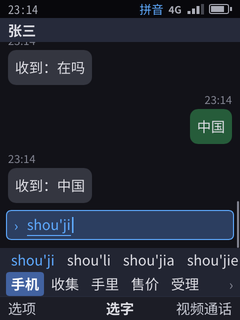
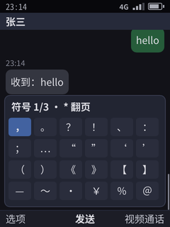
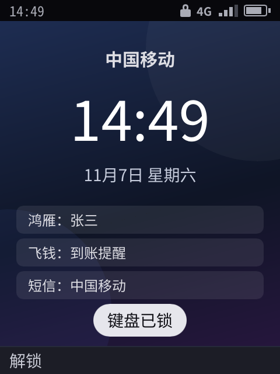
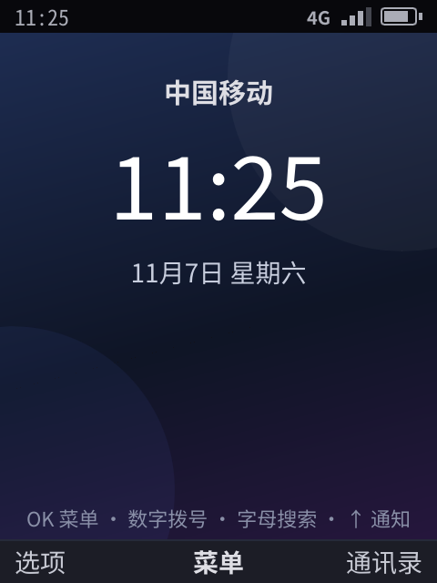
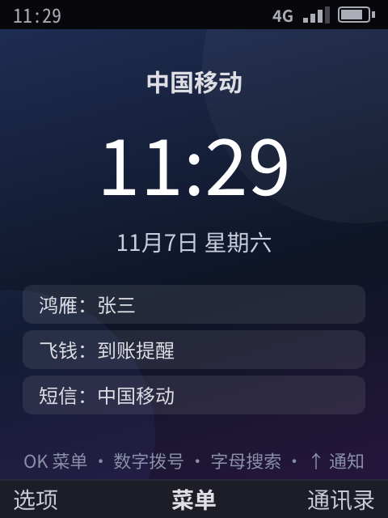
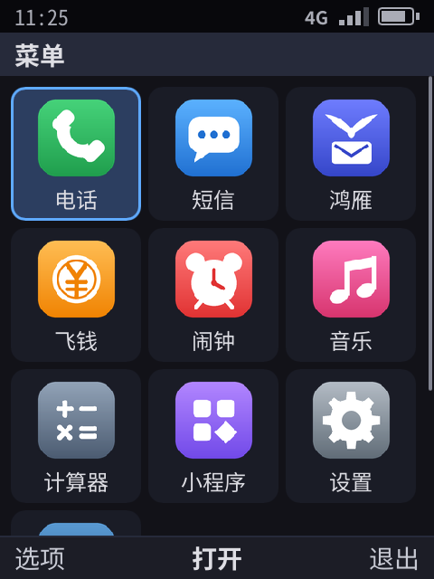
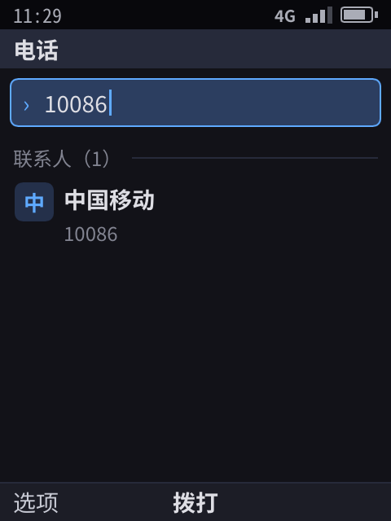
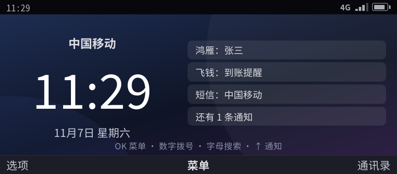
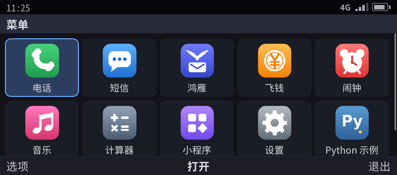

> English translation of [the Chinese original](../18-nokia-form-factors.md). The Chinese text is authoritative; keep both in sync.

# Nokia form factors and keys: T9 keypad, QWERTY keyboard, input switching aligned with Nokia

> Status:
> - Three device form factors (pixel renderer screen parameters + keyboard behavior): prototype ✓.
> - Input method keys aligned with Nokia (T9 keypad, QWERTY keyboard): prototype ✓, with unit tests and selftest cases.
> - Device body skins (drawing the keyboard area in screenshots): prototype ✓ (`make skins`, drawn by phone-paint).
>
> The material comes from Nokia's official user guides (S40, S60, KaiOS), Chinese-language user guides and forums. Every conclusion is tagged with a source level: **official** means an official user guide or UI specification; **community** means several independent sources agree; **unverified** means there is only one source or the sources contradict each other. The full list of sources is at the end.

## 0. Conclusions

- For software purposes, Nokia's many models can be grouped into **three keyboard types × three screen types**. Sliders, flips and side-sliders differ only in their mechanics; in software each falls into one of these classes:

  | Form factor on this platform | Keyboard | Screen | Nokia archetypes |
  |------------|------|------|------------|
  | `bar-t9` candybar T9 keypad | 12 keys (ITU-T) + left and right soft keys + 5-way key + call / end + C key | Portrait 480×640 | 6300, N73; slider N95; flip 7390; 8110 4G |
  | `bar-qwerty` candybar QWERTY keyboard | Compact QWERTY keyboard, digits on the Fn layer | Landscape 640×480 | E71, E63, E72 |
  | `communicator` landscape wide keyboard | Full keyboard with a number row | Widescreen 800×352 | E90, 9300; side-slider N900, E7 |

- **Keys and mode switching follow Nokia's conventions** (§3, §4). Where model generations behave differently, the T9 keypad follows Series 40 6th Edition and the QWERTY keyboard follows the E71 and E90; §6 records the differences from other models.
- **Limits of borrowing**: key layouts and interaction conventions can be borrowed; Nokia's trademarks, fonts, icons, ringtones and boot animation are not used; the device body is a "homage", not a "replica". What we keep and what we replace: see 58 (internal document) §2.
- The same app needs **no code changes** across the three form factors: apps only describe nodes and actions, and the system handles key mapping, the input method and layout according to the form factor.

## 1. Form factor parameters

Defined in `shell/device.go` and selected with `phone-shell --device <form factor>`:

| Form factor | Physical pixels | Scale | Document columns | Keyboard behavior |
|------|----------|------|----------|----------|
| `bar-t9` | 480×640 | 2× | 32 | T9 keypad (§3) |
| `bar-qwerty` | 640×480 | 2× | 43 | QWERTY keyboard (§4) |
| `communicator` | 800×352 | 1.6× | 69 | QWERTY keyboard (§4); the number row enters digits directly |

Screenshots from the pixel renderer are in [06](06-gui-architecture.md) §6.

## 2. Physical key layout

### 2.1 T9 keypad (N73 as the example)

```
┌────────────────────────────────────────────────┐
│               Screen (portrait)                │
├──────────────────┬──────────┬──────────────────┤
│ Left soft key    │    ▲     │ Right soft key   │
│ 「选项」 Options │  ◀ OK ▶  │ 「返回」 Back    │
│ Call             │    ▼     │ End              │
├──────────────────┴──────────┴──────────────────┤
│  1 .,?!          2 abc          3 def          │
│  4 ghi           5 jkl          6 mno          │
│  7 pqrs          8 tuv          9 wxyz         │
│  * symbols       0 space        # mode         │
│  C clear         ✎ edit key (some S60 models)  │
└────────────────────────────────────────────────┘
```

- Letters are assigned according to ITU-T E.161 (official).
- The 1 key cycles through punctuation, and the order differs slightly between models; on the 8390, for example, it is `. , ' ? ! @ " 1 - ( ) / : _` (official).

### 2.2 Compact QWERTY keyboard (E71 / E63 / E72)

- The E71 has three modifier keys: Fn, Shift and Chr. Backspace is at the end of the second row and Enter at the end of the third row. The E71 has no separate Ctrl key; Ctrl is Fn + Chr (official). On the Chinese-market E71 the Chr key is printed with 「中」 (Chinese) (community).
- The digits are arranged like a phone keypad on the Fn layer: 5 is on the G key (which has a tactile dot), from which one can infer 1-2-3 on R T Y, 4-5-6 on F G H, 7-8-9 on V B N and 0 on M (**unverified**, needs photos of a real device to confirm).
- The E63 has a separate Ctrl key, and the E72 has a Sym key instead of Chr (official).
- The editing keys the E71 user guide gives (official): the status bar shows the case as Abc / abc / ABC; holding Backspace erases several characters; holding Shift and scrolling highlights a word, phrase or line, Ctrl + C copies it and Ctrl + V pastes; Fn + Space changes the writing language and switches predictive input.
- The E72 user guide (official): Shift pressed once gives the next letter in the other case; holding Sym and pressing a letter repeatedly gives its accented letters (á and so on), their order and choice depending on the writing language; Ctrl + X cuts, Ctrl + A selects all; Ctrl held with Sym picks a recently used symbol.
- Kario's qwerty-v1 has Shift, Fn, Sym (used as Chr) and the 中 / 英 (Chinese / English) key, but no Ctrl: its keyboard configuration says `ctrl = "fn+sym"`, so Fn + Sym and then a letter is Ctrl + that letter, as on the E71 (§4.2).

### 2.3 Full keyboard with a number row (E90 / 9300 / N900)

- The keyboard of the E90 (the inner-screen side) has a number row, two Shift keys, Tab, Ctrl, Chr and a large Enter key (community).
- The N900 has three rows of letters, with Fn (blue arrow), Sym/Ctrl and arrow keys (official).

## 3. T9 keypad keys (implemented)

| Key | Nokia | This platform | Source |
|------|--------|--------|------|
| `#` short press | Switches case / input method; the Chinese-market S40 cycles through pinyin, stroke, English uppercase, English lowercase, numbers | Cycles through: **pinyin → stroke → smart English → Abc → abc → ABC** | Official (order unverified) |
| `#` long press | S40: pops up a small menu where you pick 「数字模式」 (Number mode); S60: switches directly between letters and numbers | **Toggles between numbers (123) and the previous mode** | Official |
| `*` while composing | English predictive input: next matching word; S40 6th Edition Chinese: next pinyin | **English: next word; Chinese: next pinyin; punctuation: next punctuation mark** | Official |
| `*` when not composing / long press | Opens the special character table | **Opens the system symbol table** (press `*` again to page through it) | Official |
| `0` | Space; in English predictive input it commits the word and adds a space; while composing Chinese it is the syllable separator | Same as Nokia | Official |
| `1` | Punctuation cycle (in predictive input, press 1 and then `*` to change the punctuation mark) | Opens the punctuation bar; press `1` or `*` for the next one | Official |
| Digit long press | Enters that digit directly (Chinese-market S40: when there is no pending input) | Same as Nokia | Official |
| ▼ | S40: moves from the pinyin row to the candidate row; S60: once a pinyin is chosen, the candidates are numbered | **Enters numbered mode; after that, press 1–5 to pick a character directly** | Official |
| ▲ | — | Back to the pinyin row; choose a pinyin with ◀ ▶, lock it with OK or ▼ | — |
| ▶ (English) | Commits the current word without adding a space | Same as Nokia | Official |
| OK | Commits | Same as Nokia | Official |
| C / Backspace | Deletes the last key press | Same as Nokia | Official |
| Right soft key / Back | Closes the candidate window | Cancels the composition and closes the prediction bar | Official |
| Prediction | S60: after committing, a prediction bar appears with the first item highlighted, and OK picks it; the bar disappears when you type the next pinyin | Same as Nokia (on the T9 keypad the prediction bar is active by default) | Official |
| Multi-tap (Abc / abc / ABC) | Pressing the same key repeatedly cycles through its letters; confirmed after about 1 second without a press, or by pressing ▶ | Same as Nokia; in Abc mode the first letter of a sentence is capitalized automatically | Official |

## 4. QWERTY keyboard keys (implemented)

| Action | Nokia (E71 / E63 / E90 / N900) | This platform | Source |
|------|----------------------------------|--------|------|
| Chinese / English switch | **Ctrl + Space** (forums for the Chinese-market E63 / E71 / E90 agree; on the N900 it officially switches the input language) | Ctrl + Space (F6 also works in the terminal); on qwerty-v1 the 中 / 英 key, or Fn + Sym and then Space | Community + N900 official |
| Special character table | Chr (E71 / E63 / E90) or Sym (E72 / N97 / E7) | **Chr / Sym tapped (on release) opens the system symbol table** (F7 in the terminal); a letter or mark pressed in it turns the table into that key's variants, the same key again picks the next | Official |
| Accented letters, variants of marks | E72: hold Sym and press a letter repeatedly, á and the others come in turn, in an order that depends on the writing language | **Hold Chr and press a key repeatedly**: the first press types its first variant, each further press replaces it with the next (`e` → é è ê ë …, `n` → ñ, `c` → ç, `s` → ß; a capital gives capitals: with Chr held tap Shift, then the letter, since Shift first and then Chr is the writing language); in pinyin mode marks give their Chinese forms first (`.` → 。 …… ·, `,` → ， 、, `?` → ？); the word being composed is committed first; a key without variants types as usual; the table is `ime/data/marks.json` | Official |
| Committing a candidate | Third-party input methods: Space or OK commits the first candidate | Space or OK commits the current candidate; 1–5 picks the n-th one | Community |
| Uppercase | Shift pressed once capitalizes one letter, pressed twice locks; the status bar shows Abc / abc / ABC | Hold Shift for capitals; on a phone keyboard with an Fn layer tap Shift once for a capital next letter only, twice quickly (within 500 ms) for caps lock and once more to unlock, the status bar showing 「Abc」 or 「ABC」; in Chinese mode, Shift + letter enters an uppercase English letter directly | Official |
| Capital at the start of a sentence | With Abc in the status bar a sentence starts with a capital (E71); Shift pressed once gives the other case (E72) | In English the first letter of a field and after `.` `!` `?` is capitalised, the status bar showing 「Abc」; Shift tapped then makes that letter small (status bar 「abc」); no capitals in email and web address fields or in pinyin; the completions follow the capital | Official |
| Caret, selection, copy and paste | E71: hold Shift and scroll to select, Ctrl + C copies, Ctrl + V pastes; E72: Ctrl + X cuts, Ctrl + A selects all | A text field has a caret that ◀ ▶ move; Shift held with ◀ ▶ selects, Shift + ▲ ▼ select to the start or end; Ctrl + C copies (everything when nothing is selected), X cuts, V pastes at the caret, A selects all, Z undoes; qwerty-v1 has no Ctrl: press Fn + Chr, then the letter; the options menu has them too (§4.2) | Official |
| Deleting | E71: hold Backspace to erase several characters | Backspace deletes the character before the caret (the selection when there is one); held 600 ms, each repeat deletes a word; Shift or Fn + Backspace (a PC keyboard's Delete) deletes the character after the caret | Official |
| Start, end, page | The E72's e-mail has shortcuts to the first or last message and a page up or down | Fn + ◀ ▶: in a text field to its start or end (with Shift held, selecting up to there), in a list to the first or last item, and the same in the system's menus, pickers, share sheet and symbol table (§4.2, "Ends in system overlays"); Fn + ▲ ▼: a screen up or down in a list; a PC keyboard's Home, End, PgUp, PgDn do the same | Official (the keys are Kario's) |
| A letter typed in a list | E71: in Contacts typing searches | On a page without an input field, a letter that is no shortcut moves the focus to the next item starting with it (a Chinese name by its pinyin initial), wrapping round; the same in system menus (a menu item's own key comes first); on a page with a field the letter still goes into it | Official / community (BlackBerry's lists) |
| Digits | E71: hold Fn and press the key, or hold the key; press Fn twice quickly to lock; C3-00: press Fn to switch between letters and digits, twice to lock; E90: number row | Hold Fn and press the key; in a text field hold a letter key that has a digit for 600 ms and the letter turns into the digit (these keys do not repeat); tap Fn once for the next key only, tap it twice quickly (within 500 ms) to lock and once more to unlock, the status bar showing 「Fn」 or 「123」 (phone-paint's input helper); number and phone fields and PINs need no Fn (§4.1); in the terminal just press the digits | Official |
| Prediction | — | After committing, a prediction bar appears; press ◀ ▶ to start choosing; pressing OK right away sends | — |
| Input language selector | E71: Fn + Space (which also switches predictive input); E90: Shift + Chr | **Shift + Chr or Fn + Space** opens 「输入语言」 (Writing language): Chinese (pinyin), English, the current one ticked; the input method has only these two | Official |

### 4.1 Shared digit keys follow the screen (implemented)

On a compact QWERTY keyboard digits and letters share keys (Kario's qwerty-v1: W E R / S D F / Z X C are 1–9, the full stop is 0, Q is #, A is *). Nokia's QWERTY phones decided per screen and field what a press types, and Kario does the same:

| Where | Nokia | Kario |
|-------|-------|-------|
| Idle screen | E71: typing searches contacts by name; you can also type a number and press the call key (the user guide says both); C3-00: type the number on the home screen and press the call key | Typed letters still open global search; when every key typed has a dial character behind it (digits, `*`, `#`, `+`), the results end with a 「拨号 123」 (Dial 123) row, and the call key (or OK on it) opens the dialer with the number filled in, as digits typed on the idle screen of a 9-key pad do. It comes first when nothing else matches |
| Number and phone fields (`keyboard: "number"` / `"phone"`), PINs (lock screen, SIM, payment password), emergency numbers typed while locked | S60's numeric input mode (`EAknEditorNumericInputMode`): the keys type digits directly, no Fn | A key with a second legend types it (`w` is 1, `h` is `:`, `o` is `+`), the others type as they are; PINs take digits only; the status bar shows 「123」 |
| Text fields | Letters; hold the key or Fn + key for the digit, press Fn twice to lock | Letters; Fn held, tapped or locked for the second legend (the table in §4) |

The Fn layer comes from the model's keyboard configuration ([24](24-sku-framework.md) §1); the 9-key pad and keyboards without an Fn layer behave as before: nothing changes on a developer machine without a model, and the selftest gives the qwerty-v1 layer with its `fn-layer` step. Holding a letter key in a text field for its digit (the E71's other way) is implemented: the renderer types the letter at the press as usual and, held 600 ms, reports one long press with `retype`; the Shell deletes the letter just typed and types its digit (in a list the long press does nothing more). Not done: the dialer's smart dialling matches pinyin by 9-key digits, so on a full keyboard find people by name by typing letters on the idle screen; phone-gui does not handle the Fn layer; Fn and Shift taps and locking and holding for digits are in phone-paint only (**not implemented** in phone-gui). On the device Fn and Shift taps and locking and holding for digits have unit tests only (**not run on a real phone**).

### 4.2 Editing text, keys in lists (implemented)

**Caret and selection**: the Shell keeps a caret and a selection for every input field (counted in characters, `shell/textedit.go`), and the renderer draws them (the frame's `caret_back` and `selection`, [23](23-renderer-protocol.md) §4). The caret starts at the end and goes back there when the app changes the field's value. In a field with text ◀ ▶ move through it and stop at its ends, never leaving the page; in an empty field ◀ still goes back one level. ◀ used to go back from a field with text too, losing what was typed; that is fixed (regression test `TestLeftStaysInTheField`). Typing, pasting and the symbol table insert at the caret, over the selection when there is one; while a word is being composed, start, end, copy and the like do nothing: commit it first. A field is one line, so Shift + ▲ ▼ select to its start and end. While the prediction bar is up after Chinese is committed, ◀ ▶ first move into it ([16](16-input-method.md) §2); Back closes it, and then they move the caret. Undo takes back up to 20 edits; typing in a row is one, a space starts the next.

**Clipboard**: copying and cutting go to the system clipboard, the one of [17](17-app-sandbox.md) §1 that apps can only write and that empties after 10 minutes; nothing is copied or cut from a password field. With the focus on a list item, Ctrl + C runs its Copy (its action with ID `copy`, such as a Hongyan message or a contact's number); with the focus not on a field, Ctrl + V pastes into the page's first input field. The first entries of the options menu's 「系统」 (System) group are Paste "…" (key `v`), Copy (a field with text), Cut (a selection) and Select all, which a keyboard without Ctrl and the 9-key pad rely on.

**Which key does what** is the keyboard configuration's and the renderer's; the Shell only receives the key names `first`, `last`, `pageup`, `pagedown`, `delete`, `copy`, `cut`, `paste`, `selectall`, `undo`, `lang`, plus `shift` on arrows and `chr` on letters ([23](23-renderer-protocol.md) §3):

| Action | bar-qwerty (qwerty-v1) | communicator (a full keyboard with a number row; it has no model configuration yet, on a developer machine it is the PC keyboard) | Terminal (`phone-shell`) |
|------|------|------|------|
| Ctrl + letter | Fn + Sym, then the letter (the keyboard configuration's `ctrl = "fn+sym"`, [24](24-sku-framework.md) §1) | The Ctrl key | Ctrl + X, V, A, Z; Ctrl + C quits the terminal, copy from the options menu |
| Selecting | Shift held + arrows | Same | Shift + arrows, Shift + Home / End |
| Start, end, page | Fn (held or tapped) + arrows | Home, End, PgUp, PgDn | Same |
| Deleting after the caret | Shift or Fn + Backspace | Delete, Shift + Backspace | Delete |
| Backspace held, a word at a time | Held 600 ms | Same | Alt + Backspace |
| Accented letters, variants of marks | Hold Sym, press the key | Hold F7 (Chr), press the key | F7 opens the symbol table, then press the key |
| Writing language | Shift + Sym, or Fn + Space | Shift + F7 | None (F6 switches Chinese / English) |

**Lists**: on a page without an input field, a letter that is no shortcut (the app's action keys, the Fn layer's digits) moves the focus to the next item whose name starts with it, a Chinese name by its pinyin initial (the reading in the input method's dictionary), wrapping round at the end; the same in system menus (options, power, writing language), where a menu item's own key comes first. On a page with a field the letter still goes into it (Contacts searches as you type), the idle screen still searches; in the main menu grid letters jump too, and the digit keys still open their cells.

**Ends in system overlays**: in the overlays the Shell draws, Fn + ◀ ▶ (`first`, `last`) go to the ends as in a list: menus (options, the command palette, the file picker, the contact picker, the power menu, the quick card view, writing language) to the first and last entry, with something typed the first and last match, not counting the entries listed only on search; the grids of the photo picker, the share sheet (which is also the app chooser when one app invokes another) and the symbol table to the first and last cell. In the first 500 ms after the photo picker or the share sheet comes up they move the choice at once, as the arrow keys do ([11](11-platform-architecture.md) §16.1). The 9-key pad has no such keys; selftest scripts still send them. An overlay does not nudge when it is at that end already (an overlay's selected item does not nudge, [37](37-motion.md) §3); Fn + ▲ ▼ do not page in overlays yet (**not implemented**). Tests run on each of the three form factors: `TestPickerFirstLast`, `TestShareSheetFirstLast`, `TestMenuFirstLast`, `TestSymbolTableFirstLast` (all fail on the old code); ↓ then OK in a menu with no match used to crash the Shell, fixed (`TestMenuNoMatchDownOK`, fails on the old code). The grids of the photo picker and the share sheet scroll by whole rows to keep the chosen cell on screen, in the text renderer and in phone-paint, on each form factor: they show rows from the first that keeps the chosen row on screen, as the menus keep their entry (past the first screenful the chosen row is the last shown), and the body's scroll bar says there is more above or below (the text renderer's │ with ┃ for the thumb in the last column, phone-paint's bar at the right edge); a grid that fits is drawn as before, without a bar. Each renderer fits its own number of rows (the text renderer 6 at 40 × 24, phone-paint 3 on `bar-t9`, 2 on `bar-qwerty`, 1 on `communicator`), so the frame is unchanged: it already says which cell is chosen ([23](23-renderer-protocol.md) §4); phone-gui's picker does not scroll (**not implemented**). Before, with more photos than fit (in phone-paint on `bar-t9`, more than 9) `last` or ↓ chose a cell drawn off the screen. Tests on each form factor through the keys: `TestPickerGridScrollsText` (40 tiles and a grid that just fits: after every key the chosen tile is drawn on its highlight, the bar's thumb at the top, between or at the end) and `TestPickerGridScrollsOnPhonePaint` (on a headless phone-paint, each photo and app icon a colour of its own: after every key the chosen one shows whole on the panel), and Rust's `a_picker_keeps_its_choice_on_screen`, all failing on the old code; the 鸿雁 case's snapshot `37b-picker-last` has the tenth photo chosen, a row down on each form factor in phone-paint. **Not tried on a phone**.

**The 9-key pad is unchanged**: t9-v1 has none of these keys, and on `bar-t9` the renderer handles Chr, Backspace and the arrows as before (the C key still repeats when held); the Shell's capitals and letter jumps are for full keyboards only; the options menu's Copy and Select all are there on every keypad. The combinations live in phone-paint (`Keyboard` in `paint/src/kms.rs`, with unit tests); phone-gui handles none of them and draws neither caret nor selection (**not implemented**). Fields in web pages belong to the page's own editor and have no such caret. In the selftest `key shift+left` is an arrow with Shift held, `chr e 2` is `e` pressed twice with Chr held and `long backspace` a held Backspace. On the device the combinations have unit tests and developer-machine selftests only (**not run on a real phone**).

## 5. Mode indicator

The status bar shows the current mode. On the T9 keypad it shows 「拼音 / 笔画 / 智能英文 / Abc / abc / ABC / 123」 (Pinyin / Stroke / Smart English / Abc / abc / ABC / 123); on the QWERTY keyboard it shows 「中 / 英」 (Chinese / English), in English 「Abc」 where the next letter will be a capital and 「abc」 after Shift took that back; a QWERTY keyboard with an Fn layer shows 「123」 in number and phone fields, 「Fn」 after a tap of Fn and 「123」 while Fn is locked.

| T9 keypad pinyin | System symbol table |
|:--:|:--:|
|  |  |

## 5.1 Idle screen and main menu (implemented)

After boot the phone shows the **idle screen** rather than going straight into the grid, following the logic of Nokia S40:

| Pressed on the idle screen | Result | Nokia counterpart |
|--------------|------|--------------|
| OK (middle soft key 「菜单」 (Menu)) | Opens the main menu grid | S40: middle key = Menu |
| Right soft key 「通讯录」 (Contacts) | Opens the Contacts app (the Phone app's contacts in a product without it) | S40: right soft key = Contacts |
| Left soft key 「选项」 (Options) | Notification centre, switching apps, etc. | On S40 the left soft key is the 「转至」 (Go to) shortcut; we replaced it with system entries that are used more often |
| Digits, `*`, `#` | Goes straight into dialing with the pressed key already filled in; keep typing to get smart matching | Every Nokia: just type the number on the idle screen |
| Letters (QWERTY models) | Opens global search with the pressed letter as the search term; when every key typed has a dial character behind it, the last row is 「拨号 123」 (Dial 123) and the call key opens the dialer with the number filled in (§4.1) | BlackBerry's "type to search"; on the idle screen of the Nokia E71 typing searches contacts by name, and a number typed is dialled with the call key |
| ↑ | Notification centre (if a widget is selected, it first moves back up one row) | The key-driven version of a modern phone's pull-down notification shade |
| ↓ | Moves between idle-screen widgets (the selected row is marked with 「▶」); OK opens the app the row belongs to, going straight to the deep link the app set for that row; Back deselects | S40's "Active standby" |
| Call key (green key) | Opens recent calls with focus on the most recent one; press again to call back; with a call in the background it brings the call screen back ([19](19-core-apps.md) §5) | Every Nokia: the green key shows dialed numbers, pressing it twice redials |
| Left soft key, then `*` | Locks the keypad (see "Keypad lock" below) | S40's keypad lock |
| F4 (end key) | Returns to the idle screen; with a call in the background it hangs it up; held, opens the power menu (power off, restart): on keypad phones without a separate power key the end key is the power key too, and then a press while an alarm rings snoozes it (as the power key does) and holding it still opens the power menu | The red key returns to idle; holding it switches off |
| The end key pressed twice on the idle or lock screen (after a pause, within 400 ms) | Opens the quick card view (NFC: door, transit and payment cards), also while locked; the chosen card is presented for 60 seconds ([30](30-nfc.md) §5). There its first press has nothing to do (the phone is on idle already, or the press only lights the screen), so it does not clash with "one press returns to idle"; a press from an app or a call still returns to idle or hangs up and is no first press; pressing the red key again and again never opens it; not while a call or an alarm rings | The "double press of the power key" when the end key is the power key: as Xiaomi's double press of the power key opens its card pack and the iPhone's double press of the side button opens Wallet |
| Power key (where the board has a separate one; key name `power`) | A press turns the screen off (the lock follows the screen-off rules) or on; silences a ringing call; snoozes a ringing alarm (it rings again in 5 minutes, as on Android); two presses (after a pause, within 400 ms, and no third within 400 ms after them; on any screen, locked too) open the quick card view, while pressing it again and again only turns the screen off and on, ending as the last press leaves it; held, it opens the power menu | Android phones' power key, the iPhone's side button; Xiaomi's double press of the power key opens its card pack |
| Side volume keys (F8, F9 on a USB keyboard) | While an incoming call is ringing: silences the ringtone; while music is playing: adjusts the media volume; otherwise: adjusts the ringtone volume (works on any screen, even with the keypad locked); while an alarm rings it is the ringtone volume too, which alarms share, so the ringing alarm gets quieter or louder; it does not snooze | Every phone; Android's Clock lets the user choose whether the volume keys set the volume, snooze or dismiss a ringing alarm, setting the volume by default |
| Media keys: headset remote, the keyboard's play / pause, previous, next (plus F10, F11, F12 on a USB keyboard) | Play / pause directly controls the sound that is playing; previous and next are handed to the app that is playing; during a call they leave the music alone (works on any screen, even with the keypad locked) | Every phone |

On any screen:
- The **call key** triggers the action with ID `call` / `dial` on the focused element or the page: on contacts and call log entries it calls, in the dial box it dials out. When the dial box is empty, it jumps to the most recent call log entry; when the page has no such action, it goes back to a call in progress, and only without one opens recent calls.
- The **end key** triggers the action with ID `hangup` on the page: on the call screens of Phone and Hongyan it hangs up. Without such an action it hangs up a phone call in the background (Nokia's red key ends a call wherever the phone is), and only without one returns to the idle screen.
- **During an incoming call**, the call key answers and the end key rejects.

Apps don't need to write any code for these two keys; they only need to name their actions by convention ([22](22-developer-api.md) §3).

When a menu or dialog is open, the end key first closes it and then returns to the idle screen or hangs up, just like Nokia's red key. Full-screen alerts such as incoming calls and alarms are the exception: during an incoming call the end key rejects; while an alarm rings the end key never stops it: where the board has a separate power key the end key leaves the alarm alone, and the user chooses 「停止」 (Stop, OK) or 「稍后提醒」 (Snooze: Back, the right soft key, a short press of the power key); without a separate power key the end key is the power key, and a press snoozes the alarm as a short press of the power key does (the toast says it rings again in 5 minutes, standby shows "Alarm HH:MM (snoozed)"), while holding it opens the power menu with the alarm ringing on beneath it.

**How to power off** (checked against the code on 2026-11-26; the power menu is **not tried on a phone**): on every kind of phone a key is held to open the power menu (Cancel, Power off, Restart, Turn airplane mode on/off, with Cancel chosen when it opens), and Power off is chosen there; no key powers off directly when held: holding Android's power key opens a menu too, and a key pressed in a pocket must not switch the phone off. The phone restarting by itself after a hold of ten seconds or so (the OnePlus 6T's PMIC reset, which is also Android's forced restart) is the hardware's, not Kario's ([28](28-battery.md) §7).

| Phone | Opening the power menu | Choosing Power off | Closing the menu | Selftest |
|-------|------------------------|--------------------|------------------|----------|
| A board with a separate power key (`power_key = true`): Kario's T9 (`t9-v1`) and QWERTY (`qwerty-v1`) products are all on such boards (sm6115, sm4250), and so is the OnePlus 6T with a keyboard connected | Hold the power key (the long press time, 600 ms by default, no less than 500 ms); holding the end key only goes back to standby | Arrows to Power off, then OK; on the T9 pad 1 as well | A short press of the power key (only closes the menu, the screen stays on), Back; the end key closes the menu and goes back to standby | 「电源菜单」 (The power menu); the second half of 「电源菜单（没有电源键的机型）」 (holding the end key opens no menu) |
| A board without a separate power key (QEMU; a whole phone whose red key reports `KEY_POWER`, mapped to `end` in its `[keymap]`): the end key is the power key too | Hold the end key (the same long press time); QEMU's virt power button reports `power`, and holding it opens the menu too | As above | A press of the end key (only closes the menu, no going back to standby), Back | 「电源菜单（没有电源键的机型）」 (The power menu on a board without a power key) |
| Only the power and volume keys (the OnePlus 6T without a keyboard) | Hold the power key; the first line says "Volume keys move · power key chooses" | Volume down once to Power off, then a short press of the power key | A short press of the power key with Cancel chosen | 「电源菜单（只有电源键和音量键）」 and 「……选关机」 (Power off) |

Keypad lock (aligned with Nokia S40):
- When locking, 「键盘已锁」 (Keypad locked) pops up once; the idle screen does not keep a permanent hint text;
- While locked, the status bar shows a small lock, the left soft key shows 「解锁」 (Unlock), and the other soft keys are empty;
- Pressing any other key shows 「按「解锁」再按 *」 (Press "Unlock", then *); pressing the left soft key shows 「现在按 *」 (Now press *); pressing `*` within 3 seconds unlocks, with the toast 「键盘已解锁」 (Keypad unlocked);
- Incoming calls, alarms and keys during a call work as usual; the end key still returns to the idle screen;
- **Emergency calls don't require unlocking**: while locked, typing 112, 110, 119, 120, 122 (and 911, 999 and the SIM's emergency numbers) directly shows 「紧急号码 112 · 按通话键拨打」 (Emergency number 112 · press the call key to dial); pressing the call key dials it, the call screen belongs to the Phone app, and after hanging up the keypad is still locked;
- **Automatic keypad lock**: Settings → Keypad lock, with the options Off, 15 seconds, 30 seconds and 1 minute. After the idle screen has been showing that long without a key press, the keypad locks automatically; it does not lock while an app is in the foreground, during a call, or while an overlay is showing.

| Keypad lock (candybar T9 keypad) |
|:--:|
|  |

- **Left and right arrow keys**: if the focused element or the page binds an action to ← →, that action runs (volume down / up, previous / next track, previous / next picture). Without a binding, ← goes back one level and → opens the focused item, so, as with Nokia's 5-way key, left and right also take you in and out of menus. In grids they move as before; in an input field with text they move the caret and stop at its ends, in an empty one they do what they do elsewhere (§4.2).
- **The end of a list**: lists do not wrap: ↑ on the first item and ↓ on the last move nothing (with text after the last item, ↓ scrolls down first, as far as it goes); so do `first`, `last` and the page keys when already at that end; in a grid → at a row's end goes on to the next row's first tile, and moves nothing only on the last tile (← on the first goes back as before). Such a key gives a nudge on the screen: the focus highlight moves 3 pixels that way and back (120 ms; not with Animations off, [37](37-motion.md) §3), so the key is not taken for lost but for the end; with the screen reader on it says "Top of list", "End of list" or "End of row" (it says only what changes, and at the end nothing does). When a block taller than the screen (a long article) is the last focusable, ↓ after its bottom shows stays on its bottom (it used to jump back to the block's top).

In the main menu:
- The number of grid columns depends on the screen: 3 columns in portrait, 4 in 4:3 landscape, 5 on widescreen (the E90's inner screen has a wide grid);
- Pressing a digit 1–9 jumps straight to the cell at that position, and cells 10 to 12 are the keypad's bottom row, `*` `0` `#` (a menu grid with digit shortcuts, as on S40);
- Like Nokia, it uses folders: the main menu only holds the everyday apps (Phone, Messages, Hongyan, Feiqian, Pictures, Camera, Music, Browser, Store, Cards, Settings); Calculator, Alarm and Weather go into 「工具」 (Tools), mini-programs and samples go into 「应用」 (Apps), and apps installed from the store go into 「应用」 by default. An app picks its folder in its manifest with `folder` (`tools`, `apps`). Folders are grids too, with the same digit shortcuts;
- The right soft key 「退出」 (Exit) or the back key returns to the idle screen.

The idle screen shows the carrier, the clock, the date and the day of the week, and below them the "active standby" information rows: the latest notification, the next alarm, the song that is playing; whatever doesn't fit is left out.
- The pixel renderer draws a gradient wallpaper, or a photo wallpaper set by the user (Settings › Wallpaper; the lock screen can have a separate one);
- On widescreen, the clock and the information rows sit side by side;
- The text renderer shows the same content with ordinary nodes.

App icons are images (original artwork drawn by `tools/icons.py`, not Nokia's icons):
- In the manifest, `icon_image` points to a PNG in the app directory;
- The pixel renderer reads it itself and, before reading, checks the file size (≤ 512 KB) and the image dimensions (≤ 256×256), because icons come from the app package;
- The text renderer still shows a single-character icon.

| Idle | Active standby information | Main menu (icons) | Dialing directly from idle |
|:--:|:--:|:--:|:--:|
|  |  |  |  |

| Landscape wide keyboard: idle | Landscape wide keyboard: 5-column main menu |
|:--:|:--:|
|  |  |

## 6. Differences from Nokia (recorded as they are)

| Item | Difference | Reason |
|----|------|------|
| English predictive input | Nokia shows only one word inline, changed with `*`; we show an extra row of candidates, which can be changed with either `*` or ◀ ▶ | The screen is larger, so more candidates are visible at a glance |
| Chinese `*` | Uses the S40 6th Edition behavior (next pinyin); on S60, `*` is the tone key | The two generations conflict; we chose to have `*` mean "next" in both Chinese and English |
| Tones | Not supported; while composing Chinese, the 1 key also acts as a separator | The dictionary has no tone information |
| Prediction bar | On the T9 keypad, OK picks the predicted word (as on S60), so to send you first press Back to close the prediction bar; on the QWERTY keyboard the prediction bar does not take over OK | On the QWERTY keyboard it is handier for OK to send, and this is also the common behavior of third-party input methods on the E71 |
| Long press | On the device, holding a key for 600ms counts as a long press; in the terminal emulator, Alt + key is used instead | Terminals don't receive key-release events |
| Stroke input, fuzzy pinyin, user phrases | ✓ | See [16](16-input-method.md) §5 |
| Order of the variants | Nokia gives each letter its variants and order by writing language; we have one table for all, with Chinese marks first in pinyin mode | The input method has only Chinese and English |
| Holding Chr / Sym alone | On the E72 holding Sym switches Bluetooth and holding Ctrl the Silent profile; holding Chr with no other key here still opens the symbol table on release, and holding Ctrl does nothing | Profiles and Bluetooth are in system menus; Chr is for typing |
| After the capital | On the E72 Shift pressed once changes one letter's case and twice the case mode; at a sentence start a tap of Shift here makes only the next letter small, there is no lasting abc mode | Capitals come only at sentence starts, another mode to remember is not worth it |
| Selecting | The E71 selects whole lines with Shift + ▲ ▼; our fields are one line, so Shift + ▲ ▼ select to the start or end | There are no multi-line fields |
| ◀ in an empty field | In Nokia's editors ◀ only moves the cursor; here ◀ in an empty field goes back one level, and moves the caret only when there is text | The same as ◀ outside fields ([19](19-core-apps.md)), and a chat page opens in its field |
| Clipboard | Nokia's clipboard can be read by anything; ours only by the system, apps can only write it, and copied text is gone after 10 minutes | [17](17-app-sandbox.md) §1 |
| Letters typed in a list | S60's lists have no such thing; we jump to the item starting with the letter, as BlackBerry did | The letter keys are free on a keyboard, and it saves pressing ▼ through long lists |
| Space twice for a full stop | Neither the E71 nor the E72 user guide has it, and we do not do it | It is not Nokia's (it is BlackBerry's); it can come as a setting if wanted |

## 7. Emulator key mapping

| Phone key | Terminal (`phone-shell`) | Pixel renderer (`phone-paint`, USB keyboard on the device) |
|--------|----------------------|----------------------------------------------|
| 5-way key / OK | Arrow keys / Enter | Same as the terminal |
| Back / right soft key close | Esc | Esc |
| Left soft key 「选项」 (Options) | Tab (or F1) | Tab / F1 |
| Right soft key | F2 | F2 |
| Call key | F5 | F5 |
| End (back to idle) / tasks | F4 / F3 | F4 / F3 |
| Power key | None (`key power` in scripts, `long power` to hold it) | The board's power key (`KEY_POWER`): let go before the long press time it is a press, held for the long press time (600 ms by default, never below 500 ms) a long press ([28](28-battery.md) §7) |
| `*` `#` 0–9 | The keys of the same name; Alt + key = long press | The keys of the same name; holding for 600ms = long press (T9 keypad form factor) |
| Chinese / English | F6 or Ctrl + Space | F6 or Ctrl + Space |
| Chr / Sym | F7 | F7 (opens the symbol table on release; held with a key, its variants) |
| Selecting, start and end, page, deleting after the caret | Shift + arrows, Home, End, PgUp, PgDn, Delete | Same |
| Copy, cut, paste, select all, undo | The options menu, Ctrl + X, V, A, Z (Ctrl + C quits) | Ctrl + C, X, V, A, Z |
| Backspace held (a word), writing language | Alt + Backspace; no writing language key | Backspace held; Shift + F7 |

## 8. Unverified items and to-dos

| Item | Notes |
|----|------|
| Exact layout of the E71's number layer and bottom row | Needs photos of a real device |
| Multi-tap order of the 1 key and 0 key on the 6300 and N95 | Differs by model; needs the original user guide text |
| Candidate numbering, the role of Space and the tone key in Nokia's built-in QWERTY pinyin | Not enough information |
| Keyboard driver | evdev keycode tables for the T9 keypad and the QWERTY keyboard (including the Fn layer), to be done in R16 once hardware is available |
| Editing keys on a real phone | Fn + Sym as Ctrl, variants with Sym held, selecting with Shift held and deleting words with Backspace held have run only with a developer machine's PC keyboard and in unit tests, **not on a real phone** with the qwerty-v1 matrix; the TCA8418 must report repeats (EV_REP) for a held Backspace to delete words |
| Recently used symbols | The E72's Ctrl held with Sym for a recently used symbol, not done |
| Writing languages | Only Chinese (pinyin) and English; predictive input (completion) cannot be switched off in the language menu; variant tables per language and a Spanish dictionary, not done |
| Switching capitals off | There is no setting, email and web address fields get none; otherwise only a tap of Shift at each sentence start |
| Multi-line fields, marking several items in a list | Fields are one line; S60's marking of several list items with Shift (the edit key) held, not done |
| phone-gui and web pages | phone-gui handles no combination and draws no caret or selection; fields in web pages have no system caret |
| The communicator's model configuration | `sku/` has no keyboard with a number row yet; on a developer machine it is the PC keyboard (with Ctrl, Home, End) |
| Holding a digit on the idle screen | The E71 holds 1 for the voice mailbox, 2–9 for speed dialling and 0 for the browser's home page (official), not done: it needs voice mail and speed dial settings first |

## Sources

- S40: [6300 user guide (hosted by Vodafone)](https://www.vodafone.de/media/downloads/help-devices/Nokia_6300_APAC_UG_en.pdf), [6300 Chinese user guide](https://www.manuallib.com/download/pdf15/NOKIA-6300-OWNER-MANUAL.PDF), [6316s Chinese user guide](http://download-support.webapps.microsoft.com/files/support/china/phones/guides/Nokia_6316s_UG_zh-CN.pdf), [2720 fold](https://manualsdump.com/en/manuals/nokia-2720model/220008/16)
- S60: [S60 UI specification](https://devlib.symbian.slions.net/s3/GUID-B35E6CAD-C9C8-467E-85CF-9781DEC8BF7C.html), [N95 8GB](https://nokia-n95-8gb.helpdoc.net/en/nokia-n95-8gb-user-guide/messaging/write-text/traditional-text-input/), [N76 Chinese user guide](https://www.manuallib.com/download/pdf12/NOKIA-N76-USER-MANUAL.PDF), [E50](http://nds1.webapps.microsoft.com/files/support/apac/phones/guides/Nokia_E50_APAC_UG_en.pdf)
- QWERTY keyboard: [E71 user guide](http://nds1.webapps.microsoft.com/phones/files/guides/Nokia_E71-1_UG_en.pdf) (web edition: [writing text](https://nokia-e71.helpdoc.net/en/nokia-e71-user-guide/get-started/write-text/traditional-text-input/), [predictive input](https://nokia-e71.helpdoc.net/en/nokia-e71-user-guide/get-started/write-text/predictive-text-input/)), [E72 shortcuts](https://nokia-e72.helpdoc.net/en/nokia-e72-user-guide/shortcuts/general-shortcuts/), [C3-00 user guide](http://nds1.webapps.microsoft.com/files/support/nam/phones/guides/Nokia_C3-00_UG_en-US.pdf), [S60 Editors API (input modes)](https://docs.huihoo.com/symbian/s60-3rd-edition-cpp-developers-library-v1.1/GUID-759FBC7F-5384-4487-8457-A8D4B76F6AA6/html/Editors_API4.html), [E72](https://nokia-e72.helpdoc.net/en/nokia-e72-user-guide/get-started/write-text/write-text-with-the-keyboard/), [E61i Chinese (Hong Kong)](https://www.ziliaoku.com/res/info_aef76c14c7244a9a92001f35f8b468c6.html), [E90 user guide](https://www.instructionsmanuals.com/sites/default/files/2019-05/Nokia-E90-en.pdf), [N900 keyboard](https://nokia-n900.helpdoc.net/en/nokia-n900-user-guide-2/introduction-2/text-input-2/use-the-physical-keyboard-2/), [E7 keyboard](https://nokia-e7-00.helpdoc.net/en/nokia-e7-00-user-guide/get-started/keys-and-parts/keyboard/)
- KaiOS: [8110 4G](https://www.hmd.com/en_int/support/nokia-8110-4g-user-guide/write-text), [2720 Flip](https://www.hmd.com/en_int/support/nokia-2720-user-guide/write-text?locale=fi-FI)
