> English translation of [the Chinese original](../19-core-apps.md). The Chinese text is authoritative; keep both in sync.

# Core apps and platform capability check

> Checks, one by one, which platform capabilities the 15 apps every phone needs depend on, and whether we have them now. Status legend: **✓** implemented in the prototype and covered by a selftest; **partial** present but incomplete; **✗** missing. For remaining work see 57 (internal document).

## 0. Summary

- **Of the 15 apps, Phone (simulated baseband), Messages, Alarm, Calculator, Calendar, Music, Camera, Photos, Weather, Settings, App store, plus the main capabilities of Hongyan and Feiqian, are in place.** The only platform capability gaps left are these:

  | Gap | Apps blocked | For Hongyan / Feiqian | Priority |
  |------|------------|---------------|:---:|
  | A phone's location receiver (the API, the permission, NMEA parsing and reading ModemManager and `/dev/gnssN` exist, **not yet tried on a real device**; the developer machine and QEMU have a simulated receiver) | Map apps, Hongyan location sharing | Location sharing, nearby, risk control | P1 |
  | Video: only WebM plays (VP8 / VP9, software decoding); H.264 / HEVC needs hardware decoding on real devices; downloaded WebM files are added to 「图片」 (Photos) after confirmation ✓; camera recording needs the hardware encoder of a real device, **not implemented** | Photos, Camera | Video messages | P2 |

- **Hongyan and Feiqian do not get the main effort.** They are "users" of capabilities: our job is to make every capability they use stable and reliable (§3); the real apps will come when Tencent and Alibaba adapt to our platform.
- **An "Alipay Java edition" will not work.** Alipay's J2ME client stopped being maintained long ago and its servers no longer support it, so even adding a Java ME runtime to the system would not let it connect. There are only two realistic paths: the platform makes its capabilities stable and waits for Alibaba to adapt; or a `phone.Ui` version is developed in partnership.

## 1. App-by-app check

| App | Platform capabilities needed | Status | Gaps |
|------|----------------|------|------|
| **Phone** | Dial / answer / hang up / hold / mute, system incoming-call screen, call log, contacts, call audio routing, proximity sensor, emergency calls, DTMF | Dialing state machine, system incoming-call screen, call log (with the contacts' names), smart dialing (every number of a contact; the full pinyin and its initials, from any syllable on), "Save number" in the number field and the call log (handed to Contacts to create the contact), ringtone / ringback tone / busy tone, speakerphone toggle, USSD (`*100#` queries, carrier menus, questions the network sends by itself), `*#06#` showing the IMEI ✓ (simulated baseband); the recent calls include those moved from an old phone (telephonyd's `log.import`, put in by time, the cap of 200 holding, deleted by an undo) ✓ (selftest on a developer machine); ModemManager backend ✓ (tested against a simulated ModemManager, [04](04-ui-language-telephonyd.md)); number keys in a call send DTMF for voice menus (10086, a bank), and on a full keyboard a letter with no shortcut of its own sends the digit behind it ✓ (on the simulated baseband and the simulated ModemManager, **not run on a real phone**); a call put in the background (Back, the right soft key 「最小化」 (Minimize)) goes on, the status bar shows it with its time everywhere, the call key, the options and the command palette, the notification centre and the lock screen bring it back, the end key hangs it up from the background, digits typed during a call make a second call (the first held, swappable), call waiting, and when no other call can be placed the phone says why and the way back ✓ (simulated baseband, §5, **not run on a real phone**) | Audio routing on real devices, proximity sensor, real baseband |
| **Messages** | Send and receive, notifications, contacts, concatenated long SMS, MMS, verification code extraction | Send and receive, notifications, conversations and unread counts, delivery reports, part counter, search, deleting messages and conversations, blocking numbers (the "Blocked" folder), copying verification codes (also from the notification), the emergency alert record ✓ (simulated baseband, stored by phone-smsd, [32](32-messaging.md)); only it deletes and blocks (the default SMS app); "Save number" in a conversation with an unknown number, Contacts' "Send message" opening the conversation ✓; messages moved from an old phone go into their conversations by time, read or unread as on the old phone, without notifications (phone-smsd's `import`, deleted by an undo) ✓ (selftest on a developer machine); each conversation's draft (kept by smsd, "Draft:" in the list), scheduled sending (a date and time picked in New message or the conversation, sent by smsd at that moment across restarts, also after a time zone change), word blocking (messages holding a word go to "Blocked", one list with the numbers), backing up to Files and restoring from Files (the XML of Android's "SMS Backup & Restore", MMS text included, what is there not added again), adding an MMS's contact card to the contacts, filling in a recipient through the system's contact picker ✓ (selftest on a developer machine, [32](32-messaging.md)) | MMS; **not verified on hardware** |
| **Contacts** (a system app, split off from Phone, not counted among the 15) | Adding / editing / deleting contacts, several numbers with types, notes, search, importing and exporting cards, saving numbers from Phone and Messages, car kits reading them, cards received over Bluetooth, sync | Opened by the idle screen's right soft key (the Nokia "Contacts"), the third tile of the main menu; the list searches as you type (name, full pinyin and initials, keypad digits, number, e-mail address), each contact shown with its photo (its name's first character without one); a contact's page shows the photo, the nickname, the job title and organization, calls, sends a message, copies a number, an e-mail, a postal or web address, shows the birthday and anniversary (with how many years when they have one), and says which address book it is in (a read-only one saying it changes on the server only, Edit opening a copy saved elsewhere); adding and editing: the name, up to 8 numbers (types: mobile / home / work / other), notes, up to 8 e-mail and 4 postal addresses (types: home / work / other; an address filled in on a page of its own: street, building and room, city, province or state, postcode, country), the organization, job title and nickname, the birthday and anniversary (the system's date fields, 「不带年份」, without the year, in Options), up to 4 web addresses, a photo (chosen in the system's picker from Gallery, cropped to a square and made a small JPEG by the system; removing it asks first), and for a new contact the book it goes to; 「移到另一本通讯录」 (Move to another address book, `v`, §1.1) on a contact's page; deleting is confirmed first; importing a vCard 2.1 / 3.0 / 4.0 from Files (the system lists the `.vcf` files, reads the new contacts and asks the user; those already there are not added again), importing from the SIM card (「SIM 卡上的联系人」, Contacts on the SIM card, in the import menu, key `s`: the Shell reads the SIM's phone book through telephonyd, again asking the user and adding nothing twice; ✓ on the simulated baseband, the ModemManager side tested only against the mock ModemManager), importing brings e-mail and postal addresses and inline photos along; exporting them all as a vCard 3.0 into Files (confirmed by the system; with e-mail and postal addresses, and the photos when they fit: a file past 4 MB goes without them, which the dialog says); "Save number" in Phone and Messages opens the new-contact page with the number filled in through `contact.save`; a card a paired device sends over Bluetooth goes into Files and the system asks whether to add it; car kits read these contacts over PBAP (each number with its type); contacts moved from an old phone (vCard 3.0 / 4.0, read from the old phone over Bluetooth 2.1 / 3.0 without the old phone's own card; those already there not added again, deleted by ID on an undo, also when edited since); the pinyin comes from the input method's dictionary, polyphonic surnames read as surnames ✓ (unit tests ✓, the vCard parser fuzzed ✓, selftest on the development machine ✓, on QEMU with both images ✓; **not verified on hardware**); **two-way sync with accounts**: Settings › Accounts signs in to several accounts (the Kario account, other CardDAV servers), each book of each switched on or off on its own, new contacts going to the book chosen; the system syncs in the background (sync-collection increments, else ETags compared; conflicts merged field by field; deletions synced both ways; e-mail and postal addresses, photos and groups (group cards or `CATEGORIES`) synced too, an unchanged photo never written again; a sync as soon as the network comes back; what the phone does not show of a card stays on the server as it was, §1.1) ✓ (unit tests against an in-memory CardDAV server, the dev-machine selftest; **not tried on a phone**); groups (made, renamed, deleted, contacts added and taken out; a group's page is the contacts list narrowed to it, a contact's page names its groups; synced with the accounts, §1.1), merging duplicates (the sets with the same number or name listed, each made one once the user confirms: numbers, e-mail and postal addresses, notes and groups together, the photo of the first that has one, not merged when that would be more than 8 numbers), a system picker that hands one contact to an app (`contacts.pick`: the app gets only the number chosen) ✓ (unit tests, dev-machine selftest; QEMU ✓, 2026-11-27 night chain r86) | Photos at URLs on other servers are not fetched (§1.1); lunar birthdays; CardDAV interoperation with real servers (iCloud, Nextcloud, Google, Fastmail, a deployed Kario account server) **not verified** |
| **Photos** | Media library (photos indexed by the system), system decoding of JPEG / PNG, thumbnails, sharing, deletion | System media library, PNG / JPEG decoding and thumbnails, the 「相册」 (Photo library) permission, photo grid (images fill the cells, no text shown), full-size view (← → to page through), set as idle / lock screen wallpaper, deletion (confirmed by the system), sharing, video playback (system decoding, OK pauses, ← → skips 5 seconds, the digits 0–9 go to 0–90%, on a touchscreen a tap on the progress bar goes to that tenth), downloaded videos added after confirmation ✓ | Camera recording, H.264 |
| **Camera** | Preview, take photos, save to the media library, shutter key, flash | System viewfinder, photos saved to the media library ✓ (V4L2 camera, a synthetic image when there is none), code scanning ✓ | Shutter key, flash, real sensor (R14) |
| **Browser** | Web view, network, downloads, reader mode | Browser app (address bar: URL or search terms, Bing / Baidu; bookmarks, recently visited, back and forward, reload, find in page, zoom, share link), downloads into the 「文件」 (Files) area, picking files to upload from web pages, `prompt`, ad and tracker blocking (can be turned off in app settings), clearing website data ✓; network permission (sandbox), reader mode, web view ✓ | Full-screen video (needs hardware decoding) |
| **Settings** | Permissions, network, display, sound, date and time, input method, storage, about, system update (OTA) | The top page groups the settings as phones commonly do (after Xiaomi's); a group of one item is that item: My device (about phone, system update, move from an old phone: with contacts, the call log, messages, the calendar, photos and videos ticked it starts receiving: over the Wi-Fi when connected (the page says it receives over Wi-Fi "network name" and the old phone has to be on the same network; when that fails, 「改用热点」 (Use the hotspot instead), and the page explains that public and office Wi-Fi often keeps devices apart), otherwise turning the personal hotspot on (the page gives the hotspot's name and password); it shows the pairing QR code (a secure surface), the "Kario Switch" app on the old phone scans it and sends, and the page shows each kind's progress; when the Wi-Fi disconnects, moves to another network or changes the address, or the hotspot is turned off, it stops, the page says why, and 「改用热点接收」 (Receive over the hotspot) starts again; at the end the page shows what this import added, and 「撤销这次导入」 (Undo this import) takes it out in one go; ✓ on a developer machine over the simulated hotspot and the simulated Wi-Fi, ✓ on QEMU with iwd really starting the hotspot (the same-Wi-Fi QEMU case ✓ too, 2026-11-27 night chain r86), **not tried on a phone**; with nothing installed on the old phone, 「经蓝牙迁移」 (Move over Bluetooth) picks a paired old phone and, once allowed there, reads its contacts and call log (Android, iPhone) and messages (Android), with the same progress, counts and undo, ✓ on a developer machine against the simulated old phones, the QEMU case ✓ (2026-11-27 night chain r86, [13](13-prototype.md)), **not tried on a phone**, [36](36-device-switch.md)), Accounts (the contacts synced with the Kario account and other CardDAV servers, several accounts at once; the calendar with one of them over CalDAV (a 「日历」 (Calendar) switch, how its sync goes and its last error): signing in (the app-specific password handed to the system, which seals it), how each account's sync goes and its last error, each book switched on or off, the book new contacts go to, sync now, whether to use mobile data, signing out of one account with the choice of taking its contacts and events off the phone, §1.1; dev-machine selftest ✓, **not tried on a phone**), Wi-Fi (connecting to encrypted networks and enterprise networks, forgetting networks), Bluetooth (the paired devices; nearby devices are searched for on the 「配对新设备」 (Pair new device) page, as on Android Settings' page to pair a device: only while that page is in front; Bluetooth is turned on first if it is off when the page opens; the search stops when another page covers it, Back leaves it, the app goes to the background or the screen goes off, and starts again on coming back, while a system dialog over it (the palette, the pairing code) leaves it on (Android's dialogs do not stop it either, or the devices found would vanish under them); it stops when a device is picked to pair, starts again when the pairing fails, and once the device is paired the page closes, back to the Bluetooth page; the system holds it to this as well: the Shell stops a search an app started when that app leaves the foreground, is frozen or ends, and when the screen goes off, [22](22-developer-api.md) §4.5; pairing (checking the pairing code when the other device has a screen), unpairing, sending a paired device a file, allowing a car kit the contacts or taking them back; unit tests ✓, QEMU ✓ (btmon sees the controller send no inquiry once the page is left or the idle screen is back), see the case 「蓝牙搜索跟着页面」 (Bluetooth search follows the page) in [13](13-prototype.md)), Mobile network (airplane mode, mobile data (with the APN and address while connected; ✓ on the simulated modem, not verified on hardware), data roaming (off by default, warning of roaming charges before it goes on, saying whether the phone roams abroad now), national roaming (another network of the SIM's country, such as China Broadnet's cards on China Mobile's network; on by default, off keeping the data link down on such a network too; saying whether the phone roams at home now); when a roaming switch keeps mobile data down, a notification in Settings' name, 「漫游时没有移动数据」 (No mobile data while roaming), opens this page and goes when the roaming ends or the switch goes on (✓ on the simulated modem, not verified on hardware), access point names (the SIM's carrier's APNs, the one in use marked; another internet APN can be chosen, one viewed and edited (name, APN, type, IP type, authentication, user name, a password that is written but never shown, MMS's MMSC, proxy and port), added, deleted, and the list reset; changing the APN in use (only its IP type or authentication included) connects the data link again with it; ✓ on the simulated modem, the ModemManager backend against the simulated ModemManager ✓, not verified on hardware), SIM lock (turn the PIN lock on or off, change the PIN; the PIN is entered in system UI), data usage (this cycle's mobile data, the apps by use, Wi-Fi apart, roaming abroad counted apart; the data plan: the monthly allowance, the start day, the data warning, turning mobile data off at the limit (turning it on again asks first and holds until the cycle ends or the plan is raised), §1.3; dev machine selftest ✓, a real modem **not tried on a phone**)), Personal hotspot (the switch, the network name, the password (shown, as phones show it, and changed on a page of its own); only what the access point can do is listed: the security (WPA2, WPA2/WPA3 transition mode, WPA3 only), hiding the network, the band (2.4 / 5 GHz, where the radio and the country allow it); iwd's access point has WPA2 only and cannot hide, which the page says; the maximum number of devices (no limit, or 1 to 10; one more cannot join, the devices already on stay); the connected devices' page (the name each gives when it asks for an address, the MAC, the address, since when); this session's and today's data; the devices' daily limit (a warning at 80%, the hotspot off at the limit, turning it on again that day asks first, §1.3); Wi-Fi is off while it is on, and the status bar shows a hotspot icon; simulated on the dev machine ✓ (the simulated hotspot can do every option), an iwd access point with NAT on the emulator ✓, **not verified on hardware**), VPN (WireGuard: importing a `.conf` in Files, e.g. copied from a computer over USB, through the system's file list; making the phone's own key pair (only the public key is shown, and can be copied); connecting and disconnecting (one at a time, a key in the status bar); details (address, server, the addresses through the tunnel, handshake, bytes; always-on VPN: kept connected, again after the tunnel went down, a failure, a network change or a restart, marked 「始终开启」 (Always on) in the list, and disconnecting it asks first and turns always-on off; block connections without VPN: with always-on only, the apps reach nothing while the VPN is not connected, and the VPN page says it blocks); apps through the VPN (all apps, only the chosen apps, or all but the chosen apps, ticked one by one); deleting after a confirmation; a simulated tunnel on the dev machine ✓ (where an app's packets go is decided by the Shell's policies), systemd-networkd on the device, the emulator's case on QEMU with both images ✓, the device cases of always-on, the block and per-app VPN ✓ on the emulator, **not verified on hardware**), More connections (NFC: only the switch and a line that opens Cards; USB), wallpaper (restore default), keypad lock, Notifications and status bar (show the network speed, off by default; show the battery percentage, on by default; emergency alerts), Display and brightness (brightness: ← → in steps of 10%, at least 10%, the dimming before the screen goes off never brighter than it, simulated on machines without a backlight; auto brightness: follows the light sensor, the brightness set becoming the level in an ordinary room, simulated on machines without a sensor; refresh rate: automatic (the panel's highest while the screen scrolls or animates, lower when it is still), standard 60 Hz, high 120 Hz, switched with ← →, as phones have it; the row is there only when the panel has more than one rate, and with a low battery or a warm phone it says the rate is at most 60 Hz now (phone-displayd, [08](08-display-adaptive-refresh.md); ✓ on the simulated 60/120 Hz panel, **not tried on a phone**); animations: standard, reduced, off ([37](37-motion.md)); themes: dark, light, retro green, amber; large text), Sound and vibration (← → adjusts the volume, silent mode), Fingerprints and PIN (the lock-screen PIN, how soon it locks after the screen goes off, notification contents on the lock screen; fingerprints: enrol, rename, delete, use for unlocking and payments; the PIN is entered in system UI), Privacy and security (app permissions, including the separate grants of mini-programs; sandbox self-check), app settings, battery (each app's background and foreground CPU over the last day), Digital wellbeing (Screen time: each app's time on the screen today and this week, daily limits, downtime; Minor mode: guarded by a parental PIN, calls and messages only with the contacts allowed, only the apps allowed, a parent may manage it remotely from a web page in WeChat; §1.2, unit tests ✓, **not tried on a phone**), Accessibility (screen reader: says the focused item and what changes, on focus or on demand, its speech engine simulated; seeing: large text, high-contrast text, bold text, colour inversion, colour correction, magnification; keys: repeat delay and rate, long press, slow keys, sticky keys, key feedback; hearing: mono audio, left/right balance; the accessibility shortcut: both volume keys together; §1.4, **not tried on a phone**), More settings (language: 简体中文, 繁體中文, English, Español or automatic; region; date and time: time zone, network time, 24-hour clock; fuzzy pinyin; developer mode; device unlock; factory reset: what goes and what stays, the lock-screen PIN and the system's own last confirmation, the data erased after the restart before the services start, an anti-theft lock with a Kario account signed in, [31](31-lock-and-biometrics.md) §11, developer-machine selftest ✓, **not tried on a phone**), app crashes. Every item and group is a command in the command palette: press `/`, type 「蓝牙」 (Bluetooth) or 「设置 · 大字号」 (Settings · Large text), and Settings opens at the page the item is on with it focused ✓ | Input method, storage; setting the time by hand works only on the device (not tried on hardware); from accounts beyond contacts and calendar sync (§1.1): Xiaomi's menu's cloud services, device connectivity and home screen are **not implemented**; in accessibility, a real speech engine for the screen reader (it only writes into the log now, nothing is heard), captions and all of it in phone-gui are **not implemented** (§1.4); a parent manages minor mode remotely only from a web page opened in WeChat (§1.2, **not tried on a phone**), a WeChat mini program and a page on the parent's own Kario phone are **not implemented**; the VPN is WireGuard only: IKEv2/IPsec, L2TP, OpenVPN, a VPN interface for apps (like Android's VpnService) are **not implemented**; the personal hotspot on a phone (iwd's access point) has no WPA3 and cannot hide the network (iwd 3.12 does neither, **not implemented**); data usage has a plan for the whole phone only: per-app limits, no mobile data in the background and two SIM cards counted apart are **not implemented** (§1.3) |
| **Mail** | Network, background sync, credential storage, HTML mail, attachments | Network ✓, document nodes ✓, background tasks ✓, file picker and saving files (attachments) ✓ | Credential storage (keychain) |
| **Alarm** | Triggered by the system on time (rings even when the app is frozen), ringtone, vibration, wake from sleep | System alarm service, full-screen ringing, alarm sound, vibration, snooze ✓ | user-chosen ringtone |
| **Calculator** | Pure UI | ✓ (grid keys, Nokia-style `*` cycles through operators) | — |
| **Calendar** | Timed reminders, date input, the lunar calendar and holidays, import and export, CalDAV sync | A system app written in TypeScript with KarioUI (`apps/calendar`, in the main menu's Tools). The month is the system's grid (`columns: 7`, the week starting on the region's first day, Monday in Simplified Chinese): the system moves the arrows inside it, at its edges ← → step over to the month of the day before or after, `*` `#` change the month, `0` goes back to today, OK opens the day; today says 「今天」 (Today), days with events carry their count; in Chinese each number has the lunar day under it (the month's name on its first), the solar terms and the traditional festivals, all computed (no table of dates): Meeus' new-moon series and the Sun's apparent longitude (with the main lunar and planetary perturbations), on Beijing time, checked day by day for 1901–2099 against the 寿星天文历 ephemeris (sxtwl, BSD-3-Clause; the coefficients of the Sun's longitude perturbations were also fitted to its solar-term times by least squares): every lunar date and solar term from 1980 to 2099 is the same, every lunar month from 1929, and the only differences are one solar term a day off in each of 1923, 1950, 1951 and 1979 and 3 lunar months in 1914–1920 (`apps/calendar/src/lunar.ts`); the region's public holidays and adjusted workdays are marked 「休」 and 「班」 from the same holiday calendar the card pack's door cards use (`holidays.get`, signed by the update server, [25](25-system-update.md) §0; the tree has only the selftest's test calendar, and the app says where its calendar is from). The day: how far from today (tomorrow, in 3 days), the whole lunar date (the sexagenary year, its animal), festivals and holidays, the day's events (← → the day before and after, `1` a new event on it); the next 30 days; an event's details. New and edit: title, all day, start and end (the system's date and time fields, [22](22-developer-api.md) §3), repeat (daily, weekly, monthly, yearly; never ending, until a date, a number of times; a rule imported from another calendar that the editor cannot say (an hourly or minutely one, one with BYHOUR, BYMINUTE, BYWEEKNO, BYYEARDAY) is kept as it is, the Repeat row read-only and saying 「这个重复规则来自别的日历，原样保留：这里不能修改」 (this repetition comes from another calendar and is kept as it is: the editor cannot change it)), two reminders, the time zone (the phone's, or a floating time that follows the phone), place, notes; a repeating event can be changed or deleted for this occurrence, for this and the following ones (「这一次及以后」) or for all of them (RFC 5545's RECURRENCE-ID, EXDATE; "this and following" splits the series in two: the old one gets an UNTIL a minute before this occurrence (the day before for an all-day one), a COUNT becoming that UNTIL, and from this occurrence on is a new series with a new UID that takes what COUNT has left, the changed occurrences and EXDATEs from it on going along, moved with it when the time changes; `Calendar.split`). Reminders are the system's scheduled notifications (`notify.schedule`, [22](22-developer-api.md) §4.4): the calendar keeps the 60 soonest of the next 35 days scheduled, again on every change, at start, from a background job twice a day and after each one; they come with the app frozen or not running, opening one goes to that occurrence, and one missed while the phone was off comes at the next start, marked so. iCalendar (RFC 5545's common subset: VEVENT, DTSTART / DTEND / DURATION, TZID with IANA names (and Outlook's and Thunderbird's ways; another TZID reads the file's own VTIMEZONE: STANDARD / DAYLIGHT with DTSTART, TZOFFSETFROM / TO, RRULE, RDATE; when its changes from two years before this one to eight after are an IANA zone's, it is that zone (the candidates picked by their January and July offsets from about 70 common zones, the phone's first, their offsets from the system's `time.offsets`), otherwise the calendar converts by the VTIMEZONE's rules itself (1970–2100, kept in the app's storage, written back with the VTIMEZONE on export, reminders handed to the system in UTC; `apps/calendar/src/vtz.ts`); an IANA name the system has no offsets for also takes the file's VTIMEZONE first), RRULE's FREQ (MINUTELY, HOURLY, DAILY, WEEKLY, MONTHLY, YEARLY; not SECONDLY: times go to the minute, so such an event is not imported, saying why) / INTERVAL / COUNT / UNTIL / BYDAY / BYMONTHDAY / BYMONTH / BYYEARDAY / BYWEEKNO / BYHOUR / BYMINUTE / BYSETPOS / WKST (by RFC 5545's table of expanding and limiting: an hourly or minutely rule keeps to the event's own clock, a day or hour its BY parts leave out is stepped over whole, and a COUNT in the thousands is not counted minute by minute; BYWEEKNO counts weeks by WKST and "the first week with at least four days", the days across the year's ends counted in the calendar year; BYSETPOS picks from all a period's expanded times; BYSECOND only 0; combinations RFC 5545 forbids (BYWEEKNO, BYYEARDAY outside a yearly rule, BYWEEKNO with an ordinal BYDAY) are not read), RDATE (dates, times, TZID, UTC; a PERIOD's start, the occurrence lasting as the event does; kept on the event's clock, the event's page saying 「另外：…」 (and on …); EXDATE takes one out too; "this and following" does not split at an RDATE's occurrence, and a split gives the RDATEs after it to the new series), EXDATE, RECURRENCE-ID, VALARMs that display, an invitation's ORGANIZER / ATTENDEE / SEQUENCE): imported from Files (the system's file list, a summary first, nothing added twice by UID), and so is a `.ics` shared to it; one event or all exported to Files (the system confirms); the system's import entry point (the deep link `calendar.import:<file ID>`, the Shell's `ImportCalendar`) imports quietly in the background and says how many in a notification, `calendar.undo:` takes out exactly that import, ready for moving from an old phone ([36](36-device-switch.md) still keeps the events as a `.ics` in Files). Command palette: 「日历 · 新建日程」 (Calendar · New event), Search events, Upcoming, Today; in the app, search by title, place and notes. The events are kept in the app's storage (the runtime writes a new file in the background and renames it; a failed write is said in a toast, "Could not save"), at most 2000 and 900 KB. Invitations without e-mail (iTIP, RFC 5546): a METHOD:REQUEST opened from Files or shared to it shows the organizer, the attendees and their answers; the user says which attendee they are (the address is remembered for next time; the only attendee is them) and can 「接受」「暂定」「拒绝」 (accept, tentative, decline): the answer goes into the event's PARTSTAT (accepted or tentative, the event goes into the calendar in place of one of the same UID; declined, it does not, and one there is taken out), and a METHOD:REPLY `.ics` is saved to Files and handed to the system's share sheet (`share.open`: Messages, Chat, Bluetooth …); the event page's 「回复邀请」 (Answer the invitation) changes the answer; a METHOD:CANCEL lists the events it cancels, 「从日历中删除」 (remove from the calendar; one occurrence's cancellation adds an EXDATE) or 「保留，标为已取消」 (keep it, marked cancelled; lists say 「已取消：」); an attendee's METHOD:REPLY updates their PARTSTAT in the organizer's copy (`apps/calendar/src/itip.ts`). An event the user organizes (one without an organizer, or whose organizer is the user's own address): 「邀请参与者」 (Invite people, `7`; 「参与者」, Attendees, once it has some) on the event's page opens the attendees' page: the first time the user's own e-mail address (as the organizer; kept, the same list the user is recognized by when answering invitations), then attendees (an address, or "Name <address>", at most 50), which gives the event an organizer (the user) and attendees (the user as the chair who accepted, the others not answered yet); OK on an attendee takes them out (asked first), and the page says who has not been told. 「发送邀请」 (Send the invitation, `8`, on the attendees' page too) writes the event with its changed occurrences as a METHOD:REQUEST `.ics` (without reminders), saved to Files once the system asked and handed to the system's share sheet; 「给移出的人发取消通知」 (Send the cancellation to those taken out) makes a METHOD:CANCEL naming only them; a new time, all-day, zone or repetition moves SEQUENCE on and saving says to send the new invitation; deleting the event makes a METHOD:CANCEL (SEQUENCE moved on), deleting one occurrence that occurrence's CANCEL (RECURRENCE-ID), deleting this and the following ones a REQUEST of the shortened series; an event the user organizes has no 「回复邀请」 (Answer the invitation). Synced with the account its attendees carry `SCHEDULE-AGENT=CLIENT` (§1.1). Where the account's server schedules (RFC 6638, §1.1 "Server-side scheduling"), the server sends the invitations, updates, cancellations and answers, and no file is made: the attendees' page asks for no address of the user's (the account's is used), has no 「发送邀请」 (Send the invitation) or 「给移出的人发取消通知」 (Send the cancellation to those taken out), and says 「邀请、更新和取消由账号的服务器自己发送」 (the account's server sends the invitations, updates and cancellations by itself); an attendee's row says their answer, and for one not answered yet whether the server delivered it (invitation delivered, sent by e-mail, not delivered); an answer coming back is pointed out in a notification 「「…」的回复：…」 (answers to …), a new invitation through the server in 「… 邀请你参加「…」」 (… invites you to …), not what the first sync brings; 「回复邀请」 (Answer the invitation) changes only the user's own answer and hands it to the server for the organizer; an invitation from a file is still answered with a file. The birthdays and anniversaries in Contacts (the system gives the calendar only the names and those dates, `contacts.dates`) show as yearly all-day events 「…的生日」 (…'s birthday) and 「…的纪念日」 (…'s anniversary): counted in the month, listed on the day, found by search; opened, they say how old or how many years and that they come from Contacts; they are not kept in the calendar, synced, exported or reminded of, and change in Contacts; one without a year counts from 1972 (a leap year), 29 February falls on February's last day in common years; the app's setting 「通讯录里的生日和纪念日」 (Birthdays from Contacts) hides them (`apps/calendar/src/birthdays.ts`). Sync with the account (CalDAV, §1.1): Settings › Accounts › 「日历」 (Calendar) syncs the events both ways through the system with the Kario account or another CalDAV server. 51 unit tests ✓ (the lunar calendar, repeat rules (RFC 5545's examples, hourly and minutely ones too), RDATE, "this and following", VTIMEZONE, iTIP (the user's own invitations too), birthdays, sync (server-side scheduling and signing out too), zones with and without daylight saving, reading and writing `.ics` and broken input, the UI), a fuzz test of the `.ics` parser (VTIMEZONE and invitations included) ✓, 7 selftest cases on the developer machine (the first 4 with 9-key and full keyboard ✓; 「日历同步（CalDAV）」 (Calendar sync), 「日历邀请经账号服务器（CalDAV 调度）」 (invitations through the account's server, CalDAV scheduling) and 「每小时重复和 RDATE、自己组织的日程邀请参与者」 (hourly repetition and RDATE, inviting to one's own event) only on the developer machine's default device ✓), the first 4 on QEMU with both images ✓; **not tried on a phone** | the command palette lists only the manifest's fixed commands and cannot find a single event (the app searches); FREQ=SECONDLY is not read (such an event is not imported); the editor makes simple repetitions only (an hourly or minutely one and one with BY parts can only be kept as they are), and RDATE is not edited there; VTIMEZONE converts within 1970–2100 only; the phone itself neither sends nor receives e-mail: iTIP goes in and out as files, or by the account's server where it schedules (sending to people on other servers is the server's business), and an invitation the server did not put into the calendar is not imported from the scheduling inbox by the phone (**not implemented**, §1.1); server-side scheduling with iCloud and Nextcloud **not verified**; birthdays have no reminder, lunar birthdays are not read; CalDAV with iCloud, Nextcloud, Fastmail **not verified**; the Traditional Chinese and Spanish names of the solar terms and festivals are not reviewed by native speakers |
| **App store** | Install / update / uninstall, signature verification, permission display, downloads, automatic updates | Signed packages, installation after system confirmation, updates from the same developer, cleanup on uninstall ✓ ([22](22-developer-api.md) §12); store catalog, downloads, delta updates, app details and reports, staged rollout, automatic updates in the background while charging, fetching the takedown list in the background ✓ ([07](07-ecosystem-and-store.md) §4.1) | Paid apps |
| **Snake** (canvas app sample, not counted among the 15) | Canvas: game picture, keys; sound effects | In the manner of the Nokia 6110 / 3310: a monochrome LCD with a yellow-green backlight, 17×10 cells, every segment and the food a small block with gaps between the cells, the head with an open mouth, and the score, the level and "GAME OVER" pixel lettering the app puts together from rectangles; the level 1–9 (the speed; a food is worth the level in points) is chosen before a game, with walls at the edges (the default) or wrap-around; after every 5 foods a bonus bug appears for 20 moves (5 to 15 times the level, more the sooner it is eaten); no reversing, and up to two turns can be pressed ahead; pause and resume, pausing by itself off the screen; the top score, the level and the edge mode are kept in the app's data. The system draws it in both the text and the pixel UI; while it has the focus, the arrow keys, digits, `#`, `*` and OK go to the app ✓ (unit tests ✓, selftest ✓); eating beeps, through the app's own audio stream, no permission needed (the stream was seen playing on the development machine; not heard on a real device) | The effect plays in the `media` category, which has one stream at a time, so it ends music playing in the background ([20](20-audio.md) §2) |
| **Weather** | Network, location, background refresh, home screen widget | Location (a simulated receiver on the developer machine and QEMU), the 「我的位置」 (My location) page (continuous location: coordinates, accuracy, altitude, speed, heading, satellites), hourly background refresh, two app settings (temperature unit and forecast days, 3–7 days), idle screen widget (OK goes straight to today's weather) ✓; the forecast is simulated data | Real weather service |
| **Music** | Audio playback, background playback, media keys and volume, media library; lossless and DSD | Play, pause / resume, switching tracks, progress, background playback without freezing, automatic pause on incoming calls, volume keys, now playing ✓; FLAC, WAV, AIFF, ALAC, APE, WavPack, MP3, Ogg, DSF, DFF, cue sheets and SACD images in the music directory (`media/music`, folders kept, copied in from a computer over USB, [27](27-usb-typec.md) §3.1; [20](20-audio.md) §9); browsing by album, artist and folder, each track with its format ("FLAC 24/96", "DSD64", "SACD"); a list is the play queue, running into the next track without a gap; 10 s back / forward; ReplayGain; while only music sounds, each track goes to the card at its own format (bit-perfect, DoP, native DSD), and the now-playing screen says how ✓ (unit tests ✓, development-machine selftest ✓, **not tried on a real device**) | AAC; showing covers; the card's hardware volume while bit-perfect; verification with a real USB / DSD DAC and real SACD images ([20](20-audio.md) §7) |
| **Hongyan** (demo) | Instant messaging UI, voice and video calls, notifications, push, mini-programs, code scanning, payment, contacts, sending photos, location, sharing | UI, video calls, system incoming-call screen, notifications, push (messages and VoIP incoming calls, data end-to-end encrypted), mini-programs, code scanning, contacts, voice messages, sending photos, copying, receiving shares ✓ | Location sharing |
| **Feiqian** (demo) | Trusted confirmation, keys and device attestation, code scanning, secure screen, NFC, payment-received notifications, biometrics | Trusted confirmation, keys, attestation, code scanning, secure screen, payment-received push, NFC transit card and payment card (simulated controller; the express transit card and the default payment app are set in Cards, [30](30-nfc.md)), fingerprint payments (once the user turns on fingerprints for payments; after a new finger is enrolled it falls back to the payment PIN and is set up again once confirmed, [31](31-lock-and-biometrics.md) §5) ✓ | NFC on real hardware ([30](30-nfc.md) §10), real fingerprint sensors, real TEE (R15) |
| **Cards** (卡包, a system app, not counted among the 15) | NFC card emulation, reader mode, the quick card view, tapping with the screen off and while suspended | Lists every card (the door cards the system keeps, the transit and payment cards apps provide, with their app), adds a door card by reading the physical card and naming it, renames, deletes and orders cards, sets the express transit card and the default payment app, sets per card whether it works with the screen off and locked (door cards and the express transit card by default, payment cards never without unlocking), presents a card; door cards are chosen by the time of use (the time of day, workday or day off, by the region's holiday calendar, 60 days of taps) and Cards shows each one's usual hours; door cards and the express transit card work locked, with the screen off and suspended without a key, the screen staying off; a double press of the power key (without one, of the end key on standby) opens the system's quick card view; through `nfc.state` / `nfc.set`, for system apps only (simulated controller, unit tests ✓, selftest ✓, [30](30-nfc.md)) ✓ | NFC on real hardware ([30](30-nfc.md) §10), encrypted door cards, real holiday calendar data |

### 1.1 Contacts and calendar sync (CardDAV, CalDAV)

> Implemented 2026-11-18; since 2026-11-20 with several accounts, an account's several address books, e-mail and postal addresses, photos and groups synced, and a sync as soon as the network comes back. Unit tests (`carddav`, `contacts`, `keystore`, `shell`, `apps/settings`, `apps/contacts`) against an in-memory CardDAV server, `carddav/davtest` (several books, group cards, photos) ✓; the dev-machine selftests 「通讯录同步（CardDAV）」 (Contacts sync), 「通讯录同步：一个账号里的几本通讯录……」 (an account's several books…) and 「通讯录：联系人的邮箱、地址和照片……」 (a contact's e-mail, addresses and photo…) ✓ ([13](13-prototype.md) §5; QEMU ✓, 2026-11-27 night chain r86); `carddav`'s interop test against the real Kario account server, `kario-accountsrv` (a copy built on this machine, plain HTTP on 127.0.0.1) ✓ (2026-11-18, while there was one book and no e-mail, photos or groups; "Tried against it" below); iCloud, Nextcloud, Google, Fastmail **not verified**; **not tried on a phone**. Since 2026-11-21 read-only books, moving a contact to another book, nicknames, organizations, titles, birthdays, anniversaries and web addresses, photos at URLs on the book's own server and birthdays in the calendar: unit tests (`carddav`, `contacts`, `shell`, `apps/contacts`, `apps/settings`, the calendar app) ✓, the dev-machine selftest 「通讯录：只读的通讯录、生日和别的字段……」 (read-only books, birthdays and the other fields…) ✓ (QEMU ✓, 2026-11-27 night chain r86), real servers **not verified**. Since 2026-11-24 the Kario account signs in on the phone itself with an e-mail code ("Signing in with a code" below): unit tests (`account`, `shell`, `apps/settings`) ✓, the dev-machine selftests 「Kario 账号：手机上用验证码登录……」 (Kario account: signing in with a code on the phone…) and 「Kario 账号：验证码试错太多次……」 (Kario account: too many wrong codes…) ✓ (QEMU ✓, 2026-11-27 night chain r86), and the account server's tests in kario-internal sign in, sync and sign out with this repository's `account` client against the real `kario-accountsrv` ✓; codes really reaching a mailbox are **not implemented** (the server only logs them; a mail provider is to be chosen); **not tried on a phone**.

- **Who syncs**: the Shell (`shell/accounts.go`), with package `carddav`: `client.go` speaks the protocol (RFC 6352), `discover.go` finds the address books (RFC 6764), `sync.go` is one book's two-way sync, `groups.go` its groups. There may be several accounts; one account syncs at a time (the books it has on one after the other). The Settings pages are `apps/settings/accounts.go`, through the system-only `account.*` ([22](22-developer-api.md) §4.5).
- **Accounts**: Settings › Accounts: a line for each account (the Kario account or the server's host, the user name, how the sync goes), 「新联系人存到」 (New contacts go to), and below 「添加账号」 (Add an account):
  - 「Kario 账号」 (Kario account): the server is the product's Kario account server (the product layer's `services.env`, `PHONE_ACCOUNT_SERVER`, [11](11-platform-architecture.md) §15, never in the code; without it there is no such entry). It signs in with a code by default (the `acctcode` page of `apps/settings`): the e-mail address, Enter or 「发送验证码」 (Send a code), and the page says where the code went and for how many minutes it holds, the focus on the code (a number field: the digits straight from the keys); a wrong code says how many tries are left, too many tries or an expired code want 「重新发送验证码」 (Send a new code); a new address first lists what the account keeps, and only 「同意并建立账号」 (Agree and make the account) makes it (the code still holds meanwhile). Signed in, the user never saw a password ("Signing in with a code" below). The page's last row, 「改用应用专用密码」 (Use an app-specific password instead), is the way there was: the e-mail address and an app-specific password made for this phone on the account's page;
  - 「其他 CardDAV 账号」 (Other CardDAV account): the server (a host name will do, or the full address of an address book or a principal; empty, it is looked up in DNS from the e-mail address's domain), the user name and the password (iCloud and Fastmail want an app-specific password).
  - Signing in, the system first finds the address books and has the server accept the password, and only then keeps the account; a wrong password, no address book, a server not on HTTPS are said on the sign-in page, and no account is kept (nor an account number used up). The same user on the same server signed in already is refused.
  - An account's page: how the sync goes (「x 分钟前已同步」 synced x minutes ago, 「正在接收联系人：120 / 5000」 receiving contacts 120 of 5000, 「等待网络」 waiting for a network, 「没有同步；15:30 再试」 not synced, trying again at 15:30) and the last error, the server, each of the account's books (its name, its switch, how many contacts are in it and how many of them came from the server, the phone's changes not sent yet), the 「使用移动数据」 (Use mobile data) switch, 「立即同步」 (Sync now, `s`) and two ways of signing out.
- **Several books**: discovery lists every book of the home: those the user may write to first (by path), the read-only ones after them (the account's page says 「只读」, read-only; "Read-only books" below). After signing in the first is on, the others off; each is switched on (OK) on the account's page, or off: 「关掉，联系人留着」 (Turn off, keep its contacts, `f`: they stay on the phone as they are and no longer sync; on again, the sync goes on from where it was) or 「关掉并删掉里面的联系人」 (Turn off and remove its contacts, `x`: those that came from the server go, those made on the phone stay on the phone alone, the sync state goes, and on again the book syncs from the start). A contact is in one book at most (`ui.Contact.Book`, "account/book", empty for the phone alone); a book's sync touches its own contacts only, and new contacts from the server go into it; Contacts may move a contact to another book ("Moving to another book" below).
- **Where new contacts go**: Settings › Accounts › 「新联系人存到」: a book that is on and may be written to (not a read-only one), or 「只在手机上」 (On the phone only). The contacts made on the phone (in Contacts, or by other apps through `contact.save` / `contacts.save`), imported from Files and the SIM card, moved from an old phone or received as cards over Bluetooth go into that book; Contacts may choose another book, or the phone alone, in 「存到」 (Save to) as a contact is made. When the first account signs in the book it turns on (its first it may write to) becomes the default and the contacts on the phone (on the phone alone) all go into it and up with its first sync, as when there was one account; an account signed in later leaves them alone, except that its first sync links a card to the same person on the phone alone (the same name, one's numbers within the other's), who goes into that book. When the default book is turned off or its account signs out, the default becomes the first book still on that may be written to, or the phone alone.
- **Discovery**: in turn, the address given, the host's `/.well-known/carddav` and the host's root; for a bare domain, or nothing typed, also the `_carddavs._tcp` SRV record and the TXT record's `path=` (first, when nothing was typed). Redirects are followed (a PROPFIND sent again as it was; never from HTTPS down to HTTP); `current-user-principal` → `addressbook-home-set` → the home's address books (one whose `current-user-privilege-set` has no `write`, `bind` or `all` is read-only, such as Nextcloud's system book). For each it notes whether it has `sync-collection`, the largest card it takes (`max-resource-size`) and whether new cards are vCard 3.0 or 4.0 (4.0 when that is all it takes, else 3.0). Plain HTTP is only for this machine and private IP addresses; everything else must be HTTPS (the password goes with every request).
- **One sync** (of each book):
  1. Pull: with `sync-collection` (RFC 6578) it asks what changed since the last sync token, at most 500 changes a page (a server that stops there answers 507 and the sync goes on with the token it gave; a server that does not take `limit` is asked without); a token the server no longer knows (`valid-sync-token`) starts over with everything, and what the phone has that everything lacks was deleted on the server. Without `sync-collection` it looks at the CTag first: unchanged, nothing changed; changed, a PROPFIND lists every card's ETag to compare. The changed cards are read 50 at a time (`addressbook-multiget`), and each batch goes into the contacts in one write (`contacts.Store.Batch`: one atomic write of the contacts and one of the groups, one sort); the new token is kept only once all of them are in.
  2. Groups ("Groups" below): first the group cards are matched with the phone's groups (renames, deletions), then each contact's groups are merged, the phone's side written at once.
  3. Push: what the phone deleted (`DELETE` with `If-Match`), changed (the server's card read again, only what changed rewritten, `PUT` with `If-Match`) and added (`PUT` with `If-None-Match: *`, the file name and UID a new random UUID); last the group cards that changed. When the server gives no ETag (it rewrote the card as it stored it), the card is read again for it. The phone's own writes are known by their ETags on the next pull and not read again.
  - Progress is saved after each batch (`<state dir>/shell/carddav-<account>-<book>.json`): a sync cut short (no network, the phone off, an error) goes on from there next time; a batch the contacts store could not write counts as not done and is read again.
- **The conflict rule** (both sides changed the same contact: seen in the pull, or a 412 to a write): merged field by field against the copy both sides last agreed on:
  - a field only one side changed takes that side's value;
  - numbers, e-mail addresses and postal addresses each merge as a set: one added on either side stays, one deleted on either side goes; a type only one side changed takes that side's;
  - a name, notes or a photo both sides changed take the server's (neither the phone's clock nor the server's says reliably who changed last, and a phone back online after days should not write over later changes made elsewhere);
  - **an edit beats a delete**: one side deleted, the other changed, and the contact comes back: deleted on the server and changed on the phone, a new card goes where the old one was; deleted on the phone and changed on the server, it comes back on the phone;
  - a 412 to a write: read again, merge, write again; another 412 leaves it for the next sync. A contact the user changes during the sync is not written over; the next sync merges it by the rule above.
- **The first sync**: a card new on the server and a contact on the phone not synced yet with the same name (any case) and one's numbers all within the other's are taken for the same person and linked (the server's name and notes, the phone's notes when the server has none; the numbers, e-mail and postal addresses of both; the server's photo, the phone's when the server has none), not added twice; the book's other contacts on the phone go up.
- **What the phone shows of a card and what not**: the phone shows the name (FN, else N or ORG), the numbers (TEL, at most 8), the e-mail addresses (EMAIL, at most 8, typed home / work / other), the postal addresses (ADR's seven parts: PO box, building and room, street, city, province or state, postcode, country; at most 4, typed as e-mail), the photo (PHOTO, below), the notes (NOTE), the nickname (the first NICKNAME, several joined with ", "), the organization (the first part of the first ORG) and job title (TITLE), the birthday (BDAY), the anniversary (4.0's ANNIVERSARY, the X-ANNIVERSARY Android and DAVx⁵ write, the `itemN.X-ABDATE` iPhone labels as the anniversary), web addresses (URL, at most 4), and the groups as below; birthdays and anniversaries may have no year (4.0's `--MMDD`, iPhone's `X-APPLE-OMIT-YEAR=1604`), one written as text (`VALUE=text`) is not read. After a change on the phone, `contacts.PatchCard` rewrites only those of them that changed (FN and N together for a new name; an e-mail or postal address of another type gets its TYPE changed, its other parameters and its value as they were; the organization changes only ORG's first part, the units after it as they were; the anniversary is written the way the card had it, or as 4.0's ANNIVERSARY or 3.0's X-ANNIVERSARY when it had none; a date without its year in 3.0 is iPhone's `X-APPLE-OMIT-YEAR=1604:1604-MM-DD`); every other line (iPhone's `item1.X-ABLabel` labels, other X-ABDATEs, other programs' `X-` properties) stays byte for byte; numbers, e-mail and postal addresses the phone did not show (past their limits, numbers that cannot be dialled) stay too; a number or e-mail address deleted takes its group's `X-ABLabel` with it; a REV becomes now; line breaks (CRLF or LF) stay as they were. Cards with neither a name nor a number do not go into the contacts and are left alone. The phone reads a card of at most 4 MB (its photo's line at most about 1.4 MB); one larger than the server's `max-resource-size` cannot be written, which fails that card alone, and the account's page says how many were not written. When the phone's contacts are full (5,000), what does not fit comes in once there is room.
- **Photos**: a card's inline photo (3.0's `PHOTO;ENCODING=b`, 2.1's `ENCODING=BASE64`, 4.0's `data:` URI) that is a JPEG, PNG or GIF of at most 1 MB and 4096 pixels a side is kept on the phone as it came (`<state dir>/shell/contact_photos/<the first 16 hex digits of its SHA-256>`, one file for one picture, only the key in `contacts.json`; one no contact uses goes after an hour). A card written back with its photo unchanged keeps its PHOTO line as it was, so the server's ETag does not move for the photo; a photo changed on the phone is written anew (3.0 `PHOTO;ENCODING=b;TYPE=JPEG`, 4.0 `data:image/jpeg;base64,`), one removed takes the PHOTO out. A photo at a URL (`PHOTO;VALUE=uri:…`) is fetched only from the book's own server (the same scheme, host and port, redirects not leaving it; that server has the password anyway and knows when the card is read): by the system during the sync (the app touches no network), at most 1 MB, kept when it is a JPEG, PNG or GIF, each URL once (the sync state notes the URL and the picture it was, so a change of the card that keeps the URL fetches nothing); no network while fetching fails that sync, which comes again, while an error from the server, a picture too large or no picture leave the contact without one. The card keeps its URL; only a photo changed or removed on the phone replaces or drops that line. A URL on another server (such as a Google card's googleusercontent.com photo) is not fetched: fetching it would tell whoever runs that address when the contact was synced; such a card has no photo on the phone and its line stays on the server as it is; the same goes for a photo past the limits. Setting a photo on the phone: Contacts has the user choose one in the system's photo picker, and the system takes its middle square, scaled to at most 256 × 256, as a JPEG of at most 48 KB (`contacts.photo`, [22](22-developer-api.md) §4.2).
- **Groups**: the phone's groups match each book's groups by name (any case). Servers keep groups one of two ways, and each book is synced the way its data is:
  - group cards (iCloud, iPhone Contacts: 3.0's `X-ADDRESSBOOKSERVER-KIND:group` with `X-ADDRESSBOOKSERVER-MEMBER:urn:uuid:<UID>`, 4.0's `KIND:group` with `MEMBER`): a card for each group, naming its members by their cards' UIDs;
  - each card's `CATEGORIES` (Nextcloud, Google, Android's DAVx⁵ by default): a contact's groups are written on its own card.
  - Telling which: a book with a group card keeps group cards (its cards' `CATEGORIES` are then no groups and stay as they are); one without a group card but with `CATEGORIES` on a card keeps `CATEGORIES`; one with neither keeps what the last sync found; a new book never seen with groups (**decided**): group cards for the Kario account (its other clients are mostly iPhones, which show nothing else), group cards on iCloud (a host ending in `icloud.com`), `CATEGORIES` on other servers (any server that keeps cards as they are keeps those). What was found is kept in the sync state (`State.Groups`). Writing goes that way: a new group card is Apple's `X-ADDRESSBOOKSERVER-*` in a 3.0 book, `KIND`/`MEMBER` in a 4.0 one; an existing group card keeps the way it writes its members, and its other lines.
  - Merging: a contact's groups merge as a set of names (against the copy both sides last agreed on: one added on either side stays, one taken out on either side goes). A group card renamed on the server renames the phone's group (both renamed: the server's wins); one renamed on the phone only renames the card; a group deleted on the phone deletes its card (unless the server renamed it meanwhile); a group card deleted on the server takes the book's contacts out of the phone's group, which stays. A group with no contact of the book yet gets no group card. Members of a group card the phone does not know (`mailto:`, cards the phone does not show) stay as they are.
  - A group on the phone may hold contacts of several books, and renamed in one book it is renamed in the others too. A group the sync empties stays on the phone, for the user to delete. Imported and exported card files carry no groups (a file's `CATEGORIES` are often Android's "My contacts", "Starred", not the user's groups).
- **When it syncs**: the system's background job every 30 minutes (the Shell's own job, run in the same wake as the apps' jobs and waking the phone at its deadline, `jobs.go`; the phone does not sleep during a sync); 20 seconds after the contacts or the groups change on the phone (the Contacts app, an import, a move from an old phone, an undo; another change within the 20 seconds starts them again); when the network comes back or changes (below); 「立即同步」 in Settings.
- **No network, metered networks**: without a network it waits, and the account's page says 「等待网络」; as soon as the network comes back or changes it looks again: on the device the Shell listens to a netlink route socket's link, address and route changes (a Wi-Fi network joined or left, mobile data up, an address that changed) and to telephonyd's mobile data going up or down, a burst of them being one change (2 seconds after the last, `shell/netwatch.go`); without such an event it looks every 5 minutes. With 「使用移动数据」 off it syncs over Wi-Fi only, and on mobile data says 「等待 Wi-Fi」. On the dev machine (the computer's network) and with the server on this machine it does not look at the network. The device's network events are **not tried on a phone** (nor on QEMU yet).
- **Errors and backoff**: no network, a timeout, a server answering 5xx or 429: it tries again by itself after a while, from 1 minute doubling up to 6 hours, at least as long as the server's `Retry-After`; a run that failed for want of a network tries again at once, past its backoff, when the network comes back or changes (at least 10 seconds after the last try), and doubles as before if it fails; 「立即同步」 does not wait. A server that refuses the password (401, an app-specific password revoked, say, or the phone signed out on the account's page) stops the syncs: a 401 to the contacts, to the calendar (an account syncing only the calendar too) or to the anti-theft lock's binding is the account's sign-in refused, the account's page says 「登录被拒绝」 (Sign-in refused) and that an app-specific password is wanted (for an account signed in with a code, that the phone's sign-in is no longer taken, perhaps signed out on the account's page, and to sign out and in again), and neither the background job nor the anti-theft lock's binding tries that password again until the user presses 「立即同步」 or signs in again. A full address book on the server stops them too. A card that cannot be written (too large, refused) does not hold up the others. An address book the server no longer has at its address (404) is looked for again, once, by its name.
- **The password**: Settings hands it to the system once (signing in with a code, the server made it for this phone and it went straight to the system, past Settings); phone-keystored seals it with AES-256-GCM under a key derived from the device key (`keystore.SealSecret`, bound to its purpose `carddav:<account>`, so it does not open for another account; in the TEE in production), and the account's record (`<state dir>/shell/accounts.json`, 0600) has only the sealed string; each sync opens it once and drops it after. Settings cannot get it back; the log has the account's ID and the server's host name only, never the user name or the password; `carddav`'s errors carry no address (a server's paths may hold the user's name).
- **Signing out**: of one account at a time, two ways: keep the contacts (all the account's contacts stay on the phone, from then on the phone's only), or take off the phone the contacts that came from this account (the ones synced down from the server; the ones made on this phone and sent up stay, on the phone alone). Other accounts' contacts are not touched; signing out of the account the calendar syncs with treats the events the same two ways ("Calendar (CalDAV)" below). Nothing is deleted on the server; the sync states of the account's books and the sealed password go. Signing out of an account signed in with a code also has the server revoke the phone's password ("Signing in with a code" below); without the server the account leaves the phone all the same, and Settings says, and keeps saying on the accounts' list, which phone to sign out under 「已登录的手机」 (Phones signed in) on the account's page. When the Kario account's anti-theft lock binding cannot be ended ("Signing out" under "Signing in with a code" below, [31](31-lock-and-biometrics.md) §11), Settings says so beforehand in the sign-out's confirmation (no network, or the server refusing the password) and afterwards says to remove the phone under 「防盗锁」 (Anti-theft lock) on the account's page too, and keeps saying it on the accounts' list until the server no longer has the binding.
- **Accounts from before**: the record of an account from when there was one account with one book (`book`) becomes the account's first book, the default, its sync state renamed `carddav-<account>-b1.json`, every contact on the phone in it (they were all synced with that account). A sync state older than version 2 (`State.Version`) has the whole book read again on the next sync: it lacks the e-mail and postal addresses, photos and groups, and without a re-read a change on the phone would write a card without them.
- **Read-only books**: the account's page says 「只读」 (read-only); each is switched on and off as any. On, it is read and never written: the server's cards come to the phone (marked read-only), the server's changes and deletions follow; the system does not let its contacts be changed, deleted or moved, put in a group or taken out of one, or merged ("「…」 is in a read-only address book: it changes only on its server"), it cannot be where new contacts go, and no contact is saved into it. Should the phone have a change or deletion of one all the same (from elsewhere), the next sync puts the server's card back; its groups are the server's (a group renamed or deleted on the phone is, for its contacts, the server's name again). Its first sync links none of the phone's own contacts into it. In Contacts a read-only contact's page says which book it comes from and that it changes on its server only, and 「编辑」 (Edit) opens a copy, saved into a book that may be written (or the phone alone), with its photo. Permissions the server changes later are not noticed (sign in again).
- **Moving to another book**: 「移到另一本通讯录」 (Move to another address book, `v`) on a contact's page in Contacts lists the other books that may be written and 「只在手机上」 (on the phone only); once chosen the contact is in that book (its ID, photo and groups as they were); the old book's next sync deletes its card on the server (with `If-Match`; one somebody changed on the server comes back to the old book, as "an edit beats a delete") and takes it out of the group cards, and the new book sends it up as a new card, with its photo and groups. Books of two accounts alike. A contact of a read-only book does not move (a copy may be saved). Only the system's Contacts app moves contacts; for any other app `book` does nothing on a change ([22](22-developer-api.md) §4.2).
- **Birthdays in the calendar**: the system's calendar app reads the dates through `contacts.dates` (its alone, and only the names, birthdays and anniversaries) and shows them as yearly all-day events (the calendar in §1).
- **Older sync states**: a sync state of a version before 3 reads the whole book again at the next sync: it lacks nicknames, organizations, birthdays and the like, and without, a change on the phone would write a card with those taken out.
- **Not done**: photos at URLs on other servers (for the reason above); lunar birthdays (vCard has no standard way to write them), birthday reminders; whether iPhone Contacts reads the X-ANNIVERSARY the phone writes is **not verified** (iPhone itself labels an X-ABDATE so, which the phone writes when the card had it that way); interoperation with real servers (iCloud, Nextcloud, Google, Fastmail, a deployed Kario account server) for group cards, `CATEGORIES`, photos, several books, read-only books and fields such as birthdays **not verified**.

#### Talking to the Kario account server

To the phone, the Kario account server (`kario-accountsrv`, in the closed kario-internal) is an ordinary CardDAV server; the phone goes the same way iPhone Contacts and DAVx⁵ on Android do:

- **Address and sign-in**: the server is the product layer's `PHONE_ACCOUNT_SERVER` (the account service's HTTPS address, without `/dav/`); HTTP Basic, the user name the account's e-mail address, the password this phone's app-specific password: the one the server made for it when it signed in with a code, or one the user made on the account's page and typed (the account itself signs in with an e-mail code and has no main password; every device has its own app-specific password, so a lost phone has just that one revoked). After too many failed sign-ins the server answers 429 with `Retry-After`, and the phone waits that long.
- **Signing in with a code** (2026-11-24; package `account` is the phone's client, `account/accounttest` a server in memory for the tests and the selftest, the Shell's part `shell/accounts_code.go`):
  - The API: `POST /v1/auth/code {"email"}` sends a code (the one the account's page uses, answering 202 `{sent, expires_in}`); `POST /v1/auth/device {"email", "code", "agree", "device"}` trades the code for this phone's password: 201 `{id, name, created, password, username, server, new_account}`; a wrong or expired code is a 401 with the tries left, `attempts_left` (0 for no code at all), a new address without `agree` a 403 with `"consent": true` (the code still holds), an account with all its app-specific passwords (10) a 409 (the code still holds); `DELETE /v1/auth/device` with Basic (the e-mail address and that password) revokes the password itself, answering 204, 401 for one no longer taken (which the phone counts as revoked), 403 for a password the user made on the page (only those the server made for phones go this way).
  - **Why an app-specific password**: the account server's app-specific passwords already open the sync only (CardDAV, CalDAV, and the anti-theft lock's binding), the account's own requests (export, deletion, the parents' page) taking a session token alone; the account's page already lists and revokes them; the phone's CardDAV and CalDAV clients and the anti-theft lock already sign in with Basic. So what the server makes for the phone is an app-specific password named after the phone (the product's name, else "Kario (SKU)"), marked as a phone's (`"device": true` in the page's list and the export). A session token manages the account and is not given to the phone.
  - **Security**: the code is 6 digits, holds 10 minutes, works once and ends after 5 wrong tries; the limits are the account page's (one code a minute and five an hour for an address, twenty codes and sixty verifications an hour from one network address, `/v1/auth/verify` and `/v1/auth/device` counted together; a wrong password when revoking counts as a failed sign-in); the password is 16 random letters, kept by the server as PBKDF2 only; HTTPS only (plain HTTP to this machine and private addresses alone, as for CardDAV); the log has no e-mail address, code or password (the server's error messages may name the address, so the phone logs the status only).
  - **Where it is kept**: the password goes from the server to the Shell, and phone-keystored seals it (`carddav:<account>`, as a typed one); the account's record also has `device` (its name on the page), Settings sees only that name (`ui.Account.Device`), and the account's page says 「用验证码登录」 (Signed in with a code) with it. A sign-in that fails after the server made the password (sealing it, finding the books) has the phone revoke it in the background.
  - **Signing out**: the anti-theft lock's binding ends first (it signs in with this password too), then `DELETE /v1/auth/device`; the answer (`account.remove`) waits for both, at most 20 seconds (a Kario account signed in with an app-specific password waits for the binding's end too). When the binding cannot end, the confirmation says so beforehand: with the lock bound to the account and no network now (`ui.Account`'s `lock_stays` is `network`; the Shell looks at the network when it changes, and at most every 30 seconds while Settings' accounts pages are open) or the server refusing the password (a 401 to the sync, the calendar or the binding: `auth`), the confirmation ends with "There is no network, so the anti-theft lock stays on for this phone at the Kario account: remove the phone on the account's page under Anti-theft lock afterwards." (refused, it begins "The Kario account no longer accepts this phone's sign-in"), in place of "The Kario account revokes this phone's sign-in." (offline the password is not revoked either; refused, it is revoked already); while the binding can end, the confirmation is as it was. When the password was not revoked (no server, a server error), `unrevoked` names it, and Settings says so and keeps saying on the accounts' list which phone to sign out under 「已登录的手机」 (Phones signed in) on the account's page (the page's button is 「退出登录」, Sign out). When the binding did not end (the phone was signed out on the page already, so its password gets a 401; or no server), it stays on the server, and the phone could not be bound to another account later (409), so the answer has `lock_left` (the account's e-mail address and this phone's device ID, a column of the page's 「防盗锁」 table), Settings' one-line toast says 「已退出；防盗锁在账号上还开着：见「账号」里的提示」 (signed out; the anti-theft lock is still on at the account: see the note in Accounts), and the note the accounts' list keeps says at which Kario account the phone's anti-theft lock is still on, to remove the phone (its device ID) under 「防盗锁」 (Anti-theft lock) on the account's page, and that until then it cannot be bound to another account (the page's button is 「移除」, Remove, apart from signing out), with a row 「已在账号的网页上移除？」 (Removed it on the account's page?) below it. The Shell keeps it in `accounts.json` (`lock_left`) until the server says the binding is gone: at most once a minute while the list is open, and at once when that row is pressed (`account.state` with `check`), the phone asks `POST /v1/antitheft/status` with its device attestation (no password, as a locked phone asks); not bound any more (removed, or the account deleted), the note goes, and a press that cannot reach the server says 「连不上 Kario 账号服务器」 (Cannot reach the Kario account server); binding this phone again takes it away too. Offline, nothing is queued to try later (the phone no longer has the password). Unit tests ✓, developer-machine selftest ✓ ([13](13-prototype.md), the case "Kario 账号：网页上让手机退出登录后，在手机上退出登录", the confirmation's line beforehand included), **not run against the real account server**, **not tried on a phone**.
  - **The anti-theft lock's binding answered 409** (the server has this phone bound to another account still: a previous owner never ended it, or this phone left it when it signed out of another account; `kario-accountsrv` only says `the phone is bound to another account: its owner removes it first`, not which account): the Shell stops trying again on its backoff, keeps this phone's device ID in the account's record (`accounts.json`'s `lock_taken`, `ui.Account`'s `lock_taken`) and logs it; Settings › Accounts' list says "The anti-theft lock is not on for alice@kario.test: this phone is still locked to another Kario account. Its previous owner must remove it (device ID PH-…) on that account's page under Anti-theft lock.", with a row "Try the anti-theft lock again" below: pressed, it binds again at once (`account.set` with `retry_lock`, waiting for the server's answer); bound, it says "The anti-theft lock is on" and the note goes, still 409 it says "The previous owner has not removed the phone yet" (a toast is one line, what matters first). A binding this phone left itself on signing out (`lock_left`, the list's other note naming the account) found gone by "Removed it on the account's page?" has it bind at once too; signing in again does as well. Unit tests ✓, developer-machine selftest ✓ ([13](13-prototype.md), the case "Kario 账号：这台手机还锁在别的 Kario 账号上"), **not run against the real account server**, **not tried on a phone**.
  - **Not done**: filling in a code from an SMS or a notification: the system's code detection (`sms.otp`, [12](12-super-app-capabilities.md) §2) reads text messages only, the code goes to a mailbox now and the phone has no mail app, so it is not wired in (it fits once the server signs in with a phone number and an SMS code); codes really reaching a mailbox (the server's `--code-sender` only logs; a mail provider is to be chosen); signing in with the device certificate and an account token is **not implemented**.
- **Discovery**: `/.well-known/carddav` redirects to `/dav/`, whose `current-user-principal` is `/dav/principals/<account ID>/`, whose `addressbook-home-set` is `/dav/addressbooks/<account ID>/`, which holds one address book, `contacts/`. Addresses carry the random account ID only, never the e-mail address.
- **Syncing**: the server has `sync-collection` (with `limit`, answering 507 and a token for just that page when it stops there), `addressbook-multiget`, strong ETags (the content's SHA-256) and `If-Match` / `If-None-Match: *`. A token it did not give, or older than the oldest deletion it remembers, is a 403 `valid-sync-token`, and the phone syncs from the start.
- **Cards**: the server says it takes vCard 3.0 only, so the phone writes new cards as 3.0; it stores and serves cards as they came, so what other devices wrote, and the parts of a card the phone changed that the phone does not show, stay, as do group cards, `CATEGORIES` and inline photos (a photo the phone sets is at most 48 KB, within a card's limit); in a book without groups yet the phone writes group cards (§1.1, "Groups"). It wants a `UID` and an `FN` on every card (the phone's new cards have both, and changing a card leaves its UID alone), at most 256 KB a card (`max-resource-size`, which the phone checks before writing), and a UID on one card only (the phone's new UIDs are new random UUIDs); at most 20,000 cards a book, a full one answering 507, when the phone stops and says so on the account's page.
- **What the phone does not use**: the account service's other `/v1/` API (the page's session sign-in, making app-specific passwords, export, deletion). Without signing in with a code, the app-specific password is made first on the account service's web pages: open the account service's address (`/account/`) in a browser, sign in with an e-mail code (a new address first agrees to what the account keeps), make an app-specific password for each device (shown only once, when it is made), revoke the ones no longer used, and export everything the account holds or delete the account (after typing its e-mail address to confirm); the pages are in kario-internal, tested end to end in headless Chromium, not deployed yet (**not verified**). Signing in with the device certificate and an account token is **not implemented** (nor is it on the account service).
- **Tried against it**: `carddav/davtest` is written after this server's behaviour (paths, tokens, tombstones, 507 pages, 412), and the unit tests and the selftest run against it. Besides, on 2026-11-18 a copy of `kario-accountsrv` was built on this machine from kario-internal's source (kario-internal itself untouched), served plain HTTP on 127.0.0.1, signed up to and given an app-specific password through `/v1/`, and `carddav`'s `TestInterop` run against it: two simulated phones on one account; discovery (`.well-known`'s 301 → `/dav/` → the principal → the home → `contacts/`), `sync-collection`, `addressbook-multiget`, new cards with `If-None-Match: *`, changes and deletions with `If-Match`, a real 412 from the server when one phone wrote between the other's read and write (seen in its access log), the merge, deletions synced both ways, a card's `X-` property and e-mail address kept ✓. Through the HTTPS reverse proxy (FN Connect) and a deployed service **not verified**. The several books, e-mail and postal addresses, photos and groups of 2026-11-20 were not run against it again (no kario-internal worktree this time, and nothing to change on the server: it keeps cards as they come, in one book), **not verified**.
- **Trying another server**: `KARIO_CARDDAV_SERVER=contacts.icloud.com KARIO_CARDDAV_USER=… KARIO_CARDDAV_PASSWORD=… go test ./carddav -run Interop -v` (the password through the environment only); use an account kept for tests: the test adds a few contacts of its own named "Kario interop <time>", changes and deletes them, and reads every other card without writing it. Not yet run against iCloud, Nextcloud or Fastmail.

#### Calendar (CalDAV)

> Implemented 2026-11-20. Unit tests ✓ (`caldav` against an in-memory CalDAV server, `caldav/davtest`; `shell`'s `TestCalendarSync`; the calendar app's sync tests), a fuzz test of `caldav.Patch` ✓; the dev-machine selftest 「日历同步（CalDAV）」 (Calendar sync) ([13](13-prototype.md) §5) ✓; `caldav`'s interop test against a `kario-accountsrv` built on this machine (plain HTTP on 127.0.0.1) ✓ ("Tried against it" below); QEMU ✓ (2026-11-27 night chain r86); iCloud, Nextcloud, Fastmail **not verified**; **not tried on a phone**. Server-side scheduling (RFC 6638, "Server-side scheduling" below) added 2026-11-23: unit tests ✓ (`caldav`'s `TestScheduling` against a scheduling `caldav/davtest`, `shell`'s `TestCalendarScheduling`, the calendar app's tests), the dev-machine selftest 「日历邀请经账号服务器（CalDAV 调度）」 (invitations through the account's server) ✓; `caldav`'s `TestInteropScheduling` against a `kario-accountsrv` built on this machine ✓ ("Tried against it" below); iCloud's and Nextcloud's scheduling **not verified**; **not tried on a phone**. 2026-11-24: signing out or turning 「日历」 off, a running calendar goes back to files at once (Settings below): unit tests ✓ (`shell`'s `TestCalendarSyncEndTellsTheApp`, two of the calendar app's tests); **not tried on a phone**.

- **Who syncs, and why in the system**: the calendar app keeps its events in its own storage, which the system cannot read; but the account's app-specific password is the system's (sealed by phone-keystored, out of the apps' reach), and the account, the network rules, the backoff and the background job are all the Shell's account's. So the sync runs in the Shell (`shell/calsync.go`, with package `caldav`: `client.go` speaks RFC 4791, `discover.go` finds the calendar, `sync.go` is the two-way sync, `ics.go` the little of iCalendar the system reads and changes; HTTP, credentials and redirects are `carddav`'s), and the events go between the system and the app as iCalendar, one object per UID (a repeating event with the occurrences changed on their own):
  - System to app: what changed on the server goes into the system's inbox (`caldav.Queue`, `<state dir>/shell/calqueue-<account>.json`); the system wakes the calendar with the deep link `calendar.sync:` (started or woken in the background, outside the wake budget), and the calendar takes the changes page by page with `calendar.pull` (at most 50 a page, about 512 KB), each replacing whatever the calendar has of that UID (an occurrence keeps its ID), saying in the next call with `taken` which it took; it also asks when it starts and comes to the foreground.
  - App to system: a change in the calendar (new, edited, deleted, imported, undone, "this and following", an invitation answered) goes to the system's outbox with `calendar.push` as soon as it is saved, which is the calendar's offline queue (a later change of a UID replaces an earlier one not sent yet), and syncs 20 seconds later; what came from the server does not go back. Both capabilities are the system calendar app's only ([22](22-developer-api.md) §4.5).
  - Turning 「日历」 (Calendar) on, the system finds the calendar first, then asks the calendar for all its events (`want_all`, the last batch with `done`).
  - Why not the calendar app talking to the server itself: the password never leaves the system, and the contacts and the calendar share the account, its state, network rules and backoff, one Settings page for both; the price is a second copy, in the system, of what has not gone across yet.
- **Discovery**: as the contacts', what was typed, the host's `/.well-known/caldav`, its root, and for a bare domain or nothing the DNS records `_caldavs._tcp` (SRV and TXT, RFC 6764); `current-user-principal`, then `calendar-home-set`, then the home's first calendar by path that the user may write to and that takes VEVENTs (iCloud's of reminders only and Nextcloud's read-only birthdays are passed over).
- **One sync**: in a sync of the account the calendar follows the contacts (the same password, network rules and Sync now; when the contacts' run met a refused password, no network or the server down, the calendar's waits too; a password refused to the calendar is the whole account's sign-in refused, "Errors and backoff" above):
  1. Pull: `sync-collection` (RFC 6578, pages of 500, from the start when the token is no longer known) or the CTag and the ETags compared; what changed is read 50 at a time with `calendar-multiget`, and the new token is kept only once those changes are in the inbox and on disk; objects that are not events (tasks, journals) and ones over 512 KB are left alone.
  2. Push: deleted (`DELETE` with `If-Match`), changed (the server's object read again, the phone's change written into it, `PUT` with `If-Match`), new (`PUT` with `If-None-Match: *` under a new random UUID; a 412 is checked for being its own earlier write whose answer was lost).
  - The phone changes only what it shows (DTSTART, DTEND, DURATION, SUMMARY, LOCATION, DESCRIPTION, RRULE, RDATE, EXDATE, RECURRENCE-ID, display and sound reminders): `caldav.Patch` writes those into the server's object and leaves every other property alone byte for byte (categories, other programs' X- properties, e-mail alarms, VTIMEZONEs, the calendar's own properties); attendees stay the server's (their other parameters, such as SCHEDULE-STATUS, as they were), with the phone's answer (PARTSTAT) and SCHEDULE-AGENT put in and the attendees the phone added added; when the event has an organizer and the phone fewer attendees than the calendar app keeps at most (50, `caldav.MaxAttendees`), the phone has them all, so one it lacks was taken out on the phone and goes from the server too (the server's object is the one the phone last had: an ETag that moved goes by the conflict rule); SEQUENCE goes up when the times or the repetition changed; an occurrence changed on its own is matched by its instant (a RECURRENCE-ID in UTC or with a TZID alike).
- **The conflict rule: the server wins, and the phone's change is kept as a copy**: when both sides changed an event (seen in the pull, or as a changed ETag or a 412 when writing), the phone takes the server's version and the phone's change becomes an event of its own with a new UID, written to the server and put in the calendar, which says so in a notification (「「…」在别的设备上也改过：你的修改另存为一个日程」: changed on another device too, your change kept as a separate event). Not "whoever changed last": the phone's and the server's clocks say nothing reliable about that, and a change made days ago offline must not quietly undo a later one elsewhere. A change beats a delete: deleted on the server and changed on the phone, the phone's goes up as a new object; deleted on the phone and changed on the server, the server's comes back. In the first sync an event both sides have by the same UID is the same event, the server's, without a copy.
- **The 2000-event, 900 KB bound**: when the calendar has no room it stops and tells the system (`full`); what it did not take stays in the system's inbox, the account's page says 「手机上的日历满了：服务器上的 n 个日程在等」 (the phone's calendar is full: n events from the server wait), and the calendar takes them once deleting events made room.
- **Offline**: without a network the changes wait in the outbox, the account's page says 「还没传上去：日历里的 n 处改动」 (not sent yet: n changes in the calendar), and they go by the contacts' rules once the network is back; inbox, outbox and sync state survive a restart (written each batch, the inbox before the token).
- **Settings**: Settings › Accounts has 「日历」 (Calendar) under the contacts' rows: a switch (turning it on finds the calendar first, or says 「服务器上没有这个账号的日历」, the server has no calendar for this account), how it goes (「x 分钟前已同步」, 「正在同步…」, 「等待网络」 …), its last error, the server's calendar's name and its number of events, the changes not sent yet; Sync now and Use mobile data work for both. 「退出登录并删除它的联系人」 (sign out and remove its contacts) takes off the phone, with the calendar on, the events that came from the account as well (the calendar gets `calendar.undo:account:<account>` and removes those that came from the server; the ones made on the phone and sent up stay). Turning 「日历」 off only stops the sync: inbox, outbox and sync state go, the events stay on the phone. Signing out (either way) or turning 「日历」 off, a running calendar knows at once: the system wakes it with `calendar.sync:` and its pull says there is no account (signing out with the events removed, it has stopped already on `calendar.undo:account:<account>`); it no longer schedules through that account, the user's own events invite by files again (the attendees page asks for the user's own address again), the pages open change with it, and a pull under way keeps nothing it brought from the account; one not running pulls by itself when it starts.
- **Server-side scheduling (RFC 6638)**: once a day the sync looks whether the server schedules (`caldav.Client.Scheduling`: the calendar's answer has `calendar-auto-schedule` in its `DAV` header, the user's principal a `schedule-inbox-URL`, and the mailto: addresses of its `calendar-user-address-set` are the user's own), and `calendar.pull` tells the calendar so, with the addresses (`schedule`, `addresses`). Where it schedules:
  - An event the user organizes goes to the server, which sends the attendees the invitations, updates and cancellations; the calendar no longer writes `SCHEDULE-AGENT=CLIENT` and makes no file. The events the first sync hands over still carry CLIENT (their invitations went as files and are not sent again), and an event whose attendees carry CLIENT keeps going by files. The server writes each attendee's `SCHEDULE-STATUS` into the event, and the sync hands the calendar back what the server stored.
  - An invitation from someone else through the server is in the calendar already, put there by the server, and the sync brings it. 「回复邀请」 (Answer the invitation) writes only the user's answer (PARTSTAT) and their own reminders into the server's copy (`caldav.Answer`: the time and title are the organizer's, RFC 6638 §3.2.2.1), and the server hands the answer to the organizer; 「拒绝」 (decline) deletes the event and the server answers with a decline. An invitation from a file is still answered with a file, and goes up with `SCHEDULE-AGENT=CLIENT` on its ORGANIZER so the server does not answer again.
  - An invitation both sides changed (the server puts the attendees' answers into the organizer's copy and the organizer's updates into an attendee's) is not copied (a copy under a new UID would invite everyone again): the phone's change is written into the server's version as it is now, the properties the phone changed for an event the user organizes with the other attendees' answers as the server has them (`caldav.PatchScheduled`), only the user's answer and reminders for one they attend.
  - The scheduling inbox: read at the end of each sync; the server has applied its messages to the calendar (an RFC 6638 server processes them itself, and the sync brought that), so what was read is deleted; an invitation the calendar does not have yet is left there (the phone does not import one the server did not put into the calendar, **not implemented**). The calendar points out new answers and new invitations through the server among the changes it takes, not what the first sync brings (`CalChange.first`).
  - When the server stops scheduling, the next day's look wakes the calendar and it goes back to files; signing out or turning 「日历」 off, it goes back to files at once (Settings above).
- **The Kario account server**: the same principal has CalDAV: `/.well-known/caldav` redirects to `/dav/`, the principal's `calendar-home-set` is `/dav/calendars/<account ID>/`, which holds one calendar, `calendar/` (VEVENTs only, no METHOD, at most 256 KB an object and 20,000 objects; `calendar-multiget`, `calendar-query` by time range, `sync-collection`, strong ETags, `If-Match` / `If-None-Match: *`, a UID in one object only). Server-side scheduling (RFC 6638): the principal has `schedule-inbox-URL`, `schedule-outbox-URL` and `calendar-user-address-set`, the `DAV` header says `calendar-auto-schedule`; between accounts messages go straight into the other's inbox and calendar, to anyone else by mail (iMIP, sent only once the operator configures SMTP; the trial only logs them); busy times through the outbox (VFREEBUSY). It is on the private server's side; with real clients (iPhone, DAVx⁵) **not verified**.
- **Tried against it**: `caldav/davtest` is written after this server's behaviour, and the unit tests and the selftest run against it. Besides, on 2026-11-20 a copy of `kario-accountsrv` built on this machine from kario-internal's sources (plain HTTP on 127.0.0.1), an account and an app-specific password made through `/v1/`, ran `caldav`'s `TestInterop`: two simulated phones on one account, discovery (`.well-known/caldav`, the principal, `calendar-home-set`, `calendar/`), `sync-collection`, `calendar-multiget`, new, changed and deleted events both ways, a real 412 from the server when one phone wrote between the other's read and write, the phone's change kept as a copy ✓; `carddav`'s interop test in the same run ✓. Another server: `KARIO_CALDAV_SERVER=caldav.icloud.com KARIO_CALDAV_USER=… KARIO_CALDAV_PASSWORD=… go test ./caldav -run Interop -v` (the password through the environment only; use an account kept for tests); iCloud, Nextcloud and Fastmail have not been run (**not verified**). Scheduling: on 2026-11-23 `TestInteropScheduling` ran against a `kario-accountsrv` built on this machine with two of its accounts (`KARIO_CALDAV_USER2` and `KARIO_CALDAV_PASSWORD2` as well): the server found to schedule (its inbox, the addresses), the organizer's invitation coming back with its delivery status, the invitation reaching the attendee, the inbox read and emptied, the acceptance written into the organizer's copy, the organizer's rename on a stale copy neither copied nor wiping out the answer, the rename reaching the attendee, the deletion marking the attendee's copy cancelled ✓.
- **Not done**: several calendars in one account (only the first that takes events and may be written syncs), renaming a calendar or its colour, tasks (VTODO), CalDAV push: **not implemented**; the phone does not ask for others' busy times through the outbox (**not implemented**). Where the server does not schedule, an event the phone organizes goes up with `SCHEDULE-AGENT=CLIENT` on each attendee (RFC 6638 §7.1: the client schedules), so that a scheduling server (iCloud, Nextcloud) does not send it again; whether they honour it is **not verified**.

### 1.2 Digital wellbeing: screen time and minor mode

> Implemented 2026-11-19 (the phone's part). Unit tests (`keystore`, `programs/smsd`, `shell`, `apps/settings`) ✓, the developer machine's selftest cases 「屏幕使用时间」 (Screen time) and 「未成年人模式」 (Minor mode) ✓ (text renderer, [13](13-prototype.md) §5); not run with the pixel renderer or on QEMU; **not tried on a phone**. A parent's remote management (a web page in WeChat) was implemented 2026-11-20, at the end of this section.

This is an optional feature of an ordinary phone (like iOS's Screen Time and Android's parental controls) and does not change the phone itself: Kario is a complete phone first, and is to run big apps like WeChat and Alipay later ([29](29-app-development.md) §5.3, native modules). Phones for students and children (parents want calls, messages and to know where they are, not games and endless feeds) and a "focus phone" for adults use the same thing: the 「健康使用手机」 (Digital wellbeing) group on the top page of Settings, with 「屏幕使用时间」 (Screen time) and 「未成年人模式」 (Minor mode) in it (after Xiaomi's menu). The system keeps and enforces both (`shell/screentime.go`, `shell/minor.go`); Settings only shows them and sends changes (`apps/settings/wellbeing.go`; settings.get's `screen_time` and `minor`, settings.set's `screen_limit`, `downtime`, `downtime_start`, `downtime_end`, `downtime_now`, `downtime_app`, `minor_mode`, `minor_app`, `minor_contact`, `parent_pin`, `parent_link`, `parent_confirm`, `parent_reset`, `ui/names.go`).

**Screen time**

- **What counts**: an app's time counts while it is in front with the screen on and the phone unlocked, kept by local date (`<state dir>/shell/screen-time.json`, 14 days; what runs past midnight counts for the next day); music playing in the background, standby and system screens do not count. Durations are measured on the monotonic clock, so network time and setting the clock by hand add or take nothing (the selftest's `timeshift` counts too; the cases count a stretch in with `screen-use`). The account is settled when the app in front changes and with the system's housekeeping (every half second with the screen on), and written once a minute.
- **The page**: today's total; this week's (from the region's first day of the week), opening to each day and each app; downtime; 「今天的应用」 (Apps today), the most used today first, each with its week and its daily limit.
- **Daily limits**: no limit, 15 minutes, 30 minutes, 1, 2 or 3 hours per app. Five minutes before, the system says 「「计算器」：今天还剩 5 分钟」 ("Calculator": 5 minutes left today); when the time is up, the app in front gives way to the system's 「屏幕使用时间」 screen (`sys.held`), which says 「「计算器」今天的限额已用完：15 分钟」 (Today's limit for "Calculator" is used up: 15 min) and offers 「再用 15 分钟」 (15 more minutes) and 「今天不再限制」 (No limit for the rest of today); opening it again (menu, palette, notification, app switcher, deep link, all through `Launch`) shows the same screen and the app does not open. Without minor mode the time is given at once (like iOS's "Ignore limit", for adults managing themselves); with it, a parent's PIN comes first, or 「问家长」 (Ask a parent) asks the parent managing the phone remotely (asking a parent for more time, below). The count starts again the next day.
- **Downtime**: a daily stretch (22:00–07:00 by default, ← → move it by 30 minutes, it may span midnight), or 「现在开始停用时间」 (Start downtime now, until its end time); then only the apps 「停用时间内允许」 (allowed during downtime; Messages, Contacts and Clock by default) work, the others show the same system screen 「停用时间到 07:00：只能用这时允许的应用和打电话」 (Downtime until 07:00: only the apps allowed then, and calls) with 「再用 15 分钟」 (15 more minutes) and 「结束这次停用时间」 (End downtime for now) (a parent's PIN in minor mode).
- **Never held back**: Phone and Settings (minor mode is turned off there); an app in a call (a VoIP call too); incoming calls, alarms and emergency alerts are system screens and unaffected; emergency calls always go out. Limits and downtime concern the front only: music already playing in the background goes on. The menu marks an app held back 「今天的时间已用完」 (Time limit reached for today) or 「停用时间」 (Downtime).

**Minor mode**

- **On and off**: Settings › Digital wellbeing › Minor mode; setting a parental PIN (4–16 digits, twice) on the system's screen turns it on; turning it off takes that PIN, and removes it with the apps and numbers allowed, screen time's limits, the time given past them and downtime, and ends the link to a parent (the record of how long each day was used stays): off, the phone holds nothing back and does not talk to the account server, as if the feature were not there (`TestMinorModeParentPIN`). It is off by default. The parental PIN is apart from the lock-screen PIN, checked the same way with the same waits after wrong tries ([31](31-lock-and-biometrics.md) §10). A parental PIN in phone-keystored is minor mode on: the Shell keeps what it last heard (`<state dir>/shell/minor.json`, only the apps and numbers allowed, no PIN), starts by it and then takes phone-keystored's word — with the Shell's file gone and the PIN still there, minor mode is on (with the first apps allowed).
- **Only the contacts allowed**: a parent picks numbers from the contacts (or types one), kept by number with the name they had then; the child editing a contact's number later does not change who gets through. A call from another number is declined without ringing as the block list declines it, logged as blocked (`callBlocked` gives `minor`); messages, multimedia messages and flash messages from it go to Blocked in phone-smsd without a notification (the `only` method: the Shell gives smsd the numbers allowed with the emergency numbers, smsd keeps them in its log, so a message arriving after a restart before the Shell is up is held too); calls to other numbers (Phone's and any app's, `tel.dial`) and messages to them (`sms.send`, one such recipient of a group is enough) are refused, Phone saying 「无法拨打：未成年人模式：只能打给家长允许的联系人」 (Cannot call: Minor mode: only the contacts a parent allowed can be called). Emergency numbers (112, 110, 119, 120, 122, 911, 999 and the SIM's and the network's) are never blocked either way. Numbers compare by `phonenum.Key`, however written (+86, spaces).
- **Only the apps allowed**: at first Messages, Contacts, Cards, Calendar, Clock, Calculator, Camera, Pictures, Music and Weather (Phone and Settings always); the browser, the app store, Feiqian, Hongyan, mini programs, Snake and the store's apps are hidden until a parent allows them one by one in 「允许的应用」 (Allowed apps). A hidden app is not on the menu or in its folders, not in the palette (neither its name nor the commands it contributes), not in the share sheet or the "open with" list, its NFC cards do not answer; it does not start, in the background neither (pushes and jobs cannot start it, `spawn` refuses); turning minor mode on or hiding an app ends it if it runs and clears its notifications.
- **What takes the parental PIN**: installing from the app store and updates that need the user (the PIN first, then the system's install confirmation; the app installed is allowed; background updates adding no permission go on as before); developer mode and device unlock (both ways); the date, time, time zone and network time (otherwise changing the clock gets round downtime); every change to minor mode and screen time; "15 more minutes" for a limit or downtime. Entered in Settings, it lets a parent go on changing things for 10 minutes while Settings stays in front; leaving Settings ends that, and more time from the system's screen asks every time. A factory reset (Settings › More settings, or the lock screen's way out of a forgotten PIN) takes the parental PIN, every time: the 10 minutes after entering it in Settings during which no PIN is asked do not count here ([31](31-lock-and-biometrics.md) §11).
- **What it does not reach**: inside the apps a parent allowed (the browser's pages, people and VoIP calls in Hongyan) nothing is filtered, content filtering is **not implemented**; whoever has the PIN can change anything; flashing the phone from a computer wipes it together with these settings: with a Kario account signed in, the anti-theft lock (like Android's FRP) keeps the erased phone unusable without a code from that account ([31](31-lock-and-biometrics.md) §11.4), but minor mode's settings do not come back, and whoever can flash the state partition too (an unlocked bootloader) gets round the anti-theft lock as well (**depends on hardware**); the location goes to a parent managing the phone remotely only once each time they ask (a parent's remote management below), sharing it continuously is **not implemented**.

**A parent's remote management**

> Implemented 2026-11-20: the phone's side (`shell/family.go`, Settings' `apps/settings/wellbeing.go`), the protocol package `family` (kario-family/1) and the account server's side (kario-internal's `kario-accountsrv`, internal document 64 §3.1). Unit tests (`family`, `shell`, `apps/settings`, the account server's 8 tests) ✓, the developer machine's selftest case 「家长远程管理」 (Remote management) ✓ (an account server simulated in the Shell, `family/familytest`, its pushes through the real push gateway and phone-pushd, [13](13-prototype.md) §5), the parent's web page end to end in headless Chromium ✓ (kario-internal's `make family-test`); the selftest ✓ on QEMU with both images (2026-11-20, the simulated account server); **not tried on a phone**; a deployed account server, a push gateway over the internet and WeChat's built-in browser **not verified**. A WeChat mini program and a page on the parent's own Kario phone are **not implemented**.
>
> A second round the same day added asking a parent for more time and a forgotten parental PIN (the two items below; the phone's side in `shell/family_ask.go`, phone-keystored's `parent.reset_pin`): unit tests (`family`, `keystore`, `shell`, `apps/settings`, 2 more account server tests) ✓, the parent's page end to end (`make family-test`) now answers requests and confirms a reset after signing in again ✓, two new selftest cases 「问家长要时间」 (Ask a parent for more time) and 「忘记家长 PIN 码」 (Forgot the parental PIN) ✓ on the developer machine (text renderer, the account server simulated in the Shell, pushes through the real push gateway, [13](13-prototype.md) §5); QEMU ✓ (2026-11-27 night chain r86); **not tried on a phone**; **not deployed**; WeChat's built-in browser **not verified**.

Students' parents use WeChat, so the parent's side is a mobile web page on the account server (`<account server>/family/`, opened straight in WeChat; a mini program can come later). The phone enforces the same as above; the rules come from the account server:

- **Linking**: Settings › Digital wellbeing › Minor mode › 「家长远程管理」 (Remote management; there only while minor mode is on and the product names an account server and its policy key) first says what the parent will see (the reports below); 「关联家长的账号」 (Link a parent's account; the parental PIN) asks the account server for an 8-digit pairing code and shows it with a QR code (a secure surface) carrying `<account server>/family/#code=<code>` (the code after the `#` never reaches the server's log). The parent scans it with WeChat (or opens the address), signs in to their Kario account with an e-mail code, and enters the code and a name for the phone; the phone then shows 「<e-mail> 输入了配对码，想管理这台手机的未成年人模式」 (<e-mail> entered the code and wants to manage minor mode on this phone), says again what the parent will see, and offers 「允许」 (Allow; the parental PIN, not asked again right after it was entered in Settings) or 「拒绝」 (Refuse). The code holds 10 minutes and once; refused, it is void. Once allowed, Settings says 「由 <e-mail> 管理」 (Managed by <e-mail>), since when, which version of the parent's rules is in force and since when, and the system posts a notification. A phone has one parent account; an account manages up to 10 phones.
- **What the parent's page does**: today's time on the screen of each app (「再问一次手机」, ask the phone again); the allowed contacts (name and number), the allowed apps, each app's daily limit (none, 15 minutes to 3 hours), downtime (every day, start and end, the apps allowed in it); answering the child's requests for more time; 「手机现在在哪里？」 (Where is it now?); confirming a parental PIN reset; unbinding. The list of apps comes from the phone's report; before the first one only contacts and downtime can be set.
- **How rules reach the phone**: each time the parent saves, the server signs the rules as the phone's next policy: the JSON of `{device ID, version, issued, expires, the parent's account, rules}`, signed as `kario-family/1\n` followed by those bytes (Ed25519, `family.Message`). Through the push gateway, on the system's own channel `system.family` (`family.PushApp`; app IDs under `system.` cannot be installed, and the Shell takes this channel itself, [21](21-push.md) §3), it sends a push that only says a new policy waits (no rules, nothing about the child), and the phone fetches it. The phone takes only such a policy (`family.Verify`): signed under the public key the product layer gives as `PHONE_FAMILY_KEY` (`services.env`, a file in the image as `PHONE_UPDATE_KEY` is, [11](11-platform-architecture.md) §15; the file holds one key a line, while the key is rotated the one that signs and the next one, and a signed policy carries the ID of the key that signed it, `key`, by which the phone picks the key to check with, §15.1), for its own device ID, a version newer than the one in force, not expired (fetched within 14 days of being issued; a phone accepts at most 31 days), rules within bounds (at most 100 contacts and 300 apps, limits of 1–1440 minutes). One that expired before the phone fetched it the server signs again with the same version when it is fetched. Then it goes into minor mode and screen time as a change made in Settings with the parental PIN does (Phone and Settings get no limit), and a notification says so. A lost push does no harm: the phone asks every 30 minutes (a system job, `family-check`) and after starting; without the push service that is all it does.
- **Who decides, the parent remotely or the parental PIN on the phone (decision)**: linking takes the PIN, so linking is the PIN holder handing these lists to that account: a remote policy may tighten and loosen the allowed contacts, apps, limits and downtime alike. What a remote policy **never** does: turn minor mode off (or on), change the PIN, add another parent, change anything else the PIN guards (developer mode, device unlock, the date and time, installing from the store); those take the PIN on the phone. When both change the rules, the later change wins: after a change on the phone with the PIN (later than a policy was issued) that policy does not override it when it arrives (its version is recorded and not fetched again), the phone reports the changed rules and when, and the parent's page starts from the phone's rules; the next save replaces them. The comparison is of the server's issue time with the phone's clock (changing the time takes the PIN in minor mode). Turning minor mode off (the PIN) ends the binding too.
- **Offline**: the phone keeps the last policy that checked out, also past its expiry (expiry limits accepting, not enforcing); when the server cannot be reached it tries again after 1 minute, doubling up to 30, and Settings says when. A location asked for while it was offline is not answered later (the server hands the phone only requests of the last 2 minutes).
- **Reports (only what the parent's page shows)**: today's time on the screen of each app, the apps on the phone (names and IDs), the rules in force and the policy version they came from, and when they were changed on the phone with the PIN. Sent after linking, 5 seconds after a policy was applied or the rules changed on the phone, when the parent asks again, and otherwise every 30 minutes when something changed (in minutes). The server keeps only the latest, until midnight of the phone's day. No messages, calls, photos, browsing or what is in apps.
- **Location**: answered once, only when the parent presses 「手机现在在哪里？」 (Where is it now?): the phone posts a notification 「已发送这台手机的位置：<e-mail> 在 <time> 问了这台手机在哪里，手机回答了一次」 (The phone's location was sent: <e-mail> asked where this phone is at <time>; the phone answered once) and a toast, and the status bar's location mark lights; a fix of the last minute is used as it is, otherwise the receiver goes on for up to 45 seconds, and without a fix by then the last known position goes (with its time), or the answer that none came. With location switched off in Settings the answer is only that it is off; it is not turned on for the parent. The position is exact (an app's "approximate location" setting does not apply). The server keeps it a day at most.
- **Asking a parent for more time**: in minor mode, when an app reaches its daily limit or downtime, the system's 「屏幕使用时间」 screen (`sys.held`) has 「问家长」 (Ask a parent) under 「好」 (OK), subtitled 「<e-mail> 在自己的手机上回答」 (<e-mail> answers on their phone). It opens `sys.ask`, where the child may leave the parent a note (60 characters at most, optional) and picks 「多用 15 分钟」, 「多用 30 分钟」 or 「多用 60 分钟」 (15, 30 or 60 more minutes); the phone makes a random request ID and sends it with the app, its name, the minutes, the note, why the app was held back (limit or downtime), the phone's date and the end of that day to the account server with its device token (`family.Ask`), and keeps it in `family.json` (today's only). The parent's page lists today's requests (app, minutes, note, when, limit or downtime); the parent may change the minutes (15, 30, 60, 120) and 「同意」 (Allow), or 「拒绝」 (Refuse). For a yes the server signs a grant with the same policy key, `{device ID, request ID, app, the phone's date, minutes, issued, expires}`, signed as `kario-family-grant/1\n` followed by the JSON (`family.GrantMessage`; apart from policies' `kario-family/1\n`, so neither passes for the other), and sends on `system.family` a push that only says an answer waits (`answer`, with the request ID); the phone fetches it. The phone takes only such a grant (`family.VerifyGrant` and `shell/family_ask.go`): signed under the product's public key, for its own device ID, for a request it sent that has no answer yet (once), for that request's app, dated today on the phone, not expired (fetched within an hour of being issued and before midnight of the request's day; a phone accepts at most 24 hours); the validity of a grant, and of a reset below, goes by the account server's clock, which the phone estimates from the `Date` of the server's last answer (`familyNow`), so a phone whose clock is hours off still takes them; the request's "end of the day" is sent converted to the server's time by the same estimate (the server takes only one within a day of its now; unconverted, a phone whose clock is ahead is already in its next day during the server's evening and could not ask); `Date` is not signed, but a grant or a reset counts only for a request the phone sent and has not used, so changing it gains nothing (`TestFamilyGrantWithAClockOff`), and gives only that app those minutes more today: past its limit, and usable in downtime too (both counted from its time on the screen now, void the next day); a notification tells the child 「家长多给了时间：<e-mail> 今天给「计算器」多加了 20 分钟」 (More time from your parent: <e-mail> gave "Calculator" 20 more minutes today), and a child still on that screen gets the app opened. A refusal is told as 「家长没有同意多给时间」 (No more time from your parent). Reports go on as before (the time on the screen counts as ever).
  - **Expiry and limits**: a request can be answered within an hour of being sent and before midnight of the phone's day; after that the page says 「没有回答，已过期」 (Expired unanswered) and the screen lets the child ask again; while one request for an app waits, no other for it (the screen says when it was asked, for how long, and that the answer is awaited). A phone sends at most 5 requests an hour, counted on the phone and by the server (429 with `Retry-After`; the screen says when to ask again). The server keeps requests and grants until midnight of the phone's day.
  - **Offline and unlinked**: asking needs the account server: unreachable, the screen says the request was not sent; nothing is queued or sent later (the parental PIN still gives time). A grant made while the phone was offline is taken when the phone next asks the server (a push, or every 30 minutes; every 5 while a request waits), if it is still that day and the grant has not expired. Without a parent's account linked, 「问家长」 is still there, but its subtitle and the toast it gives say 「没有关联家长的账号，没人可问：设置 › 未成年人模式 › 家长远程管理」 (No parent's account is linked to ask: Settings › Minor mode › Remote management). Nothing tells the parent of a new request: they see it when they open the page (the phone's page, while open, reloads the requests every 10 seconds); WeChat template or subscription messages are **not implemented**.
- **A forgotten parental PIN**: only while a parent's account is linked, Settings › Minor mode has 「忘记家长 PIN 码」 (Forgot the parental PIN; no PIN needed): the phone sends a random reset ID to the account server (at most 3 an hour a phone), and the row says 「几点已申请，正在等 <e-mail> 在家长网页上确认」 (asked at …, waiting for <e-mail> to confirm on their page), with 「撤回」 (Withdraw). The parent's page shows that the phone asked at … to reset the parental PIN, with 「确认重设」 (Confirm the reset); confirming takes a sign-in with an e-mail code within 10 minutes (otherwise the page has the parent sign in again: a code goes to their e-mail, and the old session is revoked once they are in), and the page reminds the parent to confirm with the phone in their hands. The server signs a reset `{device ID, reset ID, issued, expires}` as `kario-family-reset/1\n` followed by the JSON (`family.ResetMessage`), good for 10 minutes, and pushes `reset`; a reset not confirmed within an hour lapses. The phone takes only a reset signed under the product's key, for its own device ID, for the reset ID it asked for, not expired (a phone accepts at most 15 minutes); it posts 「设置新的家长 PIN 码」 (Set a new parental PIN), and the row becomes 「设置新的家长 PIN 码：请在几点前设置：<e-mail> 确认了重设」 (set it before …: <e-mail> confirmed the reset). Pressed, it raises the system's own parental PIN screen (the new PIN twice); before the PIN goes to phone-keystored the phone checks again that the reset has not expired, and phone-keystored replaces the PIN (`parent.reset_pin`: the old one stops working, the wrong tries are forgotten, [31](31-lock-and-biometrics.md) §10); the reset is used up, once. The phone posts 「家长 PIN 码已重设」 (Parental PIN reset) and tells the server it is done (later if the server cannot be reached), and the parent's page shows when. A reset changes nothing else of minor mode and does not unlink. **A phone with no parent's account linked still needs flashing when the parental PIN is forgotten** (which wipes the phone's data with it); Settings does not show the row then.
- **Unbinding**: the parent on the page, 「解除关联」 (Unlink) on the phone (the parental PIN), or turning minor mode off. The phone keeps its rules, nobody manages them remotely any more; the server deletes everything about the phone (the binding, rules, report, location, requests for more time, the reset's record) and pushes "unbound", and the phone hears it at its next question anyway (a notification 「未成年人模式不再远程管理」, minor mode is no longer managed remotely). Unlinked on the phone without reaching the server, the phone notes it and tells the server later (`family.json`'s `leaving`); reports and location answers stop at once. The parent deleting their account does the same.
- **Credentials**: pairing gives the phone a device token (`kfd_` and 32 random bytes; the server keeps its SHA-256), which phone-keystored seals (for `family:<device ID>`); `<state dir>/shell/family.json` (0600) holds only the sealed token, the device ID, the parent's e-mail address and the signed policy as it came.
- **Protocol** (the phone's side, `family.Client`; 401, 404 and 410 from the server mean the binding is gone):

| Request | Body | Answer |
|---------|------|--------|
| `POST /v1/family/device/pair` | `{push_token}` | 201 `{device, token, code, expires_in}` |
| `GET /v1/family/device` | — | `{state: pairing / claimed / bound, parent, version, locate, report, answered, reset}` (`answered`: the request IDs the parent answered; `reset`: the reset ID the parent confirmed) |
| `POST /v1/family/device/confirm` | `{allow, consent}` (`consent`: the version of the notice the phone showed, `family.ConsentVersion`) | 204 |
| `GET /v1/family/device/policy` | — | `{policy, sig}` (base64), 204 while there is none |
| `PUT /v1/family/device/report` | `family.Report` | 204 |
| `POST /v1/family/device/location` | `family.Location` (which request it answers, a position or `off` / `unavailable` / `no_fix`) | 204 |
| `DELETE /v1/family/device` | — | 204 (the phone unbinds) |
| `POST /v1/family/device/requests` | `family.Ask` | 201; 200 for the same request ID again; 429 past 5 an hour |
| `GET /v1/family/device/requests` | — | today's requests `[{id, state: pending / granted / refused / expired, minutes, grant: {grant, sig}}]` |
| `POST /v1/family/device/reset` | `{id}` | 201; 429 past 3 an hour |
| `GET /v1/family/device/reset` | — | `{reset, sig}` (base64), 204 while none is confirmed |
| `POST /v1/family/device/reset/done` | `{id}` | 204 (the new PIN is set); 409 for another than the one confirmed |
| `DELETE /v1/family/device/reset` | — | 204 (the phone withdraws it) |

- **Threat model (the protocol and the phone's side; the server's side is in internal document 64 §3.1)**:

| Threat | What stops it |
|--------|---------------|
| Someone between the account server and the phone (a reverse proxy ending TLS too, FN Connect in the trial) changing the rules | The rules carry the server's signature and the phone trusts only the public key in the product's image; one changed byte fails. The token goes over HTTPS only (this machine and private addresses aside) |
| Replaying an older, looser policy | The version must be newer than the one in force; a policy holds 14 days; the device ID is signed, and linking again gives a new one |
| Forged or read pushes | A push only says something is new, without rules or anything about the child; a forged one at most makes the phone ask the server once more |
| Seeing the pairing code and entering it first | The phone says which account and takes the parental PIN to allow it; the code is 8 digits, 10 minutes, once, and the server limits tries per account and address |
| The child unbinding or getting round it | Linking, allowing, unlinking and turning minor mode off take the PIN; a policy cannot turn minor mode off; changing the date and time takes the PIN (downtime and expiry go by the clock) |
| The parent's account stolen (an e-mail code is its only factor today) | It can loosen the rules, ask for the location and allow requests for more time, but the phone notifies every new policy, every location request and every grant, Settings says who manages it, and the PIN holder can unlink at any time; confirming a PIN reset also takes a sign-in within 10 minutes, and the new PIN is set by whoever holds the phone (not by the one with the account), with a notification on the phone and the page keeping a record for 30 days; stronger sign-in is **not implemented** |
| The device token stolen from the phone | Sealed by keystored (in the TEE in production); with it one can fetch the rules, forge reports and location answers, and ask for time or a reset in the child's name, not change the rules nor make a grant or a reset; device-certificate sign-in is **not implemented** |
| The server's signing key leaked | Any rules could be signed for linked phones (minor mode still cannot be turned off), and grants and resets for requests and resets a phone made; a new key needs a new public key in a system update, and rotating it is **not implemented** |
| Forged, replayed or misused grants | A grant carries the server's signature over a message beginning `kario-family-grant/1\n`: it cannot pass for a policy, nor a policy for it; the device ID, the request ID the phone sent, the app and the phone's day are signed; each request is taken once; fetched within an hour; it adds only that app's time today |
| The child pestering the parent for time | At most 5 requests an hour a phone, one waiting per app; the page lists them as they are |
| The child asking for a PIN reset | It is only asked: the parent confirms on the page after signing in again; the page reminds them to hold the phone, since for 10 minutes after confirming whoever holds it can set the new PIN (the phone cannot tell who does); a reset ID is used once and lapses |

- **Not done**: a WeChat mini program and a page on the parent's own Kario phone; telling the parent of a request for time or a reset (WeChat template or subscription messages); recovering the parental PIN without a parent's account linked (only flashing); several parents for one phone; device-certificate sign-in (the token relies on being sealed); rotating the signing key; a map on the page (only coordinates and a link to Amap opening WGS-84 coordinates, **not verified**); the parent's page learns of an unlinking on the phone only the next time it is opened.

### 1.3 Data usage and the data plan

> Implemented 2026-11-20; background data, Data Saver and each app's own limit 2026-11-21. Unit tests (`shell`'s `TestDataCycle`, `TestDataUsageLines`, `TestDataSystemLine`, `TestDataPlan`, `TestDataPlanSettings`, `TestHotspotDailyLimit`, `TestUnmeteredJobStops`, `TestBackgroundData`, `TestAppNetSettingChecks`, `TestNetStateEvents`, `TestAppDataLimit`, `TestJobsWaitForWifi`, `TestPolicySend`; `apps/settings`, `apps/store`) ✓; the developer machine's selftest cases 「流量与流量套餐」 (Data usage and the data plan), 「个人热点每天的上限」 (The hotspot's daily limit), 「后台任务遇到计费网络」 (A background job meets a metered network), 「后台数据」 (Background data), 「应用的流量上限」 (An app's data limit) and 「流量节省」 (Data Saver) ✓ (the counts are charged by the selftest, the hotspot is simulated, the blocks are the Shell's policy, [13](13-prototype.md) §5); on QEMU, 「流量套餐的硬上限和防火墙（设备）」 (The hard limit and the firewall, device), the reworked 「按应用流量与只用 Wi-Fi」 (Per-app traffic and Wi-Fi only) and the three new cases (where `net-send` goes through the firewall) ✓ (2026-11-27 night chain r86); counting on a real modem is **not tried on a phone**.

Modelled on Android's data usage: the Shell counts, warns and enforces (`shell/datausage.go`, `shell/netpolicy.go`), Settings only shows and sends changes (`apps/settings/datausage.go`; `settings.get`'s `data_usage`, `settings.set`'s `data_limit`, `data_cycle_day`, `data_warning`, `data_warning_percent`, `data_limit_off`, `data_saver`, `app_background_data`, `app_data_unrestricted`, `app_data_limit`, [22](22-developer-api.md) §4.5):

- **The page**: Settings › Mobile network › Data usage shows this cycle's mobile data (with a plan, "used so much of so much" and a bar), the cycle's first and last days and today's use; the "Data plan" and "Data Saver" rows; roaming abroad on a line of its own; "Mobile data by app", most first, with "Hotspot devices", "System and other" and "Removed apps" besides the apps (an app's line also says its own rules, "limit 100.0 MB", "limit used up", "background data off", and opens its page; an app with a limit or background data off is listed even with no mobile data); "Wi-Fi this cycle" apart, by Wi-Fi use; the previous cycle's mobile data; and where the counts come from. It looks like the Battery page's per-app CPU.
- **How it counts**: per day (local dates), per line (app, the hotspot's devices, the system) and per network (Wi-Fi, mobile data, mobile data while roaming abroad), kept in `<state dir>/shell/data-usage.json` back to the previous cycle's first day and at least 62 days; the counters are read every 30 seconds (and at once when the page opens), written at most every 30 seconds, and at once when an app is uninstalled and at shutdown. Where the counts come from depends on what the phone can do:
  - a phone with the per-app firewall (root, a kernel with nftables named counters): the firewall's counters, one set per app (by uid, [17](17-app-sandbox.md) §1), read and zeroed atomically onto the app's line; the network interfaces' own counters (`/sys/class/net/*/statistics`: those starting with `wl` count as Wi-Fi, but the hotspot's access point; the mobile data links telephonyd reports as mobile data) less the apps' and the hotspot devices' are "System and other" (the push connection, the contacts sync, the system's own downloads). So the mobile total is what really went through the interfaces, close to what the carrier counts; the two sets of counters are read a moment apart, and a difference below zero counts as 0.
  - a kernel without the firewall's named counters (nf_tables stateful objects, Linux 4.10; old vendor kernels, [24](24-sku-framework.md) §7.5): the firewall does not come up, the interfaces' counters alone remain, and the page has one line "Apps and the system" and the totals by network, and says why. This is not a protection, so it is not in the start's kernel report.
  - the dev machine (not root): nothing of its own is counted (the computer's interfaces are not the phone's); the selftest charges bytes to a line with `data-charge`; the simulated hotspot counts as usual.
  - the hotspot's devices: by the access point interface's counters (`hotspot_usage.go`), against the network the hotspot shares, mobile data on a phone.
  - mobile data while roaming abroad (telephonyd reports `international`) counts as roaming, not against the plan; national roaming counts as usual.
  - a cycle runs from the month's start day to the same day of the next month; a month without that day (the 31st, February) uses its last day.
- **The data plan** (the page's "Data plan"): the monthly allowance (in GB, such as 10 or 0.5; 500 MB works too), the start day (← →), the data warning (50%, 75%, 80% or 90% of the plan, 80% by default; c sets an amount of your own; or off), and "Turn mobile data off at the limit".
  - At the warning a notification "Data warning" comes in Settings' name, once a cycle (again for a new level), opening the page; with the plan used up, "Mobile data plan used up", and mobile data stays on.
  - With "Turn mobile data off at the limit" on, using the plan up holds mobile data off: telephonyd disconnects the data link and the firewall closes the mobile interfaces, as with mobile data off, but the switch does not move; the notification says "Mobile data is off", and the page and the mobile data row under Mobile network say the plan is used up. Turning mobile data on again asks first ("This cycle's data limit is used up. Turn mobile data on anyway?"), and then it is not held again until the cycle ends or the plan is raised (a raised plan used up holds it again); a new cycle brings mobile data back by itself.
  - The counts are looked at every 30 seconds, so mobile data may go a little past the plan before it is held; stopping at the byte in the kernel (an nftables quota; Android uses eBPF) is **not implemented**.
- **An app's page** (an app's line, or Data Saver's list of every app that uses the network): its mobile data this cycle (↓ ↑, Wi-Fi apart), "Background data", "Unrestricted data" and "Mobile data limit", and why its mobile data is blocked now.
  - **Background data** (on by default, Android's switch of that name): off, the app may use mobile data only while it is on the screen (in front, the screen on, the keypad unlocked) or a background mode the system grants keeps it running (a call, its music playing, location all the time: the `location` background mode declared, watching, and not stopped by the user from the notification; Android counts these foreground services as in front too); in the background (frozen, woken for a job or by push data) its mobile data is blocked, Wi-Fi never is (a metered Wi-Fi neither; Android also holds metered Wi-Fi). Its background jobs that ask for a network (`job.schedule`'s `network`) wait for Wi-Fi meanwhile, and one running is stopped once the phone moves to mobile data (`job.stop`, `blocked`).
  - **Data Saver** (the data usage page's "Data Saver", `data_saver`): background data off for every app but those with "Unrestricted data" (`app_data_unrestricted`); an app's own "Background data" off wins over its exemption. A status bar icon for it is **not implemented**.
  - **The app's own limit** (`app_data_limit`, bytes a cycle, 0 none): its mobile data this cycle, at home and abroad (as its line shows it), against the limit; at 80% a notification in Settings' name naming the app ("“Browser” is near its mobile data limit"), at the limit another ("“Browser” used up its mobile data limit"), each once a cycle (again for a new limit), opening the app's page; from then its mobile data is blocked, on the screen too, until the cycle ends or the limit is raised (a raised limit used up blocks it again). The counts are looked at every 30 seconds, so an app may go a little past it; a per-app quota in the kernel is **not implemented**.
  - **How a block holds**: on a phone with the per-app firewall, the app's uid (its web views' with it) gets the same rule as Wi-Fi only ([17](17-app-sandbox.md) §1), put in force when the blocks change (the app in front, the screen, the keypad lock, the counts, the settings; looked at every tick as well): its packets over a non-Wi-Fi interface are dropped and its connections fail at once with EPERM (fetch rejects, a socket's connect or send gets EPERM). A kernel without the firewall's named counters (Linux 4.10, see above) has no per-app rules: the app is still told (`net.state`) and its jobs wait for Wi-Fi, but its connections go through, the page says so, and an app's limit cannot be counted (no per-app counters), so its row offers none; the Shell's log says so at start. A developer machine has no firewall either: the blocks are the Shell's policy, by the simulated radios' network (the selftest's `net-send` answers as the firewall would), and its own connections go through.
  - **What the app learns**: `net.state` gives the network the phone is on, whether its background data is on, Data Saver, why its mobile data is blocked now (`wifi_only`, `app_limit`, `background_data`) and its limit with what it used; a `net.state` event brings it again when the block changes, to an app that runs and is not frozen ([22](22-developer-api.md) §4.7, §5).
- **The hotspot's daily limit** (Settings › Personal hotspot › Daily limit for devices: none, 500 MB, 1, 2, 5 or 10 GB; `hotspot.set`'s `daily_limit`): at 80% of it today a notification "Hotspot data warning", once; at it the hotspot goes off (Wi-Fi comes back) with "Personal hotspot is off", opening the hotspot page; turned on again that day (which asks first), it stays on for the rest of the day.
- **What QEMU shows**: the per-app counters, the firewall closing the mobile interface, the Settings pages and the notifications are as on a phone; real mobile data is not there: QEMU's simulated modem has no data path (`simwwan0` is a veth pair only in the 「移动网卡的地址」 (The cellular link's address) case), apps' packets leave through QEMU's wired interface, which the firewall counts as mobile, while the interfaces' counters look only at the links telephonyd reports, so "System and other" has no mobile data on QEMU; the carrier's count and real roaming cannot be seen either.
- **Not done**: counting two SIM cards apart is **not implemented**: the telephony model has one SIM (telephonyd's `Status`, the Shell's `telStatus` and `radio.state` carry one SIM state, one home network and one data link; ModemManager's SIM slots are not read), so there is nothing to count apart; the carrier's balance (USSD such as *101#, which the user asks in Phone) and reconciling with it; a separate limit for roaming; counting the hotspot's devices one by one; a per-app share for the limit's notice (always 80%); blocking background data on a metered Wi-Fi as Android does; a fetch error that names the block (fetch rejects with libcurl's own text for EPERM, **not verified** on QEMU; `net.state` says why).

### 1.4 Accessibility

> Implemented on 2026-11-21. Unit tests (`shell`'s `TestA11ySettings`, `TestScreenReader`, `TestA11yShortcut`, `TestKeyFeedback`, `TestRendererKeySettings`, `TestTextRendererContrast`; `apps/settings`' `TestA11yPage`, `TestA11yActions`, `TestMenuCommands`; `audio`, `audio/tts`, `programs/audiod`; phone-paint's `design`, `look`, `keygate`, `kms` and `paint` tests) ✓; five developer-machine selftest cases 「辅助功能·视觉」 (seeing), 「辅助功能·放大」 (magnifier), 「辅助功能·按键」 (keys), 「辅助功能·听觉」 (hearing), 「辅助功能·屏幕阅读器」 (screen reader) ([13](13-prototype.md) §5); QEMU ✓ (2026-11-27 night chain r86); **not tried on a phone**; the speech engine is **not implemented**.

The group 「辅助功能」 (Accessibility) under Digital wellbeing on the Settings home, in five sections after Android's and Xiaomi's accessibility menus (Android has screen readers, display, interaction controls, audio and captions; Xiaomi vision, hearing, physical). The system keeps and applies the settings (`shell/a11y.go`, `shell/reader.go`); Settings shows them and sends changes (`apps/settings/a11y.go`, `settings.set`'s keys in [22](22-developer-api.md) §4.5); every item is a command in the palette (「设置 · 粗体文字」, Settings · Bold text).

| Section | Items | How |
|----|----|----------|
| Screen reader | Screen reader (switch), reading (on focus / on demand) | "Screen reader" below |
| Seeing | Large text (the same item as in Display and brightness), high-contrast text, bold text, colour inversion, colour correction (deuteranomaly, protanomaly, tritanomaly), magnification (2×, 3×) | The frame's `contrast`, `bold`, `invert`, `daltonize`, `magnify`, drawn by phone-paint ([23](23-renderer-protocol.md) §4; high-contrast text's contrast rules in [26](26-design-system.md) §5.1); with all off, pictures and snapshots are byte for byte as before. In the text UI high-contrast text turns the text black or white and bold text uses the terminal's bold; colour filters and the magnifier are phone-paint's only |
| Keys | Key repeat delay (0.25, 0.5, 1, 2 s), repeat rate (30, 15, 8, 4 a second or no repeat), long press (0.4, 0.6, 1, 1.5 s), power key ends call (only where the board has a power key of its own, §5.6), slow keys (off, 0.3, 0.5, 1 s), sticky keys, key feedback (none, sound, vibration, sound and vibration) | Timing and combinations go to a renderer that reads the keyboard (the `keys` message, [23](23-renderer-protocol.md) §2, §3): phone-paint repeats the key held itself (not using the kernel's repeat), reports a long press when its time comes, slow keys, sticky keys (Shift on any keyboard tapped for the next letter, twice to lock; Ctrl and Alt tapped for the next key), and Alt + a key is that key's long press. The defaults are as before (30 a second after 250 ms, the long press at 600 ms); the power key's long press (the power menu) follows the long press time too, but never below 500 ms ([28](28-battery.md) §7); the selftest's keys do not pass a keyboard and are not affected; in a computer's terminal the terminal repeats keys. Key feedback is the Shell's: each press (from a renderer, the terminal, the selftest's `key`) gives a click (notification category, silent in silent mode) or a 20 ms vibration |
| Hearing | Mono audio, left/right balance (← → in steps of 10%) | phone-audiod's mixer ([20](20-audio.md) §11); captions: nothing the phone plays has text yet (video's subtitle tracks are not read, voice messages are not transcribed), **not implemented** |
| Shortcut | The accessibility shortcut: magnification (default), screen reader, colour inversion, off | Both volume keys together (Android's shortcut; in a computer's terminal Alt + F8, held Alt + F9): for magnification a press zooms, another undoes it; with the screen reader on, both held for the long press read the focused item |

**Magnification**: the whole screen zoomed 2× or 3× around the focus (the focused row, a grid's tile, a menu's chosen entry, a dialog), following it as it moves (Android's magnification follows the focus and typing too). The renderer draws the frame again at the zoomed scale, so text is sharp, not enlarged pixels; the layout does not change, neither the Shell nor apps know it is zoomed. With the magnifier or a colour filter on, no transitions are drawn.

**Screen reader**:

- **What it says**: read from the node tree in the Shell's hands, the same the renderers draw: the page's or dialog's title; the focused item's words (its `a11y_label` for the reader when the node has one), what it is (edit box, button, switch, checkbox, radio button, link, heading, progress bar, video, picture, web page), its state (a switch on or off, an item's value and badge, a field's text or "3 characters entered"), its place ("item 3 of 10"); for a menu the chosen entry and its place, for a dialog its title, text and how to answer ("OK: Confirm; Back: Cancel"), on a PIN screen how many digits are in. Changes: a new page or dialog reads its title and the focus (cutting what is being said), the focus moving reads the new item (cutting), the focused item's state changing reads only the state, toasts and notification banners are read after what is being said. Apps tell the reader what a switch, a checkbox or an icon is with the nodes' `role`, `checked` and `a11y_label` ([22](22-developer-api.md) §3); Settings' switches all say so.
- **Keys**: they move the focus as always; the reader only speaks (Android's TalkBack changes the gestures; a keyboard phone need not change its keys).
- **Reading**: "on focus" as above; "on demand" says nothing by itself, and both volume keys held read the page's title and the focused item.
- Turned on and off it says 「屏幕阅读器已打开」 (Screen reader on) and 「屏幕阅读器已关闭」 (Screen reader off); the accessibility shortcut can be set to the screen reader to switch it with both volume keys.
- **Sound**: each line goes through phone-audiod's speech service (`speech.say`, [20](20-audio.md) §11), with the interface, queueing and interrupting in place; **the engine is simulated**: it only writes what would be said into audiod's log, and nothing is heard on a phone (so with the reader on the log holds the screen's text; a real engine need not log it). No engine speaking both Chinese and English, licensed for the zero-GPLv3 images and small was found: eSpeak NG is GPLv3; SVOX Pico is Apache-2.0 and about 1 MB a language, but has no Chinese; sherpa-onnx's Chinese models start at tens of MB and the model files' licences need checking ([20](20-audio.md) §11). A real engine is **not implemented**.
- With the screen off (no frames drawn on the device) the reader does not read either; incoming calls and alarms light the screen.

**Not done**: a real speech engine; captions; all of this in phone-gui (it knows neither the frame's new fields nor `keys`); the key settings on a real phone's keypad **not tried on a phone**; keys to pan and zoom while magnified (the zoom is changed in Settings only); no status bar indicator for Ctrl and Alt latched (Shift and Fn have one); the reader reading by character, by line or the whole page (TalkBack's reading controls).

## 2. System capabilities already implemented

| Item | Description |
|------|------|
| **telephonyd** (C++23, R2) | Single-threaded event loop; modem abstraction interface + simulated baseband (network registration, signal, dialing → ringing → active call, busy, missed, automatic SMS replies); the call log is persisted; received SMS and cell broadcasts wait in a queue until phone-smsd has stored and acknowledged them ([32](32-messaging.md)); the protocol is the same as the other system services (JSON lines). See [04](04-ui-language-telephonyd.md) |
| Telephony capabilities | `tel.dial / answer / hangup / hold / mute / calls / log`, `sms.send / list / read / threads / alerts / delete / block / blocked` (deleting and blocking for the default SMS app only). **Apps without the `phone` permission can also request a call, but the user has to confirm it in a system dialog** (like `tel:` links on iOS); the call screen always belongs to the Phone app. While the keypad is locked, emergency numbers can be dialed directly ([18](18-nokia-form-factors.md) §5.1) |
| System incoming-call screen | Whatever is in the foreground, a SIM incoming call is taken over full-screen by the system; after answering it is handed to the Phone app; missed calls are recorded in the notification centre |
| **phone-smsd** | The SMS system service: storage (an append-only log over a snapshot, no database), conversations, read and unread, deleting, search, the blocked folder, delivery states, verification codes; telephonyd keeps a received message until smsd has stored and acknowledged it; emergency alerts (cell broadcast) come up full screen over the lock screen too, with their own sound; the national level cannot be switched off, the others can in Settings ([32](32-messaging.md)) |
| Contacts | Stored by the system, owned by the Shell (`shell/contacts.go`, package `contacts`): the names of incoming calls, messages and the call log are looked up on the Shell's loop, car kits read them over Bluetooth and apps through the broker, so a service of its own would only add a round trip to every name lookup. One JSON file (`<state dir>/shell/contacts.json`), written whole and atomically on every change (a temporary file in the same directory, fsync, rename, fsync of the directory), mode 0600; a batch of changes (a batch a sync pulls) is written once (`Store.Batch`, the groups' `contact_groups.json` too); photos are files beside it in `contact_photos/`, named by their content's SHA-256; a file that does not parse is moved aside (`contacts.json.damaged`) and kept, never written over; one that cannot be read (permissions, I/O errors) is not written. A new phone's contacts are empty; the demo contacts are only for the development machine (no SKU) and the selftest (`phone-shell --selftest` / `--script`, on the device too). Reading needs the runtime permission 「通讯录」 (Contacts), pre-granted in the manifests of the system image's Phone, Messages and Contacts; writing (`contacts.save` / `delete` / `import` / `export`) is shown to the user in a system dialog that says what changes, every time, except for the system's Contacts app ([22](22-developer-api.md) §4.2) |
| Alarm service | Stored and triggered on time by the system, ringing full-screen even when the app is frozen or not running; supports snooze and daily repeat. The ringing screen is the system's (`shell/alarm.go`; the clock app only gets the `alarm` event and reloads its list): OK stops; Back and the right soft key snooze (5 minutes); a short press of the power key snoozes too, as on Android (the end key on phones without a separate power key), while holding it still opens the power menu; where there is a separate power key the end key leaves the alarm alone; the volume keys set the alarm's volume (the ringtone's), they do not snooze ([28](28-battery.md) §7). After a snooze standby shows "Alarm HH:MM (snoozed)", HH:MM being when it rings again. Unit tests `TestPowerKeySnoozesTheAlarm`, `TestEndKeyAsPowerKeySnoozesTheAlarm`, selftest cases 「闹钟响时短按电源键」 and 「闹钟响时按挂断键（没有电源键的机型）」; **not tried on a phone** |
| **Scheduled notifications** | `notify.schedule`: an app puts a notification at a time on some zone's clock (a meeting at 09:00 Asia/Shanghai), or at a floating time that follows the phone's zone (every day at 08:00), repeating daily or weekly if it likes; the system keeps them (`<state dir>/shell/scheduled.json`, written whole and atomically) and shows them itself when due, never waking an app frozen or not running for it; while suspended the RTC wakes the phone before one as for an alarm; one missed while the phone was off comes at the next start, marked so; at most 64 per app, the `notifications` permission, none shown once the user turned the app's notifications off ([22](22-developer-api.md) §4.4) |
| **Date and time fields** | An input's `keyboard: "date"` / `"time"`: the value is `YYYY-MM-DD` or `HH:MM`; the user sees the region's order of year, month and day with the weekday, and the 12- or 24-hour clock they chose; ← → pick the year, month or day, or the hour or minute, ↑ ↓ step it, digits type it (a 9-key pad's digit keys, a full keyboard's number layer without Fn); for every app, `DateInput` and `TimeInput` in KarioUI ([22](22-developer-api.md) §3) |
| Live input field changes | A `live` input field notifies the app on every edit, for search-as-you-type (smart dialing) |
| Idle screen and main menu | Boot lands on the idle screen, and OK opens the main menu; the main menu has 3–5 columns depending on the screen, and number keys 1–9 jump straight to the matching cell; app icons are images, see [18](18-nokia-form-factors.md) §5.1. Folders as on Nokia phones: the main menu holds the everyday apps, apps such as Calculator, Alarm and Weather go into 「工具」 (Tools), mini-programs and demos go into 「应用」 (Apps), and apps installed from the app store go into 「应用」 by default (the manifest's `folder`) |
| Left and right arrow keys | Actions bound to ← → take priority (adjust volume, previous / next track, previous / next photo, skip 5 seconds in a video); when nothing is bound, ← goes back one level and → opens the focused item; in grids they move as before, in an input field with text they move the caret ([18](18-nokia-form-factors.md) §4.2) |
| **Themes and wallpaper** | 设置 › 主题 (Settings › Theme) switches the whole color scheme (both the text UI and phone-paint follow); while viewing a photo in Photos, 「设为壁纸」 (Set as wallpaper): idle screen, lock screen or both; the system keeps its own copy, and the lock screen one is shown while the keypad is locked; text on top of a wallpaper is white, over a gradient dark overlay so that it stays legible ([23](23-renderer-protocol.md) §4) |
| **UI placement** | Apps use the page's `layout` to say where content goes: Music's now playing and photo viewing are centered slightly below the middle, Calculator sits at the bottom with the result enlarged as far as the screen width allows (`display` style), and the system places them according to the screen |
| Boot animation | Original artwork (not Nokia's handshake): the 12 keys light up one after another, then the system name and a progress bar appear |
| **Photos** | Photos belong to the system, not to the app that took them, and are stored in the system state directory. All an app can see is: photos it took itself, and photos the user handed it in the system picker; with the runtime permission 「相册」 (Photo library) it can see all of them. Taking a photo (`camera.capture`) goes through the system viewfinder and stores a JPEG; picking a photo (`media.pick`) goes through the system picker, which hands over one read-only file; deletion is confirmed by the system; image nodes write `media:<id>` and the system decodes them. When the media library is opened for the first time, the samples in the system image are put into it: 8 public-domain / CC0 photos and one video (Wikimedia Commons, sources listed in `share/phone/examples/*/SOURCES.md`); the drawn placeholder images left by older versions are replaced with these |
| **Video playback** | `video.open`: the Shell opens the video file and an audiod audio ring and hands them to mediad; mediad starts ffmpeg to decode (WebM: VP8 / VP9, Opus / Vorbis), the picture goes to the renderer through shared memory and the sound is written into the ring; the video clock follows the audio audiod has already played, so pausing, stalls and incoming calls that take the audio focus stop the picture too. The app only gets the stream name, which it writes into a `media` node; when the stream is not on the app's foreground UI the system pauses it, and when the UI is closed it closes the player ([22](22-developer-api.md) §4.6). The ffmpeg in the image is built only with royalty-free formats; H.264 / HEVC is left to hardware decoding on real devices (**not implemented**) |
| **Settings** | App permissions (including the time and count of the most recent use of each grant, and grants revoked after long disuse; network can be set to 「只用 Wi-Fi」 (Wi-Fi only)), Wi-Fi and Bluetooth (`wifi.*`, `bt.*`, [22](22-developer-api.md) §4.5), the personal hotspot (`hotspot.*`, ibid.), data usage (bytes sent and received this cycle per app and per Wi-Fi / mobile network, the data plan and its warnings, each app's background data, Data Saver and the apps' own limits, §1.3 here and [17](17-app-sandbox.md) §1), app settings (toggles, options, numbers, text), sound (three volume categories handed to audiod), theme, wallpaper, automatic keypad lock, security (the lock-screen PIN and fingerprints, [31](31-lock-and-biometrics.md) §6), SIM lock ([04](04-ui-language-telephonyd.md)), developer mode, system update ([25](25-system-update.md)), about phone (including the product name and app crash logs), sandbox self-check, the status bar's network speed and battery percentage, language, region, date and time (next row), all through `settings.get` / `settings.set`, which only system apps can use |
| **Language, region and time** | Four UI languages; on a change the Shell switches at once, apps restart with their tombstones and come back on their pages, and the renderer restarts too ([22](22-developer-api.md) §9.1). The region is automatically the SIM's country (telephonyd reports the SIM's MCC; without a SIM, the last one's), else the SKU's region; the automatic language follows the region. The time zone is automatically the network's: telephonyd reports NITZ (both the simulated baseband and ModemManager's `Modem.Time`), matched by offset against the zones of the network's country, and when the network says nothing the region's main zone; it can also be chosen from the IANA zones, by region. The device clock and the RTC always run in UTC; the Shell and every app get `TZ`; the Shell's own clock, dates and weekdays follow the language and the zone, with a 12- or 24-hour clock. Network time: NTP where the image has systemd-timesyncd (through systemd-timedated), NITZ while NTP has not synchronised; or automatic time off and the time set by hand (the Shell, as root, sets the system clock; the RTC is written as the board configuration says, or for a read-only RTC an offset from it is kept, from which `phone-clock` sets the clock at boot, [28](28-battery.md) §6; in a chroot the clock is the base system's and the Shell leaves it alone). NTP, setting the clock from NITZ and by hand: unit tests ✓, not tried on hardware; the image has systemd-timesyncd, systemd-timedated and tzdata (tzdata is put into the image by the kas config, checked in the built root file system; the Shell embeds Go's time zone database as a fallback; other processes read the image's `/usr/share/zoneinfo`) |
| **Safety nets for the app lifecycle** | Under low memory, background apps are ended first; a foreground app stuck for 5 seconds triggers 「没有响应」 (Not responding); crashes are logged, and apps that crash repeatedly are not launched in the background ([17](17-app-sandbox.md) §5.1, §5.2) |
| **Sound** | Volume keys (silence the ringtone during an incoming call, adjust the media volume while music plays), incoming calls only vibrate in silent mode (on a phone with a sound switch the switch sets ring, vibrate or silent, and Settings only shows it), 「正在播放」 (Now playing) on the idle screen and pause / resume in the system menu; Hongyan's video calls have two-way audio; voice messages are encoded with Opus and stored as Ogg Opus ([20](20-audio.md) §4) |
| **Camera** | mediad prefers a V4L2 camera (on the emulator, the kernel's vivid virtual camera) and uses a synthetic image when there is none ([11](11-platform-architecture.md) §8) |
| **Input method** | User dictionary and frequency adaptation, user-created phrases, English next-word prediction, fuzzy pinyin ([16](16-input-method.md) §5.1); stroke input on the T9 keypad (§5.3) |
| **Web reader mode** | The host app fetches the page in its own sandbox, extracts the main text and hands it to the system's document node for display, with links in the menu; messages in Hongyan that contain a URL can be opened in 「阅读模式」 (Reader mode) ([14](14-tui-route-and-app-framework.md) §5) |
| **Web view** | `web` node: the page is rendered by the system's `phone-webview` (WPE WebKit) in a separate process under the host's web uid, and the picture is handed to the pixel renderer through shared memory; arrow keys move between links, and the back key first goes back in history; the page's `phone.call` goes through the broker, and the system UI labels the web origin; messages in Hongyan that contain a URL can be opened in 「网页」 (Web page) ([14](14-tui-route-and-app-framework.md) §5) |
| **Product configuration layer** | `profile.d` stacked layer by layer: product name, system apps left out, menu order, defaults of system settings, which system service implements each capability ([14](14-tui-route-and-app-framework.md) §2.1) |
| **Idle screen widgets** | An app puts one line of text on the idle screen; ↓ selects it, and OK goes straight to the matching page in the app ([18](18-nokia-form-factors.md) §5.1) |
| **C/C++ apps** | C ABI SDK (`sdk/c`) and a C++ sample app ([22](22-developer-api.md) §9) |
| **Weather** | Foreground location (runtime permission 「位置」 (Location), the status bar shows a location icon 📍 at the top right), and the app converts the coordinates to a city itself; 「我的位置」 (My location, `l`) shows the receiver's position live through `location.watch`, which the system pauses in the background (allowed all the time it goes on, and the status bar and a notification say Weather uses the location in the background) and which stops on Back; 「后台也跟着我的位置」 (Follow me in the background, `b`) asks for all the time with `location.background`; in the background the system wakes it within the budget every 60 minutes to refresh, without it staying resident; the forecast is simulated data |
| **Clipboard** | Apps can write but not read; paste is the first item of the system menu, 「粘贴「…」」 (Paste "…") ([17](17-app-sandbox.md) §1) |
| **Share panel** | `share.open` ([22](22-developer-api.md) §4.9): manifests declare with `share` what they can receive, and the system lists the targets; sharing a photo also grants it to the target; the initiating app cannot see which apps the user has installed |

| Boot | Main menu grid | Smart dialing | In a call |
|:--:|:--:|:--:|:--:|
| 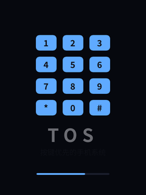 | 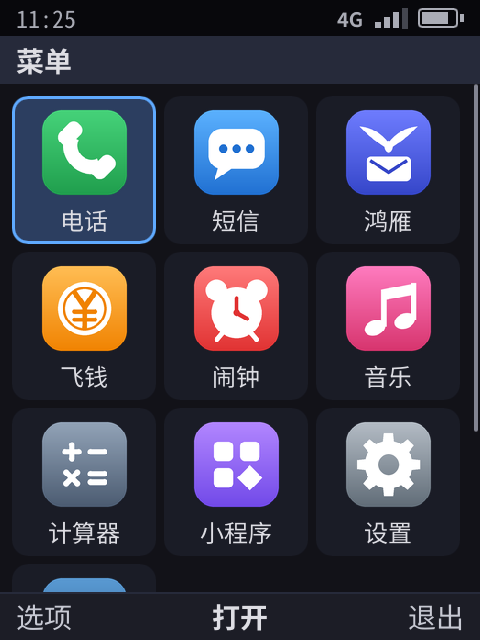 | 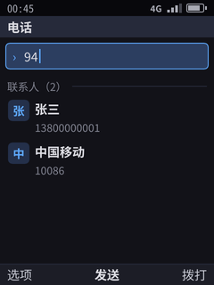 | 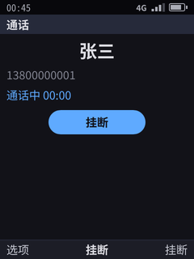 |

| System incoming call | Messages | Alarm ringing | Calculator |
|:--:|:--:|:--:|:--:|
| 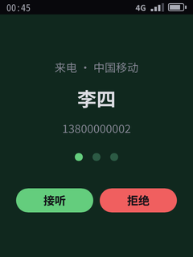 | 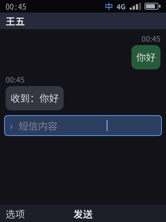 | 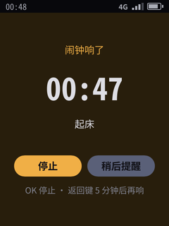 | 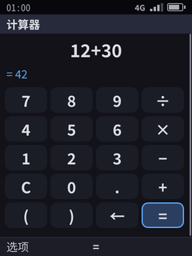 |

| System viewfinder | Photos app | System picker | Photo sent in Hongyan |
|:--:|:--:|:--:|:--:|
| 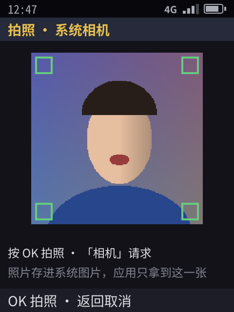 | 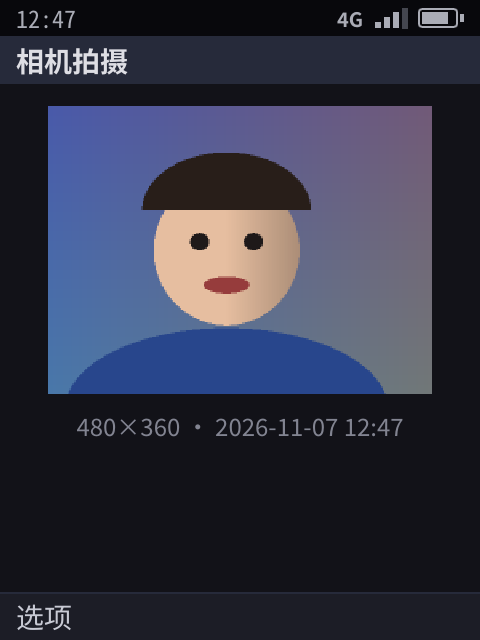 | 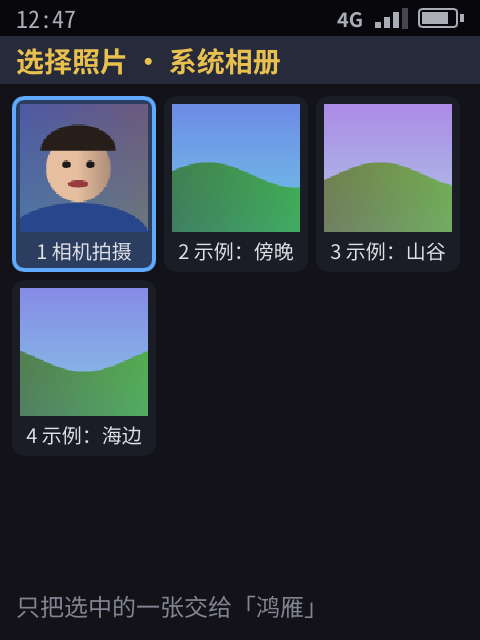 |  |

| Weather | About phone | Share panel | Calendar (the month, the test holiday calendar) |
|:--:|:--:|:--:|:--:|
| 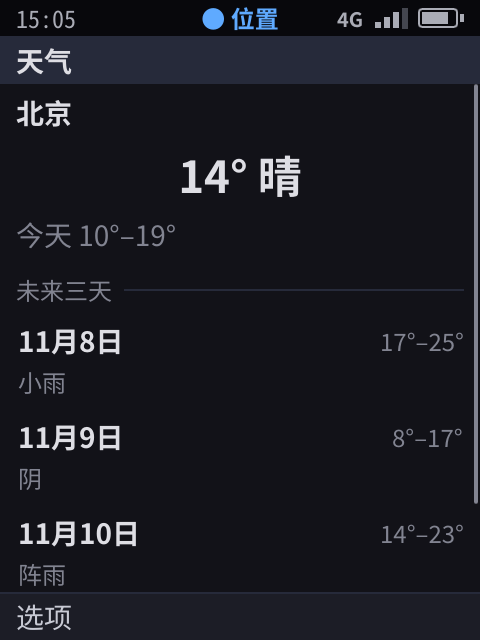 | 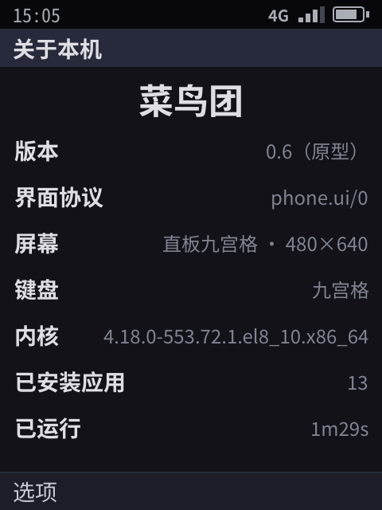 | 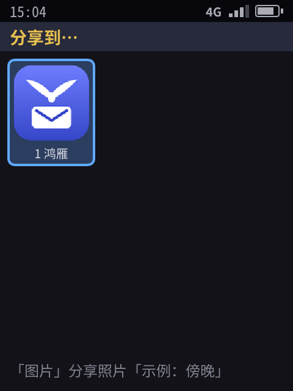 | 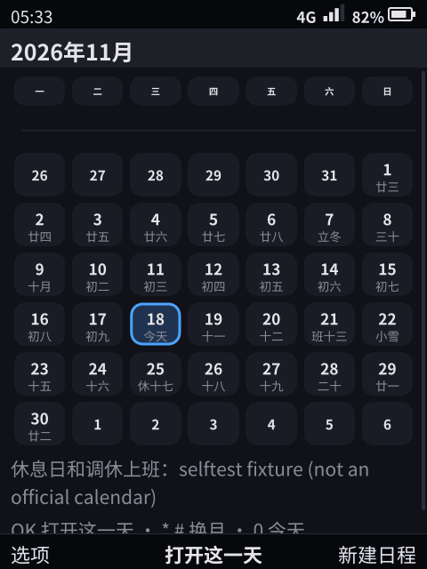 |

On the device (AArch64 QEMU; the pixel renderer draws to the virtio-gpu screen through DRM/KMS, and the QEMU monitor injects USB keyboard key presses and captures the framebuffer): idle screen → OK opens the main menu → OK opens Phone → Tab opens the options menu → back to idle, OK, press 7 to open Calculator, `12 * 30` then Enter gives 42 → back to idle, OK, press 2 to open Messages → back on the idle screen, type 10086 directly and dial it:

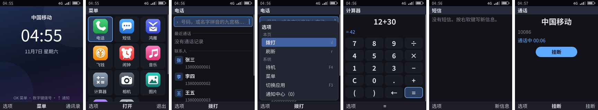

## 3. Capabilities Hongyan and Feiqian depend on: status and stability requirements

| Capability | Status | What is still missing to "provide it stably" |
|------|------|----------------------|
| App identity and sandbox | ✓ sandbox self-check 13/13 on the device, and the CTS runs the same checks; one cgroup per app; per-app network toggle, Wi-Fi only, data usage accounting | — |
| Notifications | ✓ (quick reply included) | Grouping, do not disturb |
| **Push** | ✓ ([21](21-push.md)): delivered even when the app is frozen or its process is not running; VoIP push wakes the app for incoming calls; data end-to-end encrypted, keys in keystored; tokens invalidated on uninstall; TLS (or TLCP), devices register with device attestation | Deploying the production push gateway, device certificates provisioned at the factory |
| Voice and video calls | Partial: video path, system incoming-call screen, push wake-up, ringtone, recording, app-provided audio streams ✓ | Network transport, echo cancellation |
| Code scanning | ✓ (system scanner; the app only gets the result; mediad decodes the camera's picture, tested with the developer machine's synthetic camera and the emulator's vivid) | Real camera (R14); recognition on a real phone **not yet tried on a real device** |
| Trusted payment confirmation | ✓ (system UI, what you see is what you sign, signature verified on the server; a fingerprint can confirm too, simulated sensor, [31](31-lock-and-biometrics.md)) | Real TEE (R15), real fingerprint sensors |
| Mini-programs | ✓ (JS / TS, origin labeling, runtime grants tracked per "host + mini-program", keys isolated per mini-program, signed distribution) | — |
| Contacts | ✓ reading (e-mail and postal addresses, photos as `contact:<key>`); writing confirmed by the system (`contacts.save` and others); the system syncs them both ways with several CardDAV accounts' books (§1.1), apps need do nothing (`contacts.books` lists the books); groups (`contacts.groups`, `contacts.group`, synced too), contacts' photos (`contacts.photo`), the system's contact picker (`contacts.pick`) | An app moving a contact to another book |
| Sending / receiving photos | ✓ Sending: the system picker hands over only the selected photo (a read-only file); received photos are decoded and displayed by the system; PNG and JPEG; received photos can be saved with 「保存到相册」 (Save to photo library) (`media.save`, confirmed by the system) | Compression |
| Location | `location.get`, `location.watch`, the permission (the dialog offers precise or approximate), background location ("allow all the time" in a second dialog of its own or in Settings; the status bar names the app using the location in the background, and a notification while it watches there can stop it; reminders), the master switch, the network location's switch, recent access (background use included), approximate location ✓; a simulated receiver and a fake network location service on the developer machine and QEMU, a phone's GNSS and A-GNSS **not yet tried on a real device** | Satellite positioning on a phone, a real network location service, location sharing |
| Clipboard | ✓ write-only; paste is done by the system | — |
| Sharing | ✓ system share panel (text, photos, links, files) | — |
| Background keep-alive | ✓ not needed: Hongyan does not stay resident; messages and incoming calls are delivered by the server through push ([21](21-push.md) §4), and it is exempt from freezing only during a call; scheduled sync uses background tasks | — |

## 4. Next steps

1. The location receiver on a phone (together with the hardware of R2 / R16): reading ModemManager and `/dev/gnssN` exists and has to be brought up on the Snapdragon boards.

## 5. Phone: the call screen in front and in the background

The call screen is a page of the Phone app, its top page for as long as the call lasts. As on Nokia's S40 / S60 and today's phones, a call can go on in the background, shows on every screen and can be brought back from anywhere; when no further call can be placed, the phone says why and how to get back, instead of stopping at 「无法拨打」 (cannot call). The code is in `apps/dialer/call.go` (the call screen) and `shell/cellcall.go` (the background, the status bar, the way back).

### 5.1 Dialling

- Type the number straight on the standby screen (the digit keys on a full keyboard, or the digits under Fn with an Fn layer) and press OK or the call key. The Phone app shows the call screen 「正在呼叫 152…」 (Calling 152…) as soon as it has the dial, without waiting for the modem to answer `dial`; hung up before the modem answers, the screen ends at once and the call is hung up as soon as the answer comes.
- With the Phone app not running yet, typing `152` and OK (or the call key) in one go: the keys pressed before its first page are kept and handed to it in their order once that page is there; a key pressed just after the page came, while the kept keys have not been handed over, goes after them (OK used to overtake the 5 and the 2 and dial 「1」, showing only 「无法拨打」 while the number field then read 152, which looked like the phone had frozen).
- Then: 「对方振铃…」 (ringing) → 「通话中 00:12」 (in call); busy, a failed call and the other party hanging up each say so; once the call is over the Phone app's main page is back and the recent calls have the call.

### 5.2 To the background and back to the call

| What | 9-key pad | Full keyboard (in the terminal) | Result |
|------|-----------|---------------------------------|--------|
| To the background | Back, the right soft key 「最小化」 (Minimize), 「最小化」 in the options | Esc, Backspace, F2 | The call goes on, and what was in front before the call screen comes back: the app the call came from (Contacts, Music…), else the standby screen or the system screen |
| Seeing the call | — | — | Whenever the call screen is not in front, the middle of the status bar on every screen reads 「● 通话 01:23」 (call 01:23) (「● 正在呼叫…」 while connecting, 「● 保持 01:23」 (on hold) when only a held call is left), drawn by the text and the pixel renderer; the standby screen's hint becomes 「通话键 回到通话 · OK 菜单」 (call key: back to the call · OK menu) |
| Back to the call | The call key | The call key (F5) | On the standby screen, and in another app with no number to dial under the focus, the call key brings the call screen back; with a number or 「拨打」 (Call) under the focus it dials that, as always (a second call, §5.4) |
| Back to the call | 「返回通话」 (Back to the call) in the options menu and the command palette | The same, shortcut `R` | Brings the call screen back |
| Back to the call | The first row of the notification centre, 「电话 · 通话 01:23」 (Phone · call 01:23) | The same | OK brings the call screen back, `e` hangs up |
| Back to the call | The call key on the lock screen | The same | With the secure lock on, the call screen comes back without unlocking, and only the call screen can be used ([31](31-lock-and-biometrics.md) §2.2) |
| Hanging up | The end key (red key) | F4 | On the call screen it hangs up the call shown; with the call in the background it hangs up the call in progress wherever the phone is (Nokia's red key). When a call ends away from its screen (hung up from the background, or by the other party) the system says 「和 152 的通话结束 · 00:12」 (call with 152 ended · 00:12) and the status bar's indicator goes |

### 5.3 Keys on the call screen

| Key | 9-key pad | Full keyboard |
|-----|-----------|---------------|
| Digits, `*`, `#` | Send DTMF (voice menus); the screen shows 「已发送的按键」 (keys sent) | The same; with an Fn layer, the letters that are digits under Fn (`w e r`, `s d f`, `z x c`, `q` for `#`, `a` for `*`) send their digit without Fn, so the call screen's shortcuts leave those letters alone |
| OK | Hang up (the focus is on the 「挂断」 (Hang up) button) | The same |
| Left soft key | Options: hang up, mute / unmute, hold / resume, speaker / speaker off, swap calls (with two calls), new call (when one can be placed), minimize | The same; shortcuts `m` mute, `h` hold, `l` speaker, `o` swap calls, `n` new call |
| Right soft key | Minimize: to the background | F2 |
| Back | To the background | Esc, Backspace |
| End key | Hangs up the call shown | F4 |

### 5.4 A second call and call waiting

- Digits typed on the standby screen during a call: the Phone app opens its 「新通话」 (New call) page over the call screen, saying 「正在和 152 通话，拨出时保持 · 返回键回到通话」 (in a call with 152, held when you call · Back returns to it); the number field searches contacts and recent calls as you type, as always; Back returns to the call screen. 「新通话」 (`n`) in the call screen's options opens it too; on a 9-key pad the digits on the call screen are DTMF, so a second call starts there from the options, or from digits after putting the call in the background.
- On dialling, telephonyd holds the connected call first, then dials (as ATD during a call does in GSM, [04](04-ui-language-telephonyd.md)). The call screen shows the new call, with a line 「另一路：152，已保持 00:21」 (also: 152, on hold 00:21) below; 「切换通话」 (Swap calls, `o`) resumes the held call and holds the other; when one ends the other stays, and a held one needs 「恢复通话」 (Resume call).
- When no other call can be placed, the 「新通话」 page does not open and the system says why and the way back: still connecting (calling, ringing) 「通话还在接通：按通话键回到通话」 (the call is still connecting: press Call to go back to the call), two calls already 「已有两个通话：按通话键回到通话」, during an emergency call 「正在紧急呼叫：按通话键回到通话」. Another app's `tel.dial` (Contacts, Messages) then gets the same words from the broker ([22](22-developer-api.md) §4.2).
- A call coming in during a call (call waiting): the system's incoming-call screen as always, with a line 「接听后和 152 的通话保持」 (answering puts the call with 152 on hold). Answered (OK, the call key), the first call is held and both are on the call screen; declined (Back, the end key), the first call is in front again; when the caller gives up first, it is a missed call and goes into the notification centre.

### 5.5 Other points

| Item | Notes |
|------|-------|
| Speaker, mute | The speaker is switched on the call screen (`audio.route`); when the last call ends the system puts the sound back on the earpiece, so the next call does not start on the speaker. Mute is kept per call in telephonyd |
| The Phone app during a call | While there is a cellular call the Shell does not freeze it, and the low-memory killer and a language change's restart pass it by (it used to be suspended after 10 seconds in the background, the call's events piling up in its queue) |
| Lock screen | When the screen goes off and the phone locks during a call, the call screen stays in front and is what lighting the screen shows; locked, Back, the right soft key and the menus cannot leave it, and hanging up returns to the lock screen ([31](31-lock-and-biometrics.md) §2.2) |
| Tests | Unit tests: `shell`'s `TestCallScreenToBackgroundAndBack`, `TestHideReturnsToTheAppBefore`, `TestEndKeyHangsUpAway`, `TestDigitsDuringACall`, `TestDialRefusedBesideACall`, `TestDialerRunsDuringACall`, `TestCallEndedInTheBackground`, `TestCallIndicator`, `TestWaitingCallNote`, `TestLockDuringACall`, `TestKeysAfterTheFirstPageKeepTheirPlace`; `apps/dialer`'s `TestDialShowsTheCallAtOnce`, `TestEventsBeforeTheDialAnswer`, `TestSecondCall`, `TestNoSecondCall`, `TestCallScreenKeys`; `telephonyd_test`'s second call, call waiting, swap, the other party hanging up and the slow network. Seven selftest cases on the developer machine ([13](13-prototype.md) §5), passing with the text and the pixel renderer. All on the simulated modem; the ModemManager backend's second call (`HoldAndAccept`, then `CreateCall`) is tested against the mock ModemManager (`make mm-selftest` 33/33), **not run on a real phone** |

### 5.6 Touch and the power key in a call (phones without a proximity sensor)

An Android phone turns the screen off at the ear by its proximity sensor, so a cheek cannot press the screen. The OnePlus 6T's proximity sensor sits behind the SLPI, out of Kario's reach ([24](24-sku-framework.md) §7.4); in a call (dialling, connected, on hold) touches used to be ignored altogether, and a 6T without a keyboard could only wait for the other party to hang up (test report 008 §1.2). Now it works as on Android; the code is in `shell/calltouch.go`:

| Item | Notes |
|------|-------|
| Power key ends call | Settings › Accessibility › 「按电源键挂断电话」 (Power key ends call; `power_ends_call`, Android's "Power button ends call"): in a call with the screen on, a press of the power key hangs up (as the end key does: on the call screen the call shown, with the call in the background the call in progress), and the screen stays on; with the screen dark the first press only lights it, as before. With a call ringing, the power menu open or an alarm ringing, the power key stays theirs (silence, close the menu, snooze), and holding it still opens the power menu. Only a board with a power key of its own has the switch; unset, it is on for a whole phone without a keypad of its own (`keypad = "hid"`, the 6T) whose board has no proximity sensor, and off on the others (a phone with a keypad has its end key at hand) |
| Touches at the ear do not count | While the sound comes from the earpiece (no speaker), a touch on the call screen presses nothing and does not keep the screen on longer (with the cheek resting on it, the screen still goes dark on time); a call ringing in can still be answered or declined by a tap. With the speaker on, touches work as always |
| Wake touch first | A press of a volume key (the volume stays; also the press lighting a dark screen), or a finger held still on the screen for a second (the long press's time where that is longer) and lifted within four seconds: touch comes on, the toast says 「触摸已打开 10 秒」 (touch on for 10 s), and it goes off again 10 seconds after the last touch. Holding neither buzzes nor presses anything; a finger that moved before lifting, or stayed four seconds or more (a cheek), does not count |
| How to hang up, on the call screen | Below the 「挂断」 (Hang up) button the call screen says how to hang up on this phone and whether touch works: with power key ends call on, 「按电源键挂断」 (press the power key to hang up); at the ear 「贴着耳朵时触摸不起作用：按一下音量键，或按住屏幕一秒再松开，就能用触摸」 (touch is off at the ear: press a volume key, or hold the screen for a second, to use it), once woken 「触摸已打开，最后一次触摸 10 秒后关闭」 (touch is on until 10 s after the last touch). The Shell hands them to the Phone app in the `call.hint` event ([22](22-developer-api.md) §5); a phone without a touchscreen and without a power key gets none of these lines, and the end key works as always |
| Boards with a proximity sensor | Where the board's parts name a proximity sensor (a `[[part]]` of kind `proximity`), `sku.json` has `proximity` and power key ends call is off by default. The Shell keeps a hook for the reading (`setProximity`): "near" ignores touches and neither a volume key nor a held finger wakes them; "far" lets touches through. Reading the sensor and blanking the screen at the ear are **not implemented**; without a reading such a phone behaves like one without a sensor |
| Headsets | The system does not know yet whether a headset is plugged in (routing to wired, Bluetooth and USB headsets is **not implemented**, [20](20-audio.md) §7). The rule is that sound not on the earpiece is away from the ear: once sound is routed to a headset, touches work, with nothing to change here |
| Tests | Unit tests: `shell`'s `TestVolumeKeyWakesTouchInACall`, `TestPowerKeyEndsACallOnThe6T` (these two fail on the code before the change), `TestHoldWakesTouchInACall`, `TestWokenTouchGoesOffAgain`, `TestTouchInACallOffTheEar`, `TestCallHint`, `TestPowerEndsCallSetting`; `apps/dialer`'s `TestCallScreenShowsHowToHangUp`; `apps/settings`'s `TestA11yPage`, `TestA11yActions`; `tools/sku_test.py`'s `test_proximity`. Two selftest cases on the developer machine ([13](13-prototype.md) §5): the power key hanging up runs with the text renderer; the touch case runs only with the pixel renderer (`make pixel-selftest`), **not verified**. **Not tried on a phone**: whether the 6T's touchscreen reports a cheek, and whether a one-second hold is right, need a try on the phone ([39](39-oneplus-6t.md) §14.23) |
