> English translation of [the Chinese original](../19-core-apps.md). The Chinese text is authoritative; keep both in sync.

# Core apps and platform capability check

> Checks, one by one, which platform capabilities the 15 apps every phone needs depend on, and whether we have them now. Status legend: **✓** implemented in the prototype and covered by a selftest; **partial** present but incomplete; **✗** missing. For remaining work see 57 (internal document).

## 0. Summary

- **Of the 15 apps, Phone (simulated baseband), Messages, Alarm, Calculator, Music, Camera, Photos, Weather, Settings, App store, plus the main capabilities of Hongyan and Feiqian, are in place.** The only platform capability gaps left are these:

  | Gap | Apps blocked | For Hongyan / Feiqian | Priority |
  |------|------------|---------------|:---:|
  | Real location backend (the API and permission exist, location is simulated) | Map apps, Hongyan location sharing | Location sharing, nearby, risk control | P1 |
  | Video: only WebM plays (VP8 / VP9, software decoding); H.264 / HEVC needs hardware decoding on real devices; downloaded WebM files are added to 「图片」 (Photos) after confirmation ✓; camera recording needs the hardware encoder of a real device, **not implemented** | Photos, Camera | Video messages | P2 |

- **Hongyan and Feiqian do not get the main effort.** They are "users" of capabilities: our job is to make every capability they use stable and reliable (§3); the real apps will come when Tencent and Alibaba adapt to our platform.
- **An "Alipay Java edition" will not work.** Alipay's J2ME client stopped being maintained long ago and its servers no longer support it, so even adding a Java ME runtime to the system would not let it connect. There are only two realistic paths: the platform makes its capabilities stable and waits for Alibaba to adapt; or a `phone.Ui` version is developed in partnership.

## 1. App-by-app check

| App | Platform capabilities needed | Status | Gaps |
|------|----------------|------|------|
| **Phone** | Dial / answer / hang up / hold / mute, system incoming-call screen, call log, contacts, call audio routing, proximity sensor, emergency calls, DTMF | Dialing state machine, system incoming-call screen, call log, contacts, smart dialing, ringtone / ringback tone / busy tone, speakerphone toggle, USSD (`*100#` queries, carrier menus, questions the network sends by itself), `*#06#` showing the IMEI ✓ (simulated baseband); ModemManager backend ✓ (tested against a simulated ModemManager, [04](04-ui-language-telephonyd.md)) | Audio routing on real devices, proximity sensor, DTMF, real baseband |
| **Messages** | Send and receive, notifications, contacts, concatenated long SMS, MMS, verification code extraction | Send and receive, notifications, conversations and unread counts, delivery reports, part counter, search, deleting messages and conversations, blocking numbers (the "Blocked" folder), copying verification codes (also from the notification), the emergency alert record ✓ (simulated baseband, stored by phone-smsd, [32](32-messaging.md)); only it deletes and blocks (the default SMS app) | MMS; the ModemManager side's tests not run, **not verified on hardware** |
| **Photos** | Media library (photos indexed by the system), system decoding of JPEG / PNG, thumbnails, sharing, deletion | System media library, PNG / JPEG decoding and thumbnails, the 「相册」 (Photo library) permission, photo grid (images fill the cells, no text shown), full-size view (← → to page through), set as idle / lock screen wallpaper, deletion (confirmed by the system), sharing, video playback (system decoding, OK pauses, ← → skips 5 seconds), downloaded videos added after confirmation ✓ | Camera recording, H.264 |
| **Camera** | Preview, take photos, save to the media library, shutter key, flash | System viewfinder, photos saved to the media library ✓ (V4L2 camera, a synthetic image when there is none), code scanning ✓ | Shutter key, flash, real sensor (R14) |
| **Browser** | Web view, network, downloads, reader mode | Browser app (address bar: URL or search terms, Bing / Baidu; bookmarks, recently visited, back and forward, reload, find in page, zoom, share link), downloads into the 「文件」 (Files) area, picking files to upload from web pages, `prompt`, ad and tracker blocking (can be turned off in app settings), clearing website data ✓; network permission (sandbox), reader mode, web view ✓ | Full-screen video (needs hardware decoding), accessibility, per-site cookie management |
| **Settings** | Permissions, network, display, sound, date and time, input method, storage, about, system update (OTA) | App permissions (including the separate grants of mini-programs), airplane mode and mobile data switches (✓ on the simulated modem, not verified on hardware), Wi-Fi (connecting to encrypted networks and enterprise networks, forgetting networks), Bluetooth (searching, pairing (checking the pairing code when the other device has a screen), unpairing, sending a paired device a file, allowing a car kit the contacts or taking them back), data usage, battery (each app's background and foreground CPU over the last day), app settings, sound (← → adjusts the volume), themes (dark, light, retro green, amber), wallpaper (restore default), keypad lock, security (the lock-screen PIN, how soon it locks after the screen goes off, notification contents on the lock screen; fingerprints: enrol, rename, delete, use for unlocking and payments; the PIN is entered in system UI), SIM lock (turn the PIN lock on or off, change the PIN; the PIN is entered in system UI), silent mode, fuzzy pinyin, developer mode, device unlock, system update, about phone, sandbox self-check, language (简体中文, 繁體中文, English, Español or automatic), region, date and time (time zone, network time, 24-hour clock), NFC (only the switch and a line that opens Cards, where the cards are) ✓ | Choosing an APN, input method, storage; setting the time by hand works only on the device (not tried on hardware) |
| **Mail** | Network, background sync, credential storage, HTML mail, attachments | Network ✓, document nodes ✓, background tasks ✓, file picker and saving files (attachments) ✓ | Credential storage (keychain) |
| **Alarm** | Triggered by the system on time (rings even when the app is frozen), ringtone, vibration, wake from sleep | System alarm service, full-screen ringing, alarm sound, snooze ✓ | Vibration, RTC wake-up, user-chosen ringtone |
| **Calculator** | Pure UI | ✓ (grid keys, Nokia-style `*` cycles through operators) | — |
| **Calendar** | Timed reminders, date input, CalDAV sync | System alarm usable for reminders ✓, background tasks ✓ | Timed notification API, date input |
| **App store** | Install / update / uninstall, signature verification, permission display, downloads, automatic updates | Signed packages, installation after system confirmation, updates from the same developer, cleanup on uninstall ✓ ([22](22-developer-api.md) §12); store catalog, downloads, delta updates, app details and reports, staged rollout, automatic updates in the background while charging, fetching the takedown list in the background ✓ ([07](07-ecosystem-and-store.md) §4.1) | Paid apps, adjusting the rollout percentage in the developer portal |
| **Snake** (canvas app sample, not counted among the 15) | Canvas: game picture, keys; sound effects | In the manner of the Nokia 6110 / 3310: a monochrome LCD with a yellow-green backlight, 17×10 cells, every segment and the food a small block with gaps between the cells, the head with an open mouth, and the score, the level and "GAME OVER" pixel lettering the app puts together from rectangles; the level 1–9 (the speed; a food is worth the level in points) is chosen before a game, with walls at the edges (the default) or wrap-around; after every 5 foods a bonus bug appears for 20 moves (5 to 15 times the level, more the sooner it is eaten); no reversing, and up to two turns can be pressed ahead; pause and resume, pausing by itself off the screen; the top score, the level and the edge mode are kept in the app's data. The system draws it in both the text and the pixel UI; while it has the focus, the arrow keys, digits, `#`, `*` and OK go to the app ✓ (unit tests ✓, selftest ✓); eating beeps, through the app's own audio stream, no permission needed (the stream was seen playing on the development machine; not heard on a real device) | The effect plays in the `media` category, which has one stream at a time, so it ends music playing in the background ([20](20-audio.md) §2); opening the Options menu does not pause the game (the app gets no message when the menu opens) |
| **Weather** | Network, location, background refresh, home screen widget | Location (simulated), hourly background refresh, two app settings (temperature unit and forecast days, 3–7 days), idle screen widget (OK goes straight to today's weather) ✓; the forecast is simulated data | Real weather service |
| **Music** | Audio playback, background playback, media keys and volume, media library; lossless and DSD | Play, pause / resume, switching tracks, progress, background playback without freezing, automatic pause on incoming calls, volume keys, now playing ✓; FLAC, WAV, AIFF, ALAC, APE, WavPack, MP3, Ogg, DSF, DFF, cue sheets and SACD images in the music directory (`media/music`, folders kept, copied in from a computer over USB, [27](27-usb-typec.md) §3.1; [20](20-audio.md) §9); browsing by album, artist and folder, each track with its format ("FLAC 24/96", "DSD64", "SACD"); a list is the play queue, running into the next track without a gap; 10 s back / forward; ReplayGain; while only music sounds, each track goes to the card at its own format (bit-perfect, DoP, native DSD), and the now-playing screen says how ✓ (unit tests ✓, development-machine selftest ✓, **not tried on a real device**) | AAC; showing covers; the card's hardware volume while bit-perfect; verification with a real USB / DSD DAC and real SACD images ([20](20-audio.md) §7) |
| **Hongyan** (demo) | Instant messaging UI, voice and video calls, notifications, push, mini-programs, code scanning, payment, contacts, sending photos, location, sharing | UI, video calls, system incoming-call screen, notifications, push (messages and VoIP incoming calls, data end-to-end encrypted), mini-programs, code scanning, contacts, voice messages, sending photos, copying, receiving shares ✓ | Location sharing |
| **Feiqian** (demo) | Trusted confirmation, keys and device attestation, code scanning, secure screen, NFC, payment-received notifications, biometrics | Trusted confirmation, keys, attestation, code scanning, secure screen, payment-received push, NFC transit card and payment card (simulated controller; the express transit card and the default payment app are set in Cards, [30](30-nfc.md)), fingerprint payments (once the user turns on fingerprints for payments; after a new finger is enrolled it falls back to the payment PIN and is set up again once confirmed, [31](31-lock-and-biometrics.md) §5) ✓ | NFC on real hardware ([30](30-nfc.md) §10), real fingerprint sensors, real TEE (R15) |
| **Cards** (卡包, a system app, not counted among the 15) | NFC card emulation, reader mode, the quick card view, tapping with the screen off and while suspended | Lists every card (the door cards the system keeps, the transit and payment cards apps provide, with their app), adds a door card by reading the physical card and naming it, renames, deletes and orders cards, sets the express transit card and the default payment app, sets per card whether it works with the screen off and locked (door cards and the express transit card by default, payment cards never without unlocking), presents a card; door cards are chosen by the time of use (the time of day, workday or day off, by the region's holiday calendar, 60 days of taps) and Cards shows each one's usual hours; door cards and the express transit card work locked, with the screen off and suspended without a key, the screen staying off; a double press of the power key (without one, of the end key on standby) opens the system's quick card view; through `nfc.state` / `nfc.set`, for system apps only (simulated controller, unit tests ✓, selftest ✓, [30](30-nfc.md)) ✓ | NFC on real hardware ([30](30-nfc.md) §10), encrypted door cards, real holiday calendar data |

## 2. System capabilities already implemented

| Item | Description |
|------|------|
| **telephonyd** (C++23, R2) | Single-threaded event loop; modem abstraction interface + simulated baseband (network registration, signal, dialing → ringing → active call, busy, missed, automatic SMS replies); the call log is persisted; received SMS and cell broadcasts wait in a queue until phone-smsd has stored and acknowledged them ([32](32-messaging.md)); the protocol is the same as the other system services (JSON lines). See [04](04-ui-language-telephonyd.md) |
| Telephony capabilities | `tel.dial / answer / hangup / hold / mute / calls / log`, `sms.send / list / read / threads / alerts / delete / block / blocked` (deleting and blocking for the default SMS app only). **Apps without the `phone` permission can also request a call, but the user has to confirm it in a system dialog** (like `tel:` links on iOS); the call screen always belongs to the Phone app. While the keypad is locked, emergency numbers can be dialed directly ([18](18-nokia-form-factors.md) §5.1) |
| System incoming-call screen | Whatever is in the foreground, a SIM incoming call is taken over full-screen by the system; after answering it is handed to the Phone app; missed calls are recorded in the notification centre |
| **phone-smsd** | The SMS system service: storage (an append-only log over a snapshot, no database), conversations, read and unread, deleting, search, the blocked folder, delivery states, verification codes; telephonyd keeps a received message until smsd has stored and acknowledged it; emergency alerts (cell broadcast) come up full screen over the lock screen too, with their own sound; the national level cannot be switched off, the others can in Settings ([32](32-messaging.md)) |
| Contacts | Stored by the system, runtime permission 「通讯录」 (Contacts); the Phone and Messages apps in the system image are pre-granted in their manifests |
| Alarm service | Stored and triggered on time by the system, ringing full-screen even when the app is frozen or not running; supports snooze and daily repeat |
| Live input field changes | A `live` input field notifies the app on every edit, for search-as-you-type (smart dialing) |
| Idle screen and main menu | Boot lands on the idle screen, and OK opens the main menu; the main menu has 3–5 columns depending on the screen, and number keys 1–9 jump straight to the matching cell; app icons are images, see [18](18-nokia-form-factors.md) §5.1. Folders as on Nokia phones: the main menu holds the everyday apps, apps such as Calculator, Alarm and Weather go into 「工具」 (Tools), mini-programs and demos go into 「应用」 (Apps), and apps installed from the app store go into 「应用」 by default (the manifest's `folder`) |
| Left and right arrow keys | Actions bound to ← → take priority (adjust volume, previous / next track, previous / next photo, skip 5 seconds in a video); when nothing is bound, ← goes back one level and → opens the focused item; in grids and input fields they move as before |
| **Themes and wallpaper** | 设置 › 主题 (Settings › Theme) switches the whole color scheme (both the text UI and phone-paint follow); while viewing a photo in Photos, 「设为壁纸」 (Set as wallpaper): idle screen, lock screen or both; the system keeps its own copy, and the lock screen one is shown while the keypad is locked; text on top of a wallpaper is white, over a gradient dark overlay so that it stays legible ([23](23-renderer-protocol.md) §4) |
| **UI placement** | Apps use the page's `layout` to say where content goes: Music's now playing and photo viewing are centered slightly below the middle, Calculator sits at the bottom with the result enlarged as far as the screen width allows (`display` style), and the system places them according to the screen |
| Boot animation | Original artwork (not Nokia's handshake): the 12 keys light up one after another, then the system name and a progress bar appear |
| **Photos** | Photos belong to the system, not to the app that took them, and are stored in the system state directory. All an app can see is: photos it took itself, and photos the user handed it in the system picker; with the runtime permission 「相册」 (Photo library) it can see all of them. Taking a photo (`camera.capture`) goes through the system viewfinder and stores a JPEG; picking a photo (`media.pick`) goes through the system picker, which hands over one read-only file; deletion is confirmed by the system; image nodes write `media:<id>` and the system decodes them. When the media library is opened for the first time, the samples in the system image are put into it: 8 public-domain / CC0 photos and one video (Wikimedia Commons, sources listed in `share/phone/examples/*/SOURCES.md`); the drawn placeholder images left by older versions are replaced with these |
| **Video playback** | `video.open`: the Shell opens the video file and an audiod audio ring and hands them to mediad; mediad starts ffmpeg to decode (WebM: VP8 / VP9, Opus / Vorbis), the picture goes to the renderer through shared memory and the sound is written into the ring; the video clock follows the audio audiod has already played, so pausing, stalls and incoming calls that take the audio focus stop the picture too. The app only gets the stream name, which it writes into a `media` node; when the stream is not on the app's foreground UI the system pauses it, and when the UI is closed it closes the player ([22](22-developer-api.md) §4.6). The ffmpeg in the image is built only with royalty-free formats; H.264 / HEVC is left to hardware decoding on real devices (**not implemented**) |
| **Settings** | App permissions (including the time and count of the most recent use of each grant, and grants revoked after long disuse; network can be set to 「只用 Wi-Fi」 (Wi-Fi only)), Wi-Fi and Bluetooth (`wifi.*`, `bt.*`, [22](22-developer-api.md) §4.5), data usage (bytes sent and received per app and per Wi-Fi / mobile network, [17](17-app-sandbox.md) §1), app settings (toggles, options, numbers, text), sound (three volume categories handed to audiod), theme, wallpaper, automatic keypad lock, security (the lock-screen PIN and fingerprints, [31](31-lock-and-biometrics.md) §6), SIM lock ([04](04-ui-language-telephonyd.md)), developer mode, system update ([25](25-system-update.md)), about phone (including the product name and app crash logs), sandbox self-check, language, region, date and time (next row), all through `settings.get` / `settings.set`, which only system apps can use |
| **Language, region and time** | Four UI languages; on a change the Shell switches at once, apps restart with their tombstones and come back on their pages, and the renderer restarts too ([22](22-developer-api.md) §9.1). The region is automatically the SIM's country (telephonyd reports the SIM's MCC; without a SIM, the last one's), else the SKU's region; the automatic language follows the region. The time zone is automatically the network's: telephonyd reports NITZ (both the simulated baseband and ModemManager's `Modem.Time`), matched by offset against the zones of the network's country, and when the network says nothing the region's main zone; it can also be chosen from the IANA zones, by region. The device clock and the RTC always run in UTC; the Shell and every app get `TZ`; the Shell's own clock, dates and weekdays follow the language and the zone, with a 12- or 24-hour clock. Network time: NTP where the image has systemd-timesyncd (through systemd-timedated), NITZ while NTP has not synchronised; or automatic time off and the time set by hand (the Shell, as root, sets the system clock and the RTC). NTP, setting the clock from NITZ and by hand: unit tests ✓, not tried on hardware; whether the image has systemd-timesyncd and tzdata is not checked yet (the Shell embeds Go's time zone database as a fallback; other processes read the image's `/usr/share/zoneinfo`) |
| **Safety nets for the app lifecycle** | Under low memory, background apps are ended first; a foreground app stuck for 5 seconds triggers 「没有响应」 (Not responding); crashes are logged, and apps that crash repeatedly are not launched in the background ([17](17-app-sandbox.md) §5.1, §5.2) |
| **Sound** | Volume keys (silence the ringtone during an incoming call, adjust the media volume while music plays), incoming calls only vibrate in silent mode, 「正在播放」 (Now playing) on the idle screen and pause / resume in the system menu; Hongyan's video calls have two-way audio; voice messages are encoded with Opus and stored as Ogg Opus ([20](20-audio.md) §4) |
| **Camera** | mediad prefers a V4L2 camera (on the emulator, the kernel's vivid virtual camera) and uses a synthetic image when there is none ([11](11-platform-architecture.md) §8) |
| **Input method** | User dictionary and frequency adaptation, user-created phrases, English next-word prediction, fuzzy pinyin ([16](16-input-method.md) §5.1); stroke input on the T9 keypad (§5.3) |
| **Web reader mode** | The host app fetches the page in its own sandbox, extracts the main text and hands it to the system's document node for display, with links in the menu; messages in Hongyan that contain a URL can be opened in 「阅读模式」 (Reader mode) ([14](14-tui-route-and-app-framework.md) §5) |
| **Web view** | `web` node: the page is rendered by the system's `phone-webview` (WPE WebKit) in a separate process under the host's web uid, and the picture is handed to the pixel renderer through shared memory; arrow keys move between links, and the back key first goes back in history; the page's `phone.call` goes through the broker, and the system UI labels the web origin; messages in Hongyan that contain a URL can be opened in 「网页」 (Web page) ([14](14-tui-route-and-app-framework.md) §5) |
| **Product configuration layer** | `profile.d` stacked layer by layer: product name, system apps left out, menu order, defaults of system settings, which system service implements each capability ([14](14-tui-route-and-app-framework.md) §2.1) |
| **Idle screen widgets** | An app puts one line of text on the idle screen; ↓ selects it, and OK goes straight to the matching page in the app ([18](18-nokia-form-factors.md) §5.1) |
| **C/C++ apps** | C ABI SDK (`sdk/c`) and a C++ sample app ([22](22-developer-api.md) §9) |
| **Weather** | Foreground location (runtime permission 「位置」 (Location), the status bar shows 「● 位置」 (● Location)), and the app converts the coordinates to a city itself; in the background the system wakes it within the budget every 60 minutes to refresh, without it staying resident; the forecast is simulated data |
| **Clipboard** | Apps can write but not read; paste is the first item of the system menu, 「粘贴「…」」 (Paste "…") ([17](17-app-sandbox.md) §1) |
| **Share panel** | `share.open` ([22](22-developer-api.md) §4.9): manifests declare with `share` what they can receive, and the system lists the targets; sharing a photo also grants it to the target; the initiating app cannot see which apps the user has installed |

| Boot | Main menu grid | Smart dialing | In a call |
|:--:|:--:|:--:|:--:|
| 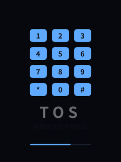 | 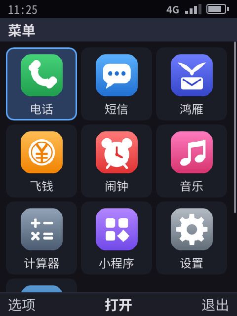 | 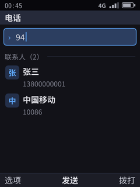 | 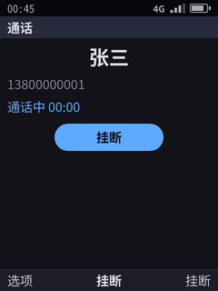 |

| System incoming call | Messages | Alarm ringing | Calculator |
|:--:|:--:|:--:|:--:|
| 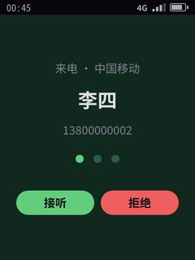 | 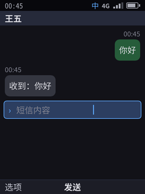 | 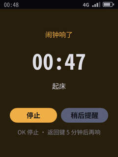 | 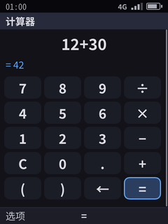 |

| System viewfinder | Photos app | System picker | Photo sent in Hongyan |
|:--:|:--:|:--:|:--:|
| 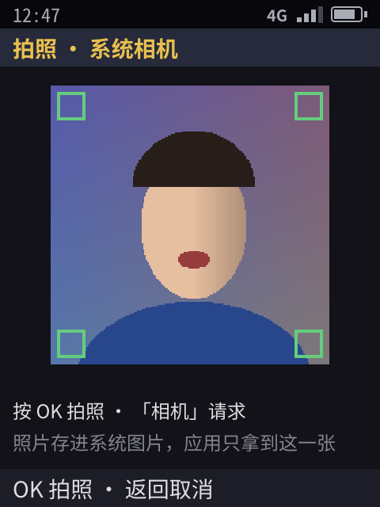 | 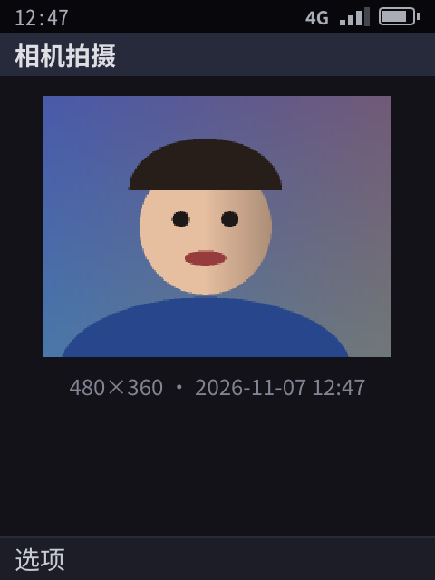 | 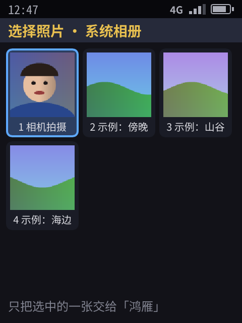 | 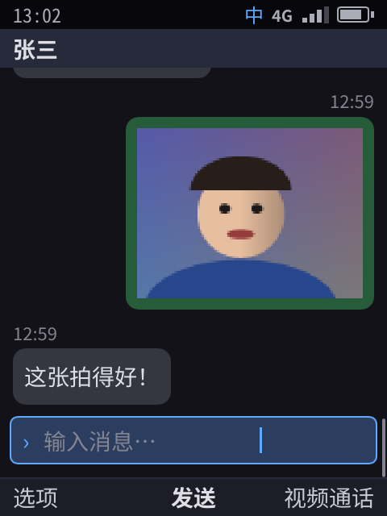 |

| Weather | About phone | Share panel |
|:--:|:--:|:--:|
| 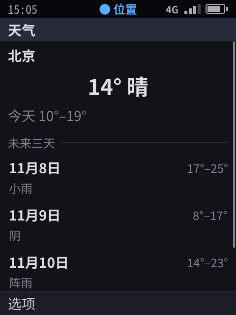 | 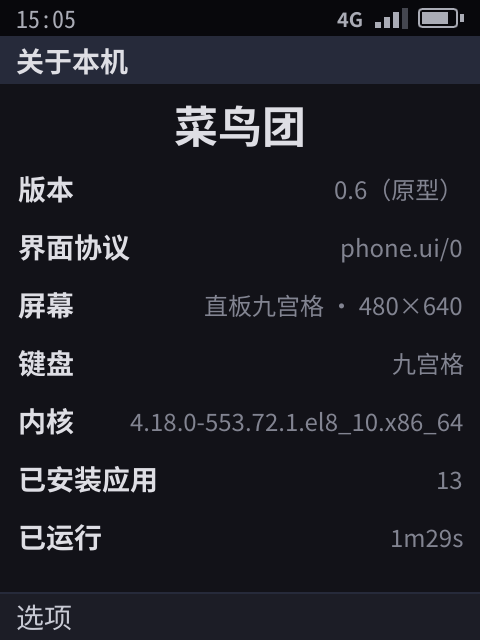 | 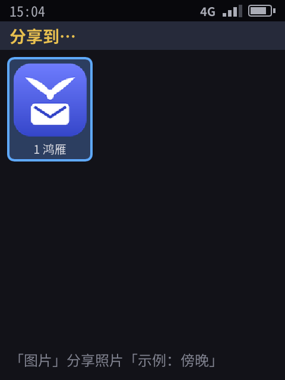 |

On the device (AArch64 QEMU; the pixel renderer draws to the virtio-gpu screen through DRM/KMS, and the QEMU monitor injects USB keyboard key presses and captures the framebuffer): idle screen → OK opens the main menu → OK opens Phone → Tab opens the options menu → back to idle, OK, press 7 to open Calculator, `12 * 30` then Enter gives 42 → back to idle, OK, press 2 to open Messages → back on the idle screen, type 10086 directly and dial it:

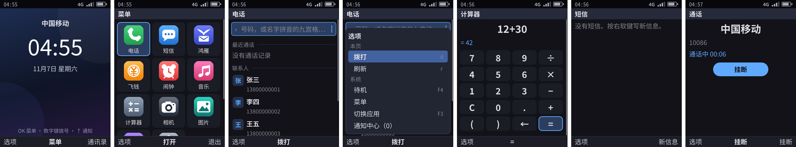

## 3. Capabilities Hongyan and Feiqian depend on: status and stability requirements

| Capability | Status | What is still missing to "provide it stably" |
|------|------|----------------------|
| App identity and sandbox | ✓ sandbox self-check 13/13 on the device, and the CTS runs the same checks; one cgroup per app; per-app network toggle, Wi-Fi only, data usage accounting | — |
| Notifications | ✓ | Quick reply, grouping, do not disturb |
| **Push** | ✓ ([21](21-push.md)): delivered even when the app is frozen or its process is not running; VoIP push wakes the app for incoming calls; data end-to-end encrypted, keys in keystored; tokens invalidated on uninstall | TLS, authentication with the device certificate, cloud gateway |
| Voice and video calls | Partial: video path, system incoming-call screen, push wake-up, ringtone, recording, app-provided audio streams ✓ | Network transport, echo cancellation |
| Code scanning | ✓ (system scanner; the app only gets the result) | Real camera (R14) |
| Trusted payment confirmation | ✓ (system UI, what you see is what you sign, signature verified on the server; a fingerprint can confirm too, simulated sensor, [31](31-lock-and-biometrics.md)) | Real TEE (R15), real fingerprint sensors |
| Mini-programs | ✓ (JS / TS, origin labeling, runtime grants tracked per "host + mini-program") | Per-mini-program isolated keys (R5) |
| Contacts | ✓ | Writing, groups, sync |
| Sending / receiving photos | ✓ Sending: the system picker hands over only the selected photo (a read-only file); received photos are decoded and displayed by the system; PNG and JPEG; received photos can be saved with 「保存到相册」 (Save to photo library) (`media.save`, confirmed by the system) | Compression |
| Location | Partial: `location.get` and the permission ✓, location is simulated | Real satellite positioning, location sharing |
| Clipboard | ✓ write-only; paste is done by the system | — |
| Sharing | ✓ system share panel (text, photos) | Sharing links, files |
| Background keep-alive | ✓ not needed: Hongyan does not stay resident; messages and incoming calls are delivered by the server through push ([21](21-push.md) §4), and it is exempt from freezing only during a call; scheduled sync uses background tasks | — |

## 4. Next steps

1. Real location backend (together with the hardware of R2 / R16).
2. Signed distribution of mini-programs (the remaining part of R5).
