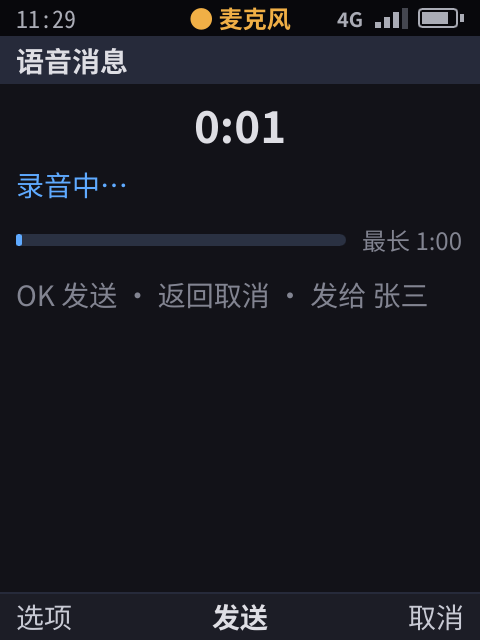
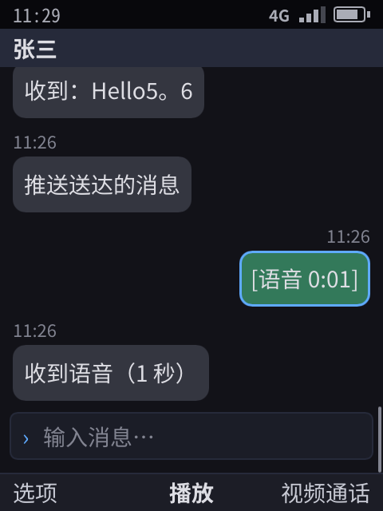
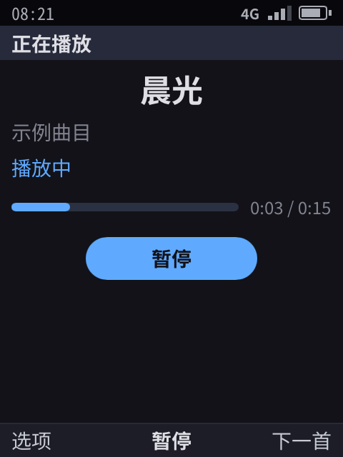
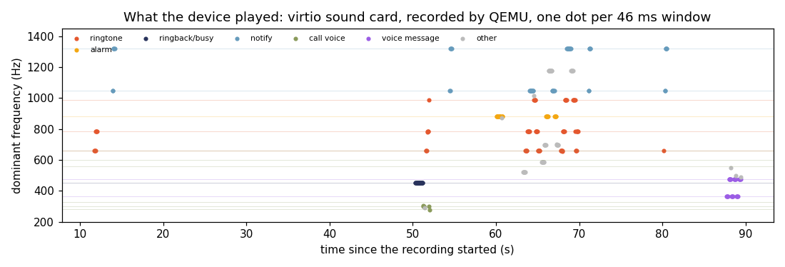

> English translation of [the Chinese original](../20-audio.md). The Chinese text is authoritative; keep both in sync.

# Audio service (R23)

> Phone calls, alarms, music and Hongyan voice all need sound. Implemented: the system service `phone-audiod`, audio focus, system notification sounds, the music app, background playback, recording, app-provided audio streams (shared memory, passed via fd, §3.1), Hongyan voice messages, video sound (mediad writes into the same kind of ring buffer), plus the sound card on the device and verification by recording in QEMU. Lossless music (FLAC, WAV, AIFF, ALAC, APE, WavPack, cue sheets), DSD (DSF, DFF, SACD images), sending each track to the sound card at its own format (bit-perfect, DoP, native DSD), gapless playback and ReplayGain are in §9: unit tests ✓ and selftest ✓ on the development machine, **not tried on a real device** (no real USB DAC, no SACD disc image). Bluetooth, real recording devices and the like are listed in §7 and are **not implemented**.

## 0. Conclusions

- **Apps cannot touch the sound card.** There is no `/dev/snd` in the sandbox (Landlock only allows `/dev/null`, `/dev/zero` and the two random-number devices), and only the Shell can connect to the audio service's socket (permissions 0600). An app can only ask the broker to "play a given item from the media library", or control its own playback streams.
- **The system decides when sound is made.** Every sound belongs to a category, and categories have priorities: emergency alert > call > ringtone > alarm > media > notification sound. Music pauses automatically on an incoming call and resumes automatically after hanging up; a notification sound only ducks the music. Apps can only use the "media" category, so they cannot borrow a higher-priority category to interrupt others.
- **Ringtones, alarms, ringback tones, busy tones and notification sounds are all played by the system**, so they sound even when the app is frozen or not running.
- **Recording requires the user's authorization and comes with a status bar indicator.** Only the foreground app or an app in a call can record; as soon as an app leaves the foreground, the system stops its recording (Android 9+ and iOS behave the same way).
- **Apps' own sound does not pass through the Shell.** The Shell checks permissions once, at setup, and hands the app a block of shared memory; after that, PCM data flows directly between the app and audiod (§3.1).
- **The music app can play in the background.** With `background: ["audio"]` declared in the manifest, leaving the app while a song is playing does not freeze it; once playback is paused or finished, the app is frozen as usual the next time you leave it.
- **Music plays at its own format.** While only music is sounding, audiod bypasses the 48 kHz mixer and opens the sound card at the track's own sample rate and depth; when nothing changes the samples (media volume at maximum, no ReplayGain, a card that takes the format) that is bit-perfect. DSD goes out natively when it can, as DoP when the user chose DoP, and otherwise converted to 176.4 kHz PCM. As soon as a notification sound plays, the mixer takes over again, and a second later the music goes direct again (§9.5).
- The selftest on the development machine and the pixel renderer in all three form factors both score 37/37; the results on the device are in §6.

## 1. Architecture

```
 App (sandboxed, no /dev/snd)
   │ phone.Ui: media.list / audio.play / audio.control / audio.state / audio.route
   ▼
 Shell broker ── permissions, control of own streams only, forwards stream events to the owning app
   │ System sounds: incoming-call ringtone, ringback tone, call, alarm, notification sound (switched on and off automatically by call and alarm state)
   │ JSON-lines RPC + event subscription (unix socket, 0600)
   ▼
 phone-audiod ── mixer (48 kHz stereo, one frame every 20 ms) + focus policy + sources
   │             while only music sounds: past the mixer, at the track's own format (§9.5)
   ▼
 Output sinks: alsa (aplay → sound card; a USB sound card when one is plugged in) | file (WAV) | null
```

How this maps to Android and iOS:

| Responsibility | Android | iOS | Us |
|------|---------|-----|------|
| Mixing, output | AudioFlinger | System audio service | The mixer in `phone-audiod` |
| Who may make sound, interruption and resumption | Audio focus (AudioFocus) + AudioPolicy | Audio session categories + interruption notifications | Category priorities (§2); the policy lives in the service, and apps cannot set it themselves |
| Background playback | Foreground service + media notification | `audio` background mode | `background: ["audio"]`, in effect only while the app is actually making sound |
| Ringtones, alarms | System app + ring stream | System | Played directly by the Shell; apps are not involved |

## 2. Categories and focus

| Category | Used by | Priority | Effect on music |
|------|------|:---:|------|
| `alert` | Emergency alerts (cell broadcast, [32](32-messaging.md) §7); volume fixed at full, sounds in silent mode too | 6 | Paused, resumes afterward |
| `call` | During a call (ringback tone, call audio, busy tone) | 5 | Paused, resumes afterward |
| `ring` | SIM incoming call, VoIP incoming call | 4 | Paused, resumes afterward |
| `alarm` | Alarm | 3 | Paused, resumes afterward |
| `media` | Apps (music, etc.) | 2 | Only one stream at a time; a new one replaces the old one |
| `notify` | Notification banners | 1 | Ducked to 30%, not paused |

- A stream interrupted by a higher priority is marked `by_focus`. When the interruption ends, only streams marked this way are resumed; a stream the user paused is not resumed.
- Each category has its own volume (the `volume` method).
- The route `earpiece` / `speaker` is toggled by 「免提」 (Speaker) on the dialer screen and requires the `phone` permission. The prototype has only one output sink, so speaker mode just multiplies the call gain by 1.4; really switching between earpiece, speaker and headphones depends on the ALSA UCM configuration of the target hardware (§7).

## 3. App API

| Capability | Parameters | Notes |
|------|------|------|
| `media.list` | — | Audio in the system media library: the music library's tracks (§9; the ID is `music:<path in the music library>`, with `#<number>` added for tracks of cue sheets and SACD images), then the 3 synthesized sample tracks. Besides title, artist and length, music tracks have `album`, `album_artist`, `track`, `disc`, `genre`, `year`, `folder`, `format` ("FLAC 24/96"), `quality`, `codec`, `rate`, `bits`, `channels`, `lossless`, `replaygain`, `cover` and `from` (`cue` / `sacd`) |
| `audio.play` | `{media, next?, at_ms?, replaygain?, dsd?}` | Plays an item from the media library; the category is fixed to `media`; returns the stream. `next`: the track that follows without a gap; `at_ms`: where to start; `replaygain`: `track` / `album` / empty (off); `dsd`: `auto` / `dop` / `pcm` |
| `audio.control` | `{id, op, at_ms?, next?, replaygain?, dsd?}` | `pause` / `resume` / `stop`; can only control the app's own streams. Music also has `seek` (`at_ms`), `queue` (replaces the track that follows; an empty `next` means none) and `options` (`dsd`) |
| `audio.state` | — | The app's own streams: state, position, duration, whether paused by focus |
| `audio.route` | `{route}` | `earpiece` / `speaker`; requires the `phone` permission |

Every time a stream's state changes, the Shell sends an `audio` event (the stream as JSON) to the app that owns it. The app updates its UI accordingly, and when a track finishes it receives `ended` and automatically moves on to the next one. Music streams also carry `media` (the track playing now: it changes when the queued track takes over, and the app then queues the one after), `format` and `output` (how it reaches the card: `mixer 48 kHz`, `pcm S32_LE 96000 Hz 2ch bit-perfect`, `dop …`, `dsd …`). These fields and the music fields of `media.list` are defined by the Shell and the music app each on its own for now (`shell/music.go`, `apps/music/library.go`), not yet in `ui/caps.go`.

### 3.1 App-provided audio streams

| Capability | Permission | Notes |
|------|------|------|
| `audio.stream` `{name}` | — | Plays PCM that the app writes itself: voice messages, decoded VoIP audio, sound effects. The category is decided by the system: `call` while the app is in a call, `media` otherwise |
| `audio.record` `{name}` | Microphone (runtime grant) | Microphone audio is written into the buffer, and the app reads it. Only the foreground app or an app in a call can use it, and recording stops immediately when the app leaves the foreground; while recording, the middle of the status bar shows 「● 麦克风」 (● Microphone) (orange in the pixel renderer) |

How the data flows:

```
 App ──audio.stream──▶ Shell (checks permission, sets category) ──open──▶ audiod
                                                                          │ creates a memfd: 48 kHz mono ring buffer, size sealed
 App ◀──reply + fd (SCM_RIGHTS)── Shell ◀────────────reply + fd────────── audiod
   │
   └── From then on: the app writes / reads the shared memory, audiod reads / writes it every 20 ms; the Shell is no longer involved
```

- The buffer format is defined in `audio/ring.go`: a 64-byte header that records the read and write positions, followed by the samples. One producer, one consumer.
- Neither side trusts the read and write positions written by the other: indices are taken modulo the capacity, so nothing the peer writes can push them out of bounds. The memfd's size is sealed (`F_SEAL_SHRINK`), so the peer cannot truncate the file and thereby make the other side crash with SIGBUS when it touches the mapped memory; the seals are checked before mapping, and an unsealed memfd is rejected. Each of these points has unit tests.
- App SDK: `app.GoAudio(capability, name, callback)` returns an `AudioStream`; read and write its `Ring`, and call `Close` when done.
- Video sound goes through the same kind of buffer, except that the writer is mediad instead of the app: on `video.open`, the Shell opens a `media`-category stream on the app's behalf and hands the fd to mediad, whose ffmpeg decodes the sound to 48 kHz mono and writes it in. The picture's clock is the number of samples audiod has already consumed, so when audio focus pauses this sound (an incoming call), the picture stops too ([19](19-core-apps.md) §2).
- The microphone is currently simulated: a "speaking voice" that alternates between 365 Hz and 475 Hz. These are neither system sound frequencies nor notes from the sample tracks, so the recorded voice can be recognized even in the device's sound card output (§6).

**Hongyan voice messages**:
- In a chat, choose 「语音消息」 (Voice message) from the options menu (shortcut r) to open the recording screen, which shows the duration and a progress bar; the maximum is 1 minute;
- Press OK to send, Back to cancel;
- The recording is saved as WAV in the app's own data directory;
- The bubble shows 「[语音 0:02]」 ([Voice 0:02]); select it and press OK to play it;
- If you leave the app while recording, the system stops the recording, and when you come back the recording screen shows 「录音已中断」 (Recording interrupted).

| Recording (indicator in the status bar) | The voice message after sending |
|:--:|:--:|
|  |  |

The `progress` node (a progress bar: `fraction` 0–1, a label on the left, a description on the right) is a general-purpose capability that music progress, app store downloads and system updates (OTA) can all use. Each of the two renderers draws it in its own way, so apps don't have to assemble it from characters.

## 4. System sounds

All sounds are original tones synthesized in code; neither the Nokia ringtone (Nokia Tune) nor other vendors' notification sounds are used:

| Sound | Content | When it plays |
|------|------|------------|
| Incoming-call ringtone | Three rising notes E5, G5, B5, looped | SIM incoming call, VoIP incoming call (when the system incoming-call screen appears); stops on answer or reject |
| Alarm | 880 Hz triplet, looped | When the alarm goes off; stops on dismiss or snooze |
| Ringback tone | 450 Hz, 1 second on, 4 seconds off (the signaling tone of China's telephone network) | After dialing out, while the other party's phone is ringing |
| Busy tone | 450 Hz, 0.35 seconds on, 0.35 seconds off | The other party is busy |
| Call audio | A low-frequency harmony that simulates the other party speaking | During a call on the simulated baseband (on a real device the baseband connects directly to the sound card, §7) |
| Notification sound | Two short notes (C6, E6) | When a notification banner appears; silent during a call |
| Emergency alert | 853 Hz and 960 Hz together (the CMAS and EU-Alert attention signal), 2 s, half a second, half a second, looping | When the emergency-alert screen comes up; stops when it is closed |

### 4.1 Volume keys, silent mode, vibration

- **Volume keys** (side keys; F8, F9 on a USB keyboard) work on any screen, even with the keypad locked. While an incoming call is ringing, pressing either one silences the ringtone; the incoming-call screen shows 「铃声已静音」 (Ringtone silenced) and the call stays on screen, still ringing. While music is playing they adjust the media volume; otherwise they adjust the ringtone volume, and a toast shows the current volume.
- **Media keys** (headset remote, keyboard media keys; plus F10 play / pause, F11 previous, F12 next on a USB keyboard) likewise work on any screen. Play / pause is handled directly by the system on the stream that is playing. Previous and next are up to the app (the app holds the playlist), so the system sends the playing app a `media` event (`next` / `previous`), the equivalent of a media session. During a call the keys belong to the call and leave the music alone. The idle screen shows 「正在播放 <曲名>」 (Now playing <title>).
- **Silent mode** (「设置 › 静音模式」 (Settings › Silent mode)): the incoming-call ringtone and notification sounds turn into vibration, and the incoming-call screen shows 「静音模式 · 振动」 (Silent mode · Vibrate); alarms still sound.
- **Vibration**: drives the LED-class vibration motor common in phone kernels (`/sys/class/leds/vibrator`; write the duration first, then activate). On an incoming call it vibrates every 1.5 seconds, and once for a notification. The emulator has no motor and only records vibration requests (the selftest asserts them with `vibrated`).
- **Now playing**: while music is playing, the idle screen shows 「正在播放 …」 (Now playing …), and the system menu has 「暂停播放 / 继续播放」 (Pause playback / Resume playback) (`shell/volume.go`).

### 4.2 App sound during calls

Audio streams and recordings that an app opens during a call (VoIP or phone) all belong to the "call" category: they take priority for the duration of the call and don't stop when the app leaves the foreground. Once a Hongyan video call connects, it opens two of them: one plays the other party's voice (a simulated speech rhythm in the prototype), the other reads the microphone, and both are closed on hang-up.

### 4.3 Voice message compression

Voice messages are encoded with Opus (VoIP mode, at most 16 kbit/s, 20 ms frames, complexity 5) and stored as standard Ogg Opus files (RFC 7845) that any player can open: about 2 KB per second, one fiftieth of 48 kHz PCM (`voice.Encode` / `voice.Decode`, package `audio/voice`). The encoder is libopus transpiled to pure Go with ccgo (`github.com/kazzmir/opus-go`, BSD-3), with no cgo, so an app can encode inside its own sandbox. It lives in a separate package that only apps sending voice link (the chat app's binary grows by 1.7 MB because of it). On the development machine, encoding 10 seconds of voice takes 0.26 seconds; ffprobe identifies the result as 48 kHz mono Opus, and ffmpeg decodes it without errors. When decoding, the encoder's leading delay is removed according to the pre-skip in OpusHead and the tail is trimmed according to the granule position of the last page, so the decoded sample count is exactly the same as the recording, with a point-by-point correlation coefficient of about 0.8 against the original signal.

## 5. Implementation

| Part | Location | Notes |
|------|------|------|
| Mixer and focus | `audio/audio.go` | Streams, categories, focus, volume, routing, stereo mixing; while a single music stream sounds it is handed out to go to the sound card directly (`Solo`), taken back as soon as a notification sound comes and handed out again a second later; unit tests cover focus switching, tone frequencies, WAV reading/writing, stereo, the events of a queue moving on, handing out and taking back |
| Sources | `audio/sources.go`, `mp3.go`, `opusfile/`, `vorbisfile/` | System notification sounds, synthesized sample tracks, WAV files, MP3 (decoded while playing; go-mp3, pure Go, Apache-2.0), Ogg Opus and Ogg Vorbis (`.opus`, `.ogg`, `.oga`, told apart by whether the first packet is `OpusHead` or `\x01vorbis`; decoded while playing, mono or stereo mixed down to mono. Opus uses the same pure-Go libopus as voice messages; Vorbis uses the pure-Go jfreymuth/oggvorbis (MIT), resampled to 48 kHz by nearest sample. Both decoders are linked only into phone-audiod; the Shell only reads the Ogg header and the last page to compute the length). Unit tests: a 440 Hz MP3, a 520 Hz stereo Opus and a 660 Hz Vorbis at 44.1 kHz decode with a frequency error within 10 Hz and the right length; a 22.05 kHz MP3 is rejected |
| Service | `cmd/phone-audiod` (`programs/audiod`) | RPC: `play` (for music `track`, `next`, `start_ms`, `dsd`), `control` (for music also `seek`, `queue`, `options`), `state`, `volume`, `route`; stream events after subscribing; the `auto` sink uses ALSA when there is a sound card and `aplay` (a USB sound card when there is one), and is silent otherwise; the ALSA sink first finds out what the card takes from `aplay --dump-hw-params` and a USB card's `/proc/asound/cardN/stream0`, then decides how each song goes out (§9.5) |
| Lossless and DSD | `audio/flac`, `audio/tags`, `audio/cue`, `audio/dsd`, `audio/musicfile`, `audio/hifi` | See §9 |
| Shell integration | `shell/audio.go`, `shell/music.go` | System sounds switched on and off automatically by call, incoming-call and alarm state; app capabilities; no freezing during background playback (`shell/freeze.go`); the music library (§9.7) |
| Shared-memory ring buffer, simulated microphone | `audio/ring.go` | Unit tests: wraparound, end marker, rejecting a memfd without seals, a peer lying about the read/write positions |
| fd passing | `wire/wire.go`, `rpc.go` | Unit tests: several messages carrying fds, fds not mismatched when the decoder reads ahead |
| Voice messages | `apps/chat` | Recording, saving as WAV, playback |
| Music app | `apps/music` | Track list, browsing by album, artist and folder, each track with its format; now playing (progress bar, pause / resume, previous / next, 10 s back / forward, stop, how it reaches the card); a list is the play queue and runs on into the next track without a gap; playback settings (ReplayGain, DSD output); track info (§9.8) |
| Selftest script commands | `shell/headless.go` | `audio <category>`, `audio paused <category>`, `audio idle`, `require-audio` |
| Device | `meta-phone/recipes-kernel/linux` | Kernel config fragment `phone-sound.cfg`: ALSA + virtio sound card |
| | `phone-audiod.service` | System service; during the boot selftest it hands the sound card over to the selftest's own instance |
| | `yocto/qemu-selftest.sh` | Adds a virtio sound card to QEMU and records the sound the device plays as WAV |
| | `yocto/audio-check.py` | Analyzes the dominant frequency of the recording segment by segment, recognizes the ringtone, alarm, ringback tone and so on, and fails if any one is missing; `--plot` draws the chart in §6 |

Sound-related assertions in the selftest:

- When dialing out there is a ringback tone, after connecting there is call audio, and after hanging up it is quiet.
- On a system incoming call the ringtone sounds, and after answering it turns into call audio.
- When the alarm goes off there is alarm sound, and after dismissing it, it is quiet.
- New case 「音乐」 (music):
  - After starting playback and leaving the app, the process is still running 2 seconds later and has not been frozen;
  - On an incoming call the ringtone sounds and the music pauses;
  - After rejecting the call, the music resumes automatically;
  - Back in the app, pressing pause makes the UI show 「已暂停」 (Paused).
- Case 「音乐：无损与 DSD」 (music: lossless and DSD, §9.9): FLAC 24/96 goes to the card at 96 kHz; a cue album image shows as three tracks and the image itself is not listed; playing the first track from the album, the second and third follow without a key press; a DSF is converted to 176.4 kHz PCM.
- Case 「音乐：电脑经 USB……」 (music: a computer over USB…): the computer sees the folders 「相册」「视频」「音乐」「文件」 (Photos, Videos, Music, Files), and an album folder copied into Music stays a folder ([27](27-usb-typec.md) §3.1).



## 6. On-device verification

- **Kernel**: the config fragment enables ALSA and the virtio sound card (`CONFIG_SND_VIRTIO=y`), and `/dev/snd/pcmC0D0p` appears on the device.
- **Service**: when `phone-audiod --sink auto` detects a sound card and `aplay`, it selects ALSA output (log: `sink alsa:plughw:0,0`).
- **QEMU**: `qemu-selftest.sh` adds `-audiodev wav` and `-device virtio-sound-pci`, which record the sound the device plays as WAV.
- **Analysis**: after `make yocto-selftest` finishes, `audio-check.py` takes the dominant frequency segment by segment (46 ms) and recognizes which system sound each segment is; if any of the ringtone, alarm, ringback tone or voice message is missing, it fails.
  - Result: every `make yocto-selftest` run prints `AUDIO-CHECK: PASS`, passing together with the boot selftest.
  - The voice message is recognized for 1.2 seconds, and only within the segment of the voice message case. The full chain is: simulated microphone → shared memory → Hongyan → WAV file → shared memory → mixer → virtio sound card → QEMU recording.
  - The simulated microphone uses frequencies that neither sample track uses, and detection requires at least 0.6 seconds in a row; otherwise notes in the tracks would be mistaken for a voice message.



The events in the chart correspond one-to-one to selftest cases:

| Time | Sound | Case |
|------|------|------|
| 12 s | Ringtone, notification sound | Hongyan VoIP incoming call; background message banner |
| 50 s | 450 Hz ringback tone, then call audio | Phone dials out, call connects |
| 52 s | Ringtone | SIM incoming call |
| 60 s | 880 Hz alarm sound | Alarm goes off |
| 63–70 s | Sample tracks (gray dots) with a ringtone in between | Incoming call during music playback: the ringtone sounds, the music pauses, and after rejecting the call the music resumes |
| 55, 71, 80 s | Notification sound | Banners for SMS and push messages |
| 80 s | Ringtone | Push: Hongyan receives a VoIP push and reports an incoming call |
| 88–89 s | 365 / 475 Hz (purple dots) | Hongyan plays back the voice message it just recorded |

Under TCG emulation the guest cannot keep up with real time, so the sound card data is choppy (underruns). This recording is therefore only used to judge "did something sound, and which sound was it", not to assess audio quality.

## 7. Not done yet

| Item | Why it is needed | Plan |
|------|------------|------|
| Real recording device | The microphone is currently simulated | Connect to ALSA like the output side (`arecord`); production goes through PipeWire. QEMU's wav backend cannot capture and the development machine has no microphone, so this step has to be verified on a real device |
| Headset buttons, playback controls on the lock screen | Currently there is only 「正在播放」 (Now playing) on the idle screen and pause / resume in the system menu | Done together with switching the output sink to PipeWire |
| Real call audio | On a real device the call audio is connected directly between the baseband and the sound card, bypassing the mixer | Configure the ALSA UCM call routing for the hardware when integrating ModemManager (R2) |
| Bluetooth, headphones, real earpiece / speaker routing | Essential on a real device | Switch the output sink to PipeWire (WirePlumber only does device management; the policy stays in `phone-audiod`) |
| Echo cancellation | Speaker mode and VoIP | WebRTC AEC, inside the service |
| Remaining music decoders (AAC); low-sample-rate MPEG-2 / 2.5 MP3 | Music | AAC carries patent royalties, so it goes through the real device's hardware decoder; MP3 supports only MPEG-1 Layer III (32 / 44.1 / 48 kHz): go-mp3 decodes low-sample-rate files incorrectly without reporting an error, so such files are rejected outright |
| Volume while bit-perfect | Bit-perfect needs the media volume at maximum today; below it a track still goes at its own rate, but the volume is applied digitally (no longer bit-perfect, and DoP and native DSD become a PCM conversion) | Use the card's own hardware volume (the ALSA mixer's volume control, as HiBy and others do in USB exclusive mode), configured per board and DAC |
| A real USB DAC, a DSD DAC | DoP, native DSD and the negotiation of discrete rates are only unit-tested against sample texts, **not tried on a real device** | Verify with a USB DAC that plays DSD; on plugging in, the new card is used only at the next output change (a notification sound, a format change) |
| Compatibility with SACD disc images | The parser is written from public descriptions and the test images come from our own writer: **not verified against real disc images** | Check against a few real images (stereo, multichannel, DST) and correct |
| DST-compressed frames | Left to ffmpeg's DST decoder; we have no DST encoder, so the tests can only use "uncompressed" DST frames and the decoding of really compressed frames is **not verified** | Verify with real DST files or images |
| APE decoding | Left to ffmpeg; there is no Monkey's Audio encoder on the development machine, only the header parsing is tested, the decoding is **not verified** | Add a small APE sample file to the tests |
| Showing covers | Covers in the tags are found (the `cover` field), the music app does not show them yet | The Shell's image nodes accept `music:` covers (`shell/frame.go`, `shell/render.go`) |

## 8. How OSS, ALSA and PipeWire relate

We don't use OSS. OSS (Open Sound System) is an old interface from around 2000 that ALSA replaced starting with Linux 2.6. **ALSA is still the audio driver layer in the Linux kernel today**, and Android is built on it too (through the slimmed-down user-space library tinyalsa). What people call a "modern audio architecture" refers to the layer above ALSA:

| Layer | Role | Us today | Production |
|----|------|----------|------|
| Kernel driver | Sound card, codec chips (ASoC on SoCs) | ALSA, QEMU's virtio sound card | ALSA ASoC, with a device tree written for each board |
| Routing configuration | Switching the earpiece, speaker, headphone and call paths | None (only one output) | ALSA UCM configuration files |
| Sound server | Mixing, resampling, Bluetooth, low latency | phone-audiod does its own mixing, output via `aplay` | PipeWire (already the default in Fedora, Ubuntu and postmarketOS), responsible for devices, Bluetooth (BlueZ) and the echo cancellation module |
| Policy | Who may make sound, who interrupts whom, who may record | phone-audiod (§2) | Still phone-audiod; PipeWire's session manager WirePlumber only does device management |

So modernizing does not mean replacing ALSA. It means switching our output sink from `aplay` to PipeWire (R29), with the policy layer unchanged.

## 9. Lossless music and DSD

> The aim is a lossless player like HiBy Music: the common lossless formats and DSD, cue sheets, each track sent to the sound card at its own format, one track running into the next without a gap. Status: unit tests ✓ and selftest ✓ on the development machine; DSD DACs, USB DACs and real SACD images are **not tried on a real device** (§7).

### 9.1 Formats and decoding

| Format | Files | Decoded by | Notes |
|------|------|--------|------|
| FLAC | `.flac` | Our own pure-Go decoder (`audio/flac`, after RFC 9639) | 4–32 bits, any sample rate (192 kHz and beyond), 1–8 channels; seeks by the seek table when there is one and by bisecting between frame headers otherwise, to the exact sample. Unit tests: 16/44.1, 24/96, 24/192, mono, independent channels, fixed predictors only and high LPC orders decode sample for sample as ffmpeg does; seeking with and without a table is exact too. On the development machine a second of 24/96 stereo white noise (the hardest signal to compress) decodes in 17 ms |
| WAV | `.wav` | Read by us (`audio/musicfile`, `audio/hifi`) | 8–32-bit integers, 32/64-bit floats, `WAVE_FORMAT_EXTENSIBLE`, RF64 beyond 4 GB; floats go out as 32-bit integers (so not bit-perfect) |
| AIFF / AIFF-C | `.aif` `.aiff` `.aifc` | Read by us | Big-endian integers, `sowt` (little-endian), 32/64-bit floats |
| ALAC | `.m4a` `.mp4` | ffmpeg (a separate process, as mediad uses for video) | The MP4 boxes (length, rate, depth, tags) are read by us; an `.m4a` holding AAC is refused (AAC carries royalties, §7) |
| APE (Monkey's Audio) | `.ape` | ffmpeg | The header (both the 3.98+ and the older layout) and the APEv2 tag are read by us |
| WavPack | `.wv` | ffmpeg | Block header, channel count and tags are read by us; WavPack 5's DSD mode is not supported |
| MP3, Ogg Vorbis, Ogg Opus | `.mp3` `.ogg` `.oga` `.opus` | The existing pure-Go decoders | Now also at their own rate, in stereo; MP3 drops LAME's encoder delay and padding, so an album played through has no gaps |
| DSD | `.dsf` `.dff` | Read by us (`audio/dsd`) | DSF (Sony) and DSDIFF (Philips); DSD64, 128, 256 |
| DST | `.dff` (compressed), SACD images | ffmpeg's DST decoder, the frames taken out by us and wrapped as DSDIFF for it | Ten seconds at a time in an in-memory file (memfd), each batch starting one frame early and that frame's output dropped, so the joins are as continuous decoding; ffmpeg itself converts the DSD to PCM, at 176.4 kHz as we ask. Frames that DST marks "not coded" we play as DSD ourselves (ffmpeg lays such frames out wrongly) |
| SACD images | `.iso` | Parsed by us (`audio/dsd`) | See §9.4 |

ffmpeg is LGPL and runs only as a separate program; it decodes to 32-bit PCM, and 16- and 24-bit sources are only shifted left, so the samples stay as they are and the formats that go through ffmpeg can be bit-perfect too. Unit tests: a 24-bit WAV encoded to ALAC and WavPack decodes back through ffmpeg sample for sample, also after seeking. The device's ffmpeg enables only the decoders and demuxers needed (`yocto/kas/phone-qemuarm64.yml`): video's VP8, VP9, Opus, Vorbis and PNG, plus ALAC, APE, WavPack and DST, the MOV (MP4 / M4A), APE, WV and IFF (DSDIFF) demuxers, and 32-bit PCM output. None of them carries royalties: Apple open-sourced ALAC under Apache 2.0, APE and WavPack are free; DST is part of MPEG-4, with patents filed around 2000, to be confirmed by legal before production.

### 9.2 Tags

`audio/tags` reads Vorbis comments (FLAC, Ogg), ID3v2.2 / 2.3 / 2.4 (MP3, and the ID3 chunks in WAV, AIFF, DSF and DFF; unsynchronisation, extended headers and v2.4's data length flag are handled), ID3v1 and APEv2 (APE, WavPack); the MP4 iTunes tag boxes are read in `audio/musicfile`. Fields: title, artist, album, album artist, track number / total, disc number / total, genre, year, composer, ReplayGain (track and album gain and peak, Opus's `R128_*_GAIN`), an embedded cue sheet (FLAC's and APE's `CUESHEET`), the cover (whether there is one and its MIME type; the image is read when needed). Encoding: ID3 text marked Latin-1 is often GBK or UTF-8 in fact, so it is read as UTF-8 when it is valid UTF-8, as GBK when it reads as Chinese in GBK, and as Latin-1 otherwise. Unit tests cover each kind of tag, plus an ID3v2.4 tag written by ffmpeg to compare.

### 9.3 Cue sheets

`audio/cue` reads `FILE`, `TRACK`, `INDEX 00 / 01`, `TITLE`, `PERFORMER`, `SONGWRITER`, `ISRC`, `CATALOG` and `REM GENRE / DATE / DISCNUMBER / REPLAYGAIN_*`; encodings: UTF-8 (with or without a BOM), UTF-16 (with a BOM), GBK (GB 18030).

- **Boundaries**: a track plays from its `INDEX 01` to the next track's `INDEX 01`; the pregap (`INDEX 00` to `01`) belongs to the track before (foobar2000's default), so neighbouring tracks join with nothing lost or repeated.
- **Several files**: a track may span files (the rest of its file, then the next file's start up to the next track's `INDEX 01`); both of EAC's layouts (the gap at the start of the next file, or at the end of the previous one) come out right.
- **Finding the files**: when the name `FILE` gives is not there, it tries the same name in another letter case, the same name with another extension (an image ripped as WAV and converted to FLAC / APE later), then the audio file named like the cue sheet. Names with `..` or an absolute path are refused: a cue sheet can only point into its own folder.
- **The image is not listed on its own**: the library no longer lists the files a cue sheet plays.
- **Gapless**: the next track of the same image does not get a decoder of its own: it takes over the previous track's and reads on (APE does not even restart ffmpeg); in a unit test three tracks played through are sample for sample the image.

### 9.4 DSD and SACD

- **DSF**: read in its layout of 4096-byte blocks, channel after channel, with bytes stored least significant bit first turned around. **DSDIFF**: the `PROP` chunk inside `FRM8` (rate, channels, compression), the `DSD ` or `DST ` chunk, the `DSTI` frame index (checked before use; without it, the chunk headers are walked), title and artist in `DIIN`, the non-standard `ID3 ` chunk.
- **SACD images**: the Scarlet Book is not public; the parser is written from public descriptions, with no GPL code (such as sacd-ripper) consulted. Sector 510's master TOC `SACDMTOC` (album data, where the stereo and multichannel area TOCs are), sector 511's `SACDText` (album title, artist), the area TOC `TWOCHTOC` / `MULCHTOC` (rate, frame format DST / plain DSD, channels, speaker layout, track count), and in its following sectors `SACDTRL1` (each track's first sector and sector count), `SACDTRL2` (start time and length, 75 frames a second) and `SACDTTxt` (each track's title and performer, in the character set the area declares: ISO 8859-1, Shift-JIS, KS C 5601, GB 2312, Big5). Audio sectors: a header byte, the packet infos (frame start, data type, length), a timecode for each frame that starts in the sector, then the packets; the audio packets joined make the frames (plain DSD: 4704 bytes a channel, interleaved by byte; DST: one coded frame). A track's frames are taken by their timecodes; a seek estimates the sector by proportion, then backs off.
- **Which area**: the stereo area when there is one; with only a multichannel area, that one, mixed down to stereo (centre and surrounds at −3 dB, the LFE left out).
- **Test images** come from our own writer in the tests (`audio/dsd/dsdtest`, stereo plain DSD plus multichannel DST, GB 2312 text), so they show only that both sides agree; **compatibility with real disc images is not verified** (§7).
- **To PCM** (`audio/dsd`'s `Decimator`): one Kaiser-windowed sinc low-pass FIR (about 80 dB stop band), computed only at the output samples; the input being 1-bit, each byte of the filter is one table lookup (the table holds those 8 taps' sum for each of the 256 byte values). DSD64 → 176.4 kHz: 512 taps, −6 dB at 37 kHz; → 88.2 kHz: 1024 taps, −6 dB at 28 kHz; DSD128 / 256 multiply the taps and keep the shape. DSD's 0 dB (50 % modulation) comes out at −6 dBFS; no gain is added, so nothing clips. Unit tests: a 1 kHz test tone at DSD64 / 128 / 256 converts with a signal-to-noise ratio up to 20 kHz above 70 dB and its level within 0.3 dB; the idle pattern converts to silence. On the development machine (Xeon E5-2670 v3) a second of stereo DSD64 to 176.4 kHz takes 28 ms; the cost on a phone is **not measured on a real device**, and DSD256 takes four times as much.
- **DoP** (`audio/dsd`): each 24-bit sample carries 16 DSD bits of its channel in its lower two bytes (the earliest at the top), under a marker byte alternating 0x05 / 0xFA; DSD64 at 176.4 kHz, DSD128 at 352.8 kHz. **Native DSD**: ALSA's `DSD_U8`, `DSD_U16_LE/BE`, `DSD_U32_LE/BE`, each frame holding 1 / 2 / 4 bytes of each channel, the earliest byte at the top. Both packings have unit tests (markers alternating and kept across calls, byte order).

### 9.5 To the sound card: bit-perfect, DoP, native DSD

While a single music stream sounds and nothing else needed mixing for a second, audiod skips the mixer and opens the sound card at the song's format (`aplay` restarted with its format, rate and channels), writing every 20 ms; when a notification sound or ringtone comes it goes back to the 48 kHz stereo mixer, and a second later back again (at a switch, about 0.2 s still in the card's buffer is lost; starting playback has that much delay too). `hifi.Negotiate` decides how, from the track's format, what the card takes (formats, channels and rate range from `aplay --dump-hw-params`; for a USB card the exact rates of each alternate setting in `/proc/asound/cardN/stream0`), the total gain (media volume × ReplayGain) and the DSD setting:

| Track | When | How it goes |
|------|------|--------|
| PCM (FLAC, WAV, ALAC…) | The card takes the rate | At its own rate; the container is the one that just holds it (S16_LE for 16 bits, S24_3LE for 24, otherwise the top of S32_LE, the samples unchanged); mono is doubled; bit-perfect when the total gain is exactly 1 and the source is not floats |
| PCM | The total gain is not 1 | At its own rate, with the volume applied in 32 bits and TPDF dither for 16/24-bit output; no longer bit-perfect |
| PCM | The card lacks the rate (a USB DAC without 88.2 kHz, say) | Back to the mixer, resampled to 48 kHz |
| DSD | Gain 1, at most two channels, ALSA offers a native DSD format | Native DSD (with the setting "native when it can") |
| DSD | Gain 1, the user chose DoP, the card takes 24-bit PCM at the DSD rate / 16 | DoP |
| DSD | Otherwise (volume applied, multichannel, PCM chosen) | Converted to 176.4 kHz PCM (88.2 kHz if that is not taken); if neither, the mixer |
| DST | — | The 176.4 kHz PCM ffmpeg decodes, sent as PCM (not counted as bit-perfect) |

- A next track of the same format is written on into the same `aplay` (no gap); another format reopens the card (a very short pause, as in every bit-perfect player).
- DoP is never switched on by itself: a DAC that does not know DoP plays it as loud noise, so the user chooses it in "Playback settings"; native DSD is used only when the driver says it takes it.
- With a USB sound card plugged in (a playback interface in `/proc/asound/cardN/stream0`), `--sink auto` uses it.
- Bit-perfect needs the media volume at maximum; hardware volume is **not implemented** (§7).
- The emulator's virtio sound card has no DSD, and the development machine has no sound card (its sink is null, which takes everything, so the selftest there sees the choice made for "takes everything"). The negotiation rules have unit tests (a QEMU-like card, a sample USB DAC with a DSD alternate setting, null); **DoP and native DSD on a real DAC are not tried on a real device**.

### 9.6 Gapless playback and ReplayGain

- When the app starts a track it passes the next one (`next`); audiod opens it at once in the background (the ffmpeg formats start decoding early too, a few seconds ahead). When this track has been read, the same read goes on into the next, the stream's `media` becomes the next track, and the app queues the one after. The next track of the same image takes over the decoder (§9.3).
- The mixer's path (while other sounds play) runs on the same way, without resetting the resampler.
- ReplayGain is chosen in the app (by track / by album / off); the Shell takes that gain from its index (the other kind when the tags lack it), held down by the peak so it cannot clip, and audiod applies it on both paths.

### 9.7 The music library

- Music lives in `media/music`, folders kept (an album folder copied from a computer stays a folder, [27](27-usb-typec.md) §3.1). At most 8 levels deep; names starting with a dot and symbolic links are skipped.
- The index is in memory, refreshed by file size and modification time at every listing, from headers only (`audio/musicfile`); MP3s are no longer decoded through to find their length. A cue sheet is read again when its folder or a file it plays changes.
- Order: folder, album, disc, track number. Tracks without an album name go into 「本机音乐」 (Music on this phone).

### 9.8 The music app

- The home screen is all tracks, each with its artist and format ("FLAC 24/96", "DSF DSD64", "SACD DSD64"); `a` opens albums, `r` artists, `f` folders, `g` playback settings (all in the options menu too). An album page shows the album artist and the best format ("SACD", "24/96"), tracks in disc and track order.
- The list a track was started from is the play queue, each track running into the next without a gap.
- Now playing: title, artist · album, state, the format and how it reaches the card (「比特完美 · 96 kHz」 (Bit-perfect · 96 kHz), 「DoP（PCM 承载 DSD）送到声卡」 (DoP to the sound card), 「DSD 转成 PCM · 176.4 kHz」 (DSD converted to PCM · 176.4 kHz), 「和系统声音一起混音（48 kHz）」 (Mixed with system sounds at 48 kHz)) and a progress bar; `p` play / pause, `←` `→` previous / next, `b` `f` 10 s back / forward, `i` track info, `s` stop.
- Playback settings: ReplayGain (off / by track / by album) and DSD output (native when it can / DoP / always PCM), kept in the app's data directory.
- Back in the foreground, the app reads the library again, so music a computer just copied in shows up at once.

### 9.9 Tests

| What | Where | Result |
|------|------|------|
| FLAC decoding | `audio/flac` unit tests | Sample for sample as ffmpeg (7 sets of encoder settings), exact seeks |
| Headers, lengths, tags | `audio/musicfile`, `audio/tags` unit tests | FLAC 24/96, WAV 16 / 24 / 32 / float, AIFF, ALAC, WavPack, MP3, Vorbis and Opus made with ffmpeg, lossless lengths exact to the sample; APE with a hand-made header |
| Cue sheets | `audio/cue`, `audio/musicfile` unit tests | UTF-8, with a BOM, GBK, UTF-16, both multi-file layouts, the fallbacks for finding files, paths out of the folder refused |
| DSD, SACD | `audio/dsd` unit tests | DSF, DSDIFF (plain / DST, with and without an index), SACD images (stereo plus multichannel DST, GB 2312 text, seeking), the conversion's SNR and level, DoP and native DSD packing; the DST wrapping gives ffmpeg's decoder the right number of frames |
| Playback, gapless, output | `audio/hifi` unit tests | A 24-bit WAV output bit-perfect as it is; three cue tracks played through are sample for sample the image, the decoder handed on; renegotiation at a format change; two SACD tracks played through; uncoded frames of a DST area played as DSD; ALAC and WavPack lossless through ffmpeg; DST batches and their joins give the right frame count; the negotiation rules; the 48 kHz mixer path's frequency, level and ReplayGain; the resampler's stop band |
| Mixer | `audio` unit tests | Stereo, the events of a queue moving on, handing out / taking back |
| Selftest | 「音乐：无损与 DSD」 in `shell/selftest.script` | Development machine ✓: the sample music (`audio/testdata`: FLAC 24/96, a GBK cue sheet with its FLAC image, a DSF's header and one period, which `scripts/stage.sh` makes into 4.6 s of DSD64); FLAC 24/96 shows 「96 kHz 原采样率输出」 (at its own rate, 96 kHz: the volume is not at maximum there), the album's three tracks follow one another by themselves, the DSF shows 「DSD 转成 PCM · 176.4 kHz」 (DSD converted to PCM) |
| Device | — | **Not tried on a real device**: no USB DAC or DSD DAC attached, no real SACD image or DST file |
