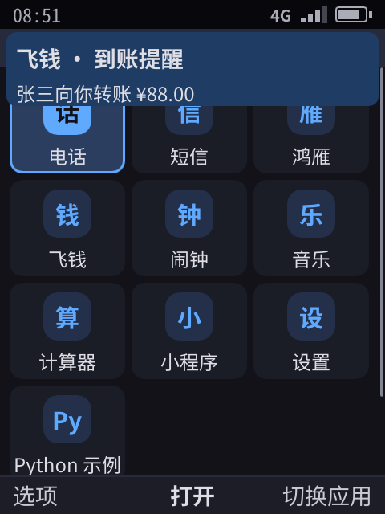
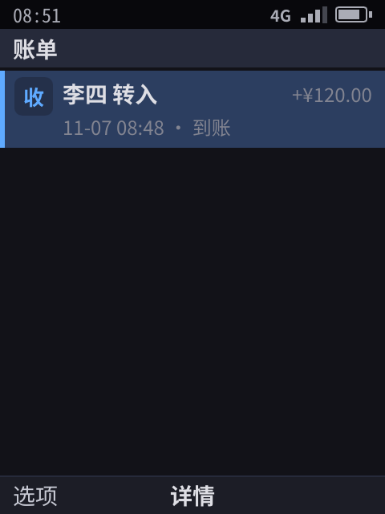

> English translation of [the Chinese original](../21-push.md). The Chinese text is authoritative; keep both in sync.

# Push service (R6)

> Apps are frozen 10 seconds after leaving the foreground ([17](17-app-sandbox.md) §5), so without push they could not receive messages, payment-received notifications or incoming calls. Implemented: the device-side `phone-pushd`, the gateway's open core `pushgw` and the simulated cloud gateway `phone-pushgw` built on it (TLS or TLCP, state persisted to disk, devices register with device attestation, adaptive heartbeat interval), the Shell's dispatch policy (budget, priority, collapse key, demotion for VoIP abuse), end-to-end encryption (with key rotation), and tokens invalidated together with the installation; Feiqian and Hongyan are integrated. What §7 lists is **not implemented**.

## 0. Summary

- **The whole device has only one long-lived connection.** `phone-pushd` keeps a single connection between the device and the push gateway; apps do not need to stay resident, and they still receive messages after being frozen, or even after their process has been killed.
- **The system decides what a push can do:**

  | The message contains | How the system handles it | Does it wake the app |
  |----------|--------------|:---:|
  | Title, body | The system shows the notification directly (needs the 「通知」 (Notifications) permission) | No |
  | Data | Handed to the app: a frozen app is thawed for 3 seconds; if the process is gone, it is launched in the background | Yes, with a limit on how often |
  | VoIP (`kind: voip`) | Wakes or launches the app immediately; the app reports the incoming call, and the system shows the full-screen incoming-call screen (needs the `voip` permission) | Yes, no limit |

- **Abuse prevention:**
  - After a VoIP push wakes an app, the app must report an incoming call within 10 seconds; after 3 misses within 24 hours, its VoIP pushes are treated as ordinary data pushes (subject to the budget of 20 per hour), the same constraint iOS places on PushKit.
  - Data pushes wake each app at most 20 times per hour; the excess is queued and delivered the next time the app comes to the foreground.
  - Tokens are signed by the gateway and can only be delivered to the specified app on the specified device.
  - Data is at most 4 KB; messages are kept for one day by default; the gateway deletes a message only after the device acknowledges it; duplicate deliveries are deduplicated by message ID.
- **For Hongyan and Feiqian, this is the precondition for being "stable and usable".** Android in China has no FCM, and WeChat on Android keeps itself alive with its own long-lived connection, which is exactly the kind of residency our freezing mechanism forbids. So system push is a capability that Tencent and Alibaba are certain to use when they adapt to our platform, and it must be stable.
- The push cases pass both on the dev machine and in the boot selftest on the device (§6; for the current baseline see 57 (internal document)).

## 1. Architecture

```
 App servers (backends of Hongyan, Feiqian)
   │ HTTPS POST /v1/push {token, title, body, data, kind, ttl}
   ▼
 Push gateway (cloud; phone-pushgw in the prototype) ── per-device queue, store and forward, deleted after ack
   │ one long-lived connection per device (heartbeat; unacknowledged messages resent after reconnecting)
   ▼
 phone-pushd (device, system service) ── device identity; received messages kept until the Shell acknowledges them
   │ unix socket, 0600, only the Shell can connect
   ▼
 Shell ── notifications, waking or background-launching apps, budget
   │ phone.Ui: push.register → token; "push" event
   ▼
 App (frozen most of the time)
```

How this maps to existing solutions:

| | iOS | Android (outside China) | Android in China | Us |
|---|-----|-----------------|----------|------|
| Gateway | APNs | FCM | Per-vendor channels (Huawei, Xiaomi, OPPO, vivo, etc.) | Our own gateway; app servers integrate with a single HTTP API |
| Notification only | alert push, does not wake the app | notification message | Notification bar message | Title, body: shown by the system, no wake-up |
| Waking the app | Background push, rate-limited by the system | data message, high priority has a quota | Pass-through message (most require the app to be running) | Data: thawed for 3 seconds or launched in the background, 20 times per hour |
| Incoming calls | PushKit + CallKit, the call must be reported immediately | High-priority message + full-screen notification | Vendor channel + app keep-alive | `kind: voip`: woken immediately, the app reports the call |

## 2. App server API (gateway)

| Endpoint | Caller | Description |
|------|--------|------|
| `POST /v1/push` `{token, kind, title, body, data, thread, collapse_id, ttl}` | App server | Returns `{id, online}`; queued while the device is offline. `thread` is the conversation: notifications of the same conversation are merged into one, and when the user opens it the app receives `thread:<conversation>`, so it knows which conversation to open. `collapse_id` (at most 64 bytes): a new message from the same app with the same key replaces the old one still in the queue, and on the device it also replaces the old notification and data not yet delivered (unread counts, scores) |
| `POST /v1/device/register` `{device, secret, attestation}` | pushd | Device registration: `attestation` is the key service's device attestation over `push.RegisterNonce(device, secret)`, with a certificate chain up to the vendor root. When the gateway is configured with `--trust-root`, unregistered devices are always rejected; once a device ID is registered, only the same device (the same attested device ID) can change its secret |
| `POST /v1/device/connect` `{device, secret}` | pushd | Long-lived connection that returns JSON line by line: `hello` (with the heartbeat interval), `msg`, `ping` |
| `POST /v1/device/token` `{device, secret, app}` | pushd | Issues a token for an app on this device |
| `POST /v1/device/ack` `{device, secret, id}` | pushd | The message has been handled, and the gateway can delete it |

- **Token** = device ID + app ID, plus an HMAC computed with the gateway key. A server holding Feiqian's token can only send messages to Feiqian on this device, and cannot derive the tokens of other apps from it. Unit tests cover both forged tokens and a key change.
- **Store and forward**: at most 100 messages are queued per device, and beyond that the oldest are dropped; expired messages are no longer delivered.
- **Persisted state** (`--state`): the gateway's signing key, the devices, each app's installation generation and the queued messages are all written to one file, so after the gateway restarts, the tokens held by app servers still work and the queued messages are still there. The prototype is a single process plus one file; mass production uses replicated storage.
- **Device attestation** (`--trust-root`): a device's push identity is vouched for by its device certificate, so forged device IDs cannot connect; when no root is configured (development environment), it falls back to trust on first use.
- **TLS** (`--tls-dir`): on first start the gateway generates a certificate, stores it, and serves HTTPS; pushd, the app server (the Hongyan server) and the Shell acting as a server in the selftest all pin this certificate (`--gateway-cert`), and during the handshake the certificate must match exactly. In mass production this is replaced by a certificate signed by a public CA, and the image pins the gateway's public key.
- **TLCP (Chinese national TLS)** (add `--tlcp` as well): GB/T 38636, SM2 certificates and key exchange, SM4 encryption, SM3 integrity checks, with signing and encryption certificates in pairs (dual certificates). On first start the gateway generates its own SM2 root certificate and two server certificates; `cert.pem` is this root certificate, and clients pin it as before; before each handshake, a client looks at the pinned certificate: if it is SM2, it uses TLCP (both server certificates must chain to it, and the host name must match too), otherwise TLS 1.3. So pushd and app servers need no configuration change. The implementation uses `gitee.com/Trisia/gotlcp` (MIT, pure Go); it interoperates with `tlcp_client` from the independent implementation GmSSL 3.1 (handshake, certificate chain verification, HTTP send and receive). The device image uses TLCP (`phone-pushgw.service` with `--tlcp`, and the device selftest sets `PHONE_PUSH_TLCP=1`), the dev machine selftest uses TLS 1.3, and both paths have end-to-end coverage.
- **Adaptive heartbeat**: when connecting, pushd sends the heartbeat interval it wants, starting at 30 seconds; once a connection survives 3 heartbeats, it asks the gateway to double the interval (`/v1/device/heartbeat`, at most 28 minutes); if the connection drops while idle, the carrier's NAT timeout has been exceeded, so it falls back to the last interval that held and never tries that long again. The learned interval is stored in the state directory and reused after a restart (`push.Heartbeat`).
- **Priority**: a `priority: "normal"` data push for an app that is frozen or not running is queued first and delivered together when the app wakes up for some other reason; at the latest, the system does one combined wake-up after 15 minutes. The default `high` wakes immediately.

## 3. Device side

**phone-pushd:**
- On first start it generates the device identity (device ID + secret, stored in the state directory with permission 0600).
- After a disconnect it reconnects with backoff at 1, 2, 4 seconds up to 30 seconds; receiving no data at all for 3 consecutive heartbeat periods counts as a disconnect.
- Received messages are kept until the Shell acknowledges them (`ack`); after reconnecting, the Shell calls `pending` to collect what it missed.

**The Shell's decisions** (`shell/push.go`):

| Situation | Handling |
|------|------|
| The app is running and not frozen | Sends the `push` event directly |
| The app is frozen, within budget | Resumes the process, sends the event, freezes it again after 3 seconds (10 seconds for VoIP) |
| The process is gone, within budget | Launches the app in the background (lifecycle `background`) and sends the event once the app is ready |
| More than 20 per hour | The events are queued and delivered together when the app comes to the foreground |
| VoIP push, but the app lacks the `voip` permission | Dropped and logged |
| The app lacks the 「通知」 (Notifications) permission, or the user turned off its notifications in 「设置 › 应用权限」 (Settings › App permissions) | No notification is shown; the data part is handled as usual |
| The app is in the foreground | No system notification pops up; the app decides how to alert the user (iOS does the same); `notified` is false in the event handed to the app |

**App interface:**
- `push.register` returns a token, which the app hands to its own server.
- Messages arrive as a `push` event whose value is `{id, kind, data, sent, notified}`. `notified` means the system has already shown a notification for this push, so the app should not post its own (it is false when the app is in the foreground or the user has turned off its notifications).
- Notifications the system shows on behalf of an app carry the actions declared under `notify_actions` in the app manifest ([22](22-developer-api.md) §1). Hongyan declares 「回复」 (Reply): the user presses `r` in the notification center, the system brings up an input screen, and after sending it hands the text to Hongyan in the background (`notif_action`; the notification's ID is `thread:<conversation>`); Hongyan sends the message as usual without having to come to the foreground.

**Which gateway the device connects to**: the push gateway's address and the certificate to pin come from the product layer's `services.env` (`PHONE_PUSH_GATEWAY`, `PHONE_PUSH_GATEWAY_CERT`, [11](11-platform-architecture.md) §15); when they are not given, the simulated gateway on the device is used.

## 4. Integrated apps

| App | Usage |
|------|------|
| Feiqian | For a payment-received notification, the server sends a title, a body and data together: the notification is shown by the system; the data (`{"type":"income", ...}`) wakes the app for a few seconds to record the payment in the bills and the balance. The data can be end-to-end encrypted, and Feiqian decrypts it with `push.open` |
| Hongyan (not resident) | The app logs in to its own server only when it comes online (the simulated server `phone-chatsrv`, standing in for the Hongyan vendor's cloud) and hands the push token to it; the text, photos and voice it sends also go to the server. Replies from the other party are pushed down by the server, with a notification (the title is the other party, the body is the message, `thread` is the conversation) and data; incoming calls are VoIP pushes: the app is woken, reports the incoming call, and the system shows the full-screen incoming-call screen. The bot's reply rules are in `apps/chat/bot`, shared by the server and the "offline demo without a server" |

Selftest cases (dev machine 34/34):

1. A frozen Feiqian receives a payment-received notification with a title and a body: the banner appears and the process **stays frozen**; the data push that follows wakes it, and it is frozen again 3 seconds later; back in Feiqian, the bills contain this payment.
2. The Feiqian process is killed (simulating low memory), and a data push launches it in the background, where it records the payment; after opening it, the bills contain this entry.
3. A VoIP push is sent to Hongyan: the system full-screen incoming-call screen appears; a message push goes into the conversation.

The Shell log confirms that each case took the expected path:
- the payment-received notification after freezing did not wake Feiqian;
- `woke com.phone.wallet for 3s`, frozen again 3.5 seconds later;
- `started com.phone.wallet in the background`;
- when only the push cases were run, Hongyan had never been opened, and the VoIP push launched it in the background.

| Payment-received notification (Feiqian still frozen) | Payment in the bills (recorded by the data push) |
|:--:|:--:|
|  |  |

The case 「鸿雁不常驻」 (Hongyan does not stay resident):
1. The freeze delay is set to 0.5 seconds;
2. In Hongyan, select 「模拟来电」 (Simulate incoming call); the server sends the VoIP push only after 3 seconds;
3. Leave Hongyan, first assert that the process is frozen, then wait for the system incoming-call screen to appear.

Hongyan's own timers are stopped while it is frozen, so this incoming call can only come from the server's push. The Shell log shows that Hongyan was woken about 2.3 seconds after it was frozen.

### 4.0 Tokens invalidated with the installation

A token identifies "this app, from this particular installation, on this device": the gateway keeps an installation generation for each device and each app, and signs it into the token.
- When an app is uninstalled, the Shell notifies pushd, and pushd asks the gateway to increment the generation. The old token is invalidated immediately; an app server that pushes with it again gets **410 Gone** and should delete that token.
- A reinstalled app gets a token with the new generation, and does not receive messages sent by the server of the app from the previous installation.
- Code: `push.TokenAt` / `ParseTokenGen`, the gateway's `/v1/device/revoke`, pushd's `unregister`; unit tests cover "410 after invalidation, the new token works after reinstalling".

### 4.1 End-to-end encryption

The gateway (our cloud service) only forwards ciphertext and cannot see chat content. The approach follows Web Push (RFC 8291) and uses standard library primitives:

1. Each app has an X25519 key, generated and kept by the system key service keystored (in the TEE later); the app can only get the public key, through `push.key`. When Hongyan comes online, it hands the public key to the Hongyan server together with the push token.
2. For each push, the server generates an ephemeral key and uses ECDH and HKDF-SHA256 to derive a one-time AES-256-GCM key, which encrypts the data part of the push. The format is `e1.` followed by the base64url encoding of "ephemeral public key | nonce | ciphertext".
3. The gateway and the Shell only see `e1.…`; when Hongyan receives it, it asks the key service to decrypt it (`push.open`), so the private key never enters the app process. Tampered ciphertext cannot be decrypted, and another app's key cannot decrypt it either.

- The notification's title and body are shown by the system, so they remain plaintext; only the data part is end-to-end encrypted. As on iOS, to hide the content of a notification, the server sends only "You have a new message" and puts the real content in the encrypted data.
- The code is in `push/seal.go` (`Seal` / `Open`) and `keystore` (`PushKey` / `OpenPush`); unit tests check wrong keys, tampering, that no plaintext leaks, and that the keys of two apps cannot open each other's data.
- Selftest: Hongyan's first case asserts that the push it receives carries encrypted data (`push-sealed`).
- **Key rotation**: when `push.key` carries `rotate: true`, the key service generates a new key and keeps the old one as the previous key: data encrypted before the rotation that is still in transit can still be decrypted, but anything older cannot. On uninstall both keys are deleted.
- **System key wipe**: when the owner unlocks the device or locks it again, the key service wipes the keys of all apps, push keys included, and data encrypted with an old public key can no longer be decrypted. The Shell then sends a `push.key_changed` event to every running app (frozen ones are resumed for a few seconds); the app calls `push.key` again and hands the new public key to its own server; apps that are not running fetch their key as usual on their next launch. Hongyan does exactly this; the selftest case 「设备解锁」 (Device unlock) keeps Hongyan running throughout, and after relocking asserts that it is still the same process and that replies still decrypt.
- Not done yet: a real TEE.

### 4.2 Gateway cluster

The gateway can run as several instances (`--cluster-key` is the shared key, `--peer-addr-file` lists the peers); any instance can accept pushes from app servers and long-lived connections from devices; when an instance restarts or dies, devices switch to another one, tokens do not need to change, and queued messages are not lost.

- **Replication**: every state change (registering a device, enqueuing a message, an ack, invalidating tokens on uninstall) becomes an idempotent operation, sent in batches to every peer (full mesh, retried on failure; requests carry an HMAC made with the cluster key and a time, and requests more than two minutes off are rejected). Merge rules: device records are "last writer wins" by version; a message is added only once per ID; messages that were acknowledged or replaced through a collapse key leave a tombstone until they expire, so a late copy from a peer cannot bring them back; only the newest message per collapse key is kept; uninstall generations only ever increase.
- **Catch-up**: at startup and every half minute afterwards, an instance pulls snapshots from its peers and merges them (the merge itself is idempotent too), so a restarted instance immediately has all devices and queued messages, and an instance that was cut off from the network catches up too.
- **Tokens**: the key that signs tokens is derived from the cluster key, so a token signed by any instance is valid on all of them.
- **Delivery**: the instance holding the device's long-lived connection is responsible for delivery; when a push lands on another instance, the operation replicated from there triggers the delivery.
- **Device side**: pushd's `--gateway-file` can list several files (the address file of each instance); when the connection drops, it switches to the next instance right away, and backs off only when all instances fail; fetching tokens, acks and revocations also try the current instance first, then the others. App servers (the Hongyan server) likewise try them in order, skip the ones they cannot reach, and do not retry when rejected (token invalidated, too large).
- **Verification**: the unit test `TestCluster` (a token signed by A works on B; a message pushed to B is delivered by A to a device connected to A; acks are synced over, and merging snapshots does not bring acknowledged messages back; while A is down, messages queue on B, the restarted A pulls the state back from B, and old tokens still work; requests without a cluster signature are rejected). In the selftest, the Shell starts two instances (sharing the server identity and the cluster key); the case 「推送网关集群」 (Push gateway cluster): a push to the instance the device is not connected to is delivered by the connected one; when the instance the device is connected to is killed, the device switches over right away and messages still arrive; the killed instance, restarted by its supervisor, pulls the state back from its peer, and messages pushed to it are delivered as well.

### 4.3 Coalesced radio wakeups

Every time the cellular radio wakes up it stays in a high-power state for several seconds, so keep-alives on the long-lived connection should not wake it up just for themselves:

- **Gateway**: any message sent on a connection pushes the next ping back by a full interval (the traffic itself keeps the NAT mapping alive), so only truly idle connections get pings. Unit test `TestTrafficDefersPing`: after a message, the next ping comes at least a full interval later.
- **Device**: when other traffic has already woken the radio, the Shell tells pushd (`radio_active`), and pushd asks the gateway to postpone the next ping by one interval (at most once per half interval). For now this is triggered when a batch of scheduled background tasks starts; on real hardware it should use the radio state reported by the modem instead (**not implemented**, depends on hardware).

## 5. Implementation

The gateway has two layers (D11). The open core is the `pushgw` package: the device protocol, store and forward, tokens, persisted state, the cluster (§4.2). `cmd/phone-pushgw` is the simulated gateway built on it, adding only the command-line flags: an app server holding a token can push, there are no rate limits, and all instances form one replica set. The mass-production push service is not open source; it uses the same core and adds app server authentication, rate limits and sharding (63 (internal document)). The core leaves extension points for this: before every push it asks whether this request may send to this app (`Authorize`) and whether it is sending too fast (`Limit`, answered with 429 and `Retry-After` when over), which instances should serve a device (`Owner`), and routes can be added on `Routes()`; with no extension point set, the behavior and the API are the same as before.

| Part | Location |
|------|------|
| Message format, tokens | `push` (with unit tests) |
| Gateway core | `pushgw`: device protocol, store and forward, cluster, extension points (with unit tests) |
| Simulated gateway | `cmd/phone-pushgw` (`pushgw` plus command-line flags) |
| Simulated Hongyan server | `cmd/phone-chatsrv`; the app learns its address from the environment variable `PHONE_CHAT_SERVER` (inside the sandbox the app cannot read the system's runtime directory) |
| Device service | `cmd/phone-pushd` |
| Shell dispatch, budget, background launch | `shell/push.go`; lifecycle changes in `shell/core.go` |
| Capabilities | `push.register` (`ui/caps.go`); scheduled background tasks (`job.schedule`) share the wake-up logic with push (`deliverBackground`, `shell/jobs.go`) |
| Gateway cluster | `pushgw/cluster.go` (replication, snapshot merging, cluster signatures), `push.Gateways` (the client's list of instances) |
| Selftest script commands | `push [voip] [other] <app> <title> \| <body> \| <data>` (acts as the app server and goes through the full chain; `other` sends to an instance the device is not connected to), `pushgw-kill` (kills the instance the device is connected to), `appkill <app>`, `require-push`, `require-pushgw-cluster` |
| Device | `phone-pushgw.service` (when the product layer does not give a cloud gateway, the simulated gateway runs on the device; state in `/var/lib/phone/pushgw-state.json`, trusting `/var/lib/phone/factory/root.pub`), `phone-pushd.service` (starts after keystored, reads the address and certificate from `services.env`) |

## 6. Verification on the device

- **Image**: includes `phone-pushgw.service` and `phone-pushd.service`, started by systemd at boot (the serial output contains the startup records of both services).
- **Boot selftest**: the Shell starts its own private gateway and pushd (on random ports). The private gateway also runs with `--state` and `--trust-root`, so pushd has to register with device attestation before it can connect (gateway log `registered (attested PH-…)`); all push cases pass on the device. Apps on the device run in the sandbox (separate uid, namespaces, Landlock, seccomp), so this also verifies that freezing, thawing and background launch work just as well inside the sandbox.
- **Stability**: the app SDK once had a data race that made the 「设置」 (Settings) case fail intermittently; after the fix, consecutive runs on the device all pass.

## 7. Not done yet

| Item | Why | Plan |
|------|--------|------|
| End-to-end encryption (continued) | The data part is encrypted (Hongyan, Feiqian), the keys are in keystored, and keys can be rotated (§4.1) | TEE |
| Mobile network optimization (continued) | Coalesced wakeups are done (§4.3); the gain has to be measured on real hardware | On real hardware, use the modem's radio state (Linux IDLETIMER or baseband reports) in place of the "background task started" approximation |
| Gateway cluster (continued) | Multiple instances and replication are done (§4.2); the peers are a static list, full mesh | The simulated gateway stays one replica set; sharding belongs to the mass-production push service (§5) |

