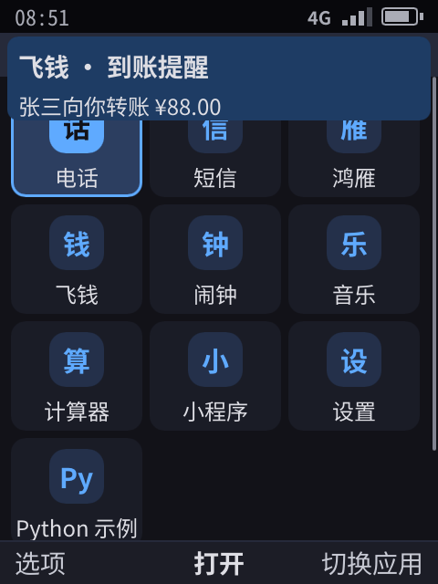
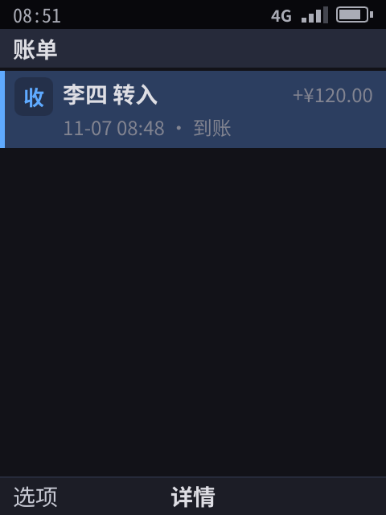

> English translation of [the Chinese original](../21-push.md). The Chinese text is authoritative; keep both in sync.

# Push service (R6)

> Apps are frozen 10 seconds after leaving the foreground ([17](17-app-sandbox.md) §5), so without push they could not receive messages, payment-received notifications or incoming calls. Implemented: the device-side `phone-pushd`, the gateway's open core `pushgw` and the simulated cloud gateway `phone-pushgw` built on it (TLS or TLCP, state persisted to disk, devices register with device attestation, adaptive heartbeat interval), the Shell's dispatch policy (budget, priority, collapse key, demotion for VoIP abuse), end-to-end encryption (with key rotation), and tokens invalidated together with the installation; Feiqian and Hongyan are integrated; third-party clients should come in through the system push, and one that really needs a long connection of its own may keep one while frozen with the `keepalive` permission, with the system owning the wake-ups (§8, dev machine and QEMU ✓, **not tried on a phone**). What §7 lists is **not implemented**.

## 0. Summary

- **The whole device has only one long-lived connection.** `phone-pushd` keeps a single connection between the device and the push gateway; apps do not need to stay resident, and they still receive messages after being frozen, or even after their process has been killed. The one exception is the connection of its own that a store-reviewed app with the `keepalive` permission keeps, whose heartbeats ride this connection's wakes (§8).
- **The system decides what a push can do:**

  | The message contains | How the system handles it | Does it wake the app |
  |----------|--------------|:---:|
  | Title, body | The system shows the notification directly (needs the 「通知」 (Notifications) permission) | No |
  | Data | Handed to the app: a frozen app is thawed for 3 seconds; if the process is gone, it is launched in the background | Yes, with a limit on how often |
  | VoIP (`kind: voip`) | Wakes or launches the app immediately; the app reports the incoming call, and the system shows the full-screen incoming-call screen (needs the `voip` permission) | Yes, no limit |

- **Abuse prevention:**
  - After a VoIP push wakes an app, the app must report an incoming call within 10 seconds; after 3 misses within 24 hours, its VoIP pushes are treated as ordinary data pushes (subject to the budget of 20 per hour), the same constraint iOS places on PushKit.
  - Data pushes wake each app at most 20 times per hour; the excess is queued and delivered the next time the app comes to the foreground.
  - Tokens are signed by the gateway and can only be delivered to the specified app on the specified device.
  - Data is at most 4 KB; messages are kept for one day by default; the gateway deletes a message only after the device acknowledges it; duplicate deliveries are deduplicated by message ID.
- **For Hongyan and Feiqian, this is the precondition for being "stable and usable".** Android in China has no FCM, and WeChat on Android keeps itself alive with its own long-lived connection, which is exactly the kind of residency our freezing mechanism forbids. So system push is a capability that Tencent and Alibaba are certain to use when they adapt to our platform, and it must be stable.
- The push cases pass both on the dev machine and in the boot selftest on the device (§6; for the current baseline see 57 (internal document)).

## 1. Architecture

```
 App servers (backends of Hongyan, Feiqian)
   │ HTTPS POST /v1/push {token, title, body, data, kind, ttl}
   ▼
 Push gateway (cloud; phone-pushgw in the prototype) ── per-device queue, store and forward, deleted after ack
   │ one long-lived connection per device (heartbeat; unacknowledged messages resent after reconnecting)
   ▼
 phone-pushd (device, system service) ── device identity; received messages kept until the Shell acknowledges them
   │ unix socket, 0600, only the Shell can connect
   ▼
 Shell ── notifications, waking or background-launching apps, budget
   │ phone.Ui: push.register → token; "push" event
   ▼
 App (frozen most of the time)
```

How this maps to existing solutions:

| | iOS | Android (outside China) | Android in China | Us |
|---|-----|-----------------|----------|------|
| Gateway | APNs | FCM | Per-vendor channels (Huawei, Xiaomi, OPPO, vivo, etc.) | Our own gateway; app servers integrate with a single HTTP API |
| Notification only | alert push, does not wake the app | notification message | Notification bar message | Title, body: shown by the system, no wake-up |
| Waking the app | Background push, rate-limited by the system | data message, high priority has a quota | Pass-through message (most require the app to be running) | Data: thawed for 3 seconds or launched in the background, 20 times per hour |
| Incoming calls | PushKit + CallKit, the call must be reported immediately | High-priority message + full-screen notification | Vendor channel + app keep-alive | `kind: voip`: woken immediately, the app reports the call |

## 2. App server API (gateway)

| Endpoint | Caller | Description |
|------|--------|------|
| `POST /v1/push` `{token, kind, title, body, data, thread, collapse_id, ttl}` | App server | Returns `{id, online}`; queued while the device is offline. `thread` is the conversation: notifications of the same conversation are merged into one, and when the user opens it the app receives `thread:<conversation>`, so it knows which conversation to open. `collapse_id` (at most 64 bytes): a new message from the same app with the same key replaces the old one still in the queue, and on the device it also replaces the old notification and data not yet delivered (unread counts, scores) |
| `POST /v1/device/register` `{device, secret, attestation}` | pushd | Device registration: `attestation` is the key service's device attestation over `push.RegisterNonce(device, secret)`, with a certificate chain up to the vendor root. When the gateway is configured with `--trust-root`, unregistered devices are always rejected; once a device ID is registered, only the same device (the same attested device ID) can change its secret |
| `POST /v1/device/connect` `{device, secret}` | pushd | Long-lived connection that returns JSON line by line: `hello` (with the heartbeat interval), `msg`, `ping` |
| `POST /v1/device/token` `{device, secret, app}` | pushd | Issues a token for an app on this device |
| `POST /v1/device/ack` `{device, secret, id}` | pushd | The message has been handled, and the gateway can delete it |

- **Token** = device ID + app ID, plus an HMAC computed with the gateway key. A server holding Feiqian's token can only send messages to Feiqian on this device, and cannot derive the tokens of other apps from it. Unit tests cover both forged tokens and a key change.
- **Store and forward**: at most 100 messages are queued per device, and beyond that the oldest are dropped; expired messages are no longer delivered.
- **Persisted state** (`--state`): the gateway's signing key, the devices, each app's installation generation and the queued messages are all written to one file, so after the gateway restarts, the tokens held by app servers still work and the queued messages are still there. The prototype is a single process plus one file; mass production uses replicated storage.
- **Device attestation** (`--trust-root`): a device's push identity is vouched for by its device certificate, so forged device IDs cannot connect; when no root is configured (development environment), it falls back to trust on first use.
- **TLS** (`--tls-dir`): on first start the gateway generates a certificate, stores it, and serves HTTPS; pushd, the app server (the Hongyan server) and the Shell acting as a server in the selftest all pin this certificate (`--gateway-cert`), and during the handshake the certificate must match exactly. The pinned file may hold several certificates, and the gateway presenting any of them will do: to replace the gateway's certificate, the image first pins the old one and the new one, then the gateway switches ([11](11-platform-architecture.md) §15.1). In mass production this is replaced by a certificate signed by a public CA, and the image pins the gateway's public key (**not implemented**).
- **TLCP (Chinese national TLS)** (add `--tlcp` as well): GB/T 38636, SM2 certificates and key exchange, SM4 encryption, SM3 integrity checks, with signing and encryption certificates in pairs (dual certificates). On first start the gateway generates its own SM2 root certificate and two server certificates; `cert.pem` is this root certificate, and clients pin it as before; before each handshake, a client looks at the pinned certificate: if it is SM2, it uses TLCP (both server certificates must chain to it, or to another pinned SM2 root certificate, and the host name must match too), otherwise TLS 1.3; a file mixing the two kinds is not connected with. So pushd and app servers need no configuration change. The implementation uses `gitee.com/Trisia/gotlcp` (MIT, pure Go); it interoperates with `tlcp_client` from the independent implementation GmSSL 3.1 (handshake, certificate chain verification, HTTP send and receive). The device image uses TLCP (`phone-pushgw.service` with `--tlcp`, and the device selftest sets `PHONE_PUSH_TLCP=1`), the dev machine selftest uses TLS 1.3, and both paths have end-to-end coverage.
- **Adaptive heartbeat**: when connecting, pushd sends the heartbeat interval it wants, starting at 30 seconds; once a connection survives 3 heartbeats, it asks the gateway to double the interval (`/v1/device/heartbeat`, at most 28 minutes); if the connection drops while idle, the carrier's NAT timeout has been exceeded, so it falls back to the last interval that held and never tries that long again. The learned interval is stored in the state directory and reused after a restart (`push.Heartbeat`).
- **Priority**: a `priority: "normal"` data push for an app that is frozen or not running is queued first and delivered together when the app wakes up for some other reason; at the latest, the system does one combined wake-up after 15 minutes. The default `high` wakes immediately.

## 3. Device side

**phone-pushd:**
- On first start it generates the device identity (device ID + secret, stored in the state directory with permission 0600).
- After a disconnect it reconnects with backoff at 1, 2, 4 seconds up to 30 seconds; receiving no data at all for 3 consecutive heartbeat periods counts as a disconnect.
- Received messages are kept until the Shell acknowledges them (`ack`); after reconnecting, the Shell calls `pending` to collect what it missed.

**The Shell's decisions** (`shell/push.go`):

| Situation | Handling |
|------|------|
| The app is running and not frozen | Sends the `push` event directly |
| The app is frozen, within budget | Resumes the process, sends the event, freezes it again after 3 seconds (10 seconds for VoIP) |
| The process is gone, within budget | Launches the app in the background (lifecycle `background`) and sends the event once the app is ready |
| More than 20 per hour | The events are queued and delivered together when the app comes to the foreground |
| VoIP push, but the app lacks the `voip` permission | Dropped and logged |
| The app lacks the 「通知」 (Notifications) permission, or the user turned off its notifications in 「设置 › 应用权限」 (Settings › App permissions) | No notification is shown; the data part is handled as usual |
| The app is in the foreground | No system notification pops up; the app decides how to alert the user (iOS does the same); `notified` is false in the event handed to the app |
| A push on the system channel `system.family` (the account server saying minor mode has a new policy, the parent asks for the location or a report, answered a request for more time, or confirmed a parental PIN reset, [19](19-core-apps.md) §1.2) | It goes to no app (app IDs under `system.` cannot be installed); the Shell asks the account server itself and checks the signatures; the push holds only the kind of news (with a random ID such as the request's or the reset's) |

**App interface:**
- `push.register` returns a token, which the app hands to its own server.
- Messages arrive as a `push` event whose value is `{id, kind, data, sent, notified}`. `notified` means the system has already shown a notification for this push, so the app should not post its own (it is false when the app is in the foreground or the user has turned off its notifications).
- Notifications the system shows on behalf of an app carry the actions declared under `notify_actions` in the app manifest ([22](22-developer-api.md) §1). Hongyan declares 「回复」 (Reply): the user presses `r` in the notification center, the system brings up an input screen, and after sending it hands the text to Hongyan in the background (`notif_action`; the notification's ID is `thread:<conversation>`); Hongyan sends the message as usual without having to come to the foreground.

**Which gateway the device connects to**: the push gateway's address and the certificate to pin come from the product layer's `services.env` (`PHONE_PUSH_GATEWAY`, `PHONE_PUSH_GATEWAY_CERT`, [11](11-platform-architecture.md) §15; while the certificate is replaced the file holds the old one and the new one, §15.1); when they are not given, the simulated gateway on the device is used.

## 4. Integrated apps

| App | Usage |
|------|------|
| Feiqian | For a payment-received notification, the server sends a title, a body and data together: the notification is shown by the system; the data (`{"type":"income", ...}`) wakes the app for a few seconds to record the payment in the bills and the balance. The data can be end-to-end encrypted, and Feiqian decrypts it with `push.open` |
| Hongyan (not resident) | The app logs in to its own server only when it comes online (the simulated server `phone-chatsrv`, standing in for the Hongyan vendor's cloud) and hands the push token to it; the text, photos and voice it sends also go to the server. Replies from the other party are pushed down by the server, with a notification (the title is the other party, the body is the message, `thread` is the conversation) and data; incoming calls are VoIP pushes: the app is woken, reports the incoming call, and the system shows the full-screen incoming-call screen. The bot's reply rules are in `apps/chat/bot`, shared by the server and the "offline demo without a server" |

Selftest cases (case counts of the whole selftest in "Current verification baseline" in 57 (internal document)):

1. A frozen Feiqian receives a payment-received notification with a title and a body: the banner appears and the process **stays frozen**; the data push that follows wakes it, and it is frozen again 3 seconds later; back in Feiqian, the bills contain this payment.
2. The Feiqian process is killed (simulating low memory), and a data push launches it in the background, where it records the payment; after opening it, the bills contain this entry.
3. A VoIP push is sent to Hongyan: the system full-screen incoming-call screen appears; a message push goes into the conversation.

The Shell log confirms that each case took the expected path:
- the payment-received notification after freezing did not wake Feiqian;
- `woke com.phone.wallet for 3s`, frozen again 3.5 seconds later;
- `started com.phone.wallet in the background`;
- when only the push cases were run, Hongyan had never been opened, and the VoIP push launched it in the background.

| Payment-received notification (Feiqian still frozen) | Payment in the bills (recorded by the data push) |
|:--:|:--:|
|  |  |

The case 「鸿雁不常驻」 (Hongyan does not stay resident):
1. The freeze delay is set to 0.5 seconds;
2. In Hongyan, select 「模拟来电」 (Simulate incoming call); the server sends the VoIP push only after 3 seconds;
3. Leave Hongyan, first assert that the process is frozen, then wait for the system incoming-call screen to appear.

Hongyan's own timers are stopped while it is frozen, so this incoming call can only come from the server's push. The Shell log shows that Hongyan was woken about 2.3 seconds after it was frozen.

### 4.0 Tokens invalidated with the installation

A token identifies "this app, from this particular installation, on this device": the gateway keeps an installation generation for each device and each app, and signs it into the token.
- When an app is uninstalled, the Shell notifies pushd, and pushd asks the gateway to increment the generation. The old token is invalidated immediately; an app server that pushes with it again gets **410 Gone** and should delete that token.
- A reinstalled app gets a token with the new generation, and does not receive messages sent by the server of the app from the previous installation.
- Code: `push.TokenAt` / `ParseTokenGen`, the gateway's `/v1/device/revoke`, pushd's `unregister`; unit tests cover "410 after invalidation, the new token works after reinstalling".

### 4.1 End-to-end encryption

The gateway (our cloud service) only forwards ciphertext and cannot see chat content. The approach follows Web Push (RFC 8291) and uses standard library primitives:

1. Each app has an X25519 key, generated and kept by the system key service keystored (in the TEE later); the app can only get the public key, through `push.key`. When Hongyan comes online, it hands the public key to the Hongyan server together with the push token.
2. For each push, the server generates an ephemeral key and uses ECDH and HKDF-SHA256 to derive a one-time AES-256-GCM key, which encrypts the data part of the push. The format is `e1.` followed by the base64url encoding of "ephemeral public key | nonce | ciphertext".
3. The gateway and the Shell only see `e1.…`; when Hongyan receives it, it asks the key service to decrypt it (`push.open`), so the private key never enters the app process. Tampered ciphertext cannot be decrypted, and another app's key cannot decrypt it either.

- The notification's title and body are shown by the system, so they remain plaintext; only the data part is end-to-end encrypted. As on iOS, to hide the content of a notification, the server sends only "You have a new message" and puts the real content in the encrypted data.
- The code is in `push/seal.go` (`Seal` / `Open`) and `keystore` (`PushKey` / `OpenPush`); unit tests check wrong keys, tampering, that no plaintext leaks, and that the keys of two apps cannot open each other's data.
- Selftest: Hongyan's first case asserts that the push it receives carries encrypted data (`push-sealed`).
- **Key rotation**: when `push.key` carries `rotate: true`, the key service generates a new key and keeps the old one as the previous key: data encrypted before the rotation that is still in transit can still be decrypted, but anything older cannot. On uninstall both keys are deleted.
- **System key wipe**: when the owner unlocks the device or locks it again, the key service wipes the keys of all apps, push keys included, and data encrypted with an old public key can no longer be decrypted. The Shell then sends a `push.key_changed` event to every running app (frozen ones are resumed for a few seconds); the app calls `push.key` again and hands the new public key to its own server; apps that are not running fetch their key as usual on their next launch. Hongyan does exactly this; the selftest case 「设备解锁」 (Device unlock) keeps Hongyan running throughout, and after relocking asserts that it is still the same process and that replies still decrypt.
- Not done yet: a real TEE.

### 4.2 Gateway cluster

The gateway can run as several instances (`--cluster-key` is the shared key, `--peer-addr-file` lists the peers); any instance can accept pushes from app servers and long-lived connections from devices; when an instance restarts or dies, devices switch to another one, tokens do not need to change, and queued messages are not lost.

- **Replication**: every state change (registering a device, enqueuing a message, an ack, invalidating tokens on uninstall) becomes an idempotent operation, sent in batches to every peer (full mesh, retried on failure; requests carry an HMAC made with the cluster key and a time, and requests more than two minutes off are rejected). Merge rules: device records are "last writer wins" by version; a message is added only once per ID; messages that were acknowledged or replaced through a collapse key leave a tombstone until they expire, so a late copy from a peer cannot bring them back; only the newest message per collapse key is kept; uninstall generations only ever increase.
- **Catch-up**: at startup and every half minute afterwards, an instance pulls snapshots from its peers and merges them (the merge itself is idempotent too), so a restarted instance immediately has all devices and queued messages, and an instance that was cut off from the network catches up too.
- **Tokens**: the key that signs tokens is derived from the cluster key, so a token signed by any instance is valid on all of them.
- **Delivery**: the instance holding the device's long-lived connection is responsible for delivery; when a push lands on another instance, the operation replicated from there triggers the delivery.
- **Device side**: pushd's `--gateway-file` can list several files (the address file of each instance); when the connection drops, it switches to the next instance right away, and backs off only when all instances fail; fetching tokens, acks and revocations also try the current instance first, then the others. App servers (the Hongyan server) likewise try them in order, skip the ones they cannot reach, and do not retry when rejected (token invalidated, too large).
- **Verification**: the unit test `TestCluster` (a token signed by A works on B; a message pushed to B is delivered by A to a device connected to A; acks are synced over, and merging snapshots does not bring acknowledged messages back; while A is down, messages queue on B, the restarted A pulls the state back from B, and old tokens still work; requests without a cluster signature are rejected). In the selftest, the Shell starts two instances (sharing the server identity and the cluster key); the case 「推送网关集群」 (Push gateway cluster): a push to the instance the device is not connected to is delivered by the connected one; when the instance the device is connected to is killed, the device switches over right away and messages still arrive; the killed instance, restarted by its supervisor, pulls the state back from its peer, and messages pushed to it are delivered as well.

### 4.3 Coalesced radio wakeups

Every time the cellular radio wakes up it stays in a high-power state for several seconds, so keep-alives on the long-lived connection should not wake it up just for themselves:

- **Gateway**: any message sent on a connection pushes the next ping back by a full interval (the traffic itself keeps the NAT mapping alive), so only truly idle connections get pings. Unit test `TestTrafficDefersPing`: after a message, the next ping comes at least a full interval later.
- **Device**: when other traffic has already woken the radio, the Shell tells pushd (`radio_active`), and pushd asks the gateway to postpone the next ping by one interval (at most once per half interval). For now this is triggered when a batch of scheduled background tasks starts and when the system wakes for the heartbeat of an app's own connection alone (§8.2); the phone waking from suspend does not count by itself, as the maintenance wake wakes only the CPU ([28](28-battery.md) §8). On real hardware it should use the radio state reported by the modem instead (**not implemented**, depends on hardware).
- **The limit counts the time suspended**: pushd's "at most once per half interval" is counted on `CLOCK_BOOTTIME`, which includes the time suspended and does not jump when the wall clock is set. It used to be counted on Go's monotonic clock, which stands still while suspended: after the phone slept 20 minutes, it counted only the seconds awake, pushd did not ride the wake the system made for an app's heartbeat, and the gateway's ping woke the radio once more when it came (unit test `TestRideCountsTheTimeSuspended`, which the old code fails).
- **The push connection's own TCP keep-alive** (**not implemented**): the connection pushd dials and the one the gateway accepts both have the kernel's TCP keep-alive on, with Go's defaults: a probe after 15 seconds idle, one every 15 seconds, the connection dropped after 9 unanswered (seen with `getsockopt` on the developer machine, the same at both ends). Over a cellular network, those probes bring the radio up every 15 seconds while the phone is awake; the gateway's end sends them whether the phone sleeps or not, so a suspended phone is either woken by them or does not answer and is dropped by the gateway's kernel after about 2.5 minutes (inferred, **not tried on a phone**). The batching above and the estimate of [28](28-battery.md) §8 assume this connection carries only the gateway's pings; the keep-alive should be turned off, as it is for apps' own connections (§8.2). The developer machine's and the device selftest's gateways are local, off the radio, so it does not show there.

## 5. Implementation

The gateway has two layers (D11). The open core is the `pushgw` package: the device protocol, store and forward, tokens, persisted state, the cluster (§4.2). `cmd/phone-pushgw` is the simulated gateway built on it, adding only the command-line flags: an app server holding a token can push, there are no rate limits, and all instances form one replica set. The mass-production push service is not open source; it uses the same core and adds app server authentication, rate limits and sharding (63 (internal document)). The core leaves extension points for this: before every push it asks whether this request may send to this app (`Authorize`) and whether it is sending too fast (`Limit`, answered with 429 and `Retry-After` when over), which instances should serve a device (`Owner`), and routes can be added on `Routes()`; with no extension point set, the behavior and the API are the same as before.

| Part | Location |
|------|------|
| Message format, tokens | `push` (with unit tests) |
| Gateway core | `pushgw`: device protocol, store and forward, cluster, extension points (with unit tests) |
| Simulated gateway | `cmd/phone-pushgw` (`pushgw` plus command-line flags) |
| Simulated Hongyan server | `cmd/phone-chatsrv`; the app learns its address from the environment variable `PHONE_CHAT_SERVER` (inside the sandbox the app cannot read the system's runtime directory); `POST /v1/deliver` is a message another account sends of its own accord, pushed at once the same way (404 while the user has not logged in), the message traffic of the standby comparison ([40](40-testing.md) §9) |
| Device service | `cmd/phone-pushd` |
| Shell dispatch, budget, background launch | `shell/push.go`; lifecycle changes in `shell/core.go` |
| Capabilities | `push.register` (`ui/caps.go`); scheduled background tasks (`job.schedule`) share the wake-up logic with push (`deliverBackground`, `shell/jobs.go`) |
| Gateway cluster | `pushgw/cluster.go` (replication, snapshot merging, cluster signatures), `push.Gateways` (the client's list of instances) |
| Selftest script commands | `push [voip] [other] <app> <title> \| <body> \| <data>` (acts as the app server and goes through the full chain; `other` sends to an instance the device is not connected to), `pushgw-kill` (kills the instance the device is connected to), `appkill <app>`, `require-push`, `require-pushgw-cluster` |
| Device | `phone-pushgw.service` (when the product layer does not give a cloud gateway, the simulated gateway runs on the device; state in `/var/lib/phone/pushgw-state.json`, trusting `/var/lib/phone/factory/root.pub`), `phone-pushd.service` (starts after keystored, reads the address and certificate from `services.env`) |

## 6. Verification on the device

- **Image**: includes `phone-pushgw.service` and `phone-pushd.service`, started by systemd at boot (the serial output contains the startup records of both services).
- **Boot selftest**: the Shell starts its own private gateway and pushd (on random ports). The private gateway also runs with `--state` and `--trust-root`, so pushd has to register with device attestation before it can connect (gateway log `registered (attested PH-…)`); all push cases pass on the device. Apps on the device run in the sandbox (separate uid, namespaces, Landlock, seccomp), so this also verifies that freezing, thawing and background launch work just as well inside the sandbox.
- **Stability**: the app SDK once had a data race that made the 「设置」 (Settings) case fail intermittently; after the fix, consecutive runs on the device all pass.

## 7. Not done yet

| Item | Why | Plan |
|------|--------|------|
| End-to-end encryption (continued) | The data part is encrypted (Hongyan, Feiqian), the keys are in keystored, and keys can be rotated (§4.1) | TEE |
| Mobile network optimization (continued) | Coalesced wakeups are done (§4.3); the gain has to be measured on real hardware; both ends of the push connection still have Go's default TCP keep-alive on (§4.3) | On real hardware, use the modem's radio state (Linux IDLETIMER or baseband reports) in place of the "background task started" approximation; turn TCP keep-alive off at both ends of the push connection |
| Gateway cluster (continued) | Multiple instances and replication are done (§4.2); the peers are a static list, full mesh | The simulated gateway stays one replica set; sharding belongs to the mass-production push service (§5) |
| Apps' own connections (continued) | ✓ on the dev machine (§8.5), and kept across a Shell restart (§8.2; the in-place restart also has a selftest case, ✓ on the dev machine and in QEMU); a TypeScript app's is a keepalive WebSocket (§8.3), ✓ on the dev machine on both engines; dialling as the app's uid in the sandbox with data usage counting it for the app (one selftest case native, one TypeScript) is ✓ in QEMU (2026-11-27), and running them fixed a bug: dialling a host name made the socket the Shell's (after the §8.5 table); **not tried on a phone**, and the power cost on a real radio is not verified; kario-jsrt speaking TLS on the socket it is handed is tested on the dev machine only | Run 「应用自己的长连接在真的沙箱里」 and 「TypeScript 应用的保活 WebSocket 在真的沙箱里」 on the device; test `wss://` in QEMU (needs a test certificate the apps in the sandbox trust); measure one wake on real hardware ([28](28-battery.md) §8) |

## 8. Third-party clients' long connections

Clients such as WeChat receive their messages on Android over a long connection of their own, sending heartbeats on their own timer. On Kario an app is frozen 10 seconds after it leaves the foreground ([17](17-app-sandbox.md) §5): its timers stop, its heartbeats do not go out, and once the operator's NAT mapping expires the connection is gone. The platform's policy has two levels: the system push first (§8.1); a client that really cannot do without its own connection is allowed one, but when the phone wakes is the system's decision (§8.2). [28](28-battery.md) §8 compares the power the two cost.

### 8.1 Preferred: through the system push (partner integration)

The client's server sends its messages to the device through the push gateway, and the client does not stay resident: the way that costs no standby power at all, as the whole phone has only pushd's one connection with its heartbeat. Hongyan does it this way (§4), and partners integrate the same way:

1. **Registering**: when the app comes online (signing in, each start) it gets a token with `push.register` and the public key for end-to-end encryption with `push.key`, and hands them to its own server with the user's account. A token names "this app, from this installation, on this device"; after an uninstall the gateway answers 410 and the server deletes it (§4.0); after the system wipes the keys the app gets `push.key_changed` and hands over the key again (§4.1).
2. **Sending messages**: the server calls `POST /v1/push` (§2). What the user should see goes in `title` and `body` (shown by the system without waking the app; needs the 「通知」 (Notifications) permission), `thread` is the conversation (one conversation is merged into one notification, and opening it tells the app which conversation to open), `collapse_id` for things like unread counts where only the newest matters; what the app should handle goes in `data` (≤ 4 KB, sealed with `push.Seal`), which thaws the app for 3 seconds, at most 20 times an hour per app; data that is not urgent carries `priority: "normal"` and comes when the app wakes anyway. When the gateway answers `online: false` the device is offline, and the message waits until it is back.
3. **Incoming calls**: `kind: "voip"`; the app reports the call within 10 seconds, and the system shows the full-screen incoming-call screen (needs the `voip` permission; the constraint of §0).
4. **Its own connection while awake**: while in the foreground, or woken by a push, the app uses its own connection as usual to send, receive and fetch what it missed; it needs no keep-alive after leaving the foreground, as the data in a push (or "you have a new message") is enough for it to fetch the rest the next time it wakes.
5. **The server side**: the simulated gateway (`cmd/phone-pushgw`) takes pushes from any server holding a token, for development and joint testing; the mass-production push service adds app server authentication and rate limits (63 (internal document)) with the same API. A reference server is `cmd/phone-chatsrv` (Hongyan's server).

The developer documentation's parts for this: the capabilities in [22](22-developer-api.md) §4.2, the background rules in §6.

### 8.2 The exception allowed: one connection of its own (`net.keepalive`)

A client whose server does not (or cannot yet) send through the system push may keep **one** connection of its own while frozen, with the system owning the wake-ups:

| Rule | How |
|------|------|
| Who may | Native apps (Go, C) declaring the `net` and `keepalive` permissions, and TypeScript apps (whose one connection is a WebSocket, §8.3); `keepalive` needs its purpose in `purposes`, and the store reviews **every version** of an app with it by hand (`check` in `appstore`). Apps installed from the development store (developer mode) are not reviewed |
| One per app | `net.keepalive {host, port, every_s}` ([22](22-developer-api.md) §4.7): the system connects to the server as the app (on the device its uid, so the firewall and data usage count it like its other connections) and hands the app the socket with the reply; a new call replaces the old one, `close: true` closes it; it is closed when the app ends or is uninstalled. TCP; the app speaks its own protocol (TLS included). The system keeps a copy of the same socket, which it only looks at for data and never reads |
| Heartbeats scheduled by the system | The app sends no heartbeat on a timer of its own; it waits for the system's `keepalive` event (`beat`), for which the system thaws it for 2 seconds. The system schedules them by `every_s` (60–3600 seconds): from half an interval after the last heartbeat on, any wake that comes anyway (a line on the push connection: a heartbeat, a `hello` or a push; a batch of background jobs; data on some connection) carries it, while the maintenance wake of a suspended phone, every 15 minutes at the latest, wakes only the CPU and does not ([28](28-battery.md) §8); when none came by the deadline, the system wakes for the app alone, and pushd's heartbeat rides that wake (`radio_active`, §4.3); a push heartbeat expected within 10 seconds past the deadline is waited for. Batched as Android batches inexact alarms: the two connections wake together, about as often as the more frequent of them (`push.Beat`) |
| The connection stays while frozen | The kernel keeps the TCP connection for the frozen app; when data comes, the system thaws the app for 3 seconds and sends a `keepalive` event (`data`), at most 20 times an hour as data pushes, past which the data waits in the kernel until the app wakes for something else and reads it; when the server closes the connection, `closed`. When the app freezes the system turns TCP keep-alive off on the socket: the kernel's own probes would wake the radio behind the system's back |
| Budget | The system wakes for one app's heartbeat alone at most 6 times an hour; past that its heartbeats wait for wakes that come anyway, and a suspended phone sets no wake alarm for it (`nextWake`) |
| Visible | The "Own connections" section of Settings › Battery: per app over the last day, how often the system woke for it, how many heartbeats rode other wakes, how often it was woken for data, and the estimated charge ([28](28-battery.md) §8) |
| A Shell restart | When the Shell restarts in place (an update, the selftest) or systemd restarts it after a crash, the apps' connections go to the next Shell ([11](11-platform-architecture.md) §14), and the system's copy of the socket goes with them (named `keep-<app id>-<pid>`: in `PHONE_HANDOFF` for a restart in place; with the fd store, stored as soon as it connects and taken out when the connection ends); the heartbeat schedules, the hourly budgets and the last day's counts are in `shell/keepalive.json` in the state directory. The next Shell goes on watching the same socket and scheduling heartbeats by the same deadlines, and the numbers in Settings › Battery are neither counted again nor lost. The fd store is shared with the apps' protocol connections, and own connections have a budget in it: a quarter at most in all, never taking a protocol connection's place, and where they do not fit the one used longest ago gives up its place; the time of the last push heartbeat is written once it is 10 seconds or more past the value saved, so after a crash it is less than 10 seconds early at most ([28](28-battery.md) §8). Where it had no place in the fd store, the socket did not come along, or its schedule was not written, the system sends the app the `keepalive` event `lost`, with a text saying why (`full`, `dropped`, `unsaved`): its socket may still work, but the system no longer watches it or wakes for it, and the app calls `net.keepalive` again (a new connection; it closes the old one itself). The socket comes along wherever it can: connecting again costs another handshake (TLS included) and another radio wake, and the server sees the connection drop; an app cannot hand its socket back to the system (files only travel from the system to apps), so where it cannot come along the app has to connect again |

**The push connection's windows**: when a `hello` or a `ping` comes from the gateway, pushd sends a `window` event with the heartbeat interval, and pushes are still `push` events; the Shell takes both as the radio having just been awake, and works out from them about when the next push heartbeat comes.

### 8.3 TypeScript apps: a keepalive WebSocket

A TypeScript app opens no socket of its own; its network is `fetch` and `WebSocket` ([22](22-developer-api.md) §9.4). Its one connection is a WebSocket: on the system's side exactly what a native app has (§8.2's same capability, the same dialling as the app's uid, the same copy, the same heartbeats, budget and Settings › Battery), except that the socket goes to the runtime, which speaks TLS and WebSocket on it:

```ts
import { WebSocket, on } from "kario";

const ws = new WebSocket("wss://chat.example.com/live", [], { keepalive: 600 });
ws.onmessage = (e) => show(e.data);
on("event", (name, value) => {
  if (name === "keepalive" && value === "beat") ws.send("PING"); // the heartbeat the server wants
});
```

| Rule | How |
|------|------|
| Why a WebSocket, not a TLS stream | Both engines have WebSocket already: kario-jsrt speaks the handshake and the framing itself (libcurl only connects and does TLS), `kario run` uses Node's TLS and the same framing; the limits, timeouts, error texts, fuzzing and one set of tests on both engines are there, and developers know it. A TLS stream would add an interface the web does not have to each engine, the app would have to find its messages' boundaries itself, and QuickJS has no TLS to lend. The protocols that want a long connection (MQTT, XMPP, STOMP, GraphQL subscriptions) all have a standard way over WebSocket, which their servers mostly offer already; a client that only speaks raw TCP or a binary protocol of its own is written as a native app (§8.2). A WebSocket message reaches the app whole: data that came while it was frozen arrives intact once it is thawed |
| Who may | TypeScript apps with `net` and `keepalive` in their manifest; the purpose and the review of every version as in §8.2. Without `keepalive` the constructor throws a `TypeError` at once, and the system refuses too |
| Connecting | `new WebSocket(url, protocols, { keepalive: every_s })`: `every_s` is the heartbeat interval (60–3600 seconds), and the URL's rules are other WebSockets' (`wss://`, `ws://` only to the device's own loopback). The runtime calls `net.keepalive` with the URL's host and port (443 for `wss` and 80 for `ws` by default); the system dials as the app's uid as in §8.2, keeps its copy and hands the socket to the runtime with the reply; the runtime speaks TLS and the WebSocket handshake on that connected socket. kario-jsrt has libcurl's connect-only use it: the open-socket callback hands it over, the socket-option callback says it is connected already (`CURL_SOCKOPT_ALREADY_CONNECTED`), and the host name resolves to the address the system connected to (`CURLOPT_RESOLVE`, no second DNS lookup), with certificates and CAs as always; Node uses `net.Socket({fd})`, wrapped in `tls.connect({socket})` for `wss` (the socket reaches Node through kario-native.node, as a reply's files do). From then on it is any other WebSocket: `open`, `message`, `send`, `close`, `signal`, the limits (at most 4 at a time, the keepalive one among them) |
| Only through the runtime | The runtime refuses the app's own `call("net.keepalive")`: a socket is taken only from the reply to its own call, and a socket in any other reply is closed as before (those take regular files only) |
| Heartbeats | The system's `keepalive` events still reach the app's `on("event")` (`beat`, `data`, `closed`, `lost`). On `beat` the app sends its heartbeat on the WebSocket (the message its server wants), for which the system thaws it for 2 seconds; the runtime does not send one for it: what a heartbeat looks like is the server's to say. The server should not ping on a timer of its own: any byte that comes while the app is frozen (a WebSocket ping too) is data, thaws the app and counts against the 20 an hour |
| One per app | The runtime has one `net.keepalive` out at a time, a later keepalive WebSocket waiting for the earlier one's reply, so the replies come in the order the system replaces its connections (§8.2: a new call replaces the old one), and the last to get its socket is the one the system watches. When a keepalive WebSocket gets its socket the runtime closes the other keepalive WebSockets: an open one as usual (close code 1001, reason `replaced`), one still in its handshake by dropping it (1006 `replaced`). For one cancelled before its socket came (`close()`, `signal`), the runtime closes the socket when the reply comes, closes the other keepalive WebSockets all the same (the system has replaced their connection with it) and, with no other waiting, tells the system `close: true` |
| The end | When a keepalive WebSocket ends (the app closes it, the server does, it breaks) the runtime tells the system `close: true`: the system closes its copy and wakes for it no more; without the system's copy closed the server would not see the TCP connection end. Not after the system said `closed` or `lost`; with a `net.keepalive` not answered yet the runtime waits for its reply (one that succeeded has replaced the old connection, after one that failed it tells), so that this `close` cannot close the connection that just replaced it |
| Frozen, budget, visible, a Shell restart | As in §8.2: the kernel keeps the connection for the frozen app; when data comes the system thaws it with `data`, the runtime's worker thread (Node's event loop) reads it and hands each whole message to `message` (whether the `data` event or the `message` comes first is not fixed); past the hourly budget the data waits in the kernel until the app wakes for something else. Settings › Battery counts it for the app. On `lost` the app opens another keepalive WebSocket, and the runtime closes the old one |
| `kario test` | A keepalive WebSocket does not go through the system: like any other WebSocket it connects to the server the test plays ([22](22-developer-api.md) §9.4), and `app.event("keepalive", "beat")` gives the heartbeat |

### 8.4 Implementation

| Part | Location |
|------|------|
| Capability, permission, events | `ui/caps.go` (`CapNetKeepalive`, `PermKeepalive`, `KeepaliveArgs`, `KeepaliveRes`, `KeepaliveUse`), `ui/names.go` (`EventKeepalive`, `KeepaliveBeat` / `Data` / `Closed` / `Lost`, and why `lost`: `KeepaliveLostFull` / `Dropped` / `Unsaved`); the Go SDK's `OnEventText` gets an event with a text |
| Batching, budget, power model | `push/keepalive.go` (`Beat`, `WakeBudget`, `WakeCost`, `LTEWake`) |
| Push windows | `programs/pushd` (the `window` event, `svc.PushWindowEvent`) |
| Shell | `shell/keepalive.go`: dialling (the root Shell `setfsuid`s to the app's uid on a locked thread, as `sendAs` in `traffic.go`; one address at a time, without Go's fast fallback, which dials a host name's IPv4 and IPv6 addresses in goroutines of their own, so the socket is made on another thread and is the Shell's; a socket not made on this thread fails the dial), watching the connection, riding, waking alone, the budget, the counts; hooked into freezing (`freeze.go`), the housekeeping (`core.go`), push (`push.go`), background jobs (`jobs.go`), the suspended phone's wake time (`sleep.go`), uninstalling (`install.go`); handing over and taking over at a restart (`handoff`, `InheritedApps`, `Adopt` → `keepaliveAdopt` in `handoff.go`), the fd store's budget (`storeConn` in `handoff.go`, `keepaliveStore` in `keepalive.go`), writing and reading `keepalive.json` (`New` in `core.go`; the push heartbeat's time: `keepalivePushed`) |
| Settings › Battery | `apps/settings/battery.go`, from `energy[].keepalive` in `settings.get` |
| Store review | `appstore/store.go` |
| Sample | `examples/keepalive` (「长连接示例」 (Keepalive Sample): sends `HELLO` on connecting, `PING` on `beat`, connects again on `lost`, takes other lines as messages); `examples/keepalive-ts` (「保活 WebSocket 示例」 (Keepalive WebSocket Sample), TypeScript: the same, its messages a WebSocket's text messages) |
| TypeScript (§8.3) | kario-jsrt: `jsrt/src/ws.c` (the `keepalive` option; one `net.keepalive` at a time, replacing the old one, `close: true`; the worker has libcurl use the system's socket), `jsrt/src/kario.c`, `dispatch.c` (the runtime's own calls: the socket in their reply goes straight to `ws.c`, and the app's `call("net.keepalive")` is refused; the `keepalive` event's `closed` and `lost` go to `ws.c` first), `jsrt/src/net.c` (`keepalive` in the manifest); Node: `sdk/ts/node/net.mjs` (the same rules), `runtime.mjs` (the runtime's own calls), `kario.mjs` (`net.Socket({fd})`, `tls.connect({socket})`), `fake.mjs` (`kario test`); types in `sdk/ts/index.d.ts` (`WebSocketOptions.keepalive`) and `KeepaliveEvent` in `sdk/ts/ui.d.ts` (generated by `tools/tsgen` from `ui/names.go`); the Shell no longer refuses TypeScript apps (`shell/keepalive.go`) |
| Selftest steps | `shell/keepalive_headless.go` (`keep-server` started on a host name makes `{keepalive}` that name with the port it took, with `netns` it puts the server in a network namespace of its own behind a veth pair, with `ws` it speaks WebSocket: each text message counts as a line, and `keep-send` sends a text message; `keepalive-net`; `keep-conns`: how many connections the server accepted in all, every one still open), `shell/keepalive_apart.go` (`keep-server` with `apart` puts the server in a process of its own outside the Shell's, still there after a `shell-restart`, [40](40-testing.md) §2) |

### 8.5 Tests

| Test | What it checks |
|------|--------|
| `TestBatchedHeartbeats` in `push` | A simulated day (without the hourly budget): a 28-minute push heartbeat and a 28-minute app heartbeat wake the radio 51 times, 0 times for the app alone, push heartbeats a few seconds late too; an app heartbeat of 60 minutes also 51 and 0; a 5-minute push heartbeat (a network with a short NAT) and a 28-minute app heartbeat 287 and 0; an app heartbeat shorter than the push heartbeat (10 minutes, 1 minute) wakes alone every time, but pushd's heartbeat rides those wakes, so the radio wakes 144 and 1440 times, not 195 and 1491 |
| `TestOwnWake`, `TestWakeBudget`, `TestPowerTable` in `push` | When to wake alone (a push heartbeat in the window, about the deadline); the hourly budget over a sliding hour, a clock set back does no harm; the table of [28](28-battery.md) §8 |
| `TestHeartbeatsAreWindows` in `programs/pushd` | A fake gateway sends `hello`, `ping`, `msg`: a `hello` and a `ping` each give a `window` event with the heartbeat interval then (the new one after a `hello` that changed it), a `msg` is still a `push` event |
| `TestRideCountsTheTimeSuspended` in `programs/pushd` | `radio_active` rides at most once per half interval: the first rides, one 13 minutes later does not; 20 minutes on (suspended, the monotonic clock moving only seconds) one rides again, and the gateway is asked twice to put its ping a full interval out; `CLOCK_BOOTTIME` reads and moves with time. The old code, counting on the monotonic clock, fails it |
| `TestMaintenanceWakeIsNoRadioWindow` in `shell` | An app's heartbeat every 28 minutes, the phone suspended, the RTC's maintenance wake at about 15 minutes (the heartbeat's window open): the app gets no heartbeat and pushd no `radio_active`; the next suspend ends at the deadline, the system wakes for the app alone, the app gets its heartbeat and pushd one `radio_active`. The old code told pushd at every wake (3 times in all) and fails it |
| `TestKeepaliveRefused`, `TestKeepaliveBeats`, `TestKeepaliveData`, `TestKeepaliveDataBudget`, `TestKeepaliveEnds` in `shell` | Refused without the permission and for a heartbeat out of range, not refused for a TypeScript app (the socket goes to its runtime, §8.3; the old code refuses it and fails); connecting to a local test server hands over the socket; no ride before the window opens, a ride on the push heartbeat once it is open; a wake alone at the deadline, with the suspended phone's wake time set for it; a push heartbeat due within 10 seconds past the deadline waited for; with the budget used up no wake alone, other wakes still carry it; TCP keep-alive off when frozen, data thaws the app with `data`, the server closing gives `closed`; data over the budget wakes nothing; the app ending closes the connection, and after an uninstall Settings › Battery no longer lists it |
| `TestKeepaliveSurvivesHandoff`, `TestKeepaliveLostAcrossRestart`, `TestKeepaliveLostWithoutItsSchedule`, `TestKeepaliveFDStore`, `TestKeepaliveOfAnAppGone` in `shell` (`keepalive_restart_test.go`) | The hand-over of a restart in place (the files `PHONE_HANDOFF` lists stay open, the Shell's own copies close, the next Shell starts on the same state directory and takes over): the next Shell has the same socket, the heartbeat's interval and last heartbeat are unchanged, Settings › Battery's counts and the wakes alone left this hour are as before the restart, and it is listed once; once it is frozen the server sends a line, and the app is woken (`data`) and reads it; the app made its socket blocking, and it is still blocking after the takeover. The socket did not come along, or its schedule was not written: the app gets `lost` once, and the counts stay. With the fd store: stored as `keep-<id>-<pid>` as it connects (the stored file is this connection), taken out at its end; for an app that ended while no Shell was there, the next Shell lets its socket go and takes it and the app's protocol connection out of the fd store (the old code left the protocol connection there, holding a place for good). The old code fails all five |
| `TestKeepaliveFDStoreBudget`, `TestKeepaliveLastPushAfterACrash` in `shell` (`keepalive_fdstore_test.go`) | On a fake fd store made after systemd 259 (8 places; when full it says nothing and quietly closes), 6 apps with 3 own connections, then 2 more apps: at most 2 own connections, the one used longest ago gives up its place (the one that had data stays), all protocol connections are in, and the store never refused one; after an app ends, the most recently used of those that gave up their place goes back in; one log line each for giving up and going back. The Shell then crashes and restarts from that store: the two apps without a place each get `lost` once with the text `full`, with one log line; the one that went back is used on, and the store is unchanged. A crash after a push heartbeat restores that heartbeat's time; then a push every second, 60 times: a crash at any of them restores a time within 10 seconds, and it was written 6 times; once the connection has ended it is neither written nor read. The old code fails both (the store refuses the third; the time restored is zero) |
| `TestEventText` in `sdk` | An event with a text (why `lost`) goes to `OnEventText`, one without to `OnEvent`; an app that set only `OnEvent` still gets it |
| `TestReviewKeepalive` in `appstore` | Refused without a purpose; a new app and every version of an update go into manual review, a TypeScript app's too (the store never told them apart: the old code passes too) |
| `TestKeepaliveWebSocket`, `TestNodeKeepaliveWebSocket` in `jsrt` (one set of cases on both engines, Node with kario-native.node) | The fake Shell gets `net.keepalive {host, port, every_s}`, dials itself, keeps a copy and hands the socket over with the reply: the runtime speaks TLS on it (host name `example.com`, while the fake Shell dialled the local machine: the runtime looks up no name) and the handshake, `open`; on `beat` the app's `PING` reaches the server; while the app is stopped with SIGSTOP the server sends a binary message of 100000 bytes and a Chinese text, the fake Shell's copy of the socket shows the data waiting, and after SIGCONT and the `data` event the app has both, with the right length, checksum and text; the server closes (4001 `bye`): the `close` event, and the runtime sends `close: true`; plain `ws://localhost` works too (the name resolves to the address the fake Shell connected to, the handshake's `Host` as always); of two opened at once the second's call waits for the first's reply, the first getting its socket closes the open one (1001 `replaced`), the second getting its socket drops the first, still in its handshake (1006 `replaced`; the server it was connected to sees the connection end), neither sends `close: true`, and heartbeats go to the latest only; one cancelled before its socket came: `close` 1006 `aborted`, the socket in the reply is closed (the app's process no longer holds it), the open one closed (1001 `replaced`), and `close: true` sent once; after `lost`, closing it sends no `close: true`; a refusal from the system gives `error` and `close` 1006 with its text, as does a reply without a socket or with a regular file, none sending `close: true`; without the `keepalive` permission or with a heartbeat out of range (30, 4000, 600.5, `"600"`) it throws a `TypeError` at once, and the app's own `call("net.keepalive")` is refused and never reaches the Shell. The old code fails: at the first step (the app's call reaches the Shell); with the earlier steps taken out, at the next one too (an interval out of range throws nothing; the runtime asks the system nothing and connects itself) |
| `TestKeepServerWebSocket`, `TestKeepServerByName` in `shell` | The selftest's `keep-server … ws`: the handshake answered, text messages counted as lines (`keep-got`), `keep-send` sends a text message, a ping and a close answered; another mode is an error. Started on `localhost`, `{keepalive}` is `localhost:<port>`; started on an address, it stays the address; both connect |
| `TestDialAsDualStack` in `shell` | Dials the host name `localhost` (two addresses, IPv4 and IPv6, the server on `127.0.0.1` only) as the app's uid 5 times: every socket belongs to that uid. Run as root (`podman unshare`) it uses uid 65534; not as root it can only use its own uid, whose socket's owner shows nothing, and only the thread check in the dial can fail. The old code fails as root: "the socket is uid 0's, not the app's 65534" (fast fallback makes the socket on another thread); with only `FallbackDelay: -1` taken out and the thread check kept, it fails without root too |
| The selftest case 「TypeScript 应用的保活 WebSocket」 (A TypeScript app's keepalive WebSocket; dev machine ✓, 2026-11-27, run alone; QEMU ✓, 2026-11-27, in whole runs) | Installs 「保活 WebSocket 示例」 (Keepalive WebSocket Sample) from the development store, which connects through the system to a test server speaking WebSocket on the loopback (`keep-server 127.0.0.1:0 ws`), and the server gets `HELLO`; once it is frozen the server sends a message, the app is thawed, the message is in its log, and it freezes again; past the deadline (`keepalive-due`) the system wakes once for it, and the server gets `PING`; the "Own connections" section of Settings › Battery has it; it is uninstalled |
| The selftest case 「TypeScript 应用的保活 WebSocket 在真的沙箱里」 (A TypeScript app's keepalive WebSocket in the real sandbox; on the device only: `require-sandbox`; QEMU ✓, 2026-11-27, run alone 3 times; **not tried on a phone**) | The WebSocket test server is on the loopback, started on a host name (`keep-server localhost:0 ws`: the image's `/etc/hosts` gives `localhost` two addresses, `127.0.0.1` and `::1`, and the server is on the first only); 「保活 WebSocket 示例」 (Keepalive WebSocket Sample), installed from the development store, connects to `ws://localhost:<port>/live`: the system dials that name as the app's uid and hands the socket to kario-jsrt, and libcurl takes the name to be the address the system connected to (`CURL_SOCKOPT_ALREADY_CONNECTED` and `CURLOPT_RESOLVE` with the image's libcurl 8.19); the server gets `HELLO`; `keepalive-net` checks that the system's copy of the socket belongs to the app's uid and that kario-jsrt's process holds the same socket (the loopback does not go through the per-app firewall, so data usage is not checked here; the native app's case checks it); once it is frozen (the real cgroup freezer) the server sends a message, and the app in its sandbox is thawed and gets it; it is uninstalled. The old form, dialling `127.0.0.1`, passed 7 times in whole runs; with the host name, an image without the dial's fix fails at `keepalive-net` ("socket of uid 0, not of the app's 10002", see after the table), and with the fix it passes |
| The selftest case 「应用自己的长连接」 (An app's own long connection; dev machine ✓; QEMU ✓, 2026-11-27, in whole runs) | Installs 「长连接示例」 (Keepalive Sample) from the development store, which connects to a test server on the loopback (`keep-server`), and the server gets `HELLO`; once it is frozen the server sends a line, the app is thawed, the line is in its log, and it freezes again; 400 seconds on a push comes, and the app's heartbeat rides that wake (the server gets `PING`, 0 wakes alone); past the deadline (`keepalive-due`) the system wakes once for it, and the server gets a second `PING`; the "Own connections" section of Settings › Battery has it (woke once for it, about 0.9 mAh); it is uninstalled |
| The selftest case 「应用自己的长连接在真的沙箱里」 (An app's own long connection in the real sandbox; on the device only: `require-sandbox`, `require-netfw`; QEMU ✓, 2026-11-27: passed 10 times in whole runs and 4 times run alone; **not tried on a phone**) | The test server is in a network namespace of its own behind a veth pair (`keep-server netns`, `192.168.252.2`: not the loopback, which the per-app firewall does not count); 「长连接示例」 (Keepalive Sample), installed from the development store, connects to it, the server gets `HELLO`, and a line it sends reaches the app; `keepalive-net`: the system's copy of the socket belongs to the app's uid (`fstat`), the app's process holds the same socket (`/proc/<pid>/fd`), and the firewall's counters count at least 120 bytes each way to the app today, printing `PHONE-KEEPALIVE-NET`; the mobile data by app in Settings › Data usage lists it; it is uninstalled and data usage put back as it was |
| The selftest case 「应用自己的长连接，Shell 重启后」 (An app's own long connection, after a Shell restart; `require-restart`) | The test server is outside the Shell's process (`keep-server 127.0.0.1:0 apart`); 「长连接示例」 (Keepalive Sample), installed from the development store, connects to it, and the server gets `HELLO`; once the app is frozen the server sends a line, and the app is thawed and gets it (`data` once); the Shell restarts in place (`shell-restart`), the app's process stays and the new Shell takes it over (`adopted`); frozen again, the app is still thawed by the next line the server sends and gets it, and `data` counts on to 2; past the deadline (`keepalive-due`) the system wakes once for it alone and the server gets `PING`; the server has accepted this one connection all along, and it is still open (`keep-conns 1`: the app got no `lost` and did not connect again); it is uninstalled |

The dev machine's selftest does not run as root, so the Shell dials with its own uid; on the device (root, sandbox) the two cases dialling as the app's uid with the firewall counting it for the app are ✓ in QEMU (2026-11-27) and **not tried on a phone**. The TypeScript one showed a bug: when the Shell dialled a host name, Go's fast fallback dialled its IPv4 and IPv6 addresses in goroutines of their own, so the socket was made on a thread without the `setfsuid` and belonged to the Shell (root), not the app, where neither the per-app firewall rules nor its counters (which go by the socket's uid) reach it; the earlier cases all dialled addresses, so it did not show. It is fixed (the dial of §8.4, `TestDialAsDualStack`). kario-jsrt using a handed-over socket with the image's libcurl 8.19 is ✓: `CURL_SOCKOPT_ALREADY_CONNECTED`, and `CURLOPT_RESOLVE` for the host name `localhost` (8.19 takes the entry and connects; but libcurl resolves `localhost` to the loopback by itself, so this does not tell whether it used the entry). TLS (`wss://`) on a handed-over socket is tested with the dev machine's libcurl 7.61 only and is **not verified** in QEMU: the sandboxed app trusts only the system's CAs, and the test server has no certificate they vouch for. The hand-over at a restart in place now has a selftest case (the last row above): its test server is outside the Shell's process and still there after the restart; the restart by systemd after a crash (the fd store) still has unit tests only, as the Shell's process ends and that server dies with it. A suspended phone really waking for a heartbeat, and the power on a real radio, are **not tried on a phone**.

