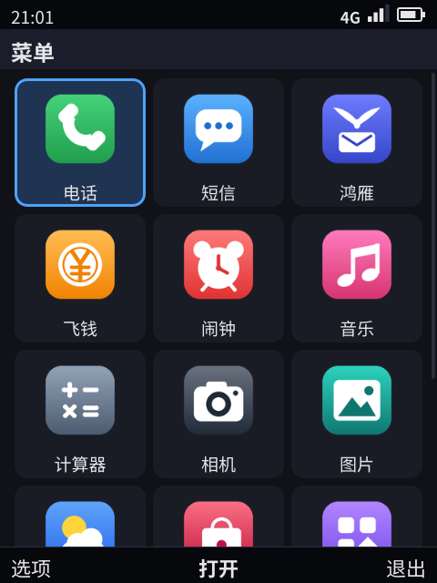
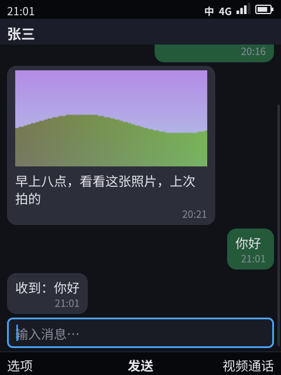
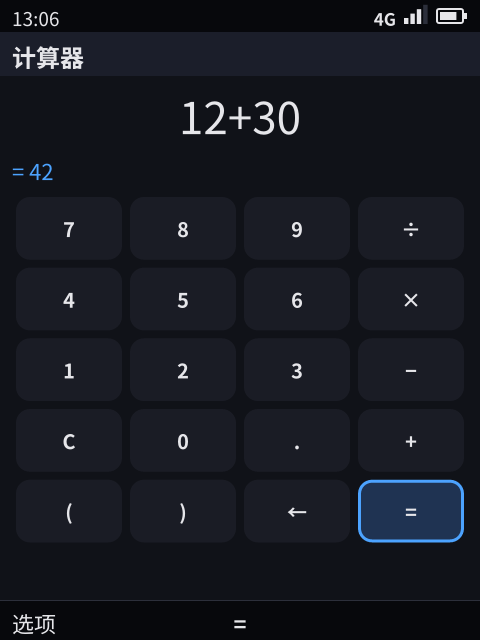
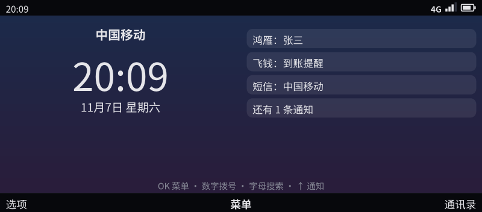

> English translation of [the Chinese original](../23-renderer-protocol.md). The Chinese text is authoritative; keep both in sync.

# Renderer protocol (phone.frame/1): a replaceable pixel UI

> The pixel renderer is a **replaceable slot**. There are two renderers, both in kario: the in-house phone-paint (Apache-2.0) is the renderer on the device; phone-gui (Slint, GPL-3.0-only) serves as a reference to compare it against and does not go into the device image (§10). This document is the protocol specification between the Shell and the renderer, and community members writing their own renderers follow it as well.
>
> Status: protocol v1, handshake, version check, incremental frames (`patch`), layout reports (`layout`), media frames passed straight through shared memory (`shm`), the slot in the image, two renderers (both with animations), the renderer sandbox, the watchdog and the license check are implemented. **Not implemented**: dmabuf (§9).

## 0. Why a protocol and not a library

| Requirement | Approach |
|------|------|
| The platform is open source, the renderer may be closed source | The renderer is a **separate program** launched by the Shell, and the two sides exchange JSON lines only through this protocol (standard input, standard output). No linking, no shared libraries, so the licenses do not affect each other (§8) |
| Swapping the renderer does not change behavior | Semantics such as focus, navigation, menus, permissions and the input method all live in the Shell. The renderer does only two things: draw the frame, and hand key presses back. So the same selftest must still pass with a different renderer (§6) |
| Not tied to any one toolkit | Frames contain only semantics (titles, items, input fields, grids, overlays), with no Slint concepts. Platform code must not depend on how the renderer is written |

The renderer is a **trusted system component**: it sees everything on the screen, including secure screens such as payment codes. It therefore runs with a system identity, not as an app; the rules for secure screens are in §5.

## 1. Processes and transport

- Launch: `phone-shell --gui <program>`. `--gui auto` means the slot `<prefix>/lib/phone/renderer` in the image, which is a link to the actual renderer.
- Shell → renderer: standard input, one JSON message per line.
- Renderer → Shell: standard output, one JSON message per line.
- Standard error: logs, which the Shell writes to `gui.log` in the run directory (in device mode also to the console).
- In tests the Shell adds the arguments `--headless --snap-dir <dir>`: no display device is attached, drawing happens in memory, and PNGs are written on request. Any other arguments are defined by the renderer itself.
- File paths appear in frames: the PNGs of app icons. The renderer reads these files directly. Icons come from app packages, so their file size (≤ 512 KB) and dimensions (≤ 256×256) must be checked before reading them. Photo library thumbnails and wallpapers are not given as paths: renderers that declare `shm` take them from shared memory (§4.2), and for other renderers the pixels are put directly into the frame (`pixels`).
- **The Shell supervises the renderer**: after the renderer exits (crashes, is killed by the kernel), the Shell starts it again and sends a complete frame; all state lives in the Shell, so nothing is lost. After 3 crashes within one minute it switches to the fallback renderer `<prefix>/lib/phone/renderer-fallback` (if installed; `--gui-fallback` can name one); without a fallback it keeps restarting at a slower pace (`shell/watchdog.go`).

## 2. Handshake and versions

The Shell sends `hello` first:

```json
{"t": "hello", "proto": "phone.frame/1", "device": {"id": "bar-t9", "keypad": "t9", "width": 480, "height": 640, "scale": 2}}
```

QWERTY keyboard SKUs additionally carry `fn` in `device`: the Fn layer, mapping each key's own character to the character it types while Fn is held (`{"w": "1", ".": "0", ...}`, taken from the `[fn]` table of the keyboard configuration, [24](24-sku-framework.md) §1). When the screen mode is larger than the form factor's size (a dev board connected to an HDMI monitor), phone-paint still draws at the form factor's size, centered on the screen.

The renderer replies with `ready`:

```json
{"t": "ready", "proto": "phone.frame/1",
 "renderer": {"name": "phone-paint", "version": "0.1.0", "license": "Apache-2.0", "toolkit": "tiny-skia + ab_glyph"},
 "features": ["snap", "images"],
 "display": {"width": 480, "height": 640, "scale": 2}}
```

Version rules:
- `proto` is `phone.frame/<major>[.<minor>]`. **The major version must be the same**; otherwise the Shell refuses to start and reports both sides' versions; a renderer that finds the Shell's major version differs exits with exit code 3.
- Minor versions only add things: new fields are all optional, and a side that does not recognize a new message type ignores it. Both sides must ignore fields and messages they do not recognize.
- A renderer whose `ready` lacks `proto` is always rejected. If no `ready` arrives within 10 seconds, the Shell gives up and closes it.

The identity in `renderer` (`name`, `version`, `license`, `toolkit`) is recorded in the Shell log, in 「关于本机」 (About phone) and in the CTS report.

`features` are the capabilities the renderer declares:

| Feature | Meaning |
|------|------|
| `snap` | Can write a PNG screenshot on `snap`. The pixel checks of the selftest and the CTS need it; without it, screenshot steps report an error instead of being skipped silently |
| `kms` | Drives the display itself (DRM/KMS) |
| `keys` | Reads the keyboard itself and sends key presses to the Shell |
| `images` | Can draw the `image` field (pixel images) and PNG paths |
| `anim` | Has animations (focus movement, overlays appearing). A renderer without animations still qualifies |
| `sandboxed` | Has dropped privileges after opening the display and input devices: no network, not root, cannot gain privileges again (§5) |
| `landlock` | File access is additionally restricted by Landlock to the font and icon directories (§5) |
| `seccomp` | System call filtering that at least forbids running programs (§5) |
| `patch` | Can receive `patch` messages (§3): the Shell switches to sending increments |
| `layout` | Sends `layout` (§3) each time it has laid out a frame and the geometry has changed. Still qualifies without it |
| `shm` | Receives media surfaces over the side channel (`side_fd` in `hello`) and takes pixels from shared memory according to the frame's `surface` (§4.2). Without it, the Shell keeps putting pixels into the frame |
| `power` | Takes `power`: turns the panel off and on as the Shell asks (phone-paint disables the CRTC and the panel driver powers the panel and its backlight down); while off it draws no frames, and on again it draws the last frame received meanwhile |
| `mouse` | Uses a mouse as keys: the wheel moves the focus up and down (a horizontal wheel left and right), the left button is OK, the right one Back, the middle one Options. Keyboards and mice plugged in after start are picked up too (§5) |
| `pointer` | Gives the mouse a pointer: drawn as soon as it moves, hidden while typing; with the pointer shown a left click on a body node sends `tap`, on the soft-key bar that soft key (left `tab`, middle `enter`, right `f2`), over a dialog `enter`, and with no pointer the left button is still `enter`. The Shell works the same without it |

`display` is the panel the renderer **actually** drives. On the device the display mode is authoritative, not the device profile. A renderer that does not know the size at startup can leave it out at first; when it learns the size or the size changes, it sends a `display` message. The Shell's layout decisions (for example the number of grid columns: 3 in portrait, 5 on a wide screen) adjust to it.

## 3. Messages

| Direction | `t` | Fields | Description |
|------|-----|------|------|
| Shell → renderer | `hello` | `proto`, `device`, `side_fd` | The first message; `side_fd` is the side channel the renderer inherits (§4.2) |
| | `frame` | see §4 | A complete frame. Sent only when the content has changed |
| | `patch` | `patch` | An incremental frame: a JSON merge patch (RFC 7386) against the previous frame, sent only to renderers that declare `patch` (§4.1) |
| | `snap` | `name`, `echo` | Write the current picture as `<name>.png`, once drawing is done and animations have stopped. When `echo` is true, the reply includes the frame the renderer holds |
| | `quit` | — | Exit. If the renderer has not exited after 3 seconds, the Shell kills it |
| | `power` | `on` | The panel on (true) or off (false): the screen timeout, a key waking it (the Shell's screen management, [11](11-platform-architecture.md)). Only to a renderer that declared `power` |
| Renderer → Shell | `ready` | `proto`, `renderer`, `features`, `display` | The answer to `hello` |
| | `display` | `display` | The panel size has changed |
| | `key` | `key`, `text`, `long` | One key press |
| | `power` | `on`, `err` | The answer to `power`: the panel's state now; a non-empty `err` means it could not be switched |
| | `input` | `name`, `kind`, `added` | A keyboard (`keyboard`) or mouse (`mouse`) was plugged in (`added` true) or out, such as an external keyboard on the USB-C port |
| | `snapped` | `name`, `err`, `frame` | `snap` is done; a non-empty `err` means it failed; `frame` is the frame the renderer merged, when `echo` was requested |
| | `tap` | `screen`, `node`, `tile` | The pointer clicked body node `node` of the frame for `screen` (in a grid, tile `tile`; 0 for other nodes). The Shell moves the focus there and treats it as OK; it ignores the click when `screen` is not the frame it sent last, a dialog is up, the keypad is locked, or the node cannot take the focus |
| | `layout` | `layout`: `screen`, `area`, `offset`, `nodes` | The geometry (in logical pixels) of the frame just laid out: the height of the body area, the scroll offset, and the `y` (relative to the top of the body) and `h` of each node in `body`. When the renderer declares `kms` (so it is the screen), the Shell uses this to decide whether the focused node is taller than the body area and how far to scroll inside it each time (80% of the visible area, with an overlap between consecutive screens), instead of estimating from the text layout; later it will also serve accessibility and touch |

Key presses:
- Function keys go in `key`: `enter`, `esc`, `tab`, `up`, `down`, `left`, `right`, `backspace`, `f2`, `f3`, `f4` (may also be written `end`, the hang-up key), `call` (the call key), `ime` (Chinese / English), `sym` (symbols).
- For character keys `key` is empty and the character goes in `text`.
- Long press: `long` is true; on the T9 keypad (12-key), holding a key for 600 ms counts as a long press.
- What a key press means (typing, navigation, soft keys) is decided entirely by the Shell; the renderer only reports it faithfully.

## 4. Frames

Each frame describes the complete picture. The Shell sends a frame only when the content changes; when the renderer declares `patch`, the Shell may send a patch against the previous frame instead (§4.1).

| Field | Description |
|------|------|
| `t` | Always `frame` |
| `screen` | ID of the current screen (for debugging and screenshots) |
| `status` | Status bar, see below |
| `title` | Title bar |
| `loading` | When non-empty, a loading indicator is shown |
| `body` | List of nodes, see below |
| `focus` | Index in `body` of the focused node; -1 means none |
| `scroll` | Scroll position: `pos` (0 at the top to 1 at the bottom), `frac` (when the focused node is taller than the screen, the position inside that node; otherwise -1) |
| `soft` | Text of the three soft keys: left, middle, right |
| `ime` | Input method candidate rows, see below |
| `toast` | Short-lived message |
| `banner` | The lines of text of a notification banner |
| `overlay` | System overlay, see below; when present it covers everything |
| `boot` | Boot screen: `progress` (0–1), `brand` (system name) |
| `idle` | Idle screen: `time`, `date`, `operator`, `lines` (active idle information), `hint`; `wallpaper`: the wallpaper (a pixel image, screen-sized, delivered only through shared memory to renderers that declare `shm`; while the keypad is locked it is the lock screen wallpaper). When there is a wallpaper, all text is white, over a black overlay that fades from top to bottom |
| `layout` | Where body content goes when it is shorter than the body area: empty (top), `center` (centered slightly below the middle, with 55% of the free space above it; Music's now playing, photo viewing), `bottom` (at the bottom; Calculator) |
| `theme` | Color scheme: empty (dark), `light` (light), `retro` (retro green), `amber` (amber). Changed by 设置 › 主题 (Settings › Theme); the renderer switches the whole set of colors accordingly, while photos and web pages stay unchanged |
| `zoom` | 设置 › 大字号 (Settings › Large text): when greater than 0, the renderer scales the whole frame up by this factor (the scale factor is multiplied by it and the logical size shrinks accordingly), and layout reports are computed at the scaled-up size; when absent, normal size. phone-paint handles it, phone-gui ignores it |

`status` (status bar): `time`; `mid` (indicator text in the middle) and `mid_kind` (`call` call, `secure` secure screen, `mic` recording, `location` location; the renderer picks a color from it); `ime` (input method state); `net`; `signal` (0–4 bars); `battery` (percent); `charging` (connected to power, optional); `locked` (keypad lock, draws a padlock).

Nodes in `body` (`FrameNode`):

| Field | Description |
|------|------|
| `kind` | `text`, `section`, `item`, `input`, `button`, `image`, `media`, `doc`, `progress`, plus `grid` (grid) and `bubble` (chat bubble), which the Shell synthesizes. The body text of a `bubble` is in `title` (when `text` is also present, `text` is the body text and `title` is the sender); time and status are in `subtitle` / `trailing`; `out` means sent by the user |
| `style` | Text style: `dim`, `accent`, `title`, `ok`, `warn`, `big`, `display` (Calculator's result: enlarged as far as the screen width allows, right-aligned) |
| `text`, `title`, `subtitle`, `trailing`, `badge`, `icon`, `label` | Text content; `icon` is a single-character icon used by the text UI |
| `icon_image` | PNG path of the icon (when the system lists apps) |
| `placeholder`, `value`, `preedit`, `secret` | Input field: hint, content, the part the input method is composing, whether to display it as a password |
| `out` | The bubble was sent by the user |
| `focused` | Has focus |
| `image`, `pip` | Pixel image (see below); `pip` is the small window in a video call |
| `waiting` | Hint shown while the media has not arrived yet |
| `fill` | The image fills the body area (web pages) instead of being shrunk to the image height limit |
| `doc` | Document: text runs laid out line by line; each run (`FrameRun`) has `text`, `col` (starting column), `width`, `box` (box-drawing characters), `fg`, `bg`, `bold`, `italic`, `under` |
| `columns`, `tiles`, `sel` | Grid: number of columns, tiles, selected tile (-1 means none) |
| `fraction` | Fraction of the progress bar (0–1) |

Grid tiles (`FrameTile`): `icon`, `image` (PNG path; when present, `icon` is not drawn), `pixels` (pixel image in the same format as `FrameImage`; used for photo thumbnails, so the renderer never reads photo library files directly), `title`, `badge`, `focused`; `photo`: this tile is a photo or video (the grid of the Photos app), the image fills the tile with no title drawn, focus is shown as an outline, and `badge` is drawn on top of the image (the video's duration). Photo tiles more than 4 rows away from the row with the focus carry no `pixels` and are drawn as empty tiles: the size of a frame depends only on one screen, not on how many photos the library holds.

Pixel image (`FrameImage`): `w`, `h`, `rgb` (base64, `w × h × 3` bytes), `secure` (secure screen, see §5), `pixelated` (no smoothing when scaled up); or `surface`, `seq`: the pixels are in shared memory (§4.2), with no `rgb`. An app's canvas node (`canvas`, [22](22-developer-api.md) §3) is drawn as pixels by the Shell and reaches the renderer as an `image` node (`pixelated`, one unit per pixel), so the renderer does not need to know about canvases.

Input method candidate row (`FrameIMERow`): `items`, `sel`, `active` (this is the row currently being chosen from), `numbered` (chosen by number), `more` (there is another page).

Overlay (`FrameOverlay`):

| Field | Description |
|------|------|
| `kind` | `menu`, `confirm`, `perm`, `auth`, `scan`, `capture`, `picker`, `incoming`, `alarm` |
| `title`, `lines`, `warn`, `note`, `note_bad`, `footer` | Text; `note_bad` means the note is an error |
| `items`, `query` | Menu items (`FrameMenuItem`: `header` group heading, `text`, `key` shortcut key, `sel` selected); the search term of the command palette. The permission dialog (`perm`) also uses `items` to list each requested permission, and every one of them must be drawn |
| `choices`, `choice` | Buttons and the currently selected button |
| `pin` | PIN digits for trusted confirmation: entered, total length |
| `image`, `phase` | Viewfinder picture; animation position 0–1 (scan line, incoming call), -1 means none |
| `tiles`, `columns` | The grid of the picker and of the share panel |

Rules:
- The renderer must draw every node type and every overlay type. When it meets a type it does not know (from a newer minor version), it must at least draw its text and must not drop it altogether.
- Overlays are system UI: they are always drawn on top, and app content cannot cover them.

### 4.1 Incremental frames (`patch`)

- A patch is a JSON merge patch (RFC 7386): it lists only the members that changed; a value of `null` deletes that member; objects are merged member by member; arrays and all other values are replaced whole.
- The renderer keeps the JSON of the previous frame, merges each `patch` into it, and then parses the result as described in §4. A renderer that has just restarted first receives a complete `frame`.
- One extension: an array whose length has not changed is patched element by element, written as `{"$set": {"<index>": <element patch>}}`. When the focus moves within a grid, only the `focused` changes of two elements are sent, rather than the whole row of thumbnails again. Frames never contain a member named `$set`, so it cannot be confused with ordinary content.
- The Shell sends a patch only when it is smaller than the full frame, so `frame` and `patch` messages alternate.
- **End-to-end check**: for renderers that declare `patch`, the Shell sets `echo` on every `snap`; the renderer puts the frame it merged into `snapped`, and the Shell compares it field by field with its own frame, failing the step if they differ. So every screenshot step in the selftest checks the patches along the way.
- Effect: for the full selftest on a dev machine (bar phone with a T9 keypad, phone-paint), 343 of 345 frames were sent as patches, 5.2 MB in total, against 9.8 MB as full frames. Small changes such as the status bar clock, the animation phase, input method candidates and the focus in a grid take only a few dozen bytes; the bulk that remains is the video call picture, which changes every frame and is handled by passing it straight through shared memory (§4.2).

### 4.2 Media surfaces (`shm`)

Video pictures are not put into frames:

- **Shared memory**: mediad creates one memfd per video stream: a 32-byte header (`PHSURF1\0`, width, height, latest buffer, the frame numbers of the two buffers, little-endian), followed by two RGB buffers. mediad writes the buffer that is not being displayed and switches over when it is done; the size is sealed, so the reader's mapping never becomes invalid. The reader takes the latest buffer and checks its frame number before and after copying (to be overwritten mid-copy, two frames would have to be written in a row, which almost never happens at 15 frames per second); if they do not match, it copies again.
- **Handover**: the Shell subscribes to `surface` from mediad and receives an fd; it sends the renderer a message `{"t": "surface", "id", "w", "h"}` over the side channel with the fd attached (`SCM_RIGHTS`), once per surface, and again after the renderer restarts. The side channel is a `SOCK_SEQPACKET` socket pair the Shell creates when it launches the renderer; the renderer inherits it as fd 3 and can still receive on it after dropping privileges and after seccomp (which forbids creating new sockets).
- **Per frame**: mediad tells the Shell only the new frame number (4 bytes), the Shell writes `{"surface": id, "seq": n}` into the frame, and the patch is only a few dozen bytes; the renderer takes the pixels from shared memory according to `surface`.
- **Effect**: for the same video call (dev machine, bar phone with a T9 keypad), 54 KB is sent to the renderer through shared memory against 534 KB through base64 (renderer without `shm`). Both renderers declare `shm`; the text UI still subscribes to full frames the old way.
- **Web pages**: a `web` node appears in the frame as `kind: "media"`, `fill: true`, with the surface name `web:<app>/<screen>/<node>`. The surface is created by the web view process `phone-webview` with the same layout and handed to the Shell over the control channel between the two; the Shell passes it on to the renderer as above, and renderers without `shm` receive base64 full frames.
- **A surface of the same name with new memory** (the same node opened a new page): the Shell remembers which shared memory (by inode) it sent for each surface name and sends `surface` again once when it changes; when the renderer receives a surface with a name it already has, it switches to the new mapping and unmaps the old one.
- **The Shell's own surfaces**: photo thumbnails (`thumb:<photo>@<side>`, cropped to the size of one grid tile) and wallpapers (`wallpaper:idle`, `wallpaper:lock`, screen-sized) are created by the Shell and written once. When the wallpaper changes, `seq` is incremented, so the frame changes and the new surface is sent along with it. The picture of a video (`video.open`) is a mediad surface whose name is the player's ID.
- **Surfaces no longer in use**: when a frame no longer mentions a surface, the Shell sends `{"t": "drop", "id"}` (without an fd) over the side channel after that frame, and the renderer unmaps it; if it is needed again later, the Shell sends `surface` again. On the Shell side, a thumbnail surface is closed in the first frame where it no longer appears, so photos that have been scrolled past take no memory.

## 5. Security requirements

- **Secure screen**: pixel images with `secure` set to true (payment codes) must be masked in screenshots. A status bar `mid_kind` of `secure` means the current screen is a secure screen (payment code, trusted confirmation), which has to be signaled with a conspicuous color. Apart from the display panel, the renderer must not hand the picture to any other process.
- **Key presses come only from the keyboard**: the renderer must not synthesize key presses on its own.
- **Overlays cannot be covered** (§4).
- **The renderer must drop privileges**: it can see payment codes and also decodes icons from app packages, so it is attack surface. Both renderers implement four layers and report them in `features` only after their self-check passes:
  | Layer | phone-paint | phone-gui |
  |----|-------------|-----------|
  | `sandboxed`: empty network namespace, nobody, no_new_privs | Drops privileges after opening the graphics card as root; keyboards and mice are opened by an input helper forked before that | Drops privileges right at startup, keeping only the video and input groups; the first process to open the graphics card automatically becomes DRM master, so no root is needed; libinput opens the keyboard itself |
  | `landlock`: file allowlist | Read-only `/usr` and the icon directories of installed apps | In addition `/sys`, `/run/udev`, `/etc/udev`, which libinput reads, plus read/write `/dev/dri`, `/dev/input` |
  | `seccomp`: system call filtering | Everything the app sandbox denies, plus `execve`, `socket`, `fork` | Everything the app sandbox denies, plus `execve` (libinput needs netlink sockets, so `socket` cannot be denied; the absence of network is guaranteed by the network namespace) |
  | Self-check | Cannot read `/etc/shadow` or `/etc/passwd`, cannot connect to local ports, `socket()` is denied | Cannot read `/etc/shadow` or `/etc/passwd`, cannot connect to local ports, `ptrace` is denied |
  Photo thumbnails and wallpapers are given to the renderer as pixels by the Shell (embedded or through shared memory), so the renderer cannot read the photo library.
- **Keyboards and mice plugged in later**: once phone-paint has dropped its privileges it can open nothing under `/dev`, so before that it forks an input helper (`paint/src/input.rs`, the way seatd and logind open devices for compositors): it watches `/dev/input` with inotify, opens new keyboards and mice and passes their file descriptors to the renderer over a socket. The helper keeps only the capability to read device nodes (`CAP_DAC_READ_SEARCH`), runs as nobody with no network and with Landlock allowing nothing but `/dev/input`, closes every other descriptor it inherited (the graphics card's included) and reads nothing from the renderer: a compromised renderer cannot make it open any other file.

## 6. Conformance checks: what to run when swapping the renderer

| Check | Command | What it proves |
|------|------|----------|
| Full selftest | `phone-shell --selftest --gui <renderer> --device <form-factor> --pixel-dir <dir>` | Every case passes with this renderer, and every screenshot step produces an image (needs `snap`) |
| CTS | `phone-shell --cts <report> --gui <renderer>` | The report's `renderer` field records the renderer's identity and features and is signed together with the report |
| Handshake | `go test ./shell -run TestRendererHandshake` | The same major version connects; a different major version, or not reporting a version, is rejected |
| Docs | `go test ./shell -run TestRendererDoc` | Every field in the frame and every message is documented in this document |
| Watchdog | Selftest case 「渲染器崩溃」 (Renderer crash) (`gui-crash`) | After the renderer is killed, the watchdog starts a new process, handshakes again and resends the current full frame, and subsequent screenshots work as usual; runs both on the dev machine and in the device boot selftest |

## 7. Swapping the renderer in the image (Yocto)

- `phone-renderer` is a virtual runtime package name, and the image only requires that it is present (`PHONE_IMAGE_PACKAGES`).
- The recipes of phone-paint and phone-gui both `RPROVIDES` and `RCONFLICTS` it and install the `/usr/lib/phone/renderer` link. The two recipes conflict with each other, so an image contains only one renderer. The Shell's `--gui-fallback auto` looks for `/usr/lib/phone/renderer-fallback`; the device has only phone-paint, and no recipe installs it.
- `yocto/kas/phone-qemuarm64.yml`: `PREFERRED_RPROVIDER_phone-renderer = "phone-paint"`, so the image contains zero GPLv3; the product images of kario-internal use the same configuration. The reference configuration `yocto/kas/phone-gui.yml` (`make yocto-build KASEXTRA=yocto/kas/phone-gui.yml`) switches to phone-gui with `:forcevariable` (kas writes the sections in name order, so without it the setting would be overridden); phone-gui is the only GPLv3 package allowed in that image (`INCOMPATIBLE_LICENSE_EXCEPTIONS`; bitbake's `license-exception` check only reports and does not fail the build), and it is used only for testing, never shipped.
- The display service `phone-display.service` belongs to phone-fw and starts the renderer in the slot with `--gui auto`; the boot selftest does the same.
- **The image contains no GPLv3**: `INCOMPATIBLE_LICENSE = "GPL-3.0* LGPL-3.0* AGPL-3.0*"`, so there is no obligation under GPLv3 section 6 to provide "Installation Information". The source code obligations for GPLv2 components such as the kernel and busybox apply as usual; libgcc and libstdc++ carry the GCC Runtime Library Exception, which allows any program to use them. The obstacles to deal with in Poky plus systemd (all written in the `no-gplv3` section of `kas/phone-qemuarm64.yml`, one entry each):
  - GNU tar: required by the base package group and systemd, replaced by busybox (oe-core's `no-gplv3.inc`);
  - Test packages (ptest) need make, bash, coreutils and the like: ptest is turned off;
  - bash: needed by the alsa-utils helper scripts, systemd's kernel-install, e2fsprogs' e2scrub, opkg-utils, bash completion and libpam's test package, none of which the image installs; the dependencies are removed and the script interpreter check is skipped;
  - gdbm: the gdbm modules of Python and Perl are turned off; systemd's ukify, glib's code generator, openssl's Perl scripts and the Python part of opkg-utils are not installed, and their dependencies on Python and Perl are removed;
  - Subpackages that contain GPLv3 parts (bzip2's language files, some kbd keymaps) are excluded outright, and QA only reports warnings.
  - Result: the image has 104 packages, and the boot selftest, the CTS, the sound card check and DRM display output all pass ([13](13-prototype.md) §5).
- **Product layer** (closed source, a separate repository): factory configuration (the product image's kas configuration, the cloud services' addresses and trust roots) ✓; device model BSPs **not implemented** (R16).

## 8. License boundaries

| Part | License | Location |
|------|------|------|
| Platform: Shell, system services, SDK, apps, telephonyd, Yocto layer | Apache-2.0 | `LICENSE` |
| phone-paint | Apache-2.0; all dependencies have permissive licenses | `LICENSE` |
| phone-gui | GPL-3.0-only (`gui/COPYING`); Slint is used under its GPLv3 option | `gui/LICENSE` |

- `make license-check` (also part of `make test`) verifies that:
  - Every Go dependency of the platform has a permissive license. Dependencies without a license file must be checked by hand and then registered (for example `go-localereader`, whose README states MIT).
  - Every Rust dependency of phone-paint offers a permissive license option.
  - phone-gui is GPL-3.0-only, and every Rust dependency offers an option usable with GPL-3.0 (a permissive license, or GPL-3.0 itself: the Slint crates).
- The split-out platform repository contains no renderer, and its license check covers only the platform part.
- The Shell sits between apps and renderers: apps only speak `phone.Ui` and never touch the renderer, so the renderer's license has no effect on apps (58 (internal document) §3.2).

## 9. Not done yet

| Item | Description |
|------|------|
| GPU rendering | Needs a real device (R21) |
| dmabuf (R21) | Video frames go straight onto DRM planes through dmabuf (hardware composition), saving even the renderer's copy; needs a real device |

## 10. The two renderers

| Item | phone-paint (on the device) | phone-gui (for comparison, GPLv3) |
|----|---------------------|-------------------|
| Drawing | tiny-skia (shapes, images) plus ab_glyph (text) | Slint's software renderer |
| Dependencies | 74 crates, all offering a permissive license option | 491 crates; 12 Slint crates under GPL-3.0, the rest permissive |
| License | Apache-2.0 | GPL-3.0-only; does not go into the device image |
| Image | `yocto/kas/phone-qemuarm64.yml` | Plus `yocto/kas/phone-gui.yml` (for comparison) |
| Binary size, code size | About 1.4 MB; about 2,750 lines of Rust | About 8.7 MB; about 2,600 lines of Rust plus Slint |
| Capabilities | Headless mode: `snap`, `images`, `patch`, `layout`, `power`, `shm`; on the device: `kms`, `keys`, `images`, `patch`, `anim`, `layout`, `power`, `mouse`, `pointer`, `shm`, `sandboxed`, `landlock`, `seccomp` (DRM/KMS dumb buffer plus evdev, no dependency on libinput or xkb) | Headless mode: `snap`, `images`, `anim`, `patch`, `layout`, `shm`; on the device: `kms`, `keys`, `images`, `anim`, `patch`, `layout`, `shm`, `sandboxed`, `landlock`, `seccomp` (layout geometry taken from the position of each node in the Slint layout) |
| Design | Flat, high contrast, aligned to a grid; focus fade (120ms), scroll easing (140ms); the design system is finalized: color schemes of the four themes, ten font sizes, spacing, corner radii and contrast rules, with tests keeping the code and the documentation in agreement ([26](26-design-system.md)) | Rounded cards, animations; four themes (the first ten colors come from the same palette as the text UI, plus cards, dividers, bubbles, status colors and the idle screen gradient); screens with a fixed dark look, such as incoming call, alarm, boot and secure masking, do not change with the theme |

Verification: the same selftest passes in full on both renderers and all three form factors (`make pixel-selftest` runs phone-paint, `make gui-selftest` runs phone-gui); on the device, the boot selftest, the CTS and DRM display output pass for both images, the `renderer` in the report is the one in the slot, and signature verification passes (for the current baseline see 57 (internal document)).

| Main menu (bar phone, T9 keypad) | Hongyan | Device DRM display output: Calculator | Landscape wide keyboard: idle screen |
|:--:|:--:|:--:|:--:|
|  |  |  |  |

In device mode, phone-paint remembers what is currently on the screen; for a new frame it copies only the rectangle that changed into the dumb buffer and reports only that region to DirtyFB (`damage` in `kms.rs`); if the picture has not changed, it does nothing. With drivers that refresh on demand, such as virtio-gpu, DirtyFB must be called after writing the dumb buffer, otherwise the screen stays black.

**Writing your own renderer is not much work**: the protocol works at the semantic level, and node and overlay types together number fewer than twenty; Chinese needs no complex glyph shaping and can simply be laid out character by character. So there is no need to copy or improve on Slint: writing a dedicated renderer from scratch against our protocol is enough, and the copyright stays entirely ours.
