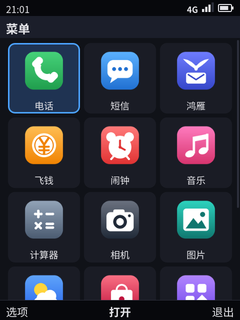
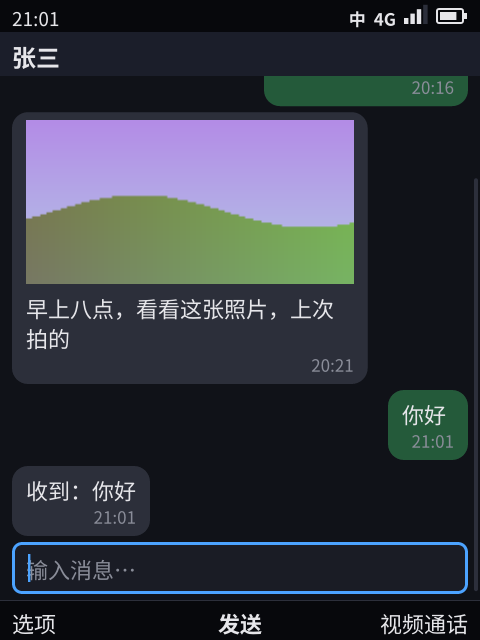
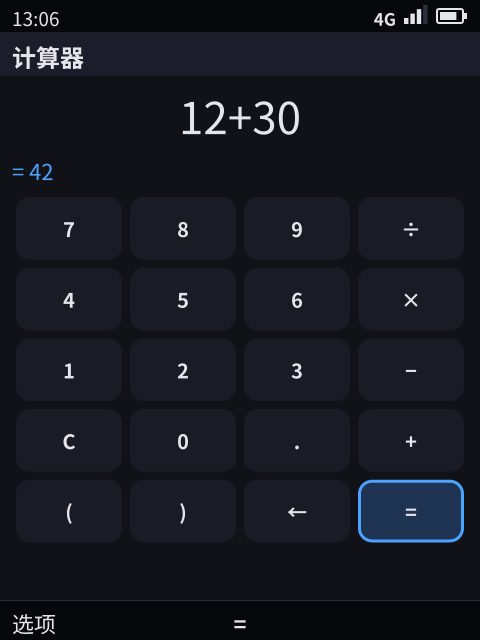
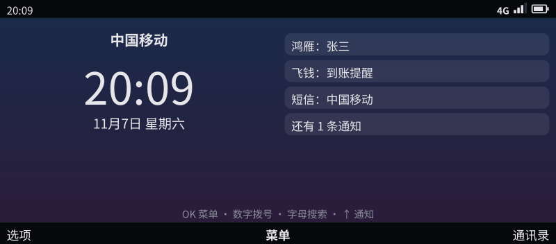

> English translation of [the Chinese original](../23-renderer-protocol.md). The Chinese text is authoritative; keep both in sync.

# Renderer protocol (phone.frame/1): a replaceable pixel UI

> The pixel renderer is a **replaceable slot**. There are two renderers, both in kario: the in-house phone-paint (Apache-2.0) is the renderer on the device; phone-gui (Slint, GPL-3.0-only) serves as a reference to compare it against and does not go into the device image (§10). This document is the protocol specification between the Shell and the renderer, and community members writing their own renderers follow it as well.
>
> Status: protocol v1, handshake, version check, incremental frames (`patch`), layout reports (`layout`), media frames passed straight through shared memory (`shm`), the slot in the image, two renderers (both with animations), the renderer sandbox, the watchdog, the license check and the refresh rate (`rate`, `motion`, phone-paint) are implemented; phone-paint's optional GPU compositing (`gpu`) was verified on QEMU with a software GPU only ([42](42-gpu-rendering.md) §7), its optional rasterizing on the GPU on the developer machine's llvmpipe only; these and switching the refresh rate on a phone are **not tried on a phone**. Settings › Accessibility's high-contrast text, bold text, colour inversion and correction and magnifier (frame fields, §4) and key timing (the `keys` message, §3) were implemented on 2026-11-21: phone-paint handles them (the colour filters and the magnifier on the CPU path only, §4), unit tests ✓, **not tried on a phone**; phone-gui does not (**not implemented**). The touchscreen (feature `touch`, message `touch`, §2, §3) was implemented on 2026-11-25: phone-paint reads the touchscreen of a SKU that has one, follows one finger, places it on the frame and says what it is on, and the Shell turns it into keys ([10](10-keyboard-interaction-model.md) §2.1); unit tests ✓, ✓ on QEMU (the virtio multitouch device: phone-paint reads it driving the panel, `make yocto-gui`; the boot selftest's two touch cases), on the OnePlus 6T **not tried on a phone**; phone-gui reads no touchscreen (**not implemented**). **Not implemented**: dmabuf (§9).

## 0. Why a protocol and not a library

| Requirement | Approach |
|------|------|
| The platform is open source, the renderer may be closed source | The renderer is a **separate program** launched by the Shell, and the two sides exchange JSON lines only through this protocol (standard input, standard output). No linking, no shared libraries, so the licenses do not affect each other (§8) |
| Swapping the renderer does not change behavior | Semantics such as focus, navigation, menus, permissions and the input method all live in the Shell. The renderer does only two things: draw the frame, and hand key presses back. So the same selftest must still pass with a different renderer (§6) |
| Not tied to any one toolkit | Frames contain only semantics (titles, items, input fields, grids, overlays), with no Slint concepts. Platform code must not depend on how the renderer is written |

The renderer is a **trusted system component**: it sees everything on the screen, including secure screens such as payment codes. It therefore runs with a system identity, not as an app; the rules for secure screens are in §5.

## 1. Processes and transport

- Launch: `phone-shell --gui <program>`. `--gui auto` means the slot `<prefix>/lib/phone/renderer` in the image, which is a link to the actual renderer.
- Shell → renderer: standard input, one JSON message per line.
- Renderer → Shell: standard output, one JSON message per line.
- Standard error: logs, which the Shell writes to `gui.log` in the run directory (in device mode also to the console).
- In tests the Shell adds the arguments `--headless --snap-dir <dir>`: no display device is attached, drawing happens in memory, and PNGs are written on request. Any other arguments are defined by the renderer itself.
- File paths appear in frames: the PNGs of app icons. The renderer reads these files directly. Icons come from app packages, so their file size (≤ 512 KB) and dimensions (≤ 256×256) must be checked before reading them. Photo library thumbnails and wallpapers are not given as paths: renderers that declare `shm` take them from shared memory (§4.2), and for other renderers the pixels are put directly into the frame (`pixels`).
- **The Shell supervises the renderer**: after the renderer exits (crashes, is killed by the kernel), the Shell starts it again and sends a complete frame; all state lives in the Shell, so nothing is lost. After 3 crashes within one minute it switches to the fallback renderer `<prefix>/lib/phone/renderer-fallback` (if installed; `--gui-fallback` can name one); without a fallback it keeps restarting at a slower pace (`shell/watchdog.go`).

## 2. Handshake and versions

The Shell sends `hello` first:

```json
{"t": "hello", "proto": "phone.frame/1", "device": {"id": "bar-t9", "keypad": "t9", "width": 480, "height": 640, "scale": 2}}
```

QWERTY keyboard SKUs additionally carry `fn` in `device`: the Fn layer, mapping each key's own character to the character it types while Fn is held (`{"w": "1", ".": "0", ...}`, taken from the `[fn]` table of the keyboard configuration, [24](24-sku-framework.md) §1). A renderer that reads the keyboard handles Fn the Nokia way: the keys type the Fn layer's character while Fn is held, for the next key after a tap, and for every key after two quick taps lock it, until one more tap; each change of state goes to the Shell (`fn-once`, `fn-lock`, `fn-off` in §3), which shows it in the status bar. Shift works the same: held it gives capitals, tapped once the next letter only, tapped twice quickly caps lock (`shift-once`, `shift-lock`, `shift-off`). Keys with an Fn-layer character do not repeat: the press reports the letter as usual, and holding it 600 ms reports a long press once more, with `retype` (the letter was reported at the press), which the Shell replaces with the Fn-layer character (in a text field: the Nokia E71's other way to its digits). Where the keyboard configuration has no Ctrl key, `device` also carries `ctrl`: the combination used as Ctrl (`"fn+sym"`: Fn + Sym, after which the next key is Ctrl + that key, as on the E71). The renderer turns the text-editing combinations into key names for the Shell (§3; what each key does is in [18](18-nokia-form-factors.md) §4.2). phone-paint does this; phone-gui handles neither the Fn layer nor these combinations (**not implemented**). A whole phone with a keypad of its own (a KaiOS-class matrix keypad) also has `keymap` in `device`: the code this phone reports → the code to read it as (`{"139": 59, "2": 513}`: `KEY_MENU` as `KEY_F1`, `KEY_1` as `KEY_NUMERIC_1`, from the board's `[keymap]`, [24](24-sku-framework.md) §7.4); a renderer that reads the keyboard looks it up first and goes on as usual, codes not in it are read as they are, and an input device with any key in it counts as a keyboard. phone-paint does this; phone-gui does not read it (**not implemented**). A SKU whose display has a touchscreen (`touch` in `sku.json`, [24](24-sku-framework.md) §7.4) also has `touch: true` in `device`: only then does a renderer that reads input devices read the touchscreen (`touch` in §3); without it a touchscreen is neither a keyboard nor a mouse (QEMU's multitouch device reports `BTN_LEFT`) and is not read. When the screen mode is larger than the form factor's size (a dev board connected to an HDMI monitor), phone-paint still draws at the form factor's size, centered on the screen. Where the board's `sku.json` says how to use its GPU, `device` also has `gpu` (the path phone-paint takes when `PHONE_PAINT_GPU` is not set: `compose`, `raster`, the CPU without it) and `gpu_render` (the kernel driver of the GPU's render node where the display's device cannot render), see [42](42-gpu-rendering.md) §3, §4; phone-gui does not read them (**not implemented**).

SKUs with a hardware sound switch (`sku.json`'s `sound_switch`, [24](24-sku-framework.md) §7.4) also carry `sound_switch` in `device`: the switch's input device name (`"Alert slider"` on the OnePlus 6T). A renderer that reads input devices opens the device of that name reporting `ABS_SND_PROFILE` (a three-position slider) or the switch `SW_MUTE_DEVICE` (a two-position mute switch: set is `silent`, else `ring`), not as a keyboard: at start it reads which position it is at with `EVIOCGABS` or `EVIOCGSW`, then at each move, and sends `sound_switch` (§3) to the Shell; it is not one of the `input` devices (phone-paint's `paint/src/sound_switch.rs`, Rust unit tests ✓, **not tried on a phone**; phone-gui does not read it). A renderer that does not know the field does not read the switch, and the Shell goes on by the silent mode setting ([20](20-audio.md) §4.1).

A renderer that reads the keyboard times keys as the Shell's `keys` message says (§3, Settings › Accessibility): it repeats the key held itself (the repeat delay, so many a second, 0 for none; the kernel's own repeats are dropped, so a keypad without autorepeat repeats too), and reports a long press when its time comes whether the key repeats or not (the 9-key digits, letters with an Fn-layer character, the end key, Backspace deleting words); slow keys: a key counts as pressed only once held that long, one let go before was never pressed; sticky keys: Shift works on any keyboard as on Nokia's (tapped for the next letter, tapped twice to lock; a USB keyboard without an Fn layer too, and Shift tapped then an arrow selects), Ctrl and Alt tapped are for the next key. Alt + a key (or, with sticky keys, Alt tapped first) reports that key's long press (`long`), as in a terminal; Alt + Backspace is Backspace held. The power key's long press does not follow the setting: 600 ms. Both volume keys pressed together are the accessibility shortcut: the first one down has stepped the volume as usual, after the second neither key's repeats step it, letting one go reports `a11y`, and both held for the long press report `a11y` with `long` (once). phone-paint does this (`paint/src/keygate.rs`, `kms.rs`), **not tried on a phone**; phone-gui does not handle `keys` (**not implemented**).

The renderer replies with `ready`:

```json
{"t": "ready", "proto": "phone.frame/1",
 "renderer": {"name": "phone-paint", "version": "0.1.0", "license": "Apache-2.0", "toolkit": "tiny-skia + ab_glyph"},
 "features": ["snap", "images"],
 "display": {"width": 480, "height": 640, "scale": 2}}
```

Version rules:
- `proto` is `phone.frame/<major>[.<minor>]`. Both sides speak the same major: the Shell offers what it speaks in `hello`, the renderer says which it chose in `ready`'s `proto`, and from then on both speak it. While the Shell speaks one major (now, `phone.frame/1`) `hello` carries `proto` alone; during the transition to a new major the Shell speaks the one before it too, for at least one release, with the oldest in `hello`'s `proto` (all a renderer that does not negotiate reads) and all of them, newest first, in `protos`: `{"proto": "phone.frame/1", "protos": ["phone.frame/2", "phone.frame/1"]}`. A renderer that speaks several majors takes the newest of `protos` it speaks; one that speaks one looks for it in `proto` (or `protos`) and exits with exit code 3 when it is not there. When `ready`'s major is not one the Shell speaks, the Shell refuses to start and reports both sides' versions (`renderer speaks phone.frame/3, this shell speaks phone.frame/2 and phone.frame/1`).
- A renderer of the older major: the Shell turns each line it sends from its own form into that major's, and each line the renderer sends back (`out` and `in` of its entry in `frameVersions` in `shell/gui.go`, which can be `ui.ProtoForm`'s renaming rules: message types and top-level fields renamed, as in [22](22-developer-api.md) §2.1); a line that cannot be turned is dropped and logged. A change inside a frame (the paths of a `patch` too) or to the messages on the side channel (§4.2) needs code of its own (**not implemented**; there is no such change yet). After the transition the old entry is dropped from `frameVersions`.
- There is one major so far, `phone.frame/1`; phone-paint and phone-gui speak it alone and read only `proto`. The mechanism has been gone through on the development machine with a `phone.frame/0` made up in the tests only (`display` is `screen`, `quit` is `bye`; `TestRendererMajors`).
- Minor versions only add things: new fields are all optional, and a side that does not recognize a new message type ignores it. Both sides must ignore fields and messages they do not recognize. The touchscreen (2026-11-25) was added to `phone.frame/1` this way: `device`'s `touch`, `layout`'s `top`, `input`'s `touchscreen` and the `touch` message both ways are new; a Shell that does not know them writes no `touch` into `device`, so the renderer reads no touchscreen and sends it no `touch`; a renderer that does not know them declares no `touch`, so the Shell neither sends nor listens to `touch`; either way both sides have keys only, as before. Input-to-photon timing (2026-11-26, §3.1) was added the same way (the rules of [22](22-developer-api.md) §2.1: only optional fields, features and messages added, nothing renamed, no meaning changed): the feature `latency`, `hello`'s `stats`, `in` on `key` and `touch`, `in` and `start` at the top of `frame` and `patch`, and the messages `shown` and `stats`; a Shell that does not know them sends no `in`, `start` or `stats` and does not listen to `shown`, and the `in` a renderer reports is a field it does not know, ignored as ever; a renderer that does not declare `latency` sends no `in`, and the Shell adds nothing.
- A renderer whose `ready` lacks `proto` is always rejected. If no `ready` arrives within 10 seconds, the Shell gives up and closes it.

The identity in `renderer` (`name`, `version`, `license`, `toolkit`) is recorded in the Shell log, in 「关于本机」 (About phone) and in the CTS report.

`features` are the capabilities the renderer declares:

| Feature | Meaning |
|------|------|
| `snap` | Can write a PNG screenshot on `snap`. The pixel checks of the selftest and the CTS need it; without it, screenshot steps report an error instead of being skipped silently |
| `kms` | Drives the display itself (DRM/KMS) |
| `keys` | Reads the keyboard itself and sends key presses to the Shell; the Shell sends it the `keys` message (key timing, §3) |
| `images` | Can draw the `image` field (pixel images) and PNG paths |
| `anim` | Has animations (focus movement, overlays appearing). A renderer without animations still qualifies |
| `sandboxed` | Has dropped privileges after opening the display and input devices: no network, not root, cannot gain privileges again (§5) |
| `landlock` | File access is additionally restricted by Landlock to the font and icon directories (§5) |
| `seccomp` | System call filtering that at least forbids running programs (§5) |
| `patch` | Can receive `patch` messages (§3): the Shell switches to sending increments |
| `layout` | Sends `layout` (§3) each time it has laid out a frame and the geometry has changed. Still qualifies without it |
| `shm` | Receives media surfaces over the side channel (`side_fd` in `hello`) and takes pixels from shared memory according to the frame's `surface` (§4.2). Without it, the Shell keeps putting pixels into the frame |
| `power` | Takes `power`: turns the panel off and on as the Shell asks (phone-paint disables the CRTC and the panel driver powers the panel and its backlight down); while off it draws no frames, and on again it draws the last frame received meanwhile. Several `power` messages queued are done as the last says, each answered; it waits for the page flip on its way before a change (phone-paint at most 0.5 s) and checks with a flip once the panel is on ([28](28-battery.md) §7) |
| `phase` | Runs an overlay's phase (the scan line, the pulse of a call or an alarm) by itself by the clock (the overlay's `period`, §4): the Shell sends only its start, 0, and the period, the frame stays the same while the phase runs, and the Shell sends no frames for it; snapshots draw the start. Without it the Shell writes the phase of the moment into the frame, as before ([37](37-motion.md) §3) |
| `mouse` | Uses a mouse as keys: the wheel moves the focus up and down (a horizontal wheel left and right), the left button is OK, the right one Back, the middle one Options. Keyboards and mice plugged in after start are picked up too (§5) |
| `pointer` | Gives the mouse a pointer: drawn as soon as it moves, hidden while typing; with the pointer shown a left click on a body node sends `tap`, on the soft-key bar that soft key (left `tab`, middle `enter`, right `f2`), over a dialog `enter`, and with no pointer the left button is still `enter`. The Shell works the same without it |
| `touch` | Reads the touchscreen (when `device` in `hello` has `touch`): follows the first finger to come down until it lifts, the others left alone; places it from the panel onto the frame (centred, the inset rows, a panel turned 90° all taken into account) and sends `touch` (§3), saying at its coming down what it is on. Nothing is reported while the panel is off or the magnifier on; a finger that comes down outside the frame (on the inset rows) is not followed, one that moves out stays on its edge. Headless it is declared too: a `touch` from the Shell is taken as a finger on a touchscreen of the frame's size and answered with the same `touch` (the selftest's touch steps). Without it, the Shell has keys only, as before |
| `timing` | With `timing: true` in `hello`, it answers each frame it receives (`frame` or `patch`) with a `drawn` saying what the frame took (§3). The Shell asks for it only while it records the performance timeline (`kario run -profile`, [29](29-app-development.md) §3); phone-paint has it only headless (it draws each frame the way the panel would and times that, as in [37](37-motion.md) §5), not when it drives a panel (**not implemented**). A renderer without it still qualifies |
| `gpu` | Composes on the GPU (phone-paint: with `PHONE_PAINT_GPU=1` set and GLES 2 working on a GPU, or `soft`, a test mode that takes a software rasterizer too; [37](37-motion.md) §5 item 8, [42](42-gpu-rendering.md); with `PHONE_PAINT_GPU=raster` the GPU paints the display list too, item 10). Only a report; the Shell does not need it; the pictures are those without the GPU, at most 2 levels off |
| `latency` | Numbers each input it reports and times it to the photon (§3.1): `key` and `touch` carry `in`; the Shell names it back in the first `frame` or `patch` that shows its effect and puts `start` in an app's first page; the renderer answers with `shown`, and on `stats` writes its numbers to `hello`'s `stats` file. phone-paint has it on a panel and headless (`paint/src/perf.rs`); phone-gui does not (**not implemented**). A renderer without it still qualifies |
| `rate` | Takes `rate`: paces its frames by the refresh rate phone-displayd chose (each step of motion one period of the panel, never faster than it); a renderer driving a panel switches it to that rate's mode (same size, progressive; phone-paint with `gpu` too, its buffers staying) and answers which it switched to; sends `motion` when an animation begins and stops ([08](08-display-adaptive-refresh.md) §3). Without it the Shell sends no `rate` and the panel stays in the mode it started in |

`display` is the panel the renderer **actually** drives. On the device the display mode is authoritative, not the device profile. A renderer that does not know the size at startup can leave it out at first; when it learns the size or the size changes, it sends a `display` message. The Shell's layout decisions (for example the number of grid columns: 3 in portrait, 5 on a wide screen) adjust to it.

## 3. Messages

| Direction | `t` | Fields | Description |
|------|-----|------|------|
| Shell → renderer | `hello` | `proto`, `device`, `side_fd`, `timing`, `stats` | The first message; `side_fd` is the side channel the renderer inherits (§4.2); with `timing` true it wants each frame's `drawn` (answered only by a renderer that declares `timing`); `stats` is the file a renderer that declares `latency` writes its numbers to (`paint-stats.json` in the Shell's run directory, §3.1; the headless renderers for snapshots get none) |
| | `frame` | see §4; `in`, `start` | A complete frame. Sent only when the content has changed. To a renderer that declared `latency` it may carry `in` and `start` at its top (§3.1) |
| | `patch` | `patch`, `in`, `start` | An incremental frame: a JSON merge patch (RFC 7386) against the previous frame, sent only to renderers that declare `patch` (§4.1); `in` and `start` as in `frame` |
| | `snap` | `name`, `echo` | Write the current picture as `<name>.png`, once drawing is done and animations have stopped. When `echo` is true, the reply includes the frame the renderer holds |
| | `quit` | — | Exit. If the renderer has not exited after 3 seconds, the Shell kills it |
| | `stats` | — | Write the numbers to `hello`'s `stats` file now (§3.1; `phone-shell --dump` sends it). Only to a renderer that declared `latency` |
| | `power` | `on` | The panel on (true) or off (false): the screen timeout, a key waking it (the Shell's screen management, [11](11-platform-architecture.md)). Only to a renderer that declared `power`; the Shell asks for one at a time, the next 250 ms after the answer to the one before, and only for a change ([28](28-battery.md) §7) |
| | `rate` | `hz` | The refresh rate phone-displayd chose ([08](08-display-adaptive-refresh.md)): sent when it changes, and once more after the renderer (re)starts. Only sent to renderers that declare `rate` |
| | `keys` | `repeat_delay`, `repeat_rate`, `long_press`, `slow`, `sticky`, `power_long` | How keys are timed (Settings › Accessibility, §2): the milliseconds a key is held before it repeats, the repeats a second (0 none), the long press's milliseconds, slow keys' milliseconds (0 off), sticky keys, the power key's long press (the power menu) in milliseconds (the long press's, but never below 500). Sent once the renderer is up and again on each change; only to a renderer that declared `keys`. Defaults 250, 30, 600, 0, false, 600 (the kernel's repeat and the long press before) |
| | `touch` | `phase`, `x`, `y` | Only to a headless renderer that declared `touch` (the selftest's `touch` and `touchscreen` steps): a finger on the frame, which the renderer answers with the `touch` it would send for its own touchscreen (with `hit` at `down`). A renderer driving a panel does not take it: touches come only from the touchscreen (§5) |
| Renderer → Shell | `ready` | `proto`, `renderer`, `features`, `display` | The answer to `hello` |
| | `display` | `display` | The panel size has changed |
| | `key` | `key`, `text`, `long`, `ms`, `in` | One key press; the power key's also has `ms`: how many milliseconds it was down (a short press up to its release, a long one up to the long press time); a renderer that declared `latency` adds `in`: the input's number (§3.1; the power key has none) |
| | `power` | `on`, `err`, `ms`, `warn` | The answer to `power`: the panel's state now; a non-empty `err` means it could not be switched; `ms` is how many milliseconds the change took; `warn` what the renderer found wrong about a change that did happen (phone-paint: no page flip completed within 0.5 s of the panel coming on, so it may not have come up; the flip before never completed). When the answer to turning the panel on carries `warn`, the Shell turns the panel off and on once more (once only), the backlight waiting for the second time ([28](28-battery.md) §7) |
| | `input` | `name`, `kind`, `added`, `ok` | A keyboard (`keyboard`), mouse (`mouse`) or touchscreen (`touchscreen`, only with `touch` in `device`) was plugged in (`added` true) or out, such as an external keyboard on the USB-C port; `ok`: it can press OK (a key read as Enter, also by the board's keymap; a mouse's left button; a touchscreen, whose taps choose), which the phone's power and volume keys cannot. When nothing connected can press OK, the Shell lets the power key answer the power menu ([28](28-battery.md) §7); from a renderer that sends no `ok` a device counts as able to |
| | `sound_switch` | `position` | Where the sound switch is (when `device` has `sound_switch`): `ring`, `vibrate` or `silent` (the kernel's `SND_PROFILE_RING`, `_VIBRATE`, `_SILENT`; a two-position mute switch has only `ring` and `silent`); once with the current one when the device is opened, then at each move. The Shell sets the sound mode by it, without a toast for the first report ([20](20-audio.md) §4.1) |
| | `snapped` | `name`, `err`, `frame` | `snap` is done; a non-empty `err` means it failed; `frame` is the frame the renderer merged, when `echo` was requested |
| | `rate` | `hz`, `err` | The answer to `rate`: the panel's rate now; a non-empty `err` means it could not switch (the panel has no mode of that rate, or `set_crtc` failed), and `hz` is the one still in use. A headless renderer answers the rate it was sent. The Shell passes it on to phone-displayd |
| | `motion` | `on` | An animation began (true: scroll easing, focus slide, transitions, banners and toasts sliding) or stopped (false), once each; the Shell passes it on to phone-displayd, which uses the high rate during it and holds it 400 ms after. Slow changes such as the blinking cursor or a spinner are not reported |
| | `tap` | `screen`, `node`, `tile` | The pointer clicked body node `node` of the frame for `screen` (in a grid, tile `tile`; 0 for other nodes). The Shell moves the focus there and treats it as OK; it ignores the click when `screen` is not the frame it sent last, a dialog is up, the keypad is locked, or the node cannot take the focus |
| | `touch` | `phase`, `x`, `y`, `hit` | The finger followed on the touchscreen (a renderer that declared `touch`): `phase` is `down`, `move` (only once it is at least a logical pixel from where it was last reported), `up` or `cancel` (the device gone, events lost, the panel turned off); `x`, `y` are where it is on the frame, in logical pixels, at Large text's size as in `layout`; `down` carries `hit`: what the finger came down on, as the renderer drew the frame (table below); while a list scrolls or a highlight glides, as the step on the panel then shows it (phone-paint takes the touchscreen's reports between an animation's steps, not after it, Rust unit test `a_touch_during_a_scroll_is_on_what_shows`). Taps, drags, swipes and long presses are told apart by the Shell and turned into keys ([10](10-keyboard-interaction-model.md) §2.1); the Shell listens only to a renderer that declared `touch`. A renderer that declared `latency` adds `in` to each report (§3.1) |
| | `shown` | `app`, `ms` | The first page of the app a frame's `start` named reached the panel: the milliseconds from its process's start, a whole number (§3.1). The Shell logs a line |
| | `layout` | `layout`: `screen`, `area`, `offset`, `top`, `left`, `width`, `content`, `nodes` | The geometry (in logical pixels) of the frame just laid out: the height of the body area, the scroll offset, and the `y` (relative to the top of the body) and `h` of each node in `body`; `top` is how far down the frame a `y` of 0 is drawn (the scroll offset not taken off; phone-paint reports it, and the selftest's touch steps find a row by it); `left` and `width` are where the nodes are drawn across the frame (a tap on a progress bar is placed in its tenths by them), `content` the height of the whole body laid out (how far a drag can scroll, and whether all of the page shows, [10](10-keyboard-interaction-model.md) §2.1). When the renderer declares `kms` (so it is the screen), the Shell uses this to decide whether the focused node is taller than the body area and how far to scroll inside it each time (80% of the visible area, with an overlap between consecutive screens), instead of estimating from the text layout; later it will also serve accessibility |
| | `drawn` | `n`, `parse_ms`, `layout_ms`, `draw_ms`, `transition_ms` | What frame `n` (counted from 1, `frame` and `patch` alike) took, in milliseconds: reading it, laying it out, each step of drawing it as the panel would (a step of the frame's motion every period of the panel's rate: the last `rate`, else 60 Hz, 16.7 ms), each step of the transition it starts. Sent only when `hello` asked; the Shell writes it into the performance timeline (`shell/trace.go`); the times are this machine's, not a phone's |

Key presses:
- Function keys go in `key`: `enter`, `esc`, `tab`, `up`, `down`, `left`, `right`, `backspace`, `f2`, `f3`, `f4` (may also be written `end`, the hang-up key), `call` (the call key), `ime` (Chinese / English), `sym` (symbols), `a11y` (the accessibility shortcut: both volume keys together, §2; with `long`, both held); the QWERTY Fn state `fn-once` (tapped), `fn-lock` (locked), `fn-off` (back to letters), and Shift's `shift-once`, `shift-lock`, `shift-off`, which are not key presses and only change the status bar's mode indicator; a full keyboard's text-editing keys `first`, `last` (Fn + ← →, Home, End), `pageup`, `pagedown` (Fn + ↑ ↓), `delete` (Shift or Fn + Backspace, Delete), `copy`, `cut`, `paste`, `selectall`, `undo` (Ctrl + C, X, V, A, Z), `lang` (Shift + Chr, Fn + Space: the writing language). Arrows, `first` and `last` with Shift held also carry `shift` set to true (selecting). None of these come from the T9 keypad.
- For character keys `key` is empty and the character goes in `text`. A character key pressed with Chr held also carries `chr`: which press in a row of the same key it is (from 1); the Shell types its nth variant in place of the one before. Chr tapped alone reports `sym` (on release).
- Long press: `long` is true; on the T9 keypad (12-key), holding a key for 600 ms counts as a long press; the power key is a long press once held for `power_long` with the kernel saying it is still down, a short press when let go before, each reported once, autorepeats adding nothing ([28](28-battery.md) §7); on a QWERTY keyboard a key with an Fn-layer character held 600 ms is reported as a long press too, with `retype: true`: the character was reported at the press, and the long press replaces it; on a QWERTY keyboard, once Backspace has been held 600 ms each of its repeats carries `long` (it deletes a word).
- What a key press means (typing, navigation, soft keys) is decided entirely by the Shell; the renderer only reports it faithfully.

What a touch came down on (`hit` of `touch`, at `down` only): the renderer says it from the frame as it drew it; the Shell does not know where things are drawn.

| `area` | Also | What it is |
|--------|------|--------|
| `soft` | `soft`: 0, 1, 2 | The soft-key bar, in thirds from the left |
| `status` | — | The status bar |
| `title` | — | The title bar |
| `ime` | `row` | A candidate row of the input method, from the top (the Shell does not use it yet) |
| `body` | `screen`; `node`, `tile` | The body of the frame for `screen`: node `node` (in a grid tile `tile`, 0 for other nodes); between nodes there is no `node` |
| `overlay` | `kind`; `item`, `choice` or `tile` | An overlay of kind `kind`: on entry `item` of its `items` (a menu's entry, a cell of the symbol table; group headers do not count), button `choice` of its `choices` or tile `tile` of its `tiles`; elsewhere on the overlay none of the three. The soft-key bar under a menu or dialog is still `soft`; a full-screen overlay (the viewfinder, a picker, an incoming call, an alarm) covers it |
| `outside` | `kind` | The dimmed screen around a menu or dialog |
| `idle`, `boot` | — | The standby screen, the boot screen |

### 3.1 From input to photon (`latency`)

A renderer that declares `latency` numbers each input it reports: every `key` and every `touch` report (`down`, `move`, `up`, `cancel`) carries `in`, a whole number from 1 that only grows (the power key gets none). It notes when the input happened: a renderer that reads the input devices takes the kernel's timestamp of the event, having switched the device's clock to `CLOCK_MONOTONIC` with `EVIOCSCLOCKID` (when that fails, or the timestamp is in the future or more than 10 seconds old, the moment it read the event); the inputs it plays itself (phone-paint's `PHONE_PAINT_PLAY`, [39](39-oneplus-6t.md) §8.1) the moment it played them.

The Shell notes each input with an `in` once it has handled it; the next `frame` or `patch` it sends carries `in` at its top: the numbers of the inputs handled since the frame before, an array. That frame is the first to show their effect. When there is no frame to send (the inputs changed nothing) the Shell drops the numbers, unless the foreground app still owes an answer (an action of it not back yet, keys held for it, its first page still to come): then they wait for its frame, 2 seconds at most. Turning the screen off drops them all.

For an app the Shell started (not one it took over, not a system one) the frame of its first page (a frame whose `screen` is not empty) carries `start` at its top: `{"app": "<app id>", "at": <when its process started, CLOCK_MONOTONIC microseconds>}`, within 30 seconds of the start. The renderer answers with `shown` when that frame reaches the panel; the Shell logs `com.example.notes first page shown 212ms after start`, counted from the process's start as the `ready 24ms after start` line is.

The photon: for a frame drawn with a page flip, the moment that flip completed (DRM's flip event; the vblank time in the event when the driver's `DRM_CAP_TIMESTAMP_MONOTONIC` is 1, else the moment the event was read); for one drawn in place (no flip), the moment it was handed to the display; when nothing was drawn (the panel already showed it) the input counts as `unchanged`, with no time. Headless, the moment it was drawn (drawn the way the panel would be, [37](37-motion.md) §5). The renderer takes `in` and `start` out of a frame before it keeps it, so snapshots and `echo` do not see them.

The renderer always keeps (the last 4096 of each kind): each frame's milliseconds of drawing (`draw_ms`) and of handing to the display (`present_ms`), whose sum is the frame time (`frame_ms`); the gaps between consecutive flips in motion, a gap longer than 1.5 periods of the panel counting as late (`late`) and the flips it missed by the period as dropped (`dropped`); input to photon in milliseconds, for keys, repeats and touches each; each app's start to its first page shown. An input that no frame showed within 3 seconds counts as unanswered (`unanswered`). On `stats`, when `PHONE_PAINT_PLAY` has played out, and when it exits, it writes their counts, p50, p95, p99 and maximum, with the verdict against the gate ([39](39-oneplus-6t.md) §8.1), as JSON to `hello`'s `stats` file, replacing it whole; `phone-paint --stats [FILE...]` lays one or more such files out as one table (`/run/phone/paint-stats.json` by default). When the Shell is killed with SIGKILL its renderer is killed with it (`Pdeathsig`) and the write at exit does not happen: for the numbers, `phone-shell --dump` first.

phone-paint does this (`paint/src/perf.rs`, Rust unit tests with synthetic timestamps; the Shell's side in `shell/latency_test.go`; run headless on a development machine with `tools/perf/host.sh`), **not tried on a phone**.

## 4. Frames

Each frame describes the complete picture. The Shell sends a frame only when the content changes; when the renderer declares `patch`, the Shell may send a patch against the previous frame instead (§4.1).

| Field | Description |
|------|------|
| `t` | Always `frame` |
| `screen` | ID of the current screen (for debugging and screenshots) |
| `status` | Status bar, see below |
| `title` | Title bar |
| `loading` | When non-empty, a loading indicator is shown |
| `skeleton` | The app has not sent its first page yet (`loading` then says it is starting): a renderer may draw the outline of a page under the title (the shapes of a few list rows) instead of `loading`'s words; the first page takes its place where it is, and the Shell marks no transition for it ([37](37-motion.md) §3). phone-paint does, with a spinner at the title bar's end; other renderers show `loading` as before |
| `body` | List of nodes, see below |
| `focus` | Index in `body` of the focused node; -1 means none |
| `scroll` | Scroll position: `pos` (0 at the top to 1 at the bottom), `frac` (when the focused node is taller than the screen, the position inside that node; otherwise -1); `offset` (optional): a finger dragged the body to this scroll offset (logical pixels, as `layout`'s `offset`), which the renderer draws as it is, not following the focus nor easing, wherever the focus is; not given after the next key |
| `soft` | Text of the three soft keys: left, middle, right |
| `ime` | Input method candidate rows, see below |
| `toast` | Short-lived message |
| `banner` | The lines of text of a notification banner |
| `overlay` | System overlay, see below; when present it covers everything |
| `boot` | Boot screen: `progress` (0–1), `brand` (system name) |
| `idle` | Idle screen: `time`, `date`, `operator`, `lines` (active idle information), `hint`; `wallpaper`: the wallpaper (a pixel image, screen-sized, delivered only through shared memory to renderers that declare `shm`; while the keypad is locked it is the lock screen wallpaper). When there is a wallpaper, all text is white, over a black overlay that fades from top to bottom |
| `layout` | Where body content goes when it is shorter than the body area: empty (top), `center` (centered slightly below the middle, with 55% of the free space above it; Music's now playing, photo viewing), `bottom` (at the bottom; Calculator) |
| `theme` | Color scheme: empty (dark), `light` (light), `retro` (retro green), `amber` (amber). Changed by 设置 › 主题 (Settings › Theme); the renderer switches the whole set of colors accordingly, while photos and web pages stay unchanged |
| `zoom` | 设置 › 大字号 (Settings › Large text): when greater than 0, the renderer scales the whole frame up by this factor (the scale factor is multiplied by it and the logical size shrinks accordingly), and layout reports are computed at the scaled-up size; when absent, normal size. phone-paint handles it, phone-gui ignores it |
| `transition` | How this frame follows the one before ([37](37-motion.md)): `kind` is `push` (the next level or an app opened), `pop` (back, or home), `rise` (a menu or dialog coming up) or `sink` (it going away); `n` grows by one each time, so a patch that keeps the member is not taken for a new one. Only on that frame; a renderer drawing a real screen goes from the frame on screen to this one (whole pages pushed in and back sideways, the panel rising from below or dropping), and snapshots still draw the end. phone-paint handles it, other renderers ignore it |
| `bump` | The key before this frame moved nothing (the end of a list: neither the focus nor the scroll changed, [37](37-motion.md) §3): which way, `dx` or `dy` -1 or 1 (left out: 0); `n` grows by one each time, so a patch that keeps the member is not taken for a new one. Only on the frame after the key, say `{"dy": 1, "n": 7}`. A renderer drawing a real screen may nudge the focus highlight that way and back, so the key is not taken for lost but for the end; snapshots still draw it at rest. phone-paint does (120 ms, 3 logical pixels), other renderers ignore it |
| `motion` | Settings › Animations: empty (standard), `reduced` (no transitions, banners and toasts do not slide, the focus in lists, grids and the input method's candidate rows and scrolling still ease, the focused row's text cut with an ellipsis still scrolls into view, the end of a list still nudges; standard is reduced to this below 15% battery when not charging), `off` (nothing moves; the phase, the charging battery, the cursor, spinners and cut text stop too, and the end of a list does not nudge). A renderer drawing a real screen may slide `banner` and `toast` in and out as they appear and go (with standard motion only), glide the focus in grids and candidate rows and scroll the focused row's text cut with an ellipsis into view (timing them itself, [37](37-motion.md) §3), and snapshots still draw the end; phone-paint does, other renderers may ignore it. Backlight fades are the Shell's, not in the protocol |
| `contrast`, `bold` | Settings › Accessibility: `contrast` true puts text in the black or white farthest from the background and moves the status colours until they read as text ([26](26-design-system.md) §5.1), the surfaces unchanged; `bold` true draws all text in the bold face, measured bold (what does not fit is cut as usual). phone-paint handles them, phone-gui ignores them |
| `invert`, `daltonize` | Settings › Accessibility, on the whole picture drawn (snapshots too): `invert` inverts the colours, light and dark swapped, hues kept (BT.601's luma Y becomes 1 − Y, chroma unchanged, as Android does; on the encoded values, so a middle grey stays middle grey); `daltonize` corrects them: `deuteranomaly` (weak green), `protanomaly` (weak red), `tritanomaly` (weak blue), in linear RGB the way Android's Daltonizer does (in LMS, what the missing cone cannot see of a colour is spread onto the other two, 0.7 each). With both, correction first, then inversion. With neither the renderer does nothing: pictures and snapshots are byte for byte as before. phone-paint handles them, phone-gui ignores them |
| `magnify` | The magnifier (turned on by the accessibility shortcut): above 1, the whole screen zoomed that much around the focus (the focused row or tile, a menu's chosen entry, a dialog): the renderer draws the frame again at that much the scale and shows a panel-sized part of it; a focus taller than that part shows its top; the logical size and the layout report do not change. With the magnifier or a colour filter on, phone-paint draws no transitions, and composes on the CPU even with `gpu` (the GPU path cannot apply them yet: it is closed while one is on and started again once they are all off, [37](37-motion.md) §5 item 8). phone-paint handles it, phone-gui ignores it |

`status` (status bar): `time`; `mid` (indicator text in the middle) and `mid_kind` (`call` call, `secure` secure screen, `mic` recording, `input` the computer is pressing keys over the developer link, `location` an app uses the location in the background; the renderer picks a color from it and draws a kind it does not know as plain text); `ime` (input method state); `net`; `signal` (0–4 bars); `battery` (percent); `percent` (write the percentage beside the battery; Settings › Notifications and status bar › Show battery percentage, on by default); `charging` (connected to power, optional; phone-paint draws a lightning bolt beside the battery and, below full, the battery fills from its level a step at a time and starts again, timing it itself, and the standby screen draws a big battery under the date, [37](37-motion.md) §3); `locked` (keypad lock, draws a padlock); `location` (an app is using the location; draw a location icon left of the signal); `vpn` (a VPN tunnel is up; draw a key left of the network type; the text renderer writes `VPN`); `hotspot` (the personal hotspot is on; draw a hotspot icon beside the network, optional); `sound` (the sound mode when it is not ring: `vibrate` or `silent`; draw a vibrate icon or a bell struck through left of the hotspot icon, 📳 or 🔕 in the text renderer, optional); `speed` (the network speed right now as text, e.g. `12K/s`, `1.2M/s`; only when "Show network speed" is on in Settings; drawn leftmost).

Nodes in `body` (`FrameNode`):

| Field | Description |
|------|------|
| `kind` | `text`, `section`, `item`, `input`, `button`, `image`, `media`, `doc`, `progress`, plus `grid` (grid) and `bubble` (chat bubble), which the Shell synthesizes. The body text of a `bubble` is in `title` (when `text` is also present, `text` is the body text and `title` is the sender); time and status are in `subtitle` / `trailing`; `out` means sent by the user |
| `style` | Text style: `dim`, `accent`, `title`, `ok`, `warn`, `big`, `display` (Calculator's result: enlarged as far as the screen width allows, right-aligned) |
| `text`, `title`, `subtitle`, `trailing`, `badge`, `icon`, `label` | Text content; `icon` is a single-character icon used by the text UI |
| `icon_image` | PNG path of the icon (when the system lists apps) |
| `placeholder`, `value`, `preedit`, `secret` | Input field: hint, content, the part the input method is composing, whether to display it as a password |
| `caret_back`, `selection` | A focused input field: the caret is this many characters before the end of `value` (`preedit` is drawn at the caret); the characters `[from, to)` are selected. Both are omitted when the caret is at the end and nothing is selected, so a renderer that does not know them still draws the caret at the end |
| `out` | The bubble was sent by the user |
| `focused` | Has focus |
| `image`, `pip` | Pixel image (see below); `pip` is the small window in a video call; an `item`'s `image` (a contact's photo) is drawn in the icon's place |
| `waiting` | Hint shown while the media has not arrived yet |
| `fill` | The image fills the body area (web pages) instead of being shrunk to the image height limit |
| `doc` | Document: text runs laid out line by line; each run (`FrameRun`) has `text`, `col` (starting column), `width`, `box` (box-drawing characters), `fg`, `bg`, `bold`, `italic`, `under` |
| `columns`, `tiles`, `sel` | Grid: number of columns, tiles, selected tile (-1 means none) |
| `fraction` | Fraction of the progress bar (0–1) |

Grid tiles (`FrameTile`): `icon`, `image` (PNG path; when present, `icon` is not drawn), `pixels` (pixel image in the same format as `FrameImage`; used for photo thumbnails, so the renderer never reads photo library files directly), `title`, `subtitle` (for tiles without an icon only: a second line under the title, a calendar day's lunar date; such a tile's `badge` is drawn as a dot in the corner), `badge`, `focused`; `photo`: this tile is a photo or video (the grid of the Photos app), the image fills the tile with no title drawn, focus is shown as an outline, and `badge` is drawn on top of the image (the video's duration). Photo tiles more than 4 rows away from the row with the focus carry no `pixels` and are drawn as empty tiles: the size of a frame depends only on one screen, not on how many photos the library holds.

Pixel image (`FrameImage`): `w`, `h`, `rgb` (base64, `w × h × 3` bytes), `secure` (secure screen, see §5), `pixelated` (no smoothing when scaled up); or `surface`, `seq`: the pixels are in shared memory (§4.2), with no `rgb`. An app's canvas node (`canvas`, [22](22-developer-api.md) §3) is drawn as pixels by the Shell and reaches the renderer as an `image` node (`pixelated`, one unit per pixel), so the renderer does not need to know about canvases.

Input method candidate row (`FrameIMERow`): `items`, `sel`, `active` (this is the row currently being chosen from), `numbered` (chosen by number), `more` (there is another page).

Overlay (`FrameOverlay`):

| Field | Description |
|------|------|
| `kind` | `menu`, `confirm`, `perm`, `auth`, `scan`, `capture`, `picker`, `incoming`, `alarm` |
| `title`, `lines`, `warn`, `note`, `note_bad`, `footer` | Text; `note_bad` means the note is an error |
| `items`, `query` | Menu items (`FrameMenuItem`: `header` group heading, `text`, `key` shortcut key, `sel` selected); the search term of the command palette. The permission dialog (`perm`) also uses `items` to list each requested permission, and every one of them must be drawn |
| `choices`, `choice` | Buttons and the currently selected button |
| `pin` | PIN digits for trusted confirmation: entered, total length |
| `image`, `phase`, `period` | Viewfinder picture; animation position 0–1 (scan line, incoming call), -1 means none; `period`: the ms of one cycle (the scan line 2400, an incoming call 1500, the alarm and emergency alerts 1000), sent only to a renderer that declared `phase`: `phase` is then the start (0), and the renderer runs it itself from when the overlay appeared, snapshots drawing the start; without `period`, `phase` is where it was when the Shell built the frame |
| `tiles`, `columns` | The grid of the picker and of the share panel |

Rules:
- The renderer must draw every node type and every overlay type. When it meets a type it does not know (from a newer minor version), it must at least draw its text and must not drop it altogether.
- Overlays are system UI: they are always drawn on top, and app content cannot cover them.

### 4.1 Incremental frames (`patch`)

- A patch is a JSON merge patch (RFC 7386): it lists only the members that changed; a value of `null` deletes that member; objects are merged member by member; arrays and all other values are replaced whole.
- The renderer keeps the JSON of the previous frame, merges each `patch` into it, and then parses the result as described in §4. A renderer that has just restarted first receives a complete `frame`.
- One extension: an array whose length has not changed is patched element by element, written as `{"$set": {"<index>": <element patch>}}`. When the focus moves within a grid, only the `focused` changes of two elements are sent, rather than the whole row of thumbnails again. Frames never contain a member named `$set`, so it cannot be confused with ordinary content.
- The Shell sends a patch only when it is smaller than the full frame, so `frame` and `patch` messages alternate.
- **End-to-end check**: for renderers that declare `patch`, the Shell sets `echo` on every `snap`; the renderer puts the frame it merged into `snapped`, and the Shell compares it field by field with its own frame, failing the step if they differ. So every screenshot step in the selftest checks the patches along the way.
- Effect: for the full selftest on a dev machine (bar phone with a T9 keypad, phone-paint), 343 of 345 frames were sent as patches, 5.2 MB in total, against 9.8 MB as full frames. Small changes such as the status bar clock, the animation phase (a renderer that declared `phase` runs it itself and gets no frames for it), input method candidates and the focus in a grid take only a few dozen bytes; the bulk that remains is the video call picture, which changes every frame and is handled by passing it straight through shared memory (§4.2).

### 4.2 Media surfaces (`shm`)

Video pictures are not put into frames:

- **Shared memory**: mediad creates one memfd per video stream: a 32-byte header (`PHSURF1\0`, width, height, latest buffer, the frame numbers of the two buffers, little-endian), followed by two RGB buffers. mediad writes the buffer that is not being displayed and switches over when it is done; the size is sealed, so the reader's mapping never becomes invalid. The reader takes the latest buffer and checks its frame number before and after copying (to be overwritten mid-copy, two frames would have to be written in a row, which almost never happens at 15 frames per second); if they do not match, it copies again.
- **Handover**: the Shell subscribes to `surface` from mediad and receives an fd; it sends the renderer a message `{"t": "surface", "id", "w", "h"}` over the side channel with the fd attached (`SCM_RIGHTS`), once per surface, and again after the renderer restarts. The side channel is a `SOCK_SEQPACKET` socket pair the Shell creates when it launches the renderer; the renderer inherits it as fd 3 and can still receive on it after dropping privileges and after seccomp (which forbids creating new sockets).
- **Per frame**: mediad tells the Shell only the new frame number (4 bytes), the Shell writes `{"surface": id, "seq": n}` into the frame, and the patch is only a few dozen bytes; the renderer takes the pixels from shared memory according to `surface`.
- **Effect**: for the same video call (dev machine, bar phone with a T9 keypad), 54 KB is sent to the renderer through shared memory against 534 KB through base64 (renderer without `shm`). Both renderers declare `shm`; the text UI still subscribes to full frames the old way.
- **Web pages**: a `web` node appears in the frame as `kind: "media"`, `fill: true`, with the surface name `web:<app>/<screen>/<node>`. The surface is created by the web view process `phone-webview` with the same layout and handed to the Shell over the control channel between the two; the Shell passes it on to the renderer as above, and renderers without `shm` receive base64 full frames.
- **A surface of the same name with new memory** (the same node opened a new page): the Shell remembers which shared memory (by inode) it sent for each surface name and sends `surface` again once when it changes; when the renderer receives a surface with a name it already has, it switches to the new mapping and unmaps the old one.
- **The Shell's own surfaces**: photo thumbnails (`thumb:<photo>@<side>`, cropped to the size of one grid tile) and wallpapers (`wallpaper:idle`, `wallpaper:lock`, screen-sized) are created by the Shell and written once. When the wallpaper changes, `seq` is incremented, so the frame changes and the new surface is sent along with it. The picture of a video (`video.open`) is a mediad surface whose name is the player's ID.
- **Surfaces no longer in use**: when a frame no longer mentions a surface, the Shell sends `{"t": "drop", "id"}` (without an fd) over the side channel after that frame, and the renderer unmaps it; if it is needed again later, the Shell sends `surface` again. On the Shell side, a thumbnail surface is closed in the first frame where it no longer appears, so photos that have been scrolled past take no memory.

## 5. Security requirements

- **Secure screen**: pixel images with `secure` set to true (payment codes) must be masked in screenshots. A status bar `mid_kind` of `secure` means the current screen is a secure screen (payment code, trusted confirmation), which has to be signaled with a conspicuous color. Apart from the display panel, the renderer must not hand the picture to any other process. So the developer link's screenshot (`kario device screenshot`, [27](27-usb-typec.md) §4) does not ask the panel's renderer: the Shell starts a headless instance of the same renderer (on a device as nobody, without network) and hands it the panel's frame to draw as a PNG; a secure screen's frame has its content replaced by one `secure` picture first, so the screenshot masks it.
- **Key presses come only from the keyboard**: the renderer must not synthesize key presses on its own. **Touches come only from the touchscreen**: a renderer driving a panel does not take `touch` from the Shell, only a headless one does (the selftest); the keys the Shell turns a touch into carry the time the finger came down, so a dialog that rose after it does not take them for an answer (`shell/input.go`), a touch does not light the screen, with the keypad locked touches are ignored except on an overlay (an incoming call), and in a call except for one ringing in.
- **Overlays cannot be covered** (§4).
- **The renderer must drop privileges**: it can see payment codes and also decodes icons from app packages, so it is attack surface. Both renderers implement four layers and report them in `features` only after their self-check passes:
  | Layer | phone-paint | phone-gui |
  |----|-------------|-----------|
  | `sandboxed`: empty network namespace, nobody, no_new_privs | Drops privileges after opening the graphics card as root; keyboards and mice are opened by an input helper forked before that | Drops privileges right at startup, keeping only the video and input groups; the first process to open the graphics card automatically becomes DRM master, so no root is needed; libinput opens the keyboard itself |
  | `landlock`: file allowlist | Read-only `/usr` and the icon directories of installed apps | In addition `/sys`, `/run/udev`, `/etc/udev`, which libinput reads, plus read/write `/dev/dri`, `/dev/input` |
  | `seccomp`: system call filtering | Everything the app sandbox denies, plus `execve`, `socket`, `fork` | Everything the app sandbox denies, plus `execve` (libinput needs netlink sockets, so `socket` cannot be denied; the absence of network is guaranteed by the network namespace) |
  | Self-check | Cannot read `/etc/shadow` or `/etc/passwd`, cannot connect to local ports, `socket()` is denied | Cannot read `/etc/shadow` or `/etc/passwd`, cannot connect to local ports, `ptrace` is denied |
  Photo thumbnails and wallpapers are given to the renderer as pixels by the Shell (embedded or through shared memory), so the renderer cannot read the photo library.
- **Keyboards and mice plugged in later**: once phone-paint has dropped its privileges it can open nothing under `/dev`, so before that it forks an input helper (`paint/src/input.rs`, the way seatd and logind open devices for compositors): it watches `/dev/input` with inotify, opens new keyboards and mice (and touchscreens, with `touch` in `device`) and passes their file descriptors to the renderer over a socket. The helper keeps only the capability to read device nodes (`CAP_DAC_READ_SEARCH`), runs as nobody with no network and with Landlock allowing nothing but `/dev/input`, closes every other descriptor it inherited and reads nothing from the renderer: a compromised renderer cannot make it open any other file. It is forked before the graphics card is opened: forked after, it would inherit the mappings of the card's two scan-out buffers and keep the display's DRM master for as long as it lived; on the OnePlus 6T it stayed behind once the renderer had exited, and the next renderer could not open the panel (2026-11-24, [11](11-platform-architecture.md) §14). It ends with the renderer: dropping privileges clears the parent-death signal, which it sets again once dropped; it also ends when the renderer's end of the socket closes.

## 6. Conformance checks: what to run when swapping the renderer

| Check | Command | What it proves |
|------|------|----------|
| Full selftest | `phone-shell --selftest --gui <renderer> --device <form-factor> --pixel-dir <dir>` | Every case passes with this renderer, and every screenshot step produces an image (needs `snap`) |
| CTS | `phone-shell --cts <report> --gui <renderer>` | The report's `renderer` field records the renderer's identity and features and is signed together with the report |
| Handshake | `go test ./shell -run TestRendererHandshake` | The same major version connects; a different major version, or not reporting a version, is rejected |
| Major change | `go test ./shell -run TestRendererMajors` | In a transition `hello`'s `proto` is the older major and `protos` has both: a renderer of the older alone (the `phone.frame/0` made up in the test) connects and is turned to and from its form; one of both gets the newer; with one major only, the older renderer exits with code 3, and one naming a major the Shell does not speak is refused |
| Docs | `go test ./shell -run TestRendererDoc` | Every field in the frame and every message is documented in this document |
| Watchdog | Selftest case 「渲染器崩溃」 (Renderer crash) (`gui-crash`) | After the renderer is killed, the watchdog starts a new process, handshakes again and resends the current full frame, and subsequent screenshots work as usual; runs both on the dev machine and in the device boot selftest |

## 7. Swapping the renderer in the image (Yocto)

- `phone-renderer` is a virtual runtime package name, and the image only requires that it is present (`PHONE_IMAGE_PACKAGES`).
- The recipes of phone-paint and phone-gui both `RPROVIDES` and `RCONFLICTS` it and install the `/usr/lib/phone/renderer` link. The two recipes conflict with each other, so an image contains only one renderer. The Shell's `--gui-fallback auto` looks for `/usr/lib/phone/renderer-fallback`; the device has only phone-paint, and no recipe installs it.
- `yocto/kas/phone-qemuarm64.yml`: `PREFERRED_RPROVIDER_phone-renderer = "phone-paint"`, so the image contains zero GPLv3; the product images of kario-internal use the same configuration. The reference configuration `yocto/kas/phone-gui.yml` (`make yocto-build KASEXTRA=yocto/kas/phone-gui.yml`) switches to phone-gui with `:forcevariable` (kas writes the sections in name order, so without it the setting would be overridden); phone-gui is the only GPLv3 package allowed in that image (`INCOMPATIBLE_LICENSE_EXCEPTIONS`; bitbake's `license-exception` check only reports and does not fail the build), and it is used only for testing, never shipped.
- The display service `phone-display.service` belongs to phone-fw and starts the renderer in the slot with `--gui auto`; the boot selftest does the same.
- **The image contains no GPLv3**: `INCOMPATIBLE_LICENSE = "GPL-3.0* LGPL-3.0* AGPL-3.0*"`, so there is no obligation under GPLv3 section 6 to provide "Installation Information". The source code obligations for GPLv2 components such as the kernel and busybox apply as usual; libgcc and libstdc++ carry the GCC Runtime Library Exception, which allows any program to use them. The obstacles to deal with in Poky plus systemd (all written in the `no-gplv3` section of `kas/phone-qemuarm64.yml`, one entry each):
  - GNU tar: required by the base package group and systemd, replaced by busybox (oe-core's `no-gplv3.inc`);
  - Test packages (ptest) need make, bash, coreutils and the like: ptest is turned off;
  - bash: needed by the alsa-utils helper scripts, systemd's kernel-install, e2fsprogs' e2scrub, opkg-utils, bash completion and libpam's test package, none of which the image installs; the dependencies are removed and the script interpreter check is skipped;
  - gdbm: the gdbm modules of Python and Perl are turned off; systemd's ukify, glib's code generator, openssl's Perl scripts and the Python part of opkg-utils are not installed, and their dependencies on Python and Perl are removed;
  - Subpackages that contain GPLv3 parts (bzip2's language files, some kbd keymaps) are excluded outright, and QA only reports warnings.
  - Result: the image has 104 packages, and the boot selftest, the CTS, the sound card check and DRM display output all pass ([13](13-prototype.md) §5).
- **Product layer** (closed source, a separate repository): factory configuration (the product image's kas configuration, the cloud services' addresses and trust roots) ✓; device model BSPs **not implemented** (R16).

## 8. License boundaries

| Part | License | Location |
|------|------|------|
| Platform: Shell, system services, SDK, apps, telephonyd, Yocto layer | Apache-2.0 | `LICENSE` |
| phone-paint | Apache-2.0; all dependencies have permissive licenses | `LICENSE` |
| phone-gui | GPL-3.0-only (`gui/COPYING`); Slint is used under its GPLv3 option | `gui/LICENSE` |

- `make license-check` (also part of `make test`) verifies that:
  - Every Go dependency of the platform has a permissive license. Dependencies without a license file must be checked by hand and then registered (for example `go-localereader`, whose README states MIT).
  - Every Rust dependency of phone-paint offers a permissive license option.
  - phone-gui is GPL-3.0-only, and every Rust dependency offers an option usable with GPL-3.0 (a permissive license, or GPL-3.0 itself: the Slint crates).
- The split-out platform repository contains no renderer, and its license check covers only the platform part.
- The Shell sits between apps and renderers: apps only speak `phone.Ui` and never touch the renderer, so the renderer's license has no effect on apps (58 (internal document) §3.2).

## 9. Not done yet

| Item | Description |
|------|------|
| GPU rendering | phone-paint's GPU compositing is optional (`gpu`, [37](37-motion.md) §5 item 8), tested on llvmpipe on the developer machine and on QEMU's virtio-gpu through softpipe (the GBM surface, page flips, the sandbox, falling back; [42](42-gpu-rendering.md) §7); rasterizing on the GPU is optional too (with `PHONE_PAINT_GPU=raster`, every kind of op the GPU paints byte for byte the CPU's, [37](37-motion.md) §5 item 10), tested only on the developer machine's llvmpipe; both **not tried on a phone** |
| dmabuf (R21) | **Not implemented**, needs a real device. Design: mediad takes the dmabuf a hardware decoder (V4L2) or the camera exports (NV12 or the like, with its format and modifier) and hands it to the Shell over the frame socket, and the Shell passes it on unchanged to the renderer over the side channel (as with `shm`: a buffer's fd goes once, then each frame only the buffer's number), the frame's `image` still naming the `surface`; this only for a renderer that declares a new feature `dmabuf`, shared memory otherwise. phone-paint's GPU path makes it a `GL_TEXTURE_EXTERNAL_OES` texture with `EGL_EXT_image_dma_buf_import` (the driver converts YUV to RGB) and composes it as a layer where the `image` is, saving even the renderer's copy; with a free DRM overlay plane it can go straight onto the plane (hardware composition) without the GPU at all. The CPU path does not declare it. Surfaceless EGL on llvmpipe on the developer machine has no `EGL_EXT_image_dma_buf_import`, so it cannot be tested there |

## 10. The two renderers

| Item | phone-paint (on the device) | phone-gui (for comparison, GPLv3) |
|----|---------------------|-------------------|
| Drawing | tiny-skia (shapes, images) plus ab_glyph (text) | Slint's software renderer |
| Dependencies | 92 crates, all offering a permissive license option (the GPU path's khronos-egl, glow and libloading bring 18, of which 16 are glow's for WebAssembly only and not built into the device's program; Mesa is not linked, it is opened at run time) | 491 crates; 12 Slint crates under GPL-3.0, the rest permissive |
| License | Apache-2.0 | GPL-3.0-only; does not go into the device image |
| Image | `yocto/kas/phone-qemuarm64.yml` | Plus `yocto/kas/phone-gui.yml` (for comparison) |
| Binary size, code size | About 2.2 MB (x86-64 release build, the GPU path about 0.2 MB of it); about 9,500 lines of Rust (without unit tests) | About 8.7 MB; about 2,600 lines of Rust plus Slint |
| Capabilities | Headless mode: `snap`, `images`, `patch`, `layout`, `power`, `timing`, `phase`, `rate`, `touch`, `shm`; on the device: `kms`, `keys`, `images`, `patch`, `anim`, `layout`, `power`, `mouse`, `pointer`, `phase`, `rate`, `shm`, `sandboxed`, `landlock`, `seccomp`, `touch` where the SKU has a touchscreen, optionally `gpu` (DRM/KMS dumb buffer plus evdev, no dependency on libinput or xkb; with `gpu`, GLES 2 plus GBM) | Headless mode: `snap`, `images`, `anim`, `patch`, `layout`, `shm`; on the device: `kms`, `keys`, `images`, `anim`, `patch`, `layout`, `shm`, `sandboxed`, `landlock`, `seccomp` (layout geometry taken from the position of each node in the Slint layout) |
| Design | Flat, high contrast, aligned to a grid; the focus gliding in lists, grids and candidate rows (100 ms), scroll easing (140 ms), transitions, banners and toasts sliding in and out ([37](37-motion.md)); the design system is finalized: color schemes of the four themes, ten font sizes, spacing, corner radii and contrast rules, with tests keeping the code and the documentation in agreement ([26](26-design-system.md)) | Rounded cards, animations; four themes (the first ten colors come from the same palette as the text UI, plus cards, dividers, bubbles, status colors and the idle screen gradient); screens with a fixed dark look, such as incoming call, alarm, boot and secure masking, do not change with the theme |

Verification: the same selftest passes in full on both renderers and all three form factors (`make pixel-selftest` runs phone-paint, `make gui-selftest` runs phone-gui); on the device, the boot selftest, the CTS and DRM display output pass for both images, the `renderer` in the report is the one in the slot, and signature verification passes (for the current baseline see 57 (internal document)).

| Main menu (bar phone, T9 keypad) | Hongyan | Device DRM display output: Calculator | Landscape wide keyboard: idle screen |
|:--:|:--:|:--:|:--:|
|  |  |  |  |

In device mode, phone-paint records each frame as a list of drawing operations, compares it with the last frame's and draws again only the rectangles that changed (`layers.rs`, [37](37-motion.md) §5), with the body drawn as a layer in bands a screen high so that scrolling only copies rows; into the dumb buffer it copies only the rectangles that changed since that buffer was last written, and reports only those to DirtyFB (`kms.rs`); if the picture has not changed, it does nothing. With drivers that refresh on demand, such as virtio-gpu, DirtyFB must be called after writing the dumb buffer, otherwise the screen stays black. With `PHONE_PAINT_GPU=1` set, the layers are split and only the rectangles drawn are uploaded as textures, the GPU composes, and frames reach the panel through a GBM surface and page flips, not the dumb buffer ([37](37-motion.md) §5 item 8, **not tried on a phone**).

**Writing your own renderer is not much work**: the protocol works at the semantic level, and node and overlay types together number fewer than twenty; Chinese needs no complex glyph shaping and can simply be laid out character by character. So there is no need to copy or improve on Slint: writing a dedicated renderer from scratch against our protocol is enough, and the copyright stays entirely ours.
