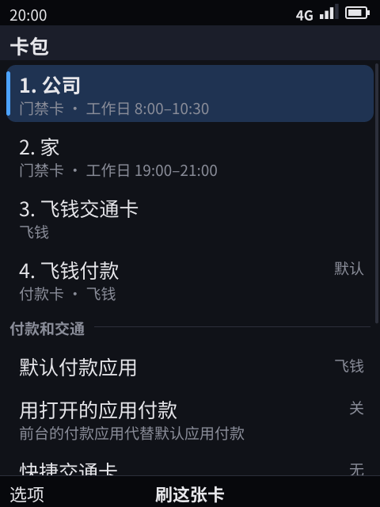
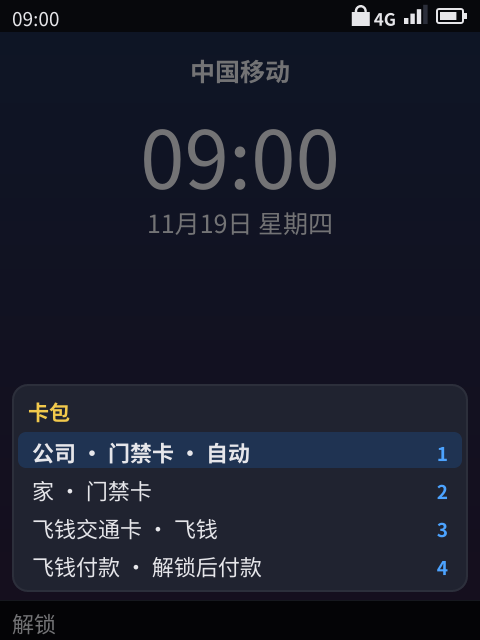
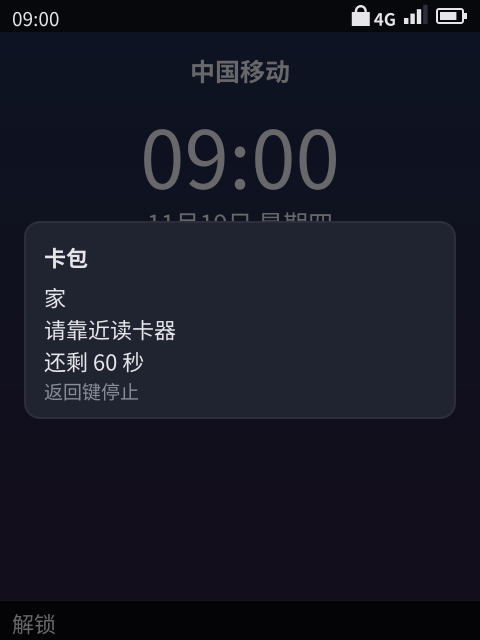
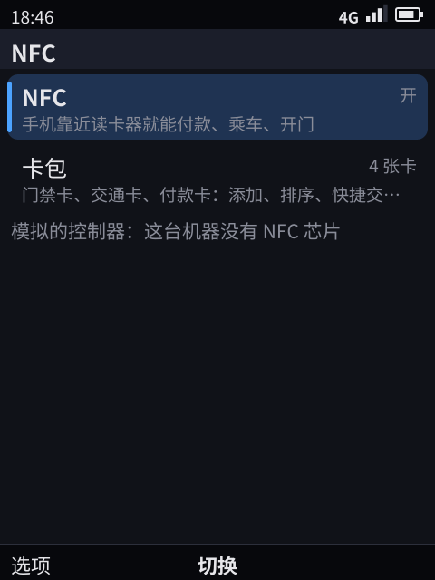

> English translation of [the Chinese original](../30-nfc.md). The Chinese text is authoritative; keep both in sync.

# NFC: door cards, transit cards, payment cards (card emulation)

> Status: **prototype ✓ (simulated controller)**. The system service `phone-nfcd`, the hardware layer `hal/nfc` (the simulated controller and the skeleton of an NCI backend), the system app "Cards" (卡包, `apps/cards`), door cards and the express transit card that work with the phone locked and the screen off without a key, choosing door cards by the time of use, per card whether it works with the screen off and locked, the quick card view on a double press of the power key (the end key where there is none), the NFC switch in Settings › NFC, Feiqian's transit card and payment card, telling workdays from days off by the region's holiday calendar (signed and delivered by the update server; the platform ships no real calendar, **not implemented**), reader mode for apps (a runtime permission, the system's reading sheet, a session exchanging commands with a CPU card, on the simulated controller only) and the "reader left" event, and the read stopping at once when Cards leaves "Add door card" are implemented; unit tests ✓, 8 selftest cases on the developer machine ✓ (text interface; the first 5 under the pixel renderer too ✓), the whole selftest's 133 cases ✓ (§9). **Not verified on hardware**: the NCI backend was only tested against a fake controller, and the controller answering UID cards by itself and its interrupt waking a suspended phone have only run in the simulation, **not on a real phone** (§8). The test phone, a Redmi Note 4X, has no NFC chip; the OnePlus 6T has an NXP NFC controller and is the phone to verify the NCI backend on later.

## 0. Summary

- **One phone stands in for several cards.** Door cards (mostly UID cards, which readers check by card number only), transit cards and payment cards all sit in the system's card pack, and there can be several door cards and several transit cards. The phone answers a reader as one identity at a time: one door card's UID, or "host card emulation" (HCE, ISO-DEP), or both at once (a fixed UID with ISO-DEP, like a dual-interface card).
- **A system app, "Cards", manages the cards, like the card pack on a Xiaomi phone.** It lists every card (the door cards the system keeps, the transit and payment cards apps provide, with their app), adds a door card by reading the physical card, renames, deletes and orders cards, sets the express transit card and the default payment app, sets per card whether it works with the screen off and the phone locked (door cards and the express transit card do by default; payment cards always need unlocking), and shows when each door card is usually tapped. Settings › NFC keeps only the NFC switch and a line that opens Cards.
- **Locked, no key is needed.** With the screen off, the phone locked and the whole phone suspended, door cards and the express transit card answer readers by themselves and the screen stays off, as Xiaomi's door cards and the iPhone's Express Transit do: nfcd sets up in the controller beforehand the UID of the door card most likely now (and ISO-DEP for the express transit card); the controller answers UID cards on its own, and for HCE, whose commands the host must answer, the reader's field wakes the system (the system sleep of [28](28-battery.md), `sleepWake`). The old → shortcut on the lock screen is gone.
- **Door cards go by the time of use, not by reader.** Each door card keeps the times of its successful taps (the time of day, workday or day off, 60 days of them, older ones counting less); at a door reader the phone presents the one most likely now: each tap scores by a smooth kernel about an hour wide over the time of day, workdays and days off apart (days off are weekends, and with the region's holiday calendar also its public holidays, but not the weekend days it makes workdays); a reader that refuses it gets the next one at the next tap. With no taps at nearby times of day, the card pack's order decides. The reader's polling signature is only a secondary hint, with the screen on (§4).
- **The quick card view: a double press of the power key.** As a double press of the power key opens the card pack on Xiaomi phones and of the side button opens Wallet on the iPhone: anywhere, locked too, two presses of the power key show the cards over the lock screen, and choosing one presents it for 60 seconds, for the rare time the automatic choice is wrong. The key model gets a power key, `power`; on keypad phones without a separate one the end key is the power key the Nokia way: held, it powers off; two presses on the standby or lock screen, after a pause, open the quick view ([18](18-nokia-form-factors.md) §5.1, [10](10-keyboard-interaction-model.md) §1).
- **Aligned with Android.** An app declares cards in its manifest (AID groups, the category `payment` / `other`, whether the phone must be unlocked); once a reader selects one of its AIDs, the system hands the app every command (APDU) as an event and the app answers with `nfc.reply`, which is Android's `HostApduService`. Payment cards go to the default payment app chosen in Cards, like Android's "contactless payments".
- **Apps need not stay running.** At the gate the transit card's app may be frozen or not even running: the system thaws it for a few seconds, or starts it in the background, as it does for push, and then hands it the command (a tap is the user's doing, so it does not count against the push wake budget). When the reader is done with its card, the app, if still running, gets `nfc.deactivated` (Android's `onDeactivated`).
- **Apps can read cards too.** As with Android's `enableReaderMode` and iOS's Core NFC: with the runtime permission `nfc_reader`, a read shows the system's reading sheet ("hold the card to the back of the phone"), the app gets the UID of the physical card read, and with a CPU card it can exchange commands in a session of at most 30 seconds; Feiqian reads a physical transit card's balance that way. On the simulated controller only (§6, §8).

## 1. Compared with Android, iOS and Chinese phone wallets

| Aspect | Android | iOS / Chinese phone wallets | Kario | Status |
|------|---------|--------------------|-------|------|
| An app's card (HCE) | `HostApduService`, AID groups, category, `requireDeviceUnlock`, `requireDeviceScreenOn` in `apduservice.xml` | HCE opened in iOS 18 (some regions); Chinese wallets each do their own | The manifest's `nfc`: AID groups, category, `requires_unlock`, `express`; the `nfc.apdu` event + the `nfc.reply` capability, with the `nfc` permission | ✓ (simulated controller) |
| Where cards are managed | Settings › Contactless payments; each app manages its own cards | iOS Wallet; Xiaomi's and Huawei's "card pack" / "wallet" system apps | The system app "Cards": every card, adding door cards, the order, the express transit card, the default payment app, per card whether it works with the screen off (§5) | ✓ |
| The reader leaves | `onDeactivated` | — | The `nfc.deactivated` event: `link_loss` (the field gone, the reader halting the card or a DESELECT), `deselected` (another AID selected); only to an app still running | ✓ (simulated controller) |
| Payment cards | Settings › "Contactless payments" picks the default payment app, the only one automatically; "except when another payment app is open" | Wallet's default card | Cards › Default payment app (the only one automatically), "Pay with the open app"; payment cards answer only unlocked, with the screen on | ✓ |
| Foreground preference | `setPreferredService` | — | Only for payment cards, through the setting above; other categories | **Not implemented** |
| AID conflicts | Several apps declaring one AID of category `other`: a dialog asks the user | — | No dialog: the card order decides, and after a refusal the next card declaring the same AID goes first (§4) | ✓ (differently) |
| Cards in a secure element | `OffHostApduService`: routed to an eSE or the SIM | Apple Pay's cards are in the secure element | Design: the routing table sends the AID to the eSE / UICC NFCEE instead of the host (DH) | **Not implemented** |
| Reader mode | `enableReaderMode` | Core NFC | The system uses it (Cards reads the physical card when adding a door card); apps use `nfc.read` (the runtime permission `nfc_reader`, the system's reading sheet) and `nfc.transceive` (a session exchanging commands with a CPU card, at most 30 seconds) (§6) | ✓ (simulated controller); over NCI only the UID, no session, **not implemented** |
| Seeing the reader before choosing | Android 15 observe mode + polling loop filters | iOS reads the reader's ECP frames to pick the express transit card or an access card | With the screen on nfcd reads the vendor frame in the polling loop to tell a gate, a door and a till apart; the reader's polling signature is only a secondary hint for door cards (§4) | Simulated controller ✓; over NCI **not implemented** (needs a vendor extension) |
| Door cards | No public interface | Chinese phone wallets read an unencrypted card's UID in reader mode and emulate that UID | The same: "Add door card" in Cards; chosen by the time of use (§4); encrypted cards need the controller's support and the card's keys | UID cards ✓ (simulated); encrypted cards **not implemented** |
| Express transit | None (the transit app declares it needs no unlock) | iOS Express Transit: screen off and locked | Cards › Express transit card (a card with `express: true` in its manifest), working with the screen off by default | ✓ |
| Tapping with the screen off, suspended | From Android 12 an HCE service can declare `requireDeviceScreenOn: false` | Xiaomi's door cards and the iPhone's Express Transit work with the screen off, no key needed | The controller answers by itself as nfcd set it up beforehand: UID cards without the main processor, HCE by the system the field woke; the screen stays off (§3, §4, §8) | Simulated ✓; **not run on a real phone** |
| Picking a card quickly | Stock Android's double press of the power key opens the camera; some vendors let it open the wallet | The iPhone's double press of the side button, Xiaomi's of the power key opens the wallet / card pack | A double press of the power key (without one, of the end key on standby) opens the quick card view (§5) | ✓ |

## 2. Architecture

```
 Readers (doors, transit gates, tills)
   │ 13.56 MHz: polling frames, anticollision, ISO-DEP APDUs
   ▼
 NFC controller (phones: NXP PN7160 / PN553 class, NCI; developer machine, QEMU: the simulated controller)
   │ hal/nfc.Controller: field, polling frames, activation, APDUs, reader mode; with the screen off it answers by itself as set up; on a phone its interrupt is a wake-up source
   ▼
 phone-nfcd (system service, nfcd.sock) ── chooses and switches cards, door cards by the time of use; keeps the door cards' UIDs, their taps, the user's choices
   │ wire RPC + events (the field on and off, APDUs, how a tap went); only the Shell connects
   ▼
 Shell ── locked, screen on, the foreground app, the cards apps declare, the Shell's clock → nfcd; no suspend while a field is on; the quick view, the countdown, toasts; the power key
   │ phone.Ui: nfc.apdu event / nfc.reply; nfc.state / nfc.set (system permission)
   ▼
 Apps: Cards (system app, manages the cards); Feiqian (transit and payment cards; a frozen app thawed, a stopped one started in the background)
```

| Part | Where |
|------|------|
| Controller interface, simulated controller, simulated readers, NCI backend, wake-up source; keeping a CPU card read in reader mode for commands (the optional `Exchanger`, the simulated controller only), the simulated CPU card (`TransitApplet`) | `hal/nfc` (`nfc.go`, `sim.go`, `nci.go`, `wake.go`, with unit tests) |
| Choosing and switching cards, door cards by the time of use (days told apart by the holiday calendar), door cards, reader mode (Cards' read and apps' reading sessions, one at a time, cancellable) | `programs/nfcd` (`engine.go`, `reader.go`, with unit tests); program name `phone-nfcd`, state in `<state dir>/nfc/state.json` (0600) |
| The holiday calendar's format and signature (shared by the phone and the update server) | `ota/holidays.go`; the update server `kario-otasrv` (not open) serves `holidays.json` |
| Method names and the structures between the Shell and nfcd | `svc/nfcd.go` |
| The app interface, the manifest check | `ui/nfc.go` (`CheckNFCCards`, shared by the installer and the store backend) |
| Cards | `apps/cards` (`com.phone.cards`, a system app with the `system` permission, in the main menu) |
| Shell: policy, events, capabilities | `shell/nfc.go`; apps' reading and the reading sheet `shell/nfcread.go`; fetching the holiday calendar `shell/holidays.go`; the quick view, presenting, the end key as the power key `shell/cards.go`; the power key `shell/keys.go`; the field while suspended `shell/sleep.go`; selftest commands `shell/nfc_headless.go` |
| Settings › NFC | `apps/settings/nfc.go` |
| Feiqian's transit card and payment card | `apps/wallet/nfc.go`, the `nfc` of `apps/wallet/manifest.json` |
| The power key's key code | The pixel renderer: `paint/src/kms.rs` (`KEY_POWER` → `power`, a short press sent on release; held for 600 ms a long press, sent while the key is still down: from its autorepeat where the key repeats, from the renderer's own timer for a power key that does not), `paint/src/input.rs` (an input device with only a power key is opened too) |
| Image | `phone-nfcd.service` (the `phone-fw` recipe, started at boot, with the simulated controller) |

## 3. Which card may answer when

| Card | Screen on, unlocked | Screen on, locked | Screen off (suspended too) |
|----|:--:|:--:|:--:|
| Door cards (UID cards the system copied), "also with the screen off and the phone locked" on (the default) | ✓ | ✓ | ✓ |
| A door card the user turned that off for in Cards | ✓ | — | — |
| An app's `other` card (transit cards and the like) | ✓ | Not with `requires_unlock: true` in its manifest, else ✓ | ✓ when the user turned on "also with the screen off and the phone locked" in Cards (not for a `requires_unlock` card) |
| The express transit card (chosen by the user in Cards, `express: true` in its manifest) | ✓ | ✓ | ✓ (by default; the user can turn it off) |
| Payment cards (`payment`) | Only the payment app's: ✓ | — | — |
| Settings › NFC off | — | — | — |

- The payment app: the app in the foreground if it has a payment card and "Pay with the open app" is on; else the default payment app chosen in Cards; with none chosen and only one app with a payment card, that one.
- The Shell hands nfcd the lock (`c.locked()`, the lock model of [31](31-lock-and-biometrics.md)), the screen, the foreground app, the cards apps declare and the Shell's clock (its offset from the system clock, its time zone's offset from UTC), again whenever any of it changes: compared in the Shell's housekeeping (twice a second with the screen on, every 5 seconds with it off); the screen going off and the automatic lock happen in that same housekeeping, and a press of the power key that turns the screen off hands it over at once. Choosing by the time of use goes by that Shell clock, which the selftest's `timeshift` and `nfc clock` move.
- When a door card or the express transit card works with the screen off, the Shell leaves the screen off; a refusal and the switch to the next card do not light it either (the next tap simply presents that card). Only when a payment card is silent because the phone is locked, or another card because the screen is off, does the Shell light the screen with "Unlock the phone to use “X”" / "Turn the screen on to use “X”".
- **Suspended**: when a reader's field comes, nfcd tells the Shell (the `field` event); while the field lasts the Shell does not let the phone suspend (the system sleep of [28](28-battery.md), reason "NFC reader"), and after a wake it stays up at least 10 seconds as usual. On a phone, the controller's interrupt wakes it: nfcd sets the `power/wakeup` attribute of the device behind the NCI node to `enabled` when it opens it (`nfc.WakeSource`; the driver must offer the attribute), and the controller keeps listening while suspended (§8). On the developer machine the simulated sleep "sleeps" 2 seconds first, and a reader's field within them wakes it at once (woken by "simulated NFC field"); otherwise the simulated RTC moves the clock to the wake time.

## 4. Choosing the card, switching automatically

**With the screen on, reading the polling loop (observe mode).** While the screen is on, when a reader's field appears the controller does not answer at first; it hands nfcd the reader's polling frames (Android 15's observe mode). When the first loop ends (the `off` frame), nfcd decides which card to present. Some readers add a frame to their loop that says what they are (**a vendor frame**), as Apple's ECP frames tell an iPhone whether it faces a transit gate, a door or a till. The simulated readers use a format of our own: `4B 50` ("KP"), the kind (1 transit, 2 access, 3 payment), a 4-byte id. Real readers' ECP format is not public; nfcd reads only the simulated kind (real readers' vendor frames **not implemented**).

**With the screen off, the controller answers by itself.** Once the screen is off the phone may suspend, and the main processor cannot decide for each reader in time, so with the screen off (and with a controller without observe mode, §8) nfcd does not use observe mode but sets up the identity in the controller beforehand: the UID of the door card that goes first now, plus ISO-DEP (whenever an app has cards, its routing table holding the AIDs of the app cards that may answer then). A door reader that reads UIDs opens on the UID, all done by the controller without waiting for the main processor; gates and tills speak ISO-DEP, and their commands go to the host the field woke. The identity is worked out again when a field ends, when the policy changes (lock, screen, clock, cards) and every minute while the phone is awake, and the controller is changed only when it changes; a suspended phone is woken by the RTC at least every 15 minutes for maintenance ([28](28-battery.md)), after which the Shell hands over its policy again and nfcd sets up the card for the time it is then, so the card set up is at most 15 minutes old; a refusing reader still switches cards (below), the next tap presenting the next card.

**Door cards by the time of use.** Every successful tap of a door card is recorded by nfcd as "card, time" (the Shell's clock in the zone of the moment, kept in the state file, at most 400 taps, those older than 60 days dropped). To order the door cards, each one scores the sum of its taps' weights:

- the time of day: with the tap and now d minutes apart in the day (across midnight too), the kernel K(d) = (1 − (d/150)²)², 0 from d ≥ 150 on (a quartic kernel, a standard deviation of about an hour, falling smoothly from 1 to 0);
- age: the weight times 2^(−days / 14), halved every two weeks;
- the kind of day: only days of the same kind as today count, workdays or days off, and neither kind borrows from the other. Without a holiday calendar workdays are Monday to Friday and days off Saturday and Sunday; with the region's calendar, its public holidays are days off and its make-up workdays on a weekend are workdays (below). A tap's day is its date in the time zone of the moment.

The highest score goes first; with equal scores (mostly no taps at nearby times of day, such as a new card), the reader's hint (below) comes first with the screen on, then the card pack's order. Cards shows each door card's "usual hours": the 60 minutes either side of each tap joined into spans, overlapping ones merged, the heaviest 3 per kind of day, in the order of the day, the ends rounded to the half hour.

An example (selftest ✓): in Cards "家" (home) comes before "公司" (office). On the first workday at 9:00 there are no taps, so the office door gets the first card, "家", refuses it, the phone switches to "公司", the second tap opens, and "公司 9:00" is recorded; tapping again at 9:40, the 9:00 tap is near, and "公司" goes first at once; so it does at 9:00 on the next workday. With "公司" moved first in Cards, near 20:00 there are no taps, so the home door gets "公司" first by the order, refuses it, and "家" opens; on the workday after, "家" has a tap at this time of day, which beats the order, and goes first at once, while "公司" still goes first at 9:00. Cards shows "Door card · workdays 8:00–10:30" and "Door card · workdays 19:00–21:00" for them.

**The holiday calendar.** Next to `latest.json` the update server serves `holidays.json` (`ota.Holidays`): per region (two letters of ISO 3166) the public holidays (`days_off`) and the weekend days that are make-up workdays (`workdays`), dates in the region's own time; signed as `latest.json` is, except that the signature also covers the file's name (`ota.DataMessage`, [25](25-system-update.md) §0). With an update server the Shell fetches it once a day (an hour later after a failure), checks the signature, the issue time and that it is not older than the one it has, keeps it in `<state dir>/shell/holidays.json`, and hands nfcd the days of the phone's region (Settings › Region, the SIM's country when automatic, [19](19-core-apps.md)) with the policy; when the region changes, the next policy has the new region's. Without a calendar, or one without the region, Monday to Friday are workdays as before.

```json
{"format": "kario-holidays/1",
 "regions": {"CN": {"source": "<the notice's name and date>", "days_off": ["<YYYY-MM-DD>", "…"], "workdays": ["<YYYY-MM-DD>", "…"]}}}
```

The platform ships no calendar and makes up no dates: China's holidays and make-up workdays are set each year by a notice of the General Office of the State Council, and someone has to check a calendar against the notice before putting it on the update server (real calendar data **not implemented**). The selftest uses a test calendar (`nfc holidays fixture`, §7), not an official one: locked with the screen off (no reader hint), on the make-up Saturday at 20:00 the home door gets "家" at the first tap (the workday taps at 20:00 count); on the Wednesday off at 20:00 it is a day off with no taps yet, so the card pack's order presents "公司" first and "家" opens after the switch; "家"'s usual hours then have 19:00–21:00 on days off (selftest ✓, checking the `usual` Cards gets; how Cards writes "days off …" is checked by a unit test).

**The reader's polling signature, a secondary hint only.** With the screen on (in observe mode) nfcd also remembers which door card each reader accepted (a signature from the reader's own vendor frame in its loop; at most 32 readers, for 60 days), used only to order cards with equal time scores, ahead of the card pack's order. Why it is not the main rule: a plain reader's loop (field on, a poll of type A, field off) is the same for every reader of its kind, so it cannot tell the home door from the office door, and only readers with a vendor frame can be told apart; only a controller in observe mode with the screen on sees the loop at all (with the screen off the controller answers by itself, and over NCI it needs a vendor extension); the user's habit of tapping at certain times shows on every controller, and choosing by the time of use is what the owner asked for.

**Which card goes first.** In turn:
1. the card the user chose in the quick view or in Cards (for 60 seconds);
2. the card that goes next after a reader just refused one (at the next tap within 2 minutes);
3. among the cards that may answer: the kind the vendor frame names (door cards, the express transit card, payment cards) first, then the card pack's order, the places door cards hold taken in the order of the scores above; a card refused in the last 2 minutes is left out.

When the reader says it is a till and the payment card is silent only because the phone is locked (or the screen off), the phone presents nothing and lights the screen with "Unlock the phone to use “Feiqian pay”", rather than trying a door card; if the user unlocks right at the till, nfcd presents the payment card as soon as it has the new lock state (§3), while the reader is still polling (unit test ✓). With the screen off it is the same: the till selects the PPSE over ISO-DEP, nfcd answers `6A82` and lights the screen to say unlock first (selftest ✓).

**HCE routing.** With an app's card presented the phone answers as ISO-DEP, that card's AIDs first and the AIDs of every other app card that may answer too: whichever AID the reader selects, the command goes to that card's app (an AID two cards declare goes to the one ahead). When the selected AID belongs to a card that may not answer now (the payment card while locked), nfcd answers `6A82` and says the phone must be unlocked. When the kind of reader is not known (with the screen off, or without a vendor frame), the door card's UID and ISO-DEP are presented together (the dual-interface identity of §8).

**What counts as success.**

| Card presented | Success | Failure |
|----------|------|------|
| UID card (a door card; the reader spoke no ISO-DEP) | The reader activated it once, then halted it (HLTA) and did not poll it again | The reader polled it again (activated it again), or dropped the field without halting it; no activation at all does not count |
| An app's card (HCE) | The answer to the last command was not an error (`9000`, `61xx`, `62xx`, `63xx`) and the app answered every command in time | An error answer (`6A82`, `6985`, `9401`…), the reader left before the app answered, or the reader sent no command at all |

A door reader does not tell the card it accepted it, so for a UID card this is a guess: a reader that accepts a card mostly halts it and opens; one that refuses mostly goes on polling. The simulated readers behave that way; **not checked against real readers**.

**Switching.** On a failure nfcd picks the next of the candidates (after a door card only another door card, the app cards being in the ISO-DEP already; after an app's card only another card declaring the AID the reader selected helps, or a door card when the reader sent no command at all) as the card the next tap presents first, and the Shell shows "Switched to “X”: hold the phone to the reader again" (without lighting the screen when it is off); while the user is presenting a chosen card, the presentation moves to that card and the countdown starts over. On success it clears the refusals and the next card, ends the presentation, and a door card's tap is recorded with its time.

## 5. Cards, the quick card view, the power key, Settings

**Cards** (the system app `com.phone.cards`, in the main menu, with the `system` permission): every card in the card order ("1. 家" …), each with a line saying what it is: a door card its usual hours ("Door card · workdays 8:00–10:00, 12:00–14:00 · days off 10:00–12:00", the UID's last two digits before its first tap; "Door card · unlocked only" when it no longer works with the screen off), a transit card its app's name (with "· works with the screen off" when it does), a payment card "Payment card · <app>"; the express transit card and the default payment card are marked on the right. OK presents the card (with the system's countdown, below); a card's options: rename and delete (confirmed) for door cards, "Use as the express transit card" / "Stop using as the express transit card" for a card that can be one, "Only with the phone unlocked" / "Also with the screen off and the phone locked" for every card but payment cards (and `requires_unlock` cards), move up and move down for every card. A group "Payment and transit" below: the default payment app, pay with the open app, the express transit card; the last two lines explain that door cards and the express transit card work with the screen off and locked without a key and go by the time of use, and OK and the double press of the power key. The page's options have "Add door card". Cards does all of it through `nfc.state` / `nfc.set` (§6); the UIDs stay in nfcd, Cards gets the last two digits only.

**Adding a door card**: Cards says "Hold the card to the back of the phone", and nfcd reads the card in reader mode (at most 20 seconds; leaving the page, Cards sends `nfc.set` `cancel_read`, which stops it at once so it does not keep the reader):
- an unencrypted UID card: nfcd keeps it until it is added, and Cards asks the user for a name (default "Door card N"); once saved, its UID goes into nfcd's state file, out of every app's reach;
- an encrypted MIFARE Classic card: the phone says copying it needs the card's keys, which it does not have (**not implemented**: the controller must emulate the sectors, and the keys must come from the building's management);
- a smart card (CPU card, ISO-DEP): the phone says to add it in its issuer's app;
- a card already in the card pack (the same UID): the phone says what it is called there.

**The quick card view**: **a double press of the power key** (within 400 ms), anywhere, locked too, as Xiaomi's double press of the power key opens its card pack and the iPhone's double press of the side button opens Wallet. The first press keeps its meaning (it turns the screen off when it is on, on when it is off); the second lights the screen and opens the quick view (a system overlay with the locked screen still behind it; in the Shell, which is quick and can show over the lock screen): the cards in the card pack's order, the one a door reader gets by itself now marked "auto", digits 1–9 choosing directly; choosing one presents it, and choosing a payment card while locked says to unlock first. Not during a call, nor while a call or an alarm rings. Keypad phones without a separate power key use the end key: two presses within 400 ms on the standby or lock screen (after a pause). There its first press has nothing to do (the phone is on standby already, or the press only lights the screen), so it does not clash with a single press going back to standby; a press from an app or a call still goes back or hangs up and is no first press, and pressing the red key again and again never opens the view. Selftest scripts start with the end key's double press off (their keys come faster than a person's, and one case's last end key and the next case's first would count as a double press); the case that tests it turns it on with `nfc picker on`; the power key's double press is always on.

**The power key** (key name `power`; the pixel renderer maps `KEY_POWER` to it, [10](10-keyboard-interaction-model.md) §1, [18](18-nokia-form-factors.md) §5.1): a press turns the screen off (the lock follows the screen-off rules, [31](31-lock-and-biometrics.md) §2.1) or on; a press while a call rings silences it; a double press opens the quick view; held for 600 ms, while still down, it opens the power menu (the renderer times a power key that does not autorepeat itself, §9) ("Power off", "Restart", handed to systemd on a phone, on the developer machine only "Not a phone: it stays on"). Without a power key, holding the end key opens the same menu (Nokia's hold the red key to switch off).

**Presenting**: an overlay shows the card's name, "Hold near the reader" and the seconds left; it closes itself after 60 seconds or 1.5 seconds after a successful tap; Back stops presenting.

**Settings › NFC**: only the NFC switch and a "Cards" line (with the number of cards; OK opens Cards, through `nfc.set` `open_cards`), and a last line naming the controller (on the developer machine "Simulated controller: this machine has no NFC chip").

| Cards | The quick view on the lock screen | Presenting | Settings › NFC |
|:--:|:--:|:--:|:--:|
|  |  |  |  |

## 6. The app interface

The manifest ([22](22-developer-api.md) §1):

```json
"permissions": ["nfc"],
"nfc": [
  {"id": "transit", "category": "other", "description": "飞钱交通卡", "aids": ["F0465154524E53"], "express": true,
   "locales": {"en": "Feiqian transit card"}},
  {"id": "pay", "category": "payment", "description": "飞钱付款", "aids": ["325041592E5359532E4444463031", "F0465150415901"]}
]
```

| Field | Meaning |
|------|------|
| `id` | Lower-case letters, digits, `-`, `_`, at most 16, unique in the manifest; events name the card by it |
| `category` | `payment` (for the default payment app only, unlocked only) or `other` |
| `description` | The name in the card pack, 1–32 characters; `locales` gives it by language |
| `aids` | 1 to 16 AIDs (hex, 5 to 16 bytes); an AID in one card only; the PPSE (`2PAY.SYS.DDF01`) in payment cards only |
| `requires_unlock` | An `other` card silent while the phone is locked, which the user cannot let work with the screen off either |
| `express` | An `other` card the user may make the express transit card |

The installer (`shell/install.go`) and the store backend (`appstore`) check it with the same `ui.CheckNFCCards`; an app with cards and without the `nfc` permission does not install. At most 8 cards per app.

Capabilities and events ([22](22-developer-api.md) §4.11, §5):
- the `nfc.apdu` event: `{session, card, aid, apdu}`, every command after the reader selected one of the card's AIDs (the SELECT itself included), in hex;
- `nfc.reply`: `{session, apdu}`, the answer to the latest command, ending in its status word (`9000` success); only the app the command went to can answer, and an answer after the reader left is an error;
- `nfc.state` / `nfc.set`: for Cards and Settings (the `system` permission, which the Shell's broker checks). `nfc.state` gives the cards (door cards with their usual hours, `usual`; each card's `locked`: whether it works with the screen off and locked, and `locked_fixed`: that it cannot be changed), the door card a door reader gets first now, `door_first`, and the user's choices; besides the switches, the default payment app, the express transit card and the order, `nfc.set` has `locked` (`card`, `on`) and Cards' keys `read` (reader mode; the answer's `read` says what was read), `cancel_read` (stops a `read` waiting for a card), `add_door`, `rename`, `delete`, `present` (the Shell presents the card with its countdown) and `open_cards` (the Shell opens Cards).
- the `nfc.deactivated` event: `{session, card, reason}`, the reader is done with this card: `link_loss` (the field gone, the reader halting the card or a DESELECT) or `deselected` (the reader selected another AID), at most once per selection of a card; only to an app still running (a frozen one thawed for a second), and an app that has ended is not started for it.

Reader mode (`nfc.read`, `nfc.transceive`, [22](22-developer-api.md) §4.11): the app declares the runtime permission `nfc_reader` in its manifest with a purpose in `purposes`, and the system asks the user at its first read. Only the app in the foreground reads, and one read at a time (Cards' included). `nfc.read` shows the system's reading sheet, saying which app reads, which Back stops (the app gets `cancelled`); once a card answers it gives the UID, ATQA, SAK and whether it speaks ISO-DEP. A CPU card (ISO-DEP) also gets a session where the controller can keep it: `nfc.transceive` sends commands in it one by one and gets the answers, while the sheet says "Keep the card on the phone"; the session ends when the app closes it, the user presses Back, the card is taken away, 30 seconds are up, or the app ends or leaves the foreground, and the sheet goes with it. Card emulation carries on meanwhile: readers can still tap the phone while it reads.

Apps must be quick: a reader waits only so long for each command. The simulated readers wait 3 seconds per command (times the selftest's timeout scale); a real gate gives much less, and a cold start may not make it (**not run on a real phone**; the plan: thaw the express transit card's app ahead of time while the screen is off, or put the card in a secure element, §10).

## 7. Simulated readers and the simplified flows

The selftest and nfcd's unit tests use three simulated readers from `hal/nfc`. The transit and payment commands are **a simplified flow of our own**: no keys, no MACs, not any operator's or EMV's specification; amounts are 4-byte big-endian cents. When an identity is set up before the field comes, the simulated controller answers on the first loop (the controller answering by itself); without one it only reports the polling frames and waits for nfcd to decide (observe mode).

| Reader | Polls | What it does | Accepts |
|--------|------|--------|----|
| Door (`DoorReader`) | A, vendor frame kind 2 | Reads the UID (whether the card speaks ISO-DEP or not) | A UID on its list: halts the card; otherwise polls again |
| Transit gate (`TransitGate`) | A, B, kind 1 | `00 A4 04 00` SELECT of the card's AID → `80 5C 00 02 04` reads the balance → `80 54 01 00 08 <fare> <gate id> 04` debits, the card answers the new balance; too little answers `9401` | All three `9000` |
| Till (`PaymentTerminal`) | A, B, kind 3 | SELECT of the PPSE, looking for the AID it supports (`4F`) in the directory it answers → SELECT of that AID → `80 70 00 00 08 <amount> <terminal id> 08`, the card answers an 8-byte cryptogram | All `9000` |

Feiqian's transit card keeps its balance in the app's data (`transit.json`, ¥20.00 to start, readable when the gate starts the app); the payment card signs the transaction with an app key (`keystore.sign`, key name `nfcpay`), uses the first 8 bytes of the signature's digest as the cryptogram and records a "Contactless payment" bill. The simulated CPU card held to the phone in reader mode (`TransitApplet`) is a physical transit card of the same simplified flow: it answers a SELECT of its own AID and the balance read, and Feiqian's "Read a transit card's balance" reads it.

Selftest script commands (`shell/headless.go`, `shell/nfc_headless.go`):

| Command | What it does |
|------|------|
| `require-nfc` | Skips the case without phone-nfcd |
| `nfc card <uid> [encrypted\|cpu]`, `nfc card none` | Holds a physical card to the back of the phone (reader mode reads it), or takes it away |
| `nfc card <uid> transit <aid> <cents>` | Holds a physical transit card of the simplified flow (a CPU card, its balance in cents), which answers the SELECT and the balance read in a reading session |
| `nfc reader <name> door <uid>[,…]` / `gate <aid> <fare>` / `pay <aid> <amount>` | Defines a simulated reader |
| `nfc tap <name> ok\|fail [<card name>]` | Holds the phone to the reader (the Shell keeps running, the commands go through the app and back) and asserts that the reader accepted or refused, and which card it saw |
| `nfc clock <HH:MM> [workday\|weekend\|holiday\|makeup]` | Moves the Shell's clock forward to the next such time of day (if asked, on Monday to Friday, at a weekend, or on a holiday or a make-up workday of the holiday calendar); nfcd gets it with the next policy |
| `nfc holidays fixture\|none` | A test calendar (not an official one): the first Saturday after tomorrow a make-up workday, the Wednesday after it a day off; signed by a temporary update server with a temporary key, fetched, checked and kept by the Shell as usual and handed to nfcd; `none` forgets the calendar |
| `nfc deactivated <app> <card> <reason>` | Asserts that the last `nfc.deactivated` the Shell delivered to the app was for this card with this reason |
| `nfc usual <card name> workday\|dayoff <HH:MM>-<HH:MM>` | Asserts that the usual hours nfcd gives Cards for this door card have that span on workdays or on days off (Cards' line is wider than the selftest's screen) |
| `nfc asleep`, `nfc woken` | Waits until the simulated sleep has begun; asserts that a reader's field ended the last sleep |
| `nfc picker on\|off` | The end key's double press opens the quick card view (off when a script starts) |
| `key power [count]`, `long power`, `long end` | Presses the power key (`key power 2` is a double press); holds the power key, the end key |

## 8. The hardware layer and the NCI backend

`hal/nfc.Controller`: `Events()` (the field on and off, polling frames, activation, halting, APDUs), `Present(identity)` (a UID card, HCE with an AID routing table, or both together; `nil` answers nothing), `Respond(APDU)`, `Read(ctx)` (reader mode, stopping when the time is up or it is cancelled), `Info()` (observe mode or not, simulated or not); a reading session needs the optional `Exchanger` (`Exchange` sends a command to the CPU card just read, `Release` lets it go), which only the simulated controller has: over NCI it needs the poll-mode data connection (the ISO-DEP interface when reading, sending and receiving on credits), **not implemented**, and an app reading on an NCI controller gets the UID only. nfcd's controller is the board's (`nfc` in `sku.json`, [24](24-sku-framework.md)): `sim` on the emulator, `nci:<device>` on a board with an NCI controller, and on a board without NFC nothing, so nfcd exits; the developer machine, with no `sku.json`, uses `sim`; `--controller` overrides it.

The NCI backend (`hal/nfc/nci.go`) is how controllers like NXP's PN7160 (NCI 2.0) and PN553 (NCI 1.0) look on a raw NCI device: NXP's `nxpnfc` / `pn5xx_i2c` drivers make every read and write one NCI packet, as Android's NCI stack uses them. Mainline Linux's `nxp-nci` driver keeps NCI in the kernel (net/nfc), and the interface it offers userspace over netlink does not include host card emulation (**not checked** whether that can be worked around). Written and unit-tested against a fake controller:

| Use | NCI messages | Code |
|------|----------|------|
| Packets | Control packets (MT, PBF, GID, OID) and data packets (connection id); the 3-byte header read first, then the payload | `Packet`, `ReadPacket` |
| Reset, init | `CORE_RESET_CMD` / `RSP` / `NTF`, `CORE_INIT_CMD` / `RSP` (the 1.0 and the 2.0 formats) | `NewNCI` |
| Field notifications | `RF_FIELD_INFO` in `CORE_SET_CONFIG`, `RF_FIELD_INFO_NTF` | `NewNCI` |
| The card's identity | `LA_NFCID1` (the UID; empty lets the controller pick a random one) and `LA_SEL_INFO` (the SAK: `08` for a UID card, `20` for ISO-DEP; the dual-interface identity is a fixed UID with `20`) in `CORE_SET_CONFIG` | `Present` |
| Routing table | `RF_SET_LISTEN_MODE_ROUTING`: the ISO-DEP protocol and every AID to the host, in several commands when one does not hold it (More); the power state is "switched on" only | `ListenRouting` |
| Listening, reading | `RF_DISCOVER` (listen A, B or poll A, B), `RF_INTF_ACTIVATED_NTF` (the UID, SAK and ATQA taken from it when reading), `RF_DEACTIVATE` | `Present`, `Read` |
| APDUs | Data packets on the static RF connection (0), segmented with PBF, sent on credits (`CORE_CONN_CREDITS_NTF`) | `DataPackets`, `Respond` |
| Wake-up source | `enabled` written to the device node's `/sys/dev/char/<major>:<minor>/device/power/wakeup` (the node's own `power/wakeup` without it), so the interrupt wakes a suspended phone | `WakeSource` (unit test ✓ on a fake sysfs) |

**What the hardware must do** (to tap with the screen off, locked and suspended; all **not run on a real phone**):
- **The controller's field interrupt is a wake-up source**: a reader's field (`RF_FIELD_INFO_NTF`) and a command for the host must wake a suspended phone; nfcd turns it on with `WakeSource`, and the driver must offer `power/wakeup` (`device_init_wakeup`, or `wakeup-source` in the device tree); the controller stays powered and listening while suspended.
- **The controller emulates UID cards itself**: anticollision, selection and halting with the fixed UID of `LA_NFCID1`, without waiting for the main processor (the field notification still wakes the main processor, and nfcd records the tap and judges it). Emulating a fixed UID on NXP's controllers needs vendor settings (**not checked**).
- **The dual-interface identity**: a fixed UID with ISO-DEP (SAK `20`) answered together, door readers reading the UID, gates speaking ISO-DEP. Whether real door readers accept a SAK with the ISO-DEP bit (some take only MIFARE cards, `08`) is **not checked**; where they do not, the screen-off identity must be either the UID card or ISO-DEP (UID for users with several door cards).
- nfcd never tells the controller that the screen went off or the phone locked (NCI 2.0's power sub-states, `CORE_SET_POWER_SUB_STATE`), so the controller stays "switched on" and listens by the routing table; nfcd applies the lock and screen rules of §3 itself, and with the screen off sets up the identity beforehand (§4). The draw while suspended and how long it takes from the wake to nfcd's answer are unmeasured.

**Not implemented** (all need a phone): running on a real controller; NXP's vendor initialisation (firmware download, proprietary commands); the vendor extension for observe mode (Android's proprietary NCI messages); the vendor settings NXP needs to emulate a UID card; the device node and its permissions (a `DeviceAllow` in the unit file). Boards say in the SKU which NFC controller they have ✓ (`nfc = "sim"` or `"nci:/dev/<node>"`, none without it; nfcd opens it or exits) and whether they have a separate power key ✓ (`power_key`; where they do, the end key is no longer the power key, [24](24-sku-framework.md)).

**Test phones**: the Redmi Note 4X has no NFC chip, so only the simulated controller runs on it. The OnePlus 6T has an NXP NFC controller (the exact part **not checked**; usually said to be PN553 class) and is the phone to verify the NCI backend on; which driver it uses on a mainline kernel, and whether it offers a raw NCI device, is **not checked** either.

## 9. Verification

- Unit tests: `hal/nfc` (NCI packets, init 1.0 / 2.0, the HCE routing table and segmented exchange, sending on credits, reader mode, the UID card identity, the dual-interface identity; the simulated readers against door cards, transit cards, payment cards and a phone that does not answer, an identity set up before the field answered on the first loop, the dual-interface identity opening a door and passing a gate; the wake-up source on a fake sysfs); `programs/nfcd` (adding door cards in reader mode: encrypted, CPU, no card, a duplicate; rename, delete; door cards by the time of use: the order first without taps, the switch, a tap still counting 40 minutes on and no more three and a half hours on, the order first at 20:00 once changed, the time score beating the order the next day, still known after a restart, weekends and workdays apart, taps older than 60 days counting no more; the score falling smoothly with the time of day, 0 beyond 150 minutes, across midnight, halved in two weeks; the usual hours merged, rounded to the half hour, across midnight; the reader's hint used only between equal time scores and only with the screen on (observe mode); per card working with the screen off: the defaults, a door card turned off, a payment card refused, the express transit card turned off; door cards locked with the screen off, the field events; a card set up by the time of use without observe mode; the express transit card with the screen off, and a toast to turn the screen on when it is not express; payment locked says to unlock, and unlocking at the till pays at once; with two payment apps the default and the one in front; the card order, NFC off; an app that does not answer times out; switching when two apps declare one AID; reading again at once after Cards' read is cancelled; apps' reading sessions: reading a balance, no other app reaching it, nothing more after it is closed, no session for a UID-only card, stopping at once when closed while waiting, the card taken away, the 30 seconds up, Cards unable to read meanwhile; the reader leaving: one `link_loss` after a gate and one after a till, the first of two cards selected one after the other `deselected`, no app told after a door; the holiday calendar: Monday to Friday without one, holidays as days off and the make-up Saturday as a workday, the date in the tap's own zone, the order on the Wednesday off and the workday taps on the make-up Saturday, a holiday's tap among the days off in the usual hours); `hal/nfc` (a cancelled read stops, a CPU card's session: selecting the AID, reading the balance, cut off when the card is taken away or replaced); `ota` (the calendar's format check, the signature naming the file and not passing for `latest.json`); `shell` (a press of the power key turns the screen off and on, a double press opens the quick view with the automatic card marked and closes it once a card is chosen, holding it opens the power menu, which does not power off a developer machine; the end key's double press on standby opens the quick view, pressing it again and again does not, nor does it while turned off, holding it opens the power menu); `paint` (the power key sent on release, a long press when held; without autorepeat the renderer's timer sends the long press at 600 ms while the key is still down and nothing on release; with autorepeat only once; a short press on release); `apps/cards` (how the usual hours, days off and working with the screen off read, the cards' marks and options); `ui` (the manifest check); `appstore` (the store backend refuses a bad `nfc`); `apps/wallet` (the transit card's debit, the payment directory).
- 8 selftest cases on the developer machine ✓:
  1. Cards opens; reader mode copies two door cards, named "家" and "公司"; an encrypted card and a card already in the card pack cannot be copied; Settings › NFC has only the switch and the "Cards" line, whose OK opens Cards;
  2. locked, with the screen off and the phone suspended (the simulated sleep), no key pressed, a door that accepts only "公司" gets the first card, "家", at 9:00 on a workday, and the reader's field woke the phone (the Shell's log: `sleep: woke after 0s (simulated NFC field)`); the phone switches to "公司" and the second tap opens; at 9:40 and at 9:00 on the next workday "公司" goes first; "公司" is moved up to first in Cards; at 20:00 the home door gets "公司" first by the order, and opens with "家"; on the workday after, "公司" goes first at 9:00 and "家" at 20:00; the screen is still off after every tap; Cards shows "Door card · workdays 8:00–10:30" and "Door card · workdays 19:00–21:00";
  3. a double press of the power key (`key power 2`) on the lock screen opens the quick view, at 9:00 marking "公司 · Door card · auto"; "家" chosen and presented, the home door opens at the first tap; after the presentation the office door gets "公司" first again; with the end key's double press turned on, two presses of the end key on the lock screen open the quick view too; unlocked, from the calculator, two presses of the end key only go back to standby and do not open it;
  4. Cards makes Feiqian's transit card the express transit card, and its row reads "Feiqian · works with the screen off"; with Feiqian frozen, the phone locked and the screen off, the gate debits ¥2.00, the screen stays off, and Feiqian shows a balance of ¥18.00;
  5. Feiqian chosen as the default payment app in Cards; locked with the screen off, the till fails and the screen lights with "Unlock the phone to use “Feiqian pay”"; unlocked, the till's payment succeeds (Feiqian was not running and the system started it in the background) and Feiqian lists a "Contactless payment";
  6. in Cards, Back right after opening "Add door card" stops the read at once; opening it again, the "家" card held to the phone is read at once (the toast names it "家");
  7. "Read a transit card's balance" on Feiqian's transit card page: the "Reading NFC cards" permission asked once, the system's reading sheet saying "For “飞钱”"; with a CPU card holding ¥12.34 held to the phone Feiqian reads "The card holds ¥12.34" through the session and the sheet closes itself; a UID-only card has no session ("Not a transit card this app can read"); Back while it waits gives Feiqian "Reading stopped"; after the gate Feiqian gets `nfc.deactivated` (`transit`, `link_loss`);
  8. a test calendar (signed by the update server, fetched by the Shell): locked with the screen off, on the make-up Saturday at 20:00 the home door gets "家" at the first tap; on the Wednesday off at 20:00 the order presents "公司" first and "家" opens after the switch; "家"'s usual hours have 19:00–21:00 on days off.
- The Shell's log confirms the path: `sleep: simulated until 09:16:04`, then `sleep: woke after 0s (simulated NFC field)`, the reader's field ending the simulated sleep, and "家" answered by the identity set up before the field (`nfc: door:1 "家" ok=false next="公司" reason="refused"`).
- The first 5 cases under the pixel renderer (phone-paint, `bar-t9`) ✓, the screenshots in §5 come from that run; the last 3 have run in the text interface only. The whole selftest's 133 cases in the text interface ✓ (the lock-screen and suspend cases among them; the compatibility run of the same build PASS, all 85 capabilities called, `nfc.read` and `nfc.transceive` among them).
- **Not run on a real phone**: the controller answering UID cards by itself, its interrupt waking the phone, the draw while suspended, judging success at real readers and the dual-interface identity are unverified on hardware; a power key held for 600 ms is reported at once, from its autorepeat where the key repeats and from the renderer's own timer (`poll` waiting out the 600 ms) for a power key without autorepeat (mostly gpio-keys), unit tests ✓, **not verified** on a real power key; a held end key is reported from its autorepeat (once, at 600 ms; the press itself still goes at once), **not verified** on a real keypad.

## 10. Not implemented

| What | Why | Plan |
|------|--------|------|
| A real controller (NCI on a phone) | Needs a phone with NFC | Run the raw NCI device on the OnePlus 6T first; the vendor initialisation, observe-mode extension, wake-up source and fixed UID of §8 |
| Encrypted door cards (MIFARE Classic sectors) | The controller must emulate sectors, and the card's keys are needed | Depends on hardware, and on working with building management / card issuers |
| Cards in a secure element (`OffHostApduService`: eSE, SIM) | Needs an eSE or an NFC SIM (SWP) | The routing table hands the AID to the NFCEE; real T-Union transit cards and bank cards mostly need this |
| Reading sessions for apps over NCI | They need the poll-mode data connection (the ISO-DEP interface when reading, sending and receiving on credits), with no real controller to write it against | Together with NCI on a real phone; for now an app reading over NCI gets the UID only |
| A real holiday calendar | The dates are each government's (in China a yearly notice of the General Office of the State Council), and the platform makes none up; the format, the signature, the delivery and the days told apart by the calendar are all there | The owner checks a calendar against the notice and puts it on the update server (`holidays.json`), again with each year's notice |
| Foreground preference (beyond payment), a dialog on AID conflicts | The order and switching handle it for now | Depending on use |
| Real readers' vendor frames (ECP and the like) | The format is not public | Capture frames once there are real readers |
| Gate timing | Real gates give less time than the simulation; a cold start may not make it | Thaw the express transit card's app ahead of time while the screen is off, or use a secure element |
| Operators' and banks' real flows (T-Union, PBOC, EMV) | The prototype uses simplified flows | The issuers' apps implement them; the platform provides the APDU channel |
