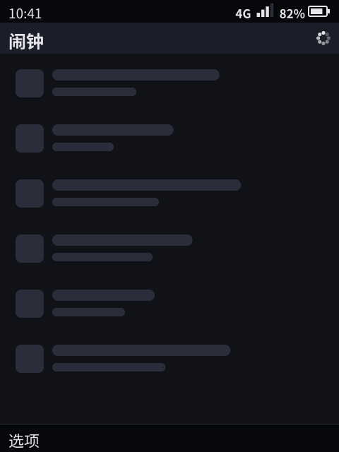

> English translation of [the Chinese original](../37-motion.md). The Chinese text is authoritative; keep both in sync.

# Motion: which animations suit Kario, and how to make them smooth

> An investigation and plan of 2026-11-17, with a first batch done the same day; a second batch on 2026-11-18: damage rectangles and layers, banners and toasts sliding, backlight fades, caches for full redraws; a third batch on 2026-11-20: the body as a layer (scrolling only copies), a skeleton page while an app starts, the cursor's blink and spinners, images cached at their display size and blending in integers, and the pixel selftest reporting each step's time by itself at its end; a fourth batch on 2026-11-21: compositing on the GPU (§5 item 8, GLES 2, used only with `PHONE_PAINT_GPU=1`; by default and on any failure the CPU composes as before; **not tried on a phone**, no Adreno, Mali or PowerVR tried); the focus gliding in grids and the input method's candidate rows, the charging battery's animation, phase animations run by the renderer (the protocol gained the overlay's `period` and the feature `phase`), and each step's time collected by itself on a real display, with a run on QEMU's virtio-gpu screen that found and fixed three pacing problems of ours; the same day motion came to follow the panel's refresh rate (phone-displayd, [08](08-display-adaptive-refresh.md)): one step a period of the panel, the old 16 ms replaced by the panel's period (16.7 ms at 60 Hz, 8.3 ms at 120 Hz), on the CPU and the GPU path, the renderer telling the Shell when an animation begins and stops (`motion`), and keys and animations raising the rate to the panel's highest (§5 item 9); the same day rasterizing on the GPU (§5 item 10, L2: used only with `PHONE_PAINT_GPU=raster`, the GPU paints the layers from the display list, every kind of op it paints byte for byte the CPU's; **not tried on a phone**); a fifth batch on 2026-11-24, ideas taken from a few menu frameworks for small monochrome OLEDs (§4.1): the focused row's text cut with an ellipsis scrolling into view by itself (a marquee), easing whose speed does not jump on a new target, and the highlight nudged at the end of a list (§3) (each item in §3 and §5 says where it stands). The figures in §2 were measured on the developer machine, §2.3 has QEMU's (a CPU and a screen emulated with TCG, **not a phone's**), and the figures for phones are **estimates**; the GPU in §2.4 and §2.5 is Mesa's llvmpipe (a rasterizer running on the CPU), and its figures say nothing about phones; motion has been looked at on QEMU's virtio-gpu, and has **not been looked at** on a phone (**not tried on a phone**); switching the refresh rate has been tried only on the selftests' simulated panel (**not tried on a phone**).

## 0. Conclusions

- **Smooth motion is possible, but not by drawing every frame from scratch.** phone-paint used to rasterize the whole screen again for every animation frame (text, rounded corners and images, all of it). On the developer machine a screen takes 2.2 ms at the median and 5–11 ms for the slow ones; on a phone's CPU that is estimated at 2.5 to 6 times slower, 15–60 ms a frame for the slow screens, which 60 frames a second (16.7 ms a frame) cannot keep up with. Now each frame on the device is first recorded as a list of what is drawn, compared with the last frame's list, and only the rectangles that changed are drawn again (§5 item 2): on a real sequence of screens the mean step went from 2.6 ms to 1.1 ms, steps where part of the screen changed from 2.5 ms to 0.4 ms, and steps where nothing changed take 0.04 ms (§2.1); with the body drawn as a layer and scrolling only copying, the mean step went down again from 0.9–1.1 ms to 0.5–0.6 ms, and steps where the whole screen changes (a new page, scrolling) from 2.0–2.5 ms to 1.0–1.4 ms (§2.2).
- **The way to smoothness is "draw once, then only move"**: a new screen is drawn in full once, into an off-screen layer; each animation frame only copies a few opaque layers to the screen at an offset, 0.1 ms a frame on the developer machine and estimated under 1 ms on a phone. Add double buffering and page flips timed to the display's refresh (there used to be a single buffer and no vertical sync, so motion would tear).
- **The animations that suit us are short, directional and follow the keys** (§3): the focus highlight sliding over, whole pages pushed in and back, menus and dialogs rising from the bottom, banners sliding down from the top, eased scrolling, and the screen lighting up and going dark through a backlight ramp. 100–200 ms, shorter than on touch phones (Nokia E72 users complained that transitions slowed them down).
- **Not done**: frosted-glass blur, parallax, 3D flips, springs that bounce back, full-screen transparent cross-fades as the default transition, and anything that makes a key wait for an animation (§4).
- **A switch in Settings**: "Animations: standard / reduced / off", as Nokia S60 had "theme effects", iOS "Reduce Motion" and Android "Remove animations"; on low battery and in power saving motion is reduced by itself.

## 1. As it is (the code)

| Item | Now |
|------|-----|
| Easing | `Ease` in `paint/src/paint.rs`: from rest an ease-out cubic; a new target while it moves goes on from where it is at the speed it has: a cubic Hermite curve from the present place and speed to the target at rest, in the same time, so neither the place nor the speed jumps; the speed it goes on with is cut so the curve never passes the target (Kario has no bounce), and is 0 when the new target is behind it; a start at exactly three times the average speed makes that curve the ease-out cubic, so a move from rest is the old one to the bit (§3) |
| Scrolling | 140 ms (`SCROLL_MS`); the scroll offset rounded to whole panel pixels, the body drawn as a layer in bands a screen high (`Body` in `paint/src/canvas.rs`), and each step only copies the rows in the window (§5 item 2) |
| Focus | In lists the highlight slides from one row to the other in 100 ms (`FOCUS_MS`); in grids (the main menu's icons, a calendar's month, the calculator's keys, the gallery's grid) and the input method's candidate rows the highlight glides from one cell to the next, also 100 ms easing out, and a new target mid-way goes on from where it is at the speed it has (`Glide` in `paint/src/paint.rs`: a list row's top and height, a grid's column and row, a candidate's x and width, each of the two numbers an `Ease`): a grid draws every tile's background, then the highlight, then what is on the tiles, and a photo grid's highlight is a ring gliding over the photos; a candidate row draws the highlight first and then the words, each as light as the highlight covers it; each step draws again only the cells the highlight passes; with Animations reduced, grids and candidate rows glide as lists do; off, none of them glides |
| Banners, toasts | Timed by the renderer itself (`Slide` in `paint/src/motion.rs`): a notification banner slides down from behind the status bar and a toast up from behind the soft-key bar (or the candidate rows), 150 ms easing out; leaving takes 100 ms easing in; turning round mid-way goes on from where it is, in the time the rest of the way takes. A banner or toast is drawn once, into a transparent layer of its own, and each step only lays that strip on at an offset |
| Backlight | Fades instead of jumping (`Fader` in `hal/backlight`): lighting up 150 ms, dimming and going dark 300 ms, a new level (the setting, automatic brightness) 250 ms; interpolated along CIE lightness (each step looks the same size), eased out lighting up and eased in going dark, written at the hardware's own resolution (finer than a percent); a new target mid-way goes on from the level shown. Going off, the light first fades to its darkest, and only then does the renderer turn the panel off (the panel driver takes the backlight down with the panel, which would cut the fade short); a key during the fade brings the light back from where it is; once the panel is off, lighting up waits for the renderer to say the panel is on before the fade ([28](28-battery.md) §7). The keyboard backlight does the same |
| Cursor, spinners | Timed by the renderer itself (`CARET_MS`, `SPIN_MS` in `paint/src/motion.rs`): a field's text cursor shows for 500 ms and hides for 500 ms, and shows at once on typing or moving it; a spinner is a ring of 8 dots, the brightest stepping on one every 125 ms, a turn a second; while nothing moves the renderer wakes when the next change is due and draws only the cursor or the spinner again; snapshots always show the cursor and the spinner at its start; with Animations off neither moves |
| An app starting | While the app has not sent its first page the Shell marks the frame `skeleton` ([23](23-renderer-protocol.md) §4), and phone-paint draws a skeleton page: the title, a spinner at the title bar's end and the shapes of a few list rows, without the words "Starting"; the first page takes its place where it is, without a second push (`shell/motion.go`) |
| The charging battery | Timed by the renderer itself (`CHARGE_MS`, `CHARGE_STEPS` in `paint/src/motion.rs`): on a charger and below full, the status bar's battery fills a step further from its level every 500 ms, full after four steps and then again, with a lightning bolt beside it; the standby screen (the one a charger lights, [28](28-battery.md) §1) draws a battery twice the size and its percentage under the date, moving with it; each step draws only the battery (under 0.2% of the screen in the status bar, under 1% for both on the standby screen); snapshots show it at its level; with Animations off it does not move |
| Phase animations | The overlay's `phase` (0–1): the scanner's line (a cycle of 2.4 s), the pulse of an incoming call (1.5 s), of the alarm and of emergency alerts (1 s). A renderer that declares `phase` (phone-paint) is sent only its start, 0, and the cycle's `period`, and runs it itself by the clock from when the overlay appeared, a step every 16 ms at most (`PHASE_MS`); how far the scan line has moved and how much the pulse has grown are rounded to whole panel pixels, so a step that moves them less draws nothing (about 20 steps of the pulse's 1.5 s change something); the frame stays the same while the phase runs and the Shell sends no frames for it ([23](23-renderer-protocol.md) §4, `overlayPhase` in `shell/motion.go`); snapshots draw the start, so the snapshots of a call, the alarm and the scanner are the same every time (they used to show wherever the phase was when the Shell built the frame); with Animations off it does not move; other renderers are still sent the phase of the moment the Shell builds the frame |
| Marquee | Timed by the renderer itself (`MARQUEE_*`, `marquee_at` in `paint/src/motion.rs`): where the focused list row's (`item`) title or subtitle, or a menu's chosen entry, is cut with an ellipsis (`fit` in `canvas.rs`), it first shows cut as before for 1 s, then its hidden end scrolls into view at 30 logical pixels a second, a panel pixel a step, stays there for 1 s, and shows cut again, and again; a row's title and subtitle scroll together (timed by the longer, the shorter waiting at its end); the text is drawn only inside the row's box (`Op::Marquee`), and on a side with text hidden beyond it the edge fades over 8 logical pixels; with the focus moved away the next frame shows it cut; under a menu or dialog the body's rows do not scroll; snapshots show it cut |
| The end of a list | Where a key moved nothing (neither the focus nor the scroll), the Shell marks the next frame `bump` ([23](23-renderer-protocol.md) §4, `shell/motion.go`), and the renderer nudges the focus highlight 3 logical pixels that way and back (`BUMP_MS`, `BUMP_PX`, `nudge` in `paint/src/motion.rs`): out in the first 60 ms easing out, back in the next 60 ms easing in, never past where it rests; a list row draws its highlight nudged in its own place (3 pixels is just the gap between rows, `GAP`, so it covers no neighbour), a grid's highlight is drawn the way it glides |
| Boot animation | `shell/boot.go` |
| Frames | Each frame (each easing step too) is first recorded as a list of what is drawn (`paint/src/canvas.rs`: what, where, which colour), compared with the last frame's list for the damage rectangles, and only those are drawn again (`paint/src/layers.rs`); there are two layers: the page (the body, the title bar, the IME candidate rows, the soft-key bar) and the top layer (the status bar, banners, overlays, toasts); when only the top layer changed, the page's pixels are copied back and the top layer drawn over them, the page is not drawn again; inside the page layer the body has a layer of its own, in bands, and scrolling only copies it. Paced by page-flip events where flips work and wait for vertical blanks; where the flip events' frame number does not move on (virtio-gpu has no vertical blank: a flip completes at once and its frame number is always 0), or flips do not work, frames are paced by a timer at the refresh rate of the mode the panel runs at (the rate phone-displayd chose, the Shell's `rate`; until one comes, the mode the panel started in): the next frame, once drawn, is handed over a period (16.7 ms at 60 Hz, 8.3 ms at 120 Hz) after the last was, as waiting for a vertical blank would (`wait_frame` in `paint/src/kms.rs`, `paint/src/pace.rs`; before, the steps of a motion came one straight after the other there, faster than the panel and burning CPU, §2.3); the GPU path's frames are paced the same way; a step that changed nothing waits a period too; transitions (§3) draw nothing again, they only copy two pictures (`paint/src/motion.rs`) |
| To the panel | Two DRM dumb buffers in turn: a frame goes into the one not on screen, copying only the rectangles that changed since that buffer was last written (each buffer's damage owed is kept; where it is not known, the pixels are compared); a page flip (`page_flip`, with its completion event) shows it at the next vertical blank; a driver that cannot flip, or three flips in a row without an event, fall back to one buffer written in place plus `dirty_framebuffer` (a clip rectangle per damage rectangle, `paint/src/kms.rs`). The two buffers are mapped once at start and kept mapped (they used to be mapped for each frame, and every frame faulted their pages in again); after its first step a transition tells the hand-over that only the rows that move changed (a page pushed or popped: between the bars; a panel rising or sinking: below the status bar), so whole frames are not compared; pixels are turned into the panel's format a word at a time (§2.3). One bug fixed: when a frame was back as it was two frames before (a toast come and gone with animations off), the buffer not on screen held that frame already, and it was taken to be on screen without a flip, so the screen stayed on the frame with the toast |
| Snapshots | Draw what is there once the easing ends (the protocol says so), so the pixel selftest is not affected by motion; snapshots are still drawn whole and directly, not through the list (the same drawing code, the same pixels, §2.1); phase animations are drawn at their start and the charging battery at its level; drawn in passes now (backgrounds, highlight, contents), grids and candidate rows give byte for byte the pixels of drawing a cell at a time as before (unit tests `grid_passes_draw_what_a_tile_at_a_time_did`, `the_candidate_row_draws_as_it_did`; the frames the renderer got in pixel selftest cases drawn by phone-paint before and after the change are byte for byte the same, except the charging standby screen, §2.3); the body is drawn in bands and copied there too and the scroll offset rounded, so a scrolled page is at most half a panel pixel from where it was before 2026-11-20, and glyph edges differ by 1–2 levels with the integer blending (not visible) |
| Compositing on the GPU | Only with `PHONE_PAINT_GPU=1` (not by default): the CPU still records the list and draws the damage, only with the layers split, and only the rectangles drawn are uploaded as textures; one GLES 2 shader composes the whole screen with the CPU's integer sums, a transition is a shader over the screens before and after, and frames reach the panel through a GBM surface and page flips; without EGL, with a driver that is only a software rasterizer, or on a failure, back to the CPU (`paint/src/gpu.rs`, §5 item 8); a `rate` switches the panel's mode with the GPU's buffer on it (§5 item 8); **not tried on a phone** |
| Rasterizing on the GPU | Only with `PHONE_PAINT_GPU=raster` (not by default): the CPU only records the list and finds the damage, the GPU paints the page layer, the top layer and the body's bands from the list into textures, then composes and shows them as GPU compositing does; every kind of op the GPU paints (clear, rectangles, rounded rectangles, circles, fades, text, images, sliding layers) is byte for byte the CPU's, polygons and rounded rectangles and circles reaching out of the picture are painted by the CPU over transparent pixels and laid over (`paint/src/raster.rs`, §5 item 10); **not tried on a phone** |

## 2. Measured

Developer machine (Intel Xeon E5-2670 v3, Haswell, turbo 3.1 GHz, one thread), phone-paint release build, the bar phone with the 9-key pad at 480×640, the 100 snapshot screens of the whole pixel selftest, each drawn 40 times in a row, median taken:

| What | Developer machine | On a phone (**estimate**: an A73 at 2.0 GHz about 2.5–3 times slower, an A53 / A55 about 5–6 times, from single-core benchmark ratios; **not tried on a phone**) |
|------|------|------|
| Full redraw, median of 100 screens | 2.2 ms | 6 ms / 12 ms |
| Full redraw, 90th percentile | 5.4 ms | 15 ms / 30 ms |
| Full redraw, slowest (NFC card picker, with card artwork) | 10.9 ms | 30 ms / 60 ms |
| Standby screen / main menu grid / chat | 1.4 / 5.1 / 2.9 ms | — |
| One opaque full-screen copy (memcpy, 1.2 MB) | 0.1 ms | 0.3 ms / 0.6 ms |
| tiny-skia drawing a full-screen layer with blending (`draw_pixmap`) | 2.3 ms | 6 ms / 13 ms |

- What is slow are the screens with images (wallpaper, gallery, camera, card artwork) and the per-pixel floating-point blending; text is not the bulk of it: a trial glyph cache (each glyph's coverage bitmap cached by its horizontal position to a quarter pixel) brought the median only from 2.2 ms to 1.6 ms and the 90th percentile from 5.4 ms to 4.7 ms.
- So animation frames must avoid full redraws, and full-screen transparent blending too; opaque row-by-row copies cost almost nothing.
- tiny-skia has NEON code on aarch64, which the factors above assume; they need measuring on SD662 and T610 boards (**depends on hardware**).
- The step counts in §2.1–§2.4 were taken with steps 16 ms apart (the clock of `--bench` and of the selftest's timing before 2026-11-21); both now step a period of the panel (60 Hz without a `rate`: 16.7 ms), which leaves some motions a step fewer (a 180 ms push: 11 steps, not 12); the time a step takes is not affected.

### 2.1 With damage rectangles (2026-11-18)

The same developer machine (shared with other jobs, so single timings jitter: each way of drawing runs three times and each step counts its fastest run), the 9-key bar phone at 480×640. The frames are the 170 frames the renderer really received in a few groups of pixel selftest cases (standby, chat, phone, contacts, alarm, calculator, menu, lock screen, brightness, animations), as `PHONE_PAINT_DUMP` recorded them, each followed by the animation steps it starts (the clock advanced at 60 Hz), 328 steps in all. `phone-paint --bench <frames file>` draws them three ways: as before (the whole screen every step, nothing kept), the whole screen with decoded pictures, icons and glyph outlines kept, and as now (recorded, only the damage drawn); every step's picture must be byte for byte the same all three ways, or it fails. Putting frames on the panel is not included (the developer machine has none).

| ms a step | Steps | Median | 90th percentile | Slowest | Mean |
|------|------|------|------|------|------|
| Before: whole screen, nothing kept | 328 | 2.27 | 4.99 | 7.62 | 2.60 |
| Whole screen, pictures, icons, glyph outlines kept | 328 | 1.54 | 4.12 | 7.01 | 2.20 |
| Now: recorded, only the damage drawn | 328 | 0.67 | 2.97 | 5.79 | 1.10 |
| Of which the whole screen changed (a new page, each step of a scroll): before / now | 150 | 2.01 / 1.62 | 4.92 / 3.32 | 7.62 / 5.79 | 2.69 / 2.02 |
| Of which part of the screen changed: before / now | 120 | 2.45 / 0.38 | 5.66 / 0.87 | 7.39 / 2.73 | 2.78 / 0.47 |
| Of which nothing changed: before / now | 58 | 2.24 / 0.03 | 2.42 / 0.05 | 5.52 / 0.09 | 2.04 / 0.04 |

- Now a step draws again 33% of the screen at the median, 50% on average: the steps where the whole screen changes are mostly new pages and scrolling (then the body moved and was drawn again at every step; the body layer came later, §2.2). The status bar clock moving on a minute draws only the time again (under 1% of the screen), the focus moving down a row in a list two rows (about 23%), a banner or a toast coming or going only its strip at each step (about 12% and 3%), and the page layer is not touched (unit tests).
- Recording is cheap: 42 drawing operations a frame on average, 0.05 ms.
- On a phone, by the factors of §2: steps where part of the screen changed about 1–2.5 ms, whole-screen steps about 4–10 ms (**estimate, not tried on a phone**). Running `phone-paint --bench` on a development board measures it (record the frames file on the developer machine by running the selftest with `PHONE_PAINT_DUMP=<file>`, and copy it over).
- The "before" figures are not quite comparable with §2's 2.2 ms: they include animation steps, draw a sequence (caches carry over between frames), and the machine's load differs. The table is a run while the machine was fairly idle; three runs under heavy load (a load average over 100): before 3.1–3.7 ms on average, now 1.4–1.7 ms, now about 45–50% of before; the whole screen with only the caches could not be told from before then, and is 12–15% faster when the machine is fairly idle.

### 2.2 With the body layer, the image cache and integer blending (2026-11-20)

The same developer machine (a load average of 6–10, 48 cores), the 9-key bar phone at 480×640, `phone-paint --bench`, each way of drawing run three times and each step counting its fastest run. Two frames files, both recorded on 2026-11-20 with `PHONE_PAINT_DUMP` from pixel selftest cases (by the Shell and renderer before these changes): A is §2.1's groups of cases (standby, Hongyan's conversation and message menu, phone, contacts, alarm, calculator, menu, lock screen PIN, brightness, animations), 81 frames, 230 steps; B is A's groups before the alarm (standby, Hongyan, phone, contacts) plus Settings' permission page, both input methods, the document node and editing a contact, long lists and long pages, 144 frames, 367 steps. "Before" is phone-paint at a618f80, "now" this batch's, on the same frames file, the two programs run in turn twice each (the table is the second run; every mean of the first run is within 0.15 ms of it); for each program, every step's picture is byte for byte the same all three ways.

| ms a step | Steps | Median | 90th percentile | Slowest | Mean |
|------|------|------|------|------|------|
| A, before: recorded, only the damage drawn | 230 | 0.49 | 2.77 | 4.27 | 0.93 |
| A, now: plus the body layer, the image cache, integer blending | 230 | 0.34 | 1.81 | 3.95 | 0.63 |
| A, steps where the whole screen changed: before / now | 92 / 77 | 1.52 / 1.04 | 3.05 / 2.91 | 4.27 / 3.95 | 1.97 / 1.41 |
| B, before | 367 | 0.36 | 2.90 | 4.53 | 1.13 |
| B, now | 367 | 0.18 | 0.93 | 3.84 | 0.47 |
| B, steps where the whole screen changed: before / now | 152 / 136 | 2.63 / 0.80 | 3.19 / 1.72 | 4.53 / 3.84 | 2.48 / 0.97 |
| A, whole screen with the caches kept: before / now | 230 | 1.45 / 1.38 | 3.32 / 2.79 | 5.52 / 4.42 | 1.90 / 1.59 |
| B, whole screen with the caches kept: before / now | 367 | 1.99 / 1.44 | 3.63 / 3.30 | 5.78 / 4.19 | 2.20 / 1.66 |

- "The whole screen changed" goes by each program's own damage: now that the scroll offset is rounded to whole panel pixels, the last few steps of an easing that move less than half a pixel change nothing, so there are fewer such steps now. Steps where the whole screen changes are now mostly new pages; a scroll step only copies the body's rows and draws the title bar, the soft keys and the status bar again.
- The body layer: `--bench`'s last line is what each step drew into the body's bands: 0 at the median, 14% (A) and 8% (B) of a screen on average, all at the step a frame arrives (the body the scroll is going to go over is drawn then, so at that step nothing may have changed on the screen yet; in B the slowest such step takes 2 ms); from a scroll's second step on, not one pixel of the body is drawn (unit test `scrolling_copies_the_body`).
- What makes full redraws faster (a new page's first draw is one): a build with the glyphs blended in floating point again takes 2.07–2.10 ms on average for a full redraw of B, so integer blending is about 20% (the developer machine is x86-64, where `f32::round` is a library call; aarch64 has an instruction for it, so on a phone the gain is likely smaller, **not tried on a phone**); a build with the image cache off takes 1.67–1.69 ms on average and 4.99–5.28 ms at the slowest on A (which has the main menu's grid of icons), so the image cache is about 6–10%, and the slowest step about 13%.
- On a phone, by the factors of §2: steps where the whole screen changes about 2.5–4 ms on average (A73) and 5–8.5 ms (A53 / A55), **estimate, not tried on a phone**.
- The selftest's report on the same cases (A's 11, `PHONE_PAINT_STEPS`, §5 item 6): 217 steps, median 0.33 ms, 95th percentile 2.85 ms, slowest 6.09 ms; 307 transition steps, median 0.15 ms, 95th percentile 0.61 ms; none later than 25 ms. These are single runs while the selftest runs too, higher than the table's fastest of three.

### 2.3 Gliding in grids and candidates, and measured on QEMU's virtio-gpu screen (2026-11-21)

The same developer machine (a load average of 12–15), the 9-key bar phone at 480×640, `phone-paint --bench`, each way of drawing run three times and each step counting its fastest run. The frames file is put together the way the renderer receives frames: the focus moving 14 times in the main menu (14 icons, the apps' own; two of the moves scroll), 9 times in a month (35 days, with lunar dates), and 10 times along two rows of input-method candidates (the move to the other row does not glide), 36 frames and 268 steps in all (a move of the focus is about 7 steps: 100 ms at 60 Hz); every step's picture is byte for byte the same all three ways.

| ms a step | Steps | Median | 90th percentile | Slowest | Drawn again a step (median) |
|------|------|------|------|------|------|
| Main menu: the focus's gliding steps (part of the screen changed) | 84 | 0.37 | 0.44 | 0.98 | 8% of the screen |
| Month: gliding steps | 72 | 0.23 | 0.27 | 0.32 | 1.1% |
| Candidate rows: gliding steps | 64 | 0.13 | 0.16 | 0.35 | 2.2% |
| The whole file: now / before (the whole screen every step, nothing kept) | 268 | 0.25 / 2.8–3.3 | 0.8 / 5.9 | 2.5 / 6.8–6.9 | — |

- On a phone, by the factors of §2: a gliding step in the main menu about 1–2 ms, in a month or candidates under 1.5 ms (**estimate, not tried on a phone**).
- The pixels unchanged: the 399 frames the renderer received in 33 pixel selftest cases (two runs on the 9-key bar phone, one on the wide landscape keyboard; `PHONE_PAINT_DUMP`), drawn as snapshots by phone-paint before (5d08d68) and after this change: 397 are byte for byte the same, and the other 2 are the standby screen on a charger (the new battery and bolt). Calls, the alarm and the scanner are among them, and their start is byte for byte as it was drawn before (on the wide landscape keyboard, at a scale of 1.6, rounding the whole pulse radius to panel pixels first moved its start by less than a pixel; now only the change is rounded). In the selftest those three snapshots always show the start now; before, they showed the phase of the moment the Shell built the frame, different every run, so they cannot be compared byte for byte with before.
- The same three frames files drawn by `--bench` (with the focus moving 15 times in a month and once along candidates, the rest these cases' ordinary screens): every step's picture byte for byte the same all three ways; now a step takes 0.59 / 0.23 / 0.44 ms at the median and 0.62 / 0.61 / 0.63 ms on average, the old way 1.73 / 1.42 / 1.48 ms and 2.17 / 1.95 / 1.89 ms (the 9-key bar phone's two files 600 and 256 steps, the wide landscape keyboard's 257).
- The developer machine's pixel selftest report (`PHONE-GUI-MOTION:`, the two 9-key bar phone runs): 600 steps, median 0.71 ms, 95th percentile 4.12 ms, slowest 16.2 ms, 623 transition steps, median 0.15 ms; 256 steps, median 0.33 ms, 95th percentile 3.82 ms, slowest 17.7 ms, 547 transition steps, median 0.16 ms; none slower than 25 ms.

QEMU: `make yocto-gui` (qemuarm64, aarch64 emulated by TCG on the developer machine above; a virtio-gpu screen of 480×640; Linux 6.18; this batch's image), four runs with the same keys ([13](13-prototype.md) §5.1): the 7 steps after boot, then the focus gliding in the main menu, a month and the calculator, Settings' first page scrolling, the options menu rising and sinking, the focus gliding along Hongyan's input-method candidates, and the wallet's scan line. The table is the drive script's `PHONE-GUI-MOTION:` lines (run 1 found the problems; its keys differed a little from the later runs', so it is not in the table). These are **the emulator's figures**: TCG interprets aarch64, and memory accesses, page faults and NEON are far slower than on a phone, and differently so; they serve to find pacing problems and to compare before and after a change, and are **not a phone's figures**.

| A step (ms, median / 95th percentile) | Run 2: scan-out buffers mapped every frame | Run 3: scan-out buffers mapped for good | Run 4: and the timer moved before the hand-over |
|------|------|------|------|
| Transitions: composing a step | 1.8 / 6.8 | 1.7 / 5.2 | 1.6 / 4.7 |
| Transitions: handing over to the panel | 26.5 / 36.6 | 6.9 / 10.9 | 7.0 / 9.6 |
| Transitions: between two frames | 28.3 / 39.9 | 15.6 / 20.6 | 13.7 / 16.5 |
| Transitions: frames more than 25 ms apart | 220 of 233 | 1 of 407 | 0 of 473 |
| Easing (the focus gliding in grids and candidates, scrolling): drawing a step | 5.4 / 17.4 | 5.4 / 14.1 | 5.1 / 12.9 |
| Easing: handing over | 6.4 / 29.9 | 1.1 / 8.1 | 1.2 / 8.1 |
| Easing: between two frames | 18.5 / 41.7 | 19.1 / 27.6 | 13.6 / 19.0 |
| Easing: frames more than 25 ms apart | 50 of 206 | 22 of 248 | 6 of 341 |
| Frames drawn only because of a timer (the scan line, cursor, spinners): drawing / handing over | 2.3 / 5.0, 2.4 / 9.9 | 2.4 / 4.6, 0.5 / 1.7 | 2.3 / 2.6, 0.5 / 4.3 |

Found and fixed (all of them ours):
- **virtio-gpu has no vertical blank**: a flip completes at once, and the events' frame number is always 0 (waiting for the flip: 0.1 ms). A flip's completion used to be taken as a vertical blank, so the steps of a motion came one straight after the other, faster than the panel and burning CPU; now a frame number that does not move on means pacing by a timer at the mode's refresh rate. In the first run (with this already fixed) gliding steps in grids came about 16 ms apart.
- **The scan-out buffer mapped for every frame**: every frame faulted the pages it copied to in again; with the buffers mapped once at start, handing a transition's frame over went from 26.5 ms to 6.9 ms, frames from 28 ms apart to under 16 ms, and frames more than 25 ms apart from 220 to 0–1. On a phone page faults are much cheaper, but a few hundred a frame are still saved (**not tried on a phone**).
- **The timer waited before drawing**: gliding steps came a frame plus the drawing time apart (19.1 ms in run 3); now it waits after drawing, before the hand-over, as a vertical blank does. QEMU's EDID for virtio-gpu defaults to 75 Hz, hence frames a little over 13.3 ms apart in run 4.
- A transition step used to compare the whole frame twice to find what changed; now it tells the hand-over which rows move, and turns colours a word at a time: hardly visible on the emulator (in run 1 the median hand-over of each transition was mostly 26–37 ms, in run 2 26.5 ms over all), and two comparisons of 1.2 MB saved on the developer machine.
- **Tearing**: a flip swaps whole buffers, and virtio-gpu hands the host whole buffers too; in run 4 a screendump every 40 ms while the main menu was pushed in gave 6 different pictures in 30 (the start, the old page dimmed, the new page at three places on its way in, the end), each a whole frame, none torn.
- Not changed: the camera's and the scanner's viewfinders draw the whole screen again for each camera frame, 0.5–0.65 s a frame on the emulator (the 0.52 s 95th percentile on the drive script's line for frames that moved nothing is theirs: each frame scales the 192×144 picture into the viewfinder bilinearly, and tiny-skia's floating-point pipeline is very slow under TCG; in the developer machine's pixel selftest, the scanner included, the slowest step takes 16–18 ms). This is not motion and stays; a phone has to tell.
- The charging battery was not seen on QEMU: the emulator's battery is simulated and does not charge.

### 2.4 Compositing on the GPU (2026-11-21, on llvmpipe, not a phone's figures)

The same developer machine (a load average of 7–12), the 9-key bar phone at 480×640, `phone-paint --bench`, each way run three times and each step counting its fastest run. The developer machine has no usable GPU (only the server's mgag200 display chip, which it may not open either), so the GPU path (§5 item 8) runs on Mesa 23.1's llvmpipe, which executes shaders on the CPU, on several threads by default. The GPU path's figures below therefore only show that the code runs and that its pictures agree with the CPU path's; they **say nothing about how fast a phone's GPU is** (no Adreno, Mali or PowerVR **tried**). The frames files were recorded on 2026-11-21 with `PHONE_PAINT_DUMP` from pixel selftest cases: A is §2.2's 11 cases, 95 frames, 239 steps; B is A's groups before the alarm plus Settings' permission page, the document node and editing a contact (the two input methods' cases need state earlier cases leave when run alone, so they are not in it), 69 frames, 221 steps. A GPU path step counts from recording the list through drawing the split layers, uploading and composing to the GPU having finished (`glFinish`); neither path includes putting the frame on a panel.

| ms a step | Steps | Median | 90th percentile | Slowest | Mean |
|------|------|------|------|------|------|
| A, CPU path: recorded, only the damage drawn | 239 | 0.36 | 1.52 | 4.58 | 0.62 |
| A, GPU path (llvmpipe, its default threads) | 239 | 1.06 | 2.91 | 6.08 | 1.27 |
| A, GPU path steps where the whole screen / part of it / nothing changed | 91 / 77 / 71 | 2.12 / 1.06 / 0.05 | 4.03 / 1.55 / 0.08 | 6.08 / 3.28 / 0.15 | 2.28 / 1.20 / 0.06 |
| A, GPU path, llvmpipe on one thread (`LP_NUM_THREADS=1`) | 239 | 12.78 | 14.72 | 18.04 | 9.53 |
| A, transition steps: CPU copying rows / GPU / GPU on one thread | 355 | 0.17 / 0.49 / 7.12 | 0.20 / 0.60 / 7.91 | 0.79 / 0.71 / 9.06 | 0.19 / 0.50 / 7.27 |
| B, CPU path / GPU path / GPU on one thread | 221 | 0.31 / 1.15 / 12.84 | 1.44 / 2.85 / 14.43 | 4.45 / 5.92 / 17.21 | 0.59 / 1.27 / 9.62 |
| B, transition steps: CPU / GPU | 263 | 0.17 / 0.53 | 0.21 / 0.67 | 0.80 / 1.00 | 0.18 / 0.55 |

- The pictures: every screen the GPU composes is byte for byte what the CPU sums from the same split layers with the same integers (`Layers::composed`); against the CPU path's pictures, 96 of A's 239 steps and 84 of B's 221 are byte for byte the same, and the others differ by at most 2 levels a channel (A) and 1 (B). The difference is the order of blending: on the GPU path the top layer and the scroll bar or spinner over the body are drawn over transparent pixels and laid over, on the CPU path drawn straight onto the page; where they are opaque both are the same, where they are not (antialiased edges, a dialog's scrim) tiny-skia's rounding and the integer blending's when laying over differ by 1 level, and by 2 where two translucent ones overlap (the antialiased corner of a dialog on its scrim). Under a translucent scrim over the whole screen (a dialog) up to 72% of a screen's pixels differ by 1 level; in B under 0.1% of the screen differs at any step. No sRGB: textures and framebuffers are blended as stored, not converted to linear first, as tiny-skia does, so there is no difference from gamma. Every transition step is byte for byte the CPU's (unit test).
- On llvmpipe the GPU path is slower: composing reads 6 textures and blends in integers for every pixel of the screen every frame, which llvmpipe does on the CPU, more work than the CPU path drawing only the damage and copying rows for transitions; on one thread a frame takes about 13 ms. So on a device whose driver is only a software rasterizer (Mesa falls back to llvmpipe when it finds no GPU driver; a unit test using `/dev/null` as the card does exactly that), the GPU path is not used.
- Uploads: the median step uploads 0.9% (A) and 0.3% (B) of the screen; the step a frame arrives, with the whole screen changed, uploads the page layer, the top layer and the body's bands, up to 3–4 screens; a scroll step uploads only the scroll bar (unit test: under 2% of the screen), a banner or toast sliding nothing (only its texture moves), a transition nothing.
- The selftest's report (A's 11 cases, `PHONE_PAINT_STEPS`, single runs while the selftest runs too): with `PHONE_PAINT_GPU=1`, 219 steps, median 0.98 ms, 95th percentile 5.09 ms, slowest 35.08 ms (1 step later than 25 ms); 301 transition steps, median 0.49 ms, 95th percentile 0.58 ms. Without it on the same day: 239 steps, median 0.50 ms, 95th percentile 3.56 ms, slowest 12.30 ms; 355 transition steps, median 0.16 ms, 95th percentile 0.73 ms; none later than 25 ms. The step counts differ because the selftest runs in real time and the two runs did not get quite the same frames. All of them llvmpipe's and this machine's figures.
- On QEMU's display through softpipe (a software GPU emulated under TCG, [42](42-gpu-rendering.md) §7.2): about half a minute a frame; it shows that GBM, the flips, the sandbox and the pictures work there, and says nothing about speed.
- How long compositing and uploading take on a phone's GPU: **not tried on a phone**. Running `phone-paint --bench` on a development board gives that GPU's figures in the GPU rows (surfaceless EGL finds its render node; the first GPU line names the GL renderer).

### 2.5 Rasterizing on the GPU (2026-11-21, on llvmpipe, not a phone's figures)

The same developer machine (a load average around 12, other tests running too), the 9-key bar phone at 480×640, `phone-paint --bench`, each way run three times and each step counting its fastest run, the GPU still Mesa 23.1's llvmpipe (§2.4): it runs shaders on the CPU, so L2's figures below only show that the code runs and that its pictures are the CPU's; they **say nothing about a phone's GPU**. The frames files are §2.4's A and B; the animation steps a period of 60 Hz, 16.7 ms (§2's last point), so A has 227 steps and B 207. An L2 step (§5 item 10) counts from recording the list through listing the jobs, the GPU painting the layers and composing, to the GPU having finished (`glFinish`); none of the paths includes putting the frame on a panel.

| ms a step | Steps | Median | 90th percentile | Slowest | Mean |
|------|------|------|------|------|------|
| A, CPU path: recorded, only the damage drawn | 227 | 0.39 | 1.58 | 4.57 | 0.66 |
| A, compositing on the GPU (L1, §2.4) | 227 | 1.13 | 3.04 | 5.85 | 1.35 |
| A, rasterizing on the GPU (L2, the pixel under read by framebuffer fetch) | 227 | 1.28 | 6.35 | 15.94 | 2.18 |
| A, L2 steps where the whole screen / part of it / nothing changed | 90 / 74 / 63 | 2.62 / 1.39 / 0.05 | 7.74 / 3.21 / 0.08 | 15.94 / 8.00 / 0.13 | 4.03 / 1.73 / 0.06 |
| A, L2 copying the pixels under (`PHONE_PAINT_RASTER_FETCH=0`) | 227 | 1.44 | 9.81 | 21.81 | 3.45 |
| A, llvmpipe on one thread: CPU / L1 / L2 | 227 | 0.38 / 13.51 / 13.47 | 1.60 / 14.92 / 32.94 | 4.53 / 17.74 / 76.55 | 0.64 / 10.13 / 15.45 |
| B, CPU / L1 / L2 | 207 | 0.40 / 1.07 / 1.29 | 1.51 / 2.52 / 4.49 | 4.39 / 5.78 / 16.05 | 0.62 / 1.21 / 1.78 |

The ops L2 painted (the first of the three runs), how many of them the GPU painted, and the share of the time the CPU path takes to paint them one by one (the same run paints each job again on the CPU, timed by kind, not counted in the table above):

| Op | A: ops | A: painted by the GPU, ops / pixels | A: the CPU path's time | B: ops | B: painted by the GPU, ops / pixels | B: the CPU path's time |
|------|------|------|------|------|------|------|
| Text | 1073 | 100% / 100% | 42% | 1395 | 100% / 100% | 43% |
| Rectangles | 847 | 100% / 100% | 29% | 665 | 100% / 100% | 32% |
| Rounded rectangles | 642 | 98.0% / 98.9% | 26% | 415 | 96.6% / 98.6% | 22% |
| Clear | 79 | 100% / 100% | 3% | 60 | 100% / 100% | 3% |
| Circles | 74 | 100% / 100% | 1% | 16 | 100% / 100% | 0.2% |
| Images | 1 | 100% / 100% | 0.1% | 2 | 100% / 100% | 0.1% |
| All | 2716 | 99.5% / 99.6% (33.5 million pixels) | 118 ms | 2553 | 99.5% / 99.6% (24.6 million pixels) | 72 ms |

- The pictures: at every step of both files, every layer the GPU painted (the page layer, the top layer, the body's bands) is byte for byte what the CPU paints split (`Layers::split`), but in the rectangles of the rounded rectangles left to the CPU (the 2–3% that reach out of a band of the body or the screen, where tiny-skia clips), which differ by 1 level (3700 pixel-steps over all of A's steps, 7524 over B's); the composed screen against the CPU path's: 88 of A's 227 steps and 73 of B's 207 byte for byte the same, the others at most 2 levels (A) and 1 (B) off, from the order of blending as at L1 (§2.4). Neither file has a polygon (nothing was charging).
- Which ops are the bulk: of the CPU path's rasterizing time, text is about 42%, rectangles 29–32% and rounded rectangles 22–26%, all three painted by the GPU; clears, circles and images together are under 5%. Most pixels are rectangles and rounded rectangles.
- On llvmpipe L2 is slower, most of all at steps where the whole screen changes: each op is a draw, over a hundred at a new page's first step, and llvmpipe bins and shades each draw on the CPU; without framebuffer fetch, each copy of the pixels under first finishes what was drawn before, slower again. A phone's GPU does these in dedicated parallel hardware; whether it is worth it is **not tried on a phone**.
- The glyph atlas: A's three runs rasterized 1696 glyphs in all; the second and third runs found nearly all in the atlas.
- A frames file C recorded the same day (13 cases on the 9-key bar phone, all passing: standby, Hongyan's conversation and message menu, phone, adding and editing a contact, alarm, calculator, lock screen PIN, brightness, animations, the permission page, the document node; 109 frames, 286 steps): the GPU painted 99.6% of the ops and 99.8% of the pixels; of the CPU path's rasterizing time text is 42%, rectangles 34%, rounded rectangles 20%; again every layer differs by 1 level only in the rectangles left to the CPU. The same file drawn at the other form factors' sizes (`--size`): on the bar phone with a full keyboard, 640×480@2, the GPU painted 99.0% of the ops, on the wide landscape keyboard, 800×352@1.6, 98.5%: its body's bands are only 352 rows high and more rounded rectangles cross one, so 8% of them went to the CPU (porting tiny-skia's clipping of edges too would give these to the GPU, **not implemented**); at both sizes the layers again differ by 1 level only in those rectangles.
- The selftest's report (C's 13 cases, `PHONE_PAINT_STEPS`, single runs while other tests ran too, not comparable with the table's fastest of three): without `PHONE_PAINT_GPU`, 509 steps, median 0.31 ms, 95th percentile 2.38 ms, slowest 6.57 ms, 841 transition steps, median 0.15 ms, 95th percentile 0.29 ms; with `PHONE_PAINT_GPU=raster`, 462 steps, median 0.12 ms, 95th percentile 2.47 ms, slowest 14.08 ms, 729 transition steps, median 0.15 ms, 95th percentile 0.61 ms; neither run had a step later than 25 ms, and the step counts differ because the selftest runs in real time. The two runs' 16 snapshots are byte for byte the same but the boot animation's, 2 pixels off (it is taken mid-animation, and differs between two CPU runs too): snapshots do not go through the GPU.

## 3. Which animations

Principles:
- **A key takes effect at once**: the Shell's state is new at once, and the animation is only an in-between drawn by the renderer; a key pressed mid-animation goes on from where things are, at the speed they have, to the new target (`Ease`, §1), and a held, repeating key neither queues, builds up lag nor moves in jerks.
- **Short**: navigation on a keyboard phone is frequent, so one step shorter than Material 3's defaults (250–400 ms to enter).
- **Directional**: going in (opening, the next level) pushes in from the right, going back pushes back from the left; passing things (menus, dialogs) rise from the bottom, notifications come down from the top. The direction tells the user which level they are on.
- **Easing**: entering and moving ease out (close to Material 3's standard decelerate, `cubic-bezier(0, 0, 0, 1)`), leaving eases in (close to standard accelerate, `cubic-bezier(0.3, 0, 1, 1)`), and leaving is shorter than entering.

| Animation | Where | Duration, easing | How (cost) | Priority | Status |
|-----------|-------|------------------|------------|----------|--------|
| Focus highlight sliding | Moving the focus in lists, grids, settings, IME candidates | 100 ms ease-out; key repeats go on from where it is | Only the old and new rows or tiles are drawn again (damage rectangles), the highlight bar interpolated between them | 1 | Sliding in lists ✓ (unit test); damage rectangles ✓ (each step draws only the stretch between the two rows, §2.1); gliding in grids and IME candidate rows ✓ (each step's picture byte for byte a full redraw's, drawing only the cells the highlight passes, unit test `highlights_glide_over_grids_and_candidates`; a step draws 8% of the screen on average in the main menu, about 1% in a month, about 2% in candidates, §2.3); with Animations reduced, grids and candidate rows glide as lists do; off, they do not; looked at on QEMU's virtio-gpu screen (emulated, §2.3), **not tried on a phone** |
| Scrolling | Paging, the focus leaving the visible area | 140 ms ease-out | The body drawn as a layer taller than the screen, a window of it copied each frame | 1 | ✓ (the body drawn as a layer in bands a screen high, the scroll offset rounded to whole panel pixels: the body a scroll goes over is drawn at the step its frame arrives, and each step after it only copies rows, drawing not one pixel of the body; each step's picture is byte for byte a full redraw's, unit tests; a jump of more than two screens keeps only the bands that show, and each step draws what comes into view); looked at on QEMU's virtio-gpu screen (Settings' first page, the main menu; emulated, §2.3), **not tried on a phone** |
| Page push in, push back | Opening the next level, going back; the next page at the same level that an app puts in for a ← → action (the next photo in the gallery: → pushes in, ← pushes back) | In 180 ms, back 150 ms, both easing out | The new page drawn once, the two pages' layers moved sideways (opaque copies); the old page moves only a third of the way and is dimmed a little (the dimmed copy made once); the status bar and soft keys stay | 1 | ✓ (the Shell marks `push` / `pop` in the frame, [23](23-renderer-protocol.md) §4; the compositing has unit tests; the next page put in for ← → is `TestTheNextPageSlidesIn`, 2026-11-26); looked at on QEMU's virtio-gpu screen (emulated, §2.3), **not tried on a phone** |
| Menus, dialogs, system confirmations rising | The options menu, permissions, payment confirmation, PIN | In 150 ms ease-out, out 100 ms ease-in | The background dimmed once, the panel's layer rising from the bottom edge (a menu from behind the soft-key bar, a centred dialog only a short way); dropping when it closes | 1 | ✓ (`rise` / `sink`); looked at on QEMU's virtio-gpu screen (the options menu; emulated, §2.3), **not tried on a phone** |
| Banners, toasts | New-message banners, toasts | In 150 ms, out 100 ms after their time | Only the strip at the top or bottom moves | 2 | ✓ (timed by the renderer, can turn round mid-way; each step's picture is what a full redraw shows and the page layer is not drawn again, unit tests); with reduced or no motion they appear and go at once; **not looked at** on a real screen |
| Lighting up, going dark, dimming | A key lighting the screen, the timeout turning it off | Up 150 ms, down 300 ms | The backlight ramps in a few steps: no redraw, no CPU ([28](28-battery.md) §1) | 1 | ✓ (`Fader` in `hal/backlight`, sysfs and simulated backlights; unit tests on a fake sysfs tree, the Shell's tests and the brightness selftests ✓); with Animations off it jumps (with reduced motion it still fades: nothing moves on the screen, it costs a few sysfs writes); **not tried on a phone** |
| Opening an app | From the main menu or the command palette | 180 ms ease-out | Like a page push; while the app has not sent its first page, a skeleton page with only the title is pushed in, so no key waits | 2 | ✓ (the Shell marks the frame `skeleton`, and what is pushed in is a skeleton page: the title, a spinner and the shapes of a few list rows, below; the first page takes its place where it is, without a second push; keys pressed meanwhile are still kept and handed to the app in order once its first page is there, none lost and none waiting for the animation; the Shell's test `TestAppSkeleton`, the renderer's unit tests); **not looked at** on a real screen |
| Small widgets | The text cursor's blink, progress bars, spinners, the charging battery | The cursor on and off every 500 ms, a spinner one turn a second (linear) | Only that small area drawn again | 2 | Only that area drawn again ✓ (damage rectangles); cursor blink ✓, spinner ✓ (on loading pages and the skeleton page; each step draws only the cursor or the spinner, under 1% of the screen, its picture byte for byte a full redraw's, unit tests); the charging battery ✓ (the status bar and the standby screen, a step every 500 ms, each drawing only the battery, unit test `the_charging_battery_fills_in_its_own_rectangle`; the pixel selftest's snapshot `78-charging`; QEMU's simulated battery does not charge, so not looked at there; **not tried on a phone**) |
| Phase animations | The scanner's line, the pulse of calls and the alarm | As now | Advanced by the renderer by the clock, so the Shell sends no frames for them | 3 | ✓ (the protocol: the overlay's `period` and the feature `phase`, [23](23-renderer-protocol.md) §2, §4; the renderer steps at most every 16 ms, draws only the scan line or the pulse's ring, and is back at the start after a cycle, unit test `an_overlays_phase_runs_by_itself`; the Shell's test `TestOverlayPhase`; the scan line looked at on QEMU's virtio-gpu screen, emulated, §2.3; **not tried on a phone**) |
| Speed kept on a new target | The focus gliding in lists, grids and candidate rows while an arrow key is held and repeats, scrolling | 100 ms and 140 ms as before; from rest an ease-out as before | A cubic Hermite from the present place and speed to the target at rest, in the same time; the speed cut so as not to pass the target, 0 on turning round (not a critically damped spring: it takes forever to stop, and its time would need cutting off apart, §1) | 1 | ✓ (place and speed continuous across a new target, a new target the same way never turned from or passed, from rest the old ease-out cubic to the bit, the time and the end as before, unit test `ease_keeps_its_speed_on_a_new_target`; a held key moving the target every 70 ms changes the speed by at most a twentieth of the average from a quarter millisecond to the next, `a_held_key_glides_without_jolts`, where the old easing jumped from about a fifth of the average to over twice it at each new target; the list's highlight too, `the_list_highlight_keeps_its_speed`; all three fail on the old code); at the default repeat of 30 a second the highlight moves at about 30 rows a second, almost steadily (the old one jumped back from about 20 to 43 rows a second every 33 ms, in jerks); **not looked at** on a real screen, **not tried on a phone** |
| Marquee for the focused row | Where the focused list row's title or subtitle (a settings row's subtitle too) or a menu's chosen entry is cut with an ellipsis | 1 s still, scrolling to its end at 30 logical pixels a second (at scale 2 just a panel pixel a frame of 60 Hz; close to Android's marquee, 30 dp a second: on the bar phone's 2.8" 480×640 screen a logical pixel is about 1.1 dp; at body text sizes about 2.5 Chinese characters or 5 letters a second, readable as it moves), 1 s still, back to the cut text and again; it does not scroll back (text moving backwards cannot be read) | Timed by the renderer, like the phase animations, the Shell sending no frames for it; each step draws only the box of that row's text (damage rectangles), and a step that moves it less than a panel pixel draws nothing | 2 | ✓ (which rows scroll, each step drawing only inside that row (the steps to and from the cut text also in the text's own margin), each step byte for byte a full redraw, snapshots at the start and mid-way byte for byte the cut text, at the end the text's end at the box's right edge, stopping at once when the focus moves, under a menu its entry scrolling and not the body, still with Animations off, unit tests `a_focused_rows_cut_text_scrolls_into_view`, `a_marquee_dwells_scrolls_pauses_and_starts_again`; rasterized on the GPU (L2) it is painted by the CPU, within the tolerance, `each_kind_paints_the_cpus_pixels`); a step takes 0.53 ms on the developer machine (median; 95th percentile 0.62 ms) and draws 9% of the screen (the box of that row's text); the pixel baselines are unchanged; **not looked at** on a real screen, **not tried on a phone** |
| A nudge at the end of a list | ↑ ↓ at a list's end (↑ on the first item, ↓ on the last, the scroll at its end too), `first`/`last` (a keyboard's Fn + ← →) and the page keys at that end already, → on a grid's last tile (→ at a row's end goes on to the next row; ← on the first tile goes back as before) | 120 ms: out 3 logical pixels in 60 ms easing out, back in 60 ms easing in, never past where it rests; a held key nudges again once the first is back | The protocol's `bump` ([23](23-renderer-protocol.md) §4); only the rows the highlight touches drawn again | 1 | ✓ (the Shell: which keys are at the end, one that scrolls not, `bump` on the next frame once, numbered on, tests `TestEndOfListBump`, `TestBumpFrame`; ↓ at a tall block's end no longer jumps back to its top (a bug of the old code: `TestTallBlockEndStays` fails on it), `TestBumpAtATallBlocksEnd`; the screen reader says "Top of list", "End of list", "End of row" (it says what changed, and at the end nothing did, so it used to say nothing), and nothing reading on demand, `TestBumpSpoken`; the renderer: out and back, each step byte for byte a full redraw, drawing only near the focused row (in a grid the tiles the highlight touches), the last step byte for byte the settled screen, the same `bump` not again, reduced motion nudging, off not, `a_bump_nudges_the_highlight_and_back`, `a_bump_goes_out_and_back`); only the body's highlight (lists, grids) is nudged, a menu's chosen entry is not (**not implemented**); **not looked at** on a real screen, **not tried on a phone** |
| Boot animation | Booting | As now | — | — | ✓ |

| An app that has not sent its first page (skeleton page, phone-paint) |
|:--:|
|  |

## 4. Not done

| Not done | Why |
|----------|-----|
| Frosted-glass blur, live shadows | A full-screen convolution every frame, unaffordable on the CPU |
| Parallax, live wallpapers | Power for nothing; Android Go also drops live wallpapers on low-memory devices |
| 3D flips, cube transitions (S60 5th edition's theme effects) | Perspective transforms and resampling: slow and dizzying |
| Springs that bounce back (frameworks for small screens like LUMEN drive every animation with an underdamped spring) | Right for a finger dragging; with key navigation the bounce only makes the position arrive late, and passing the target and coming back hides where the focus stopped |
| A switch overshooting and springing back | As above: the state changes at once, and the overshoot only pretends to have inertia |
| Squashing on press, springing back on release | A keyboard phone has no element under a finger: the key pressed is a hardware key; squashing the focused item would shake the screen at every OK |
| The chosen icon in a menu wobbling or turning | Something always moving takes the attention, and needs its whole tile drawn again (not moved): power for nothing |
| The home screen as a carousel turning sideways (one big icon at a time) | The home screen is a 3-column grid with the digits 1–9 going straight to a tile ([18](18-nokia-form-factors.md)); a carousel shows one at a time, is turned a step at a time, and has no digits |
| A full-screen transparent cross-fade as the default transition | A full-screen blend every frame (§2: 6–13 ms on a phone); kept for a very short fade in "reduced" mode |
| Transitions over 300 ms, or keys that wait for an animation to end | In a user review of the Nokia E72 the transitions slowing things down are the main complaint, and the theme effects have to be turned off for it |

### 4.1 The small-screen menu frameworks looked at

On 2026-11-24 we looked at a few menu frameworks in C for 128×64 monochrome OLEDs with a few keys, asking whether their motion suits Kario: [LUMEN](https://github.com/Xulijun180/LUMEN) (AGPL-3.0: every animation a spring or a Bézier curve, page transitions that can turn round mid-way, rolling digits, a marquee, vector icons that move when chosen) and [kk_ui](https://gitee.com/keysking/kk_ui), [kk_oled](https://gitee.com/keysking/kk_oled) (MIT, 1 bit monochrome, non-linear animation without bounce, scrolling menus and information pages). **No code was taken**: LUMEN is AGPL-3.0, and not even snippets of its code may enter Kario (the platform is Apache-2.0, [23](23-renderer-protocol.md) §8); kk_ui is MIT, and none of its code was used either. Three ideas were taken and written anew in the general way, by our own principles (short, directional, following the keys, interruptible, no overshoot, no key waiting): the marquee for the focused row, speed kept on a new target, the nudge at the end of a list (§3). The table above has what was not taken. Rolling digits (digits that change roll a place at a time like a mechanical counter, say the battery level, a timer, the calculator's result) are a candidate, **not implemented**: compare the old and new text place by place, clip each place on its own, and draw again only the little box of the digits, as cheap as the charging battery; which numbers are worth rolling needs thinking first (the clock rolling every minute may be too busy).

## 5. How to make it smooth (renderer changes)

1. **Double buffering, page flips on vertical sync** (✓, **not tried on a phone**): two dumb buffers in turn, a DRM page flip, and the next frame drawn when the flip-done event comes, replacing `sleep(16 ms)`; no tearing, and frames in step with the panel's refresh rate. Drivers that cannot flip keep writing in place with damage rectangles, each step waiting a period of the panel. Drivers whose flips do not wait for a vertical blank (virtio-gpu: its flip events' frame number is always 0) are paced by a timer at the refresh rate of the mode the panel runs at (✓, measured on QEMU, §2.3). A refused flip shows its frame by `set_crtc` the first time and the next frame flips again; only a second refusal in a row turns to drawing in place; a pending flip (EBUSY) is waited for and asked again once; the first refusal logs the CRTC, planes and framebuffers the kernel shows and which rule of a flip is broken ([42](42-gpu-rendering.md) §4.3: the OnePlus 6T reported EINVAL on Nura, cause unknown, **not tried on a phone**).
2. **Layers and damage rectangles** (✓, **not tried on a phone**): transitions are composed between the last frame on screen and the frame just drawn (✓). Each frame is recorded as a list of drawing operations; an operation in one list and not in the other makes where it draws damaged, and of operations in both but in another order, everything from the first out of order counts as damaged; damage rectangles close together are joined, more than 8 become one, and over 60% of the screen means drawing the whole screen. Drawing again inside a damage rectangle, operations that reach outside it (glyphs, rounded shapes) draw into a scratch picture and only the rectangle is copied over; rectangle-like operations (backgrounds, scrims, pictures) are first cut to two pixels outside the rectangle, so the pixels inside are byte for byte those of a full redraw (unit tests compare each kind of change; `--bench` compares every step of a real sequence). There are two layers: the page and the top layer (the status bar, banners, overlays, toasts); a banner or toast sliding is drawn into a transparent layer of its own and laid on only in its strip, so neither the status bar clock nor a banner coming and going draws the page again. The body (✓) is recorded in a list of its own, at its place on the page not scrolled, drawn in bands a screen high (`Body` in `paint/src/canvas.rs`: band k is the body's k-th screen, each band drawn moved up by whole rows), and the rows that show are copied onto the page; full redraws and snapshots draw the bands and copy them the same way, so both ways give the same pixels byte for byte. The scroll offset is rounded to whole panel pixels. The live display keeps the bands (`paint/src/layers.rs`): when the body's list changes, only what changed is drawn again in the bands and becomes the page's damage where it shows; when the offset changes, rows are only copied. The body between where the scroll starts and where it goes (the easing's two ends) is all recorded and drawn at the step its frame arrives, and the steps after it only copy; a jump of more than two screens keeps only the bands that show. Memory: the page layer, the screen and the scratch picture are 1.2 MB each, plus 1.2 MB each for a banner and a toast while they slide, and 1.2 MB a band of the body, at most 4 (usually 1–2) and one more spare.
3. **Compositing only by opaque row copies**, dimming done once when a transition starts (✓, `paint/src/motion.rs`).
4. **Transitions marked in the protocol** (✓): the Shell compares where two frames in a row are (which app, how deep its page stack, any overlay, whether the app put the page in for a ← → action) and writes `transition` in the frame (`push`, `pop`, `rise`, `sink`, with a sequence number `n`), and the renderer picks the animation from it. Back (a tap on the title bar, a swipe from the left edge, the Back key) is a `pop` wherever it leads, from an app's first page back to the system screen that opened it too (the end key F4 going to standby always was): the app used to be compared first, so Back out of an app to the main menu was a push because the app changed; and a page an app put in for a → action kept "came from the right", so Back to it later (a Settings row whose value → changed, after a page opened from it) played as a push too. Now the Shell counts Back's steps, and a frame after one is a `pop`; a page's "came from the right" counts only when it has just been put in (2026-11-27, report 008, unit test `TestBackIsAPop`, failing before the change, **not tried on a phone**); full-screen overlays (incoming calls, the alarm, the viewfinder) and pickers get none; snapshots still draw the end ([23](23-renderer-protocol.md), `shell/motion.go`). Banners, toasts and the backlight need nothing in the protocol: the renderer sees banners and toasts appear and go in the frames, and the backlight is the Shell's. The focus gliding in grids and candidate rows and the charging battery need nothing either: the renderer sees the selected cell and `charging` in the frames. Phase animations do (✓): to a renderer that declares `phase` the Shell sends only the overlay's start and `period`, and the frame stays the same while the phase runs.
5. **Full redraws fast too** (drawing a new page the first time is the delay of opening it): decoded pictures (by content, or by a shared-memory surface's frame number), app icons (by the file's size and time) and glyph outlines (Noto CJK's are CFF, interpreted again at every draw otherwise) are kept (✓, full redraws 12–15% faster on average while the machine is fairly idle, §2.1; the pixels unchanged). Images are scaled once at the size and place they are shown (✓, `Patch` in `paint/src/canvas.rs`: the scaled pixels, kept by picture, transform and canvas size), and drawing them again, in the body's bands or in a snapshot only lays those pixels on, so every way of drawing uses the same pixels; a glyph's coverage and the standby wallpaper's gradient scrim are blended in integers (✓; a glyph's every pixel used to take four `roundf` calls, and the gradient tiny-skia's floating-point pipeline). Together full redraws are about 16–25% faster on average: integer blending alone about 20% (B), the image cache alone about 6–10% on the sequence with a grid of icons (A, §2.2); against before, glyph edges differ by 1–2 levels, which cannot be seen.
6. **Measured**: with `PHONE_PAINT_TRACE` set the renderer logs a line per burst of motion: the median and 95th percentile of the steps (recording plus drawing the damage) and of transition steps, how much of the screen the steps drew again, and the frames later than a period and a half of the rate the panel ran at (25 ms at 60 Hz) (✓); `PHONE_PAINT_DUMP=<file>` writes every frame received (after merging patches) as a line, and `phone-paint --bench <file> [--size 480x640@2]` times the three ways of §2.1 and compares the pictures (✓), a further line what each step drew into the body's bands; where EGL works it goes on to time the GPU path (§2.4): each step compared byte for byte with what the CPU sums from the split layers, and by how many levels it differs from the CPU path's picture (more than 2 fails), and the transitions the frames start timed both ways; then L2 (§2.5, item 10): every layer of every step compared pixel by pixel with what the CPU paints split (beyond the tolerance fails), and for each kind of op how many there were, how many the GPU painted and the CPU path's time painting them. Collected by itself in the pixel selftest (✓): `make pixel-selftest` sets `PHONE_PAINT_STEPS=build/pixel/<form factor>/motion.jsonl` for each form factor, and headless phone-paint draws each frame it gets once more the way the live display does (recorded, the damage drawn, each animation step the frame starts with the clock advanced a period of the refresh rate the Shell gave (60 Hz without one; before 2026-11-21 it was 16 ms a step, so at 60 Hz a transition now has a step fewer, a 180 ms push 11 steps instead of 12), each step of a transition composed; nothing put on a panel), timing each step, a line a frame (`paint/src/timing.rs`; with `PHONE_PAINT_GPU=1` set as well it times the GPU path, with `=raster` L2, each step until the GPU has finished); at the selftest's end the Shell prints a line `PHONE-GUI-MOTION:` with these steps' median, 95th percentile and slowest, the transition steps' median and 95th percentile, and how many steps took longer than 25 ms (`MotionReport` in `shell/motion.go`). It reports and judges nothing, so a slow or busy machine fails no run; a renderer killed and restarted goes on writing. Collected by itself on a real display (✓): `PHONE_PAINT_TRACE`'s line for each burst of motion also has the time to hand a frame to the panel (copying it into the scan-out buffer and asking for the flip, without waiting for the flip before), the time waited for the flip and the time between two frames, followed by the sums of every frame so far and of the frames drawn only because of a timer (the cursor, spinners, the charging battery, the phase); a single frame that set nothing moving only goes into the sums; `PHONE_PAINT_STEPS=<file>` is written on a live display too, opened before the privileges are dropped, a line per burst of motion, with `present` (handed to the panel), `gap` (between two frames) and `flips` (the page flips asked for and completed so far) added. `make yocto-gui` sets both for every service with the kernel parameter `systemd.setenv=` (`PHONE_PAINT_STEPS` writes to the console), and the drive script ends with `PHONE-GUI-MOTION:` lines: the sums, then a line each for transitions, easing (glides, scrolling, banners) and frames that moved nothing (`yocto/qemu-gui-drive.py`, §2.3), and a line `PHONE-GUI-FLIPS:` with the page flips. The same kernel parameters collect on a development board, **not tried on a phone** (depends on hardware). The target is a 95th percentile no higher than 16.7 ms during transitions.
7. **Settings › Display and brightness › Animations** (✓): standard / reduced (no transitions, banners and toasts do not slide, the focus in lists, grids and candidate rows and scrolling still ease, the backlight still fades, the cursor, spinners, the charging battery and the phase still move, the marquee still scrolls (it shows text that is cut: a function), the end of a list still nudges) / off (everything instant, the backlight jumps too, the cursor, spinners, the charging battery, the phase and the marquee stop, and the end of a list does not nudge); standard is reduced by itself below 15% battery when not charging (there is no power-saving mode yet).
8. **Compositing on the GPU** (✓ optional: with `PHONE_PAINT_GPU=1`, or without it where the board's `paint_gpu` is `compose`, every board being `off` for now, [42](42-gpu-rendering.md) §3; verified on QEMU with a software GPU, [42](42-gpu-rendering.md) §7; **not tried on a phone**, no Adreno, Mali or PowerVR tried): rasterizing stays on the CPU (tiny-skia, ab_glyph), compositing and putting frames on the panel go to the GPU (GLES 2 through EGL; SD662's Adreno 610 through Mesa's Freedreno, T610's Mali-G52 through Panfrost; for PowerVR Mesa has only an early Vulkan driver, GLES would go through Zink). At 480×640 the CPU is enough with the above; GPU compositing is there for bigger screens, slower CPUs and video planes later, and whether to use it is to be decided by measuring on phones. `paint/src/gpu.rs`, `paint/src/gbm.rs`:
   - The layers split (`Layers::split`, `paint/src/layers.rs`): the page layer without the body, transparent in the body's rows but for what the list draws after the body (the scroll bar, a skeleton page, a spinner), what it draws before the body not drawn there; the body's bands as before; the top layer on its own over transparent pixels; a banner or toast sliding, when nothing of the top layer drawn after it covers it, a picture of its own (at most two), otherwise drawn into the top layer as before. A scroll only changes the body's offset and damages nothing in the page layer.
   - Uploads: each picture keeps the rectangles drawn, and the GPU uploads only those (`glTexSubImage2D`; with GLES 3 or `GL_EXT_unpack_subimage` straight from the picture's rows at their stride, otherwise first copied into one tight block); textures take the nearest pixel, nothing is scaled.
   - Composing: one fragment shader covers the screen in one pass: the two bands of the body that can show, in the body's rows, the page layer over them, the top layer and the two sliding pictures; blending uses the CPU's integer sums (`over` in `canvas.rs`; the division by 255 as `(t + (t >> 8)) >> 8`, the CPU's for every possible value, unit test), so fragment shaders need a highp of at least 20 bits (GPUs without, of the Mali-400 kind, keep the CPU path). It composes into two off-screen pictures in turn, and not at all when nothing changed. At most 2 levels from the CPU path's pictures (§2.4 says where).
   - Transitions (§3) are a shader over the two off-screen pictures before and after; slides, panels rising and dropping, the dimming and the scrim all use `motion.rs`'s same integers (`motion::Plan`); a step is one draw, nothing copied or uploaded, and byte for byte the CPU's (unit test).
   - The display and the GPU on two devices (a Mali, PowerVR or Vivante beside another display controller): the GPU's render node opened with the card before the sandbox, GBM and EGL made on it, linear buffers exported as dmabufs and imported by the display's device through PRIME to be flipped to, `glFinish` before each flip (`paint/src/node.rs`, [42](42-gpu-rendering.md) §4.1; verified on QEMU with a second file of the card, two real devices **not tried on a phone**).
   - To the panel: a GBM surface (scan-out buffers, XRGB8888, the mode's size) that an EGL window surface renders into; after `eglSwapBuffers` its buffer is locked, gets a framebuffer and is flipped to (`scan_out` in `kms.rs`: the first frame by `set_crtc`, then page flips with completion events, each after the one before has happened, with the dumb buffers' pacing and fallbacks), and the buffer on screen before the last flip goes back to the surface. A portrait panel in a landscape phone turned a quarter, a big monitor with the screen in its middle: both done in that last pass; the mouse pointer drawn as a small picture of its own and laid over. Turning the panel off and on again shows the last frame's framebuffer.
   - The refresh rate (item 9): a `rate` switches the panel's mode with the GPU's framebuffer on it (`set_rate` in `kms.rs` sets the framebuffer on the panel, a dumb buffer's or the GPU's); the other rate's mode has the same size, so the GBM surface and its buffers stay as they are, and frames are paced by the new mode at once. A transition on the GPU takes a `rate` between two steps as the CPU's does. Tried headless on llvmpipe only (steps by the period, unit test `steps_follow_the_rate`); a mode switch under GBM buffers is **not verified** (the developer machine has no card it may open) and **not tried on a phone**.
   - Settings › Accessibility's colour inversion and correction and the magnifier ([23](23-renderer-protocol.md) §4, `paint/src/look.rs`) no longer make the GPU step aside: the colour filters are a shader of the pass to the panel, by look.rs's sums (on llvmpipe inversion is byte for byte the CPU's, a correction within a level); the magnifier's picture is still drawn again by the CPU at the zoomed scale and cut around the focus, and goes to the panel as a texture in place of the composed screen, only what changed uploaded (`looks` in `paint/src/main.rs`; tests `the_filters_are_the_cpus`, `the_magnifiers_picture_takes_the_screens_place`, `the_gpu_shows_a_look_as_the_cpu_path`; [42](42-gpu-rendering.md) §4.2). No transition while one is on, as before. High-contrast and bold text are drawn by the CPU and need nothing of the GPU.
   - Starting and falling back: libEGL, libGLESv2 and libgbm are opened at run time (Mesa is not linked, so the renderer starts on images without it; opened with `RTLD_NODELETE`, as Mesa's exit handlers must not outlive its code). The GPU starts after the sandbox is in force: Mesa's threads (llvmpipe starts dozens) are inside Landlock and seccomp too, and Landlock only binds the threads started after it; where the display and the GPU are two devices the GPU's render node is opened with the card before the sandbox, and what cannot be reached inside the sandbox (sysfs's device details, a shader cache on disk) goes unused (the decision and its costs: [42](42-gpu-rendering.md) §4). Without the libraries, without highp, with a driver that is only a software rasterizer (llvmpipe, softpipe; taken only with `PHONE_PAINT_GPU=soft`, a test mode for QEMU's display, which has no GPU), or with a GBM surface that cannot give its first buffer, the CPU path is used and the reason written to `gui.log`; a failure while in use (swapping, flipping) gives the panel back to the dumb buffers and the CPU draws from then on, that frame drawn whole (`PHONE_PAINT_GPU_FAIL=<n>` makes the n-th frame on the panel fail, to test this). While it is used, `ready`'s `features` has `gpu` ([23](23-renderer-protocol.md) §2).
   - Tests (Mesa's llvmpipe on the developer machine, surfaceless EGL): the screen the GPU composes from the split layers is byte for byte `Layers::composed` and at most 2 levels from the CPU path's; a scroll step uploads only the scroll bar and a banner's slide step nothing; every step of every transition is the CPU's; the quarter turn, the centring, a window's row order and the pointer; without libEGL, and with `/dev/null` as the card, it says why and does not crash; it composes under seccomp (the developer machine's kernel has no Landlock); the test mode takes a software rasterizer that `1` refuses; a failure on purpose comes at its frame. GBM, the page flips and Landlock: the developer machine has no card it may open; verified on QEMU's virtio-gpu through softpipe (`make yocto-gui-gpu`, [42](42-gpu-rendering.md) §7: `gpu` reported inside the whole sandbox, pages flipped, the screendumps those of the CPU path, a GPU failing mid-run handing back to the CPU), emulated, not a phone's figures.
   - Images: Mesa 26.0.5 (MIT, no GPLv3) is in the QEMU image with EGL, GLES 2, GBM and gallium's softpipe, without LLVM, X11 or Wayland (17.5 MB, [42](42-gpu-rendering.md) §5); the OnePlus 6T's configuration adds freedreno (built since 2026-11-25, [42](42-gpu-rendering.md) §5; on the phone the GPU test image 009's GPU did not come up and the CPU drew, and the changes since are **not tried on a phone**, [39](39-oneplus-6t.md) §8.1); phone-paint's package recommends Mesa's. The images do not set `PHONE_PAINT_GPU`: a systemd drop-in for the display service does, or the board file's `paint_gpu` (through `sku.json` and the handshake, the environment over it; every board is `off`, the OnePlus 6T until [39](39-oneplus-6t.md) §8.1 and §14.4 pass, [42](42-gpu-rendering.md) §3), or for one image the build switch `PHONE_PAINT_GPU_DEFAULT` (`yocto/kas/paint-gpu.yml`, into that image's `sku.json`, [42](42-gpu-rendering.md) §3).
   - Video frames as dmabuf textures (`EGL_EXT_image_dma_buf_import`) are **not implemented**; the design is in [23](23-renderer-protocol.md) §9.
9. **Frames by the refresh rate** (✓, **not tried on a phone**, [08](08-display-adaptive-refresh.md)): when the renderer gets the `rate` the Shell passes on (the rate phone-displayd chose) it switches the panel to that rate's mode (same size, `set_crtc`; on the GPU path too, item 8), and from then on takes a step a period of the panel (until the first `rate`, a period of the mode the panel started in); a `rate` that comes during an animation is taken between two steps, not after the animation, in transitions on either path too (`Inbox::rates` in `paint/src/main.rs`). Frames coming faster than the panel (an arrow key held, repeating) are merged into one before drawing: no frames are drawn that the panel cannot show; where flips do not wait for a vertical blank, two frames are at least a period of the current mode apart (item 1: `wait_frame` in `paint/src/kms.rs` with `paint/src/pace.rs`, one pacing for both paths, no second timer in the drawing loop). Each burst of motion sends `motion` `on` as it begins and `off` once drawn, which the Shell passes on to displayd: the high rate during it, held 400 ms after it stops; slow changes such as the cursor, spinners, the charging battery and an overlay's phase are not reported, and the phase steps at most every 16 ms (`PHASE_MS`) at any rate. Snapshots are not affected (they draw the settled picture). Whether switching modes blinks on a real panel, and how many frames it takes, needs the chosen 120 Hz panel to know.
10. **Rasterizing on the GPU (L2)** (✓ optional: with `PHONE_PAINT_GPU=raster`, or without it where the board's `paint_gpu` is `raster`, not by default; `=1` is still only item 8's compositing; **not tried on a phone**): on top of item 8, the display list is painted by the GPU too: the CPU only records the list and finds the damage, and the GPU paints the page layer, the top layer and the body's bands from the list straight into their textures (each also a framebuffer), each rectangle to paint again a job, cut to the rectangle by the scissor; then it composes and shows them as in item 8. The CPU paints and keeps no layer at all. `paint/src/raster.rs`, `paint/src/scan.rs`:
   - Jobs (`Layers::raster`, `paint/src/layers.rs`): the layers split and the damage as in item 8, but each rectangle the CPU would paint is a job instead (which picture, which rectangle, a transparent base or the body's background, the ops to paint, how many rows a band of the body is moved up), painted by the GPU in order.
   - Each kind of op is painted with the CPU's arithmetic, so its pixels are the CPU's: a rectangle's edges with tiny-skia's fixed-point coverage (1/256 pixel, `fill_dot8`), worked out in the shader; for rounded rectangles and circles the CPU finds each quarter-pixel row's span along tiny-skia's edges (the same fixed point, the curves cut into the same lines, a few integer operations a row; `scan.rs` is ported from tiny-skia and keeps its BSD-3 licence), and the fragment shader turns the spans into tiny-skia's 4×4 supersampled coverage; blending is tiny-skia's lowp integers (an opaque paint reduced to Source and lerped, a translucent one scaled by the coverage and laid over). Text's coverage is the very one ab_glyph gives the CPU, kept in an 8-bit glyph atlas (a GLES 2 `LUMINANCE` texture, 1024×1024) by font, glyph, size and the fractions of the pen and the baseline (ab_glyph places the outline by the fractions only, so the same glyph at the same fractions is the same anywhere), rasterized the first time it is shown (CJK too, nothing baked in advance); when full, the run of adjacent shelves used longest ago that is tall enough is emptied and made one shelf (never one the op being painted uses); it is laid on with `blend`'s integers. Images are textures of the CPU's scaled pixels (`Patch`), and a sliding layer not composed on its own is a texture of its rows, both kept by key and laid on with `over`; a fade by the CPU's alpha for each row. The pixel under: read straight through GLSL ES 3.00's `inout` where `GL_EXT_shader_framebuffer_fetch` is there (llvmpipe gives no usable values through GLSL ES 1.00's `gl_LastFragData`), otherwise (or where such shaders fail to compile) the op's rectangle copied first (`glCopyTexSubImage2D`), text in groups of glyphs that do not overlap. No `GL_FRAMEBUFFER_SRGB` and no GL blending: values are blended as stored, as tiny-skia does.
   - The CPU's fallback: an op the GPU cannot paint is painted by the CPU over transparent pixels (the CPU path's own code), only its rectangle uploaded, and laid over: polygons (in the UI only the charging bolt), rounded rectangles and circles reaching out of the picture, which tiny-skia clips (at a band of the body's top and bottom, or the screen's edge: 2–3% in §2.5), and glyphs bigger than the atlas; `PHONE_PAINT_RASTER_CPU=round,text,...` gives the kinds named to the CPU always, and `PHONE_PAINT_RASTER_FETCH=0` does without framebuffer fetch (both for finding faults).
   - Tolerance: every kind of op the GPU paints (clear, rectangles, rounded rectangles, circles, fades, text, images, sliding layers) is **byte for byte** the CPU's, a tolerance of 0; an op left to the CPU may be up to 3 levels from it painted directly (tiny-skia's rounding against `over`'s, once each for a polygon's fill, edge and laying over; measured). Tests and `--bench` judge so: a pixel may only be off by 3 levels for each of the CPU fallback's rectangles it is in (`Raster::inexact` keeps which rectangles of the layers the CPU painted, until the GPU paints over them), and by nothing anywhere else. Snapshots, those of the headless selftest too, do not take this path: their byte-for-byte baselines do not change.
   - Tests (Mesa's llvmpipe on the developer machine): 40 random ops of each kind at 5 scales, opaque and translucent, over varied pixels, the page and top layers the GPU paints compared with what the CPU paints split, with framebuffer fetch and with copies (`each_kind_paints_the_cpus_pixels`); the coverage from the rounded rectangles' and circles' spans is tiny-skia's pixel for pixel (3000 shapes, `spans_cover_as_tiny_skia_does`); the glyph atlas, once full, lets the glyphs used longest ago go, rasterizes them again when they are shown again, and gives glyphs bigger than itself to the CPU, every frame the CPU's (`the_glyph_atlas_keeps_what_was_used_last`); on the pairs of frames and at every step of scrolls, a banner, a toast, grids, candidates and charging, every layer (the body's bands too) and the composed screen are the CPU's (`the_gpu_rasters_the_cpu_layers`); headless timing works on the CPU path, L1 and L2 (`each_frame_writes_its_steps`, `steps_follow_the_rate`). The pixel selftest's 164 frames (§2.4's A and B) drawn as snapshots by phone-paint before and after this change are byte for byte the same.
   - A bug fixed on the way: a polygon's box used to leave one edge width around it, and a thick edge's sharp corner reaches further (tiny-skia's miter limit is 4, reaching out up to twice the edge's width), so the damage and the GPU missed those pixels; now it leaves two (unit test `a_polygon_paints_inside_its_box`, failing on the old code). The UI's bolt has a thin edge and never reached them.
   - Why not SDF: computing rounded rectangles and circles from the true shapes in the shader (with the same 4×4 samples) was tried first, but tiny-skia cuts curves into lines and approximates circles with quadratics first (up to a quarter pixel off), so about 10% of a rounded rectangle's edge pixels were 1–3 samples off (up to 48 levels at full contrast) and about 35% of a circle's up to 4 (64 levels); with the CPU finding the spans along tiny-skia's edges and the GPU the coverage they are byte for byte the same, at a few integer operations a row more on the CPU.
   - On llvmpipe L2 is slower than L1 and the CPU path (§2.5), which says nothing about phones. Whether it is worth it on a phone, the frame times and the power are **not tried on a phone**; to confirm on a phone: whether the driver has `GL_EXT_shader_framebuffer_fetch` and reads right with it (freedreno), what a draw for each op (and without fetch a copy) costs on a tiling GPU (Adreno's GMEM), whether highp's integer arithmetic is exact, and `--bench`'s L2 rows.

## 6. Order

Steps 1–5 are done (step 5: the caches (glyphs, images at their display size), integer blending, the body layer, the priority 2 banners and toasts, skeleton page, cursor and spinner, the focus gliding in grids and candidates, the charging battery's animation, and the priority 3 phase animations run by the renderer); compositing and rasterizing on the GPU are done, optional (§5 items 8 and 10; compositing verified on QEMU with a software GPU; **not tried on a phone**); step 6 was done once on QEMU's virtio-gpu screen (emulated, §2.3), and measuring on a development board (the GPU path too) **depends on hardware**.

1. Double buffering and page flips, timing each frame (§5 items 1 and 6).
2. Layers, page push in and back, menus rising (§3 priority 1).
3. The focus sliding with damage rectangles, the backlight ramp.
4. The switch in Settings and reducing by itself in power saving.
5. Glyph and image caches, the priority 2 and 3 animations.
6. Measuring on the development boards, and adjusting durations and levels by what is measured.
